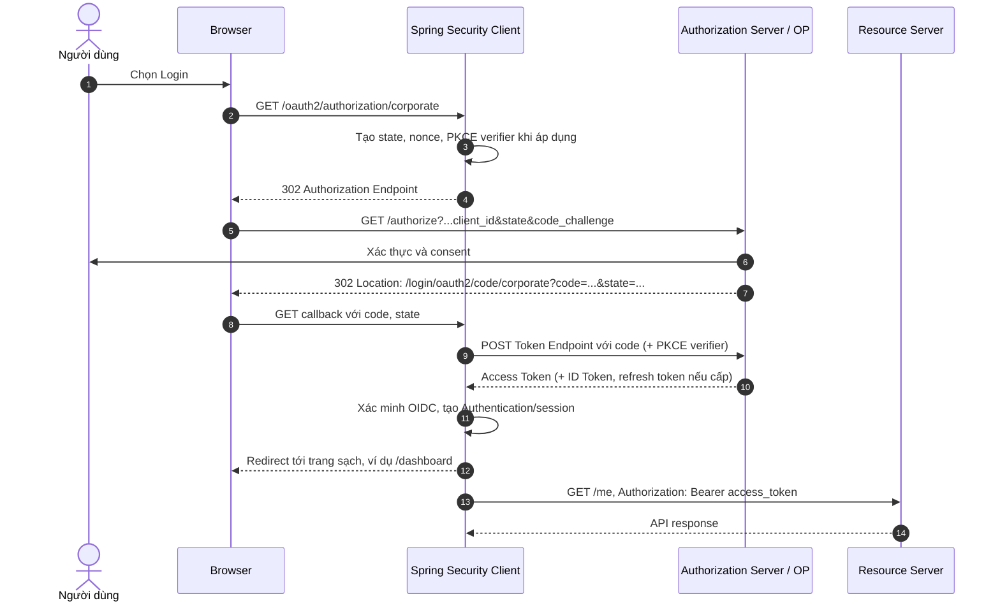

# 27.6. Rò rỉ authorization code hoặc token qua URL, log và referrer

> **Module:** Spring Security OAuth 2.0 OIDC Client  
> **Chương:** 27. Bảo mật tích hợp  
> **Phạm vi:** Spring Security OAuth 2.0 Client, OpenID Connect Login, browser redirect, HTTP gateway, application logs, observability và bảo vệ credentials trong toàn bộ Authorization Code Flow.

OAuth 2.0 và OpenID Connect (OIDC) dựa trên nhiều loại thông tin nhạy cảm: authorization code, access token, refresh token, ID token, `state`, `nonce`, PKCE `code_verifier` và Client credentials. Dù một hệ thống đã xác minh đúng chữ ký ID Token và dùng HTTPS, dữ liệu vẫn có thể bị lộ nếu được đặt trong URL, ghi vào access log, gửi qua referrer, thu thập bởi analytics hoặc lưu trong APM traces.

Có một điểm dễ nhầm: **Authorization Code Flow thông thường thực sự đưa `code` vào query string của redirect callback**. Điều đó được giao thức cho phép. Nhưng mã này phải sống ngắn, dùng một lần, bị ràng buộc với Client/redirect URI và được bảo vệ bởi PKCE khi phù hợp. Ứng dụng phải tránh để URL chứa `code` bị lưu hoặc phát tán hơn mức cần thiết.

Ngược lại, **access token và refresh token không nên được đưa vào URL để gọi API, redirect hoặc chia sẻ liên kết**. Bearer token là credential: ai sở hữu token và đáp ứng điều kiện chấp nhận của Resource Server có thể sử dụng quyền của token đó, kể cả khi không biết mật khẩu người dùng.

Bài học tập trung vào cách nhận biết từng đường rò rỉ, mức độ nguy hiểm, biện pháp phòng ngừa trong Spring Security/Servlet/WebFlux, hạ tầng proxy và hệ thống logging, cùng cách phản ứng khi đã xảy ra sự cố.

---

## 1. Mục tiêu học tập

Sau bài này, bạn có thể:

1. Giải thích sự khác nhau giữa authorization code, access token, refresh token, ID token, `state` và PKCE `code_verifier`.
2. Chỉ ra vị trí authorization code xuất hiện hợp lệ trong redirect của Authorization Code Flow.
3. Hiểu vì sao token trong URL query, path hoặc fragment có thể bị lộ qua các hệ thống khác nhau.
4. Phân biệt `Referer` HTTP header với `Referrer-Policy` response header.
5. Hiểu giới hạn của chính sách referrer mặc định hiện đại và lý do vẫn cần giảm thiểu bề mặt rò rỉ.
6. Nhận diện những logs nhạy cảm tại NGINX, ingress, API gateway, Spring Boot, Servlet container, APM, tracing và browser analytics.
7. Dùng Authorization Code + PKCE S256, `state`, OIDC `nonce` và redirect URI validation theo đúng vai trò.
8. Cấu hình `Referrer-Policy`, cache headers và redirect sau callback theo threat model.
9. Gọi Resource Server bằng `Authorization: Bearer ...` thay vì query parameter.
10. Tránh rò rỉ credentials qua exception messages, DEBUG/wiretap logging và HTTP body/header logging.
11. Hiểu rủi ro riêng của `id_token_hint` trong OIDC RP-Initiated Logout.
12. Thiết kế cách giảm logging nhạy cảm mà vẫn duy trì khả năng quan sát lỗi.
13. Lập kế hoạch kiểm thử bảo vệ URL/log/referrer mà không dùng token production.
14. Phân loại sự cố, revoke/rotate credentials và quản lý dữ liệu đã bị thu thập vào logs/backups.

## 2. Bản đồ những credential thường bị lẫn lộn

| Dữ liệu | Mục đích | Nơi xuất hiện đúng | Nếu bị lộ |
|---|---|---|---|
| **Authorization code** | Được Client đổi lấy token ở Token Endpoint | Callback redirect trong Authorization Code Flow; tiếp theo nằm trong token request | Có thể bị dùng để tranh đổi token nếu các ràng buộc khác cũng bị vượt qua |
| **Access token** | Cấp quyền truy cập API | HTTP `Authorization: Bearer ...` tới Resource Server đúng audience | Có thể bị replay cho tới khi hết hạn/thu hồi, tùy sender constraints |
| **Refresh token** | Xin access token mới | Storage bảo vệ của Client; body của refresh grant gửi AS | Rủi ro truy cập kéo dài, rotation/replay và thu hồi grant |
| **ID token** | Cung cấp kết quả xác thực OIDC cho Client | Token response và OIDC principal/trạng thái server-side theo thiết kế | Có thể lộ claims cá nhân, session context; không phải Bearer API token chung |
| **state** | Correlate authorization request/response, chống CSRF/mix-up theo thiết kế | Authorization Request và callback, gắn với transaction an toàn | Bị lộ có thể giảm bảo vệ nếu còn các lỗ hổng khác; không thay thế access token |
| **nonce** | Gắn ID Token với OIDC authentication request | Authorization Request và xác minh ID Token | Khi xử lý sai có thể tạo rủi ro replay/mix-up |
| **PKCE code_verifier** | Chứng minh Client khởi tạo Authorization Request | Client giữ bí mật theo phạm vi thích hợp, gửi **Token Endpoint** | Nếu lộ cùng code có thể phá lợi ích của PKCE |
| **Client secret/private key** | Xác thực confidential Client | Secret manager, Token Endpoint authentication | Có thể cho phép mạo danh Client; cần rotation |

**Không đánh đồng mức độ ảnh hưởng của các giá trị này.** Một `state` bị xuất hiện trong callback không có nghĩa attacker lập tức sở hữu access token; nhưng việc thu thập state/callback URL vẫn mở ra thông tin để ghép các cuộc tấn công và phải được hạn chế.

### 2.1. ID token không tự tương đương access token

ID Token phục vụ OIDC Client xác minh authentication. Một Resource Server thông thường phải nhận **access token** thích hợp, kiểm tra issuer/audience/claims theo protocol của nó. Không sử dụng ID Token để gọi API thay access token hoặc coi việc log ID Token là vô hại vì “nó không phải API token”: ID Token có thể chứa email, subject, nhóm và các claims nhạy cảm.

## 3. Đường đi của Authorization Code Flow

Ví dụ một browser login qua OIDC:



Điểm xuất hiện URL nhạy cảm tự nhiên là callback:

```http
GET /login/oauth2/code/corporate?code=<redacted>&state=<redacted> HTTP/1.1
Host: app.example.test
```

Đây không phải bằng chứng cấu hình sai. Sai lầm là **để callback URL tiếp tục đi vào logs, giao diện HTML, analytics, third-party requests hoặc redirects không kiểm soát**.

## 4. Authorization code có phải bearer token không?

Authorization code là một credential giao dịch, không phải access token. Nó thường:

- Có thời hạn ngắn.
- Chỉ được sử dụng một lần.
- Gắn với Client/authorization request.
- Gắn với redirect URI và token request semantics.
- Phải được kết hợp với PKCE verifier khi luồng có PKCE.
- Có thể yêu cầu Client authentication nếu là confidential Client.

Điều đó **giảm** khả năng kẻ nhận được code ngoài ý muốn đổi nó thành token, nhưng **không làm việc lộ code trở thành vô hại**.

### 4.1. Các trường hợp code lộ vẫn đáng lo

- Client public không triển khai PKCE hoặc dùng PKCE sai.
- `code_verifier` cũng bị ghi log/lộ cùng code.
- Client secret bị lộ cùng thông tin code/redirect.
- Attackers kiểm soát callback hoặc có lỗ hổng token exchange/confused deputy.
- Authorization server không thực thi one-time use hoặc redirect/PKCE binding đúng.
- APM/analytics thu thập code, state và các dấu vết đủ để điều tra phiên.

Phải coi code là dữ liệu nhạy cảm, dù rủi ro thấp hơn refresh token trong nhiều tình huống.

## 5. Vì sao URL là bề mặt rò rỉ đặc biệt?

URL thường được sao chép và quan sát bởi nhiều thành phần hơn body/header:

1. Browser address bar và history.
2. Bookmarks, clipboard, link sharing.
3. Browser extensions.
4. Reverse proxy/ingress access logs.
5. API gateway, WAF, CDN và load balancer.
6. Servlet container access logs.
7. APM HTTP transaction names và tracing attributes.
8. Error reports, screenshots, bug-report attachments.
9. Analytics scripts, RUM SDK và third-party trackers.
10. `Referer` header khi trang có URL nhạy cảm tải tài nguyên hoặc điều hướng.
11. HTTP redirect `Location` headers bị ghi log.
12. Caches và monitoring systems được cấu hình không phù hợp.

HTTPS bảo vệ dữ liệu trên đường truyền với các endpoints tin cậy; nó **không tự ngăn** URL bị lưu ở browser, proxy TLS termination, application logs, APM hoặc analytics.

### 5.1. URL query, path và fragment khác nhau

| Vị trí | Ví dụ minh họa | Được gửi trong HTTP request tới server? | Rủi ro |
|---|---|---|---|
| Query | `/callback?code=<redacted>` | Có | Access logs, proxy, referrer, browser history |
| Path | `/token/<redacted>` | Có | Logs, routing, tracing, referrer, bookmarks |
| Fragment | `/callback#access_token=<redacted>` | Không gửi trong request HTTP thông thường | Browser history/JS/extension, client-side analytics |
| Header | `Authorization: Bearer <redacted>` | Có, trong header | Rò nếu HTTP header logging; nhưng không mặc nhiên nằm trong URL |
| Form/JSON body | Token request body | Có, trong body | Rò nếu body logging; không tự xuất hiện trong URL |

**Đừng hiểu “fragment không gửi tới server” là “fragment an toàn”.** JavaScript trong trang có thể đọc `location.hash`, extension có thể xem URL, và frontend telemetry có thể vô tình thu thập fragment. Legacy Implicit Flow dùng fragment để trả access token, nhưng không phải lựa chọn khuyến nghị cho kiến trúc mới.

## 6. Referrer và Referer: viết khác nhau nhưng liên quan

HTTP header lịch sử có tên **`Referer`** (không phải `Referrer`). Nó báo URL nguồn của một navigation/resource request theo policy trình duyệt.

Response header điều khiển hành vi là **`Referrer-Policy`**.

Ví dụ một trang callback chưa được làm sạch có URL:

```text
https://app.example.test/login/oauth2/code/corporate?code=SECRET&state=VALUE
```

Nếu trang tại URL đó tải:

```text
https://analytics.example.net/collect
```

thì referrer có thể tiết lộ thông tin URL nguồn, tùy browser policy, scheme và hướng navigation.

**Không khẳng định mọi browser hiện đại luôn gửi nguyên query string tới website khác.** Default phổ biến hiện nay là `strict-origin-when-cross-origin`, chỉ gửi origin cho nhiều cross-origin HTTPS requests; nhưng same-origin navigation vẫn có thể giữ path/query, các policy khác có thể cho phép nhiều hơn và hệ thống analytics vẫn có thể thu thập `window.location.href` một cách độc lập.

### 6.1. Một ví dụ same-origin

Trang callback có query code và tải:

```http
GET /assets/app.js HTTP/1.1
Host: app.example.test
Referer: https://app.example.test/login/oauth2/code/corporate?code=<redacted>&state=<redacted>
```

Với một số referrer policies, **same-origin** có thể gửi URL đầy đủ bao gồm query, và server phục vụ assets có thể lưu nó vào access logs.

### 6.2. Một ví dụ cross-origin

Dưới `strict-origin-when-cross-origin`, request từ HTTPS RP tới HTTPS analytics khác origin thường có referrer chỉ gồm:

```http
Referer: https://app.example.test/
```

nhưng đây không phải lý do bỏ kiểm soát: policy có thể khác ở các client cũ/cấu hình riêng, redirects có thể đổi hành vi, và analytics SDK vẫn có thể gửi full URL trong **payload riêng**.

## 7. Các Referrer-Policy thường gặp

| Policy | Tác động khái quát | Phù hợp với trang OAuth2 callback? |
|---|---|---|
| `no-referrer` | Không gửi Referer | **Rất phù hợp** để giảm rủi ro lộ callback URL |
| `same-origin` | Chỉ gửi referrer khi cùng origin | Vẫn có thể lộ query trong same-origin logs |
| `strict-origin-when-cross-origin` | Thường full URL same-origin, origin cross-origin HTTPS→HTTPS | Hữu ích mặc định nhưng không loại bỏ mọi rò rỉ |
| `origin` | Gửi origin, không gửi path/query | Giảm rò rỉ query, vẫn tiết lộ origin |
| `origin-when-cross-origin` | Full URL same-origin, origin cross-origin | Còn rủi ro same-origin |
| `unsafe-url` | Có thể gửi URL đầy đủ rộng hơn | **Không dùng** trên các trang chứa OAuth credentials |

Hành vi còn phụ thuộc browser, protocol downgrade và chính sách tổng thể. Nếu threat model yêu cầu tránh phát tán callback URL, chọn `Referrer-Policy: no-referrer` cho endpoints/flow nhạy cảm hoặc global policy chặt chẽ.

### 7.1. Referrer policy không giải quyết toàn bộ logging

Dù `no-referrer`, callback URL vẫn có thể nằm trong:

- RP ingress/access logs;
- browser history;
- reverse proxy;
- APM transaction attributes;
- logs của Spring filter;
- HTTP request telemetry.

Vì vậy, cần **làm sạch URL và redaction ở từng lớp**, không chỉ thêm một HTTP header.

## 8. Cấu hình Referrer-Policy trong Spring Security Servlet

Ví dụ cấu hình response header ở Spring Security:

```java
package example.security;

import org.springframework.context.annotation.Bean;
import org.springframework.context.annotation.Configuration;
import org.springframework.security.config.Customizer;
import org.springframework.security.config.annotation.web.builders.HttpSecurity;
import org.springframework.security.web.SecurityFilterChain;
import org.springframework.security.web.header.writers.ReferrerPolicyHeaderWriter.ReferrerPolicy;

@Configuration
public class BrowserSecurityConfig {

    @Bean
    SecurityFilterChain securityFilterChain(HttpSecurity http)
            throws Exception {

        return http
            .authorizeHttpRequests(auth -> auth
                .requestMatchers("/", "/error", "/signed-out").permitAll()
                .anyRequest().authenticated()
            )
            .oauth2Login(Customizer.withDefaults())
            .headers(headers -> headers
                .referrerPolicy(referrer -> referrer
                    .policy(ReferrerPolicy.NO_REFERRER)
                )
            )
            .build();
    }
}
```

Đoạn code dùng Spring Security Servlet 6.x theo cấu trúc DSL thông dụng. Tùy project/version, cần kiểm tra API tương ứng.

### 8.1. Vì sao có thể đặt global no-referrer?

Global policy làm giảm nguy cơ quên một trang callback/logout/diagnostic nào đó. Tuy nhiên, nó có thể ảnh hưởng analytics hoặc một số flow yêu cầu referrer. Nếu sản phẩm cần policy khác trên các trang bình thường, hãy áp chính sách chặt cho nhóm routes nhạy cảm và kiểm tra response headers trong mọi nhánh redirect/error.

### 8.2. Đừng quên proxy/CDN có thể ghi đè header

Nếu ingress/CDN thêm hoặc sửa `Referrer-Policy`, header cuối mà browser nhận có thể khác cấu hình Spring. Kiểm tra **HTTP response thực tế** tại biên Internet, không chỉ đọc code.

### 8.3. Browser referrer policy không phải CSRF protection

`Referrer-Policy: no-referrer` không thay được `state` của OAuth2, `nonce` của OIDC hay CSRF token của các state-changing endpoints. Các cơ chế giải quyết những vấn đề khác nhau.

## 9. Redirect ngay về URL sạch sau callback

Một biện pháp quan trọng là để Spring Security xử lý callback rồi đưa browser sang URL không chứa code/state:

```text
/login/oauth2/code/corporate?code=<redacted>&state=<redacted>
    |
    v
Spring Security xử lý authorization response
    |
    v
HTTP 302/303 đến /dashboard
    |
    v
Browser hiển thị URL sạch /dashboard
```

Với OAuth2 Login thông thường, Spring Security xử lý callback trong filter, tạo Authentication/session rồi chuyển hướng theo success handler. Không cần render HTML cho callback chứa code.

### 9.1. Không render một trang callback nhiều third-party assets

Tránh:

```html
<!-- PHẢN VÍ DỤ về kiến trúc callback -->
<script src="https://analytics.example.net/tag.js"></script>
<script>
  sendAnalytics({ currentUrl: window.location.href });
</script>
```

Nếu callback URL còn chứa `code`/`state`, telemetry có thể thu chúng. Tốt nhất callback là endpoint xử lý giao thức và **redirect nhanh sang URL sạch** trước khi tải scripts và analytics không cần thiết.

### 9.2. History vẫn có thể lưu navigation

Redirect giúp giảm thời gian URL nhạy cảm xuất hiện và tránh render trang có code, nhưng không tự bảo đảm browser history, browser telemetry hoặc tất cả network logs không còn dấu vết callback. Cần giữ toàn bộ các biện pháp bảo vệ khác.

### 9.3. Không tin return URL từ query

Nếu success handler nhận `?next=https://attacker.example` rồi redirect không allowlist, nó tạo open redirect và có thể phát tán thông tin phiên hoặc làm user rời trusted origin.

Return-to URL nên là relative internal path hoặc allowlist, được liên kết với authorization transaction một cách đáng tin và không chứa token.

## 10. Cache-Control trên callback và response có credential

Browser/proxy caching có thể giữ dữ liệu nhạy cảm, nhất là khi ứng dụng tự tạo HTML/JSON tại callback.

Một policy thường dùng trên response nhạy cảm:

```http
Cache-Control: no-store
Pragma: no-cache
Referrer-Policy: no-referrer
```

`no-store` yêu cầu caches không lưu response theo semantics HTTP. Nó không bảo đảm browser history, access logs và APM không ghi URL hoặc request metadata.

### 10.1. Cache header không che query string

Nếu request URL là:

```text
/login/oauth2/code/corporate?code=<redacted>
```

và proxy đã log `request_uri` trước khi trả response, header `Cache-Control: no-store` **không xóa log đó**.

### 10.2. Không trả token trong HTML hay redirect Location

Không để access token xuất hiện trong:

- Redirect URL, query hoặc path;
- HTML response/screenshot/debug page;
- JavaScript inline chứa token;
- Cookie có thuộc tính không phù hợp;
- Response headers được log rộng rãi nếu không cần.

Đối với server-side OAuth2 Client, lưu authorized client/tokens ở storage server-side bảo vệ thay vì phát token sang frontend chỉ để điều hướng.

## 11. Authorization Code + PKCE S256

**PKCE** (Proof Key for Code Exchange) giúp giảm nguy cơ authorization code bị kẻ thứ ba thu được rồi đổi lấy token.

Sơ đồ:

```text
Client tạo ngẫu nhiên code_verifier
  |
  +-> Tính code_challenge = BASE64URL(SHA256(code_verifier))
  |
  +-> Authorization Request:
  |     code_challenge=...
  |     code_challenge_method=S256
  |
  +-> Callback nhận code
  |
  +-> Token Request:
        code=...
        code_verifier=<giá trị gốc, chỉ gửi tới Token Endpoint>
```

AS kiểm tra verifier tạo ra challenge đã gắn với authorization request. Nếu attacker chỉ có authorization code mà **không** có verifier, họ không thể đổi code thành token tại AS tuân thủ PKCE.

### 11.1. PKCE không làm authorization code public được

PKCE không bảo vệ nếu:

- Verifier bị ghi log/lộ cùng code;
- Implementation vô hiệu hóa validation;
- Attacker kiểm soát Client storage/process;
- Authorization Request/redirect flow có lỗ hổng khác.

Cần cả PKCE, state, trusted redirect URI, TLS và secret handling.

### 11.2. Vì sao dùng S256, không dùng plain khi có thể?

`S256` không tiết lộ verifier trực tiếp thông qua challenge. `plain` cho phép challenge bằng verifier, làm giảm lợi ích chống code interception ở những môi trường quan sát authorization request. Ưu tiên `S256` theo security best practices và OP capabilities.

## 12. PKCE trong Spring Security Client

Spring Security có cơ chế tạo/verifier PKCE cho những flows phù hợp. Với Servlet `DefaultOAuth2AuthorizationRequestResolver`, có thể sử dụng customizer của framework trong phiên bản hỗ trợ:

```java
import org.springframework.security.oauth2.client.web.DefaultOAuth2AuthorizationRequestResolver;
import org.springframework.security.oauth2.client.web.OAuth2AuthorizationRequestCustomizers;

DefaultOAuth2AuthorizationRequestResolver resolver =
    new DefaultOAuth2AuthorizationRequestResolver(
        clientRegistrationRepository,
        "/oauth2/authorization"
    );

resolver.setAuthorizationRequestCustomizer(
    OAuth2AuthorizationRequestCustomizers.withPkce()
);
```

**Lưu ý:** chính sách PKCE mặc định của Spring Security thay đổi theo client type/version và thông số Client registration. Khi cần enforce PKCE cho confidential Client, kiểm tra behavior thực tế với version đang dùng và OP hỗ trợ, không chỉ suy từ cấu hình `client-secret`.

### 12.1. Điều cần kiểm thử

Trong authorization redirect:

```text
code_challenge=...
code_challenge_method=S256
```

Trong Token Endpoint request:

```text
code_verifier=...
```

Nhưng tuyệt đối **không xuất các giá trị thật trong logs test production**. Dùng test fixtures hoặc chỉ kiểm tra sự tồn tại/cấu trúc. Nếu dùng custom resolver, giữ attributes của authorization request gốc để Token Request vẫn có verifier.

## 13. State và OIDC nonce không thay PKCE

Ba cơ chế:

| Cơ chế | Câu hỏi nó trả lời |
|---|---|
| `state` | Authorization response có liên quan tới request đã bắt đầu không, giúp chống CSRF/mix-up theo contract? |
| `nonce` | ID Token có thuộc OIDC authentication request hiện tại không? |
| PKCE | Client đổi authorization code có chứng minh đã tạo challenge tương ứng không? |

Một ứng dụng có thể dùng cả ba. Không được:

- Thay `state` bằng tên tenant hoặc user ID dễ đoán.
- Cho browser tự chọn `nonce` rồi bỏ xác minh.
- Ghi `code_verifier` vào query URL để “debug”.
- Tắt PKCE chỉ vì đã có Client secret.
- Bỏ state verification khi callback vẫn hoạt động bình thường trong lab.

### 13.1. Giao dịch nhiều tabs

Hai tabs có thể mở hai OAuth2 logins cùng lúc. Nếu ứng dụng lưu một biến session `currentState` đơn lẻ rồi ghi đè, flow cũ có thể thất bại hoặc bị nhầm. Dùng authorization request repository/correlation của Spring Security và kiểm thử concurrent attempts.

## 14. Redirect URI phải được kiểm soát

Một authorization code thường gắn với Client và redirect URI theo yêu cầu OAuth2. Điều này giúp ngăn kẻ thứ ba đổi code ở endpoint khác.

Cần:

- Đăng ký redirect URI chính xác với AS.
- Tránh wildcard redirect thiếu kiểm soát.
- Không sinh redirect URI từ Host/header chưa được xác minh.
- Không cho query `redirect_uri=https://evil.example` ghi đè registration.
- Xử lý `{baseUrl}` đúng khi sau reverse proxy.
- Không nhầm post-login redirect URL với OAuth2 redirect URI.

### 14.1. Open redirect trên RP

Giả sử RP có:

```text
https://app.example.test/redirect?next=https://attacker.example
```

và AS cho phép URI đó làm redirect target. Một open redirect có thể làm mã hoặc thông tin giao dịch rời trusted origin tùy flow. Validate URLs theo allowlist, ưu tiên relative paths và tránh dùng redirector mở làm OAuth2 callback.

## 15. Không đặt access token trong query parameter

Phản ví dụ:

```http
GET /api/reports?access_token=<redacted> HTTP/1.1
Host: api.example.test
```

Ngay cả khi server chấp nhận, URL này có thể bị log, copy, bookmark, cache hoặc chia sẻ.

Đúng hướng cho Bearer token:

```http
GET /api/reports HTTP/1.1
Host: api.example.test
Authorization: Bearer <redacted>
Accept: application/json
```

RFC 6750 mô tả các phương thức truyền Bearer token, bao gồm Authorization header và một số dạng khác; nhưng URI query method **không được khuyến nghị** vì những rủi ro bảo mật. Trong tích hợp mới, dùng Authorization header và HTTPS.

### 15.1. Header cũng cần bảo vệ

`Authorization: Bearer ...` giảm nguy cơ phát tán qua URL/referrer, nhưng nếu APM/proxy bật HTTP header logging toàn phần, token vẫn có thể bị lộ.

**Dùng header không thay thế redaction.**

## 16. WebClient gọi API đúng cách

Ví dụ gọi API sau khi đã có `OAuth2AuthorizedClient` phù hợp:

```java
import org.springframework.web.reactive.function.client.WebClient;
import org.springframework.security.oauth2.client.OAuth2AuthorizedClient;
import reactor.core.publisher.Mono;

Mono<Report> loadReport(
        WebClient webClient,
        OAuth2AuthorizedClient authorizedClient) {

    String accessToken =
        authorizedClient.getAccessToken().getTokenValue();

    return webClient.get()
        .uri("https://api.example.test/reports/current")
        .headers(headers -> headers.setBearerAuth(accessToken))
        .retrieve()
        .bodyToMono(Report.class);
}
```

Ở đây:

- Token nằm trong Authorization header.
- URL không chứa token.
- Client cần xác nhận API destination/audience/scopes là đúng.
- Không ghi `accessToken` vào log hoặc exception message.
- Không gửi token qua các redirects tới hostname không đáng tin.

Trong ứng dụng Spring Security reactive, có thể tích hợp OAuth2-aware `WebClient` filter/authorized client manager thay vì tự lấy token, miễn là registration và API target được kiểm soát.

### 16.1. Tránh token ở WebClient baseUrl

Không tạo:

```java
// PHẢN VÍ DỤ:
WebClient client = WebClient.create(
    "https://api.example.test?access_token=" + token
);
```

Vì URL sẽ bị giữ trong logs/tracing và request URI. Không dùng token như path segment, kể cả khi đã URL-encoded.

## 17. Access token trong URL fragment: bài học từ Implicit Flow

Legacy OAuth2 Implicit Flow có thể trả access token bằng URL fragment:

```text
https://spa.example.test/callback#access_token=<redacted>
```

Fragment không được gửi trong HTTP request bình thường tới server nhưng vẫn có nguy cơ:

- JavaScript đọc `window.location.hash`.
- Third-party scripts và XSS đọc token.
- Browser extensions/telemetry quan sát URL.
- Token nằm trong lịch sử/copy/share links.
- Không có token exchange kiểu Authorization Code + PKCE.
- Khó quản lý token lifecycle/refresh an toàn trong browser.

Với ứng dụng hiện đại, ưu tiên **Authorization Code + PKCE** cho browser/public clients và kiến trúc BFF/server-side khi phù hợp. Không xây tích hợp mới dựa trên việc access token xuất hiện trong URL fragment.

### 17.1. URL fragment không được gửi trong Referer thông thường

Theo browser referrer semantics, fragments không được gửi trong `Referer` header, nhưng điều đó không bảo vệ token khỏi JavaScript/analytics đọc URL rồi gửi riêng. Phân biệt **referrer header leakage** và **client-side data exfiltration**.

## 18. Refresh token trong URL còn nguy hiểm hơn

Refresh token có thể dùng để xin access tokens mới nhiều lần, tùy AS policy, expiry, rotation và sender constraints.

Không đặt refresh token vào:

- Query của trang web.
- QR code dùng như URL đăng nhập.
- Redirect Location.
- Local browser links/bookmarks.
- JavaScript error reports.
- Access logs hoặc APM spans.
- Client-side analytics.
- Session cookie plaintext mà JavaScript có thể đọc.

Nên lưu server-side với encryption/access controls/retention phù hợp, hoặc trong cơ chế lưu trữ được thiết kế đúng theo loại OAuth2 Client. Nếu refresh token bị lộ, cần xem xét revoke, rotation, token family và các phiên/liên kết liên quan.

## 19. OIDC id_token_hint trong logout URL

OIDC RP-Initiated Logout có thể sử dụng `id_token_hint` trong request tới OP end-session endpoint. Tùy OP, tham số này có thể nằm trong URL query của browser redirect:

```text
https://login.example.test/logout?id_token_hint=<redacted>&post_logout_redirect_uri=...
```

Điều này khác access token trong query API, nhưng **ID Token vẫn có thể chứa dữ liệu nhận dạng nhạy cảm** và URL vẫn có thể đi vào history, referrer hoặc logs.

### 19.1. Những biện pháp cần có

- Dùng handler OIDC của Spring Security khi phù hợp, thay vì tự ghép logout URL.
- Chỉ redirect tới end-session endpoint đã được OP công bố/cho phép.
- Dùng HTTPS.
- Dùng strict Referrer-Policy trên RP và phối hợp với OP nếu có thể.
- Không log `Location` header đầy đủ chứa `id_token_hint`.
- Không truyền ID Token tới third-party website không phải OP.
- Chỉ lưu ID Token phục vụ nhu cầu đã xác định và theo retention policy.

### 19.2. Không thể cam kết OP không ghi log

RP có thể giảm dữ liệu bị lộ trong logs của chính mình, nhưng không trực tiếp quản lý mọi hệ thống của OP. Khi sử dụng giao thức yêu cầu gửi một token tới OP, cần đánh giá chính sách logs/retention của nhà cung cấp và capabilities của họ.

## 20. Rò rỉ qua reverse proxy, NGINX và ingress

Một cấu hình NGINX thường dùng:

```nginx
log_format risky '$remote_addr "$request" $status';
```

Biến `$request` thường chứa request line, có thể bao gồm query:

```text
GET /login/oauth2/code/corporate?code=<redacted>&state=<redacted> HTTP/1.1
```

Biến `$request_uri` cũng thường bao gồm query string. Với callback OAuth2, đây là nơi rò rỉ rõ ràng.

### 20.1. Một mẫu log tránh query string

Ví dụ ở mức minh họa:

```nginx
log_format oauth_safe
    '$remote_addr "$request_method $uri" $status '
    'request_time=$request_time';
access_log /var/log/nginx/access.log oauth_safe;
```

Trong NGINX, `$uri` biểu thị đường dẫn URI đã được chuẩn hóa theo context server, **không bao gồm query string**, khác `$request_uri` và `$args`.

Nhưng lưu ý:

- Nếu ứng dụng đặt token trong **path**, mẫu này vẫn lộ token.
- Nếu có path chứa PII nhạy cảm, cần masking riêng.
- Proxy error logs/tracing/WAF/CDN có thể vẫn log query.
- Không phải mọi deployment đều dùng NGINX; kiểm tra load balancer và ingress controller cụ thể.
- Phải đảm bảo logging vẫn có metrics HTTP cần thiết mà không giữ credential.

### 20.2. Đừng chỉ tắt access log rồi quên WAF/APM

Trong hệ thống có CDN → WAF → ingress → service mesh → Spring Boot, mỗi lớp có thể log request riêng. Một thay đổi ở NGINX không tự làm an toàn:

```text
CDN request log
WAF event log
Ingress access log
Service mesh trace
Servlet container access log
Application filter log
APM transaction span
Error reporter
```

Lập sơ đồ đường đi của request callback và điểm có thể ghi `queryString` hoặc `fullUrl`.

## 21. Servlet container access logs

Tomcat, Jetty hoặc Undertow có thể ghi request target theo pattern riêng. Trong Tomcat access log, pattern chứa request line có thể gồm query string; các trường request URI, query string và request line phải được phân biệt.

### 21.1. Điểm cấu hình cần kiểm tra

- Pattern có chứa raw request line không?
- Query string có được nối vào URI không?
- Cookie/header logging có được bật không?
- Container error logs có in URL đầy đủ khi 4xx/5xx không?
- Access logs có được forward sang SIEM không?
- Logs retention và ai được quyền truy cập?
- Có lọc riêng các callback paths như `/login/oauth2/code/*` không?

Không mặc định rằng framework đã redacted code/state ở tầng container. Hành vi là thuộc cấu hình log thực tế.

## 22. Spring Boot request logging nguy hiểm ở đâu?

Một vài loại logging/debug phổ biến có thể lộ credentials:

- `CommonsRequestLoggingFilter` nếu bật query string.
- Custom `OncePerRequestFilter` in `request.getRequestURL() + "?" + request.getQueryString()`.
- `HandlerInterceptor` hoặc exception handler in toàn bộ URI.
- Access denied/authentication failure logger gắn raw request.
- HTTP tracing với URL đầy đủ.
- Controller tự log `Authorization` header hoặc `OAuth2AuthorizedClient`.
- DEBUG/wiretap logs của HTTP clients.

Phản ví dụ:

```java
// PHẢN VÍ DỤ: đẩy code/state vào log của ứng dụng.
log.info("incoming URL: {}?{}",
    request.getRequestURL(),
    request.getQueryString());
```

Một cấu hình log tốt nên ghi:

```text
event=oauth2_callback
route=/login/oauth2/code/{registrationId}
registrationId=corporate
result=success
durationMs=240
correlationId=opaque-event-123
authorizationCode=[not-logged]
state=[not-logged]
```

**Không** ghi raw state hoặc toàn bộ session ID chỉ để correlate. Dùng opaque server-generated log correlation ID riêng và privacy policy.

## 23. Structured logging và allowlist trường

Redaction bằng cách thay một vài regex có thể hữu ích, nhưng nhược điểm:

- Token có thể mang tên `id_token`, `refresh_token`, `auth_code`, `authorization`.
- URL encoded values có thể không khớp regex.
- Token có thể nằm trong nested JSON, exception causes hoặc response headers.
- APM có thể lấy raw value trước lớp redaction.
- Custom API có tên token fields khác.

**Ưu tiên allowlist fields**: chỉ ghi những trường đã đánh giá an toàn.

Ví dụ:

```java
log.info("oauth_login_result registrationId={} outcome={} traceId={}",
    registrationId,
    "success",
    safeCorrelationId);
```

Thay vì:

```java
// PHẢN VÍ DỤ:
log.info("callback request={} principal={} token={}",
    request, authentication, authorizedClient);
```

### 23.1. Không log toàn bộ exception object một cách mù quáng

Một số HTTP client exceptions có message hoặc body chứa URL, headers hoặc token values. Khi log exceptions, cần biết loại exception và định dạng dữ liệu từ library.

Giữ stack trace phục vụ xử lý lỗi, nhưng loại bỏ credentials khỏi messages/tags và đảm bảo access controls/retention. Không thay bằng “không log gì” khiến sự cố không thể điều tra.

## 24. APM, tracing và analytics

APM agents thường có khả năng thu:

- HTTP URL đầy đủ.
- Path và query string.
- Request/response headers.
- HTTP body.
- Baggage, tags, span attributes.
- Exception messages.
- Browser RUM `window.location.href`.
- Session replay recordings.

Các SDK/configuration khác nhau nên không có một API redaction chung áp dụng cho mọi vendor.

### 24.1. Quy tắc chung

1. **Tránh thu raw query string** trên OAuth callback, logout và Token Endpoint.
2. Không thu `Authorization`/`Cookie`/`Set-Cookie` hoặc Client credentials.
3. Làm sạch những URLs trong span names và attributes.
4. Không gắn access token, `code`, `state`, `code_verifier` thành trace tags.
5. Disable hoặc hạn chế session replay trên trang login/callback.
6. Tách dữ liệu operational cần thiết khỏi secrets.
7. Kiểm soát quyền xem và retention của telemetry.
8. Kiểm tra exporters và downstream dashboards, không chỉ agent gốc.

### 24.2. Analytics JavaScript đọc URL trực tiếp

Ngay cả khi `Referrer-Policy: no-referrer`, script có thể gửi:

```javascript
// PHẢN VÍ DỤ: analytics gửi full URL callback tới bên thứ ba.
analytics.track("page_view", {
  url: window.location.href
});
```

Vì vậy policy không thay thế quyết định **không render/không chạy analytics trên callback URL chứa code**. Redirect về trang sạch trước, rồi mới gọi analytics nếu phù hợp.

## 25. Error pages và debugging tools

Một ứng dụng có thể xử lý callback lỗi bằng cách render trang:

```text
OAuth2 login failed: /login/oauth2/code/corporate?code=...&state=...
```

Nếu lỗi xuất hiện trong HTML, screenshot, ticket support hoặc công cụ session replay, credential đi xa hơn request ban đầu.

Trang lỗi nên hiển thị message an toàn:

```text
Không thể hoàn tất đăng nhập. Vui lòng thử lại.
Mã tham chiếu hỗ trợ: EVT-42C7
```

Và server log metadata an toàn như registration ID, nhóm nguyên nhân và correlation ID.

### 25.1. Không cho user copy raw callback URL vào ticket

Khi cần debug, yêu cầu người dùng chia sẻ mã lỗi/correlation ID hoặc screenshot đã che URL, **không** yêu cầu dán link callback chứa code/state/ID Token. Support agent cần có hướng dẫn xử lý dữ liệu nhạy cảm.

## 26. Token leakage qua HTTP redirects

Một Bearer token có thể bị gửi sai đích nếu HTTP client tự động follow redirect tới domain khác mà vẫn chuyển tiếp header nhạy cảm.

Ví dụ:

```text
Client gọi https://api-a.example.test/data
Authorization: Bearer token-for-A
API A trả 302 tới https://api-b.example.test/data
```

HTTP libraries có chính sách khác nhau về việc giữ/xóa Authorization header khi cross-origin redirects. Không mặc định client nào cũng an toàn trong mọi loại redirect.

### 26.1. Bảo vệ

- Chỉ gửi token cho API host và audience được cấu hình.
- Không follow redirects sang arbitrary destinations khi có credential.
- Kiểm tra redirect policy của `WebClient`/Reactor Netty hoặc HTTP client cụ thể.
- Không lấy target URI từ browser query rồi đính kèm Bearer token.
- Đảm bảo Host/domain allowlist, HTTPS và TLS validation.
- Log redirect target ở mức origin/route an toàn, không log token.

### 26.2. Không dùng access token của registration khác

Khi có nhiều OP/AS/Resource Servers, access token của API A không nên được gửi tới API B. Cần chọn `OAuth2AuthorizedClient` theo registration/principal/target đúng và kiểm tra audience. Đây là vấn đề confused deputy/token leakage, không chỉ lỗi HTTP.

## 27. Referrer leakage và third-party resources trên callback

Một rủi ro phổ biến là render HTML tại callback rồi tải:

- Fonts từ CDN ngoài.
- Tag manager.
- Analytics pixel.
- Customer support widget.
- Social media tracking.
- Error reporter script.
- Ad/marketing scripts.

Với policy lỏng, Referer có thể tiết lộ URL chứa code. Ngay cả với policy chặt, third-party scripts chạy trong chính origin page có thể xem `location.href` và gửi dữ liệu riêng.

**Quy tắc kiến trúc:** callback chỉ xử lý giao thức và redirect về URL sạch; tránh chạy third-party scripts tại URL chứa code.

### 27.1. CSP bổ trợ nhưng không thay Referrer-Policy

`Content-Security-Policy` giúp hạn chế nguồn scripts/resources và một số rủi ro XSS/exfiltration, nhưng không tự bảo đảm callback code không bị logged ở proxy. Referrer policy, CSP, logging controls và redirect đều là các lớp bổ trợ.

## 28. URL chứa token trong deep links và email

Một thiết kế sai thường gặp:

```text
https://app.example.test/open?access_token=<redacted>
```

được gửi qua email hoặc chat để “tự đăng nhập”. Link có thể được:

- Email security scanners mở trước.
- Browser/chat previews truy cập.
- Forward/share.
- Ghi vào proxy logs và analytics.
- Lưu trong history.

Đừng đưa OAuth access/refresh token vào deep link. Nếu sản phẩm cần một-time login link, đó là một giao thức riêng: token ngẫu nhiên, scope hẹp, TTL ngắn, one-time use, chống replay, xử lý scanner prefetch và không coi link đó là OAuth API token. Với các yêu cầu nhạy cảm, cần thêm kiểm tra danh tính/thiết bị.

## 29. Mã hóa URL không phải redaction

URL encoding:

```text
access_token=eyJ...
access_token=eyJ%2E...
```

không làm credential bí mật. Các proxies/servers/analytics có thể giải mã; người có log có thể khôi phục.

Tương tự, Base64 không phải mã hóa bảo mật. Không đưa token vào path, query hoặc fragment rồi tuyên bố an toàn vì đã encode hoặc hash một phần.

### 29.1. Hash token để correlation có được không?

Nếu cần nhận diện token trùng trong security telemetry, dùng một thiết kế fingerprint được đánh giá an toàn, chẳng hạn HMAC với secret quản lý riêng, không log token raw. Cân nhắc độ dài, sự khác biệt token type và khả năng tương quan người dùng. Không tự dùng hash trần của một token có entropy không chắc chắn để giải quyết vấn đề logging.

## 30. Authorization Request URL cũng có dữ liệu nhạy cảm

Authorization Request tới OP:

```text
/authorize?client_id=...&redirect_uri=...&scope=...&state=...&nonce=...&code_challenge=...
```

Không thường chứa access token, nhưng vẫn có các giá trị cần bảo vệ:

- `state` và `nonce` liên kết giao dịch.
- `login_hint` có thể chứa email hoặc định danh cá nhân.
- `acr_values`/`prompt` thể hiện security intent.
- `redirect_uri` có thể bộc lộ host/tenant.
- `request`/`request_uri` trong các profiles nâng cao có privacy implications.

Không lưu tràn lan Authorization Endpoint URL đầy đủ trong support logs. Đặc biệt tránh log PKCE verifier nếu ứng dụng từng đưa nó vào custom params sai chỗ.

## 31. Token Endpoint logging

Token Request thường là POST form:

```http
POST /oauth2/token HTTP/1.1
Host: login.example.test
Content-Type: application/x-www-form-urlencoded
Authorization: Basic <redacted-client-authentication>

grant_type=authorization_code&code=<redacted>&redirect_uri=<encoded>&code_verifier=<redacted>
```

Token response có thể chứa:

```json
{
  "access_token": "<redacted>",
  "token_type": "Bearer",
  "expires_in": 300,
  "refresh_token": "<redacted>",
  "id_token": "<redacted>"
}
```

**Không bật HTTP body logging cho Token Endpoint** chỉ để debug 400/401. Body có thể chứa authorization code, PKCE verifier hoặc refresh token; response chứa token values.

### 31.1. Log lỗi như thế nào?

Có thể ghi:

```text
event=oauth2_token_exchange
registrationId=corporate
grantType=authorization_code
httpStatus=400
oauthError=invalid_grant
durationMs=180
correlationId=trace-72c
```

Nhưng tránh raw request/response body, Client secret và Authorization header. `invalid_grant` có nhiều nguyên nhân (code expired/reused, redirect mismatch, PKCE failure); điều tra qua mock/test OP và metadata an toàn.

## 32. HTTP client wiretap và DEBUG logs

Một số thư viện cho phép:

- Dump HTTP request/response headers.
- Dump body đầy đủ.
- In URL/query.
- Log TLS/session/network traces.

Ví dụ Reactor Netty `wiretap` hoặc custom `ExchangeFilterFunction` có thể ghi dữ liệu nhạy cảm nếu dùng không kiểm soát.

### 32.1. Quy tắc khi cần debug

- Chỉ bật trong test environment với synthetic credentials.
- Ở production, có chính sách approval và redaction trước khi ghi.
- Không gửi raw headers/body của Token Endpoint hoặc UserInfo vào log.
- Không để DEBUG mode từ một incident tạm thời tồn tại vô hạn.
- Kiểm tra APM exporter và log forwarding.
- Hạn chế thời gian retention/access.
- Quét dữ liệu sau khi tắt debug để phát hiện secrets đã lọt vào logs.

## 33. Spring Security authorized client storage

Sau OIDC Login, ứng dụng có thể lưu `OAuth2AuthorizedClient` trong:

- HTTP session/repository.
- `InMemoryOAuth2AuthorizedClientService`.
- `JdbcOAuth2AuthorizedClientService`.
- Custom encrypted token store.

Vòng đời authorized client khác với việc hiển thị user profile. Không trả `OAuth2AuthorizedClient` nguyên đối tượng qua controller, không để JSON serializer in raw token values.

### 33.1. Ví dụ controller an toàn

```java
import java.util.Map;
import org.springframework.security.core.annotation.AuthenticationPrincipal;
import org.springframework.security.oauth2.core.oidc.user.OidcUser;
import org.springframework.web.bind.annotation.GetMapping;
import org.springframework.web.bind.annotation.RestController;

@RestController
class CurrentUserController {

    @GetMapping("/me")
    Map<String, String> me(@AuthenticationPrincipal OidcUser user) {
        return Map.of(
            "subject", user.getSubject(),
            "issuer", user.getIdToken().getIssuer().toString()
        );
    }
}
```

Đoạn code giả định endpoint chỉ phục vụ OIDC principal; một app nhiều authentication methods cần xử lý các loại principal tương ứng. Tùy privacy policy, **ngay cả issuer/sub** cũng có thể không cần trả ra frontend; chỉ trả dữ liệu tối thiểu.

## 34. Referrer-Policy ở trang có authorization code: đánh giá thực tế

Để đánh giá, xét ba đường:

**A. Callback không render HTML, redirect ngay.**

Rủi ro referrer từ trang callback giảm đáng kể; vẫn cần bảo vệ access logs/redirect metadata.

**B. Callback render HTML cùng-origin assets.**

Same-origin requests có thể gửi full callback URL theo một số policies; logs phục vụ assets có thể nhìn thấy code/state.

**C. Callback render third-party scripts.**

Dù HTTP Referer chỉ gửi origin, third-party JavaScript chạy trong page có thể đọc URL và gửi code trong telemetry. CSP và kiến trúc callback là quan trọng.

Không chỉ kiểm tra `Referrer-Policy` ở `/dashboard`; cần kiểm tra cả **redirect/error responses** và đường callback thực tế.

## 35. Mối liên hệ giữa OAuth2 và các đường rò rỉ dữ liệu khác

Không giới hạn việc tìm credentials vào chuỗi `access_token=`:

| Vị trí | Dữ liệu có thể lộ | Cách giảm thiểu |
|---|---|---|
| OAuth2 callback query | Code, state, error details | Redirect sạch, PKCE/state, query-free logs |
| OAuth2 Authorization Request | State, nonce, login_hint | Không log full URL, privacy controls |
| Token Endpoint request body | Code, verifier, refresh token | Không body log, TLS, Client auth |
| Token Endpoint response | Access/refresh/ID tokens | Không body log, encrypted storage |
| Resource Server request header | Access token | Redact Authorization, destination allowlist |
| OIDC UserInfo HTTP | Access token + PII response | Không log headers/body, data minimization |
| OIDC RP-Initiated Logout | id_token_hint, redirect URI | Trusted OP, Referrer-Policy, Location redaction |
| Browser history/analytics | Full callback URL, URL fragment | Redirect sạch, no analytics at callback |
| APM/errors | Raw URL, headers, body, stack traces | Field allowlist, sanitization |
| Support tickets | Copied callback URL/screenshot | Hướng dẫn che dữ liệu và dùng correlation ID |

## 36. Kiểm thử Referrer-Policy và cache headers

Với Spring Security Servlet và MockMvc:

```java
import static org.springframework.test.web.servlet.request.MockMvcRequestBuilders.get;
import static org.springframework.test.web.servlet.result.MockMvcResultMatchers.header;
import static org.springframework.test.web.servlet.result.MockMvcResultMatchers.status;

mockMvc.perform(get("/"))
    .andExpect(status().isOk())
    .andExpect(header().string("Referrer-Policy", "no-referrer"));
```

Đây là test HTTP header trên một endpoint minh họa. Cần kiểm tra callback/redirect/error path trong integration test, vì filter chain/header writers có thể khác nhau.

### 36.1. Kiểm tra header là chưa đủ

Test có `Referrer-Policy: no-referrer` không chứng minh proxy/CDN/APM không log callback query. Cần test quan sát từng tầng logging và behavior của browser theo policy.

## 37. Kiểm thử authorization redirect và PKCE

Một test initiation có thể kiểm tra redirect tới OP và không lộ access token:

```java
import static org.springframework.test.web.servlet.request.MockMvcRequestBuilders.get;
import static org.springframework.test.web.servlet.result.MockMvcResultMatchers.status;
import static org.springframework.test.web.servlet.result.MockMvcResultMatchers.header;
import static org.hamcrest.Matchers.startsWith;

mockMvc.perform(get("/oauth2/authorization/corporate"))
    .andExpect(status().is3xxRedirection())
    .andExpect(header().string(
        "Location",
        startsWith("https://login.example.test/")
    ));
```

Trong test sâu hơn cần parse Authorization Request để xác minh:

- `response_type=code`.
- `state` không rỗng, khó đoán theo contract.
- `code_challenge_method=S256` khi dùng PKCE.
- `redirect_uri` đúng ClientRegistration.
- `client_id`, scopes và issuer phù hợp.
- Không có `access_token` hoặc `refresh_token` trên authorization URL.
- Không có `code_verifier` trên Authorization Request URL.

### 37.1. Mock login không thay protocol test

`oauth2Login()`/`oidcLogin()` test helpers có thể tạo Authentication giả cho controller/authorization tests. Chúng không tự xác minh callback `code/state`, Token Endpoint, PKCE hay URL logging. Dùng integration test với mock OP khi cần kiểm tra toàn flow.

## 38. Kiểm thử proxy access logs không chứa query

Một chiến lược test hạ tầng:

1. Dùng Authorization Server giả cấp authorization code synthetic.
2. Browser/test client đi qua ingress thật của môi trường test.
3. Callback chứa code/test state ngẫu nhiên.
4. Gửi requests và ghi nhận trace ID.
5. Kiểm tra access logs, WAF logs, APM spans, error reports của các tầng.
6. Xác nhận code/test state không xuất hiện trong logs được kiểm tra.
7. Xác nhận vẫn còn route/status/duration cần cho observability.
8. Không dùng credentials thật để thử nghiệm.

### 38.1. Canary marker cho kiểm thử

Có thể dùng một marker synthetic không phải credential production trong test server để phát hiện raw query logging. Không cố “tạo token giống production” và không đưa real refresh tokens vào search indexes để kiểm tra.

## 39. Kiểm thử Referer tại browser

Một test browser có thể:

1. Dùng một trang test có URL chứa marker synthetic trong query.
2. Cấu hình `Referrer-Policy: no-referrer`.
3. Trang có cùng-origin image/resource và cross-origin resource trong test domain.
4. Quan sát HTTP `Referer` thực tế.
5. Đổi policy sang `strict-origin-when-cross-origin` để so sánh.
6. Kiểm tra same-origin requests có thể chứa full URL khi policy cho phép.
7. Bật test analytics script cố gửi `location.href` để chứng minh referrer header policy không chặn riêng dữ liệu JS.
8. Khôi phục policy an toàn và loại bỏ test script.

Điều quan trọng: đừng dùng authorization code thật trong URLs kiểm thử browser/referrer.

## 40. Những dấu hiệu một credential đã bị rò

Một vài phát hiện:

- Regex/secret scanner tìm thấy JWT/access token hoặc refresh token trong logs.
- Callback query `code=...` nằm trong NGINX/ingress/access logs.
- APM spans có `http.url` chứa query.
- Browser analytics `page_location` chứa callback URL.
- Một support ticket có URL callback đầy đủ.
- Token response được bật DEBUG log.
- SIEM export hoặc backup chứa `Authorization: Bearer ...`.
- Unauthorized API calls xuất hiện sau thời điểm log bị lộ.
- Refresh token rotation/replay detection báo bất thường.

Không đợi có bằng chứng attacker đã khai thác mới giảm lộ dữ liệu; credential xuất hiện ngoài vùng lưu trữ dự kiến đã là một vấn đề cần phân loại.

## 41. Phản ứng khi authorization code bị lộ

Phân biệt:

**Code đã hết hạn/được đổi token một lần:** cơ hội dùng lại có thể thấp nếu AS tuân thủ one-time use.

**Code còn hạn và PKCE/Client binding yếu:** rủi ro cao hơn.

**Code và verifier/Client secret cùng bị lộ:** có thể tạo điều kiện cho token exchange trái phép.

Các bước:

1. Xác định Client registration, AS, thời điểm và kênh bị lộ.
2. Không đưa code thật vào ticket/log mới khi điều tra.
3. Kiểm tra AS audit logs an toàn: code đã được đổi chưa, ở Client nào, có lỗi replay không.
4. Xem xét rủi ro session/token liên quan, cần revoke hay buộc re-login theo chính sách.
5. Khắc phục nguồn leak (access log, analytics, Referer, redirect).
6. Quét/xử lý các bản sao logs, traces và exports theo retention/security policy.
7. Đánh giá xem PKCE S256 và Client authentication đã được enforce đúng không.
8. Thông báo và xử lý incident theo quy trình tổ chức nếu có dữ liệu cá nhân/credential bị ảnh hưởng.

Không kết luận “authorization code vô hại vì chỉ sống 60 giây” mà không kiểm tra đồng thời các biện pháp khác.

## 42. Phản ứng khi access token bị lộ

Access token có thể còn hiệu lực cho tới khi:

- Hết hạn;
- Được AS/RS từ chối do revocation/denylist/introspection;
- Sender constraint không được thỏa;
- Client/resource policy thay đổi.

Hướng xử lý:

1. Xác định issuer, audience, scopes, subject và expiry theo phương pháp phân tích an toàn.
2. Đánh giá API nào token có thể truy cập.
3. Revoke token/grant nếu AS/Resource Server hỗ trợ và policy yêu cầu.
4. Xem xét chặn tại RS qua introspection/denylist/versioning khi cần hiệu lực nhanh.
5. Kiểm tra API audit logs để phát hiện sử dụng bất thường.
6. Không gửi lại token cho người dùng để “tự thử xem còn hoạt động”.
7. Làm sạch log/APM và khắc phục cơ chế phát sinh leak.
8. Theo dõi hiệu quả thu hồi, vì JWT offline có thể còn được chấp nhận tới expiry nếu RS không có cơ chế revoke tức thời.

## 43. Phản ứng khi refresh token bị lộ

Refresh token thường có mức độ nghiêm trọng cao vì có thể xin access token mới.

Các việc cần xem xét:

- Revoke refresh token hoặc authorization grant tại AS.
- Xem xét token family nếu AS dùng refresh token rotation.
- Kiểm tra các sự kiện reuse/replay/invalid_grant.
- Xác định authorized client storage, copies và users/tenants liên quan.
- Dừng background jobs dùng connection bị nghi ngờ.
- Xóa/reprovision local authorized client records theo policy.
- Yêu cầu user reauthorize/re-login khi cần.
- Nếu Client secret/private key cũng lộ, rotate credential độc lập.
- Điều tra phạm vi log/backup/APM exposure và audit.

Không chỉ xóa một dòng trong JDBC rồi tuyên bố mọi token đã bị AS/RS vô hiệu hóa. Local delete và remote revocation có tác dụng khác nhau.

## 44. Đánh giá rủi ro theo loại dữ liệu

| Dữ liệu bị lộ | Khả năng lạm dụng tiêu biểu | Xử lý ưu tiên |
|---|---|---|
| Authorization code đơn lẻ | Có thể tranh đổi token nếu các bảo vệ bị thiếu/vượt | Kiểm tra PKCE, one-time use, session/grant và exposure |
| Authorization code + verifier | Rủi ro token exchange tăng mạnh | Kiểm tra AS, revoke liên quan, điều tra |
| Access token | Truy cập API theo audience/scopes cho tới expiry/revoke | Revoke/deny và audit API |
| Refresh token | Xin token mới kéo dài | Revoke/rotate family/grant, kiểm tra replay |
| ID token | Lộ dữ liệu nhận dạng và session context | Privacy incident assessment; không coi vô hại |
| Client secret | Mạo danh confidential Client | Rotate secret, kiểm tra token events |
| Authorization header đầy đủ | Có thể chứa access token/Client auth | Disable header logging, rotate/revoke phù hợp |
| Callback URL + state | Giao dịch login có thể bị quan sát | Kiểm tra correlation, logging và policy |
| Session cookie | Chiếm phiên RP tùy bảo vệ bổ sung | Invalidate sessions, cookie/CSRF/session controls |

Mức độ cụ thể phụ thuộc token type, sender constraints, TTL, AS/RS policy và người có quyền truy cập nơi dữ liệu bị lộ.

## 45. Data lifecycle sau khi đã rò qua log

Sau khi vô tình log token, nó có thể nằm ở:

```text
Application stdout
  -> Container log collector
  -> Aggregation service
  -> Search index
  -> Dashboard
  -> Alerting webhook
  -> Export/snapshot
  -> Backup
```

Xóa dòng log ở source chưa chắc xóa bản sao downstream.

Cần:

- Ngăn tạo dữ liệu mới trước.
- Liệt kê nơi dữ liệu đã truyền.
- Thu hồi/revoke credential còn hiệu lực.
- Hạn chế quyền truy cập/quarantine dữ liệu.
- Áp dụng deletion/redaction nơi hỗ trợ.
- Xử lý retention của backups và exports.
- Tìm những đường leak tương tự ở service khác.
- Ghi nhận incident mà không đưa lại token raw vào báo cáo.
- Cập nhật secret scanning/alerting rules.

### 45.1. Không tự xóa audit bằng mọi giá

Một số security/audit records phải được giữ theo yêu cầu tổ chức hoặc pháp lý, nhưng có thể giảm rủi ro bằng token redaction, restricted access, encryption và retention phù hợp. Quyết định nằm trong chính sách dữ liệu, không phải chỉ trong Controller code.

## 46. Lab A — Callback code xuất hiện ở đâu?

**Mục tiêu:** quan sát flow hợp lệ và các bề mặt rò rỉ.

**Chuẩn bị:** Spring Boot OAuth2 Client, một OP test, synthetic authorization codes.

Các bước:

1. Bắt đầu `/oauth2/authorization/corporate`.
2. Quan sát 302 tới Authorization Endpoint của OP test.
3. OP trả callback với `code`/`state` synthetic.
4. Spring Security xử lý callback và redirect về URL sạch.
5. Kiểm tra browser history/network tab.
6. Kiểm tra access log patterns có ghi query không.
7. Bật `Referrer-Policy: no-referrer` và đánh giá sự khác biệt.
8. Ghi nhận phạm vi vẫn cần masking.

**Kết quả mong đợi:** code trong callback query là một bước của protocol, nhưng URL đó không nên được phát tán sang logs/analytics.

## 47. Lab B — PKCE S256 và code interception

**Mục tiêu:** hiểu vì sao code đơn lẻ không đủ khi PKCE được thực thi đúng.

Các bước:

1. Cấu hình Client test dùng Authorization Code + PKCE S256.
2. Quan sát authorization request có code_challenge.
3. Kiểm tra Token Endpoint request gửi verifier.
4. Trong mock OP, thử code không có/verifier sai: bị từ chối.
5. Thử code đúng + verifier đúng trong test flow: token được cấp.
6. Thử sử dụng lại code: bị từ chối theo one-time use.
7. Không log verifier/code thật.
8. Kiểm tra Client authentication theo client type.

**Kết quả mong đợi:** PKCE giảm rủi ro code interception nhưng không thay secure storage/logging.

## 48. Lab C — Referrer và analytics

**Mục tiêu:** so sánh browser Referrer-Policy với JavaScript URL collection.

Các bước:

1. Tạo trang test tại URL chứa marker giả.
2. Thử `strict-origin-when-cross-origin`.
3. Ghi lại Referer tới same-origin và cross-origin test endpoints.
4. Thử `no-referrer`.
5. Bật một test script gửi `location.href` tới test receiver.
6. Xác nhận no-referrer không ngăn JS tự gửi full URL.
7. Loại bỏ script và chuyển callback sang redirect nhanh.
8. Không dùng OAuth tokens thật.

**Kết quả mong đợi:** Referrer-Policy chỉ kiểm soát Referer header, không phải mọi SDK/script có quyền xem URL.

## 49. Lab D — NGINX access log và Spring request logging

**Mục tiêu:** đảm bảo callback query không lọt vào logs.

Các bước:

1. Dùng mock callback URL với code/state synthetic.
2. Trong test NGINX, thử pattern dùng `$request`.
3. Quan sát query xuất hiện trong access log.
4. Chuyển sang logging allowlist dùng `$uri` và metadata cần thiết.
5. Bật một custom Spring filter log raw `getQueryString()` trong lab để thấy rủi ro.
6. Loại bỏ filter/logging không an toàn.
7. Kiểm tra các tầng ingress/APM khác.
8. Viết regression test/canary để phát hiện raw query logging.

**Kết quả mong đợi:** proxy và ứng dụng log đủ metadata nhưng không ghi authorization code/state.

## 50. Lab E — Access token trong query vs Authorization header

**Mục tiêu:** quan sát bề mặt log và giảm rủi ro.

Các bước:

1. Dùng một API test với fake token/fixtures.
2. Gửi request GET chứa token fake trong query.
3. Xem access log của test proxy.
4. Gửi request tương đương bằng Authorization header.
5. Xem proxy query-free log có còn chứa token fake không.
6. Kiểm tra header logging không vô tình xuất token.
7. Bật redirect trong test API sang host khác, kiểm tra header forwarding policy.
8. Không sử dụng production access token trong lab.

**Kết quả mong đợi:** Authorization header là lựa chọn tiêu chuẩn cho Bearer API request, nhưng phải bảo vệ headers và redirects.

## 51. Lab F — OIDC logout id_token_hint

**Mục tiêu:** nhận diện dữ liệu nhạy cảm trong logout redirect.

Các bước:

1. Đăng nhập bằng OIDC test OP.
2. Cấu hình RP-Initiated Logout qua handler của Spring Security.
3. Thực hiện logout.
4. Kiểm tra `Location` header với test ID Token hint nếu OP yêu cầu.
5. Kiểm tra proxy/APM có ghi Location đầy đủ không.
6. Cấu hình logging redaction.
7. Kiểm tra Referrer-Policy/redirect behavior.
8. Không xem ID Token là access token hoặc bỏ bảo vệ vì nó không dùng gọi API.

**Kết quả mong đợi:** OIDC logout có thể phát sinh một URL nhạy cảm riêng, cần bảo vệ ở log và browser.

## 52. Lab G — Phản ứng sự cố khi token đã xuất hiện trong APM

**Mục tiêu:** thực hành incident response mà không lan truyền secret thêm.

Các bước:

1. Dùng fake token và đưa vào mock APM record.
2. Phát hiện record qua synthetic secret scanner.
3. Xác định downstream destinations/exporters.
4. Tắt nguồn raw URL/header logging.
5. Giả lập revoke/rotate token trong mock AS.
6. Quarantine/redact record và exports theo policy test.
7. Viết incident summary chỉ có metadata/correlation IDs.
8. Thêm regression test ngăn tái diễn.

**Kết quả mong đợi:** xử lý đồng thời credential validity, data lifecycle và nguyên nhân kỹ thuật.

## 53. Ma trận kiểm thử bảo mật

| Kịch bản | Kỳ vọng |
|---|---|
| Authorization Code callback bình thường | Code/state được correlate và chỉ dùng một lần |
| Callback code bị dùng lại | Bị AS từ chối |
| PKCE verifier sai | Token request bị từ chối |
| State bị sửa | Callback bị từ chối |
| Nonce OIDC sai | ID Token bị từ chối theo policy |
| Redirect URI không khớp | Authorization/Token flow thất bại an toàn |
| URL query access token | Không có trong API integration mới |
| Bearer API call | Token nằm ở Authorization header |
| Referrer-Policy no-referrer | Browser không gửi Referer từ trang được áp policy |
| Same-origin resource từ URL có query | Không rò query nhờ policy/kiến trúc |
| Analytics page_location | Không gửi callback code/state |
| NGINX $request log | Được thay bằng safe fields trong production |
| Servlet request logging | Không ghi raw query/headers/body |
| APM http.url attribute | Được sanitize |
| HTTP exception | Không in code/verifier/token values |
| Token Endpoint request/response | Không log body/Client secrets |
| WebClient cross-host redirect | Không chuyển token sang host không tin cậy |
| OIDC id_token_hint logout | Trusted OP, redacted Location/logging |
| Client credentials in logs | Không xuất hiện, rotation policy có |
| Refresh token in storage | Encrypted/access-controlled theo policy |
| Multiple OP registrations | Không gửi token/secret cho provider khác |
| Browser history/screenshot support | Không lộ link có credentials |
| Security incident simulation | Revoke/cleanup/telemetry response đúng |

## 54. Bảng chẩn đoán lỗi thường gặp

| Dấu hiệu | Nguyên nhân khả dĩ | Hướng xử lý |
|---|---|---|
| `code=...` có trong ingress logs | Pattern ghi `$request`/`request_uri` | Đổi query-free logging, dọn bản sao |
| Callback URL được gửi vào analytics | RUM/page_location lấy full URL | Không chạy analytics trên callback, redirect sạch |
| `Referer` chứa code ở asset request | Policy same-origin cho full URL | Dùng no-referrer trên flow nhạy cảm |
| Referrer policy đã chặt nhưng vẫn leak | JS tự gửi `location.href` | Kiểm tra scripts/telemetry, CSP, callback architecture |
| PKCE không có challenge | Cấu hình/version/client type không bật | Enforce PKCE S256 và test |
| State sai nhưng login vẫn hoàn tất | Custom filter/bypass correlation | Khôi phục kiểm tra framework |
| Token trong API URL | Tự gắn query token | Dùng Authorization Bearer header |
| Token trong logs dù URL sạch | Header/body logging, wiretap | Redact Authorization/body, disable wiretap |
| ID Token trong logout Location logs | Logging redirect header đầy đủ | Redact Location, trusted OP |
| APM lưu full token request | HTTP body collection | Exclude Token Endpoint/sanitize |
| Response 401 và debug bật token dump | Unsafe error handler | Log safe error metadata |
| Token sang API khác issuer/audience | Sai authorized client/redirect | Chọn đúng registration/destination |
| Mất dấu lỗi sau khi tắt log URL | Không còn safe telemetry | Ghi route/status/error code/correlation ID |
| Browser history còn callback | Code trong query theo flow | Redirect nhanh, hạn chế log, PKCE |
| Refresh token lộ từ DB snapshot | Storage/backup controls yếu | Revoke token, encryption/ACL/retention |
| Support ticket chứa callback link | Hướng dẫn debug sai | Dùng correlation ID, xóa/che credential |

## 55. Những hiểu lầm cần tránh

| Hiểu lầm | Cách hiểu đúng |
|---|---|
| “Có authorization code trong callback query là lỗi giao thức.” | Đây là một phần thông thường của Authorization Code Flow; cần giới hạn rò rỉ. |
| “Code sống ngắn nên có thể log công khai.” | Vẫn là credential giao dịch; có rủi ro khi PKCE/Client binding yếu hoặc leak kèm dữ liệu khác. |
| “HTTPS ngăn URL xuất hiện trong logs.” | HTTPS không ngăn TLS termination, server logs, APM, browser history. |
| “no-referrer bảo đảm mọi JavaScript không thấy URL.” | JS cùng trang vẫn có thể đọc location.href. |
| “Referrer policy mặc định luôn giấu query trong mọi request.” | Same-origin có thể giữ full URL; browser/config khác nhau. |
| “Fragment không gửi HTTP nên access token an toàn.” | JS/extension/history vẫn có thể quan sát fragment. |
| “Bearer token query có thể dùng nếu encode.” | URL encoding không bảo mật; nên dùng Authorization header. |
| “Authorization header không bao giờ bị log.” | Header/body logging có thể làm lộ. |
| “Một regex redaction xử lý mọi token.” | Token có nhiều tên/định dạng; ưu tiên allowlist logging. |
| “Cache-Control no-store ngăn proxy access logging.” | Nó chỉ tác động caching, không xóa request logs. |
| “PKCE thay thế state và nonce.” | Ba cơ chế có mục đích khác nhau. |
| “Có Client secret nên không cần PKCE.” | PKCE vẫn có giá trị chống code interception; phụ thuộc security policy. |
| “ID token không phải access token nên log thoải mái.” | ID Token có claims nhạy cảm và session context. |
| “Callback redirect sạch xóa hết dấu trong browser/history.” | Không bảo đảm xóa logs/history đã ghi. |
| “Dùng default Spring Security đủ chặn mọi APM leaks.” | Proxy/agent/analytics nằm ngoài security filter chain. |
| “Revocation request thành công nghĩa mọi JWT RS bị từ chối ngay.” | Có thể có JWT offline validation/caching lag. |
| “Log exception toàn bộ luôn an toàn vì không in token riêng.” | Exception messages/body có thể chứa dữ liệu nhạy cảm. |
| “Có thể dùng production token để test logging.” | Test phải dùng synthetic fixtures và mock AS. |

## 56. Câu hỏi tự kiểm tra

**Câu 1.** Vì sao authorization code có thể xuất hiện trong query string của OIDC callback mà vẫn đúng protocol?

*Gợi ý:* Authorization Code Flow dùng redirect từ Authorization Endpoint về registered redirect URI với `code` và `state`.

**Câu 2.** Vì sao không nên lưu callback query trong NGINX logs?

*Gợi ý:* Nó có thể chứa code/state và được forward tới SIEM/backups.

**Câu 3.** `Referer` và `Referrer-Policy` khác nhau thế nào?

*Gợi ý:* Một là request header, một là response policy.

**Câu 4.** Chính sách `strict-origin-when-cross-origin` có luôn ngăn rò query trong same-origin requests không?

*Gợi ý:* không; same-origin có thể giữ full URL.

**Câu 5.** Nếu `Referrer-Policy: no-referrer` đã được bật, analytics JavaScript vẫn có thể đọc gì?

*Gợi ý:* `window.location.href`.

**Câu 6.** PKCE bảo vệ điều gì?

*Gợi ý:* giảm khả năng người chỉ đánh cắp code đổi lấy token nếu không có verifier.

**Câu 7.** Nếu code và `code_verifier` cùng bị log, PKCE còn bảo vệ được tới mức nào?

*Gợi ý:* lợi ích của PKCE trước code interception bị suy giảm nghiêm trọng.

**Câu 8.** Một access token nên được gửi tới API bằng cách nào?

*Gợi ý:* HTTP Authorization Bearer header tới đúng API over HTTPS.

**Câu 9.** Vì sao `/api/data#access_token=...` vẫn nguy hiểm dù fragment không gửi tới HTTP server?

*Gợi ý:* JS, browser history và telemetry có thể truy cập.

**Câu 10.** ID Token trong `id_token_hint` cần bảo vệ ở đâu?

*Gợi ý:* logout redirect Location, logs, referrer và trusted OP.

**Câu 11.** `Cache-Control: no-store` có xóa access log đã ghi URL không?

*Gợi ý:* không.

**Câu 12.** Vì sao một app dùng authorization code + PKCE vẫn cần state và OIDC nonce?

*Gợi ý:* chúng giải quyết correlation/CSRF và ID Token binding.

**Câu 13.** Lỗi logging nào có thể còn tồn tại khi đã bỏ query khỏi NGINX access log?

*Gợi ý:* APM fullUrl, ingress khác, application filter, header/body logging.

**Câu 14.** Khi refresh token bị lộ, chỉ xóa JDBC record tại RP có đủ không?

*Gợi ý:* chưa; cần xem xét remote revocation/rotation và RS/API impact.

**Câu 15.** Vì sao dùng một mock OP và synthetic token khi test?

*Gợi ý:* tránh tạo sự cố thật và có thể chủ động kiểm tra mọi edge cases.

## 57. Checklist triển khai production

1. **Flow:** Dùng Authorization Code + PKCE S256 theo client type/OP policy, không chọn Implicit Flow cho thiết kế mới?
2. **State/nonce:** Không bypass state/nonce validation của Spring Security?
3. **Redirect URI:** Được đăng ký, exact/allowlisted và không bị Host injection?
4. **Callback:** Có redirect nhanh tới URL sạch, không render third-party scripts?
5. **Referrer:** Đã áp policy đủ chặt ở callback, logout và error pages?
6. **Cache:** Response nhạy cảm có `Cache-Control: no-store` khi phù hợp?
7. **Token transport:** Không có access/refresh token trong URL query/path/fragment?
8. **Header:** Bearer token chỉ tới đúng API audience/host qua HTTPS?
9. **Proxy:** Access logs của CDN/WAF/ingress/load balancer không ghi raw query?
10. **Container:** Servlet/server access patterns không ghi full request line chứa code?
11. **Spring logs:** Không ghi raw query/headers/body hoặc `OAuth2AuthorizedClient`?
12. **APM:** Full URL, body, Authorization/Cookie/Location headers được sanitize?
13. **Analytics:** Không gửi callback URL có code hoặc fragment chứa token?
14. **Logout:** `id_token_hint` được gửi tới trusted OP và redacted trong logging?
15. **Debug:** Wiretap/DEBUG không bật trong production cho Token Endpoint?
16. **Storage:** Authorized clients/refresh tokens có encryption/ACL/retention phù hợp?
17. **Incidents:** Có quy trình revoke/rotate, tìm downstream copies và thông báo?
18. **Tests:** Đã chạy test browser Referer, integration PKCE, fake-token log scanning?
19. **Multi-provider:** Không gửi credentials của provider A tới AS/API B?
20. **Data lifecycle:** Logs, SIEM, backups và support tickets có chính sách dọn secrets?

## 58. Tài liệu tham khảo

- [Spring Security Reference — OAuth 2.0 Login](https://docs.spring.io/spring-security/reference/servlet/oauth2/login/index.html): OAuth2/OIDC Authorization Code Login trên Servlet.
- [Spring Security Reference — Advanced OAuth 2.0 Login](https://docs.spring.io/spring-security/reference/servlet/oauth2/login/advanced.html): Authorization Request Resolver, PKCE customizer và extensibility.
- [Spring Security Reference — Security HTTP Response Headers](https://docs.spring.io/spring-security/reference/servlet/exploits/headers.html): Referrer-Policy, cache control và các bảo vệ browser.
- [Spring Security Reference — Reactive OAuth2 Client](https://docs.spring.io/spring-security/reference/reactive/oauth2/client/index.html): WebFlux authorized client và WebClient integration.
- [Spring Security API — OAuth2AuthorizationRequestCustomizers](https://docs.spring.io/spring-security/reference/api/java/org/springframework/security/oauth2/client/web/OAuth2AuthorizationRequestCustomizers.html): PKCE extension.
- [Spring Security API — OAuth2AuthorizedClient](https://docs.spring.io/spring-security/reference/api/java/org/springframework/security/oauth2/client/OAuth2AuthorizedClient.html): lưu access/refresh token.
- [RFC 6749 — OAuth 2.0 Authorization Framework](https://www.rfc-editor.org/rfc/rfc6749): authorization code, redirect, token request và state.
- [RFC 6750 — OAuth 2.0 Bearer Token Usage](https://www.rfc-editor.org/rfc/rfc6750): Bearer header và rủi ro khi token trong URI query.
- [RFC 7636 — PKCE](https://www.rfc-editor.org/rfc/rfc7636): code challenge/verifier, S256.
- [RFC 9700 — OAuth 2.0 Security Best Current Practice](https://www.rfc-editor.org/rfc/rfc9700): code interception, token protection, redirect/callback risks.
- [RFC 7009 — OAuth 2.0 Token Revocation](https://www.rfc-editor.org/rfc/rfc7009): token revocation endpoint.
- [OpenID Connect Core 1.0](https://openid.net/specs/openid-connect-core-1_0.html): ID Token, nonce, issuer/audience và login.
- [OpenID Connect RP-Initiated Logout 1.0](https://openid.net/specs/openid-connect-rpinitiated-1_0.html): id_token_hint và end-session.
- [MDN — Referrer-Policy](https://developer.mozilla.org/en-US/docs/Web/HTTP/Headers/Referrer-Policy): chính sách và các mức phát tán referrer.
- [MDN — Referer](https://developer.mozilla.org/en-US/docs/Web/HTTP/Headers/Referer): HTTP request header.
- [MDN — Cache-Control](https://developer.mozilla.org/en-US/docs/Web/HTTP/Headers/Cache-Control): no-store và HTTP caching.
- [OWASP Logging Cheat Sheet](https://cheatsheetseries.owasp.org/cheatsheets/Logging_Cheat_Sheet.html): những dữ liệu không nên ghi log, bảo vệ log và retention.
- [OWASP OAuth2 Cheat Sheet](https://cheatsheetseries.owasp.org/cheatsheets/OAuth2_Cheat_Sheet.html): các biện pháp OAuth2 security thực hành.

**Kết luận:** Authorization code trong callback query là hành vi bình thường của OAuth2 Authorization Code Flow, nhưng **URL chứa code phải được coi là nhạy cảm và không được phát tán**. Access/refresh tokens càng không nên nằm trong URL; hãy dùng Authorization header tới đúng Resource Server và bảo vệ Client storage. Trong Spring Security, tổ hợp **Authorization Code + PKCE S256 + state + OIDC nonce + trusted redirect URI + URL sạch sau callback + Referrer-Policy** giảm nguy cơ code interception và browser leakage. Đồng thời phải khóa các đường rò qua proxy, access logs, APM, analytics, HTTP headers/body logging và logout `id_token_hint`. Nếu credentials đã bị thu thập, ưu tiên revoke/rotate khi phù hợp, điều tra API impact và xử lý mọi bản sao trong hệ thống telemetry — không chỉ xóa một dòng log.
