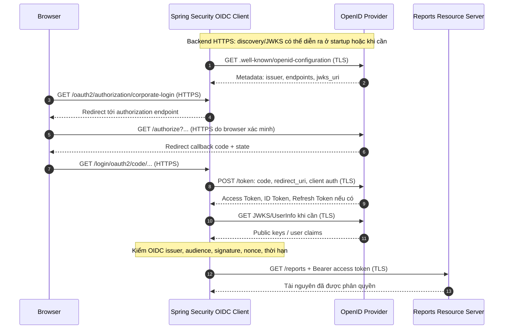
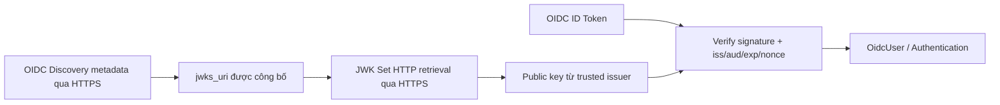
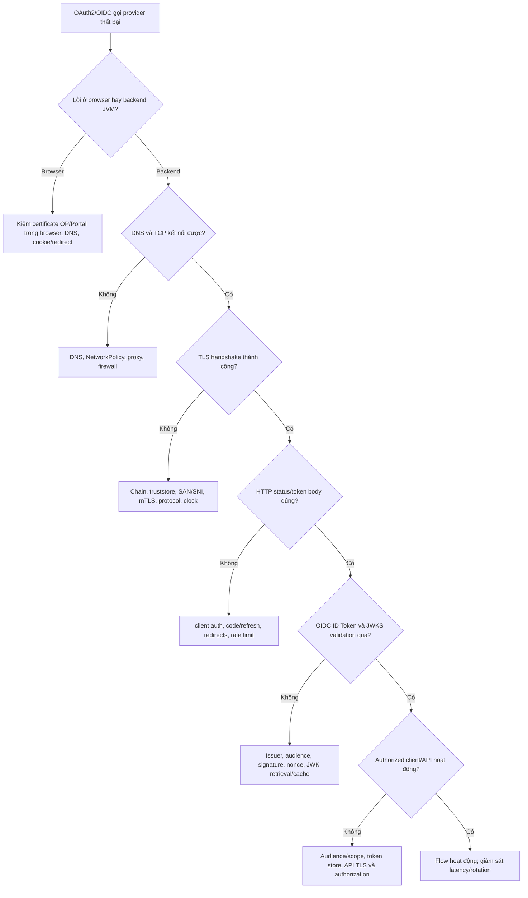

# 27.7. TLS, certificate trust và quản lý kết nối tới provider

Trong **Spring Security OAuth 2.0 / OpenID Connect (OIDC) Client**, một lần đăng nhập có thể liên quan tới nhiều kết nối HTTPS: trình duyệt chuyển hướng đến Authorization Server, backend trao đổi authorization code tại token endpoint, ứng dụng đọc tài liệu discovery, tải JWKS để xác minh chữ ký ID Token, gọi UserInfo và đôi khi thực hiện token revocation hoặc OIDC Logout. Các kết nối ấy mang **authorization code, access token, refresh token, client credentials hoặc tài liệu khóa công khai phục vụ xác minh danh tính**. Vì vậy, bảo vệ TLS và cấu hình **certificate trust** là một phần của ranh giới tin cậy, không chỉ là tùy chọn mạng.

Một lỗi thường gặp là sửa `SSLHandshakeException` bằng cách tắt xác minh certificate hoặc hostname. Cách này có thể khiến luồng đăng nhập “chạy được” trong môi trường thử nghiệm nhưng tạo cơ hội cho attacker giả mạo provider, đánh cắp token/client secret hoặc cung cấp metadata/JWK không đáng tin. Cách tiếp cận đúng là **xác định kết nối nào bị lỗi, vì sao PKIX/hostname validation thất bại, rồi sửa trust chain, certificate, DNS, proxy hoặc cấu hình HTTP client tương ứng**.

Bài học **“27.7. TLS, certificate trust và quản lý kết nối tới provider”** thuộc chương *27. Bảo mật tích hợp* hướng dẫn từ mô hình đến cấu hình Spring Boot, Java JSSE, Servlet, WebFlux/Reactor Netty, mutual TLS (mTLS), connection pooling, timeout, retry, certificate rotation và kiểm thử.

> **Quy tắc cốt lõi:** Với endpoint OAuth2/OIDC đáng tin, ứng dụng phải xác minh **đúng server qua TLS** và **đúng issuer/client registration qua OAuth2/OIDC**. TLS không thay thế validation của OIDC, còn kiểm tra chữ ký ID Token không thay thế TLS của token/discovery/UserInfo endpoints.

## 1. Mục tiêu học tập

Sau bài này, bạn có thể:

1. Liệt kê các kết nối browser → provider, backend → provider và backend → Resource Server trong OAuth2/OIDC Login.
2. Phân biệt HTTPS/TLS, certificate chain, root/intermediate CA, trust anchor, Subject Alternative Name (SAN), SNI và hostname verification.
3. Phân biệt **truststore** (tin cậy máy chủ) với **keystore/client identity** (chứng chỉ/khóa riêng để chứng minh client trong mTLS).
4. Sử dụng Java default truststore, truststore riêng và Spring Boot SSL bundles đúng phạm vi.
5. Hiểu vì sao TLS client được cấu hình cho token endpoint **chưa chắc** được dùng cho discovery, JWKS, UserInfo hoặc revocation.
6. Lập chính sách TLS cho Servlet HTTP clients và Reactive `WebClient`/Reactor Netty.
7. Giải thích OAuth2 mutual-TLS client authentication và certificate-bound access tokens theo RFC 8705.
8. Thiết kế connect/handshake/response timeout, connection pool, retry, cancellation và egress policy an toàn.
9. Lập kế hoạch xoay vòng chứng chỉ/CA, giám sát thời hạn và phục hồi khi provider đổi certificate.
10. Chẩn đoán lỗi `PKIX path building failed`, SAN mismatch, proxy/hostname, mTLS handshake và token endpoint failure mà không tắt xác minh TLS.

## 2. Sơ đồ kết nối TLS trong một lần OIDC Login

Giả sử Portal dùng registration `corporate-login` với OP tại `https://idp.example.org` và gọi Reports API.



Trong sơ đồ có ít nhất **ba nhóm kết nối**:

- **Browser ↔ Portal/OP:** TLS được thiết lập bởi browser. Backend `WebClient` của Portal không điều khiển truststore của browser.
- **Portal ↔ OP:** JVM của ứng dụng thiết lập TLS cho discovery, token endpoint, JWKS, UserInfo và các endpoint tùy chọn.
- **Portal ↔ API:** một kết nối HTTPS độc lập; API có certificate/trust policy, audience và scopes riêng.

Đổi truststore của Java **không tự** làm browser tin certificate của OP, và đổi certificate của Portal **không tự** làm backend tin issuer certificate của OP.

### 2.1. Bảng endpoint và vật liệu nhạy cảm

| Endpoint | Bên khởi tạo kết nối | Nội dung/độ nhạy | Kiểm soát TLS |
|---|---|---|---|
| `/oauth2/authorization/{registrationId}` | Browser → Portal | Khởi động authorization, session/cookie | TLS của Portal |
| Authorization endpoint của OP | Browser → OP | Login/consent, state, PKCE challenge | Browser xác minh OP certificate |
| `/.well-known/openid-configuration` | Portal JVM → OP | Issuer và URL endpoints được công bố | JVM outbound TLS/trust |
| Token endpoint | Portal JVM → OP | Authorization code, client auth, refresh token | Outbound TLS, có thể mTLS |
| JWKS endpoint | Portal JVM → OP | Public keys dùng xác minh ID Token | Outbound TLS + issuer/key validation |
| UserInfo endpoint | Portal JVM → OP | Bearer access token và thông tin user | Outbound TLS + OIDC UserInfo validation |
| Revocation/introspection endpoint | Portal JVM → AS | Token/client authentication | Outbound TLS, chính sách provider |
| `end_session_endpoint` | Thường browser → OP qua redirect | Logout request, có thể chứa `id_token_hint` | Browser xác minh OP certificate |
| Reports API | Portal JVM → Resource Server | Bearer access token và dữ liệu nghiệp vụ | Outbound TLS + Resource Server validation |

Không nên kết luận “OAuth2 Login dùng HTTPS” mà chỉ xem `redirect-uri` trong `application.yml`. Các TLS connections có **thư viện HTTP client khác nhau, trust material khác nhau và thời điểm thực thi khác nhau**.

## 3. TLS bảo vệ gì và không bảo vệ gì?

HTTPS/TLS ở kết nối client–server bảo đảm ba thuộc tính quan trọng trong phạm vi phiên kết nối:

1. **Server authentication:** bên gọi xác minh máy chủ đang kết nối sở hữu certificate hợp lệ cho tên miền mong đợi, có chuỗi tin cậy phù hợp.
2. **Confidentiality:** dữ liệu trên đường truyền được mã hóa; eavesdropper trên mạng không đọc được nội dung phiên TLS hợp lệ.
3. **Integrity:** dữ liệu trao đổi không bị sửa âm thầm trên đường truyền.

TLS **không tự** bảo đảm:

- OP issuer được chọn là provider mà ứng dụng thực sự có ý định tin cậy.
- ID Token có chữ ký hợp lệ, `iss`/`aud`/`nonce`/`exp` đúng.
- Access token có đúng audience, scope hoặc quyền với tài nguyên.
- Backend không gửi token đến host khác vì lỗi SSRF/config.
- JSON trong UserInfo không chứa dữ liệu giả mạo từ ứng dụng khác.
- Một proxy trung gian được quản trị đúng.

Ví dụ attacker sở hữu một domain có certificate CA công khai hợp lệ. Nếu ứng dụng cho browser truyền `issuer-uri=https://attacker.example` rồi tự discovery, **TLS hoàn toàn có thể thành công**. Lỗ hổng vẫn tồn tại vì ứng dụng đã tin một issuer do attacker chọn. Vì vậy cần cả **hostname/certificate validation** và **allowlist issuer/registration**.

### 3.1. TLS version và cipher suites

Với ứng dụng hiện đại, nên ưu tiên TLS 1.3 và TLS 1.2 khi cần tương thích, theo chính sách bảo mật của tổ chức/nhà cung cấp và khả năng JDK. Tránh các giao thức lỗi thời như SSLv3, TLS 1.0 và TLS 1.1.

Không tự bật cipher suite cũ chỉ vì một provider legacy chưa nâng cấp. Nếu gặp mismatch, cần làm việc với provider và nhóm bảo mật để có giải pháp thay thế có kiểm soát. Không bật `trust-all` để xử lý lỗi giao thức TLS — hai vấn đề hoàn toàn khác nhau.

## 4. X.509 certificate trust: chuỗi tin cậy PKIX

Khi Portal kết nối `https://idp.example.org`, phía server thường gửi:

```text
Leaf/server certificate
  Subject Alternative Name: DNS:idp.example.org
  Public key và validity interval
          |
          v
Intermediate CA certificate(s)
          |
          v
Root CA (trust anchor được client tin cậy)
```

Java TLS client phải có đường chứng thực hợp lệ từ leaf qua intermediates tới một root/trust anchor mà truststore tin cậy, đồng thời thỏa các kiểm tra tên máy chủ, key usage, thời hạn và chính sách thuật toán.

### 4.1. Root CA, intermediate CA và leaf

| Loại certificate | Vai trò | Có nên tự thêm vào truststore? |
|---|---|---|
| Root CA | Trust anchor | Chỉ khi CA được phê duyệt; thường có sẵn trong JDK truststore hoặc kho quản lý |
| Intermediate CA | Phát leaf, nối trust chain | Server nên gửi chain đầy đủ; có thể cấu hình theo PKI policy |
| Leaf/server certificate | Xác thực endpoint cụ thể | Không nên mặc định pin leaf lâu dài chỉ để chữa lỗi chain |
| Client certificate | Xác thực client với server trong mTLS | Nằm cùng **private key** ở keystore/client identity, không phải root trust anchor |

Một số hệ thống dùng CA nội bộ. Nếu Java chưa tin CA đó, lỗi `PKIX path building failed` có thể xảy ra ngay cả khi browser được tổ chức cấu hình tin certificate.

### 4.2. SAN quan trọng hơn Common Name

Khi kết nối tới `idp.example.org`, certificate phải có identity phù hợp trong **Subject Alternative Name**, ví dụ `DNS:idp.example.org`. Không nên dựa vào việc Common Name chứa chuỗi gần giống hoặc tắt hostname verification để đi qua.

Ví dụ:

```text
URL: https://idp.example.org/token
Certificate SAN: DNS:login.example.org
Result: TLS hostname verification failure
```

Chứng chỉ có chain CA hợp lệ nhưng **sai hostname** vẫn không được chấp nhận.

### 4.3. Validity và đồng hồ hệ thống

Certificate có `Not Before` và `Not After`. Đồng hồ của máy chủ ứng dụng sai có thể khiến certificate nhìn như “chưa có hiệu lực” hoặc “đã hết hạn”.

Thời gian còn ảnh hưởng OIDC `exp`, `iat`, `auth_time` và token lifetime. Nên đồng bộ NTP và giám sát clock skew, nhưng **không sửa thời gian hệ thống tùy tiện** để qua kiểm tra certificate.

### 4.4. Một lỗi chain khác lỗi hostname

| Lỗi | Điều thường sai |
|---|---|
| `PKIX path building failed` | Không tìm được trust path đến CA đã tin cậy |
| `unable to find valid certification path` | Thiếu root/intermediate hoặc dùng truststore sai |
| `No subject alternative DNS name matching` | SAN không chứa hostname đang kết nối |
| `CertificateExpiredException` | Leaf/intermediate hết hạn hoặc đồng hồ sai |
| `CertificateNotYetValidException` | Certificate chưa tới Not Before, hoặc clock sai |
| `handshake_failure` | TLS version/cipher/client certificate/SNI hoặc policy server |

Giải pháp phải khớp nguyên nhân; **không có một tùy chọn “bỏ kiểm SSL” nào là giải pháp đúng cho tất cả**.

## 5. Truststore, keystore và client secret khác nhau

Những thuật ngữ rất dễ bị dùng lẫn:

| Vật liệu | Dùng để | Bí mật không? |
|---|---|---|
| **Truststore** chứa CA/certificate đáng tin | Xác minh máy chủ OP/API khi kết nối TLS | Bản public certificate không phải secret, nhưng cấu hình trust phải được bảo vệ khỏi sửa trái phép |
| **Keystore** chứa certificate chain + private key client | Chứng minh client identity trong mTLS | **Private key là bí mật** |
| OAuth2 `client-secret` | Client authentication tại token endpoint theo `client_secret_basic`/`client_secret_post` | **Bí mật** |
| `private_key_jwt` key | Ký client assertion JWT | **Private key là bí mật**; không tự đồng nghĩa mTLS key |
| ID Token signing key của OP | OP ký ID Token; RP kiểm qua JWKS/public key | Public JWK thường không bí mật; private key chỉ OP giữ |
| Access/refresh token | Credential để truy cập/refresh | **Bí mật**, không đưa vào log/query/cert store |

Một ứng dụng có thể dùng **HTTPS server authentication** mà **không dùng mTLS**. Cũng có thể dùng mTLS client certificate **và** client secret theo policy provider, nhưng cần phân biệt rõ các cơ chế.

### 5.1. HTTPS thông thường

```text
Portal ---- TLS ----> OP
   |
   +-- Portal xác minh server certificate của OP
   +-- OP không nhất thiết yêu cầu client certificate
   +-- Client có thể authenticate bằng client_secret_basic ở /token
```

### 5.2. Mutual TLS

```text
Portal ---- mTLS ----> OP
   |
   +-- Portal xác minh server certificate của OP
   +-- OP xác minh client certificate của Portal
   +-- Client phải có private key tương ứng
```

Đừng gọi một kết nối HTTPS “mTLS” chỉ vì có `client-secret` trong `application.yml`. Client secret thuộc HTTP/OAuth2 client authentication, không phải TLS client certificate authentication.

## 6. Java default truststore và phạm vi cấu hình

Một Java HTTPS client thường dựa vào JSSE và các trust anchors mà JDK/truststore được cấu hình để sử dụng. Tùy JDK, môi trường và bảo mật tổ chức, certificate roots có thể nằm trong file `cacerts` hoặc trust material được chỉ định riêng.

Những JVM system properties thường gặp:

```properties
javax.net.ssl.trustStore=/etc/ssl/portal/provider-trust.p12
javax.net.ssl.trustStorePassword=<SECRET_FROM_RUNTIME>
javax.net.ssl.trustStoreType=PKCS12
```

Nếu được áp dụng vào **một JVM**, cấu hình mặc định này có thể ảnh hưởng **nhiều HTTP clients trong cùng process**, không chỉ client OIDC. Ngoài ra, nếu bạn tạo một truststore riêng chỉ có CA nội bộ rồi **thay** default truststore, những CA công khai vốn được tin có thể không còn khả dụng trong JVM đó.

**Không thay JVM truststore global chỉ để sửa một kết nối mà không xét các HTTPS clients khác** như database proxy, payment gateways, telemetry, email/webhooks và Resource Server.

### 6.1. Truststore riêng theo provider

Trong hệ thống tích hợp nhiều providers có yêu cầu CA khác nhau:

```text
Corporate OP -> corporate trust bundle
Partner OP   -> system CA / partner-approved CA
Reports API  -> riêng theo API trust policy
```

Tách TLS configuration theo target giúp giảm ảnh hưởng của việc rotate CA hoặc thay certificate và không mở rộng trust anchor không cần thiết cho cả JVM.

### 6.2. Có nên import leaf certificate?

Không nên coi import trực tiếp leaf certificate vào truststore là bước sửa nhanh mặc định. Khi leaf được renew, truststore có thể không còn tin, gây outage. Nếu muốn pin certificate/public key theo threat model cụ thể, cần thiết kế **backup pins, thời hạn, rotation và quy trình emergency recovery**.

Với PKI nội bộ, thường hợp lý hơn là tin đúng **private CA được phê duyệt** và yêu cầu provider cung cấp leaf+intermediate chain hợp lệ, miễn là PKI policies đủ chặt.

### 6.3. KMS/Secret Manager và quyền file

Mật khẩu PKCS12 và private key không được commit vào Git, đóng gói vào public Docker image hoặc in ra build logs. Trong container/Kubernetes có thể mount trust material/keystore qua secret volume hoặc cơ chế secrets runtime, với permissions hạn chế.

Public CA certificate có thể ít nhạy cảm hơn private key, nhưng **khả năng thay đổi truststore** là quyền bảo mật đặc biệt: nếu attacker thêm CA của mình, ứng dụng có thể tin provider giả mạo.

## 7. Spring Boot SSL bundles: quản lý trust material

Các phiên bản Spring Boot hiện đại cung cấp **SSL bundles** để mô tả truststore/keystore theo tên thay vì rải các file/mật khẩu ở nhiều class. Cấu hình ví dụ dùng PKCS12 truststore:

```yaml
spring:
  ssl:
    bundle:
      jks:
        corporate-op:
          truststore:
            location: "file:/etc/portal/tls/corporate-trust.p12"
            password: "${CORPORATE_TRUSTSTORE_PASSWORD}"
            type: PKCS12
```

Với PEM CA certificate, ở các phiên bản Spring Boot hỗ trợ bundle PEM:

```yaml
spring:
  ssl:
    bundle:
      pem:
        corporate-op-ca:
          truststore:
            certificate: "file:/etc/portal/tls/corporate-ca.pem"
```

Đây là **cấu hình trust material**, không phải một lời hứa rằng **mọi HTTP call do Spring Security tạo sẽ tự dùng bundle**. Phải xem client nào thực sự phát request và wire bundle/SSLContext vào đúng HTTP client.

### 7.1. Lấy bundle bằng SslBundles

Ví dụ trong bean Java:

```java
import javax.net.ssl.SSLContext;
import org.springframework.boot.ssl.SslBundle;
import org.springframework.boot.ssl.SslBundles;

final class ProviderTlsMaterial {

    private final SslBundles bundles;

    ProviderTlsMaterial(SslBundles bundles) {
        this.bundles = bundles;
    }

    SSLContext corporateSslContext() {
        SslBundle bundle = bundles.getBundle("corporate-op");
        return bundle.createSslContext();
    }
}
```

API/vị trí extension có thể thay đổi theo major version Spring Boot. Trong project thực tế, hãy khớp phiên bản Spring Boot/Spring Security/Reactor Netty được sử dụng.

### 7.2. SSL bundle không tự thay OIDC issuer

`SslBundle` mô tả **transport trust/client identity**. `ClientRegistration` mô tả **OAuth2/OIDC provider, client và grant**. Hai thứ phải được phối hợp, nhưng không thể thay nhau:

```text
corporate-op SSL bundle:
  -> tin CA nào khi kết nối TLS?

corporate-login ClientRegistration:
  -> issuer nào, authorizationUri/tokenUri nào,
     clientId nào, redirectUri nào, scopes nào?
```

Certificate hợp lệ của một domain khác **không** làm domain đó trở thành issuer đã được phê duyệt.

### 7.3. Cảnh báo trust material có thể bị thay thế

Nếu một SSL bundle chỉ trust CA nội bộ, kết nối đến các hosts dùng CA công khai có thể thất bại khi client đó tái sử dụng bundle. Điều này có thể là **chủ đích của policy**, nhưng cần biết hậu quả.

Không tạo một `SSLContext` tùy ý rồi gán cho mọi outbound requests. Phân nhóm target tin cậy rõ ràng và chủ động kiểm tra endpoints được truy cập.

## 8. Java JSSE: xây SSLContext với TrustManagerFactory

Khi không dùng SSL bundles, có thể xây `SSLContext` từ PKCS12 truststore của ứng dụng bằng JSSE. Skeleton:

```java
import java.io.InputStream;
import java.nio.file.Files;
import java.nio.file.Path;
import java.security.KeyStore;
import javax.net.ssl.SSLContext;
import javax.net.ssl.TrustManagerFactory;

final class TlsContexts {

    static SSLContext fromPkcs12Truststore(
            Path file,
            char[] password) throws Exception {

        KeyStore store = KeyStore.getInstance("PKCS12");
        try (InputStream input = Files.newInputStream(file)) {
            store.load(input, password);
        }

        TrustManagerFactory trustManagers =
                TrustManagerFactory.getInstance(
                        TrustManagerFactory.getDefaultAlgorithm());
        trustManagers.init(store);

        SSLContext sslContext = SSLContext.getInstance("TLS");
        sslContext.init(
                null,                   // Client keys chưa được cấu hình
                trustManagers.getTrustManagers(),
                null);

        return sslContext;
    }
}
```

Đây là ví dụ **HTTPS server trust**. Với mTLS, phải cấp `KeyManager[]` từ client keystore vào `sslContext.init(...)`; việc chỉ có truststore không khiến OP nhận được client certificate.

### 8.1. SSLContext và hostname verification là hai phần

Một `SSLContext` có trust managers hợp lệ chưa có nghĩa mọi HTTP stack tự xác minh hostname theo cách bạn mong đợi. Khi dùng HTTP clients chuẩn, giữ **endpoint identification/hostname verification bật**; tránh custom trust manager, hostname verifier hoặc Netty configuration làm vô hiệu nó.

Không làm:

```java
// ANTI-PATTERN: Không triển khai TrustManager luôn chấp nhận certificate.
// Không dùng HostnameVerifier trả true cho mọi hostname.
// Không dùng Netty InsecureTrustManagerFactory trong production.
```

Nếu TLS handshake thất bại, cần xem certificate chain, SAN, truststore, SNI, protocol và proxy trước khi thay đổi security checks.

### 8.2. Nguy cơ của một global SSLContext mặc định

Java có API cài đặt default `SSLContext` cho process, nhưng dùng nó để “sửa OIDC” có thể thay hành vi của các HTTPS clients khác trong JVM. Ưu tiên tạo một HTTP client có SSLContext riêng cho provider target và giữ default trust của phần còn lại.

## 9. Kết nối Servlet: token endpoint, discovery và JWKS khác nhau

Trong Spring MVC Servlet, các bước dùng những HTTP stacks khác nhau tùy phiên bản/cấu hình:

1. **Discovery**: khi cấu hình `issuer-uri`, Spring Boot/Spring Security có thể đọc metadata OP lúc tạo `ClientRegistration`, thường từ quá trình khởi tạo ứng dụng.
2. **Token endpoint**: một `OAuth2AccessTokenResponseClient` thực hiện code exchange hoặc refresh-token grant.
3. **JWKS/ID Token validation**: decoder/JWK retriever lấy public keys của issuer, có cache và refresh policy riêng.
4. **UserInfo**: `OAuth2UserService`/`OidcUserService` có HTTP client để gọi UserInfo endpoint khi áp dụng.
5. **Revocation/other endpoints**: các service hoặc custom handlers có HTTP client riêng.

Vì vậy, cấu hình TLS cho token response client **không đảm bảo discovery và JWKS cũng dùng cùng SSLContext**.

### 9.1. Bảng trách nhiệm

| Việc | Khái niệm Spring Security | Cần kiểm tra |
|---|---|---|
| Xây authorization redirect | `OAuth2AuthorizationRequestResolver` | URI/issuer chính xác, `state`/nonce/PKCE |
| Đổi code lấy token | `OAuth2AccessTokenResponseClient` | TLS của HTTP client, client auth, timeouts |
| Lấy user profile | `OAuth2UserService`/`OidcUserService` | Bearer token chỉ tới UserInfo host hợp lệ |
| Xác minh OIDC ID Token | OIDC ID Token decoder/JWK retrieval | Issuer, chữ ký, audience, JWKS transport |
| Duy trì authorized client | `OAuth2AuthorizedClientManager` | Token lifecycle/refresh, lưu trữ và error handling |
| Gọi API | `RestClient`/`WebClient` OAuth2 integration | TLS đến Resource Server, đúng audience/token |

`OAuth2AuthorizationRequestResolver` không phải nơi cấu hình JSSE cho token endpoint; nó xây URL để browser redirect.

### 9.2. Tùy chỉnh HTTP client cho Servlet token exchange

Trong các phiên bản Spring Security dùng `RestClientAuthorizationCodeTokenResponseClient`, có thể cấu hình `RestClient` đã được dựng bằng một request factory có SSLContext/timeout riêng.

Ví dụ tạo JDK HTTP client cho **một provider target**:

```java
import java.net.http.HttpClient;
import java.time.Duration;
import javax.net.ssl.SSLContext;
import org.springframework.http.client
        .JdkClientHttpRequestFactory;
import org.springframework.web.client.RestClient;

SSLContext providerSslContext = tlsContexts.fromPkcs12Truststore(
        providerTruststorePath,
        truststorePassword);

HttpClient jdkHttpClient = HttpClient.newBuilder()
        .sslContext(providerSslContext)
        .connectTimeout(Duration.ofSeconds(3))
        .followRedirects(HttpClient.Redirect.NEVER)
        .build();

JdkClientHttpRequestFactory factory =
        new JdkClientHttpRequestFactory(jdkHttpClient);
factory.setReadTimeout(Duration.ofSeconds(8));

RestClient providerRestClient = RestClient.builder()
        .requestFactory(factory)
        .build();
```

Biến `tlsContexts`/`providerTruststorePath`/`truststorePassword` được ứng dụng cung cấp; đoạn code minh họa **HTTP transport**, chưa hoàn thành toàn bộ Spring Security token client. Nếu tích hợp với `RestClientAuthorizationCodeTokenResponseClient`, phải giữ các message converters/HTTP body parsers và error handlers đúng OAuth2 token response contract của phiên bản đang sử dụng.

### 9.3. Ví dụ đăng ký token client trong Servlet

Trong Spring Security có extension point:

```java
http.oauth2Login(oauth2 -> oauth2
        .tokenEndpoint(tokenEndpoint ->
                tokenEndpoint.accessTokenResponseClient(
                        authorizationCodeTokenClient)));
```

Ở đây `authorizationCodeTokenClient` là một implementation **`OAuth2AccessTokenResponseClient<OAuth2AuthorizationCodeGrantRequest>`** đã được tạo và cấu hình đúng HTTP transport. Nó **không phải** một `RestClient` thô; cần adaptation theo API/version đang dùng.

Với grant refresh token, client/provider có thể sử dụng HTTP implementation khác; phải cấu hình **cả đường refresh** nếu có requirement CA/mTLS/timeouts đặc biệt. Nếu chỉ gắn token client cho code exchange mà quên refresh, login đầu tiên có thể thành công nhưng refresh lần sau lại thất bại.

### 9.4. Khi lỗi xuất hiện trước token exchange

Nếu ứng dụng fail startup vì discovery `issuer-uri`, một token HTTP client do bạn khai báo cho `oauth2Login().tokenEndpoint(...)` có thể **chưa bao giờ được dùng**. Phải xử lý TLS tại **discovery HTTP client** hoặc cung cấp các endpoint metadata đã được xác minh theo kiến trúc/phiên bản.

Không chữa bằng cách bỏ issuer validation hoặc sửa issuer thành một HTTP URL không TLS. Nếu OP nội bộ dùng CA riêng, hãy cung cấp trust anchors phù hợp cho kênh metadata với kiểm soát hostname.

## 10. Spring WebFlux: WebClient và Reactor Netty TLS

Trong Reactive stack, Spring Security sử dụng Reactive OAuth2 Client components và HTTP transport không blocking. Một `WebClient` dùng Reactor Netty có thể được cấu hình với:

- TLS trust manager / client certificate.
- Connection pool.
- TCP connect timeout.
- TLS handshake timeout.
- HTTP response timeout.
- Read/write deadlines và resource limits.

### 10.1. Tạo WebClient riêng cho provider

Ví dụ Reactor Netty tin một PEM CA được phê duyệt:

```java
import io.netty.channel.ChannelOption;
import io.netty.handler.ssl.SslContext;
import io.netty.handler.ssl.SslContextBuilder;
import java.io.File;
import java.time.Duration;
import org.springframework.http.client.reactive
        .ReactorClientHttpConnector;
import org.springframework.web.reactive.function.client.WebClient;
import reactor.netty.http.client.HttpClient;
import reactor.netty.resources.ConnectionProvider;

SslContext providerSsl = SslContextBuilder.forClient()
        .trustManager(new File("/etc/portal/tls/corporate-ca.pem"))
        .protocols("TLSv1.3", "TLSv1.2")
        .build();

ConnectionProvider connectionPool = ConnectionProvider
        .builder("corporate-op")
        .maxConnections(24)
        .pendingAcquireMaxCount(100)
        .pendingAcquireTimeout(Duration.ofSeconds(2))
        .maxIdleTime(Duration.ofSeconds(30))
        .maxLifeTime(Duration.ofMinutes(5))
        .build();

HttpClient nettyHttpClient = HttpClient.create(connectionPool)
        .secure(ssl -> ssl.sslContext(providerSsl)
                .handshakeTimeout(Duration.ofSeconds(5)))
        .option(ChannelOption.CONNECT_TIMEOUT_MILLIS, 3000)
        .responseTimeout(Duration.ofSeconds(10))
        .followRedirect(false);

WebClient corporateProviderWebClient = WebClient.builder()
        .clientConnector(new ReactorClientHttpConnector(nettyHttpClient))
        .build();
```

Đây là **ví dụ transport cho WebClient**, không mặc nhiên thay HTTP client dùng bởi mọi thành phần Spring Security. Các con số pool/timeout là giả định để minh họa; phải dựa trên latency/SLA và lượng đồng thời thực tế.

Lưu ý:

- `trustManager(caFile)` tin CA/certificate từ file đã chỉ định. Hãy xác minh file đúng CA của provider; cấu hình sai có thể loại mất trust anchors khác.
- `SslContextBuilder.forClient()` cấu hình TLS client, không tự gửi client certificate nếu chưa khai báo `keyManager(...)`.
- `handshakeTimeout` áp thời gian cho TLS handshake; `responseTimeout` cho chờ HTTP response sau khi kết nối.
- Một `WebClient` chung có quyền gửi bearer token tới target tùy ý dễ gây rò rỉ; nên ràng buộc base URI/egress allowlist.
- Không tái tạo `ConnectionProvider` cho mỗi request; pool là tài nguyên có vòng đời cần được tái sử dụng và đóng khi ứng dụng dừng.

### 10.2. Kết nối WebClient với Reactive token response client

Spring Security Reactive có các token response clients chuyên dụng, ví dụ `WebClientReactiveAuthorizationCodeTokenResponseClient` trong các phiên bản hỗ trợ. Một integration có thể cấu hình transport tương ứng:

```java
import org.springframework.security.oauth2.client.endpoint
        .WebClientReactiveAuthorizationCodeTokenResponseClient;

var codeTokenClient =
        new WebClientReactiveAuthorizationCodeTokenResponseClient();

codeTokenClient.setWebClient(corporateProviderWebClient);
```

Đây là phần **khởi tạo token client**, không phải SecurityWebFilterChain hoàn chỉnh. Đường gắn token client vào `ReactiveOAuth2AuthorizedClientProvider` hoặc OAuth2 Login authentication manager phụ thuộc phiên bản API. Phải xác minh cấu hình thực tế đang gọi đúng instance, **không chỉ tạo bean rồi giả định auto-config sẽ sử dụng**.

Một provider khác `refresh_token` hoặc `client_credentials` có thể dùng token response client riêng. Hãy áp chính sách TLS ở tất cả grant types thực tế, kể cả refresh sau khi user đã đăng nhập.

### 10.3. Không dùng block() trong Reactive TLS configuration

Tạo SSL context từ file và load trust material thường được thực hiện **khi khởi động cấu hình**, không phải lặp lại trên mỗi request. Trong Reactive request path, tránh:

```java
// KHÔNG NÊN: chặn Reactor event loop khi gọi provider.
String response = corporateProviderWebClient.get()
        .uri("https://idp.example.org/userinfo")
        .retrieve()
        .bodyToMono(String.class)
        .block();
```

Compose `Mono`/`Flux` và cung cấp timeout/error mapping phù hợp thay vì block event loop. Việc có TLS handshake chậm không phải lý do chuyển cả handler sang synchronous.

### 10.4. Không nhầm WebClient cho API với WebClient của OP

```text
OIDC token client WebClient
  -> https://idp.example.org/token
  -> client secret / code / refresh token

Reports API WebClient
  -> https://reports.example.org/api
  -> Bearer access token
```

Hai HTTP clients nên có cấu hình host allowlist, TLS, pool và timeout theo nhu cầu. Đừng đưa một `WebClient` có cấu hình header `Authorization: Bearer ...` mặc định cho API vào token endpoint hoặc third-party URLs.

## 11. JWKS và OIDC ID Token validation cũng cần TLS

OIDC ID Token thường là JWT được ký bởi OP. Spring Security cần public keys để kiểm chữ ký, thường từ `jwks_uri` trong provider metadata.



Nếu truststore của token endpoint được sửa nhưng JWK retriever vẫn dùng default JVM CA, lần login đầu có thể:

1. Đổi code lấy token thành công.
2. Không tải được JWKS vì certificate chain nội bộ.
3. Thất bại khi xác minh ID Token.

Điều này không phải lỗi token endpoint, dù người dùng chỉ thấy “Login failed”.

### 11.1. TLS không đủ để tin JWKS tùy ý

Không cho browser tự chọn `jwks_uri` hoặc issuer trên mỗi request. Metadata/JWK Set phải đến từ provider đã được đăng ký/duyệt. Một attacker domain vẫn có certificate hợp lệ của riêng họ.

Xác minh chữ ký còn phải ràng buộc JWK/ID Token với issuer, algorithm allowlist, audience, nonce, expiry và những claim hợp đồng yêu cầu. **Không tắt signature verification để khắc phục lỗi tải JWKS**.

### 11.2. Caching JWK Set

JWK retrieval có thể được cache để giảm độ trễ và hạn chế tải, nhưng phải hỗ trợ **key rotation** của OP:

```text
OP đang ký bằng key K1
OP công bố thêm K2 trên JWKS
OP bắt đầu ký ID Token bằng K2
RP cache cần cập nhật khi gặp key ID mới/TTL theo policy
OP loại bỏ K1 sau giai đoạn chuyển tiếp
```

JWK signing-key rotation **khác** TLS server certificate renewal. Public keys trong JWKS dùng kiểm JWT; TLS certificate dùng xác thực kết nối HTTPS tới endpoint.

### 11.3. Không đồng nhất key pinning và CA trust

Một OP có thể thay leaf TLS certificate nhưng giữ JWK signing key, hoặc xoay JWK signing key mà không thay TLS certificate. Nếu policy pin TLS cert hoặc JWK `kid` vô điều kiện, ứng dụng dễ bị outage khi provider rotate.

Xây dựng chiến lược dựa trên contract của OP và khả năng cache/rotation, không hardcode một key ID như một hằng không thể đổi.

## 12. Mutual TLS (mTLS) và OAuth2 Client Authentication

OAuth 2.0 Mutual-TLS Client Authentication và Certificate-Bound Access Tokens được mô tả trong **RFC 8705**. Có hai ý cần tách:

1. **Client authentication bằng TLS certificate:** Authorization Server xác minh client certificate tại TLS handshake/token endpoint theo cách đã đăng ký.
2. **Certificate-bound access token:** access token có thể gắn với certificate của client (sender-constrained), và Resource Server yêu cầu client chứng minh sở hữu private key tương ứng khi sử dụng token.

Không phải hệ thống nào bật mTLS cũng sử dụng certificate-bound access token. Chính sách cụ thể phụ thuộc AS/RS.

### 12.1. mTLS yêu cầu keystore chứa private key

Ví dụ conceptual configuration:

```text
Provider trust:
  corporate-ca.pem  -> dùng để tin OP server certificate

Client identity:
  portal-client.crt  -> public certificate của Portal
  portal-client.key  -> private key bí mật của Portal
```

Ở Reactor Netty, khi dùng PEM identity:

```java
SslContext mtlsSsl = SslContextBuilder.forClient()
        .trustManager(new File("/etc/portal/tls/provider-ca.pem"))
        .keyManager(
                new File("/etc/portal/tls/portal-client.crt"),
                new File("/etc/portal/tls/portal-client.key"))
        .protocols("TLSv1.3", "TLSv1.2")
        .build();
```

Ví dụ chưa bao gồm encrypted private key hoặc provider-specific authentication method; bảo vệ file key bằng quyền OS và secrets runtime. Đừng đưa private key vào Git, configmap công khai hoặc log.

### 12.2. TLS client certificate và client_secret_basic

```text
client_secret_basic:
  Authorization: Basic <base64(client_id:client_secret)>
  chạy bên trong HTTPS

tls_client_auth:
  client chứng minh private key qua TLS handshake
  AS mapping certificate identity đến OAuth2 client registration
```

Client secret không bị gửi dưới dạng plaintext mạng nếu HTTPS hợp lệ, nhưng vẫn là secret trong application/runtime. `tls_client_auth` yêu cầu certificate/trust policy ở phía AS và cấu hình client identity, khác với chỉ thêm `client-id`/`client-secret`.

### 12.3. RFC 8705 certificate-bound access token

Với sender-constrained token, AS có thể ràng buộc access token với client certificate (ví dụ confirmation claim `cnf` có thumbprint `x5t#S256`, tùy loại token và profile). Resource Server kiểm tra:

1. Access token hợp lệ và có đúng audience/scope.
2. Client đang kết nối bằng mTLS và certificate phù hợp.
3. Certificate thumbprint/confirmation trong token khớp cert được trình bày.

Đừng dùng access token certificate-bound như một **bearer token thuần** gửi qua một HTTP client không có client certificate. Resource Server có thể và nên từ chối nếu thiếu proof-of-possession.

### 12.4. Dedicated mTLS endpoints

Một Authorization Server có thể công bố endpoint aliases dành riêng cho mTLS theo metadata. Nếu provider yêu cầu `mtls_endpoint_aliases`, client cần hiểu đúng token/revocation/introspection endpoints áp dụng, chứ không tự dùng một URL khác chỉ vì kết nối TLS thông thường hoạt động.

Đừng tự chọn đường mTLS bằng string manipulation; dùng contract/provider metadata được tin và cấu hình registration phù hợp.

### 12.5. Certificate rotation cho mTLS

Khi Portal thay client certificate:

- OP phải chấp nhận identity mới theo chính sách đăng ký/rotate.
- Các instances cần có private key mới và khả năng reload/restart an toàn.
- Với certificate-bound tokens, token cũ có thể bị ràng buộc với cert cũ; đổi certificate giữa token issuance và API call có thể làm RS từ chối.
- Nên có giai đoạn overlap/rollout được OP hỗ trợ và kiểm tra issuance/usage với cả certificate generations.

Không giải quyết bằng cách vô hiệu kiểm certificate phía AS/RS hoặc tắt token binding.

## 13. Proxy, DNS, SNI và network egress

Trong doanh nghiệp, request outbound thường đi qua proxy hoặc service mesh:

```text
Spring Boot JVM
   |
   +-- HTTPS direct -> OP
   |
   +-- HTTP CONNECT proxy -> TLS tới OP
   |
   +-- Service mesh sidecar -> egress gateway -> OP
```

Cần biết **điểm kết thúc TLS ở đâu** và ai là chủ thể mà JVM đang xác minh.

### 13.1. TLS end-to-end và TLS interception

Với HTTP CONNECT proxy thông thường, TLS từ JVM tới OP có thể đi xuyên qua tunnel. Với TLS interception/inspection, proxy có thể phát certificate thay mặt OP từ một CA nội bộ.

Đây là thay đổi **trust boundary**:

- Ứng dụng có thể phải tin corporate inspection CA.
- Proxy có thể nhìn thấy authorization code, client secret, access/refresh token trong luồng HTTPS nó giải mã.
- Tổ chức phải đánh giá quyền truy cập, retention và sự phù hợp của việc inspection với hệ thống identity.

Không tự thêm corporate inspection CA chỉ vì proxy báo handshake error mà chưa xác nhận thiết kế này được phê duyệt cho các OAuth2 token endpoints. Với dữ liệu xác thực nhạy cảm, một số tổ chức chọn bypass interception và dùng egress allowlist.

### 13.2. Server Name Indication (SNI)

SNI cho server biết hostname TLS mà client muốn kết nối. Với nhiều virtual hosts trên một IP, nếu SNI sai hoặc bị mất, server có thể trả certificate của host khác:

```text
URL: https://idp.example.org
DNS: 203.0.113.10
SNI: idp.example.org
Server certificate SAN: idp.example.org
```

Nếu thay URL bằng `https://203.0.113.10` nhưng vẫn mong certificate cho `idp.example.org` hợp lệ, có thể gặp hostname mismatch và lỗi SNI. Không sửa bằng cách tắt hostname verification; hãy dùng canonical hostname có DNS đúng.

### 13.3. DNS và connection reuse

Một long-lived connection pool có thể giữ kết nối tới IP cũ khi provider chuyển hạ tầng. DNS TTL, TCP keep-alive, max connection life và stale connections cần được cân nhắc cùng provider SLA.

Không tăng pool timeout vô hạn để “bớt handshake”: một kết nối sống quá lâu có thể giữ route/đích cũ hoặc cản khả năng cân bằng tải và rotation.

### 13.4. Egress allowlist

Ứng dụng nên chỉ kết nối tới những hosts/endpoints đã được duyệt:

```text
https://idp.example.org:443
https://reports.example.org:443
```

Các URL `issuer-uri`, `authorization-uri`, `token-uri`, `jwk-set-uri` và `user-info-uri` phải đến từ cấu hình đáng tin, không từ request parameter.

Nếu ứng dụng cho user nhập issuer động, cần một onboarding/trust review đặc biệt để ngăn SSRF (internal metadata service, loopback/private ranges, redirects tới host lạ) và provider impersonation. TLS hợp lệ của một host **không có nghĩa ứng dụng được phép kết nối đến host ấy**.

## 14. HTTPS redirect URI và reverse proxy

Spring Security OAuth2 Login thường cấu hình:

```yaml
redirect-uri: "{baseUrl}/login/oauth2/code/{registrationId}"
```

Với portal công khai:

```text
Browser: https://portal.example.org
Proxy:   https://portal.example.org -> http://portal-service:8080
```

nếu ứng dụng nhận base URL nội bộ `http://portal-service:8080`, Authorization Request có thể tạo redirect URI sai dẫn đến `redirect_uri_mismatch` tại OP.

### 14.1. Forwarded headers chỉ tin từ proxy được kiểm soát

Spring Boot có:

```yaml
server:
  forward-headers-strategy: framework
```

Tùy deployment, native proxy strategy/`ForwardedHeaderFilter` cũng có thể áp dụng. **Chỉ bật sau khi ingress/proxy chặn hoặc overwrite `Forwarded`/`X-Forwarded-*` từ client ngoài**; nếu không, attacker có thể ảnh hưởng hostname/scheme của `redirect_uri` và gây host header injection.

### 14.2. TLS từ browser tới Portal và từ Portal tới OP

| Kết nối | Certificate phải xác minh |
|---|---|
| Browser → Portal | Certificate của Portal theo public hostname |
| Browser → OP | Certificate của OP theo hostname OP |
| Portal → OP token/JWKS | Certificate của OP theo JVM HTTP client trust |
| Portal → Reports API | Certificate của Reports API |

Việc Portal dùng HTTPS public ở front-end không bảo đảm outbound traffic tới OP cũng đã được cấu hình đúng. Ngược lại, backend truststore đúng không tự sửa lỗi Portal public certificate hoặc cookie `Secure`.

### 14.3. Cookie Secure và SameSite

OIDC redirect/callback cần browser giữ session/authorization-request correlation. Cấu hình HTTPS, cookie `Secure`, `HttpOnly`, `SameSite` và domain/path phải phù hợp với browser redirects và trust model.

Một cookie `SameSite` quá chặt có thể không được gửi lại ở một số callback flows, gây `invalid_state`. **Không hủy xác minh state** để sửa; hãy thiết kế cookie/session behavior phù hợp, dùng HTTPS và kiểm tra request correlation.

## 15. Connection pooling: không chỉ là hiệu năng

Spring Security OAuth2 Client có thể gọi token endpoint trong:

- Login burst khi nhiều người dùng bắt đầu làm việc.
- Refresh token gần hết hạn.
- Batch jobs dùng `client_credentials`.
- JWKS refresh khi OP xoay signing keys.
- UserInfo gọi khi OIDC Login hoàn tất.

Một pool quá nhỏ có thể gây chờ lâu; pool quá lớn có thể gây áp lực lên OP, socket limits và token endpoint rate limiting.

### 15.1. Các thông số quan trọng

| Thông số | Tác dụng | Nguy cơ khi sai |
|---|---|---|
| Maximum connections | Giới hạn sockets đang dùng | Quá thấp gây queue; quá cao làm quá tải OP |
| Pending acquire timeout | Thời gian chờ lấy connection từ pool | Chờ vô hạn có thể làm request timeout dây chuyền |
| TCP connect timeout | Giới hạn thời gian mở kết nối | Outage kéo dài làm treo request |
| TLS handshake timeout | Giới hạn thời gian thương lượng TLS | Handshake treo khi route/proxy/OP lỗi |
| Response timeout | Giới hạn chờ HTTP response | Gây backlog nếu token endpoint không phản hồi |
| Max idle time | Dọn connection nhàn rỗi | Quá dài có stale connections |
| Max life time | Thay connection định kỳ | Quá ngắn tăng TLS handshakes, quá dài chậm cập nhật route |
| Retry budget | Giới hạn số lần gọi lại | Retry storm khi OP đang lỗi |
| Bulkhead/concurrency limit | Cô lập workload cho provider | Một provider lỗi không kéo sập toàn bộ app |

Các giá trị là **policy vận hành**, không nên copy một “cấu hình chuẩn 5 giây/20 kết nối” cho mọi doanh nghiệp. Cần đo p95/p99, RPS, burst, OP quotas, tỷ lệ cache hit và giới hạn infrastructure.

### 15.2. Tách pool theo provider/endpoint cần thiết

Nếu Corporate OP và Partner OP khác hạ tầng hoặc SLA, có thể dùng pools/circuit boundaries riêng:

```text
Corporate token HTTP client -> Corporate pool, CA, timeout
Partner token HTTP client   -> Partner pool, CA, timeout
Reports API HTTP client     -> API pool, CA, timeout
```

Không để request đến Partner OP đang mất kết nối chiếm hết resources của Corporate OP khi hai hệ thống cần được cô lập.

### 15.3. Pool và certificate renewal

Một TLS connection đang mở có thể tiếp tục chạy với TLS session đã thiết lập trước khi server thay certificate; server certificate mới thường được thấy tại **handshake mới**. Vì vậy:

- Không dùng “các request cũ vẫn thành công” làm bằng chứng certificate mới đúng.
- Chạy synthetic **new-connection handshake checks** trong giai đoạn rotation.
- Đánh giá max life/idle times của pool khi cập nhật CA/cert.
- Với client cert mTLS, một pool cũ có thể còn trình bày certificate cũ cho tới khi connection được tạo mới.

## 16. Timeout, retry và token endpoint semantics

Đặt timeout là cần thiết, nhưng retry OAuth2 token requests đòi hỏi thận trọng hơn retry HTTP GET tĩnh.

### 16.1. Authorization code là one-time credential

`authorization_code` chỉ được sử dụng một lần. Nếu token endpoint đã **nhận và tiêu thụ code** nhưng network response bị mất, retry POST với cùng code có thể trả `invalid_grant`.

```text
Portal POST code=C1
        |
        v
OP đổi code C1 -> tokens (thành công)
        |
        x response network timeout
        |
Portal retry code=C1 -> invalid_grant
```

Không được suy luận rằng timeout đồng nghĩa OP chưa xử lý. Giải pháp có thể là báo login thất bại có kiểm soát và bắt đầu authorization flow mới, theo hợp đồng/provider; không gửi lại code vô hạn.

### 16.2. Refresh token rotation

Với refresh token rotation:

```text
RT1 -> OP -> AT2/RT2
        response có thể bị mất
Retry RT1 -> reuse/invalid_grant, có thể thu hồi cả token family
```

Vì thế:

- Không bật generic `retryWhen(...)` trên mọi `POST /token`.
- Phân biệt connect failure **chắc chắn trước khi gửi request** với timeout/unknown outcome.
- Dùng single-flight/concurrency control theo authorized client nếu nhiều requests cùng refresh.
- Khi `invalid_grant`, xử lý reauthorization và xóa state có phiên bản, tránh xóa nhầm RT2 mới.
- Có metrics và thông báo phù hợp khi provider outage.

### 16.3. Client credentials

`client_credentials` có thể xin access token mới khi hết hạn, nhưng vẫn cần rate-limit, caching và retry budget. Một job tạo principal name khác nhau mỗi lần chạy có thể tạo nhiều authorized clients và tăng token requests không cần thiết.

Kết nối token endpoint thất bại không nên làm cả hệ thống loop xin token liên tục. Pool, backoff và failure handler phải phù hợp provider quotas.

### 16.4. Redirects của HTTP client

Đối với POST token endpoint mang credential, **tránh tự động follow HTTP redirects tới host khác**. Một redirect 3xx do misconfiguration hoặc attacker kiểm soát có thể làm lộ client auth/token request, tùy HTTP client behavior. Prefer token endpoint cố định và policy từ chối redirect không mong đợi.

Đối với discovery/JWKS/UserInfo, cũng cần kiểm soát redirects, host allowlist và nội dung responses. Không để một endpoint tin cậy trả redirect sang arbitrary internal/external hosts rồi tiếp tục kèm bearer token.

## 17. TLS handshake và application error là hai tầng khác nhau

Một kết nối HTTPS có thể:

```text
A. DNS/TCP không kết nối được
B. TLS handshake thất bại
C. TLS handshake thành công nhưng HTTP 401 invalid_client
D. TLS handshake thành công, HTTP 400 invalid_grant
E. Token response thành công nhưng ID Token validation fail
F. Token hợp lệ nhưng Reports API trả 403
```

Cần xác định lỗi ở giai đoạn nào trước khi sửa. Ví dụ:

- `SSLHandshakeException` tại `/token`: điều tra TLS chain/SAN/protocol/mTLS.
- `invalid_client`: điều tra client ID/secret, client auth method, mTLS certificate identity hoặc client policy; TLS có thể đã thành công.
- `invalid_grant`: điều tra code/state/redirect URI/reuse/refresh token; không nhất thiết liên quan certificate.
- `invalid_state` trong browser callback: điều tra authorization request repository/session/cookie/CSRF; không sửa bằng cách thay truststore.
- `JwtValidationException` issuer mismatch: kiểm registration/issuer validation; không bỏ OIDC checks để login được.

### 17.1. Lỗi trust không phải lỗi hết hạn access token

Access token có `expiresAt`; TLS server certificate có `NotAfter`. Hai đồng hồ độc lập. Khi token hết hạn, manager có thể refresh; khi certificate hết hạn, một kết nối mới tới OP có thể không bắt đầu được TLS handshake để refresh. Vì thế certificate expiration monitoring trực tiếp ảnh hưởng khả năng duy trì session/API calls.

## 18. Certificate rotation và truststore rollout

OP có thể thay:

- Leaf certificate cùng CA.
- Intermediate CA.
- Root CA/trust anchor.
- Hostname/SAN hoặc hạ tầng TLS.
- Client certificate requirement cho mTLS.
- OIDC signing keys trong JWKS (độc lập với TLS cert).

Một kế hoạch rotation an toàn có thể gồm:

1. **Inventory:** liệt kê những HTTPS endpoints thực tế và certificate chains, issuers, truststores.
2. **Thông báo:** nhận lịch thay CA/cert từ provider và đánh giá ảnh hưởng.
3. **Chuẩn bị:** nạp trust anchors mới trước khi provider chuyển leaf/chain nếu CA thay.
4. **Overlap:** giữ đồng thời old/new CA cần thiết trong giai đoạn chuyển tiếp theo policy.
5. **Canary:** thử new TLS handshakes từ chính runtime/network segment production.
6. **Rollout:** cập nhật SSL bundle/truststore/client identity có kiểm soát.
7. **Giám sát:** số lỗi SSL handshake, login, refresh, JWKS và UserInfo.
8. **Dọn cũ:** bỏ CA/key cũ sau khi hết overlap và xác nhận không còn dependencies.

### 18.1. TLS cert renewal thường không cần thay issuer

`issuer-uri` là định danh của OP, không phải mã hóa certificate leaf. Nếu OP chỉ renew certificate cho cùng hostname/issuer bằng CA đã tin, ứng dụng thường không cần đổi registration issuer. Đừng tự sửa issuer URL để trỏ vào domain khác khi certificate renewal; đó là thay đổi trust domain.

### 18.2. Reload trust material trong JVM

Không phải mọi HTTP client tự phát hiện file truststore bị thay trên disk. `SSLContext` và Netty `SslContext` đã được tạo có thể vẫn giữ trust material cũ cho tới khi **reload/recreate client hoặc restart ứng dụng**, tùy implementation.

Một kế hoạch rotation phải nêu rõ:

- Khi nào nạp lại file bundle.
- Có API reload/hot-swap được framework và client hỗ trợ không.
- Có cần đóng/replace connections hoặc connection pool không.
- Có cần rolling restart/canary không.
- Cách rollback khi trust anchor mới sai.

Không giả định “copy file PEM mới vào volume” là đủ để mọi HTTPS calls dùng file mới lập tức.

### 18.3. Chứng chỉ của client mTLS cần rotation riêng

Với mTLS, cả provider và ứng dụng đều có certificate lifecycles. Client certificate sắp hết hạn phải được rotate theo yêu cầu OP/AS; khi certificate-bound tokens được dùng, kiểm cả khả năng token mới và token cũ đi qua đúng certificate.

Một hệ thống có thể có:

```text
Provider server certificate expires: T1
Portal mTLS client certificate expires: T2
OIDC JWKS signing key rotation: T3
OAuth2 refresh token expiration: T4
```

T1/T2/T3/T4 là **bốn vòng đời khác nhau**; monitor riêng.

## 19. Chẩn đoán bằng openssl, keytool và JSSE

Các lệnh dưới đây dùng **hostname/certificate giả định**. Chỉ chạy trong môi trường bạn có quyền truy cập, tránh hiển thị thông tin nhạy cảm trong log chia sẻ.

### 19.1. Quan sát server certificate và chain

```bash
openssl s_client \
  -connect idp.example.org:443 \
  -servername idp.example.org \
  -showcerts
```

`-servername` gửi SNI để nhận certificate theo đúng virtual host. `-showcerts` hiển thị chain server gửi. Cần **xem kết quả verify return code**; lệnh quan sát đơn giản không có nghĩa đã xác minh đúng truststore của JVM.

Muốn xác minh theo một CA PEM cụ thể:

```bash
openssl s_client \
  -connect idp.example.org:443 \
  -servername idp.example.org \
  -CAfile /etc/portal/tls/corporate-ca.pem \
  -verify_return_error
```

Kết quả OpenSSL không bảo đảm hoàn toàn giống Java JSSE vì truststore/algorithm policies khác. Đây là công cụ khoanh vùng mạng và certificate chain.

### 19.2. Đọc certificate validity và SAN

```bash
openssl s_client \
  -connect idp.example.org:443 \
  -servername idp.example.org \
  </dev/null 2>/dev/null | \
openssl x509 -noout -subject -issuer -dates -ext subjectAltName
```

Kiểm tra `notBefore`/`notAfter`, issuer và SAN. Không dùng lệnh này để trích private key; dữ liệu TLS server certificate thường là public.

### 19.3. Kiểm tra truststore của ứng dụng

```bash
keytool -list -v \
  -keystore /etc/portal/tls/corporate-trust.p12 \
  -storetype PKCS12
```

`keytool` có thể yêu cầu mật khẩu tương tác. Không đưa password thật vào command line nếu shell history/process listing hoặc CI logs có thể ghi lại. Đừng dán output chứa tên nội bộ/metadata nhạy cảm vào public issue tracker nếu policy hạn chế.

### 19.4. Debug Java TLS handshake

Trong môi trường kiểm thử được kiểm soát, JSSE cung cấp debug flags, ví dụ:

```text
-Djavax.net.debug=ssl,handshake
```

Chỉ bật khi thật cần và trong thời gian ngắn. TLS debug/HTTP wire logs có thể chứa metadata certificate, endpoint details hoặc thông tin phiên nhạy cảm; **không bật logging toàn bộ request headers/bodies của token endpoint trong production**.

### 19.5. Kiểm tra từ đúng network namespace

Một lệnh chạy từ laptop có thể thành công, nhưng ứng dụng trong Kubernetes pod thất bại vì:

- Truststore/JDK khác.
- DNS khác.
- Egress gateway/proxy khác.
- NetworkPolicy hoặc firewall.
- SNI/TLS interception riêng.
- File certificate chưa mount hoặc permission sai.

Để chẩn đoán đúng, kiểm tra **cùng runtime/network path** với ứng dụng hoặc một diagnostic pod được phê duyệt trong cùng namespace/egress policy, không chỉ từ máy cá nhân.

## 20. Bảng lỗi thường gặp

| Triệu chứng | Nguyên nhân khả dĩ | Hướng kiểm tra an toàn |
|---|---|---|
| `PKIX path building failed` ở token endpoint | JVM không tin CA, thiếu intermediate, truststore sai | Chain server, CA/truststore thực tế, JSSE logs |
| `PKIX` chỉ khi startup | Discovery `issuer-uri` dùng HTTP client khác | Bootstrap metadata client, trust mặc định, không chỉ token client |
| Login đổi code được nhưng xác minh ID Token fail TLS | JWKS retriever không tin certificate | HTTPS/JWK client riêng, CA, issuer |
| `No subject alternative name matching` | SAN sai hostname, gọi IP thay DNS, proxy host sai | URL, certificate SAN, SNI |
| `certificate expired` | OP server cert/intermediate expired hoặc đồng hồ app sai | Certificate validity, NTP, provider rotation |
| `handshake_failure` sau bật mTLS | OP đòi cert khác, client thiếu key, algorithm mismatch | Client cert chain/private key, AS registration, protocol |
| `bad_certificate` từ provider | Client certificate bị từ chối | Key usage, expiry, registered subject/thumbprint |
| HTTPS thành công nhưng `invalid_client` | Sai OAuth2 client auth, client policy hoặc mTLS identity | ClientRegistration, client-secret/method, provider config |
| `invalid_grant` sau timeout | Authorization code đã tiêu thụ hoặc refresh token rotation | Không retry POST mù quáng, xem flow/correlation |
| Login bắt đầu bình thường nhưng OP trang lỗi TLS | Browser không tin OP certificate | Browser/OP TLS; JVM truststore không giúp browser |
| `redirect_uri_mismatch` | Base URL/scheme/host qua proxy sai | Forwarded header trust, exact URI registration |
| `invalid_state` | Session/cookie/authorization request repository lỗi | Cookie SameSite/Secure, session, state correlation |
| JWKS ký bằng kid mới gây fail | Cache JWK chưa refresh hoặc provider rollout lỗi | JWKS cache/rotation, không pin kid cố định |
| Handshake fail sau đổi CA | Truststore runtime chưa reload | Bundle/SSLContext/client recreation, rolling restart |
| API token request bị timeout hàng loạt | Pool starvation, OP outage, proxy/DNS | Pool metrics, connect/handshake/response timeouts |
| Một provider lỗi làm provider khác chậm | Dùng chung pool/queue không giới hạn | Per-provider pool/bulkhead |
| Access token bị gửi tới host lạ | WebClient URI từ input hoặc HTTP redirect | Host allowlist, disable redirects, no token to arbitrary URLs |
| mTLS token nhận được nhưng RS trả 401 | Sender-constrained token dùng sai client cert | Certificate-bound token/RS proof-of-possession |
| Chỉ refresh mới fail TLS | Refresh token HTTP client chưa dùng same trust config | Provider/manager refresh path |

### 20.1. Không sửa bằng trust-all

Những “giải pháp” sau chỉ che giấu lỗi và mở rủi ro:

```text
TrustManager chấp nhận mọi certificate
HostnameVerifier luôn trả true
InsecureTrustManagerFactory.INSTANCE
Tắt kiểm chữ ký ID Token để tránh lỗi JWKS
Đổi HTTPS thành HTTP để token endpoint hoạt động
Tự follow token endpoint redirect tới host bất kỳ
```

Những hành vi này đặc biệt nguy hiểm với OAuth2/OIDC vì attacker có thể nhận được authorization code, client credentials hoặc access/refresh tokens.

## 21. Quy trình chẩn đoán theo tầng



Mỗi nhánh có đúng thành phần cần kiểm tra. Nếu DNS không resolve được host, thêm CA không giúp. Nếu `invalid_client`, tắt TLS không sửa client authentication. Nếu issuer validation fail, sửa certificate trust chưa chắc giải quyết mismatch về OIDC trust.

## 22. Kiểm thử TLS và certificate trust

Kiểm thử nên xác minh **từ chối kết nối không đáng tin**, không chỉ “kết nối được với certificate test”.

### 22.1. Test matrix

| Tình huống | Kết quả kỳ vọng |
|---|---|
| OP server cert hợp lệ, SAN đúng, CA trong trust | TLS handshake thành công |
| Cert do CA không tin phát | Bị từ chối |
| Cert chain hợp lệ nhưng SAN sai hostname | Bị từ chối |
| Leaf cert hết hạn | Bị từ chối |
| Server chỉ hỗ trợ TLS protocol đã bị policy cấm | Bị từ chối |
| OP yêu cầu mTLS nhưng client thiếu cert/key | Bị từ chối |
| Client cert mTLS đúng nhưng OAuth2 client ID sai | TLS có thể thành công; OAuth2 `invalid_client` |
| OP đổi CA trong giai đoạn overlap đã cấu hình | Kết nối vẫn thành công theo kế hoạch |
| JWKS endpoint có trust chain khác token endpoint | Client phải xử lý đúng cả hai hoặc báo lỗi |
| Token endpoint trả 302 sang host lạ | Không gửi credentials tới host được redirect |
| Refresh token POST timeout sau khi OP xử lý | Không retry mù quáng |
| Proxy gửi certificate khác kỳ vọng | Bị từ chối hoặc chỉ chấp nhận CA inspection đã được phê duyệt |

### 22.2. Local HTTPS server test

Có thể chạy một HTTPS test server với self-signed certificate **chỉ trong môi trường test**, sau đó:

1. Tạo một truststore test tin đúng CA test.
2. Cấu hình HTTP client under test dùng truststore đó.
3. Test handshake tới đúng hostname.
4. Test sai hostname và CA không tin được từ chối.
5. Với mTLS, yêu cầu client cert test và xác nhận không có cert bị từ chối.
6. Không dùng disable-verification làm test fixture; điều đó làm mất giá trị của test.

Nếu dùng WireMock/MockWebServer hoặc HTTP test server tương tự, cấu hình HTTPS và certificate riêng; không gọi provider production trong unit tests chỉ để kiểm tra TLS client.

### 22.3. Test Spring OAuth2 grant riêng

Với token endpoint mock:

```text
POST /token
  - authorization_code grant -> token response mock hợp lệ
  - client_credentials grant -> token response mock
  - refresh_token grant -> rotation/invalid_grant mock
```

Kiểm tra HTTP client thực sự dùng TLS/trust config theo đúng grant. Một test chỉ mock `OAuth2AccessTokenResponseClient` hoàn toàn sẽ không kiểm tra transport TLS của nó; cần integration test ở ranh giới HTTP transport.

### 22.4. Test discovery, JWKS và UserInfo

Nếu app dùng internal CA, nên kiểm:

- Startup/discovery metadata qua HTTPS.
- Token exchange qua HTTPS.
- Fetch JWKS khi cache cold và sau key rotation.
- UserInfo retrieval khi provider cung cấp endpoint.
- Optional revocation/introspection nếu app dùng.

Không chỉ test successful `/token` rồi tuyên bố toàn bộ OIDC integration an toàn.

### 22.5. Test rollout nhiều instances

Với rolling deployment:

```text
Pod A: old trust bundle
Pod B: new trust bundle (tin cả old/new CA theo overlap)
Provider: đang chuyển certificate
Pod C: old bundle chưa restart
```

Canary test nên tạo **new TLS connections** từ cả old/new configurations, kiểm handshake và operation-level login/refresh. Sau khi chuyển CA, không để một pod cũ trở thành điểm lỗi login ngẫu nhiên.

## 23. Giám sát trong production

Những sự kiện vận hành nên theo dõi:

- TLS server certificate expiry còn bao nhiêu ngày.
- Truststore/SSL bundle version đang deploy và thời điểm cuối cập nhật.
- TLS handshake failures theo **provider registration/endpoint class**.
- DNS/TCP connect failures, TLS handshake latency, HTTP response latency.
- HTTP 4xx/5xx, `invalid_client`, `invalid_grant`, rate limiting và retry counts.
- Connection pool active/idle/pending/timeouts.
- JWK cache miss/refresh và OIDC issuer/key validation failures.
- Token refresh success/failure, login failure rate và certificate rotation windows.

### 23.1. Log ít thông tin nhưng đủ điều tra

Ví dụ event schema do ứng dụng tự thiết kế:

```text
event=oidc_provider_tls_failure
registrationId=corporate-login
endpointType=token
providerHost=idp.example.org
errorType=PKIX_PATH_BUILDING_FAILED
connectionPhase=TLS_HANDSHAKE
correlationId=server-generated-id
```

**Không log**:

- Client secret/private key, truststore password.
- Raw access/refresh/ID tokens, token request/response body.
- Authorization code, PKCE code verifier, session cookie.
- HTTP Authorization headers hoặc full callback URLs.
- Arbitrary certificate/private-key dumps hoặc JSSE debug logs không redaction.

Registration ID và endpoint type thường có cardinality thấp và hữu ích hơn principal/email/session ID làm metric labels.

### 23.2. Synthetic checks

Một health check có thể kiểm DNS, TLS handshake và certificate expiry tới endpoints đã được duyệt. Với hệ thống quan trọng, cân nhắc một synthetic OAuth2 login/refresh test account **riêng**, quyền tối thiểu và secret lifecycle kiểm soát, không dùng user credentials production.

Không dùng endpoint health check để in ra certificate private key, token hoặc issuer metadata đầy đủ mà người ngoài có thể đọc.

## 24. Tình huống tổng hợp: Corporate OP dùng CA nội bộ

Giả sử ứng dụng chạy trong Kubernetes:

- Public Portal: `https://portal.example.org`, browser trust CA công khai.
- Corporate OP: `https://idp.corp.example.org`, certificate do Corporate CA phát.
- Corporate OIDC discovery và token/JWKS/UserInfo đều qua backend HTTPS.
- Backend gọi Reports API ở `https://reports.example.org`.
- Provider dùng `client_secret_basic` (không mTLS).
- Ứng dụng có nhiều replicas và token refresh khi request xảy ra.

Một thiết kế:

```text
Browser
  |
  | HTTPS: portal.example.org
  v
Trusted Ingress
  |
  v
Spring Boot Portal (JVM)
  |
  +-- Corporate OIDC HTTP clients
  |      -> corporate-op SSL bundle / CA trust
  |      -> bounded timeouts + pool
  |      -> discovery / token / JWKS / UserInfo
  |      -> issuer-uri = trusted Corporate OP
  |
  +-- Reports API HTTP client
  |      -> HTTPS trust của reports.example.org
  |      -> Bearer token chỉ tới Reports API
  |
  +-- Authorized Client Store
         -> access/refresh token mã hóa
         -> concurrency control cho refresh rotation
```

Quy trình triển khai:

1. Nhóm vận hành cung cấp corporate root/intermediate CA đã phê duyệt và metadata OP.
2. Truststore/SSL bundle được mount qua secrets/configuration riêng, không commit private material.
3. App áp corporate trust đúng **HTTP clients** dùng cho discovery, token, JWKS và UserInfo.
4. `ClientRegistration` giữ đúng issuer/token endpoints; không nhận issuer URL từ query user.
5. Browser truy cập Portal HTTPS; reverse proxy forwarded headers chỉ từ nguồn đáng tin.
6. Connect/handshake/response timeouts và pool limits được cấu hình theo OP SLA.
7. Đăng nhập OIDC xác minh ID Token, issuer/audience/nonce, không dựa vào TLS certificate để suy đoán user.
8. Authorized client manager refresh theo grant; không retry mù quáng refresh-token POST.
9. Reports API client chỉ gửi bearer token tới host được kiểm soát, với TLS trust riêng.
10. Định kỳ kiểm certificate expiry/CA rotation và canary new handshakes từ production namespace.

### 24.1. Khi lỗi xảy ra vào ngày đổi CA

```text
Login redirect tới OP trên browser: OK
POST /token từ Portal: PKIX path building failed
```

Đây là dấu hiệu **backend TLS trust**, không phải vấn đề browser URL. Kiểm tra:

- Pod nào đang lỗi; trust bundle version trên pod đó.
- Certificate chain/SAN hiện tại của OP qua SNI.
- Truststore ứng dụng dùng thực tế, không phải file CA trên laptop.
- Token HTTP client có dùng đúng bundle không.
- Truststore đã được reload/recreate chưa.
- Proxy/mesh có thay certificate chain không.

Không chuyển `token-uri` sang HTTP hoặc bật insecure TrustManager để giảm thời gian outage.

### 24.2. Khi chỉ JWKS lỗi

```text
Startup discovery: OK
Token exchange: OK
ID Token validation: fail khi fetch jwks_uri
```

Cần kiểm tra JWK retrieval HTTP client/host/chain, cache và issuer metadata. Có thể JWKS host hoặc proxy khác token host, hoặc token client đã được custom TLS trong khi JWK retriever vẫn dùng default trust. Không bỏ JWT signature validation.

### 24.3. Khi chỉ refresh lỗi

```text
OIDC Login ban đầu: OK
Sau vài phút: access token expire -> refresh request fail TLS
```

Có thể token refresh provider dùng HTTP client/path khác authorization-code exchange, hoặc pool/trust material mới chưa được sử dụng. Cần kiểm tra chính xác đường grant refresh và runtime client, không giả định “login ban đầu OK nên mọi token requests OK”.

## 25. Checklist bảo mật kết nối trước production

| Câu hỏi | Điều cần kiểm tra |
|---|---|
| OP/AS endpoint có dùng HTTPS? | Issuer, token, JWKS, UserInfo, revocation và introspection |
| URL của endpoints đến từ nguồn đáng tin? | Static registration/discovery allowlist, chống SSRF |
| Hostname certificate có khớp? | SAN, SNI, canonical host |
| Chain được trust theo PKIX? | Root/intermediate CA, truststore đúng runtime |
| Có tắt hostname/certificate verification ở đâu không? | Không có trust-all/ignore-hostname |
| Có yêu cầu mTLS không? | Client cert/key, OP registration, alias endpoint |
| Có certificate-bound access tokens không? | RS chứng minh client certificate, đúng key lifecycle |
| Discovery HTTP client có trust đúng? | Startup/metadata retrieval |
| Token response clients đủ grant types chưa? | Code, refresh, client_credentials |
| JWKS/UserInfo client có trust đúng? | Fetch và cache/rotation |
| TLS của outbound API có riêng không? | Egress allowlist, audience và token routing |
| Có proxy/mesh không? | CONNECT/inspection, forwarded headers, TLS termination |
| Connect/handshake/response timeouts hợp lý? | SLA, P95/P99, quota, concurrency |
| Pool được quản lý đúng? | Max connections, pending acquire, idle/life, cleanup |
| Có retry token POST mù quáng không? | Không; phân biệt unknown outcome và rotation |
| Certificate/CA rotation có kế hoạch? | Overlap, canary, reload/restart, rollback |
| Secrets được bảo vệ? | No Git/log, secret volumes, IAM/KMS |
| Test negative TLS cases có đủ? | CA untrusted, SAN mismatch, expiry, mTLS missing |
| Monitoring có thấy lỗi theo endpoint type? | TLS phase, provider, HTTP status, timing |
| Có kiểm tenant/provider boundaries không? | Issuer, registration, API target, token audience |

## 26. Những lỗi thiết kế cần tránh

1. **Tắt certificate validation/hostname verification** khi thấy `SSLHandshakeException`.
2. **Cho người dùng khai issuer/token endpoint** rồi tự gọi discovery mà không allowlist.
3. **Chỉ cấu hình token HTTP client**, bỏ quên discovery/JWKS/UserInfo.
4. **Nhầm truststore và client mTLS keystore**, dẫn đến thiếu private key hoặc trust sai CA.
5. **Coi `client-secret` là TLS client certificate**, không hiểu sự khác nhau của hai authentication mechanisms.
6. **Import leaf certificate để chữa nhanh**, không có kế hoạch renew/rotation.
7. **Thay truststore global** khiến các public HTTPS dependencies khác ngừng hoạt động.
8. **Đưa truststore password/private key vào Git, image hoặc logs**.
9. **Tắt issuer/signature/nonce checks** để vượt lỗi JWKS HTTPS.
10. **Tự follow token endpoint redirects** đến host không nằm trong policy.
11. **Dùng token WebClient với URL do browser truyền**, gây SSRF và bearer token leakage.
12. **Dùng SSL bundle nhưng giả định mọi client Spring Security tự dùng**, không kiểm wiring thực tế.
13. **Bật proxy inspection CA vô điều kiện** mà không đánh giá ai đọc được token requests.
14. **Đặt timeout/pool vô hạn**, khiến provider outage kéo theo toàn bộ app.
15. **Retry authorization code/refresh token POST mù quáng**, gây `invalid_grant`/replay.
16. **Không xét refresh token rotation/concurrent requests** trong nhiều replicas.
17. **Không kiểm tra SNI/SAN**, gọi bằng IP hoặc hostname alias rồi tắt validation.
18. **Bỏ qua certificate rotation**, không có overlap/canary/reload plan.
19. **Tin certificate của OP đồng nghĩa ID Token chính xác**, bỏ OIDC validation.
20. **Nhầm TLS signing certificate và JWK signing key**, dẫn tới cấu hình pinning sai.
21. **Đoán lỗi OAuth2 grant là lỗi TLS**, sửa sai tầng.
22. **Test chỉ ở laptop**, không kiểm tra truststore/egress path trong runtime production.
23. **Dùng cùng pool và trust không giới hạn cho mọi providers**, mở rộng blast radius.
24. **Ghi raw TLS debug/token bodies trên production logs**, rò secrets.

## 27. Câu hỏi ôn tập

1. Vì sao OIDC Login có nhiều TLS connections thay vì một HTTPS connection duy nhất?
2. Những connection nào do browser xác minh certificate và connection nào do JVM xác minh?
3. TLS bảo vệ gì, và vì sao TLS không thay thế OIDC `iss`/`aud`/signature checks?
4. Root CA, intermediate CA, leaf certificate và SAN có vai trò gì trong PKIX validation?
5. Vì sao certificate chain hợp lệ vẫn có thể fail hostname verification?
6. Truststore khác keystore/client private key như thế nào?
7. `client_secret_basic` và `tls_client_auth` khác nhau ở tầng giao thức nào?
8. Vì sao cấu hình một SSLContext cho `POST /token` có thể chưa sửa lỗi JWKS hoặc discovery?
9. Spring Boot SSL bundle giải quyết phần nào và không tự giải quyết phần nào của OAuth2 Client?
10. Khi nào nên dùng truststore riêng theo provider thay vì thay JVM global truststore?
11. Một leaf certificate được pin có những rủi ro nào khi provider renew certificate?
12. SNI có vai trò gì khi nhiều HTTPS virtual hosts dùng chung IP?
13. Vì sao gọi OP bằng IP dù certificate là cho DNS name có thể fail TLS?
14. TLS interception proxy làm thay đổi trust boundary OAuth2 như thế nào?
15. Tại sao forwarded headers sai có thể gây `redirect_uri_mismatch` dù OP TLS hoàn toàn hợp lệ?
16. Vì sao access/refresh token không được log ngay cả khi đang debug TLS?
17. Max connections, pending acquire, TLS handshake timeout và response timeout khác nhau thế nào?
18. Vì sao retry authorization code grant sau timeout có thể dẫn đến `invalid_grant`?
19. Tại sao refresh token rotation khiến generic retry ở token endpoint nguy hiểm?
20. Certificate-bound access token theo RFC 8705 yêu cầu thêm điều gì tại Resource Server?
21. Việc rotate client mTLS certificate có thể ảnh hưởng token đã phát hành ra sao?
22. JWK signing-key rotation khác TLS certificate renewal ở điểm nào?
23. Những trường hợp nào nên báo `SSLHandshakeException` thay vì HTTP `invalid_client`?
24. Khi OpenSSL trên laptop thành công nhưng JVM trong pod fail, nên kiểm những gì?
25. Làm sao kiểm thử hostname mismatch/CA untrusted mà không tắt TLS verification?
26. Trong rolling deployment, vì sao phải thử new TLS handshakes thay vì chỉ tái dùng connections cũ?
27. Làm sao phát hiện đường refresh token dùng HTTP client chưa được cấu hình truststore?
28. Vì sao HTTPS và allowlist issuer/target host phải được áp dụng cùng nhau?

## Tài liệu tham khảo

- [Spring Security Reference — OAuth2 Client Core](https://docs.spring.io/spring-security/reference/servlet/oauth2/client/core.html)
- [Spring Security Reference — OAuth2 Login Advanced Configuration](https://docs.spring.io/spring-security/reference/servlet/oauth2/login/advanced.html)
- [Spring Security Reference — OAuth2 Client Authorization Grants](https://docs.spring.io/spring-security/reference/servlet/oauth2/client/authorization-grants.html)
- [Spring Security Reference — Reactive OAuth2 Client](https://docs.spring.io/spring-security/reference/reactive/oauth2/client/index.html)
- [Spring Security Reference — Reactive OAuth2 Login](https://docs.spring.io/spring-security/reference/reactive/oauth2/login/index.html)
- [Spring Security Reference — OIDC Logout](https://docs.spring.io/spring-security/reference/servlet/oauth2/login/logout.html)
- [Spring Boot Reference — SSL Bundles](https://docs.spring.io/spring-boot/reference/features/ssl.html)
- [Spring Framework Reference — REST Clients](https://docs.spring.io/spring-framework/reference/integration/rest-clients.html)
- [Spring Framework Reference — WebClient](https://docs.spring.io/spring-framework/reference/web/webflux-webclient.html)
- [Reactor Netty Reference — HTTP Client SSL/TLS](https://projectreactor.io/docs/netty/release/reference/http-client.html)
- [Java JSSE Reference Guide](https://docs.oracle.com/en/java/javase/21/security/java-secure-socket-extension-jsse-reference-guide.html)
- [Java keytool Command Reference](https://docs.oracle.com/en/java/javase/21/docs/specs/man/keytool.html)
- [RFC 8705 — OAuth 2.0 Mutual-TLS Client Authentication and Certificate-Bound Access Tokens](https://www.rfc-editor.org/rfc/rfc8705)
- [RFC 9700 — OAuth 2.0 Security Best Current Practice](https://www.rfc-editor.org/rfc/rfc9700.html)
- [RFC 8414 — OAuth 2.0 Authorization Server Metadata](https://www.rfc-editor.org/rfc/rfc8414)
- [OpenID Connect Discovery 1.0](https://openid.net/specs/openid-connect-discovery-1_0.html)
- [OpenID Connect Core 1.0](https://openid.net/specs/openid-connect-core-1_0.html)
- [OWASP Transport Layer Security Cheat Sheet](https://cheatsheetseries.owasp.org/cheatsheets/Transport_Layer_Security_Cheat_Sheet.html)
