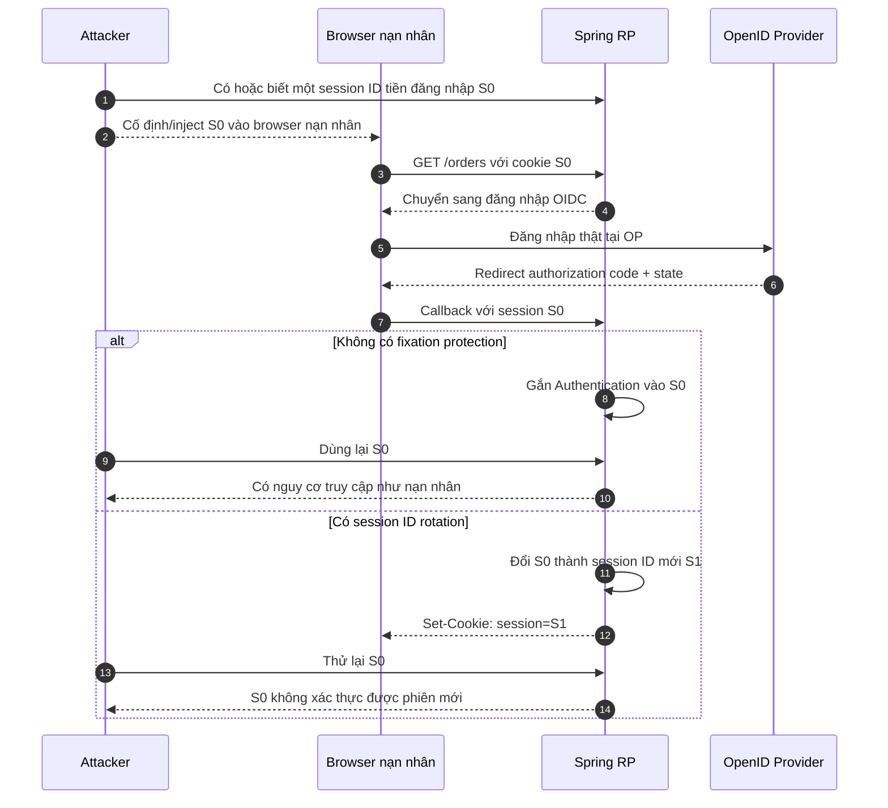
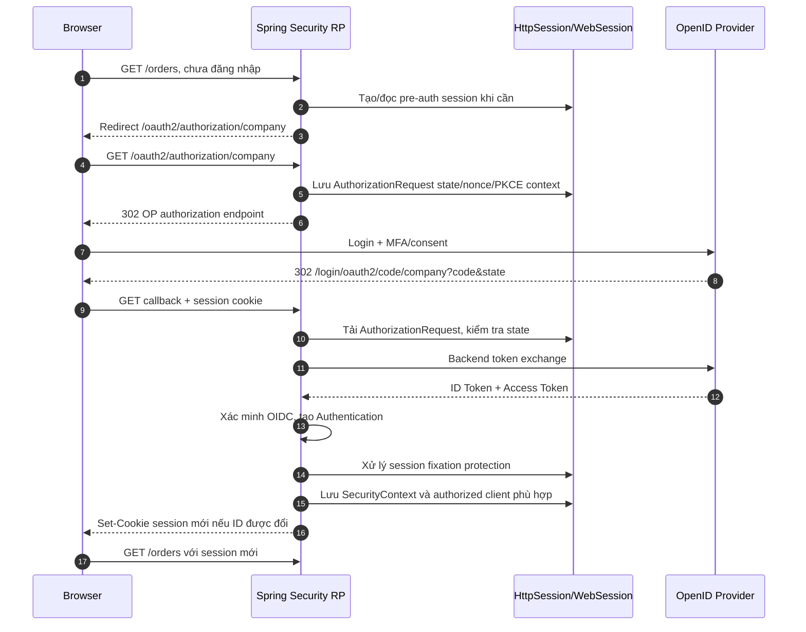
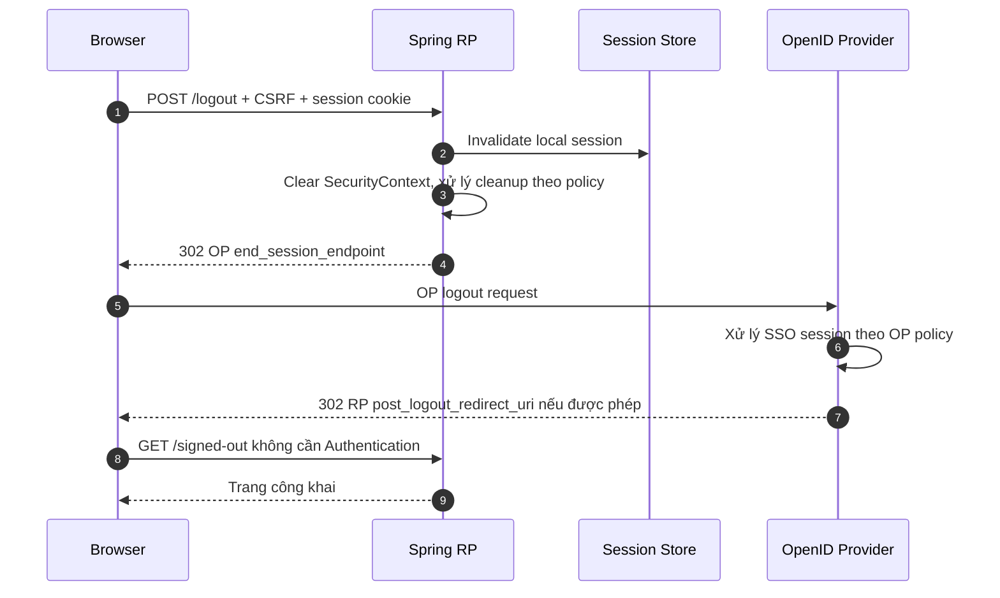
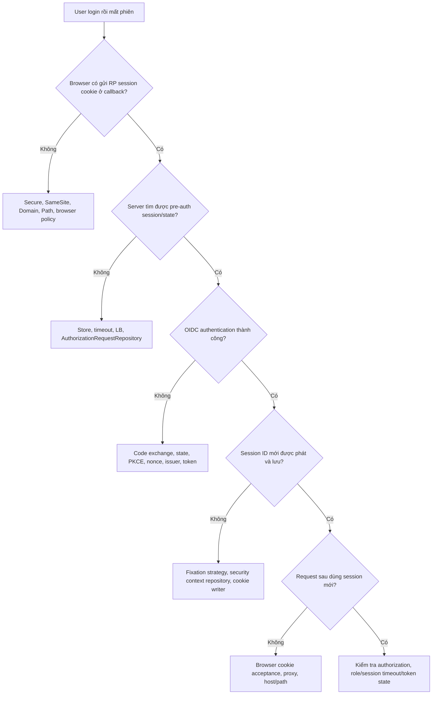

# 27.10. Session fixation, session hijacking và bảo vệ cookie

Trong ứng dụng **Spring Security OAuth 2.0 / OpenID Connect (OIDC) Client**, người dùng thường đăng nhập qua một **OpenID Provider (OP)**, nhưng sau khi Authorization Code Flow hoàn tất, ứng dụng **Relying Party (RP)** vẫn phải duy trì trạng thái xác thực của chính mình. Ở kiến trúc web truyền thống, trạng thái đó thường được lưu trong **`HttpSession`** (Servlet) hoặc **`WebSession`** (WebFlux) và browser giữ một **session cookie** tương ứng.

Bảo vệ OAuth2 `state`, OIDC `nonce`, PKCE và ID Token là cần thiết, nhưng **không thay thế** bảo vệ session của ứng dụng. Nếu session ID bị attacker kiểm soát trước khi đăng nhập hoặc bị đánh cắp sau khi đăng nhập, một hệ thống có thể xác thực token OIDC rất đúng mà vẫn để kẻ tấn công chiếm phiên người dùng.

Bài học này tập trung vào ba lớp bảo mật liên quan:

1. **Session fixation**: attacker cố khiến phiên sau đăng nhập tiếp tục sử dụng một session ID mà họ biết hoặc có thể kiểm soát.
2. **Session hijacking**: attacker lấy và tái sử dụng session credential hợp lệ để giả mạo người dùng.
3. **Cookie protection**: các biện pháp giảm việc cookie bị đọc, bị gửi sai phạm vi, bị ghi đè, bị lợi dụng trong CSRF và bị lộ qua mạng/hạ tầng.

Nội dung được đặt trong ngữ cảnh **Spring Security OAuth2/OIDC Client**, bao gồm luồng redirect qua OP, session rotation sau authentication, Servlet/WebFlux, `Secure`/`HttpOnly`/`SameSite`, `Domain`/`Path`, tiền tố `__Host-`, CSRF, XSS, logout, reverse proxy, distributed sessions, token store, nhiều tenant và chẩn đoán sự cố.

> **Nguyên tắc nền tảng:** **session ID là credential**. Không đưa session ID vào URL/log, không tin một cookie chỉ vì nó được trình duyệt gửi đến, không cho session ID do người dùng chưa xác thực biết trước tiếp tục đại diện cho người dùng vừa đăng nhập, và không coi OIDC SSO session là cùng một phiên với RP session.

## 1. Hai phiên khác nhau trong OIDC Login

Một lượt đăng nhập OIDC thường có ít nhất hai phiên độc lập:

| Phiên | Bên quản lý | Dấu hiệu ở browser | Vai trò |
|---|---|---|---|
| **OP SSO session** | OpenID Provider | Cookie thuộc domain của OP | Giúp OP xác nhận người dùng đã login và áp dụng SSO/MFA policy. |
| **RP application session** | Spring Boot application | `JSESSIONID`, `SESSION` hoặc cookie tên khác thuộc RP | Giúp RP khôi phục `SecurityContext` cho các request nghiệp vụ. |

Ví dụ:

```text
Browser
  |
  | Cookie của app.example.org: JSESSIONID=...
  v
Spring Boot RP
  |
  | Chuyển hướng tới id.example.org
  v
OpenID Provider
  |
  | Cookie của id.example.org: <OP SSO cookie>
  v
Browser quay về RP qua callback
```

RP không nên đọc hoặc dùng trực tiếp cookie của OP để thay thế session của ứng dụng. OP cũng không quản lý `HttpSession` của RP.

### 1.1. Session nào chứa authentication?

Trong ứng dụng Servlet thông thường, Spring Security có thể lưu `SecurityContext` trong session để request sau khôi phục `Authentication`:

```text
HttpSession
  └── SPRING_SECURITY_CONTEXT
          └── Authentication
                  └── OAuth2AuthenticationToken / OidcUser
```

Đây là mô hình khái niệm. Tên attribute và cơ chế repository có thể khác khi bạn thay `SecurityContextRepository`, dùng stateless session, Spring Session hoặc custom authentication.

Một hệ thống còn có thể lưu `OAuth2AuthorizedClient` trong session hoặc service/database riêng. Đối tượng này chứa Access Token và có thể có Refresh Token, **khác** với session ID và `SecurityContext`.

### 1.2. Session cookie không phải Access Token

Browser có thể gọi:

```http
GET /orders HTTP/1.1
Host: app.example.org
Cookie: JSESSIONID=<session-id>
```

RP sau khi xác thực session có thể gọi API:

```http
GET /api/orders HTTP/1.1
Host: api.example.org
Authorization: Bearer <access-token>
```

- `JSESSIONID`: credential để RP nhận diện browser session.
- Access Token: credential để Resource Server cho phép một request API trong scope/audience được cấp.
- Refresh Token: credential để OAuth2 Client xin Access Token mới từ Authorization Server.
- OP cookie: credential thuộc phiên SSO của OP.

Bốn credential này có **nơi lưu, quyền truy cập và vòng đời khác nhau**.

## 2. Session fixation là gì?

**Session fixation** là tình huống attacker có thể khiến một nạn nhân sử dụng một session identifier mà attacker **đã biết trước**. Nếu ứng dụng **không đổi identifier sau khi xác thực**, cùng session ID có thể được nâng từ trạng thái anonymous lên authenticated.

Một kịch bản khái niệm:



Sơ đồ chỉ giải thích threat model, **không phải hướng dẫn khai thác**. Để fixation thành công, attacker còn phải có phương thức đặt/biết session ID sẽ được browser nạn nhân gửi, và ứng dụng phải thiếu hoặc bị lỗi bảo vệ session sau authentication.

### 2.1. Fixation khác việc đánh cắp cookie sau login

Điểm phân biệt là **thời điểm attacker biết credential**:

- **Fixation**: attacker biết/áp đặt session ID **trước** khi nạn nhân login, hy vọng ID ấy vẫn được tin **sau** login.
- **Hijacking**: attacker lấy được session credential **đã hợp lệ** của một user, chẳng hạn do rò log, XSS, kết nối không an toàn hoặc endpoint debug.

Cùng là nguy cơ chiếm phiên, nhưng phòng vệ chủ chốt khác nhau: **rotation khi authentication boundary thay đổi** đối với fixation; **chống rò, ràng buộc và thu hồi session** đối với hijacking.

### 2.2. Session fixation không đồng nghĩa login CSRF

Một biến thể **login CSRF** có thể cố đưa browser nạn nhân vào một phiên được xác thực bằng tài khoản của attacker. OAuth2 `state` và liên kết request/callback giúp chống giả mạo/tiêm authorization response.

Ngược lại, fixation tập trung vào **session identifier** dùng trước và sau khi victim xác thực. Bảo vệ `state` mà **không thay session ID** vẫn có thể để lộ rủi ro fixation ở RP.

## 3. Session hijacking là gì?

**Session hijacking** xảy ra khi attacker chiếm hoặc sử dụng session identifier còn hiệu lực để được RP nhận diện như user đã authenticated.

Các nguồn rò có thể là:

- HTTP không mã hóa hoặc redirect sang kết nối không an toàn.
- Cookie thiếu `Secure` trong kiến trúc triển khai cần HTTPS.
- Session ID xuất hiện trong URL, Referer, analytics, error page hoặc reverse proxy logs.
- XSS hoặc script độc hại đọc cookie nếu thiếu `HttpOnly`.
- Browser extension, malware, thiết bị bị chiếm hoặc devtools/clipboard leak.
- Database/session-store dump, backup, crash dump hoặc debug endpoint.
- Cookie bị ghi đè/cookie tossing từ subdomain bị chiếm.
- Một custom endpoint trả session ID hoặc nguyên headers cho client.
- Session credential bị ghi vào tracing/APM/HTTP wiretap mà quá nhiều người đọc được.

Không nên mặc định mọi vụ hijacking đều do XSS; cần quan sát **cookie đi qua những thành phần nào và ai được phép xem nó**.

### 3.1. Session ID là bearer credential

Về nguyên tắc, nếu RP chỉ dựa vào một session cookie có giá trị hợp lệ để khôi phục authentication, kẻ đang giữ cookie có thể cố dùng nó trên browser hoặc HTTP client khác. Server cần thêm các lớp bảo vệ như hạn sử dụng, cảnh báo bất thường, session revocation và authorization nghiệp vụ.

**`HttpOnly` không khiến session cookie mất giá trị nếu nó bị lấy từ nơi khác.** Nó chỉ hạn chế khả năng truy cập cookie bằng JavaScript trong browser hỗ trợ.

### 3.2. Không gắn chặt session vào IP một cách máy móc

Ràng buộc một session cứng với một IP có thể làm hỏng trải nghiệm khi user chuyển mạng di động/Wi-Fi, sử dụng corporate proxy hoặc khi IP egress thay đổi.

Có thể dùng IP/UA thay đổi như **tín hiệu rủi ro** cho alert hoặc step-up authentication; không coi IP hoặc User-Agent là chứng minh identity. User-Agent dễ giả mạo, còn nhiều users có thể chia sẻ một IP.

## 4. So sánh các nguy cơ liên quan session

| Nguy cơ | Mục tiêu của attacker | Biện pháp trọng tâm |
|---|---|---|
| **Session fixation** | Làm session ID biết trước tồn tại sau authentication. | Đổi session ID lúc authentication thành công; chống cookie injection. |
| **Session hijacking** | Dùng session ID hợp lệ bị lộ. | HTTPS, `Secure`, `HttpOnly`, hạn session, log redaction, revoke, XSS protection. |
| **Session replay** | Dùng lại credential/session đã bị sao chép. | Server-side invalidation/expiry và kiểm soát rủi ro. |
| **CSRF** | Ép browser đã login gửi request thay đổi trạng thái. | CSRF token, `SameSite`, Origin/Fetch Metadata checks phù hợp, endpoint authorization. |
| **XSS** | Chạy script trong origin của ứng dụng. | Output encoding, CSP, input handling; `HttpOnly` giảm đọc cookie. |
| **Cookie tossing/overwriting** | Đưa cookie trùng tên từ subdomain hoặc phạm vi rộng. | Host-only cookie, không đặt `Domain` rộng; `__Host-` nếu khả thi. |
| **Login CSRF/OAuth2 callback injection** | Gắn callback/authorization khác request gốc. | `state`, session correlation, PKCE/nonce và callback validation. |
| **Open redirect** | Điều hướng user/token qua host không được phép. | Fixed/allowlisted redirect URIs, validate destination. |
| **Session exhaustion** | Gây quá nhiều sessions/request hoặc kéo dài sống. | Rate limit, TTL, quotas, cleanup, session store capacity. |

Không có một cookie flag đơn lẻ giải quyết tất cả hàng trên. Bảo mật phải được thực thi ở **trình duyệt, application, Spring Security, proxy và session store**.

## 5. OIDC login làm session chuyển từ anonymous sang authenticated

Một luồng Authorization Code/OIDC thông thường:



Chính thời điểm **authentication thành công** là ranh giới cần bảo vệ session fixation. Trước đó session có thể chỉ chứa `OAuth2AuthorizationRequest`, `SavedRequest` hoặc CSRF context; sau đó nó có thể chứa principal đã authenticated.

### 5.1. Vì sao OAuth2 `state` cần session trước login?

Spring Security thường giữ authorization request đang chờ callback qua `AuthorizationRequestRepository`, mặc định có thể dựa trên `HttpSession` ở Servlet hoặc `WebSession` ở WebFlux.

Callback mang `code`/`state` nhưng phải liên kết được với **request gốc đã bắt đầu trong browser này**. Do đó, **cookie pre-auth** cần tồn tại qua redirect giữa RP và OP, rồi **session ID phải được xử lý an toàn khi user trở thành authenticated**.

### 5.2. Không quay session ID quá sớm và làm mất callback correlation

Nếu custom code invalidate session **giữa lúc khởi động authorization và lúc nhận callback**, Spring Security có thể không tìm thấy request gốc:

```text
authorization_request_not_found
invalid_state_parameter
```

Đổi session ID ở đúng authentication lifecycle khác với xóa sạch session state tùy tiện trước khi callback được xử lý. Đừng viết một filter «mỗi request đổi session ID» vì nghĩ rotation càng nhiều càng an toàn.

### 5.3. OIDC state/nonce khác session ID

| Giá trị | Ai tạo/quản lý? | Mục đích |
|---|---|---|
| `state` | OAuth2 client tạo cho authorization request | Ràng buộc authorization response với request gốc. |
| `nonce` | OIDC client tạo khi cần | Liên kết ID Token với authentication request. |
| PKCE `code_verifier` | OAuth2 client tạo cho flow PKCE | Bảo vệ authorization code khi đổi token. |
| `JSESSIONID`/`SESSION` | App/server/session implementation | Liên kết HTTP requests của browser với server session. |
| `id_token_hint` | OIDC logout flow nếu có | Giúp OP nhận diện ngữ cảnh logout; không phải session ID. |

**Không dùng `state` như session ID**, không đưa session ID vào `state`/`nonce`, và không tắt các kiểm tra này để «chữa» session cookie bị mất.

## 6. Spring Security Servlet: session fixation protection

Trong ứng dụng Spring MVC/Servlet, Spring Security cung cấp **session fixation protection** qua các `SessionAuthenticationStrategy` phù hợp.

Trên Servlet container hỗ trợ `HttpServletRequest.changeSessionId()` (Servlet 3.1+), hành vi bảo vệ thường dùng là **đổi session ID sau authentication thành công** mà giữ lại những session attributes cần thiết.

Có thể cấu hình tường minh:

```java
import org.springframework.context.annotation.Bean;
import org.springframework.context.annotation.Configuration;
import org.springframework.security.config.Customizer;
import org.springframework.security.config.annotation.web.builders.HttpSecurity;
import org.springframework.security.web.SecurityFilterChain;

@Configuration
public class SessionFixationSecurityConfiguration {

    @Bean
    SecurityFilterChain securityFilterChain(HttpSecurity http)
            throws Exception {

        http
            .authorizeHttpRequests(auth -> auth
                .requestMatchers(
                    "/", "/login", "/public/**", "/assets/**"
                ).permitAll()
                .anyRequest().authenticated()
            )
            .oauth2Login(Customizer.withDefaults())
            .sessionManagement(session -> session
                .sessionFixation(fixation -> fixation.changeSessionId())
            );

        return http.build();
    }
}
```

**`changeSessionId()`** là cách phòng session fixation phù hợp với Servlet container hiện đại. Khi ứng dụng tùy chỉnh authentication flow, cần bảo đảm chiến lược fixation vẫn được thực thi, không chỉ được khai báo trong một filter chain không xử lý callback.

### 6.1. Đổi ID, không chỉ thay đổi attribute

Trước login:

```text
Session S0:
  id = preauth-opaque-ID
  attributes = pending OAuth2AuthorizationRequest, saved request, ...
```

Sau login:

```text
Session S1:
  id = new-opaque-ID
  attributes = SecurityContext, authorized client/session data hợp lệ, ...
```

Điểm quan trọng là **attacker biết S0 không được dùng S0 để truy cập S1**. Việc giữ attributes có thể giúp Spring Security giữ state nội bộ đúng lúc; việc xóa/di chuyển attributes phụ thuộc strategy.

### 6.2. Các session fixation strategies

| Strategy | Ý nghĩa | Lưu ý |
|---|---|---|
| `changeSessionId()` | Gọi API của Servlet container để đổi ID của session hiện có. | Thích hợp với Servlet 3.1+ và là lựa chọn thông dụng hiện đại. |
| `migrateSession()` | Tạo session mới và chuyển/copy attributes từ session cũ theo strategy. | Có thể tác động tới listeners/objects và lifecycle. |
| `newSession()` | Tạo session mới, không chuyển toàn bộ application attributes từ session cũ; có thể giữ một số security-related attributes theo implementation. | Dễ mất state nghiệp vụ nếu phụ thuộc attributes cũ. |
| `none()` | Không áp dụng session fixation protection. | Không khuyến nghị cho browser session authentication trừ khi có lý do/threat model đặc biệt. |

Không chọn `none()` để giải quyết một lỗi callback mà chưa xác định nguyên nhân. Thường lỗi state/session đến từ cookie/proxy/repository hoặc custom authentication, không phải bằng chứng fixation protection «không cần thiết».

### 6.3. Spring Security mặc định có thể đã bảo vệ fixation

Khi sử dụng cấu hình thông thường, Spring Security có các bảo vệ session fixation mặc định. Tuy nhiên **không nên kết luận production an toàn chỉ vì không thấy dòng `sessionFixation(...)`**. Cần xác định:

- Phiên bản Spring Security/Servlet đang dùng.
- Authentication mechanism thực sự được gọi.
- `SecurityFilterChain` nào xử lý OAuth2 callback.
- Có custom filter/handler tạo `Authentication` ngoài flow hay không.
- Session ID có thực sự được đổi tại successful login không.
- Spring Session/container có hook cần cấu hình thêm không.

Đây là điều cần hiểu về runtime; bản thân một đoạn config không chứng minh cookie trên browser đã được cập nhật đúng.

## 7. Khi có custom authentication: đừng bỏ qua session strategy

Một hệ thống có thể kết hợp:

- OIDC `oauth2Login()`.
- Form login.
- Custom authentication filter.
- SAML login.
- API token authentication.
- Account switching hoặc impersonation theo quyền admin.

Nếu custom code tự tạo `Authentication` rồi đặt trực tiếp vào `SecurityContext`, **chưa chắc session fixation strategy và authentication success lifecycle mặc định đã chạy**.

Ví dụ ý tưởng nguy hiểm:

```java
// Không phải cách hoàn chỉnh để tự đăng nhập:
// Nếu chỉ đặt Authentication mà bỏ session strategy,
// persistence và security controls sẽ không tương đương
// một successful authentication qua Spring Security filter.
SecurityContextHolder.getContext().setAuthentication(authentication);
```

Với authentication extension, phải dùng framework components phù hợp và tích hợp `SessionAuthenticationStrategy`/`SecurityContextRepository` theo đúng phiên bản/kiến trúc.

### 7.1. Đăng nhập lại trong cùng session

Nếu user đã login bằng tài khoản A rồi chuyển sang B, đó cũng là **thay đổi danh tính/privilege boundary**. Không cho session giữ token hoặc SecurityContext của A mà UI/API tiếp tục dùng cho B.

Cần:

1. Xác minh user được phép đổi tài khoản.
2. Đổi/invalidate session ID phù hợp với authentication lifecycle.
3. Loại bỏ state/cache gắn riêng với account trước.
4. Tạo authentication mới từ flow đáng tin cậy.
5. Không chuyển Access/Refresh Token của A thành token của B.
6. Ghi audit mà không log raw session ID.

### 7.2. Sau step-up/MFA có cần rotate?

Nếu ứng dụng nâng mức đặc quyền (ví dụ vừa xác thực MFA trước thao tác nhạy cảm), cân nhắc rotate session hoặc tạo state/credential ngắn hạn theo policy. Tuy nhiên, cần phối hợp với session storage, pending OAuth2 requests và UX; không phải mọi thao tác verify đều nên xóa toàn bộ session.

## 8. Cookie là gì trong ngữ cảnh session?

Cookie là dữ liệu browser lưu theo origin/domain/path và gửi lại theo quy tắc HTTP. Với server-side session, cookie thường chứa **một identifier ngẫu nhiên**, không chứa toàn bộ `Authentication` hay token.

Ví dụ:

```http
HTTP/1.1 302 Found
Location: /dashboard
Set-Cookie: JSESSIONID=<opaque-id>; Path=/; Secure; HttpOnly; SameSite=Lax
```

Browser gửi:

```http
GET /dashboard HTTP/1.1
Host: app.example.org
Cookie: JSESSIONID=<opaque-id>
```

Giá trị `<opaque-id>` phải được tạo đủ entropy và do session implementation quản lý. Không tự dùng email, numeric user ID, thời gian hoặc chuỗi dự đoán được làm session identifier.

### 8.1. Cookie attributes không mã hóa session ID

`Secure`, `HttpOnly` và `SameSite` là các **ràng buộc cách browser lưu/gửi/truy cập cookie**. Chúng không phải cơ chế encryption của value.

Nếu cookie bị chụp từ một log không được bảo vệ, các flags ấy không làm bản sao của session ID trở nên không dùng được.

### 8.2. Cookie phải có thời hạn và session phải có expiry server-side

Browser có thể giữ cookie cho đến khi đóng browser hoặc tới `Max-Age`/`Expires`. Nhưng application còn cần session timeout, invalidation và policy giới hạn sống ở server.

Một cookie hết hạn ở browser không tự chứng minh session phía server đã bị xóa; ngược lại session phía server hết hạn có thể khiến browser vẫn gửi cookie cũ nhưng không được authenticated.

## 9. `Secure`: chỉ gửi cookie qua kênh an toàn

Cookie `Secure` chỉ được browser gửi qua kết nối được xem là an toàn, thường là HTTPS, với một số ngoại lệ browser dành cho localhost/development.

Ví dụ production:

```http
Set-Cookie: JSESSIONID=<opaque>; Path=/; Secure; HttpOnly; SameSite=Lax
```

Nếu thiếu `Secure`, browser có thể gửi cookie trong request HTTP tới host/path nằm trong scope của cookie, làm tăng nguy cơ session bị lộ trên đường truyền hoặc qua request bị điều hướng sai.

### 9.1. TLS termination tại reverse proxy

Kiến trúc phổ biến:

```text
Browser --HTTPS--> Trusted Reverse Proxy --HTTP nội bộ--> Spring App
```

Dù backend thấy HTTP ở socket nội bộ, browser vẫn dùng HTTPS. Cần cấu hình cookie `Secure` theo **public transport**, không tắt `Secure` chỉ vì upstream connection nội bộ là HTTP.

Ví dụ Spring Boot Servlet:

```yaml
server:
  servlet:
    session:
      cookie:
        secure: true
```

Thiết lập này nên được phối hợp với proxy/gateway để application hiểu đúng scheme/host. Đặc biệt, forwarded headers phải đến từ **proxy tin cậy**, không nhận header `X-Forwarded-Proto` do client Internet tự cung cấp.

### 9.2. HTTPS và HSTS có vai trò khác nhau

HTTPS mã hóa request/response trên đường truyền. HTTP Strict Transport Security (HSTS) giúp browser đã biết policy ưu tiên HTTPS cho host theo chỉ thị, giảm rủi ro downgrade trong các tình huống phù hợp.

HSTS không thay `Secure` cookie flag; cũng không khôi phục session đã bị rò qua log hoặc XSS.

### 9.3. Không tắt certificate verification

Khi gọi OP token endpoint/JWKS/UserInfo hoặc API downstream, Spring OAuth2 Client cần xác thực TLS server. Không vô hiệu hóa hostname/certificate verification chỉ để giải quyết lỗi staging: một endpoint giả có thể nhận authorization code, client secret hoặc Refresh Token.

## 10. `HttpOnly`: giảm khả năng JavaScript đọc cookie

Cookie `HttpOnly` không được cung cấp qua API `document.cookie` cho JavaScript của trang trong browser hỗ trợ.

Ví dụ:

```http
Set-Cookie: JSESSIONID=<opaque>; Path=/; HttpOnly; Secure; SameSite=Lax
```

Điều này giúp giảm khả năng một script XSS **đọc raw session cookie** và gửi ra ngoài.

### 10.1. `HttpOnly` không ngăn mọi tác động XSS

Script đang chạy trong origin hợp lệ có thể vẫn gọi `fetch("/api/transfer", ...)` hoặc thao tác DOM; browser vẫn tự gửi cookie theo policy. Vì vậy:

- `HttpOnly` giúp bảo vệ **tính bí mật của cookie value**.
- Nó **không thay** input/output escaping, CSP, sanitization, CSRF và authorization.
- Một script trong same-origin có thể dùng chính session đang active để phát các request mà user được phép, dù không biết raw ID.

Không mô tả `HttpOnly` là «XSS đã được phòng hoàn toàn».

### 10.2. Chống XSS là một lớp không thể bỏ

Cần:

- Encode output theo HTML/attribute/JavaScript/URL context.
- Tránh chèn dữ liệu user trực tiếp vào `innerHTML`.
- Áp dụng Content Security Policy (CSP) có kiểm soát.
- Hạn chế inline scripts và third-party code.
- Kiểm soát dependency/script integrity khi phù hợp.
- Không trả Access/Refresh Token từ BFF ra frontend nếu không cần.
- Phân quyền API và hành động nhạy cảm.

## 11. `SameSite`: ảnh hưởng trực tiếp tới OIDC redirect flow

`SameSite` là chính sách browser quyết định khi nào cookie được gửi trong **cross-site context**.

Các lựa chọn thường gặp:

| Giá trị | Ý nghĩa điển hình | Ảnh hưởng tới OIDC |
|---|---|---|
| `Strict` | Chỉ gửi trong same-site requests theo chính sách browser. | Có thể làm mất session cookie khi browser quay về RP từ OP khác site. |
| `Lax` | Cho gửi trong nhiều top-level navigations dùng safe methods như GET. | Thường phù hợp callback Authorization Code qua GET. |
| `None` | Cho phép cookie trong cross-site contexts khi yêu cầu khác đáp ứng. | Thường cần cho một số cross-site POST/iframe scenarios; phải đi cùng `Secure`. |
| Không khai báo | Browser áp dụng default riêng, thường theo hướng Lax nhưng có chi tiết/ngoại lệ. | Không nên phụ thuộc ngầm vào default khi thiết kế auth flow. |

Đây là mô tả tổng quát về browser behavior; kết quả phụ thuộc site scheme, browser version, request method và chính sách cookie hiện hành.

### 11.1. OIDC Authorization Code callback GET

Một luồng thông dụng:

```text
1. Browser ở https://app.example.org
2. RP redirect sang https://id.example.net
3. OP xác thực user
4. OP redirect browser tới:
   https://app.example.org/login/oauth2/code/company?code=...&state=...
5. Browser gửi session cookie của RP
6. Spring Security tìm AuthorizationRequest gốc theo state/session
```

Vì bước 4–5 thường là **top-level navigation GET**, `SameSite=Lax` thường cho phép browser gửi cookie RP. Nếu dùng `Strict`, callback cross-site có thể không mang session cookie, dẫn đến lỗi state correlation.

### 11.2. Vì sao không luôn dùng `Strict`?

`Strict` có thể nghe «bảo mật hơn», nhưng nếu nó làm vỡ OIDC callback và user tìm cách khắc phục bằng cách tắt `state` hoặc bỏ session validation, tổng thể sẽ kém an toàn hơn.

**Chọn `SameSite` theo kiến trúc flow**, không dựa vào tên mức «Strict» một cách máy móc.

### 11.3. OIDC `response_mode=form_post`

Một số providers/flow sử dụng **cross-site POST** từ OP tới RP callback, thay vì GET chứa query. Với `SameSite=Lax`, cookie có thể **không được gửi** trong cross-site POST theo chính sách thông thường; `SameSite=None; Secure` có thể cần thiết.

Nhưng không chỉ đổi cookie sang `None` rồi mặc định flow sẽ chạy: cần xác định **Spring Security/version/provider** hỗ trợ response mode và callback body handling phù hợp, cùng CSRF policy và các ràng buộc trình duyệt.

### 11.4. `SameSite=None` có chi phí bảo mật

Nếu cho cookie gửi trong nhiều cross-site contexts, nguy cơ các request cross-site mang cookie tăng. Vì vậy cần CSRF protection, Origin/Fetch Metadata validation khi phù hợp, và giới hạn các endpoints có side effect.

`SameSite=None` **không được dùng để thay thế CSRF token**. Các browser hiện đại cũng thường yêu cầu `Secure` cùng `SameSite=None`.

### 11.5. Same-site khác same-origin

Hai URL:

```text
https://app.example.org
https://billing.example.org
```

có thể được xem là cùng **site** theo registrable domain và scheme, nhưng **khác origin** do hostname khác nhau.

Vì thế, `SameSite` không tự bảo đảm cookie chỉ được dùng bởi một origin cụ thể. `Domain`, host-only cookies, CORS, CSRF và chính sách browser vẫn cần được xét riêng.

## 12. `Domain`: hạn chế phạm vi host nhận cookie

Nếu server đặt:

```http
Set-Cookie: SESSION=<opaque>; Domain=example.org; Path=/; Secure; HttpOnly
```

cookie có thể được gửi tới các subdomains trong phạm vi domain theo browser rules. Điều này có thể tăng bề mặt tấn công nếu tổ chức có:

- Tenant-controlled subdomains.
- Hosting/preview domains.
- Subdomain bỏ quên có thể takeover.
- Ứng dụng khác cùng registrable domain.
- Host xử lý logs/cookies kém an toàn.

Với ứng dụng RP chạy tại `app.example.org`, thường nên **không đặt `Domain`** để browser tạo **host-only cookie** cho đúng hostname đang phát cookie.

### 12.1. Host-only là mặc định khi không có Domain

Ví dụ:

```http
Set-Cookie: JSESSIONID=<opaque>; Path=/; Secure; HttpOnly; SameSite=Lax
```

Nếu không có thuộc tính `Domain`, cookie được giới hạn theo host đã phát cookie, thay vì được chủ động chia sẻ toàn bộ subdomains.

Điều này đặc biệt quan trọng trong SaaS multi-tenant: cookie của tenant alpha không được vô tình gửi sang tenant beta.

### 12.2. Không dùng shared session cookie để chia sẻ SSO giữa nhiều apps

Một ý tưởng nguy hiểm là đặt `Domain=.example.org` để nhiều ứng dụng độc lập chia sẻ cùng session ID. Điều này có thể:

- Cho subdomain kém tin cậy gây cookie collision.
- Tăng phạm vi cookie bị gửi và log.
- Trộn các session stores khác nhau dưới cùng tên cookie.
- Khó quản lý logout/invalidation giữa apps.

Nếu cần Single Sign-On, dùng **OIDC/OAuth2 login qua OP**, không mặc định chia sẻ raw RP session cookie giữa các apps.

### 12.3. Cảnh giác cookie tossing

Một subdomain bị kiểm soát có thể cố đặt cookie có cùng tên trong phạm vi parent domain mà browser chấp nhận. Nếu application phân tích/ưu tiên cookie trùng tên không nhất quán, điều này có thể tạo rủi ro session confusion/fixation.

Biện pháp gồm:

- Host-only cookie, không đặt Domain.
- Tên cookie riêng cho từng ứng dụng nếu chia sẻ hostname/path.
- Kiểm soát subdomain takeover.
- Cân nhắc tiền tố `__Host-`.
- Không dùng cookie name từ input tùy ý.
- Test behavior khi có cookies trùng tên theo path/domain.

## 13. `Path`: phạm vi gửi cookie theo URL path

Cookie:

```http
Set-Cookie: SESSION=<opaque>; Path=/app; Secure; HttpOnly; SameSite=Lax
```

thường được gửi với các request có path tương ứng `/app`, nhưng không phải mọi đường dẫn trên host.

`Path` hữu ích để giới hạn phân phối cookie, nhưng **không phải ranh giới security isolation mạnh giữa các ứng dụng cùng origin**. Các scripts chạy trong same-origin và cookie precedence/path conflicts vẫn cần được xét.

### 13.1. OIDC callback phải nằm trong cookie Path

Giả sử ứng dụng login bắt đầu ở:

```text
/app/oauth2/authorization/company
```

nhưng callback public lại là:

```text
/login/oauth2/code/company
```

trong khi session cookie `Path=/app`. Browser có thể **không gửi cookie** ở callback, khiến Spring Security không tìm được `OAuth2AuthorizationRequest` đã lưu.

Phải bảo đảm cookie Path phù hợp **cả start endpoint và callback** mà ứng dụng nhận, có tính đến reverse proxy rewrite.

### 13.2. Đừng mở Path rộng vô điều kiện

`Path=/` có thể cần khi ứng dụng phục vụ nhiều routes từ root hostname. Nhưng nếu có nhiều ứng dụng độc lập trên cùng một host, nó cũng làm cookie được gửi tới nhiều paths hơn.

Một giải pháp tốt hơn thường là **tách apps nhạy cảm theo hostname**, rồi dùng host-only cookie `Path=/` cho từng host, thay vì chia path trên một origin và hy vọng Path tạo isolation hoàn toàn.

## 14. Tiền tố `__Host-` và `__Secure-`

Browser hiện đại có các quy tắc cookie prefix được dùng như phòng vệ bổ sung.

| Prefix | Yêu cầu chính đối với browser hỗ trợ | Lợi ích |
|---|---|---|
| `__Secure-` | Cookie được phát qua ngữ cảnh bảo mật và có `Secure`. | Hạn chế cookie được đặt qua kênh không an toàn. |
| `__Host-` | `Secure`, `Path=/`, **không có `Domain`**, phát từ secure origin. | Giữ cookie host-only và giảm rủi ro cookie bị subdomain đặt thay. |

Ví dụ khi app chạy ở root hostname:

```http
Set-Cookie: __Host-SESSION=<opaque>; Path=/; Secure; HttpOnly; SameSite=Lax
```

Không nên:

```http
Set-Cookie: __Host-SESSION=<opaque>; Domain=example.org; Path=/; Secure
```

vì vi phạm điều kiện `__Host-` (Domain phải được bỏ).

### 14.1. Prefix không được browser cũ enforce giống nhau

Một số clients/browsers cũ hoặc HTTP clients tự viết có thể không áp dụng đầy đủ prefix semantics. Vì vậy `__Host-` là **phòng vệ bổ sung**, không thay host configuration, cookie policy, secure session ID generation hoặc session rotation.

### 14.2. Khi nào không dùng được `__Host-`?

Nếu application thực sự cần cookie `Path=/app`, prefix `__Host-` yêu cầu `Path=/` nên không phù hợp nguyên trạng. Khi đó:

- Cân nhắc triển khai app trên hostname riêng với root path.
- Nếu không, vẫn dùng `Secure`, `HttpOnly`, host-only cookie và Path phù hợp.
- Không đặt tên `__Host-` rồi bỏ điều kiện của prefix.

### 14.3. Không dùng `__Host-` để thay TLS

Browser cần secure origin và `Secure`; HSTS/TLS configuration vẫn phải đúng. Prefix không bảo vệ session ID đã bị ghi vào application log hoặc trích từ compromised endpoint.

## 15. Spring Boot Servlet: cấu hình cookie/session

Ví dụ cho một Spring Boot Servlet app được expose công khai qua HTTPS ở root path:

```yaml
server:
  servlet:
    session:
      timeout: 30m
      cookie:
        name: __Host-SESSION
        http-only: true
        secure: true
        same-site: lax
        path: /
```

**Không khai báo `domain`** để giữ host-only cookie. Một browser hỗ trợ prefix sẽ yêu cầu `Secure` và `Path=/` như cấu hình.

Cấu hình chỉ mang tính minh họa. Khi dùng Spring Session, một container khác, custom CookieSerializer hoặc một reverse proxy chèn cookie, cần xác định **thành phần nào thực sự phát `Set-Cookie`** và properties nào có hiệu lực.

### 15.1. Đừng chỉ đọc YAML mà không xem response

Sau login, browser phải nhận một `Set-Cookie` phù hợp với public hostname/scheme. Nếu response cuối cùng có:

```http
Set-Cookie: SESSION=<id>; Path=/; HttpOnly
```

thì `Secure` hoặc `SameSite` mà bạn tưởng đã cấu hình có thể không được áp dụng bởi đúng session implementation.

Cần xác định cookie do:

- Servlet container.
- Spring Session.
- Reverse proxy/gateway.
- Custom filter/cookie writer.
- Một application middleware khác.

đang phát. Một số hệ thống có thể có **nhiều `Set-Cookie` cùng tên** do cấu hình chồng chéo; đó là dấu hiệu phải giải quyết.

### 15.2. `server.servlet.session.timeout` là idle timeout, không phải absolute lifetime

Session timeout mặc định ở Servlet thường là **inactivity timeout**. User hoạt động thường xuyên có thể giữ session dài hơn nhiều so với thời gian cấu hình.

Nếu sản phẩm yêu cầu **absolute session lifetime**, phải thiết kế cơ chế riêng theo chính sách:

```text
createdAt = 09:00
absoluteExpiry = 17:00
idleExpiry = lastActivity + 30 phút
effectiveExpiry = min(absoluteExpiry, idleExpiry)
```

Không tự coi `timeout: 30m` là «tự logout tuyệt đối sau 30 phút kể từ login».

### 15.3. Giá trị TTL phụ thuộc threat model

Một ứng dụng ngân hàng, dashboard admin hoặc hệ thống xem tài liệu ít nhạy cảm có thể có timeouts khác nhau. Cân nhắc:

- Độ nhạy dữ liệu và chức năng.
- MFA/step-up requirements.
- Thiết bị cá nhân hay chia sẻ.
- UX và SSO policy.
- Dự phòng khi OP session vẫn còn hợp lệ.
- Session store capacity.
- Phân biệt idle timeout và absolute lifetime.

Không copy một con số timeout thành «chuẩn bắt buộc» cho mọi sản phẩm.

## 16. Reverse proxy, Host/Forwarded headers và cookie flags

Một deployment:

```text
Browser: https://app.example.org
    |
    v
TLS Reverse Proxy / Load Balancer
    |
    v
Spring Boot: http://app-internal:8080
```

Spring Boot có thể dùng:

```yaml
server:
  forward-headers-strategy: framework
```

trong môi trường phù hợp để nhận biết public request scheme/host/path từ forwarded headers **được proxy đáng tin cậy quản lý**.

### 16.1. Cookie Secure phải dựa trên public HTTPS

Nếu proxy terminate TLS, không để việc upstream HTTP khiến application phát session cookie thiếu `Secure`. Có thể cấu hình `secure: true` tường minh trong production.

### 16.2. Không tin forwarded headers từ Internet

Một attacker có thể gửi:

```http
X-Forwarded-Proto: http
X-Forwarded-Host: attacker.example
```

Nếu application tin trực tiếp headers này, nó có thể tạo sai redirect URI, sai base URL hoặc hành vi cookie/transport không mong muốn.

Proxy biên phải **xóa/ghi đè** forwarded headers do bên ngoài cung cấp, rồi chỉ thêm giá trị do proxy xác định. Nếu dùng nhiều lớp proxy, cần thống nhất hop nào được tin.

### 16.3. Path rewrite ảnh hưởng callback và cookie

Public URL có thể là:

```text
https://app.example.org/portal/login/oauth2/code/company
```

nhưng backend thấy:

```text
/login/oauth2/code/company
```

do gateway strip prefix. Session cookie `Path`, forwarded prefix, OIDC `redirect_uri` và callback matcher phải tương thích. Nếu browser không gửi session cookie ở **public callback path**, Spring Security không thể correlate `state` dù token endpoint hoạt động bình thường.

### 16.4. Đừng đưa cookie vào access logs

Reverse proxies có thể log:

```http
Cookie: __Host-SESSION=<opaque>
Set-Cookie: __Host-SESSION=<opaque>; ...
```

Cần redact và giới hạn access. Một load balancer log chứa session cookies có thể trở thành nguồn hijacking nguy hiểm hơn cả application code.

## 17. CSRF protection vẫn cần dù đã có SameSite

Một ứng dụng dùng session cookie thường tự động nhận cookie từ browser trên những requests hợp lệ theo policy. Đặc điểm này làm **Cross-Site Request Forgery** có thể xảy ra khi attacker khiến browser đang login gửi request thay đổi trạng thái.

`SameSite=Lax` giảm một số cross-site contexts nhưng không thay mọi biện pháp CSRF, đặc biệt với same-site cross-origin, browser behavior, legacy clients và cấu hình `None`.

Spring Security Servlet có CSRF protection trong cấu hình web phù hợp. Không tắt CSRF toàn ứng dụng chỉ vì OIDC đã có `state`.

### 17.1. OAuth2 state và application CSRF token khác nhau

- OAuth2 `state`: bảo vệ liên kết authorization request/callback trong login flow.
- CSRF token của ứng dụng: bảo vệ các unsafe HTTP methods/actions trên endpoints dùng cookie session.

Ví dụ:

```http
POST /account/email HTTP/1.1
Host: app.example.org
Cookie: __Host-SESSION=<id>
Content-Type: application/x-www-form-urlencoded

email=new@example.org&_csrf=<csrf-token>
```

**`state` trong OIDC login không tự bảo vệ request `POST /account/email`.**

### 17.2. CSRF token có vòng đời riêng

Khi session ID được đổi hoặc SecurityContext thay đổi, CSRF token strategy có thể ảnh hưởng form đã mở trước đó. Spring Security có các cơ chế invalidation/refresh CSRF token quanh authentication/logout tùy cấu hình.

Nếu UI giữ một token cũ sau login và gặp 403, không sửa bằng việc disable CSRF. Cần đồng bộ cách frontend lấy token mới và cách repository/lazy token behavior của Spring Security version đang dùng.

### 17.3. Không dùng GET cho state-changing logout

Một link:

```html
<a href="/logout">Đăng xuất</a>
```

nếu server thực hiện logout qua GET mà không có CSRF protection có thể bị trang khác hoặc prefetch kích hoạt.

Trong Servlet app có CSRF mặc định, logout thường yêu cầu **POST với CSRF token**. Với SPA/BFF, phải thiết kế POST logout và CSRF strategy tương đương phù hợp.

## 18. OIDC callback và session cookie `SameSite`

Trong `oauth2Login()`, browser quay về RP tại:

```text
GET /login/oauth2/code/{registrationId}?code=...&state=...
```

Framework phải tìm **authorization request gốc** thường lưu ở session. Các triệu chứng thiếu cookie:

```text
authorization_request_not_found
invalid_state_parameter
OAuth2 authorization request not found
```

Những lỗi này có thể do:

- Cookie `SameSite=Strict` không được gửi khi quay từ cross-site OP.
- Cookie `Path` không bao trùm callback.
- Cookie `Domain` không phù hợp public host.
- Cookie `Secure` bị browser từ chối do dùng HTTP development URL.
- Session timeout trong lúc user hoàn tất MFA/consent.
- Browser mất/không lưu cookie vì privacy settings.
- Load balancer đưa callback tới node không có session.
- Custom authorization request repository bị lỗi.
- Callback bị route vào sai `SecurityFilterChain`.

**Không bỏ `state` hoặc chấp nhận callback không có saved authorization request để làm login «chạy được».** Đó là phá hàng rào chống callback injection.

### 18.1. Cookie cũ và cookie mới qua login

Một số người debug thấy:

```text
Pre-login session ID = S0
Post-login session ID = S1
S0 != S1
```

Đây có thể chính là **session fixation protection hoạt động đúng**, không phải bug. Vấn đề là user sau login phải tiếp tục gửi cookie S1, và S0 không được dùng để truy cập authenticated session.

### 18.2. Nhiều tab đồng thời

Hai tabs có thể khởi động login song song với hai `state` khác nhau. Cookie session giống nhau nhưng authorization request repository phải có behavior phù hợp với concurrent flows.

Đừng tự quay/xóa session ở giữa hai flows mà không hiểu repository semantics; một flow hoàn tất có thể ảnh hưởng flow còn lại. Khi cần multi-tab support cao, chọn repository/flow phù hợp và giữ state/nonce verification.

## 19. Spring Security logout và session invalidation

Một local logout an toàn thường cần:

- Xác định đúng authentication/session.
- Clear `SecurityContext`.
- Invalidate `HttpSession`/`WebSession` theo policy.
- Loại bỏ cookie phù hợp hoặc khiến browser bỏ session ID.
- Cleanup remember-me/authorized clients nếu sản phẩm yêu cầu.
- Không để session cũ được tái sử dụng.
- Không log giá trị session ID khi báo logout.

Ví dụ Servlet:

```java
import org.springframework.context.annotation.Bean;
import org.springframework.context.annotation.Configuration;
import org.springframework.security.config.Customizer;
import org.springframework.security.config.annotation.web.builders.HttpSecurity;
import org.springframework.security.web.SecurityFilterChain;

@Configuration
public class LogoutSecurityConfiguration {

    @Bean
    SecurityFilterChain securityFilterChain(HttpSecurity http)
            throws Exception {

        http
            .authorizeHttpRequests(auth -> auth
                .requestMatchers("/", "/signed-out", "/assets/**").permitAll()
                .anyRequest().authenticated()
            )
            .oauth2Login(Customizer.withDefaults())
            .logout(logout -> logout
                .logoutUrl("/logout")
                .invalidateHttpSession(true)
                .clearAuthentication(true)
                .deleteCookies("__Host-SESSION")
                .logoutSuccessUrl("/signed-out")
            );

        return http.build();
    }
}
```

Đoạn này minh họa local logout. Nếu sử dụng **OIDC RP-Initiated Logout**, thay/điều chỉnh logout success handler để browser được đưa tới OP khi hỗ trợ; đừng đăng ký nhiều logout success handlers xung đột.

### 19.1. `deleteCookies(...)` không bảo đảm xóa mọi bản cookie

Để browser xóa cookie, response cần dùng **đúng tên, domain và path** theo phạm vi cookie đang tồn tại. Nếu proxy/session implementation phát cookie với Path khác, gọi `deleteCookies("JSESSIONID")` có thể không xóa cookie thực tên `__Host-SESSION` hoặc scope khác.

Cần kiểm tra `Set-Cookie` thực tế. Session invalidation ở server vẫn là điểm quan trọng nhất; xóa cookie không thay thế việc vô hiệu session ID.

### 19.2. Clear-Site-Data có tác động rộng

Header `Clear-Site-Data` có thể yêu cầu browser xóa các loại dữ liệu của origin/site theo directive, ví dụ cookies/storage trong phạm vi hỗ trợ. Nhưng nó có thể ảnh hưởng các ứng dụng khác trên cùng site/domain và không có cùng support ở mọi browser.

Chỉ dùng khi hiểu phạm vi, quy tắc browser và UX. Không coi nó là cách duy nhất để invalidate server-side sessions hoặc OP SSO.

### 19.3. OIDC Logout không tự revoke Access/Refresh Token

Một OIDC logout success handler có thể đưa browser tới OP `end_session_endpoint`, kèm `id_token_hint` và `post_logout_redirect_uri`. Điều đó **khác** với:

- Xóa RP session.
- Xóa `OAuth2AuthorizedClient` trong token store.
- Thu hồi Access/Refresh Token qua token revocation endpoint.
- Hủy phiên ở các ứng dụng hoặc thiết bị khác.

Nếu chính sách yêu cầu dừng delegated access khi logout, phải thiết kế token cleanup/revocation riêng. Không coi browser về trang `/signed-out` là bằng chứng mọi token đã bị thu hồi.

## 20. Giới hạn số phiên đồng thời

Một user có thể có nhiều sessions từ laptop, điện thoại và nhiều browsers. Với một số ứng dụng nhạy cảm, cần giới hạn concurrent sessions hoặc cung cấp chức năng «đăng xuất các thiết bị khác».

Spring Security Servlet có hỗ trợ concurrent session control thông qua session management components và `SessionRegistry`.

Ví dụ một cấu hình giới hạn một phiên, với những điều kiện wiring/session tracking phù hợp:

```java
http
    .sessionManagement(session -> session
        .sessionFixation(fixation -> fixation.changeSessionId())
        .maximumSessions(1)
            .maxSessionsPreventsLogin(false)
            .expiredUrl("/session-expired")
    );
```

Đây là fragment trong `HttpSecurity`. Cần bảo đảm `/session-expired` là trang public và session event tracking/registry có hiệu lực theo deployment.

### 20.1. Hai chính sách khác nhau

- `maxSessionsPreventsLogin(true)`: có thể chặn login mới khi đã đạt giới hạn phiên.
- `maxSessionsPreventsLogin(false)`: cho login mới và làm phiên cũ hết hiệu lực theo cơ chế concurrency control.

Chọn theo yêu cầu sản phẩm; một người đi công tác đổi thiết bị có thể bị ảnh hưởng nếu không có chức năng thu hồi phiên cũ.

### 20.2. Session registry và distributed deployment

Nếu application chạy nhiều replicas, local in-memory `SessionRegistry` không đủ cho chính sách «một session trên toàn cluster». Cần session registry/store có khả năng quan sát các phiên trên tất cả instances.

Với Servlet stack, một số cấu hình dùng `HttpSessionEventPublisher` để cập nhật `SessionRegistry` đúng khi sessions bị hủy; khi dùng Spring Session, cần kiểm tra tích hợp session registry/distributed storage tương ứng.

**Không nghĩ rằng gọi `maximumSessions(1)` trong một node tự giới hạn phiên trên toàn cluster**.

### 20.3. Concurrency control không ngăn session theft tuyệt đối

Nếu attacker đã có cookie của session hợp lệ, việc giới hạn số session không nhất thiết phát hiện đó là một thiết bị khác; hai HTTP clients có thể dùng cùng session ID. Cần kết hợp phát hiện rủi ro, logout/revoke, TTL và session integrity.

## 21. Session timeout: idle và absolute lifetime

Có hai giới hạn khác nhau:

| Loại | Ý nghĩa | Ví dụ |
|---|---|---|
| **Idle timeout** | Session hết hạn sau khoảng thời gian không có hoạt động hợp lệ. | 30 phút không request. |
| **Absolute timeout** | Session hết hạn sau một thời gian tối đa kể từ lúc authentication/session bắt đầu, dù user còn hoạt động. | 8 giờ kể từ khi login. |

Trong hệ thống nhạy cảm, absolute timeout giúp giảm trường hợp một session bị giữ sống vô hạn bằng activity.

### 21.1. Session không được sống lâu hơn chính sách account

Nếu user bị disable hoặc role thay đổi, session vẫn có thể chứa authorities cũ. Do đó cần thiết kế:

- Kiểm tra account status khi thao tác nhạy cảm.
- Revalidation/authorization version cho role/policy changes khi cần.
- Session revocation khi user bị khóa.
- Không dựa vào session timeout đơn thuần nếu yêu cầu thu hồi tức thời.
- Đảm bảo Resource Server cũng áp dụng policy tương ứng.

### 21.2. Sliding expiration cần giới hạn

Một cookie/session với sliding idle timeout có thể sống rất lâu nếu user/attacker liên tục gửi requests. Với tài khoản admin, nên cân nhắc **absolute max age** và step-up/MFA lại cho thao tác rủi ro cao.

### 21.3. Không dùng refresh token expiry thay session expiry

Access Token, Refresh Token, RP session và OP SSO session có vòng đời khác nhau. Một Refresh Token hợp lệ không tự chứng minh browser session còn authenticated; một RP session còn sống không chứng minh Access Token chưa hết hạn.

## 22. Session hijacking và dấu hiệu phát hiện

Một số tín hiệu có thể hữu ích:

- Cùng một session xuất hiện từ hai khu vực/ASN/thiết bị rất khác trong thời gian ngắn.
- User-Agent thay đổi đáng kể.
- Số lượt thất bại CSRF hoặc security events tăng đột biến.
- Session bị dùng sau khi user tuyên bố đã logout.
- Nhiều request cùng session từ nguồn mạng bất thường.
- Sử dụng API admin không thường gặp.
- Nhiều session được tạo và quay trong khoảng thời gian ngắn.
- Token/API calls bất thường sau khi phiên web bị revoke.

Tín hiệu không tự chứng minh hijacking: VPN, mobile networks, corporate proxies và ứng dụng browser cập nhật có thể tạo false positives.

### 22.1. Log metadata, không log raw session ID

Nên ghi:

```text
event=session.authenticated
principalRef=internal-opaque-user-key
sessionEventId=<random-audit-id>
clientRegistration=company
riskLevel=low
```

Không ghi:

```text
JSESSIONID=...
Cookie: ...
Authorization: Bearer ...
RefreshToken=...
```

Nếu cần liên kết sự kiện theo session, tạo một **audit correlation ID tách khỏi credential**. Việc hash raw session ID làm log identifier cũng cần cân nhắc vì một giá trị yếu/thiết kế sai có thể thành fingerprint dài hạn hoặc lộ thông tin; đừng dùng raw cookie value làm metric label.

### 22.2. Phản ứng với nguy cơ bị chiếm session

Tùy mức rủi ro:

1. Đánh dấu session để xác minh lại.
2. Yêu cầu MFA/step-up cho hành động nhạy cảm.
3. Revoke/invalidate session server-side.
4. Thông báo người dùng khi phù hợp.
5. Xem xét token revocation nếu credential OAuth2 khác có nguy cơ bị lộ.
6. Điều tra nguồn rò từ logs, proxy, browser, XSS hoặc session store.

Không tự động khóa tài khoản vĩnh viễn chỉ vì IP đổi một lần.

## 23. Session store: database, Redis và Spring Session

Spring Session có thể thay bộ lưu session của container bằng Redis/JDBC hoặc implementation khác. Điều đó giúp ứng dụng nhiều instances chia sẻ trạng thái, nhưng tạo thêm một **kho credential nhạy cảm**.

Trong store có thể có:

- Session ID và timestamps.
- `SecurityContext`, authentication principal/authorities.
- `OAuth2AuthorizationRequest` đang chờ callback.
- `OAuth2AuthorizedClient` hoặc token liên quan nếu cấu hình lưu trong session.
- CSRF token và saved request.
- Application attributes có thể chứa PII.

### 23.1. Bảo vệ quyền truy cập store

Áp dụng:

- Least-privilege database/Redis credentials.
- Network isolation, TLS và authentication cho store.
- Encryption at rest và backup encryption theo threat model.
- Giới hạn ai được truy cập snapshots/keys/session attributes.
- Audit quyền đọc/quản trị.
- TTL/expiration cleanup phù hợp.
- Không trả session data qua admin/debug APIs.
- Tách môi trường dev/staging/prod và tenants nếu policy yêu cầu.

Mã hóa disk không ngăn một DB admin có quyền đọc mọi session rows. Nếu threat model yêu cầu chống lộ credential qua read access, cân nhắc thêm encryption ở tầng ứng dụng và phân quyền key phù hợp.

### 23.2. Shared store và session fixation protection

Khi `changeSessionId()` hoặc cơ chế tương ứng làm đổi ID, session store phải phản ánh đúng lifecycle của key cũ/mới. Với custom implementations, cần bảo đảm:

- Session ID cũ không tiếp tục dùng để khôi phục authenticated session mới.
- Không tồn tại hai keys active dẫn tới cùng authenticated state ngoài ý muốn.
- Replication/TTL không tạo cửa sổ reuse nguy hiểm.
- Session events được xử lý nhất quán.
- Custom middleware không cache credential cũ.

### 23.3. Không dùng một session namespace cho mọi môi trường

Nếu staging và production dùng cùng Redis prefix/namespace hoặc cùng cookie host/scope sai, có thể dẫn tới va chạm session IDs, dữ liệu lẫn môi trường hoặc lỗi khó chẩn đoán.

Phân tách session store, cookie names, hostnames, encryption keys và credentials theo môi trường.

## 24. Multi-tenant: cookie và session không được trộn

Một SaaS có thể dùng:

```text
alpha.example.org
beta.example.org
```

Nếu tất cả tenants đặt cookie:

```http
Set-Cookie: SESSION=<id>; Domain=example.org; Path=/
```

browser có thể gửi cùng cookie qua các subdomains. Điều này mở rộng phạm vi cookie và có thể gây session confusion hoặc va chạm với ứng dụng khác.

Một cấu hình tốt hơn nếu tenants được tách bằng hostname:

```text
alpha.example.org -> host-only session cookie alpha
beta.example.org  -> host-only session cookie beta
```

Cần kết hợp:

- Tenant được xác định từ host/path đáng tin cậy và mapping đã kiểm soát.
- Session liên kết với đúng tenant/account.
- Không để user đổi tenant ID bằng query rồi dùng session của tenant khác.
- Authorized client token store phân vùng theo registration/principal/tenant/issuer khi cần.
- Cookie `Domain` không tự mở rộng phạm vi giữa tenant hosts.
- Phân quyền resource ở mỗi request.

### 24.1. Same email không phải cùng identity

Nếu OP A và OP B trả cùng email, ứng dụng không được tự gộp hai sessions/authorized clients. Liên kết OIDC identity nên dựa trên `(issuer,sub)` đã xác minh và account linking được ủy quyền.

### 24.2. Header Host không phải nguồn xác thực tenant vô điều kiện

Nếu tenant được chọn bằng hostname, reverse proxy phải validate host và chỉ chuyển các hosts được phép. Đừng dùng `X-Forwarded-Host` tùy ý từ browser để xác định tenant và đổi cookie domain.

## 25. Spring Security WebFlux: `WebSession` và session cookie

Trên **WebFlux/Reactive stack**, application dùng `WebSession` và security context repository reactive thay vì `HttpSession`, `HttpServletRequest`.

Các thành phần cần biết:

| Servlet | Reactive/WebFlux |
|---|---|
| `HttpSecurity` | `ServerHttpSecurity` |
| `SecurityFilterChain` | `SecurityWebFilterChain` |
| `HttpSession` | `WebSession` |
| `HttpServletRequest` | `ServerWebExchange` |
| `HttpSessionSecurityContextRepository` | `WebSessionServerSecurityContextRepository` khi cấu hình dùng session |
| Session cookie do container/Spring Session | Cookie qua `WebSessionIdResolver` / session infrastructure |
| `HttpServletRequest.changeSessionId()` | `WebSession.changeSessionId()` |

Đừng copy nguyên `server.servlet.session.*` rồi mặc định nó kiểm soát cookie của một WebFlux server. Cần dùng reactive session configuration và xác định component phát cookie.

### 25.1. Cấu hình WebFlux Security cơ bản

```java
import org.springframework.context.annotation.Bean;
import org.springframework.context.annotation.Configuration;
import org.springframework.security.config.Customizer;
import org.springframework.security.config.annotation.web.reactive.EnableWebFluxSecurity;
import org.springframework.security.config.web.server.ServerHttpSecurity;
import org.springframework.security.web.server.SecurityWebFilterChain;

@Configuration
@EnableWebFluxSecurity
public class ReactiveSecurityConfiguration {

    @Bean
    SecurityWebFilterChain securityWebFilterChain(ServerHttpSecurity http) {
        return http
            .authorizeExchange(exchanges -> exchanges
                .pathMatchers(
                    "/", "/public/**", "/signed-out"
                ).permitAll()
                .anyExchange().authenticated()
            )
            .oauth2Login(Customizer.withDefaults())
            .oauth2Client(Customizer.withDefaults())
            .build();
    }
}
```

Cấu hình này xử lý OIDC login theo reactive stack. Session fixation, WebSession ID rotation và cookie properties cần được đánh giá theo **Spring Security/Spring Framework version và custom handlers** của ứng dụng.

### 25.2. `WebSession.changeSessionId()`

WebFlux có API:

```java
import org.springframework.web.server.ServerWebExchange;
import reactor.core.publisher.Mono;

public Mono<Void> rotateWebSessionId(ServerWebExchange exchange) {
    return exchange.getSession()
        .flatMap(session -> session.changeSessionId());
}
```

Đây là **ví dụ thao tác đổi ID khi đã có ServerWebExchange**, không phải một WebFlux authentication success handler đầy đủ. Không tự gọi đoạn này ở **mọi request** hoặc tại thời điểm callback chưa được correlate.

Nếu viết custom OIDC authentication success flow, phải tích hợp rotation với security-context save và success redirect đúng thứ tự. Không thay một handler mặc định bằng đoạn code này rồi làm mất persistence, response handling hoặc state validation.

### 25.3. `CookieWebSessionIdResolver`

Một WebFlux app có thể tùy chỉnh cookie bằng `CookieWebSessionIdResolver`:

```java
import org.springframework.context.annotation.Bean;
import org.springframework.context.annotation.Configuration;
import org.springframework.web.server.session.CookieWebSessionIdResolver;
import org.springframework.web.server.session.WebSessionIdResolver;

@Configuration
public class ReactiveSessionCookieConfiguration {

    @Bean
    WebSessionIdResolver webSessionIdResolver() {
        CookieWebSessionIdResolver resolver =
            new CookieWebSessionIdResolver();

        resolver.setCookieName("__Host-SESSION");

        resolver.addCookieInitializer(builder -> builder
            .path("/")
            .secure(true)
            .httpOnly(true)
            .sameSite("Lax")
        );

        return resolver;
    }
}
```

Ví dụ giả định production HTTPS, ứng dụng chạy trên root hostname và không đặt cookie Domain. Khi dùng Spring Session hoặc Boot reactive configuration khác, cần tránh đăng ký trùng resolver và xác định bean/property thực tế được dùng.

### 25.4. Không lẫn Servlet session timeout với WebFlux

Spring Boot có cấu hình riêng cho reactive session trong các phiên bản tương ứng. Nếu sử dụng custom `WebSessionManager` hoặc Spring Session, TTL và cookie behavior có thể bị override.

Cần xác định stack và storage trong ứng dụng thật, không tự kết luận `server.servlet.session.timeout` có tác dụng với WebFlux.

## 26. Stateless APIs và browser OIDC login

Một số dự án kết hợp:

- Browser-facing pages: OIDC `oauth2Login()` + session cookie.
- REST API: Resource Server JWT Bearer Token, không cần browser session.

Đây là hai use cases khác nhau. Với Servlet có thể dùng **nhiều `SecurityFilterChain`**:

```text
/api/**  -> Resource Server JWT, thường stateless
/web/**  -> oauth2Login, session-based
/oauth2/authorization/** và /login/oauth2/code/** -> thuộc login chain
```

Không cấu hình toàn ứng dụng thành `SessionCreationPolicy.STATELESS` rồi mặc định Authorization Code/OIDC login sẽ vẫn dùng session-backed authorization request repository bình thường. Nếu thiết kế **stateless OAuth2 login** đặc thù, cần repository/state correlation bảo mật riêng, không chỉ đổi một enum.

### 26.1. API bearer token không dùng session cookie

Nếu API xác thực bằng Bearer token trong `Authorization` header, threat model khác browser session:

- CSRF qua browser cookie ít liên quan hơn khi browser không tự gắn header Bearer theo cách mặc định.
- Access Token theft/replay và audience validation trở thành trọng tâm.
- API không nên tự động nhận browser session cookie khi mục tiêu là stateless resource server.

Đừng trộn hai kiểu xác thực không có chủ đích, làm API vừa nhận session cookie vừa nhận Bearer Token với precedence khó đoán.

### 26.2. OIDC login callback phải thuộc đúng chain

Nếu OIDC chain chỉ match `/web/**` nhưng start/callback ở `/oauth2/authorization/**` và `/login/oauth2/code/**`, filter có thể không xử lý đúng request. Lỗi callback khi đó không phải do SameSite, dù biểu hiện có thể tương tự.

## 27. Remember-me, persistent login và cookie khác session

Một ứng dụng có thể sử dụng remember-me hoặc cookie persistent authentication riêng. Những cookie ấy không đồng nghĩa session cookie.

Khi local session hết hạn, remember-me có thể tái xác thực user trong một request mới theo cấu hình, khiến user nghĩ logout không thành công nếu remember-me token vẫn tồn tại.

Cần phân biệt:

- Session ID cookie.
- Remember-me authentication cookie.
- OIDC OP SSO cookie.
- CSRF cookie nếu app dùng cookie-based CSRF repository.
- Browser preference cookie.
- Access Token/Refresh Token phía backend.

### 27.1. Logout cần xem toàn bộ credential liên quan

Chỉ xóa `JSESSIONID` có thể chưa xóa remember-me. Chỉ invalidate RP session không xóa OP SSO session. Chỉ gọi OP logout không nhất thiết revoke Refresh Token còn trong backend store.

Cần định nghĩa logout semantics và cleanup theo sản phẩm.

### 27.2. CSRF cookie thường không phải `HttpOnly` trong một số SPA patterns

Nếu frontend cần đọc CSRF token từ một cookie như `XSRF-TOKEN` rồi gửi header, cookie **CSRF token** có thể được cấu hình `HttpOnly=false` theo pattern đó. Điều này **không có nghĩa session cookie cũng được tắt `HttpOnly`**.

Không áp dụng cùng flags cho mọi cookie mà không phân biệt mục đích. Session cookie và CSRF token cookie có threat models khác nhau.

## 28. Vòng đời session qua OIDC logout

Một RP-Initiated Logout flow:



**Không dùng GET `/signed-out` làm bằng chứng user chắc chắn đã logout OP**: ai cũng có thể mở URL đó trực tiếp.

### 28.1. Logout không hủy mọi thiết bị mặc định

Một user có thể có sessions ở nhiều browsers hoặc thiết bị. Local logout hiện tại không nhất thiết invalidate mọi sessions khác.

Nếu muốn «Sign out everywhere», cần xác định:

- Session registry/distributed session store.
- Quyền người dùng/admin được phép revoke sessions.
- Token stores/Refresh Token families.
- OP logout/back-channel capabilities.
- Thời điểm và thông báo cho các thiết bị còn lại.

### 28.2. Nếu tab bị đóng giữa khi OP logout

RP session có thể đã bị hủy, nhưng browser chưa tới OP end-session endpoint. Khi ấy OP SSO session vẫn có thể sống. Đây là lý do không dựa duy nhất vào browser redirect để đảm bảo mọi session/token được revoke.

## 29. Khi session cookie bị lộ: phản ứng đúng

Giả sử monitoring phát hiện raw `JSESSIONID` trong một log được chia sẻ quá rộng.

Quy trình khái niệm:

1. **Khoanh vùng** ứng dụng, môi trường, thời điểm, đối tượng log bị ảnh hưởng.
2. **Ngăn rò tiếp**: dừng logging raw Cookie/Set-Cookie, hạn chế quyền đọc logs/traces.
3. **Đánh giá phạm vi các sessions có nguy cơ** trong retention window.
4. **Invalidate/revoke sessions** liên quan tại server, theo policy.
5. **Kiểm tra nguồn rò**: proxy, APM, exception, debugger, browser, XSS.
6. **Xem xét OAuth2 tokens** nếu token store hoặc raw Access/Refresh Token cũng bị lộ.
7. **Thông báo người dùng hoặc yêu cầu đăng nhập lại** khi cần.
8. **Rà cookie flags, timeout và session ID rotation**.
9. **Đánh giá backups, exports và log mirrors** có chứa cookie không.
10. **Bổ sung prevention/monitoring** để tránh tái diễn.

**Chỉ đổi tên cookie từ `JSESSIONID` sang `SESSION` không thu hồi được các session IDs đã lộ.** Cần xử lý server-side session và nguồn rò.

### 29.1. Đừng xuất raw session ID vào ticket để điều tra

Có thể dùng internal event ID/hashed diagnostics theo policy để tìm log, nhưng không paste raw cookie value trong chat/email/ticket.

Nếu buộc phải xử lý secret evidence theo quy trình điều tra bảo mật, phải dùng môi trường/kênh được phê duyệt và giới hạn truy cập nghiêm ngặt.

## 30. Troubleshooting: lỗi login và session

| Triệu chứng | Nguyên nhân đáng xét | Hướng khắc phục |
|---|---|---|
| OIDC callback báo `authorization_request_not_found`. | Browser không gửi session cookie, session expired, repository/chain sai. | Kiểm tra SameSite/Path/Domain/proxy và session store. |
| Callback từ OP về nhưng nhận login page lại. | Authentication không được lưu, cookie mới không được nhận, sai chain. | Kiểm tra SecurityContext persistence và `Set-Cookie` sau login. |
| Trước/sau login cookie ID khác. | Session fixation protection hoạt động. | Đây thường là hành vi đúng, không tự tắt rotation. |
| Trước/sau login cookie ID giống hệt. | Có thể thiếu fixation protection hoặc custom flow bỏ qua strategy. | Xác minh authentication flow/session strategy; không suy luận từ một request duy nhất. |
| Cookie không xuất hiện trên HTTP localhost. | Cookie `Secure` với browser/dev scheme không phù hợp. | Dùng HTTPS dev hoặc cấu hình riêng an toàn cho local. |
| Cookie `SameSite=Strict` và callback GET bị mất session. | Cross-site navigation không gửi cookie. | Đánh giá Lax và state verification; không tắt state. |
| form_post callback không có session cookie. | Cross-site POST và SameSite. | Xem policy `None; Secure` và khả năng hỗ trợ response mode. |
| Cookie bị gửi tới mọi subdomain. | `Domain=example.org` quá rộng. | Host-only cookie hoặc thiết kế SSO đúng qua OP. |
| `__Host-SESSION` không được browser lưu. | Có Domain, Path không phải `/`, thiếu Secure hoặc HTTP. | Đáp ứng đầy đủ prefix requirements. |
| Logout xong vẫn truy cập được bằng cookie cũ. | Session chưa bị invalidate hoặc session store/proxy stale. | Revoke server-side, kiểm tra cluster/session lifecycle. |
| Logout xong login lại ngay. | OP SSO session còn sống, remember-me hoặc frontend auto-login. | Phân biệt local logout, OP logout và remember-me. |
| Chỉ lỗi khi scale nhiều replica. | Sessions không shared, replication/TTL không nhất quán. | Spring Session/distributed store hoặc routing phù hợp. |
| Browser back hiển thị dữ liệu cũ. | History/back-forward cache hoặc HTTP cache. | Cache headers và xác minh quyền trên request mới. |
| Admin role bị thu hồi nhưng session vẫn có quyền. | Authorities snapshot cũ trong SecurityContext. | Authorization revalidation hoặc revoke sessions. |
| Session ID bị log trong APM. | Middleware/wiretap ghi raw Cookie/Set-Cookie. | Redaction, quyền truy cập và incident response. |
| Nhiều cookies cùng tên làm nhận sai session. | Path/Domain collision, subdomain cookie injection. | Host-only, tên cookie riêng và xử lý prefix. |
| API Resource Server nhận session cookie ngoài ý muốn. | Web client/proxy forward headers quá rộng. | Không forward browser Cookie sang downstream khi không cần. |
| `maximumSessions(1)` không hoạt động trên cluster. | Local SessionRegistry hoặc event tracking thiếu. | Distributed registry/session integration. |
| Lỗi CSRF sau khi login. | Token cũ/lazy token strategy/session rotation. | Lấy CSRF token mới theo cơ chế framework, không disable CSRF. |

### 30.1. Phân tách lỗi theo lớp



Không sửa lỗi «missing state» bằng việc tắt CSRF hoặc session fixation protection. Phải tìm đúng lớp mất state/cookie.

## 31. Những anti-pattern cần tránh

### 31.1. Tắt fixation protection để giữ ID cũ

```java
.sessionManagement(session ->
    session.sessionFixation(fixation -> fixation.none())
)
```

Nếu chỉ vì một integration phụ thuộc session ID không đổi, lựa chọn này có thể mở rủi ro fixation. Cần sửa integration để chấp nhận session rotation, không hạ bảo vệ của ứng dụng.

### 31.2. Gửi session ID trong URL

```text
https://app.example.org/dashboard?sessionId=<opaque-id>
```

URL có thể xuất hiện trong logs, Referer và browser history. Ưu tiên cookie/session transport có bảo vệ, không bật URL rewriting nếu không có nhu cầu và threat model rất cụ thể.

### 31.3. Tắt `HttpOnly` để SPA đọc session cookie

Trong BFF, frontend **không cần đọc raw session ID** để gọi same-origin API; browser tự gửi cookie theo policy. Nếu cần CSRF token cho SPA, dùng CSRF mechanism riêng thay vì công bố session cookie.

### 31.4. Đặt `Domain=.example.org` cho mọi tenants

Mở rộng cookie sang các subdomains khiến session hijacking/cookie injection tăng rủi ro. Dùng host-only cookies và OIDC SSO thay raw session sharing.

### 31.5. Dùng `SameSite=Strict` mà không xét OIDC callback

Có thể làm mất session trong top-level cross-site redirect. Chọn SameSite theo flow và browser behavior thực tế.

### 31.6. Dùng `SameSite=None` mà tắt CSRF

Cho cookie gửi trong nhiều cross-site contexts nhưng bỏ CSRF protection là một cấu hình nguy hiểm đối với endpoints thay đổi trạng thái.

### 31.7. Cho URL callback chứa session ID

Không đưa session ID hoặc Refresh Token vào `redirect_uri`, `state`, success redirect query hoặc post-logout redirect URI.

### 31.8. Coi `Secure` cookie là không thể bị đánh cắp

`Secure` giúp hạn chế vận chuyển qua HTTP không an toàn, không ngăn logs/heap dumps/XSS-induced requests hoặc compromised browser.

### 31.9. Coi `HttpOnly` là đã chống XSS

XSS vẫn có thể thực hiện hành động trong authenticated origin. Cần CSP/output encoding/API authorization.

### 31.10. Chỉ xóa cookie khi logout, không invalidate server session

Cookie có thể đã bị attacker sao chép trước đó. Cần server-side invalidation để bản sao mất hiệu lực.

### 31.11. Dùng HTTP session làm nơi chứa mọi token không kiểm soát

Session store/backup có thể lộ `OAuth2AuthorizedClient`/Refresh Token. Phân loại credential, mã hóa, RBAC, retention theo chính sách.

### 31.12. Khóa phiên cứng theo IP

Dễ gây false positives khi mạng thay đổi và không chứng minh identity. Dùng IP/UA làm tín hiệu rủi ro, không phải yếu tố xác thực duy nhất.

### 31.13. Dùng một SessionRegistry local cho toàn cluster

Có thể bỏ sót sessions từ nodes khác. Cần distributed session registry/integration phù hợp.

### 31.14. Cho rằng OIDC logout đồng nghĩa revoke mọi token

Local session, OP SSO session, OAuth2 authorized client và Resource Server tokens có vòng đời riêng.

## 32. Mô hình kiến trúc an toàn

```text
                         Browser
                            |
           Host-only session cookie:
           Secure + HttpOnly + SameSite=Lax
           (Path hợp lệ, no Domain)
                            |
                            v
                       HTTPS / HSTS
                            |
                            v
                 Trusted Reverse Proxy
             sanitize Forwarded/Host headers
             no raw Cookie/Set-Cookie logs
                            |
                            v
                    Spring Security RP
                 oauth2Login + CSRF policy
                            |
         +------------------+------------------+
         |                                     |
         v                                     v
    OIDC callback                         Business API
    state/nonce/PKCE                      Authentication
    validation                            Authorization
         |                                     |
         v                                     |
   Auth success                                |
   session ID rotation                         |
         |                                     |
         +------------------+------------------+
                            |
                            v
                   Session/SecurityContext
                   HttpSession / WebSession
                            |
                      Shared store
               TTL + revocation + RBAC
                            |
                +-----------+----------+
                |                      |
                v                      v
       OAuth2AuthorizedClient      Audit events
       Access/Refresh Tokens       no session ID
       encrypted/isolated          no raw tokens
                |
                v
             WebClient
         Access Token to correct
         Resource Server only

Parallel security boundaries:
  OP SSO cookie is not RP session cookie
  Logout local is not token revocation
  Session ID is not OIDC state
  Account role changes need revalidation
  Cookie attributes do not replace CSRF/XSS defenses
```

Thiết kế tốt không phụ thuộc một flag duy nhất, mà giữ đồng thời:

- Session IDs đủ entropy, chỉ do server/session infrastructure phát.
- Session rotation khi authentication/privilege boundary thay đổi.
- Cookie host-only, `Secure`, `HttpOnly`, `SameSite` phù hợp flow.
- HTTPS và proxy headers tin cậy.
- OIDC `state`/`nonce`/PKCE và callback correlation.
- CSRF/XSS defenses độc lập.
- Session store có TTL, RBAC, audit và revocation.
- Không chia raw cookies giữa providers/tenants.
- Token store và RP session tách nhiệm vụ.
- Logout/local session invalidation và OP/token cleanup theo policy.

## 33. Trình tự triển khai đề xuất

Khi bảo vệ Spring Security OIDC Client trước session fixation và hijacking:

1. **Xác định stack** là Servlet/MVC hay WebFlux/Reactive; không trộn các cấu hình session của hai loại.
2. **Liệt kê các cookies** của RP, OP, remember-me và CSRF; chỉ rõ cookie nào chứa session ID.
3. **Bật HTTPS production** và HSTS thích hợp; cấu hình trusted reverse proxy.
4. **Đảm bảo session cookie có `Secure` và `HttpOnly`**, không chứa ID dự đoán được.
5. **Chọn `SameSite` theo OIDC callback** (GET hay form_post) và CSRF threat model.
6. **Giới hạn `Domain`/`Path`**, ưu tiên host-only; cân nhắc `__Host-` nếu root path/HTTPS cho phép.
7. **Duy trì session fixation protection** khi authentication thành công; không chọn `none()` chỉ để giữ ID cũ.
8. **Giữ `state`/nonce/PKCE** và `AuthorizationRequestRepository` đúng cho login callback.
9. **Không tự thay authentication pipeline** mà bỏ security context persistence/session strategy.
10. **Duy trì CSRF protection** cho các endpoints dùng browser cookie.
11. **Giới hạn XSS** bằng encoding/CSP/secure frontend patterns; không trả token/session ID về UI.
12. **Chọn idle/absolute session lifetime** và policy step-up/MFA cho thao tác nhạy cảm.
13. **Thiết kế local logout/invalidation** và cleanup cookie đúng tên/path/domain.
14. **Phân biệt OP SSO logout, RP logout và token revocation**; triển khai từng phần theo yêu cầu.
15. **Nếu nhiều instances**, dùng shared session infrastructure/session registry/TTL nhất quán.
16. **Không log raw Cookie/Set-Cookie**, bảo vệ session dumps/backups và quyền operator.
17. **Thêm phát hiện bất thường** bằng metadata an toàn, có cơ chế revoke session khi cần.
18. **Đánh giá tenant/registration isolation** để cookie và token không bị dùng chéo.
19. **Kiểm tra callback và cookie paths qua reverse proxy** thay vì chỉ nhìn cấu hình nội bộ.
20. **Duy trì runbook ứng phó lộ session** và đánh giá rủi ro thực tế theo kiến trúc.

## 34. Tài liệu tham khảo

- [Spring Security Reference — Session Management (Servlet)](https://docs.spring.io/spring-security/reference/servlet/authentication/session-management.html)
- [Spring Security Reference — Session Fixation Attacks](https://docs.spring.io/spring-security/reference/servlet/authentication/session-management.html#authentication-session-fixation)
- [Spring Security Reference — Concurrent Sessions Control](https://docs.spring.io/spring-security/reference/servlet/authentication/session-management.html#authentication-concurrent-sessions)
- [Spring Security Reference — OAuth2 Login](https://docs.spring.io/spring-security/reference/servlet/oauth2/login/index.html)
- [Spring Security Reference — OIDC Logout](https://docs.spring.io/spring-security/reference/servlet/oauth2/login/logout.html)
- [Spring Security Reference — CSRF (Servlet)](https://docs.spring.io/spring-security/reference/servlet/exploits/csrf.html)
- [Spring Security Reference — Reactive OAuth2 Login](https://docs.spring.io/spring-security/reference/reactive/oauth2/login/index.html)
- [Spring Security Reference — WebFlux Security](https://docs.spring.io/spring-security/reference/reactive/configuration/webflux.html)
- [Spring Framework Reference — WebFlux Web Sessions](https://docs.spring.io/spring-framework/reference/web/webflux/session-management.html)
- [Spring Boot Reference — Spring Session](https://docs.spring.io/spring-boot/reference/web/spring-session.html)
- [Spring Boot Reference — Embedded Web Servers](https://docs.spring.io/spring-boot/reference/web/servlet.html)
- [MDN — Set-Cookie](https://developer.mozilla.org/en-US/docs/Web/HTTP/Headers/Set-Cookie)
- [MDN — SameSite Cookies](https://developer.mozilla.org/en-US/docs/Web/HTTP/Guides/Cookies)
- [OWASP Session Management Cheat Sheet](https://cheatsheetseries.owasp.org/cheatsheets/Session_Management_Cheat_Sheet.html)
- [OWASP Cross-Site Request Forgery Prevention Cheat Sheet](https://cheatsheetseries.owasp.org/cheatsheets/Cross-Site_Request_Forgery_Prevention_Cheat_Sheet.html)
- [OWASP Cross-Site Scripting Prevention Cheat Sheet](https://cheatsheetseries.owasp.org/cheatsheets/Cross_Site_Scripting_Prevention_Cheat_Sheet.html)
- [OpenID Connect Core 1.0](https://openid.net/specs/openid-connect-core-1_0.html)
- [OAuth 2.0 Security Best Current Practice — RFC 9700](https://www.rfc-editor.org/rfc/rfc9700)

**Kết luận:** trong Spring Security OAuth2/OIDC Client, **xác minh ID Token đúng không đồng nghĩa RP session đã an toàn**. Để chống **session fixation**, phải bảo đảm session ID được xử lý/đổi khi người dùng chuyển từ anonymous sang authenticated, đặc biệt khi có custom authentication. Để giảm **session hijacking**, phải bảo vệ cookie với HTTPS, `Secure`, `HttpOnly`, `SameSite` phù hợp, host-only `Domain`, `Path` chính xác và có thể dùng tiền tố `__Host-`; đồng thời giảm XSS/CSRF, ngăn rò session qua logs và bảo vệ session store. Trong OIDC redirect flow, cookie phải được browser gửi đúng ở callback để `state`/nonce/PKCE correlation hoạt động. Cuối cùng, **RP session, OP SSO session và OAuth2 Access/Refresh Tokens là ba vòng đời khác nhau**: rotation, logout, revocation và account authorization phải được thiết kế đồng bộ nhưng không đánh đồng.
