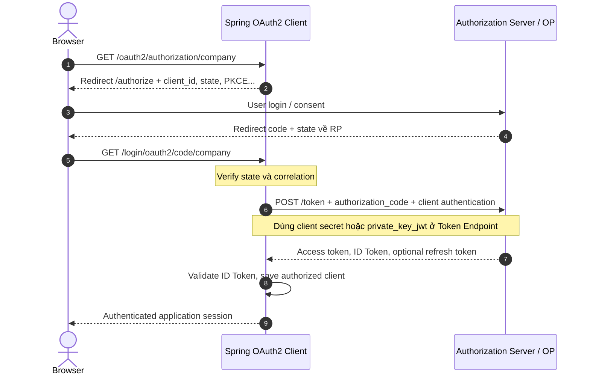
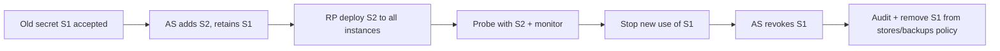
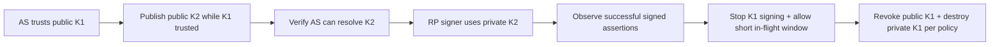
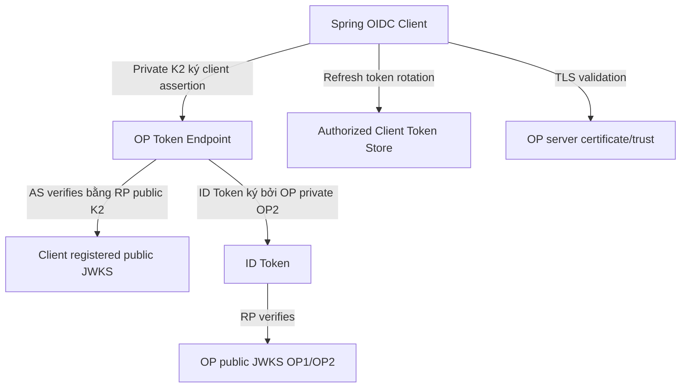
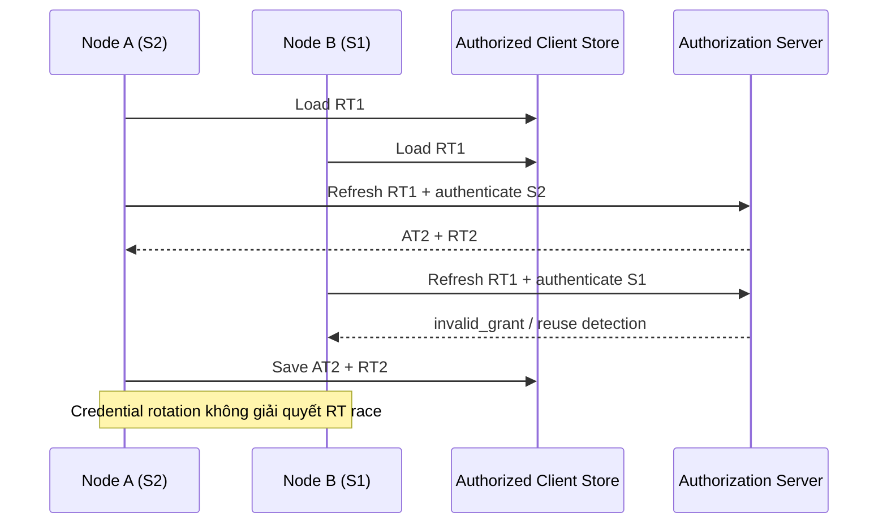

# 27.11. Client secret rotation và private key rotation

Trong **Spring Security OAuth 2.0 / OpenID Connect (OIDC) Client**, một ứng dụng có thể giữ **client secret** để xác thực với Authorization Server (AS), hoặc sử dụng một **private key** để ký JWT client assertion (`private_key_jwt`), xác thực bằng chứng chỉ mTLS, hay thực hiện một profile bảo mật khác. Khi credential bị lộ, đến hạn thay đổi hoặc tổ chức nâng mức bảo mật, ứng dụng phải thực hiện **credential rotation**.

Rotation không chỉ là sửa một biến môi trường rồi restart. Trong lúc triển khai, nhiều instance có thể đang chạy cùng lúc; browser đang thực hiện Authorization Code Flow; backend đang refresh access token; một số kết nối đã được thiết lập bằng certificate cũ; và AS có thể đang cache public key của client. Nếu loại credential cũ quá sớm, dịch vụ bị lỗi `invalid_client`. Nếu giữ credential cũ quá lâu, credential đã lộ tiếp tục có thể bị lạm dụng.

Bài học tập trung vào **27.11. Client secret rotation và private key rotation** thuộc chương **27. Bảo mật tích hợp**, trong phạm vi **Spring Security OAuth 2.0 OIDC Client** trên **Spring Boot 3.x / Spring Security 6.x**, cả **Servlet** và **WebFlux**. Các code và URL chỉ minh họa. API hỗ trợ `private_key_jwt` và tùy biến Token Endpoint có thể khác nhau theo Spring Security version; hãy đối chiếu Javadoc/reference **đúng phiên bản đã khóa trong dự án** trước khi tích hợp.

> **Nguyên tắc quan trọng:** Rotation an toàn cần một **giai đoạn chuyển tiếp có kiểm soát** giữa credential cũ và credential mới, nhưng không được kéo dài giai đoạn đó khi credential đã bị compromise. Phải phân biệt **client authentication credential**, **OP signing key/JWKS**, **refresh token** và **session cookie**: chúng không cùng vòng đời, không cùng nơi lưu, cũng không cùng cách thu hồi.

## 1. Kết quả cần đạt

Sau bài, bạn có thể:

1. Phân biệt `client_secret_basic`, `client_secret_post`, `client_secret_jwt`, `private_key_jwt`, mTLS client authentication và OP's JWK signing keys.
2. Giải thích credential được dùng ở đâu trong Authorization Code, Refresh Token và Client Credentials grants.
3. Thiết kế **client secret rotation có overlap**: tạo secret mới → triển khai → kiểm thử → thu hồi secret cũ.
4. Nhận biết giới hạn khi AS **chỉ hỗ trợ một secret đang hoạt động** và không thể bảo đảm zero-downtime bằng cấu hình đơn thuần.
5. Quản lý **private key ring**, `kid`, public JWK registration, JWT assertion `iss`/`sub`/`aud`/`exp`/`jti` và thuật toán ký.
6. Lập kế hoạch **private key rotation cho `private_key_jwt`** và phân biệt với xoay certificate mTLS.
7. Cập nhật `ClientRegistration` theo phiên bản và thay đổi cấu hình một cách nhất quán qua nhiều instances.
8. Giữ an toàn các Authorization Code callbacks, token refreshes và authorized clients đang tồn tại.
9. Xây quy trình secret management, rollout, rollback, revoke và ứng phó credential compromise.
10. Kiểm thử negative cases, multi-tenant isolation, concurrency, observability và failure handling mà không làm lộ credential.

## 2. Bối cảnh: một ứng dụng dùng client credential khi nào?

Giả sử cổng ứng dụng `https://portal.example.com` có OIDC registration:

```text
registrationId     = company
client_id          = portal-web
issuer             = https://id.company.example
grant              = authorization_code
client_auth_method = client_secret_basic
```

Người dùng login qua browser:



**Client secret/private key thường không được gửi trong browser authorization redirect**. Chúng được backend dùng để chứng minh client identity tại **Token Endpoint**, và đôi khi tại PAR/Revocation/Introspection endpoints theo profile của AS.

Nếu access token hết hạn, backend có thể dùng refresh token. Khi đó **client authentication vẫn có thể cần thiết**:

```text
POST /token
grant_type=refresh_token
refresh_token=<refresh-token>
client authentication=<secret hoặc signed assertion>
```

Vì vậy một credential rotation lỗi có thể không ảnh hưởng tất cả requests ngay lập tức; nó chỉ lộ ra khi user login mới hoặc khi token phải refresh.

### 2.1. Bốn loại rotation dễ nhầm

| Loại | Cái gì thay đổi? | Bên giữ private material | Ảnh hưởng chính |
| --- | --- | --- | --- |
| **Client secret rotation** | Secret dùng `client_secret_basic/post` hoặc secret-based client auth | RP và AS | Token Endpoint client authentication |
| **Client private key rotation** | Private key ký `private_key_jwt`/JWT request, hoặc key auth khác | RP; AS tin public key | Signed client assertion, key registration |
| **OP signing key/JWKS rotation** | OP thay private signing key và công bố public JWK | OP | RP xác minh chữ ký ID Token |
| **Refresh token rotation** | AS cấp RT mới khi client refresh | AS và token store của RP | Vòng đời user/workload authorization |

Có thể bổ sung **mTLS client certificate/private key rotation** và **session ID rotation**; chúng cũng không đồng nghĩa với bốn loại ở bảng trên.

### 2.2. Một lỗi bảo mật điển hình

OP thay khóa ký ID Token (`kid=op-K2`), nhưng đội tích hợp lại đổi `client-secret` và restart app. Kết quả là lỗi vẫn xảy ra vì decoder/JWKS cache chưa nhận khóa OP mới.

Ngược lại, client secret hết hạn gây `invalid_client` ở Token Endpoint; xóa cache JWKS của OP không giải quyết được vấn đề.

Luôn xác định credential nằm ở **bên nào** và **bước giao thức nào** trước khi rotate.

## 3. Các phương thức xác thực OAuth2 Client

### 3.1. `client_secret_basic`

RP gửi credential qua HTTP Basic Authorization tới Token Endpoint:

```http
POST /oauth2/token HTTP/1.1
Host: id.company.example
Content-Type: application/x-www-form-urlencoded
Authorization: Basic <redacted-base64-client-id-and-secret>

grant_type=authorization_code&
code=<authorization-code>&
redirect_uri=https%3A%2F%2Fportal.example.com%2Flogin%2Foauth2%2Fcode%2Fcompany
```

`Basic` chỉ là **encoding**, không phải encryption; HTTPS/TLS vẫn bắt buộc. Không ghi header `Authorization` vào log.

### 3.2. `client_secret_post`

RP gửi `client_id` và `client_secret` trong form body Token Endpoint request:

```http
POST /oauth2/token HTTP/1.1
Host: id.company.example
Content-Type: application/x-www-form-urlencoded

grant_type=client_credentials&
client_id=portal-worker&
client_secret=<redacted-secret>
```

Body có credential rất nhạy cảm; request-body logging/APM phải được redact. **Không tự đổi `client_secret_basic` sang `client_secret_post` chỉ để khắc phục lỗi rotation**: AS phải hỗ trợ và client registration phải được cấu hình đúng method.

### 3.3. `client_secret_jwt`

RP ký client assertion bằng thuật toán HMAC dựa trên shared secret; AS xác minh bằng secret. Nó vẫn là **secret-based client authentication**, nhưng biểu hiện trên HTTP khác Basic/Post.

Rotation secret có thể ảnh hưởng cả cách tạo JWT assertion và policy của AS. Secret cần entropy/độ dài phù hợp thuật toán MAC; không dùng chuỗi password ngắn làm khóa HMAC.

### 3.4. `private_key_jwt`

RP ký một **client assertion JWT** bằng private key riêng. AS nhận public key qua registration (static JWK/JWKS hoặc `jwks_uri` được cấu hình) để xác minh. Shared `client_secret` không cần dùng cho bước xác thực này.

Ví dụ JWT claims thường có:

```json
{
  "iss": "portal-web",
  "sub": "portal-web",
  "aud": "https://id.company.example/oauth2/token",
  "iat": 1794800000,
  "exp": 1794800060,
  "jti": "unique-assertion-id"
}
```

Các giá trị thời gian chỉ minh họa. **`aud` phải theo profile AS**, thường là token endpoint URL hoặc một audience được AS quy định; không chọn tùy tiện. Assertion phải có thời hạn ngắn và `jti` chống replay theo hợp đồng provider.

### 3.5. mTLS client authentication

RP chứng minh sở hữu private key của một **client certificate** thông qua TLS handshake. Cách AS xác thực certificate, certificate chain, subject DN hoặc SAN và cách token bị ràng buộc với certificate phụ thuộc RFC 8705/profile.

Certificate/private key rotation **không phải thao tác đổi `private_key_jwt`**. Cả hai dùng asymmetric cryptography, nhưng một bên chứng minh ở TLS layer, một bên ký JWT ở application layer.

### 3.6. Bảng chọn cơ chế

| Client authentication method | Dữ liệu RP phải bảo vệ | Cần đăng ký gì ở AS? | Rotation cần phối hợp |
| --- | --- | --- | --- |
| `client_secret_basic` | Shared client secret | Client ID + secret + method | Active secrets tại AS, config deployment |
| `client_secret_post` | Shared client secret | Như trên nhưng method khác | AS/RP và body redaction |
| `client_secret_jwt` | Shared secret HMAC | Secret + alg/profile | Assertion signing + AS verification |
| `private_key_jwt` | Private signing key | Public JWK/JWKS hoặc `jwks_uri`, alg | Key overlap/JWKS propagation/`kid` |
| mTLS | Client certificate private key | Trust/certificate binding policy | Cert enrollment, TLS pools, token binding |

**Không có cơ chế nào tự miễn việc bảo vệ key/secret, TLS, token storage và authorization policy.**

## 4. Secret rotation là một giao thức vận hành, không chỉ là thao tác cấu hình

Một rotation theo lịch tốt thường có **giai đoạn overlap**: AS chấp nhận cả secret cũ và secret mới trong một khoảng thời gian đủ để rollout.



### 4.1. Các bất biến phải giữ

- `client_id` và AS issuer được giữ đúng registration (trừ khi đang migrate client).
- Secret mới **được tạo bằng CSPRNG** với entropy theo chính sách AS.
- Tất cả Token Endpoint calls của client vẫn được xác thực trong giai đoạn rollout.
- OP chỉ chấp nhận secret nằm trong tập đã phê duyệt.
- Không dùng secret của tenant khác nếu secret hiện tại lỗi.
- Không xuất raw secret trong deployment logs, CI outputs hay metrics.
- Có owner, revision và ngày thu hồi secret cũ.
- Rollback phải dùng credential còn hợp lệ và không suy yếu TLS/grant policy.

### 4.2. Một timeline thực tế

| Mốc | AS chấp nhận | RP instance A | RP instance B | Mục tiêu |
| --- | --- | --- | --- | --- |
| T0 | S1 | S1 | S1 | Hoạt động bình thường |
| T1 | **S1, S2** | S1 | S1 | Tạo S2, chưa đổi traffic |
| T2 | **S1, S2** | **S2** | S1 | Rolling deployment |
| T3 | **S1, S2** | S2 | **S2** | Tất cả instances dùng S2 |
| T4 | **S1, S2** | S2 | S2 | Probe, monitor và settle |
| T5 | **S2** | S2 | S2 | Revoke S1 tại AS |

Khoảng T1–T4 không có “một con số phút chuẩn”. Nó phụ thuộc chiều dài rollout, số replicas, token refresh intervals, khả năng rollback, AS propagation latency, cũng như phát hiện các workers cũ.

### 4.3. Secret nào được sử dụng khi cả hai còn hợp lệ?

Spring Security thông thường có **một `clientSecret` được chọn trong `ClientRegistration`** tại một thời điểm, không tự lưu một danh sách secrets để thử lần lượt. Overlap là **chính sách chấp nhận ở AS**: trong lúc chuyển đổi, mỗi RP instance có thể dùng S1 hoặc S2, cả hai đều được AS chấp nhận.

**Đừng thiết kế interceptor “nếu `invalid_client` thì tự thử mọi secret trong Vault”.** Điều đó có thể làm lộ credential, che cấu hình lỗi và tạo retry storm. Nếu có yêu cầu fallback đặc biệt, phải giới hạn theo version, operation và security review.

## 5. Điều kiện để rotation gần zero-downtime

### 5.1. Authorization Server cho phép hai secrets cùng active

Đây là điều kiện thuận lợi nhất. Các bước:

1. Tạo secret mới trong AS; **không hủy S1 ngay**.
2. Lưu S2 vào secret manager với version/reference riêng.
3. Deploy S2 tới một canary RP instance hoặc một test OAuth2 client path phù hợp.
4. Kiểm tra Token Endpoint authentication thực bằng S2.
5. Rollout sang tất cả replicas/workers.
6. Kiểm tra không còn client nào dùng S1 (qua AS audit và deployment inventory).
7. Revoke S1.
8. Kiểm tra mọi lần cấp/refresh token sau revoke dùng S2 thành công.

Zero-downtime vẫn phụ thuộc application rollout, AS policy, caching và network; việc “AS cho phép hai secrets” **không tự đảm bảo** cả quá trình không lỗi.

### 5.2. AS chỉ cho phép một secret

Nếu việc tạo S2 **lập tức vô hiệu hóa S1**, một rollout nhiều instances có thể thấy:

```text
AS accepts only S2
Node A has S2 -> token requests succeed
Node B has S1 -> invalid_client
```

Với API khách hàng có yêu cầu không gián đoạn nghiêm ngặt, cần **thỏa thuận phương án với AS**:

- Có hỗ trợ versioned client credentials/secondary secrets không?
- Có thể tạo **một OAuth2 client registration mới** (client ID mới) rồi cut over không?
- Có thể tạm dừng token issuance một khoảng ngắn có thông báo không?
- Có thể blue-green deploy với chỉ một active backend route không?
- Có cách đồng bộ cutover gần như nguyên tử ở cả AS và RP không?
- Những authorization code callbacks đang chờ có dùng được client cũ không?

**Không thể hứa zero-downtime chỉ bằng cách đổi environment variable** nếu AS không hỗ trợ overlap và không có coordination. Cần công bố rủi ro hoặc áp dụng migration sang client mới, có redirect/callback/consent/authorized-client consequences riêng.

### 5.3. Khi client ID cũng thay đổi

Nếu phải tạo OAuth2 client B mới:

```text
company-v1: client_id=portal-old, secret=S1
company-v2: client_id=portal-new, secret=S2
```

Đây không còn đơn thuần là secret rotation. ID Token `aud`, redirect URI registration và authorized client storage có thể khác.

Nên dùng **versioned registration IDs** (khi phù hợp) để các Authorization Code callbacks đang bay với V1 được xử lý đúng client, còn login requests mới được route sang V2. Không tự coi refresh token của client V1 là token thuộc V2.

## 6. Spring Boot cấu hình `client_secret_basic`

Một registration OIDC Servlet/Reactive:

```yaml
spring:
  security:
    oauth2:
      client:
        registration:
          company:
            provider: company-op
            client-id: ${OIDC_COMPANY_CLIENT_ID}
            client-secret: ${OIDC_COMPANY_CLIENT_SECRET}
            client-authentication-method: client_secret_basic
            authorization-grant-type: authorization_code
            redirect-uri: "{baseUrl}/login/oauth2/code/{registrationId}"
            scope:
              - openid
              - profile
        provider:
          company-op:
            issuer-uri: https://id.company.example/oidc
```

Chỉ dùng **một secret hiện đang được chọn** trong property `client-secret`. Giá trị phải lấy từ secret manager hoặc một nguồn cấu hình bảo mật tương ứng deployment.

### 6.1. `application.properties` tương đương

```properties
spring.security.oauth2.client.registration.company.provider=company-op
spring.security.oauth2.client.registration.company.client-id=${OIDC_COMPANY_CLIENT_ID}
spring.security.oauth2.client.registration.company.client-secret=${OIDC_COMPANY_CLIENT_SECRET}
spring.security.oauth2.client.registration.company.client-authentication-method=client_secret_basic
spring.security.oauth2.client.registration.company.authorization-grant-type=authorization_code
spring.security.oauth2.client.registration.company.redirect-uri={baseUrl}/login/oauth2/code/{registrationId}
spring.security.oauth2.client.registration.company.scope=openid,profile
spring.security.oauth2.client.provider.company-op.issuer-uri=https://id.company.example/oidc
```

Không commit secret thật vào YAML/properties hoặc Docker image. Các biến môi trường cũng có bề mặt rò rỉ; giới hạn quyền đọc, process inspection, deployment manifests và CI logs.

### 6.2. Một thay đổi secret trong Vault có tự cập nhật `ClientRegistration` không?

Thông thường **không**. Spring Boot có thể tạo `ClientRegistration` lúc khởi tạo application context và giữ object trong repository. Nếu secret manager cập nhật S1 → S2, một app instance có thể vẫn dùng S1 cho đến khi:

- Context/repository được tạo lại qua restart hoặc controlled refresh, hoặc
- Bạn đã thiết kế **dynamic/reloadable registration repository** và publish snapshot mới một cách an toàn.

Đừng giả định một secret store tự động sửa mọi `ClientRegistration` trong JVM. Phải xác nhận cách integration đang resolve/invalidate secret và bean.

### 6.3. Spring Security dùng secret khi nào?

- Authorization Code Flow: client authentication khi backend đổi code tại Token Endpoint.
- Refresh Token Flow: AS có thể yêu cầu client authentication khi refresh.
- Client Credentials Flow: client authentication khi xin access token.
- Một số endpoints khác tùy provider: PAR, Token Revocation, Introspection…

**Đăng nhập đã thành công trước rotation không chứng minh credential mới hoạt động** vì access token/session hiện tại có thể vẫn dùng tốt mà chưa cần gọi Token Endpoint.

## 7. Cập nhật registration theo snapshot thay vì sửa mutable state

Nếu project cần rotate secret không restart toàn bộ cluster, có thể triển khai **immutable snapshots** của `ClientRegistration` và publish chúng sau khi secret mới đã được phê duyệt.

### 7.1. Ví dụ Servlet repository

```java
import java.util.Map;
import java.util.Objects;
import java.util.concurrent.atomic.AtomicReference;

import org.springframework.security.oauth2.client.registration
        .ClientRegistration;
import org.springframework.security.oauth2.client.registration
        .ClientRegistrationRepository;

public final class ReloadableClientRegistrationRepository
        implements ClientRegistrationRepository {

    public record Snapshot(
            long revision,
            Map<String, ClientRegistration> clients) {

        public Snapshot {
            clients = Map.copyOf(
                    Objects.requireNonNull(clients));
        }
    }

    private final AtomicReference<Snapshot> current;

    public ReloadableClientRegistrationRepository(
            Snapshot initial) {
        this.current = new AtomicReference<>(
                Objects.requireNonNull(initial));
    }

    @Override
    public ClientRegistration findByRegistrationId(String id) {
        return current.get().clients().get(id);
    }

    // Chỉ trusted admin/config workflow được gọi.
    public void publishValidated(Snapshot next) {
        current.updateAndGet(previous -> {
            if (next.revision() <= previous.revision()) {
                throw new IllegalArgumentException(
                        "Stale configuration revision");
            }
            return next;
        });
    }
}
```

Với một `ClientRegistration` hiện hành, tạo **object mới** thay vì sửa trực tiếp:

```java
// Code minh họa cho phần xây cấu hình trong trusted workflow.
ClientRegistration updated =
        ClientRegistration.withClientRegistration(previous)
                .clientSecret(newSecretFromVault)
                .build();
```

`newSecretFromVault` là biến do ứng dụng lấy từ secret manager; không phải method Spring cung cấp. Khi publish snapshot:

- Kiểm tra revision/ownership của tenant.
- Giữ các registrations khác trong map.
- Không cho log raw `ClientRegistration` hoặc new secret.
- Nếu có multiple publishers, revision cần được cấp từ authoritative config store.
- Tính đến in-flight callbacks và session/token stores.
- Không để browser tự kích hoạt publish hoặc chọn secret.

### 7.2. Chú ý Boot auto-configuration và login page

Một `ClientRegistrationRepository` bean tự định nghĩa có thể khiến Spring Boot không tạo repository mặc định từ YAML. Phải đảm bảo repository custom **chứa toàn bộ registrations hợp lệ**, không chỉ company.

Vì repository ở trên chỉ triển khai lookup, không `Iterable<ClientRegistration>`, một trang login mặc định phụ thuộc danh sách registrations có thể không hiển thị đầy đủ providers. Nếu ứng dụng có multi-provider UI, hãy duy trì login options từ allowlist đã được quản lý.

### 7.3. Khi callback dùng snapshot cũ

Một Authorization Code Flow bắt đầu trước secret rotation:

```text
T0: /authorize dùng client_id = portal-web
T1: AS chấp nhận S1, S2
T2: RP chuyển secret S1 -> S2
T3: Callback có authorization code cho cùng client_id = portal-web
T4: RP dùng S2 tại Token Endpoint
```

Nếu AS chấp nhận S2 **cho cùng client ID**, flow thường có thể hoàn tất; authorization code không tự gắn với **giá trị secret cũ**. Nhưng nếu AS đổi client ID hoặc redirect URI cùng lúc, callback có thể thất bại. Hãy tách secret rotation khỏi client identity migration khi có thể.

Một snapshot swap còn không bảo đảm mọi in-flight provider call dùng cùng revision; chính sách cần kiểm tra khi hot reload được dùng trên nhiều nodes.

## 8. Reactive/WebFlux: lookup không được block event-loop

Trong WebFlux, dùng `ReactiveClientRegistrationRepository`:

```java
import java.util.Map;
import java.util.concurrent.atomic.AtomicReference;

import org.springframework.security.oauth2.client.registration
        .ClientRegistration;
import org.springframework.security.oauth2.client.registration
        .ReactiveClientRegistrationRepository;

import reactor.core.publisher.Mono;

public final class ReloadableReactiveClientRegistrationRepository
        implements ReactiveClientRegistrationRepository {

    private final AtomicReference<Map<String, ClientRegistration>> snapshot;

    public ReloadableReactiveClientRegistrationRepository(
            Map<String, ClientRegistration> approved) {
        this.snapshot = new AtomicReference<>(
                Map.copyOf(approved));
    }

    @Override
    public Mono<ClientRegistration> findByRegistrationId(
            String registrationId) {

        return Mono.defer(() ->
                Mono.justOrEmpty(
                        snapshot.get().get(registrationId)));
    }

    // Được gọi sau bước tải/kiểm tra cấu hình từ control plane.
    public void publishApproved(
            Map<String, ClientRegistration> approved) {

        snapshot.set(Map.copyOf(approved));
    }
}
```

Đây là ví dụ **in-memory nonblocking lookup**, chưa có revision guard; production cần bổ sung revision/atomicity và lifecycle cho registrations cũ.

**Không làm:**

```java
// SAI: Vault HTTP call có thể chặn event-loop.
return Mono.just(vaultBlockingClient.getLatestSecret());
```

**Nên:**

```text
Trusted rotation event
   -> secret manager lookup bằng I/O phù hợp
   -> validate secret version/client registration
   -> tạo immutable snapshot
   -> publish atomically
   -> WebFlux lookup trả Mono<ClientRegistration>
```

Nếu secret manager SDK chỉ có blocking API, dùng dedicated bounded scheduler/worker phù hợp, có timeout và giới hạn concurrency; không gọi blocking SDK tại đường request.

### 8.1. Manager và token response client vẫn cần đúng stack

| Servlet | WebFlux |
| --- | --- |
| `ClientRegistrationRepository` | `ReactiveClientRegistrationRepository` |
| `OAuth2AuthorizedClientManager` | `ReactiveOAuth2AuthorizedClientManager` |
| `OAuth2AuthorizedClientService` | `ReactiveOAuth2AuthorizedClientService` |
| `RestClient` hoặc client tương ứng | `WebClient` |
| `HttpSecurity` / `SecurityFilterChain` | `ServerHttpSecurity` / `SecurityWebFilterChain` |
| `HttpSession` | `WebSession` |

Một repository reactive không làm cho **custom Token Endpoint HTTP client đồng bộ** tự trở thành nonblocking. Khi dùng `private_key_jwt` trong WebFlux, signing có thể cần key vault/HSM operations; phải đảm bảo chúng không block event-loop.

## 9. Quan hệ với `OAuth2AuthorizedClientManager` và token cache

Thay client credential không có nghĩa tất cả access tokens đang dùng hết hạn ngay lập tức.

```text
ClientRegistration(company, secret=S2)
                  |
                  v
OAuth2AuthorizedClientManager
                  |
          +-------+--------+
          |                |
   Token còn hạn       Cần token mới/refresh
          |                |
          v                v
      Dùng AT cũ      Token Endpoint dùng S2
                              |
                              v
                         AT/RT mới
```

### 9.1. Vì sao canary test có thể cho kết quả giả?

Một canary chỉ gọi downstream API bằng access token **còn hạn** sẽ không tạo Token Endpoint request. Dù S2 bị cấu hình sai, API vẫn trả 200.

Một kế hoạch probe tốt phải xác minh **client authentication với S2 tại AS** trong một flow thử nghiệm phù hợp:

- Dùng sandbox/canary OAuth2 client riêng khi có thể.
- Xin token mới với grant được phép và test identity phù hợp.
- Không làm hết hạn/tự revoke token user production chỉ để thử.
- Không tạo số lượng lớn browser authorization flows gây tải.
- Xem AS audit có ghi đúng client credential version/key ID nếu provider hỗ trợ.

### 9.2. Refresh token có bị vô hiệu khi đổi secret không?

**Không có quy tắc chung**. Tùy AS/provider:

- RT gắn với cùng `client_id` có thể vẫn hợp lệ và dùng với secret mới.
- AS có thể buộc re-consent hoặc reauthorization.
- Security incident rotation có thể revoke refresh token family.
- Thay client ID thường không làm RT cũ chuyển quyền sang client mới.

Phải dựa vào **provider contract và test**, không suy từ việc đổi secret thành công. Xử lý `invalid_grant` riêng với `invalid_client`.

### 9.3. Tránh retry secret không giới hạn

Nếu Token Endpoint trả `invalid_client`, đây là tín hiệu về **client authentication/configuration**, không mặc định là lỗi transient. Một retry loop cùng secret thường không giúp ích mà tạo lockout/rate-limit.

Nên alert đúng owner/config version, dùng rollback có kiểm soát nếu secret cũ vẫn được AS chấp nhận; khi credential đã compromise, không rollback về secret bị lộ.

## 10. `private_key_jwt` là gì và vì sao cần quản lý key ring?

Với `private_key_jwt`, RP không đưa shared secret vào Basic header. Thay vào đó, RP tạo một **JWT client assertion**, ký bằng private key và gửi vào Token Endpoint.

```http
POST /oauth2/token HTTP/1.1
Host: id.company.example
Content-Type: application/x-www-form-urlencoded

grant_type=client_credentials&
client_id=portal-worker&
client_assertion_type=urn%3Aietf%3Aparams%3Aoauth%3Aclient-assertion-type%3Ajwt-bearer&
client_assertion=<signed-client-assertion>
```

Body đã redacted. Tên `client_assertion_type` và value dùng OAuth2 JWT Client Authentication profile. Những profile khác nhau có thể có requirements riêng.

### 10.1. Protected JWS header

```json
{
  "alg": "PS256",
  "kid": "portal-client-key-2026-11",
  "typ": "JWT"
}
```

- `alg`: thuật toán ký phù hợp với AS policy, ví dụ RS256/PS256/ES256 nếu được cho phép.
- `kid`: key identifier để AS chọn **public key của client** đã đăng ký.
- `typ`: tùy profile; không tự xem trường này là đủ để phân biệt loại token.

**`kid` không chứa private key** và không phải bằng chứng trust độc lập. AS phải giới hạn public keys theo **client registration**; attacker không thể tự đưa khóa mới bằng một header JWT.

### 10.2. JWT claims quan trọng

| Claim | Vai trò phổ biến | Yêu cầu rotation liên quan |
| --- | --- | --- |
| `iss` | Issuer của client assertion, thường là client ID | Không đổi tùy tiện khi rotate key |
| `sub` | Subject, thường bằng client ID | Binding client identity |
| `aud` | Audience do AS yêu cầu, thường Token Endpoint | Không dùng arbitrary URL |
| `exp` | Assertion expiration ngắn hạn | Đủ giới hạn clock skew và replay |
| `iat` | Thời điểm phát hành | Clocks đồng bộ |
| `nbf` | Optional not-before theo profile | Không tạo lệch thời gian vô ý |
| `jti` | ID assertion độc nhất, chống replay | Không dùng lại khi retry |
| `kid` (header) | Key version đang ký | AS phải đã thấy public key |

`private_key_jwt` là **client authentication**, không phải `urn:ietf:params:oauth:grant-type:jwt-bearer` authorization grant. Bạn có thể sử dụng `private_key_jwt` để xác thực trong grant `authorization_code` hoặc `client_credentials`.

### 10.3. Không cấu hình `private_key_jwt` chỉ bằng một dòng YAML

```yaml
spring:
  security:
    oauth2:
      client:
        registration:
          company:
            client-authentication-method: private_key_jwt
```

Property này nêu **phương thức mong muốn**, nhưng không tự đảm bảo application có private key, signer, key resolver, assertion generation và Token Endpoint client tương thích.

Cần kiểm tra support đúng Spring Security version, cấu hình token response client/JWT converter hoặc adapter được cung cấp, và AS registration. Không sao chép ví dụ `client_secret_basic` rồi bỏ `client-secret` mà nghĩ signing sẽ tự xuất hiện.

## 11. Private key rotation: bốn điều kiện then chốt

Một private key rotation chuẩn diễn ra theo thứ tự:

1. **Tạo key pair K2** trong HSM/KMS/keystore hoặc một nguồn CSPRNG được phê duyệt.
2. **Đăng ký public key K2 tại AS** cùng public key K1 đang hoạt động; chờ AS/JWKS cache propagation.
3. **Chuyển signer của RP sang private key K2**, gửi `kid=K2`; thử token requests.
4. **Thu hồi public key K1 ở AS và retire private key K1** sau khi đã hết giai đoạn chuyển tiếp được phép.



### 11.1. Vì sao public key phải được công bố trước?

Nếu RP bắt đầu ký bằng K2 nhưng AS chưa tải public K2, Token Endpoint có thể trả:

```json
{
  "error": "invalid_client"
}
```

Không giải quyết bằng cách tắt assertion signature verification. Cần kiểm tra public key registration, `jwks_uri`, `kid`, JWS algorithm và AS cache refresh.

### 11.2. Tại sao nên giữ K1 trong một giai đoạn ngắn?

Các client assertions đã ký bằng K1 có thể đang **in flight** hoặc được AS xử lý trễ. Nếu AS gỡ K1 ngay khi RP đổi signer, một số requests có thể thất bại.

Tuy nhiên, assertion `exp` nên ngắn; không cần giữ K1 hàng tuần chỉ vì một assertion đã phát. Thời gian overlap cần dựa trên token endpoint latency, clock skew, rollout, AS cache TTL và policy.

### 11.3. K1 đã bị compromise thì sao?

Khi nghi private key bị lộ, **không áp dụng overlap bình thường một cách máy móc**. Có thể cần revoke K1 ngay, chấp nhận gián đoạn có kiểm soát, đổi public key registration, đánh giá những assertions đã bị giả mạo, revoke tokens đã cấp và điều tra audit.

“Zero-downtime” không được đặt cao hơn việc loại bỏ một signing key đã bị compromise.

## 12. Client JWKS khác OP JWKS

Đây là điểm dễ sai nhất khi nói “private key rotation” trong OIDC Client.

### 12.1. OP signing keys — OP ký ID Token

```text
OP private key (giữ tại Authorization Server)
        |
        v
Sign ID Token
        |
        v
RP tải OP public JWKS tại provider jwks_uri
        |
        v
RP verify ID Token signature + iss/aud/nonce
```

### 12.2. Client authentication keys — RP ký `private_key_jwt`

```text
RP private key (giữ trong secret manager/HSM)
        |
        v
Sign client assertion
        |
        v
Token Endpoint của AS
        |
        v
AS tải/biết CLIENT public JWK/JWKS đã đăng ký
        |
        v
AS verify client assertion signature + claims
```

| So sánh | OP JWKS | Client authentication JWKS |
| --- | --- | --- |
| Ai giữ private key? | OP | RP/client |
| Ai verify chữ ký? | RP | AS |
| Token/JWT nào được ký? | ID Token (và JWT khác của OP) | Client assertion `private_key_jwt` |
| Khóa công khai nằm ở đâu? | `providerDetails.jwkSetUri`/OP metadata | Client registration tại AS (static JWKS hoặc client `jwks_uri`) |
| Rotate ảnh hưởng | RP login token verification | AS Token Endpoint client authentication |
| Có cần chỉnh `client-secret`? | Không | Thường không dùng shared secret |

**Không lấy `ClientRegistration.getProviderDetails().getJwkSetUri()` làm nơi công bố public key của chính RP.** Trường đó trỏ tới **OP public JWKS**, dùng trong chiều xác minh ngược lại.

## 13. Quản lý private key ring an toàn

Một mô hình key ring cho một OAuth2 client:

```text
Client = portal-web
Approved alg = PS256
Keys:
  K1: RETIRING, public registered at AS, private available short grace
  K2: ACTIVE, public registered at AS, private used for new assertions
  K3: PREPARED, public registration pending / not used
```

Các trạng thái key ở đây là **thiết kế ứng dụng**, không phải enum Spring Security tạo sẵn.

### 13.1. Cấu trúc metadata đề xuất

```yaml
clientAuth:
  registrationId: company
  method: private_key_jwt
  algorithm: PS256
  activeKeyId: portal-client-key-2026-11
  keys:
    - kid: portal-client-key-2026-08
      status: RETIRING
      privateKeyRef: kms://client-auth/company/2026-08
    - kid: portal-client-key-2026-11
      status: ACTIVE
      privateKeyRef: kms://client-auth/company/2026-11
  configRevision: 42
```

Đây là **config model minh họa**, không phải property Spring Boot trực tiếp. `privateKeyRef` chỉ là một tham chiếu, không phải private key PEM hay PKCS#8.

### 13.2. Security requirements cho key ring

- Key được tạo bằng CSPRNG/HSM/KMS và theo algorithm policy.
- Có **client/tenant scoping**, không dùng chung private key giữa unrelated tenants nếu có thể tránh.
- Private key không xuất vào application logs, config dumps, tracing hoặc browser.
- Chỉ signing service được quyền sử dụng key.
- Một active key được chọn bằng revision rõ ràng; public key đã được AS đăng ký.
- Key retirement có thời hạn và có audit.
- Không lấy `kid` từ HTTP input rồi dùng để ký bằng key nào cũng được.
- Không dùng key cũ vô thời hạn cho rollback.
- Key destroy/revoke theo chính sách pháp lý, backup và incident response.
- Synchronized clocks và assertion `jti` không tái sử dụng.

### 13.3. HSM/KMS signing có thể có latency

Nếu signer gọi HSM/KMS qua mạng, request có thể bị chậm hoặc thất bại. Với WebFlux, không gọi một blocking HSM SDK trên Reactor event-loop. Đặt signing sau một abstraction có timeout, giới hạn concurrency, cancellation semantics và retries phù hợp với `jti`/assertion replay policy.

Một signer timeout có thể đã ký assertion ở phía HSM dù client chưa nhận kết quả. Không tự gửi lại cùng một `jti` nhiều lần hoặc phát assertions không giới hạn để “thử lại”.

## 14. Ví dụ tạo JWT client assertion bằng Nimbus JOSE (học thuật)

Trong dự án, nên ưu tiên **JWT client authentication converter/token client chính thức** của Spring Security nếu phiên bản và AS profile hỗ trợ. Để hiểu nội dung được ký, ví dụ sau sử dụng Nimbus JOSE trực tiếp, với RSA private key test. Nó **chỉ tạo assertion**, không xây toàn bộ HTTP client/grant/error handling.

```java
import java.security.interfaces.RSAPrivateKey;
import java.time.Instant;
import java.util.Date;
import java.util.UUID;

import com.nimbusds.jose.JOSEException;
import com.nimbusds.jose.JWSAlgorithm;
import com.nimbusds.jose.JWSHeader;
import com.nimbusds.jose.crypto.RSASSASigner;
import com.nimbusds.jwt.JWTClaimsSet;
import com.nimbusds.jwt.SignedJWT;

public final class ExampleClientAssertionSigner {

    public String sign(
            String clientId,
            String approvedTokenEndpoint,
            String activeKeyId,
            RSAPrivateKey privateKey) throws JOSEException {

        Instant now = Instant.now();

        JWTClaimsSet claims = new JWTClaimsSet.Builder()
                .issuer(clientId)
                .subject(clientId)
                .audience(approvedTokenEndpoint)
                .issueTime(Date.from(now))
                .expirationTime(
                        Date.from(now.plusSeconds(60)))
                .jwtID(UUID.randomUUID().toString())
                .build();

        SignedJWT signed = new SignedJWT(
                new JWSHeader.Builder(JWSAlgorithm.PS256)
                        .keyID(activeKeyId)
                        .build(),
                claims);

        signed.sign(new RSASSASigner(privateKey));
        return signed.serialize();
    }
}
```

**Các giới hạn cần hiểu:**

- `approvedTokenEndpoint` phải lấy từ **ClientRegistration/AS policy đáng tin cậy**, không từ browser input.
- `activeKeyId` phải thuộc key ring đã phê duyệt.
- `privateKey` ở đây là key trong memory để minh họa; production có thể dùng keystore/HSM/KMS, không export key nếu policy cấm.
- `PS256` chỉ dùng khi OP/AS chấp thuận; không chọn thuật toán theo JWT header không tin cậy.
- `UUID` phục vụ `jti` ngẫu nhiên trong minh họa; AS cần có replay protection phù hợp, có thể yêu cầu định dạng hay uniqueness policy khác.
- `exp=60s` chỉ là ví dụ; profile AS có thể đặt giới hạn khác.
- Token Endpoint cần nhận `client_assertion_type` và `client_assertion` đúng form, đồng thời xác minh signature, claims và key registration.
- Đây **không phải ID Token**, không có `nonce` của OIDC login, và không dùng làm Bearer access token cho Resource Server.
- Không log kết quả `signed.serialize()`. Một client assertion có thể được dùng để giả mạo client trong thời hạn ngắn nếu bị lộ và chưa bị replay-block.

### 14.1. Thư viện Nimbus có tự tạo rotation strategy không?

Không. Nimbus cung cấp các building blocks JOSE/JWT. Quy trình active key, public JWKS registration, rollout, AS cache propagation và key retirement thuộc **ứng dụng và AS**.

### 14.2. Tích hợp vào Spring Security không nên tự viết lại grant

Các thành phần Spring Security để kiểm tra trong phiên bản dự án gồm:

- `OAuth2AccessTokenResponseClient` tương ứng từng grant (Servlet).
- Các implementations/token clients hỗ trợ `RestClient` hoặc HTTP client thích hợp.
- Converter cho JWT client authentication, ví dụ `NimbusJwtClientAuthenticationParametersConverter` ở các phiên bản có API này.
- `OAuth2AuthorizedClientManager` và `OAuth2AuthorizedClientProvider`.
- Reactive token response clients/`ReactiveOAuth2AuthorizedClientManager` trong WebFlux.

Mẫu kiến trúc:

```text
ClientRegistration(clientAuthenticationMethod=private_key_jwt)
            |
            v
Authorized Client Manager / OAuth2 Login Token Client
            |
            v
Client Assertion Converter/Signer
            |
            +--> Approved client key ring: active kid
            +--> Issuer/client ID/token endpoint policy
            |
            v
Token Endpoint request:
  client_assertion_type
  client_assertion
            |
            v
AS validates client assertion and grant
            |
            v
Spring handles token response and authorized client persistence
```

**Không giả định chỉ thêm dependency Nimbus là mọi Spring grant tự dùng `private_key_jwt`.** Cần cấu hình JWT converter/token client đúng scope và version; nếu project có Authorization Code, Refresh Token và Client Credentials, phải bảo đảm **tất cả grant paths** cần client authentication được hỗ trợ.

## 15. Public JWKS của client và cache phía Authorization Server

Khi client dùng `private_key_jwt`, AS cần public key K1/K2. Có hai mô hình phổ biến:

### 15.1. Static public JWK/JWKS trong client registration ở AS

Quản trị viên hoặc Dynamic Client Registration workflow cập nhật public keys của client tại AS.

Ưu điểm: AS không cần gọi URL bên ngoài để lấy key mỗi lần. Nhược điểm: rotation cần API/procedure cập nhật client registration; có thể có propagation delay giữa AS nodes.

### 15.2. `jwks_uri` của client được đăng ký tại AS

AS tải public JWKS từ một URL do client công bố, ví dụ:

```text
https://portal.example.com/.well-known/client-jwks.json
```

Ví dụ **public JWKS** (giá trị public modulus rút gọn, không phải JWK hoạt động):

```json
{
  "keys": [
    {
      "kty": "RSA",
      "kid": "portal-client-key-2026-08",
      "use": "sig",
      "alg": "PS256",
      "n": "<public-modulus-K1>",
      "e": "AQAB"
    },
    {
      "kty": "RSA",
      "kid": "portal-client-key-2026-11",
      "use": "sig",
      "alg": "PS256",
      "n": "<public-modulus-K2>",
      "e": "AQAB"
    }
  ]
}
```

**Không đưa `d`, `p`, `q` hoặc thành phần RSA private key vào JWKS công khai.** Với EC, không đưa private scalar `d`. Chỉ công bố public keys.

### 15.3. AS cache JWKS có thể làm rollout chậm

Ngay cả khi client JWKS endpoint đã xuất K2, AS có thể vẫn cache snapshot chỉ chứa K1. Bắt đầu ký K2 quá sớm sẽ gây `invalid_client`.

Cần xác nhận:

- AS có cache TTL/ETag/refetch policy nào?
- AS refresh khi gặp `kid` mới không?
- Có API invalidate client JWKS cache không?
- Có nhiều Token Endpoint instances có cache khác nhau không?
- Có thể probe xác thực bằng K2 không?
- Khi gỡ K1, bao lâu AS không còn dùng K1?

**Đừng suy từ HTTP 200 của JWKS endpoint rằng tất cả AS nodes đã nhận K2.** Cần canary Token Endpoint request/AS operational confirmation.

### 15.4. Không cache/đặt `kid` toàn cục

Hai OAuth2 clients có thể cùng dùng `kid="K2"` nhưng public keys khác nhau. AS phải giới hạn JWK lookup theo **đúng client registration**; RP key ring cũng phải key theo client/tenant + version, không chỉ theo `kid`.

## 16. Thay client key và thay OP signing key cùng lúc: kiểm soát hai hướng

Một deployment có thể đồng thời chứng kiến:

- Client chuyển K1 → K2 để ký `private_key_jwt`.
- OP chuyển OP1 → OP2 để ký ID Token.
- AS thay TLS certificate.
- Backend refresh token RT1 → RT2.

Đó là **bốn thay đổi độc lập**:



**Không xóa OP JWKS cache vì client vừa rotate private key**, trừ khi OP signing key cũng thực sự thay đổi. Cũng không thay key signer client chỉ vì RP thấy ID Token có `kid` mới.

## 17. mTLS certificate/private key rotation

Với mTLS client authentication, RP sở hữu certificate và private key, dùng trong TLS handshake với AS. Certificate-bound access tokens có thể gắn với fingerprint của certificate.

### 17.1. Vì sao mTLS phức tạp hơn đổi file PEM?

Một HTTP client có thể đang giữ **TLS connection pool** với certificate K1. Khi secret manager cập nhật certificate K2:

- Connections cũ có thể vẫn dùng TLS session/identity cũ.
- HTTP client mới chỉ dùng K2 nếu TLS context/client factory được reload đúng.
- AS có thể cần trust cả certificate cũ và mới.
- Access token đã cấp có thể bị ràng buộc với **certificate cũ**.
- Một token bound với K1 có thể không dùng được khi request API gửi bằng cert K2.

### 17.2. Một timeline cho mTLS-bound tokens

```text
Phase A:
  AS/RS accept cert C1
  RP uses TLS cert C1, token AT1 bound to C1

Phase B:
  AS/RS accept C1 + C2
  RP provisions TLS context for C2

Phase C:
  New token AT2 bound to C2
  New API traffic uses C2 with AT2
  Existing AT1 traffic may require C1 until expiry/revocation

Phase D:
  Drain C1 connections and tokens according to policy
  Revoke/retire C1
```

Nếu sản phẩm bắt buộc chỉ chấp nhận C2 ngay do C1 compromise, có thể phải revoke AT1 và chấp nhận reauthorization/retry có kiểm soát.

### 17.3. Đừng dùng một WebClient/RestClient pool cho mọi tenant certificate

Một HTTP client có fixed TLS identity không nên tự động phục vụ nhiều tenants với certificates khác nhau nếu không có routing/pool isolation chặt chẽ. Thiết kế client factory theo client/tenant credential generation; đóng các pools cũ đúng cách.

Kiểm thử với AS và Resource Server thật theo RFC 8705/profile, không chỉ test “TLS handshake thành công”.

## 18. Multi-tenant: mỗi client có credential lifecycle riêng

Trong hệ thống đa tenant:

```text
tenant-alpha:
  registrationId = alpha-login
  clientId = alpha-web
  clientSecretRef = vault://oauth/alpha/v3

tenant-beta:
  registrationId = beta-login
  clientId = beta-web
  privateKeyRef = kms://oauth/beta/key-2026-11
```

Không có lý do để secret Alpha bị sử dụng làm fallback khi Beta trả `invalid_client`. Credential rotation có thể khác lịch giữa các tenants.

### 18.1. Các trường tối thiểu trong registry

```yaml
tenantCredential:
  tenantId: alpha
  registrationId: alpha-login
  issuerAlias: approved-alpha-op
  clientId: alpha-web
  authenticationMethod: client_secret_basic
  activeCredentialRef: vault://oauth/alpha/v3
  revision: 19
  state: ACTIVE
  previousCredentialRef: vault://oauth/alpha/v2
  previousCredentialRetireAt: "<approved-deadline>"
```

Đây là **schema nghiệp vụ minh họa**, không phải thuộc tính Spring Boot. `previousCredentialRef` chỉ tồn tại nếu overlap hợp lệ; không cấp quyền mặc định cho mọi application instance lấy cả S1 và S2.

### 18.2. Đổi credential không có nghĩa đổi issuer

Nếu Client Alpha giữ issuer và client ID, chỉ secret thay đổi. Identity key `(issuer, subject)` của user không tự đổi.

Nếu tenant chuyển sang OP/issuer mới, đó là **identity migration**: cần account linking, token/session handling và security review riêng. Không coi đó là “rotate private key”.

### 18.3. Không chọn credential từ user input

Không làm:

```java
// ANTI-PATTERN:
String secretRef = request.getParameter("secretRef");
String tokenEndpoint = request.getParameter("tokenEndpoint");
useSecretAndCallTokenEndpoint(secretRef, tokenEndpoint);
```

Browser không được quyết định key ring/secret version/Token Endpoint. Tenant selection phải map qua **trusted server-side registry và authorization policy**.

### 18.4. Tenant bị disable trong lúc rotation

Nếu tenant đã `SUSPENDED` vì compromise, event “secret S2 ready” không được tự chuyển tenant về ACTIVE. Credential state và business authorization state tách biệt. Khi sử dụng token mới/đang cache, cần kiểm tra tenant state hiện hành theo chính sách.

## 19. Triển khai nhiều instances và bảo đảm consistency

Một rollout kiểu rolling:

```text
AS accepts S1 + S2
                   |
           +-------+-------+
           |               |
        Node A           Node B
        secret S2        secret S1
           |               |
           +-------+-------+
                   |
                Token Endpoint
```

Có overlap, cả hai có thể tạm chạy. Nhưng hệ thống cần biết **đã chuyển hết hay chưa**.

### 19.1. Versioned configuration events

Một control plane có thể phát event:

```json
{
  "eventType": "CLIENT_CREDENTIAL_ACTIVATED",
  "registrationId": "company",
  "revision": 43,
  "activeCredentialVersion": "S2",
  "occurredAt": "2026-11-16T03:00:00Z"
}
```

Event **không chứa raw secret/private key**. Các instances nhận event, tải approved secret/reference qua kênh được ủy quyền, xây object/config mới và publish atomically.

### 19.2. Không tin sự kiện một lần là đủ

Message broker có thể delay hoặc mất event; cần scheduled reconciliation với authoritative store:

- Instance báo current revision.
- So sánh với desired revision.
- Reject stale events.
- Chỉ publish configuration đã validate.
- Không ghi đè credential mới bằng bản cũ sau restart.
- Alert nếu node chưa cập nhật vượt deadline.
- Drain nodes không đạt revision trước khi AS revoke S1.
- Tránh lấy timestamp local làm nguồn thứ tự duy nhất nếu clocks lệch.

### 19.3. Quy trình revoke cũ phải có bằng chứng

Không thu hồi S1 chỉ vì “đã deploy xong pipeline”. Xác minh:

1. Mọi serving replicas đang dùng revision mới.
2. Background workers/schedulers cũng đã chuyển.
3. Không có pods/blue-green standby cũ sắp được đưa lại vào traffic.
4. Canary Token Endpoint requests với S2 thành công.
5. Không còn request dùng S1 theo AS logs/telemetry nếu provider cung cấp.
6. Rollback plan không dựa vào credential đã/chuẩn bị revoke.
7. Đã thông báo owner và có thời điểm cutover rõ.

## 20. Authorization Code callback đang chạy khi đổi credential

Một flow OIDC có nhiều bước:

```text
Browser /authorize (client_id, redirect_uri, state, PKCE)
        |
        |  Trong thời gian user xác thực:
        |  client secret hoặc private key của RP bị rotate
        v
Browser callback (?code=...&state=...)
        |
        v
Backend Token Endpoint client authentication
```

### 20.1. Chỉ đổi secret/active key, client ID giữ nguyên

Nếu AS chấp nhận credential mới cho **cùng client registration**, callback cũ có thể hoàn tất thành công. Đây là lý do overlap giúp giảm gián đoạn.

### 20.2. Đổi client ID hoặc redirect URI

Nếu thay đổi `client_id`/redirect URI, authorization code đã được gắn với client/request cũ. Không được dùng credential của một client ID khác để redeem code mà không có hợp đồng AS hỗ trợ.

Một chiến lược:

```text
company-v1 (old client): RETIRING, giữ trong callback window
company-v2 (new client): ACTIVE, dùng cho login mới
```

Giữ `state`, PKCE, nonce và registration binding theo flow. Không dùng một biến session `currentClientId` bị ghi đè giữa các tabs.

### 20.3. Không log authorization code khi debug lỗi

Code ở callback là credential ngắn hạn. Không ghi raw `code`, `state`, PKCE verifier hoặc ID Token vào log để phân tích `invalid_client`. Thay bằng correlation ID và registration/credential revision.

## 21. Secret rotation và refresh token rotation cùng lúc

Giả sử hai browser tabs hoặc hai instances cùng refresh RT1:



Có hai vấn đề **độc lập**:

1. **Client credential version** (S1/S2) có được AS chấp nhận?
2. **Refresh token generation** (RT1/RT2) có đang bị reuse không?

Không khắc phục lỗi `invalid_grant` bằng cách đổi secret bừa bãi. Dùng single-flight/conditional persistence khi cần, đọc lại authorized client sau khi lấy lock và không dùng RT1 đã có thể bị rotate.

### 21.1. Đổi secret có tự revoke token không?

Không theo một quy tắc chung. AS quyết định token revocation policies. Một access token đã cấp có thể vẫn được Resource Server chấp nhận, trong khi refresh token cần dùng S2 để xin token mới. Đối với incident compromise, có thể cần revoke cả authorized clients/tokens nếu mức độ lộ buộc thực hiện.

## 22. Rotation không được làm giảm bảo mật giao thức

Các cơ chế bảo vệ vẫn phải hoạt động:

| Cơ chế | Phải giữ gì khi rotate? |
| --- | --- |
| TLS | Certificate/hostname verification, không `trustAll` |
| OAuth2 `state` | Correlation authorization request/callback |
| PKCE | `code_challenge`/`code_verifier` trong flow |
| OIDC `nonce` | Ràng buộc ID Token với authentication request |
| ID Token validation | Signature, `iss`, `aud`, `exp`, `azp` khi áp dụng |
| `private_key_jwt` | Signed assertion có `aud`, `exp`, `jti`, approved `alg` |
| Token Endpoint | Đúng issuer/client/method, không retry vô hạn |
| Authorized client store | Principal/registration isolation và RT rotation |
| Tenant authorization | Không tự mở quyền khi credential đổi |
| Logout/revocation | Phân biệt session clear, token revoke và OP logout |

**Không dùng bất kỳ hành động nào sau đây để cứu rollout:** tắt signature verification, chấp nhận `alg=none`, bỏ HTTPS, cho phép arbitrary token endpoint, dùng redirect URI wildcard, disable CSRF hoặc bypass audience validation.

## 23. Observability trong quá trình rotation

Một sự cố `invalid_client` thường chỉ xuất hiện khi có login hoặc refresh token mới, nên metrics phải gắn với **Token Endpoint authorization attempts** chứ không chỉ HTTP 200 của downstream API.

### 23.1. Metrics hữu ích

| Metric/Alert | Ý nghĩa |
| --- | --- |
| Token Endpoint `invalid_client` theo registration | Sai secret/key/cert hoặc AS chưa cập nhật |
| Token Endpoint success rate theo credential revision | Đo rollout có thực sự thành công |
| Credential version adoption theo instance | Node/worker còn dùng S1 |
| JWT assertion signing failures | Key/HSM/algorithm/clock errors |
| Assertion replay/`jti` rejections | Duplicate assertions hoặc retry sai |
| AS unknown client `kid` errors | Public key chưa publish/AS cache cũ |
| mTLS handshake/certificate failures | Trust/certificate rotation lỗi |
| Token refresh `invalid_grant` | RT lifecycle/race, phân biệt credential lỗi |
| Callback token exchange failures | In-flight login/registration migration |
| Time since old secret last seen | Bằng chứng để revoke theo policy |
| Secret manager availability/latency | Credential fetch và reload reliability |
| Rollout revision drift | Nodes chưa dùng snapshot mới |
| Unauthorized tenant credential use | Cross-tenant attempt/config bug |
| Revocation completion status | Đã thu hồi credential cũ tại AS hay chưa |

Không đưa secret/raw JWT, `jti` tùy ý, client assertion, access token hoặc user email vào metric labels.

### 23.2. Log an toàn

```text
event=oauth_client_authentication
registrationId=company
credentialVersion=S2
clientAuthMethod=client_secret_basic
outcome=success
requestId=opaque-correlation-id
```

Khi lỗi:

```text
event=oauth_client_authentication
registrationId=company
credentialVersion=K2
clientAuthMethod=private_key_jwt
outcome=invalid_client
category=key_not_propagated_or_claim_invalid
```

**Version marker không phải secret** nếu được thiết kế như alias công khai không nhạy cảm. Không log SHA-256 của secret dễ đoán: hash có thể trở thành dữ liệu giúp brute-force offline. Ưu tiên secret manager version ID hoặc một opaque deployment revision.

### 23.3. Những thứ tuyệt đối không log

- `client_secret`, Basic Authorization header.
- `client_assertion` JWT.
- Private key PEM/PKCS#8/keystore password.
- mTLS private key/certificate material không cần thiết.
- Access/refresh/ID Token.
- Authorization code, `state`, `nonce` và PKCE verifier.
- Cookie/session ID.
- Toàn bộ HTTP Token Endpoint request/response body.
- Environment variables/`ClientRegistration` objects serialized có chứa credential.

## 24. Kiểm thử rotation với AS sandbox

Đừng chỉ unit test rằng class config nhận secret mới. Cần test **AS chấp nhận credential** và **tất cả grant paths**.

### 24.1. Ma trận kiểm thử client secret

| Test | Bối cảnh | Kỳ vọng |
| --- | --- | --- |
| S1 baseline | AS chỉ nhận S1, RP dùng S1 | Token Endpoint thành công |
| Add S2 | AS nhận S1 và S2 | Cả hai requests thành công |
| Canary S2 | RP canary dùng S2 | Token exchange thực thành công |
| Mixed nodes | A dùng S2, B dùng S1 trong overlap | Cả hai có thể xin token |
| Revoke S1 | AS chỉ nhận S2 | S2 thành công, S1 nhận `invalid_client` |
| Wrong secret | RP dùng S3 chưa đăng ký | `invalid_client`, không fallback bất kỳ |
| Wrong client ID | S2 thuộc client A, gửi cho client B | Từ chối |
| Wrong method | `client_secret_post` khi AS chỉ cho Basic | Từ chối |
| Login callback in flight | Bắt đầu S1, callback sau khi S2 active | Success nếu cùng client ID/AS overlap |
| Refresh token | RT đã cấp trước rotation | Hành vi theo AS policy, không suy đoán |
| Client Credentials | Token cache còn hạn | Probe phải thực sự gọi Token Endpoint |
| Node rollback | One node quay lại S1 sau revoke | Phát hiện revision drift, không phục vụ traffic |
| Secret manager unavailable | Không tải được S2 | Fail có kiểm soát; không dùng secret bị revoke |
| Sensitive logging | Token requests test fixture | Không xuất raw secret |
| Multi-tenant | Alpha rotate, Beta không đổi | Không dùng secret của nhau |

### 24.2. Ma trận kiểm thử `private_key_jwt`

| Test | Input/điều kiện | Kỳ vọng |
| --- | --- | --- |
| K1 baseline | AS biết public K1, RP ký K1 | Success |
| Publish K2 | AS biết public K1+K2 | Cả K1/K2 assertions được chấp nhận theo policy |
| AS cache stale | RP ký K2 trước khi AS thấy K2 | `invalid_client`, không tắt verify |
| Switch signer | RP K2, AS nhận K2 | Success |
| Revoke K1 | AS chỉ còn K2 | K1 assertion bị từ chối |
| Wrong `kid` | Header chỉ K3 không đăng ký | Từ chối |
| Wrong `alg` | PS256 expected, token ký alg không cho phép | Từ chối |
| Wrong `aud` | Assertion cho endpoint khác | Từ chối |
| Wrong `iss`/`sub` | Không khớp client ID | Từ chối |
| Expired assertion | `exp` đã qua | Từ chối |
| Future `iat`/`nbf` | Vượt clock policy | Từ chối |
| Replay `jti` | Dùng lại assertion | Từ chối theo AS policy |
| Key compromise | K1 revoke khẩn | Không dùng K1 dù service degrade |
| HSM unavailable | Không ký được | Fail closed; không gửi unsigned assertion |
| Multi-tenant key mix | Alpha key ký request Beta | Từ chối |
| Secret exfiltration | Log/APM/exception output | Không lộ private key/assertion |
| Concurrent rollout | Instances chuyển signer khác thời điểm | Đúng overlap/cutover |

### 24.3. Kiểm thử mTLS

- AS chấp nhận C1 và C2 trong overlap.
- Token Endpoint bằng C2 thành công sau khi reload TLS context.
- HTTP connection pools cũ được drain đúng.
- Certificate-bound token AT1 chỉ được gửi với certificate binding tương ứng.
- Resource Server từ chối token bound với cert khác.
- Expired/revoked certificate bị từ chối.
- Proxy/service mesh không vô tình bỏ client cert.
- Không có `trustAllCertificates`/hostname bypass.

### 24.4. Kiểm thử end-to-end OIDC login

Một bộ kiểm thử đáng tin cậy:

```text
Given: OP test double, S1/S2 hoặc K1/K2, trusted issuer,
       signed test ID Token, client registration snapshot

When:  Browser initiates Authorization Code + PKCE
And:   Rotation happens between authorization and callback
Then:  Token exchange uses valid client credential
And:   state/PKCE/nonce/issuer/audience verification remains intact
And:   Authentication maps to correct account/tenant
And:   no credential appears in logs or browser payload
```

Một test chỉ mock `OAuth2AuthorizedClientManager` trả token giả không chứng minh Token Endpoint đã xác thực credential mới.

## 25. Kiểm thử cấu hình Spring bằng test fixtures

Khi viết unit test snapshot repository, không cần OP thật:

```java
import static org.junit.jupiter.api.Assertions.assertEquals;

import java.util.Map;
import org.junit.jupiter.api.Test;
import org.springframework.security.oauth2.client.registration
        .ClientRegistration;

class ReloadableRegistrationTest {

    @Test
    void newSecretRevisionIsVisibleToLaterLookups() {
        ClientRegistration original = fixtureRegistration(
                "company", "S1-TEST");

        var repo = new ReloadableClientRegistrationRepository(
                new ReloadableClientRegistrationRepository.Snapshot(
                        1, Map.of("company", original)));

        ClientRegistration updated =
                ClientRegistration.withClientRegistration(original)
                        .clientSecret("S2-TEST")
                        .build();

        repo.publishValidated(
                new ReloadableClientRegistrationRepository.Snapshot(
                        2, Map.of("company", updated)));

        assertEquals("S2-TEST",
                repo.findByRegistrationId("company")
                        .getClientSecret());
    }

    // fixtureRegistration(...) là test helper xây ClientRegistration
    // bằng issuer/endpoint giả và credential KHÔNG phải production.
}
```

Test này chỉ xác nhận **lookup sau publish**. Nó không chứng minh AS đã chấp nhận S2, callback đang bay an toàn hoặc secrets không bị log.

**Đừng viết production test assert raw secret**; dữ liệu `S1-TEST`/`S2-TEST` ở đây chỉ là fixture giả. Integration tests cần xác minh response/behavior, không đưa token thật vào test reports.

## 26. Failure handling: phân biệt lỗi credential và lỗi grant

### 26.1. `invalid_client`

Các khả năng:

- Secret sai/hết hạn.
- Key `kid` chưa registered/AS cache stale.
- Signature client assertion không hợp lệ.
- `iss`/`sub`/`aud` của assertion sai.
- Client auth method không khớp.
- Certificate mTLS không được AS chấp nhận.
- Client ID bị disable hoặc chưa có quyền sử dụng grant/profile.

Xử lý: xác minh registration, active version, AS logs, algorithm, secret manager và Token Endpoint method. **Không retry vô hạn** và không gửi credential đến host khác.

### 26.2. `invalid_grant`

Thường liên quan authorization code/refresh token/assertion grant không hợp lệ, expired, already used hoặc wrong client/redirect URI. Nó **không chứng minh** secret rotation lỗi.

Nếu có refresh token rotation, RT reuse có thể dẫn đến `invalid_grant` dù client authentication hoàn toàn đúng.

### 26.3. HTTP 401/403 từ Resource Server

API downstream trả `401 invalid_token` hoặc `403 insufficient_scope` khác với Token Endpoint `invalid_client`. Đừng kích hoạt secret rotation mỗi khi API 401.

| Tầng | Mã lỗi | Hướng xử lý |
| --- | --- | --- |
| AS Token Endpoint | `invalid_client` | Credential/client auth/configuration |
| AS Token Endpoint | `invalid_grant` | Code/RT/grant state và policy |
| AS Token Endpoint | `invalid_scope` | Scope/consent/registration |
| Resource Server | `401 invalid_token` | AT expiry, issuer/audience/revocation |
| Resource Server | `403 insufficient_scope` | Authorization/scope, không retry cùng token vô hạn |
| OIDC ID Token decoder | Signature/issuer/audience error | OP JWKS hoặc claims policy, không mặc định client secret |
| TLS layer | Handshake/certificate error | Truststore, mTLS cert, connection pool |
| Secret manager | Permission/timeout | Credential fetch/reload, no silent downgrade |

### 26.4. Có thể retry khi timeout không?

Một HTTP timeout ở Token Endpoint không cho biết AS đã xử lý request hay chưa. Với client assertion `jti` hoặc refresh token rotation, retry cùng request có thể bị coi là replay. Cần error/replay policy riêng cho grant, bounded retry và đôi khi reauthorization.

Không tạo một global HTTP interceptor tự động retry toàn bộ POST/token, đặc biệt khi rotating RT hoặc `private_key_jwt` assertions.

## 27. Runbook client secret rotation theo lịch

Đây là một quy trình tổ chức có thể chuẩn hóa:

### Phase A — Preparation

1. Xác nhận owner, deadline và phạm vi affected registrations/tenants.
2. Ghi nhận `client_id`, issuer, client auth method và AS dual-secret capability.
3. Kiểm tra mọi nơi đang sử dụng secret: web nodes, workers, canaries, DR standby.
4. Xác nhận access/token refresh behaviors để tránh false-positive canary.
5. Chuẩn bị secret manager version S2, RBAC và audit.
6. Chuẩn bị metrics `invalid_client`, deployment revision và rollback.
7. Xác nhận không có pending security incident buộc revoke ngay.

### Phase B — Publish new credential

8. Tạo S2 tại AS bằng quy trình chính thức; giữ S1 trong overlap nếu được phép.
9. Lưu S2 vào secret manager, không paste trong tickets/chat/CI logs.
10. Dùng client auth probe có kiểm soát để xác nhận S2 được AS chấp nhận.

### Phase C — Rollout

11. Cập nhật `ClientRegistration` hoặc restart/redeploy instances.
12. Canary một số traffic phù hợp và kiểm tra Token Endpoint, không chỉ API cache hit.
13. Rollout tất cả instances và scheduled workers.
14. Xác nhận không còn node dùng S1, không có `invalid_client` spike.
15. Kiểm tra callbacks đang bay và refresh token paths.

### Phase D — Retire

16. Đóng rollback về S1; chuẩn bị bản rollout dùng S2 đã xác thực.
17. Revoke S1 ở AS.
18. Test S1 bị từ chối, S2 còn hoạt động.
19. Dọn S1 khỏi active secret stores, cấu hình cũ và backup theo retention policy.
20. Ghi lại revision và kết quả rotation, owner, thời điểm hoàn tất.

Không coi “đã push YAML mới” là trạng thái hoàn thành. Hoàn thành khi **S1 không còn được AS chấp nhận và hệ thống dùng S2 ổn định**.

## 28. Runbook `private_key_jwt` key rotation

### Phase A — Prepare K2

1. Xác nhận thuật toán và key size/type được AS chấp nhận.
2. Sinh K2 trong HSM/KMS hoặc môi trường được phê duyệt.
3. Gán `kid` duy nhất trong phạm vi client/key ring.
4. Giữ private K2 trong nơi bảo vệ; không export nếu policy không cho.
5. Cập nhật public JWKS/AS registration để công bố K2, giữ K1.

### Phase B — Verify AS propagation

6. Xác nhận JWKS public endpoint chỉ chứa public material, HTTPS và proper cache policy.
7. Cho AS re-fetch hoặc chờ propagation theo hợp đồng provider.
8. Probe bằng signed client assertion K2 với test grant/context phù hợp.
9. Kiểm tra `kid`, `alg`, `iss`/`sub`/`aud`, `iat`/`exp`/`jti`.
10. Không chuyển toàn bộ traffic nếu AS chưa nhận K2.

### Phase C — Cutover

11. Publish active key ID K2 trong trusted config.
12. Rollout signer sang K2 theo revision.
13. Xác nhận không còn K1 signing ở nodes/workers.
14. Kiểm tra Token Endpoint success và error distribution.

### Phase D — Retire K1

15. Đợi bounded in-flight JWT assertion window.
16. Revoke public K1 tại AS/remove khỏi client JWKS khi policy cho phép.
17. Xác nhận assertions K1 bị từ chối.
18. Destroy/retire private K1 theo key management policy, xử lý backups.
19. Ghi audit và cập nhật incident/recovery documentation.

Nếu K1 bị lộ: rút ngắn hoặc bỏ overlap theo security incident procedure, ưu tiên thu hồi và phân tích token issuance.

## 29. Emergency rotation khi credential bị lộ

Rotation theo lịch và rotation do compromise có mục tiêu khác nhau.

| Chủ đề | Rotation định kỳ | Emergency compromise |
| --- | --- | --- |
| Mục tiêu | Giảm tuổi credential, duy trì ổn định | Ngừng lạm dụng ngay |
| Overlap | Có thể kéo dài theo rollout | Có thể **không cho phép** overlap |
| Revoke cũ | Sau deploy và verify | Càng sớm càng tốt theo incident owner |
| Availability | Ưu tiên gần zero-downtime | Có thể phải chấp nhận outage |
| Token revoke | Theo AS policy | Đánh giá revoke tokens đã cấp |
| Logging | Metrics vận hành | Giữ security evidence có kiểm soát |
| Key reuse | Không | Tuyệt đối không rollback key đã compromise |
| Communication | Change window | Incident response/security escalation |

### 29.1. Các bước sự cố

1. Xác định phạm vi secret/key bị lộ: registration, tenant, environment, thời gian.
2. Cô lập đường rò rỉ: repository, CI logs, chat/ticket, telemetry, container image hoặc backup.
3. Tạo credential mới trong môi trường tin cậy.
4. Phối hợp AS revoke credential cũ ngay theo mức nguy cơ.
5. Cập nhật RP instances và kiểm tra client authentication.
6. Đánh giá malicious token issuance/consent/authorization từ AS audit.
7. Nếu cần, revoke refresh/access tokens và sessions bị ảnh hưởng.
8. Bảo vệ bằng chứng điều tra nhưng không phát tán raw credentials rộng hơn.
9. Rotate thêm các credentials có thể bị lộ qua cùng kênh.
10. Kết thúc incident khi có xác nhận old credential không còn được chấp nhận và truy cập bất thường đã được xử lý.

**Không đưa secret đã lộ vào một môi trường staging để “test lại”**, không đăng nó trong task report và không dùng làm rollback option.

## 30. Các anti-pattern phải tránh

### 30.1. Đổi secret tại AS trước rồi mới bắt đầu rollout không overlap

Nếu AS lập tức vô hiệu S1, mọi node dùng S1 sẽ bị `invalid_client`. Lập kế hoạch cutover hoặc hỗ trợ secondary secret trước.

### 30.2. Đổi `client_id` và secret cùng lúc nhưng vẫn dùng registration ID cũ cho callback

Authorization Code Flow đang bay có thể bị redeem bằng client mới. Dùng versioning/migration và giữ client binding đúng.

### 30.3. Tin rằng chỉ cập nhật Vault là Spring đã tự reload

`ClientRegistration` thường được khởi tạo ở startup. Cần restart/redeploy hoặc explicit snapshot refresh.

### 30.4. Đưa private key vào client JWKS công khai

Public JWKS tuyệt đối không chứa thành phần private (`d`, private RSA/EC parameters). Chỉ public key được AS tải.

### 30.5. Rotate client key bằng cách xóa OP JWKS cache

Đó là hai hướng chứng thực khác nhau. OP JWKS giúp RP verify ID Token; client key giúp AS verify client assertion.

### 30.6. Cho JWT header quyết định thuật toán và public key URL tùy ý

Dẫn đến algorithm confusion, attacker-controlled JWK/SSRF. Client signer lấy key/alg từ approved key ring; AS verifier lấy public key từ registered client metadata.

### 30.7. Tái dùng `jti` khi retry client assertion

Tạo replay, có thể bị AS từ chối. Thiết kế retry/timeout đúng profile, không gửi không giới hạn signed assertions.

### 30.8. Bỏ signature verification vì AS cache chưa thấy K2

Không được. Chờ propagation, sửa client JWKS hoặc rollback signer sang K1 **chỉ khi K1 còn an toàn và được phép**.

### 30.9. Coi mọi lỗi 401 là lỗi secret

Resource Server 401 và Token Endpoint `invalid_client` khác nhau. Phân loại tầng trước.

### 30.10. Không test token acquisition vì access token cache vẫn còn hạn

API 200 không chứng minh secret mới hoạt động. Cần probe client authentication thực.

### 30.11. Một private key dùng chung cho mọi tenants

Làm tăng blast radius khi key bị lộ và gây key/issuer confusion. Isolate key rings theo trust boundary phù hợp.

### 30.12. Dùng secret version S1 làm fallback vô thời hạn

Nếu không có retire deadline, rotation thực chất chưa hoàn thành. Khi credential compromise, fallback là không chấp nhận được.

### 30.13. In `ClientRegistration.toString()` hoặc token request body ra log

Có thể lộ secret/assertion/token. Dùng metadata tối thiểu và redaction.

### 30.14. Dùng key/cert mới cho certificate-bound access token cũ

Mâu thuẫn confirmation binding. Phải phân vùng token theo certificate generation hoặc xin token mới phù hợp.

### 30.15. Coi Spring Security default tự quản lý KMS/JWKS publisher

Cấu hình OAuth2 client method không tự tạo key ring, secret manager rotation, JWKS public publishing, AS cache invalidation hay incident process. Những phần đó cần kiến trúc và vận hành riêng.

## 31. Bài tập thực hành

**Bài 1 — Phân biệt chiều khóa.** OP đổi `kid` ký ID Token. Có cần rotate private key `private_key_jwt` của RP không?

> Không mặc định. OP signing key và client assertion signing key thuộc hai bên khác nhau. Kiểm tra OP JWKS/key source trước.

**Bài 2 — Dual secret.** AS chấp nhận S1 và S2 trong ba ngày. RP đã deploy S2 lên 90% instances. Có nên revoke S1 ngay không?

> Chưa. Phải xử lý 10% còn lại, standby/workers, xác nhận canary và rollback policy; chỉ revoke S1 khi hoàn tất theo deadline, trừ khi S1 đã compromise.

**Bài 3 — Single secret only.** AS không cho hai secrets active. Đội dự án vẫn cam kết zero-downtime bằng rolling deployment.

> Cam kết chưa có cơ sở. Cần coordinated cutover, blue-green/client migration hoặc maintenance window; xác nhận AS support.

**Bài 4 — `private_key_jwt`.** `iss=portal-web`, `sub=portal-web` nhưng `aud` trỏ API Resource Server.

> Sai nếu AS yêu cầu Token Endpoint audience. Assertion phải đúng `aud` theo profile đăng ký tại AS.

**Bài 5 — `kid`.** Client bắt đầu ký K2 trước khi public K2 có trong AS cache.

> Token Endpoint có thể trả `invalid_client`. Publish public K2 trước, đợi propagation/probe rồi chuyển signer.

**Bài 6 — JWKS.** Developer định đưa RSA private `d` vào `/.well-known/client-jwks.json` để AS kiểm tra dễ hơn.

> Tuyệt đối không. JWKS công khai chỉ chứa public key fields.

**Bài 7 — Spring Boot.** Secret ở Vault đổi nhưng backend tiếp tục gửi S1 qua Basic header.

> Có thể ClientRegistration vẫn giữ cấu hình startup. Cần controlled reload/redeploy/snapshot publication.

**Bài 8 — Token cache.** Sau deploy S2, downstream GET trả 200. Đủ chứng minh S2 hoạt động không?

> Không. API có thể dùng cached access token. Cần canary Token Endpoint client authentication mới.

**Bài 9 — Callback.** User bắt đầu login bằng client ID A, trước callback admin đổi sang client ID B.

> Cần giữ A cho flow đang bay hoặc thiết kế versioned registrations. Không đổi code bằng B tùy tiện.

**Bài 10 — Refresh.** Token Endpoint trả `invalid_grant` sau hai requests đồng thời dù secret S2 hợp lệ.

> Kiểm tra refresh token rotation/race. `invalid_grant` không đồng nghĩa `invalid_client`.

**Bài 11 — mTLS.** AT1 bound với certificate C1 nhưng service gửi request bằng certificate C2.

> Resource Server có thể từ chối do certificate binding mismatch. Phải dùng AT tương ứng C2 hoặc giữ C1 có kiểm soát cho AT1 đến deadline.

**Bài 12 — Multi-tenant.** Alpha rotate secret, Beta bị `invalid_client`. Có được thử secret Alpha cho Beta không?

> Không. Client credentials thuộc registration/trust boundary riêng; điều tra cấu hình Beta.

**Bài 13 — Emergency.** S1 bị đưa lên public Git. Đội muốn giữ S1 thêm bảy ngày để rollback dễ.

> Không phù hợp nếu risk assessment yêu cầu revoke sớm. Kích hoạt incident response, rotate/revoke và đánh giá tokens đã cấp.

**Bài 14 — Algorithm.** AS chấp nhận PS256, client tự đổi JWT header sang `none` khi HSM lỗi.

> Không được. Fail closed; không gửi unsigned client assertion.

**Bài 15 — Retry.** HTTP timeout sau khi gửi assertion có `jti=abc`; client cứ resend cùng assertion 100 lần.

> Có nguy cơ replay/lockout/rate limit. Cần bounded retries theo AS policy và assertion lifetime, không dùng lại credentials đã có thể xử lý.

**Bài 16 — Public JWKS.** RP đã publish K2 tại HTTPS endpoint, nhưng AS vẫn từ chối K2.

> Kiểm tra AS registration/JWKS cache/propagation, algorithm, kid và assertion claims; HTTP 200 ở RP không chứng minh AS đã nhận key.

**Bài 17 — Role.** Sau secret rotation, employee user có thể được cấp quyền admin do registration đang được thay.

> Không. Credential rotation không thay đổi authentication/authorization policy. Role phải đến từ verified identity và internal tenant membership.

**Bài 18 — Unit test.** Test `ClientRegistration.withClientRegistration(...).clientSecret(S2)` pass. Đã đủ triển khai production?

> Chưa. Cần AS contract tests, rollout nhiều nodes, callbacks, refresh, negative cases và logging checks.

**Bài 19 — Spring WebFlux.** Một SDK HSM blocking ký JWT trong Reactor event-loop.

> Có thể gây nghẽn/timeout. Dùng asynchronous signer hoặc isolate blocking calls trên bounded resource pool và kiểm soát concurrency.

**Bài 20 — Old key removal.** K2 đã hoạt động nhưng K1 vẫn còn ở AS năm sau.

> Rotation chưa khép kín. Cần retire/revoke K1 theo deadline, xác minh không còn signing và kiểm tra backup/incident implications.

## 32. Tóm tắt quyết định

```text
Cần rotation credential của OAuth2 Client
                      |
                      v
        Xác định loại credential và nơi dùng
                      |
         +------------+-------------------+
         |                                |
   Shared secret                   Private key/certificate
         |                                |
         v                                v
 AS có dual-secret?              private_key_jwt hay mTLS?
         |                                |
    +----+----+                   +-------+-------+
    |         |                   |               |
   Có        Không           private_key_jwt     mTLS
    |         |                   |               |
    v         v                   v               v
 Add S2     Coordinated      Publish public K2  Register/trust C2
 keep S1    cutover /        before signer       before TLS switch
    |       new client            |               |
    v         |                   v               v
 Deploy S2   v              Switch signer K2    Drain pools and
 all nodes   Manage V1/V2         |              cert-bound tokens
    |         |                   v               |
    +----+----+              Verify assertions     |
         |                        |                |
         v                        +----------------+
 Check Token Endpoint success            |
         |                               v
         v                        Retire old key/cert
 Revoke S1 and remove stale config
         |
         v
 Audit, tests, alerts, owner, next rotation date

Always:
  - No token/secret/key leakage
  - No TLS/JWS validation bypass
  - Preserve state/PKCE/nonce/issuer/audience
  - Correct client/tenant and grant binding
  - Controlled rollback; fail closed when compromise occurs
```

### Những điều quan trọng nhất

1. **Client secret rotation** thay credential xác thực của RP tại Token Endpoint; **không phải OP JWKS rotation**.
2. **`private_key_jwt` rotation** cần công bố public key mới tại AS trước khi dùng private key mới để ký assertion.
3. **AS hỗ trợ overlap quyết định phần lớn khả năng rotation ít gián đoạn**; nếu chỉ có một secret active, không tự hứa zero-downtime.
4. **Spring Boot `client-secret` thường được resolve lúc tạo `ClientRegistration`**; secret manager update không tự cập nhật mọi app instance.
5. **Immutable/versioned registration snapshots** giúp hot reload an toàn, nhưng không thay được sự phối hợp AS và xử lý callbacks đang bay.
6. **`kid`, `alg`, `iss`, `sub`, `aud`, `exp` và `jti`** của client assertion phải tuân theo registered client profile; không lấy key/alg/token endpoint từ input không tin cậy.
7. **Public client JWKS và OP JWKS là hai hướng xác minh ngược nhau**. Không công bố private key, không dùng OP JWKS để xác thực client assertion.
8. **mTLS certificate rotation** còn liên quan TLS connection pools và certificate-bound access tokens; không chỉ đổi file cert.
9. **Access/refresh tokens, browser sessions và client credentials có vòng đời riêng**; đổi secret không tự revoke token hoặc kết thúc SSO.
10. **Canary phải thật sự gọi Token Endpoint**. API 200 nhờ access token cache không chứng minh credential mới.
11. **Multi-instance, multi-tenant và background workers** cần revision, reconciliation, credential isolation và evidence trước khi retire bản cũ.
12. **Sự cố credential compromise khác rotation định kỳ**: ưu tiên revoke, incident response và fail-closed hơn availability bằng secret/key đã lộ.

### Tài liệu tham khảo

- [Spring Security Reference — OAuth2 Client (Servlet)](https://docs.spring.io/spring-security/reference/servlet/oauth2/client/index.html).
- [Spring Security Reference — OAuth2 Client (Reactive)](https://docs.spring.io/spring-security/reference/reactive/oauth2/client/index.html).
- [Spring Security Reference — OAuth2 Login (Servlet)](https://docs.spring.io/spring-security/reference/servlet/oauth2/login/index.html).
- [Spring Security Reference — OAuth2 Login (Reactive)](https://docs.spring.io/spring-security/reference/reactive/oauth2/login/index.html).
- [Spring Security API — ClientRegistration](https://docs.spring.io/spring-security/reference/api/java/org/springframework/security/oauth2/client/registration/ClientRegistration.html).
- [Spring Security API — OAuth2AuthorizedClientManager](https://docs.spring.io/spring-security/reference/api/java/org/springframework/security/oauth2/client/OAuth2AuthorizedClientManager.html).
- [Spring Security API — ReactiveOAuth2AuthorizedClientManager](https://docs.spring.io/spring-security/reference/api/java/org/springframework/security/oauth2/client/ReactiveOAuth2AuthorizedClientManager.html).
- [RFC 6749 — The OAuth 2.0 Authorization Framework](https://www.rfc-editor.org/rfc/rfc6749).
- [RFC 7523 — JWT Profile for OAuth 2.0 Client Authentication and Authorization Grants](https://www.rfc-editor.org/rfc/rfc7523).
- [OpenID Connect Core 1.0 — Client Authentication and ID Token Validation](https://openid.net/specs/openid-connect-core-1_0.html).
- [RFC 7515 — JSON Web Signature (JWS)](https://www.rfc-editor.org/rfc/rfc7515).
- [RFC 7517 — JSON Web Key (JWK)](https://www.rfc-editor.org/rfc/rfc7517).
- [RFC 7518 — JSON Web Algorithms (JWA)](https://www.rfc-editor.org/rfc/rfc7518).
- [RFC 7519 — JSON Web Token (JWT)](https://www.rfc-editor.org/rfc/rfc7519).
- [RFC 8725 — JWT Best Current Practices](https://www.rfc-editor.org/rfc/rfc8725).
- [RFC 8705 — OAuth 2.0 Mutual-TLS Client Authentication and Certificate-Bound Access Tokens](https://www.rfc-editor.org/rfc/rfc8705).
- [RFC 7009 — OAuth 2.0 Token Revocation](https://www.rfc-editor.org/rfc/rfc7009).
- [RFC 9700 — OAuth 2.0 Security Best Current Practice](https://www.rfc-editor.org/rfc/rfc9700).
- [OWASP Secrets Management Cheat Sheet](https://cheatsheetseries.owasp.org/cheatsheets/Secrets_Management_Cheat_Sheet.html).
- [OWASP Key Management Cheat Sheet](https://cheatsheetseries.owasp.org/cheatsheets/Key_Management_Cheat_Sheet.html).
- [OWASP OAuth2 Cheat Sheet](https://cheatsheetseries.owasp.org/cheatsheets/OAuth2_Cheat_Sheet.html).
