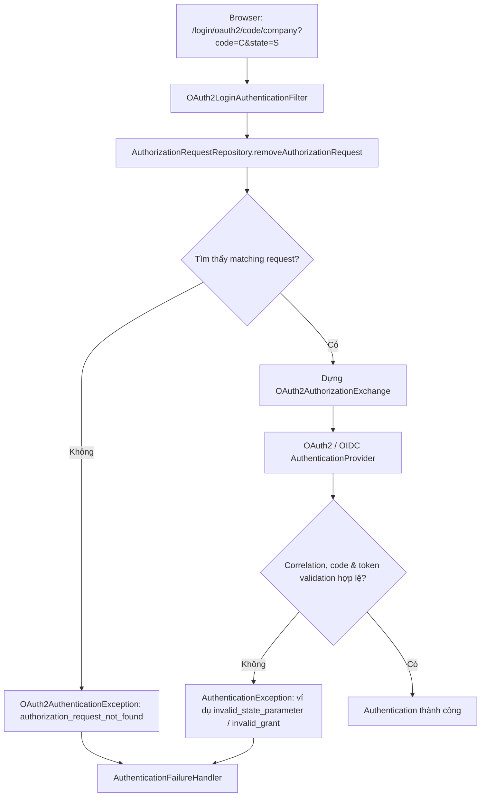

# 28.3. authorization_request_not_found, state mismatch và phiên hết hạn

Trong Spring Security OAuth 2.0 / OpenID Connect (OIDC) Client, một lỗi đăng nhập rất dễ gây hiểu nhầm là:

```text
[authorization_request_not_found]
```

Người dùng đã được chuyển tới nhà cung cấp đăng nhập, nhập tài khoản thành công và quay lại ứng dụng, nhưng thay vì có phiên đăng nhập, họ nhìn thấy thông báo thất bại. Ở môi trường khác, log lại xuất hiện:

```text
[invalid_state_parameter]
```

Cả hai thường liên quan đến **việc ứng dụng không thể liên hệ authorization response trở về với authorization request đã bắt đầu trước đó**. Tuy nhiên, tên lỗi không đủ để kết luận ngay rằng OP (OpenID Provider) lỗi, Spring Security bug hay người dùng bị tấn công.

Bài học thuộc chương **28. Lỗi và quan sát** và tập trung vào ba câu hỏi:

1. **`authorization_request_not_found` thực sự có nghĩa gì trong Spring Security?** Repository không tìm thấy giao dịch đã lưu, callback thiếu state, session bị mất hay state sai đều có thể dẫn đến biểu hiện tương tự.
2. **State mismatch được kiểm tra ở đâu, và tại sao đôi khi không có lỗi `invalid_state_parameter` riêng biệt?** Điều này phụ thuộc đường đi của filter, repository và authentication provider.
3. **Phiên hết hạn là phiên nào?** HTTP session của ứng dụng, authorization request đang chờ, authorization code của OP, access token hay refresh token có vòng đời và triệu chứng khác nhau.

Mục tiêu thực hành là chẩn đoán đúng **tầng lỗi**, bảo vệ correlation/CSRF, khôi phục bằng authorization flow mới khi cần, và ghi log có ích mà **không làm lộ authorization code, `state`, PKCE verifier hoặc token**.

> **Phiên bản tham chiếu:** Java 17+, Spring Boot 3.x, Spring Security 6.x trên Servlet/Spring MVC. Ví dụ tập trung vào API Spring Security 6.5; WebFlux được đối chiếu riêng. Những URL `example.test`, session IDs và state dưới đây chỉ để minh họa. Không dùng ví dụ debug để ghi thông tin đăng nhập thật ra log.

---

## 1. Hiểu vấn đề qua một tình huống

Giả sử một Portal hỗ trợ đăng nhập OIDC với Company SSO.

```text
GET https://app.example.test/dashboard
       |
       v
Chưa đăng nhập
       |
       v
GET /oauth2/authorization/company
       |
       v
Spring Security:
  - Tạo OAuth2AuthorizationRequest
  - Sinh state khó đoán
  - Lưu request trong HttpSession
  - 302 sang Authorization Server
       |
       v
OP hiển thị trang login, xác thực user
       |
       v
302 https://app.example.test/login/oauth2/code/company
       ?code=REDACTED
       &state=EXPECTED_STATE
       |
       v
Spring Security:
  - Tìm authorization request đã lưu trong session
  - Đối chiếu state / ngữ cảnh request
  - Nếu hợp lệ, đổi code lấy token và xác thực OIDC
```

Khi mọi thứ bình thường, browser **giữ được session cookie của ứng dụng** giữa thời điểm khởi đầu login và callback. Spring Security tìm thấy authorization request đã lưu tương ứng với `state` và tiếp tục code exchange.

Nếu session cookie không quay lại, session đã hết hạn, hoặc một authorization request khác ghi đè request cũ, callback có thể không tìm thấy request phù hợp:

```text
Callback:
    code=C1
    state=S1

HttpSession hiện tại:
    không có OAuth2AuthorizationRequest
    hoặc chỉ còn request có state=S2

=> Không có một authorization transaction đáng tin
=> Từ chối login
```

**Không được “sửa” bằng cách bỏ kiểm tra state.** State và authorization-request binding là một lớp chống login CSRF/authorization response injection. Khi mất correlation, phản ứng an toàn là **không tạo Authentication**, đưa người dùng về trang đăng nhập với thông báo có thể hiểu và cho phép bắt đầu **flow mới**.

## 2. Authorization request là gì và được lưu ở đâu?

`OAuth2AuthorizationRequest` là object mô tả yêu cầu mà OAuth2 Client gửi tới authorization endpoint. Nó có thể chứa:

- Authorization URI và response type;
- Client ID;
- Redirect URI;
- Scopes;
- **`state`**;
- Các additional parameters như `code_challenge`, `code_challenge_method` và OIDC `nonce` khi áp dụng;
- Attributes nội bộ phục vụ PKCE `code_verifier` và liên hệ với registration/context.

Trong Spring Security Servlet, abstraction lưu request là:

```java
AuthorizationRequestRepository<OAuth2AuthorizationRequest>
```

Implementation mặc định thường là:

```java
HttpSessionOAuth2AuthorizationRequestRepository
```

**AuthorizationRequestRepository không phải `ClientRegistrationRepository` hoặc `OAuth2AuthorizedClientRepository`.**

| Repository / store | Chứa gì? | Dùng khi nào? |
| --- | --- | --- |
| `ClientRegistrationRepository` | Client ID, issuer, token/authorization endpoint, scope, grant | Cấu hình provider |
| **`AuthorizationRequestRepository<OAuth2AuthorizationRequest>`** | Authorization request đang chờ: state, redirect, PKCE/nonce context | Từ bắt đầu login đến callback |
| `SecurityContextRepository` | Authentication/SecurityContext sau xác thực | Request/session đã đăng nhập |
| `OAuth2AuthorizedClientRepository` | Access token và có thể refresh token theo client/principal | Gọi API, refresh |
| `HttpSession` / Spring Session | Session data của browser | Giữ correlation, security context và dữ liệu ứng dụng |

Một callback OAuth2 thất bại **trước khi hoàn tất login** thường liên quan đến **authorization request repository**, dù người dùng vẫn chưa có `OAuth2AuthorizedClient`.

### 2.1. Một giao dịch có vòng đời ngắn

```text
Khởi động:
    OAuth2AuthorizationRequest(state=S1) -> save

Đi qua browser/OP:
    RP chờ response

Callback:
    load/remove OAuth2AuthorizationRequest bằng S1
    kiểm tra state và registration
    tiếp tục token exchange nếu hợp lệ

Sau callback:
    pending request được tiêu thụ
```

Việc repository **remove** request khi nhận callback hợp lệ giúp ngăn một authorization response được sử dụng lặp lại trong cùng client. Tuy nhiên, AS vẫn phải bảo đảm authorization code **có hạn và chỉ dùng một lần**; việc xóa request không thay thế yêu cầu này.

---

## 3. Luồng thực thi quan trọng của Spring Security Servlet

Các component chính:

| Component | Nhiệm vụ |
| --- | --- |
| `OAuth2AuthorizationRequestRedirectFilter` | Bắt request bắt đầu OAuth2 login và gửi browser tới OP |
| `OAuth2AuthorizationRequestResolver` | Tạo authorization request, state, PKCE context |
| `HttpSessionOAuth2AuthorizationRequestRepository` | Lưu, tải và xóa authorization request trong session |
| **`OAuth2LoginAuthenticationFilter`** | Nhận Authorization Code callback và bắt đầu xác thực |
| `OAuth2LoginAuthenticationProvider` | Xử lý OAuth2 authorization code exchange |
| `OidcAuthorizationCodeAuthenticationProvider` | Xử lý OIDC code flow, ID Token validation |
| `AuthenticationFailureHandler` | Xử lý thất bại tại phạm vi OAuth2 Login authentication filter |
| `ClientRegistrationRepository` | Tìm đúng registration theo flow |
| `SecurityContextRepository` | Lưu SecurityContext khi login thành công |

Các đường dẫn mặc định thường là:

```text
Bắt đầu:
  GET /oauth2/authorization/{registrationId}

Callback:
  GET /login/oauth2/code/{registrationId}
```

Nếu bạn đổi base URI ở authorization endpoint hoặc redirection endpoint, **links, ClientRegistration.redirectUri, OP allowed redirect URIs và filter matcher phải đồng bộ**.

### 3.1. Đường đi khi callback đến

Sơ đồ khái niệm:



**Lưu ý kỹ thuật:** lỗi `authorization_request_not_found` thường được tạo **sớm trong `OAuth2LoginAuthenticationFilter`**, khi repository trả về `null`. Không phải lúc nào logic cũng đến được provider để tạo lỗi `invalid_state_parameter`.

### 3.2. Một điểm khác biệt thường gây nhầm lẫn

Với **`HttpSessionOAuth2AuthorizationRequestRepository` mặc định**, `loadAuthorizationRequest(request)` chỉ trả authorization request khi **`state` của callback khớp state của request đang lưu**. Nếu state không khớp, repository có thể trả `null`.

Khi `OAuth2LoginAuthenticationFilter` gọi remove/load rồi nhận `null`, nó báo `authorization_request_not_found` — **dù trong session thực tế có một request nhưng state không khớp**.

Do đó:

```text
Session có request state=S1
Callback trả state=S2

Default repository:
    loadAuthorizationRequest(callback state=S2)
    => null (mismatch)

OAuth2LoginAuthenticationFilter:
    không có authorization request
    => authorization_request_not_found
```

**Mã lỗi không cho phép kết luận nguyên nhân duy nhất.** Nó không nhất thiết nghĩa session hoàn toàn trống; có thể là state mismatch được repository lọc trước khi đến authentication provider.

### 3.3. Vậy invalid_state_parameter xuất hiện khi nào?

Nếu authorization exchange đến được authentication provider với **authorization request** và **authorization response** có state khác nhau, provider có thể từ chối bằng lỗi như `invalid_state_parameter` theo logic Spring Security 6.x.

Điều này có thể xảy ra với repository/custom flow khác hoặc các đường xử lý khác. Nhưng **với default repository**, callback mismatch có thể đã bị chuyển thành `authorization_request_not_found` trước đó.

Không thiết kế alert theo giả định:

```text
authorization_request_not_found = chắc chắn mất session
invalid_state_parameter         = chắc chắn bị attack
```

Cả hai cần xem **đường đi filter/repository**, browser session, URL callback và cấu hình từng phiên bản.

---

## 4. Vì sao state phải được kiểm tra?

Trong OAuth2 Authorization Code Flow, `state` giúp client liên hệ authorization response với authorization request mà **chính client/browser context** đã bắt đầu.

### 4.1. Tấn công login CSRF

Attacker có thể bắt đầu login bằng tài khoản của mình, sau đó cố gửi callback/authorization response tương ứng vào browser người khác.

```text
Attacker browser:
    Start login -> state=S_attacker, code=C_attacker

Victim browser:
    Không có authorization request tương ứng S_attacker

Attacker gửi victim:
    /login/oauth2/code/company?code=C_attacker&state=S_attacker

RP an toàn:
    Không tìm matching authorization request trong victim session
    -> Reject login
```

Nếu RP chấp nhận callback chỉ vì thấy code trông hợp lệ, browser của victim có thể bị đăng nhập vào tài khoản attacker hoặc liên kết nhầm account.

### 4.2. State không phải một tham số trang trí

State phải:
- Khó đoán;
- Gắn với request/correlation context gốc;
- Được trả đúng từ OP;
- So sánh chính xác ở callback;
- Có vòng đời ngắn;
- Bị tiêu thụ khi flow hoàn tất;
- Không cho callback tự chỉ định session hoặc chọn stored request của user khác.

Không dùng:

```java
if (request.getParameter("state") != null) {
    // Cứ có state là cho đổi code?
}
```

Chỉ kiểm tra **có giá trị** không đủ; phải kiểm tra **đúng giá trị gắn giao dịch trước đó**.

### 4.3. State khác PKCE và nonce

| Cơ chế | Được kiểm tra ở đâu? | Mục đích chính |
| --- | --- | --- |
| **`state`** | OAuth2 Client khi nhận callback | Authorization response correlation/login CSRF |
| **PKCE `code_verifier`** | AS token endpoint khi đổi code | Authorization code interception |
| **OIDC `nonce`** | RP khi kiểm tra ID Token | ID Token gắn với authentication request |
| ID Token `iss` / `aud` / signature | RP | Trust issuer/client/token |
| Access token audience/scope/expiry | Resource Server | API authorization |

**Bật PKCE không phải lý do để bỏ kiểm tra state trong một flow/repository đang dùng state.** Ngược lại, state đúng cũng không bảo đảm code verifier, OIDC nonce hay ID Token signature đúng.

## 5. Authorization_request_not_found: các nguyên nhân thực tế

Dưới đây là các nhóm nên điều tra theo thứ tự, **không dựa vào tên lỗi đơn lẻ**.

| Nguyên nhân | Mô tả | Dấu hiệu |
| --- | --- | --- |
| Session cookie không quay lại | Callback không có cookie của session khởi đầu | Browser có session mới hoặc không có session |
| Session hết hạn | Người dùng ở OP quá lâu, ứng dụng đã hết idle timeout | Thời gian start→callback dài |
| Session bị invalidate | Logout, code khác hoặc app cleanup xóa session | Session ID đổi/mất giữa hai request |
| State sai/thiếu | Callback state không trùng request đã lưu | Có session nhưng không tìm matching request |
| Multi-tab ghi đè | Một flow mới thay request đang chờ | Callback tab cũ fail sau tab khác |
| Callback replay | Request đã được consume, browser refresh/back | Lần đầu có thể thành công, lần sau fail |
| Callback từ tab/trình duyệt khác | Browser không có session ban đầu | Session binding thiếu |
| Cookie SameSite không tương thích | Cross-site form POST không gửi cookie | Chỉ lỗi với response_mode=form_post |
| Secure/Domain/Path sai | Callback host/scheme/path khác với cookie scope | Lỗi chỉ ở staging/proxy |
| Session store không chia sẻ | Start ở pod A, callback ở pod B | Lỗi ngẫu nhiên khi load balance |
| Custom repository sai | Save/load/remove không đồng bộ | Lỗi sau khi thêm repository custom |
| Base URI/callback sai | Filter nhận callback khác route hoặc repository key khác | Lỗi sau thay redirect URI |
| Provider trả state không khớp | OP/proxy/custom request sửa state | Callback response khác request |
| Cluster redeploy mất state | In-memory sessions mất sau restart | Lỗi trùng với rolling deployment |

### 5.1. Mất session là nhóm thường gặp, không phải kết luận duy nhất

Khi thấy `authorization_request_not_found`, hãy hỏi:

> Trong **HTTP session đang nhận callback**, có authorization request với đúng state chưa?

Nếu không có, tiếp tục xác minh cookie/TTL/store. Nếu có một request với state khác, xem multi-tab và state mismatch.

### 5.2. Vì sao lỗi có thể xuất hiện sau khi người dùng login ở OP thành công?

OP có thể đã xác thực hoàn toàn đúng. Nhưng **RP vẫn phải xác minh callback thuộc giao dịch mà RP đã bắt đầu**. Không tìm thấy request gốc nghĩa RP không có dữ liệu tin cậy để tiếp tục.

Do đó, không được coi “OP login thành công” là bằng chứng Spring Security có thể bỏ qua state.

---

## 6. State mismatch: nguyên nhân do user, hệ thống hay attack?

Một callback không khớp có thể là:
- **Hành vi bình thường:** user refresh callback, mở hai tabs, dùng link cũ;
- **Sự cố vận hành:** session timeout, wrong cookie, reverse proxy, server node change;
- **Bug tích hợp:** custom resolver/repository làm mất/đổi state;
- **Tín hiệu bảo mật:** callback bị chèn, replay, login CSRF hoặc AS mix-up.

Chính vì nhiều nguyên nhân khác nhau, hệ thống cần **fail closed** đồng thời **giữ khả năng quan sát** để chẩn đoán.

### 6.1. Không phản hồi “state mismatch = hacker đang tấn công” cho user

Một thông báo an toàn, không khẳng định quá mức:

> Phiên đăng nhập không còn hợp lệ. Vui lòng bắt đầu đăng nhập lại.

Log nghiệp vụ có thể ghi category `oauth2_callback_correlation_failed`, nhưng không cần kết luận sự cố an ninh chỉ dựa vào một attempt.

### 6.2. Không tự dùng callback state để tạo session

Sai:

```java
String state = request.getParameter("state");
session.setAttribute("oauth2_state", state); // Sai: nhận từ callback làm nguồn chân lý
```

Khi callback tới, expected state phải **đã tồn tại từ lúc authorization request được tạo**. Lấy chính value untrusted từ callback lưu vào session rồi so sánh sẽ làm kiểm tra vô nghĩa.

### 6.3. Không đoán registration từ state

State thường là một opaque value. Nếu có nhiều providers:

```text
company -> authorization request state=S_A, issuer=OP_A
partner -> authorization request state=S_B, issuer=OP_B
```

Không xem state đơn lẻ là bằng chứng issuer. Registration, authorization endpoint, token endpoint, redirect URI, PKCE verifier và OIDC nonce phải đến từ **giao dịch đã lưu/trusted metadata**.

### 6.4. Missing state có thể trở thành not found

Với default repository, callback **không có state** thường không thể tìm request phù hợp. Điều này có thể dẫn đến `authorization_request_not_found`, chứ không nhất thiết một lỗi riêng `missing_state`.

Không “tự bổ sung state từ session” vào callback để chạy tiếp: nếu OP không trả đúng correlation, flow phải bị từ chối.

---

## 7. Session hết hạn: phải phân biệt những vòng đời khác nhau

Từ “phiên hết hạn” có thể chỉ nhiều đối tượng.

| Đối tượng | Do ai quản lý? | Khi hết hạn điều gì xảy ra? | Có làm `authorization_request_not_found` không? |
| --- | --- | --- | --- |
| **HTTP session RP** | Servlet container / Spring Session | Pending request và security context trong session có thể mất | **Có thể** |
| **Pending authorization request** | AuthorizationRequestRepository | Callback không còn transaction để đối chiếu | **Có thể** |
| **Authorization code** | Authorization Server | Token endpoint từ chối code hết hạn/đã dùng | Thường **không**; có thể là `invalid_grant` nếu state vẫn tìm thấy |
| **OP SSO browser session** | OpenID Provider | User phải xác thực lại hoặc OP trả login error | Không nhất thiết |
| **Access token** | Authorization Server/Resource Server | API từ chối token hoặc client refresh | Không trực tiếp |
| **Refresh token** | Authorization Server | Token refresh thất bại, ví dụ `invalid_grant` | Không trực tiếp |
| **OIDC ID Token** | OP phát, RP xác minh | OIDC validation thất bại vì `exp` | Không phải nguyên nhân repository not found |

### 7.1. Ví dụ HTTP session hết hạn

```text
09:00 Browser bắt đầu OAuth2 Login
      RP session=S1; authorization request state=A1

09:30 User vẫn ở OP login page
      RP idle timeout đã hết; server xóa session S1

09:32 OP redirect về callback code=C1, state=A1
      Browser mang session ID cũ, nhưng server không còn S1
      AuthorizationRequestRepository không tìm được A1

=> authorization_request_not_found
```

Giải pháp là điều chỉnh session timeout hợp lý theo UX/security policy và xử lý trạng thái **login timeout** rõ ràng. Không nên tăng timeout vô hạn chỉ để lỗi biến mất.

### 7.2. Ví dụ authorization code hết hạn

```text
09:00 RP tạo request state=A1
09:05 OP trả code=C1, state=A1
09:20 RP mới cố đổi C1 (nếu request vẫn tồn tại)

RP state matches A1
OP token endpoint:
    invalid_grant (code expired)
```

Đây là lỗi token endpoint khác với authorization request repository. Không gộp vào “state mismatch” và không retry code cũ nhiều lần.

### 7.3. Ví dụ refresh token hết hạn sau login

Người dùng đã login thành công hôm qua, hôm nay API call phải refresh access token nhưng refresh token bị revoke.

```text
OAuth2AuthorizedClientManager
    -> grant_type=refresh_token
    -> invalid_grant
```

Đây thuộc **authorized client lifecycle**, không phải callback correlation. User có thể cần reauthorize, nhưng không phải do thiếu authorization request ở thời điểm login cũ.

### 7.4. Hai loại timeout cần được quản lý riêng

- **Session idle timeout:** thời gian server còn giữ session mà request có thể dùng.
- **Login transaction TTL:** thời gian pending authorization request còn được coi là phù hợp.

Framework/repository cụ thể có thể dùng session lifecycle để quyết định pending request tồn tại. Nếu tự xây multi-tab repository, nên thêm TTL riêng thay vì coi HttpSession sống bao lâu thì authorization request hợp lệ bấy lâu.

---

## 8. Cấu hình Spring Boot OAuth2 Login mẫu

### 8.1. Dependencies

```xml
<dependencies>
    <dependency>
        <groupId>org.springframework.boot</groupId>
        <artifactId>spring-boot-starter-web</artifactId>
    </dependency>
    <dependency>
        <groupId>org.springframework.boot</groupId>
        <artifactId>spring-boot-starter-security</artifactId>
    </dependency>
    <dependency>
        <groupId>org.springframework.boot</groupId>
        <artifactId>spring-boot-starter-oauth2-client</artifactId>
    </dependency>
</dependencies>
```

Ví dụ là Servlet. Không dùng `spring-boot-starter-webflux` chỉ để có OAuth2 login khi ứng dụng thực chất là MVC.

### 8.2. application.yml

```yaml
spring:
  security:
    oauth2:
      client:
        registration:
          company:
            provider: company
            client-id: ${OIDC_CLIENT_ID}
            client-secret: ${OIDC_CLIENT_SECRET}
            authorization-grant-type: authorization_code
            client-authentication-method: client_secret_basic
            redirect-uri: "{baseUrl}/login/oauth2/code/{registrationId}"
            scope:
              - openid
              - profile
              - email
        provider:
          company:
            issuer-uri: https://id.example.test/realms/company

server:
  servlet:
    session:
      timeout: 20m
      cookie:
        http-only: true
        secure: true
        same-site: lax
```

**Đọc đúng ý nghĩa:**
- `server.servlet.session.timeout` là setting HTTP session lifecycle của Servlet ứng dụng; không làm authorization code của OP sống lâu hơn.
- Cookie `Secure=true` chỉ phù hợp khi public URL là HTTPS; khi phát triển trên HTTP localhost, cần profile local được kiểm soát.
- `SameSite=Lax` thường phù hợp với browser callback **top-level GET** trong Authorization Code Flow; với cross-site `form_post` cần xem xét khác.
- `issuer-uri`/`redirect-uri` phải khớp provider đã đăng ký.
- Không commit client secret thật.

### 8.3. SecurityFilterChain

```java
package example.security;

import org.springframework.context.annotation.Bean;
import org.springframework.context.annotation.Configuration;
import org.springframework.security.config.Customizer;
import org.springframework.security.config.annotation.web.builders.HttpSecurity;
import org.springframework.security.web.SecurityFilterChain;

@Configuration
class OAuth2SecurityConfig {

    @Bean
    SecurityFilterChain securityFilterChain(HttpSecurity http) throws Exception {
        return http
            .authorizeHttpRequests(auth -> auth
                .requestMatchers(
                    "/", "/login", "/error", "/css/**", "/js/**")
                .permitAll()
                .anyRequest().authenticated())
            .oauth2Login(Customizer.withDefaults())
            .build();
    }
}
```

Đây là cấu hình **mặc định**, đã có filter, request resolver và HttpSession authorization request repository phù hợp cho trường hợp phổ biến. **Không tự tạo AuthorizationRequestRepository chỉ vì muốn giải quyết một lỗi chưa được xác định nguyên nhân.**

---

## 9. Dùng AuthenticationFailureHandler để hiển thị lỗi an toàn

Khi `OAuth2LoginAuthenticationFilter` phát ra `AuthenticationException`, `AuthenticationFailureHandler` được cấu hình có thể phân loại lỗi và redirect về trang đăng nhập do RP phục vụ.

### 9.1. Cấu hình minh họa

```java
package example.security;

import java.io.IOException;

import jakarta.servlet.http.HttpServletRequest;
import jakarta.servlet.http.HttpServletResponse;

import org.slf4j.Logger;
import org.slf4j.LoggerFactory;
import org.springframework.context.annotation.Bean;
import org.springframework.context.annotation.Configuration;
import org.springframework.security.core.AuthenticationException;
import org.springframework.security.oauth2.core.OAuth2AuthenticationException;
import org.springframework.security.web.authentication.AuthenticationFailureHandler;

@Configuration
class LoginFailureConfiguration {

    private static final Logger log =
        LoggerFactory.getLogger(LoginFailureConfiguration.class);

    @Bean
    AuthenticationFailureHandler oauth2FailureHandler() {
        return new AuthenticationFailureHandler() {

            @Override
            public void onAuthenticationFailure(
                    HttpServletRequest request,
                    HttpServletResponse response,
                    AuthenticationException exception)
                    throws IOException {

                String code = safeCategory(exception);

                // Không log exception.getMessage() hoặc query callback:
                // chúng có thể chứa code, state, tokens hoặc PII.
                log.warn("oauth2_login_failed category={}", code);

                String target = request.getContextPath()
                    + "/login?reason=" + code;

                response.sendRedirect(
                    response.encodeRedirectURL(target));
            }
        };
    }

    private String safeCategory(AuthenticationException exception) {
        if (exception instanceof OAuth2AuthenticationException oauth2) {
            String error = oauth2.getError().getErrorCode();

            return switch (error) {
                case "authorization_request_not_found",
                     "invalid_state_parameter" -> "expired";
                case "access_denied" -> "cancelled";
                case "temporarily_unavailable",
                     "server_error" -> "unavailable";
                default -> "failed";
            };
        }
        return "failed";
    }
}
```

**Chú ý:** trong đoạn này, category `expired` là **thông báo UX thân thiện**, không phải một kết luận kỹ thuật rằng HTTP session chắc chắn đã hết hạn. Lỗi correlation còn có thể do state mismatch, cookie hoặc replay; hãy dùng category `correlation_failed` cho nội bộ nếu cần phân tích chi tiết.

### 9.2. Gắn handler vào OAuth2 Login

```java
@Bean
SecurityFilterChain securityFilterChain(
        HttpSecurity http,
        AuthenticationFailureHandler oauth2FailureHandler)
        throws Exception {

    return http
        .authorizeHttpRequests(auth -> auth
            .requestMatchers("/login", "/", "/error").permitAll()
            .anyRequest().authenticated())
        .oauth2Login(oauth2 -> oauth2
            .loginPage("/login")
            .failureHandler(oauth2FailureHandler))
        .build();
}
```

Khi sử dụng `loginPage("/login")`, ứng dụng phải tự cung cấp trang login và link bắt đầu flow, ví dụ:

```text
GET /oauth2/authorization/company
```

Không tự động redirect người dùng từ `/login?reason=expired` sang OP vô hạn. Cho người dùng chọn **Đăng nhập lại** để bắt đầu request với state và PKCE verifier mới.

### 9.3. Trang login với message cố định

```java
package example.web;

import org.springframework.stereotype.Controller;
import org.springframework.ui.Model;
import org.springframework.web.bind.annotation.GetMapping;
import org.springframework.web.bind.annotation.RequestParam;

@Controller
class LoginPageController {

    @GetMapping("/login")
    String login(
            @RequestParam(name = "reason", required = false) String reason,
            Model model) {

        String safeMessage = switch (reason == null ? "" : reason) {
            case "expired" ->
                "Phiên đăng nhập không còn hợp lệ. Vui lòng bắt đầu lại.";
            case "cancelled" ->
                "Bạn chưa cấp quyền đăng nhập. Có thể thử lại.";
            case "unavailable" ->
                "Nhà cung cấp đăng nhập tạm thời chưa sẵn sàng.";
            case "failed" ->
                "Không thể hoàn tất đăng nhập. Vui lòng thử lại.";
            default -> "";
        };

        model.addAttribute("errorMessage", safeMessage);
        return "login";
    }
}
```

Ví dụ giả định có view template `login.html`. Không render thẳng raw `exception.getMessage()` hoặc `error_description` từ OP.

### 9.4. Vì sao handler không bắt được mọi lỗi OAuth2?

Nó xử lý lỗi trong **authentication flow** thuộc OAuth2 Login filter. Nếu:
- OP authorization endpoint treo ở browser;
- Ứng dụng fail startup khi issuer discovery lỗi;
- Frontend không gửi cookie hoặc callback tới sai domain;
- Lỗi xuất hiện khi một scheduled job refresh token;
- Lỗi từ Resource Server sau khi đã login;

thì failure handler này **không chắc được gọi**. Cần phân tầng monitoring và exception handling theo nơi lỗi xảy ra.

---

## 10. HTTP session cookie: nhóm nguyên nhân phổ biến nhất

Spring Security Servlet mặc định giữ authorization request trong **HttpSession**, browser chỉ nhận session ID cookie (ví dụ `JSESSIONID` hoặc `SESSION` khi dùng Spring Session).

Hai request quan trọng:

```text
Start:
  GET /oauth2/authorization/company
  Cookie: JSESSIONID=<existing-if-any>

Response:
  Set-Cookie: JSESSIONID=<opaque-session-id>; Path=/; ...

Callback:
  GET /login/oauth2/code/company?code=...&state=...
  Cookie: JSESSIONID=<same-session-identity>
```

Trong thực tế có thể có session rotation/renewal, nhưng pending request phải được truy cập từ ngữ cảnh lưu trữ phù hợp. Đừng kiểm tra bằng cách so sánh raw cookie values rồi ghi chúng vào log; hãy dùng DevTools cục bộ và metadata không nhạy cảm.

### 10.1. Cookie không được gửi tới callback

Các nguyên nhân:
- Callback host khác host đã set cookie;
- Cookie `Path` không bao phủ callback;
- Cookie `Domain` sai;
- `Secure` trên HTTP callback;
- `SameSite` không tương thích response mode;
- Browser chặn third-party/cross-site cookies theo điều kiện;
- Frontend mở callback ở browser profile/webview khác;
- Session cookie đã hết hạn/xóa.

**Cách xử lý:** sửa public origin, redirect URI và cookie config; không sửa bằng cách bỏ state validation.

### 10.2. SameSite=Lax với top-level GET

Trong flow phổ biến:

```text
RP app.example.test -> OP id.example.test
OP -> top-level GET app.example.test/login/oauth2/code/company
```

Cookie `SameSite=Lax` thường được gửi trong top-level cross-site GET navigation (phụ thuộc browser policy). Vì vậy, Lax thường đủ cho Authorization Code Flow callback GET.

Nhưng nếu OP dùng **`response_mode=form_post`** và browser POST cross-site về RP, Lax có thể không gửi session cookie. Callback lúc đó không tìm được authorization request.

### 10.3. SameSite=None không phải lựa chọn mặc định cho mọi ứng dụng

`SameSite=None` thường yêu cầu cookie `Secure` trên trình duyệt hiện đại và mở rộng phạm vi gửi cookie cross-site.

Chỉ chọn None nếu flow thực sự cần (ví dụ form_post) và đã xem xét CSRF/cookie threat model. **Không đổi toàn bộ session cookies sang None chỉ để giải quyết một lỗi chưa hiểu rõ.**

### 10.4. Cookie consent/ITP/browser restrictions

Một số trình duyệt, webview hoặc extension chặn/cô lập cookie. Trong những trường hợp đó:
- Xem browser network DevTools;
- So sánh start và callback bằng cùng browser profile;
- Kiểm tra redirect cross-domain và cookie policies;
- Tránh đặt login start trong iframe nếu OP/browser không hỗ trợ;
- Dùng top-level browser navigation khi thích hợp.

---

## 11. Reverse proxy: sai baseUrl khiến mất correlation

Một deployment điển hình:

```text
Browser:
    https://app.example.test

Ingress / Reverse Proxy:
    TLS termination

Spring Boot:
    http://app-internal:8080
```

Nếu ứng dụng tạo redirect URI sai:

```text
http://app-internal:8080/login/oauth2/code/company
```

thay vì:

```text
https://app.example.test/login/oauth2/code/company
```

OP có thể từ chối redirect URI, browser quay về host khác, hoặc cookie RP không khớp.

### 11.1. Forwarded headers

Khi có proxy đáng tin cậy, Spring Boot có thể dùng:

```yaml
server:
  forward-headers-strategy: framework
```

Nhưng **chỉ được tin `Forwarded` / `X-Forwarded-*` headers do proxy tin cậy thiết lập**. Proxy phải lọc hoặc ghi đè headers do internet client tự gửi; nếu không sẽ có nguy cơ host header injection và sai authorization redirect URI.

### 11.2. Các giá trị phải đồng bộ

| Giá trị | Nơi khai báo/quan sát |
| --- | --- |
| RP public scheme/host/context path | Browser URL và trusted proxy |
| `ClientRegistration.redirectUri` | application.yml / configuration |
| Allowed redirect URIs | OP client registration |
| Callback filter matcher | Spring Security redirectionEndpoint |
| Cookie Path/Domain/Secure | Servlet container/Spring Session |
| Session store | Local session hoặc distributed storage |

Nếu các giá trị không khớp, có thể có lỗi:

```text
redirect_uri_mismatch
authorization_request_not_found
session cookie missing
callback handler not matched
```

Không xem các lỗi này hoàn toàn giống nhau. Ví dụ `redirect_uri_mismatch` có thể xảy ra **ở OP trước callback**, trong khi `authorization_request_not_found` thường xảy ra **sau callback đến RP**.

---

## 12. Session timeout và hành vi của OP

User có thể mất nhiều phút hoàn thành MFA, consent hoặc thiết lập lại mật khẩu tại OP. Trong khi đó HTTP session tại RP vẫn chịu **idle timeout**.

### 12.1. Cân bằng bảo mật và trải nghiệm

Một timeout quá ngắn làm login fail khi MFA lâu. Một timeout quá dài làm tăng thời gian dữ liệu session và pending flows tồn tại.

Hãy cân nhắc:
- Thời gian hoàn thành MFA/consent thực tế;
- Chế độ mobile/webview và độ trễ mạng;
- Session timeout và TTL riêng của pending requests;
- Khả năng phát hiện/hủy pending requests;
- Session store capacity và cleanup;
- Cookie security;
- OP authorization code lifetime riêng;
- Chính sách authentication/session của doanh nghiệp.

### 12.2. Đừng cho người dùng tiếp tục bằng callback cũ

Khi session đã hết hạn, cách phục hồi là:

```text
GET /login?reason=expired
    -> User click Login
    -> GET /oauth2/authorization/company
    -> New state S2
    -> New PKCE verifier V2
    -> New OIDC nonce N2 (when used)
    -> New authorization code C2
```

**Không lấy code C1/state S1 từ URL cũ** và tự gắn với session mới.

### 12.3. OP session và RP session có thời hạn độc lập

Có thể OP còn SSO session nhưng RP session đã hết hạn. User bắt đầu flow mới, được OP xác thực không hỏi mật khẩu, và RP tạo session mới sau callback hợp lệ. Đó là hành vi SSO bình thường, không phải “replay” nếu new state/code correlation đúng.

---

## 13. Multi-tab và AuthorizationRequestRepository mặc định

Một tình huống thực tế:

```text
Tab 1:
    GET /oauth2/authorization/company
    session=SESSION-A, state=S1
    repository stores request S1

Tab 2:
    GET /oauth2/authorization/partner
    session=SESSION-A, state=S2
    repository now stores request S2

Tab 1 callback:
    state=S1
    repository sees request S2
    => no matching request
    => authorization_request_not_found
```

Trong nhiều phiên bản Spring Security 6.x, **`HttpSessionOAuth2AuthorizationRequestRepository` mặc định lưu một authorization request ở một session attribute**, do đó không được giả định hỗ trợ vô hạn pending flows song song.

Điều này **không có nghĩa bạn nên bỏ kiểm tra state**. Nếu sản phẩm cần parallel login flows, hãy thiết kế repository phù hợp.

### 13.1. Thiết kế multi-tab an toàn

Một repository tùy chỉnh có thể lưu theo:

```text
session S:
    pending[S1] = OAuth2AuthorizationRequest for company
    pending[S2] = OAuth2AuthorizationRequest for partner
```

Yêu cầu:
- Mỗi state gắn **session/browser context**;
- State không lộ dữ liệu nhạy cảm;
- Save/load/remove theo cùng một key contract;
- Callback sai state không được lấy request khác;
- Có TTL riêng từng entry;
- Có giới hạn số pending requests;
- Remove một entry không xóa nhầm entry khác;
- Concurrency-safe kể cả multi-instance/distributed session;
- Tránh logout/session invalidation race;
- Không leak PKCE verifier/nonce attributes ra browser.

### 13.2. Skeleton giao diện repository

```java
import jakarta.servlet.http.HttpServletRequest;
import jakarta.servlet.http.HttpServletResponse;

import org.springframework.security.oauth2.client.web.AuthorizationRequestRepository;
import org.springframework.security.oauth2.core.endpoint.OAuth2AuthorizationRequest;

public final class PendingLoginRepository
        implements AuthorizationRequestRepository<OAuth2AuthorizationRequest> {

    @Override
    public OAuth2AuthorizationRequest loadAuthorizationRequest(
            HttpServletRequest request) {
        // 1. Read session, do not create a session on callback.
        // 2. Extract callback state.
        // 3. Lookup entry keyed by (session, state).
        // 4. Return null if no exact match.
        return null; // Skeleton, không phải implementation production.
    }

    @Override
    public void saveAuthorizationRequest(
            OAuth2AuthorizationRequest authorizationRequest,
            HttpServletRequest request,
            HttpServletResponse response) {
        // Save with TTL and bounded number of pending states.
        // When authorizationRequest == null, remove current entry
        // according to repository contract.
    }

    @Override
    public OAuth2AuthorizationRequest removeAuthorizationRequest(
            HttpServletRequest request,
            HttpServletResponse response) {
        // Atomically retrieve + remove exactly the matched entry.
        return null; // Skeleton.
    }
}
```

**Cảnh báo:** class này là **skeleton để giải thích contract**; nó trả `null`, nên **không dùng trực tiếp trong ứng dụng**, nếu không mọi callback đều báo `authorization_request_not_found`.

Một implementation thật phải lưu object theo session+state, xử lý TTL/concurrency, và verify callback không bị chuyển sang một session khác. Trong môi trường nhiều instances, chỉ `synchronized(session)` trong một JVM **không đủ** đảm bảo atomicity ở distributed storage.

### 13.3. Gắn custom repository vào Servlet OAuth2 Login

Khi repository production đã được triển khai đúng:

```java
@Bean
SecurityFilterChain securityFilterChain(
        HttpSecurity http,
        AuthorizationRequestRepository<OAuth2AuthorizationRequest> repository)
        throws Exception {

    return http
        .authorizeHttpRequests(auth -> auth
            .requestMatchers("/", "/login").permitAll()
            .anyRequest().authenticated())
        .oauth2Login(oauth2 -> oauth2
            .authorizationEndpoint(endpoint ->
                endpoint.authorizationRequestRepository(repository)))
        .build();
}
```

**Quan trọng:** phải cấu hình repository nhất quán cho start authorization và callback. Đừng tùy biến đường lưu ở request resolver nhưng quên đường remove của login filter. Kiểm tra DSL/version bảo đảm cả hai thành phần thực sự dùng cùng repository.

### 13.4. Không áp dụng custom repository để chữa lỗi cookie

Nếu session cookie không quay lại vì `SameSite` hoặc wrong domain, việc lưu nhiều pending states trong session **không giải quyết** nguyên nhân. Hãy sửa cookie/public origin trước.

---

## 14. Multi-instance và Spring Session

Một hệ thống chạy nhiều replicas:

```text
Browser start login:
    Node A saves authorization request in local HttpSession A

Callback:
    Load balancer forwards to Node B
    Node B cannot find A's local session data

=> authorization_request_not_found
```

Nếu session chỉ lưu trong RAM riêng từng node, lỗi có thể xảy ra **ngẫu nhiên**, tỷ lệ theo cách load balancer phân phối requests.

### 14.1. Hai chiến lược phổ biến

**Sticky session:** load balancer cố gắng đưa callback về node đã tạo session.

- Triển khai nhanh trong một số môi trường;
- Có thể thất bại khi node chết/restart/rolling deploy;
- Không giải quyết session loss khi scale hoặc failover.

**Distributed session store**, ví dụ **Spring Session + Redis**:

- Các nodes đọc được cùng session data theo session ID;
- Có thể duy trì correlation qua load balancing;
- Cần bảo mật Redis, TTL, serialization, namespace và concurrency;
- Không tự sửa race multi-tab nếu repository vẫn chỉ giữ một pending request.

### 14.2. Ví dụ dependencies cho Spring Session Redis

```xml
<dependencies>
    <dependency>
        <groupId>org.springframework.session</groupId>
        <artifactId>spring-session-data-redis</artifactId>
    </dependency>
    <dependency>
        <groupId>org.springframework.boot</groupId>
        <artifactId>spring-boot-starter-data-redis</artifactId>
    </dependency>
</dependencies>
```

Ví dụ cấu hình (tùy phiên bản Spring Boot và cách triển khai Redis):

```yaml
spring:
  data:
    redis:
      host: redis.internal.example.test
      port: 6379
  session:
    redis:
      namespace: portal:sessions

server:
  servlet:
    session:
      timeout: 20m
      cookie:
        http-only: true
        secure: true
        same-site: lax
```

**Không xem YAML này là một deployment hoàn chỉnh.** Production Redis cần authentication/TLS/network isolation, HA, session serialization strategy và access controls. Cần xác minh Boot version và Spring Session store thực sự được kích hoạt.

### 14.3. Kiểm tra serialization

`OAuth2AuthorizationRequest` chứa dữ liệu của pending flow. Với Redis/session serialization tùy chỉnh, class metadata hoặc serializer không tương thích sau deploy có thể làm load request thất bại.

Đừng tự chuyển object thành JSON raw rồi mất:
- `state`;
- PKCE verifier attributes;
- OIDC nonce context;
- Registration/redirect data.

Mất attributes có thể khiến state qua nhưng token exchange hoặc ID Token validation thất bại.

### 14.4. Đừng coi distributed store là phép màu

Dùng Spring Session có thể giải quyết **cross-node session visibility**, nhưng không tự:
- Đồng bộ mọi pending flows trong custom map nếu save bị lost update;
- Hợp nhất cookie của hai domains;
- Khôi phục request sau khi TTL đã hết;
- Chấp nhận callback state sai;
- Bỏ các hạn chế code lifetime của AS.

---

## 15. Reactive WebFlux: lỗi tương tự nhưng repository khác

Trên **Reactive WebFlux**, Spring Security dùng:

```java
ServerAuthorizationRequestRepository<OAuth2AuthorizationRequest>
```

Implementation mặc định phổ biến là:

```java
WebSessionOAuth2ServerAuthorizationRequestRepository
```

Nó lưu authorization request qua **`WebSession`**, khác Servlet `HttpSession`.

| Servlet | Reactive WebFlux |
| --- | --- |
| `HttpSecurity` | `ServerHttpSecurity` |
| `SecurityFilterChain` | `SecurityWebFilterChain` |
| `HttpServletRequest` | `ServerWebExchange` |
| `AuthorizationRequestRepository` | `ServerAuthorizationRequestRepository` |
| `HttpSessionOAuth2AuthorizationRequestRepository` | `WebSessionOAuth2ServerAuthorizationRequestRepository` |
| Blocking repository methods | Reactor `Mono` operations |

### 15.1. Reactive save/load/remove phải compose publisher

```java
Mono<Void> stored =
    authorizationRequestRepository.saveAuthorizationRequest(
        authorizationRequest, exchange);
```

Trong Reactor, chỉ tạo `Mono` rồi bỏ qua không bảo đảm thao tác đã thực thi. Framework chuẩn compose trước khi redirect hoặc callback processing.

Một ví dụ khái niệm:

```java
return authorizationRequestRepository
    .saveAuthorizationRequest(authorizationRequest, exchange)
    .then(redirectToProvider());
```

`redirectToProvider()` là pseudocode do ứng dụng định nghĩa, không phải Spring Security API. Không gọi `.block()` trong event loop.

### 15.2. Không trộn repository Servlet và Reactive

Một custom `HttpSessionOAuth2AuthorizationRequestRepository` của MVC không thể inject vào `ServerHttpSecurity`. Ngược lại, WebSession repository cũng không dùng cho `OAuth2LoginAuthenticationFilter` Servlet.

### 15.3. WebSession timeout và session store

Nếu browser không gửi WebSession cookie ở callback hoặc session bị hết hạn, WebFlux cũng có thể từ chối authorization response. Dùng đúng WebSession configuration/shared session store nếu deploy nhiều nodes.

### 15.4. Kiểu lỗi hiển thị có thể khác

Reactive authentication failure có error names/logging khác tùy WebFlux filter và version. **Không mặc định copy đúng stacktrace `OAuth2LoginAuthenticationFilter` của Servlet sang WebFlux.** Điều quan trọng là correlation contract: không thấy matching authorization request ⇒ không chấp nhận callback.

---

## 16. CSRF, state và response_mode=form_post

Mọi trường hợp `403 Forbidden` ở callback không nhất thiết là `authorization_request_not_found`.

Nếu OP trả authorization response bằng **form POST**:

```http
POST /login/oauth2/code/company
Content-Type: application/x-www-form-urlencoded
Cookie: JSESSIONID=<opaque>

code=REDACTED&state=REDACTED
```

có thể gặp hai vấn đề riêng:

1. **CSRF protection** của Servlet RP có thể từ chối POST trước khi OAuth2 Login filter xử lý, tùy matcher/configuration.
2. **SameSite=Lax** có thể làm browser không gửi cookie RP trong cross-site POST, khiến authorization request repository không tìm thấy giao dịch.

### 16.1. Không disable CSRF toàn ứng dụng

Sai:

```java
http.csrf(csrf -> csrf.disable()); // Không dùng như workaround tổng quát.
```

Bật/tắt CSRF phải theo threat model và endpoints. Nếu provider bắt buộc `form_post`:
- Xác minh Spring Security filter matcher hỗ trợ response mode đó;
- Nếu cần exception CSRF, giới hạn **chính xác callback route** theo method/path và đánh giá bảo vệ state/correlation;
- Không mở CSRF bypass cho `/api/**` hoặc `/logout`;
- Cấu hình cookie SameSite/Secure phù hợp browser;
- Kiểm tra session binding và OP response;
- Không coi `state` là token thay cho mọi CSRF protection của ứng dụng.

### 16.2. 403 khác not found

```text
CSRF filter rejects POST
    -> HTTP 403
    -> OAuth2LoginAuthenticationFilter có thể chưa chạy

OAuth2LoginAuthenticationFilter receives callback
    -> repository cannot load request
    -> authorization_request_not_found
```

Phân biệt vị trí bằng request tracing và category logs (đã redaction), không chỉ nhìn browser báo “đăng nhập thất bại”.

---

## 17. Khác biệt giữa callback replay và OP session vẫn còn

Người dùng có thể:
- Refresh URL callback cũ;
- Nhấn Back rồi Forward;
- Mở lại URL callback lưu trong browser history;
- Bấm login lần nữa trong khi OP vẫn có SSO session.

### 17.1. Replay callback cũ

```text
Lần 1:
  Callback state=S1
  Repository remove request S1
  Code C1 được đổi một lần
  Login thành công

Lần 2:
  Browser refresh callback URL state=S1, code=C1
  Repository không còn S1
  => authorization_request_not_found
```

Đây có thể là **hành vi bảo vệ replay chính xác**. Không tự cho qua lần hai hoặc redirect ngay tới login vô hạn. Có thể trả về trang session/callback expired kèm nút về Dashboard hoặc Login.

### 17.2. OP SSO còn, nhưng authorization flow mới vẫn hợp lệ

```text
User click "Đăng nhập lại"
   -> New state=S2
   -> Browser đến OP
   -> OP đã có SSO cookie, trả code=C2 nhanh
   -> Callback state=S2, code=C2
   -> RP khôi phục request S2
   -> Login thành công
```

Đây không phải replay; nó là **một authorization transaction mới**, dù OP không hỏi lại password.

### 17.3. Không dùng lại authorization code trong retry

OAuth2 authorization code phải có hạn và chỉ dùng một lần. Nếu token endpoint timeout sau khi đã nhận code, client không biết chắc OP đã consume code chưa; retry cùng code có thể trả `invalid_grant`.

Cách phục hồi đơn giản, an toàn trong login flow là bắt đầu authorization request mới theo thao tác của user.

---

## 18. AuthenticationFailureHandler không nên tự hồi phục theo cách nguy hiểm

Một handler báo lỗi thân thiện là tốt; một handler cố “vượt qua” correlation failure là rủi ro.

### 18.1. Không biến state mismatch thành Authentication thành công

Sai:

```java
try {
    return authenticateOAuth2Callback(request);
} catch (OAuth2AuthenticationException ex) {
    // ANTI-PATTERN: lấy email cũ hoặc subject từ query rồi login.
    return createAuthenticationWithoutVerification();
}
```

Đây là **authentication bypass**. Không có matching authorization request thì client thiếu bằng chứng flow hiện tại đáng tin.

### 18.2. Không tìm request theo state toàn cục bất kể session

Sai kiến trúc:

```text
GLOBAL_MAP[state] -> OAuth2AuthorizationRequest

Callback từ browser nào cũng có thể lấy theo state
mà không xác nhận same browser/session binding
```

Một store dùng state làm key có thể hữu ích, nhưng cần thêm **session/browser binding**, TTL, access isolation, integrity và chống injection. Không lấy một state thấy trên URL làm bằng chứng sở hữu transaction.

### 18.3. Không bỏ PKCE/nonce khi state bị lỗi

Nếu state mismatch:
- Không lấy code verifier của flow khác;
- Không tạo `OAuth2AuthorizationRequest` giả từ callback;
- Không bỏ OIDC nonce check;
- Không thử code ở token endpoint của provider khác;
- Không cho login chỉ vì ID Token signature hợp lệ.

### 18.4. Không retry vô hạn vào Authorization Server

Lặp redirect:

```text
/login?error
    -> /oauth2/authorization/company
    -> OP
    -> callback fails
    -> /login?error
    -> ...
```

khi cookie/session vẫn lỗi sẽ tạo vòng lặp. Trang lỗi nên có một hành động rõ ràng để user **tự bắt đầu flow mới**, không tự động retry vô hạn.

---

## 19. Quan sát an toàn: nên ghi gì?

Vì bài thuộc chương **Lỗi và quan sát**, cần một mô hình telemetry đủ phân biệt **state mismatch**, **mất session**, **timeout**, **token endpoint** và **OIDC validation**.

Một event ví dụ:

```json
{
  "event": "oauth2_login_failure",
  "registration_id": "company",
  "phase": "callback",
  "category": "authorization_request_not_found",
  "session_present": true,
  "pending_request_present": false,
  "trace_id": "internal-safe-trace-id"
}
```

Đây là schema **do ứng dụng tự thiết kế**, không phải Spring Security mặc định tự log các field trên.

### 19.1. Những field hữu ích

- `registrationId` đã allowlist;
- Phase: `authorization_start`, `callback`, `token_exchange`, `id_token_validation`;
- Category lỗi chuẩn hóa;
- Boolean session present hoặc pending request present (nếu đo được an toàn);
- Request age bucket, không cần exact timestamp/correlation secret;
- Browser method GET/POST, response mode nếu biết;
- Public host/category đã allowlist, không log query;
- Instance/region ID của RP;
- Session store type và lookup outcome;
- Trace ID nội bộ không mang token;
- Latency và HTTP status category.

### 19.2. Những field tuyệt đối không nên đưa vào log

- Raw `state`;
- Raw authorization code;
- PKCE `code_verifier`;
- OIDC `nonce`;
- Access token, refresh token, ID Token;
- Client secret;
- Session ID cookie;
- Full callback URL chứa `code`/`state`;
- Authorization/Cookie headers;
- Raw OAuth2 `error_description` từ OP;
- Toàn bộ `OAuth2AuthorizationRequest` (vì có attributes nhạy cảm).

### 19.3. Vì sao không log state dù nó ở front-channel?

State được gửi qua browser nhưng vẫn là **correlation data** của giao dịch xác thực. Ghi raw state trong APM, CDN logs hay ticket làm tăng nguy cơ lộ và khả năng replay/injection khi có lỗi kết hợp khác.

Nếu muốn liên hệ hai chặng request, dùng **trace/session-safe correlation ID độc lập** do ứng dụng sinh, hoặc hash/HMAC có chiến lược an toàn đã security review, không dùng trực tiếp OAuth2 state làm trace ID công khai.

### 19.4. Tách error code gốc và category UX

| Lỗi kỹ thuật | Category nội bộ | Thông báo UX |
| --- | --- | --- |
| `authorization_request_not_found` | `callback_correlation_missing` | “Phiên đăng nhập không còn hợp lệ. Hãy thử lại.” |
| `invalid_state_parameter` | `callback_state_mismatch` | Tương tự; không tiết lộ chi tiết |
| `invalid_grant` | `token_exchange_failed` | “Không hoàn tất đăng nhập. Hãy bắt đầu lại.” |
| `access_denied` | `user_cancelled` | “Bạn chưa cấp quyền đăng nhập.” |
| `temporarily_unavailable` | `op_unavailable` | “Nhà cung cấp đăng nhập tạm gián đoạn.” |
| OIDC signature/issuer/nonce invalid | `id_token_validation_failed` | “Không thể xác minh danh tính đăng nhập.” |
| HTTP 403 tại CSRF filter | `csrf_rejected` | “Yêu cầu đăng nhập không hợp lệ.” |

Đừng gán `invalid_state_parameter` = “phát hiện tấn công” trong mọi trường hợp; cũng đừng gán `authorization_request_not_found` = “server chắc chắn hết session”.

### 19.5. Metrics theo phase

Ví dụ metrics có thể là:

```text
oauth2_login_start_total{registration="company"}
oauth2_callback_total{registration="company",outcome="success"}
oauth2_callback_total{registration="company",outcome="correlation_failed"}
oauth2_token_exchange_failures_total{registration="company",error="invalid_grant"}
oauth2_login_correlation_failures_total{region="hcm",method="GET"}
```

Sử dụng **labels có cardinality hữu hạn**. Không đưa raw state, user email, session ID hoặc exception message vào metric labels.

---

## 20. Cách tái hiện lỗi một cách an toàn trong môi trường test

Một vài tình huống kiểm thử tích hợp có thể giúp xác định nguyên nhân. Đây là **đề xuất bài tập/test**, không phải yêu cầu chạy test dự án trong bước viết Markdown.

### 20.1. Happy path

1. Gửi `GET /oauth2/authorization/company` với browser session A.
2. Ghi nhận có request được lưu trong repo (chỉ log boolean/trace).
3. OP test trả `code=C1` và `state=S1`.
4. Browser gửi callback cùng session A.
5. Repository trả request phù hợp.
6. Token exchange/ID Token validation hoàn tất.

**Kết quả:** Authentication thành công, pending request đã được tiêu thụ.

### 20.2. Mất session

1. Bắt đầu login trong session A.
2. Invalidate session A trong môi trường test.
3. Gửi callback với `state=S1`.

**Kết quả:** Callback bị từ chối, có thể là `authorization_request_not_found`. Không tạo Authentication.

### 20.3. State mismatch

1. Bắt đầu flow với `state=S1`.
2. Gửi callback `state=S2` trong cùng session.

**Kết quả:** Callback bị từ chối. Với default repository, lỗi có thể là `authorization_request_not_found` thay vì `invalid_state_parameter` vì repository đã trả null.

### 20.4. Callback replay

1. Hoàn tất callback hợp lệ một lần.
2. Gửi lại chính callback URL.

**Kết quả:** Không thể hoàn tất một login lần hai từ same code/state; client/AS từ chối.

### 20.5. Multi-tab

1. Bắt đầu Company login ở tab 1.
2. Bắt đầu Partner login ở tab 2 cùng browser/session.
3. Hoàn tất tab 1 rồi tab 2.

**Kết quả:** Xác định behavior repository: có giữ nhiều pending states không, hay có một tab fail an toàn? Nếu yêu cầu hỗ trợ cả hai, dùng multi-state repository production đã được kiểm chứng.

### 20.6. Cross-node

1. Node A lưu request trong session store.
2. Callback được route tới node B.

**Kết quả:** Với shared session store, node B đọc request đúng; nếu chỉ local session và không sticky, callback có thể fail. Không sửa bằng cách bỏ state matching.

### 20.7. SameSite form_post

1. Dùng OP test có response_mode=form_post.
2. Cookie session SameSite=Lax.
3. Quan sát browser gửi cross-site POST callback.

**Kết quả:** Có thể mất cookie hoặc bị CSRF filter reject; cần phân biệt bằng network/status/cookie observations.

---

## 21. Bảng phân biệt nhanh lỗi liên quan

| Hiện tượng | Diễn giải khả dĩ | Tầng cần kiểm tra trước |
| --- | --- | --- |
| **`authorization_request_not_found`** | Repository không trả matching request | Session, cookie, state, multi-tab, load/remove |
| **`invalid_state_parameter`** | State response không khớp original request ở tầng provider | Flow correlation, custom repo, response |
| **`invalid_grant`** | Code/refresh token invalid/expired/reused, PKCE/redirect mismatch | Token endpoint & grant |
| `redirect_uri_mismatch` | Redirect URI không được OP đăng ký/không khớp | ClientRegistration, OP console, proxy |
| `invalid_client` | Client authentication sai | Client ID/secret/cert/AS config |
| `access_denied` | User từ chối hoặc AS từ chối quyền | Authorization endpoint/user consent |
| `temporarily_unavailable` | OP tạm thời không phục vụ | AS/OP availability |
| OIDC `nonce` mismatch | ID Token không thuộc expected auth request | OIDC validation/nonce context |
| ID Token issuer mismatch | Không đúng OP/trust boundary | ClientRegistration/JWKS/issuer |
| `403` tại POST callback | CSRF filter hoặc authorization rules | Filter chain/CSRF matcher |
| API 401 `invalid_token` | Access token bị Resource Server từ chối | Resource Server/authorized client |
| Refresh `invalid_grant` sau login | Refresh token hết hạn/revoke/rotation | Authorized client manager/storage |

**Nguyên tắc:** **đừng chữa lỗi tầng A bằng cách bỏ validation ở tầng B**.

---

## 22. Troubleshooting theo triệu chứng

| Triệu chứng trong thực tế | Nguyên nhân phổ biến | Cách xử lý |
| --- | --- | --- |
| OAuth2 Login chỉ lỗi sau chờ MFA 15 phút | HttpSession timeout ngắn | Điều chỉnh timeout/TTL có kiểm soát, UX login lại |
| Chỉ lỗi trên Safari/webview | Cookie/ITP/SameSite restriction | Kiểm tra cookie network và top-level navigation |
| Chỉ lỗi ở response_mode=form_post | Cross-site POST không mang Lax cookie; CSRF | Cấu hình SameSite/CSRF endpoint đúng flow |
| Lỗi sau chuyển từ HTTP sang HTTPS | Cookie Secure, scheme, redirect URI | Đồng bộ public origin và proxy headers |
| Lỗi sau bật ingress | Forwarded host/scheme sai hoặc session routing | Trusted proxy config, callback URL, session store |
| Lỗi ngẫu nhiên trên Kubernetes | Session local không chia sẻ qua pods | Spring Session / sticky session tradeoff |
| Lỗi sau rolling deployment | Session in-memory mất hoặc serialization đổi | Distributed session, compatibility/migration |
| Tab 1 fail khi tab 2 bắt đầu login | Một pending auth request mỗi session | Multi-state repository nếu có yêu cầu |
| Refresh callback URL rồi gặp not found | Request đã bị consume | Hành vi an toàn; không retry callback cũ |
| Mở link callback trong browser khác | Không có session gốc | Bắt đầu flow tại browser hiện tại |
| Callback có state không khớp | Trộn flows, callback bị sửa, state stale | Fail closed, kiểm tra session/repository |
| Error code lúc thì not_found lúc invalid_state | Repository/provider khác nhau | Kiểm tra implementation và call path |
| Company login được, Partner fail | Registration/issuer/cookie/path riêng | So sánh flow, không dùng token/keys chéo |
| Tự custom resolver xong mismatch | State/request bị rebuild không lưu đúng | Giữ nguyên request gốc và repo tương thích |
| Tự custom repo xong mọi callback fail | Save/load/remove không khớp contract | Kiểm tra null handling và callback state lookup |
| Token endpoint invalid_grant | Code expired/reused, verifier sai | Không retry code; flow mới, kiểm tra PKCE |
| OP login thành công nhưng RP báo lỗi | RP callback correlation fail | Điều tra session/cookie/state ở RP |
| OP authorization page không mở | OP availability/network | Không phải callback not found |
| 403 trước khi callback filter chạy | CSRF chain/matcher | Cấu hình CSRF route hẹp, không disable global |
| Callback sai path | Redirect URI hoặc redirectionEndpoint mismatch | Đồng bộ URI tại RP/OP |
| Reverse proxy log lộ code/state | Không redact query | Che log/APM, không chia sẻ URL thật |
| Session cookie không khớp domain | Host/cookie Domain/Path sai | Dùng public URL và cookie scope đúng |
| Session store có nhưng object load lỗi | Serialization/class mismatch | Kiểm tra Redis serializer, version compatibility |
| Lỗi chỉ khi nhiều login attempts liên tiếp | Session overwrite, stale response | Tránh auto-loop, single/multi-state behavior |
| OIDC nonce mismatch sau custom state handling | Trộn OIDC context | Đừng sửa nonce tùy tiện; dùng framework validation |
| API access token hết hạn | Token lifecycle riêng | Refresh/re-authorize đúng, không sửa login state |
| Login page tự redirect lại OP vô hạn | Failure UX không có stop condition | Cho user chọn retry với flow mới |
| App có cả Servlet và WebFlux starters | Web application type khác dự kiến | Xác nhận stack/filter/repo thực tế |

---

## 23. Bài tập tình huống

### Bài 1 — Callback đúng code nhưng session đã mất

User bắt đầu login ở session A. Sau MFA kéo dài, callback có code/state đúng, nhưng session A đã bị invalidate.

**Câu hỏi:** có nên vẫn đổi code để login không?

> **Không.** Client không còn authorization request gốc để ràng buộc callback với phiên browser. Từ chối callback và bắt đầu flow mới khi user yêu cầu.

### Bài 2 — State sai nhưng session vẫn có request

Session lưu S1, callback trả S2. Với default HttpSession repository, log hiện `authorization_request_not_found`.

**Câu hỏi:** có mâu thuẫn không?

> **Không.** Repository mặc định có thể chỉ trả request khi state callback khớp. Mismatch làm load trả `null`, filter thấy không có matching request và phát `authorization_request_not_found`.

### Bài 3 — invalid_state_parameter

Một custom repository trả authorization request S1 cho callback S2. Provider nhận cả original request và response rồi từ chối.

**Câu hỏi:** mã lỗi có thể khác default không?

> Có. Provider có thể phát `invalid_state_parameter` khi phát hiện mismatch. Đừng xây logic chẩn đoán chỉ dựa vào một tên lỗi.

### Bài 4 — Refresh callback URL

User login xong, sau đó refresh trang `/login/oauth2/code/company?code=...&state=...` và gặp lỗi.

**Giải thích:** Pending authorization request đã bị tiêu thụ; code cũng chỉ dùng một lần. Đó có thể là cơ chế chống replay hoạt động đúng.

### Bài 5 — Browser không gửi cookie trên form_post

OP dùng cross-site POST callback, RP cookie SameSite=Lax.

**Câu hỏi:** tại sao session mất?

> Browser có thể không gửi Lax cookie với cross-site POST. Cần xem response mode/cookie/CSRF policy; không bỏ state validation.

### Bài 6 — Kubernetes hai replicas

Start login ở pod A, callback ở pod B. Mỗi pod giữ local HttpSession.

**Câu hỏi:** lỗi nào thường gặp?

> Pod B không có authorization request gốc, có thể sinh `authorization_request_not_found`. Dùng shared session storage hoặc routing/session design phù hợp.

### Bài 7 — Hai tab OAuth2 login

Tab A lưu state S1, tab B lưu S2 trong cùng session. Tab A callback bị not found.

**Câu hỏi:** có phải Company SSO lỗi?

> Không nhất thiết. Default repository có thể chỉ giữ một pending request/session. Nếu cần multi-tab, xây repository keyed by session+state với TTL/concurrency handling.

### Bài 8 — PKCE mismatch

Callback state khớp, nhưng token endpoint trả `invalid_grant` do verifier sai.

**Câu hỏi:** có phải authorization_request_not_found không?

> Không phải trong đường đi thông thường. Repository đã tìm được request; lỗi xảy ra **sau đó** ở token endpoint. Kiểm tra PKCE state/verifier.

### Bài 9 — Login timeout vs OP SSO timeout

RP session 15 phút, OP SSO session 8 giờ.

**Câu hỏi:** khi RP pending auth request hết hạn thì OP SSO session còn có giúp không?

> OP có thể xác thực nhanh ở một **flow mới**; nhưng callback cũ không thể được tin nếu state request đã mất.

### Bài 10 — Reverse proxy đổi host

Start login tại `app.example.test`, callback về `app-internal.example.test`.

**Rủi ro:** Cookie RP không áp dụng cho callback host; redirect URI có thể không match OP registration. Sửa proxy/public URL.

### Bài 11 — User báo “provider đã cho login”

Người dùng đưa ảnh đã hoàn tất MFA ở OP, nhưng RP vẫn hiện lỗi.

**Chẩn đoán:** OP authentication có thể đúng, nhưng RP mất correlation. Kiểm tra browser cookies, callback/session/TTL, không đổ lỗi ngay cho OP.

### Bài 12 — Custom repo load trả null khi callback thiếu state

**Câu hỏi:** nên tự lấy state trong Session rồi chạy tiếp?

> Không. Thiếu state từ callback không chứng minh response thuộc giao dịch đó. Từ chối và yêu cầu login lại.

### Bài 13 — Raw exception.getMessage() trong URL

Handler redirect `/login?error=...` kèm exception message.

**Rủi ro:** Có thể lộ code/state, dữ liệu provider, XSS khi render và log query. Map sang category cố định.

### Bài 14 — Provider B hoạt động, A callback lỗi

**Câu hỏi:** có thể dùng token provider B để xác thực user thuộc provider A không?

> Không. Mỗi ClientRegistration/issuer là ranh giới tin cậy; không làm account linking theo email hoặc đổi token endpoint tùy tiện.

### Bài 15 — Error code là invalid_client

**Câu hỏi:** có nên tăng session timeout vì một token endpoint `invalid_client`?

> Không. `invalid_client` liên quan client authentication/registration, khác với missing authorization request.

### Bài 16 — POST callback bị CSRF 403

**Câu hỏi:** sao failure handler oauth2Login không chạy?

> CSRF filter có thể chặn request trước khi authentication filter xử lý. Cần xác định filter stage, không assume mọi 403 là state mismatch.

### Bài 17 — Hỗ trợ nhiều pending requests

**Câu hỏi:** dùng map keyed by state trên global static cache mà không binding session có đủ không?

> Không. Phải ràng buộc với browser/session, TTL, access isolation và atomic one-time removal. Raw state trong callback không tự xác nhận quyền truy cập transaction.

### Bài 18 — User liên tục auto-login loop

**Câu hỏi:** nên tự redirect tới OP ngay sau mỗi correlation failure?

> Không nên. Nếu nguyên nhân là cookie/store, loop sẽ lặp mãi. Dừng ở trang lỗi, cho user chủ động bắt đầu flow mới sau khi được hướng dẫn.

### Bài 19 — Monitor muốn đếm state mismatch

**Câu hỏi:** chỉ đếm `invalid_state_parameter` có đủ không?

> Không. Default repository có thể báo `authorization_request_not_found` cho state mismatch; cần telemetry về repository lookup failure và session/cookie metadata an toàn.

### Bài 20 — ID Token nonce không khớp

**Câu hỏi:** có phải cùng lỗi state mismatch không?

> Không. Nonce được kiểm tra ở bước ID Token validation, sau correlation/code exchange trong flow phù hợp. Cần kiểm tra OIDC context, issuer và ID Token validation, không tắt nonce.

---

## 24. Hướng dẫn điều tra nhanh trong production

Khi thấy `authorization_request_not_found`, đi theo thứ tự:

1. **Xác định stack:** Servlet `HttpSecurity` hay Reactive `ServerHttpSecurity`?
2. **Xác định provider:** registration ID nào, callback path nào? Dùng allowlist.
3. **Xác nhận điểm lỗi:** callback đã đến RP, hay OP browser page chưa redirect?
4. **Xác nhận method/response mode:** GET query hay form POST?
5. **Kiểm tra cookie:** callback có cookie RP phù hợp không? Xem browser DevTools mà không lưu raw cookie.
6. **Kiểm tra session:** callback truy cập session hiện hữu hay session mới?
7. **Kiểm tra thời gian:** start→callback có vượt session timeout/transaction TTL không?
8. **Kiểm tra repository:** đang dùng default hay custom? Save/load/remove có cùng contract?
9. **Kiểm tra state:** callback có state không, có matching request trong cùng browser context không? Chỉ đo boolean/category.
10. **Kiểm tra multi-tab:** có login flow mới ghi đè request đang chờ?
11. **Kiểm tra cluster:** start và callback có đi qua nodes khác, session store có chia sẻ không?
12. **Kiểm tra proxy:** public scheme/host/path, allowed redirect URI và forwarded headers.
13. **Kiểm tra CSRF:** nếu POST callback 403, filter nào đã từ chối trước OAuth2 Login?
14. **Nếu repository tìm được request:** kiểm tra token endpoint error như `invalid_grant` và PKCE verifier.
15. **Nếu OIDC token đã trả:** kiểm tra signature/issuer/audience/nonce; không gom thành state mismatch.
16. **Xem telemetry theo phase:** tránh log code/state/token hoặc raw error_description.
17. **Khôi phục đúng:** hướng dẫn user tạo authorization flow mới, không replay callback cũ.
18. **Nếu liên tục tái diễn:** sửa cookie/session/proxy/repository trước khi nới timeout hay thay security behavior.

---

## 25. Sơ đồ quyết định cuối cùng

```text
Browser callback /login/oauth2/code/company?code=C&state=S
                         |
                         v
OAuth2 Login filter có nhận request?
                         |
            +------------+-----------+
            |                        |
           NO                       YES
            |                        |
     Check redirect URI,             v
     matcher, CSRF, proxy     Có session/binding phù hợp?
                                     |
                         +-----------+----------+
                         |                      |
                        NO                     YES
                         |                      |
                  Cookie/session/TTL            v
                  node/store failure     Repository tìm matching request?
                                                |
                                    +-----------+-----------+
                                    |                       |
                                   NO                      YES
                                    |                       |
                             authorization_                v
                             request_not_found      State/context hợp lệ?
                                    |                       |
                             Có thể do:                 +-- NO --> Reject mismatch
                             - missing state            |
                             - state mismatch           +-- YES
                             - multi-tab overwrite               |
                             - request consumed                  v
                             - session expired             Token endpoint
                                                              |
                                                       +------+------+
                                                       |             |
                                                  invalid_grant     Token OK
                                                       |             |
                                               Code/PKCE/redirect     v
                                               vấn đề riêng       OIDC ID Token
                                                                     |
                                                              iss/aud/nonce
                                                              signature/expiry
                                                                     |
                                                            +--------+--------+
                                                            |                 |
                                                           FAIL              PASS
                                                            |                 |
                                                         Reject         Authentication
                                                                           thành công

Khi correlation không còn hợp lệ:
   -> Không bỏ state
   -> Không tự tạo request mới từ callback
   -> Không dùng code cũ hoặc token/provider khác
   -> Đưa về trang login an toàn, cho phép bắt đầu flow mới
```

### Những điểm phải nhớ

1. **`authorization_request_not_found` nghĩa là OAuth2 Login filter không lấy được một authorization request phù hợp**. Không được suy ra duy nhất “HttpSession trống”.
2. **State mismatch có thể biểu hiện là `authorization_request_not_found` với repository mặc định**, vì repository chỉ trả request khi state khớp; không phải lúc nào có lỗi `invalid_state_parameter` riêng.
3. **HTTP session hết hạn, pending request đã tiêu thụ, missing cookie và multi-tab overwrite** đều có thể làm callback thiếu correlation.
4. **Authorization code expired** thường dẫn tới lỗi token endpoint như `invalid_grant`, khác tầng repository; **refresh token expired** là vòng đời authorized client sau login.
5. **Không bỏ state, PKCE, OIDC nonce hoặc issuer validation** để “fix” lỗi đăng nhập.
6. **Servlet dùng HttpSession authorization request repository; WebFlux dùng WebSession reactive repository.**
7. **SameSite, Secure, cookie Domain/Path, reverse proxy và distributed session** là các điểm vận hành quan trọng.
8. **Multi-tab cần repository hỗ trợ nhiều pending flows nếu sản phẩm yêu cầu**, với binding session, TTL và atomic removal.
9. **Telemetry nên ghi category/phase/registration ID**, không ghi raw state, authorization code, verifier, tokens hay session IDs.
10. **Recovery an toàn là bắt đầu một authorization flow mới**. Không tự replay callback cũ hoặc âm thầm chuyển user sang provider khác.

### Tài liệu tham khảo

- [Spring Security 6.5 — OAuth 2.0 Login Core](https://docs.spring.io/spring-security/reference/6.5/servlet/oauth2/login/core.html)
- [Spring Security 6.5 — OAuth 2.0 Login Advanced Configuration](https://docs.spring.io/spring-security/reference/6.5/servlet/oauth2/login/advanced.html)
- [Spring Security API — OAuth2LoginAuthenticationFilter](https://docs.spring.io/spring-security/reference/6.5/api/java/org/springframework/security/oauth2/client/web/OAuth2LoginAuthenticationFilter.html)
- [Spring Security API — HttpSessionOAuth2AuthorizationRequestRepository](https://docs.spring.io/spring-security/reference/6.5/api/java/org/springframework/security/oauth2/client/web/HttpSessionOAuth2AuthorizationRequestRepository.html)
- [Spring Security API — AuthorizationRequestRepository](https://docs.spring.io/spring-security/reference/6.5/api/java/org/springframework/security/oauth2/client/web/AuthorizationRequestRepository.html)
- [Spring Security — Session Management](https://docs.spring.io/spring-security/reference/6.5/servlet/authentication/session-management.html)
- [Spring Session — Redis Sessions](https://docs.spring.io/spring-session/reference/configuration/redis.html)
- [Spring Security 6.5 — Reactive OAuth 2.0 Login](https://docs.spring.io/spring-security/reference/6.5/reactive/oauth2/login/index.html)
- [RFC 6749 — OAuth 2.0 Authorization Framework](https://www.rfc-editor.org/rfc/rfc6749)
- [RFC 7636 — Proof Key for Code Exchange (PKCE)](https://www.rfc-editor.org/rfc/rfc7636)
- [RFC 9700 — OAuth 2.0 Security Best Current Practice](https://www.rfc-editor.org/rfc/rfc9700)
- [OpenID Connect Core 1.0](https://openid.net/specs/openid-connect-core-1_0.html)
