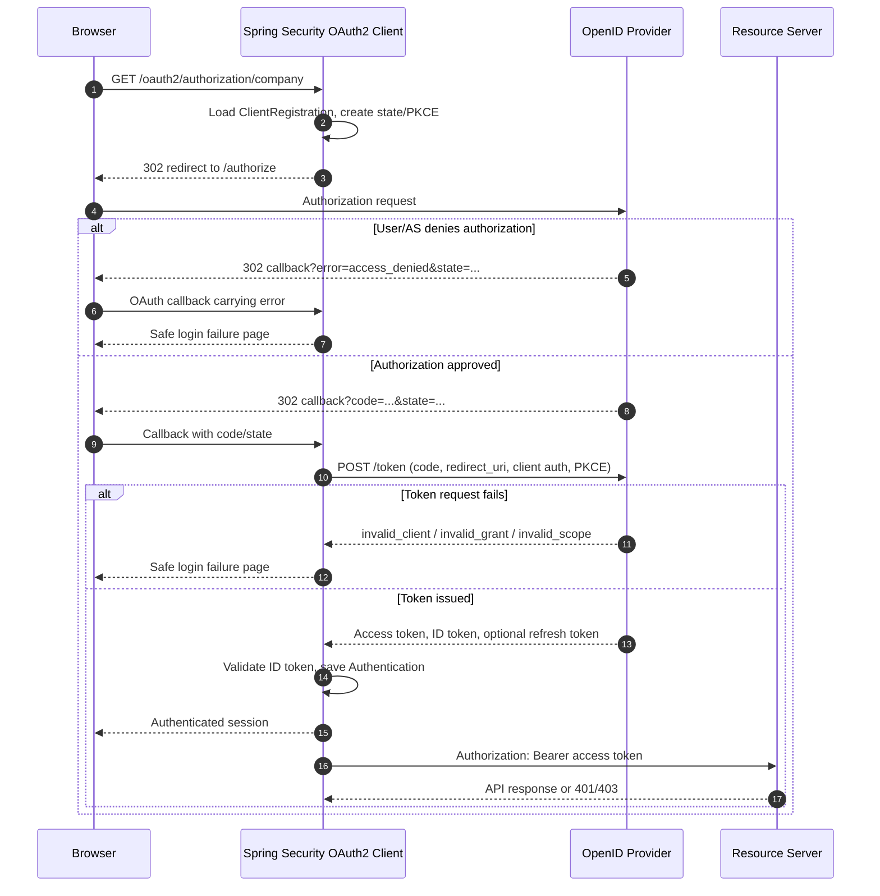
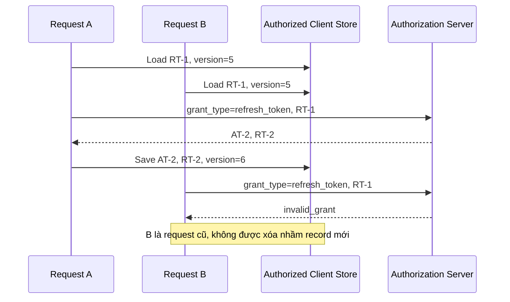

# 28.4. invalid_client, invalid_grant, invalid_scope và access_denied

Trong **Spring Security OAuth 2.0/OIDC Client**, một lần đăng nhập thất bại không nhất thiết là “sai mật khẩu”. Lỗi có thể xảy ra ngay khi ứng dụng tạo authorization request, lúc người dùng quyết định consent, khi OpenID Provider (OP) chuyển authorization code về callback, trong quá trình đổi code lấy token, hoặc nhiều giờ sau khi ứng dụng dùng refresh token để gia hạn access token.

Bốn mã lỗi thường gặp là:

- `invalid_client` — Authorization Server (AS) không chấp nhận việc xác thực hoặc nhận diện **OAuth client**.
- `invalid_grant` — authorization grant được trình tại Token Endpoint **không hợp lệ, đã hết hạn, bị thu hồi hoặc không khớp những ràng buộc cần thiết**.
- `invalid_scope` — phạm vi quyền (`scope`) được yêu cầu **không hợp lệ, không được biết tới, sai định dạng hoặc vượt phạm vi được phép**.
- `access_denied` — resource owner hoặc AS **từ chối authorization request**; trong OIDC Login, đây thường là một lỗi được trả về browser redirect.

Không thể sửa cả bốn lỗi bằng một cách chung là “xóa cookie rồi đăng nhập lại”. `invalid_client` có thể do secret rotation hoặc sai phương thức client authentication; `invalid_grant` có thể do authorization code được dùng hai lần hoặc refresh token rotation; `invalid_scope` có thể do client chưa được phép xin scope; `access_denied` có thể đơn giản là người dùng bấm từ chối consent.

Bài học giải thích chính xác **lỗi đến từ đâu**, **đọc HTTP/OAuth response như thế nào**, **Spring Security biểu diễn lỗi ra sao**, **phân loại lỗi trước khi retry**, và **quan sát trong production mà không tiết lộ authorization code, access token, refresh token hoặc client secret**.

---

## 1. Mục tiêu bài học

Sau bài này, người đọc có thể:

1. Phân biệt **Authorization Endpoint error**, **Token Endpoint error** và **Resource Server/API error**.
2. Đọc đúng `error`, `error_description`, `error_uri`, `state` và HTTP status.
3. Chẩn đoán `invalid_client` theo client ID, client secret, `client_secret_basic`, `private_key_jwt` hoặc mTLS.
4. Chẩn đoán `invalid_grant` theo code lifecycle, redirect URI, PKCE và refresh token rotation.
5. Chẩn đoán `invalid_scope` theo requested scope, consent, client policy và granted scopes thực tế.
6. Hiểu `access_denied` ở OP khác lỗi 403 của ứng dụng hoặc API.
7. Sử dụng `OAuth2Error`, `OAuth2AuthenticationException` và `OAuth2AuthorizationException` đúng tầng trong Spring Security.
8. Tránh tự động retry những requests dùng authorization code/refresh token một lần.
9. Thiết kế màn hình lỗi và operational runbook theo loại lỗi.
10. Xây logging, metrics, tracing và tests bảo vệ bí mật xác thực.

## 2. Tình huống minh họa: một OIDC Login chuẩn

Giả sử ứng dụng:

```text
Relying Party:
  https://portal.example.org

OpenID Provider:
  https://login.example.org

Client registration ID:
  company

OAuth client ID:
  portal-web-prod

Callback:
  https://portal.example.org/login/oauth2/code/company

Scopes:
  openid profile email
```

Luồng đăng nhập:



**Điểm quan trọng:** một lỗi xuất hiện trên callback từ browser không cùng dạng với lỗi trả về `POST /token` ở backend. Cùng mã lỗi có thể có ý nghĩa bổ sung tùy endpoint, nhưng **không thể suy ra tầng lỗi chỉ từ HTTP status code**.

## 3. Các tầng và định dạng lỗi OAuth2

### 3.1. Authorization Endpoint: redirect lỗi về RP

Trong Authorization Code Flow, nếu AS đã xác định được một redirect URI hợp lệ và có thể trả lỗi an toàn, nó có thể redirect browser:

```http
HTTP/1.1 302 Found
Location: https://portal.example.org/login/oauth2/code/company?error=access_denied&state=RANDOM_STATE
Cache-Control: no-store
```

Lỗi ở đây được mang bằng **query parameters** của callback đối với response mode thông thường của Authorization Code Flow.

`state`, nếu đã được client gửi, phải được trả lại theo yêu cầu giao thức. RP cần xác minh nó gắn với transaction ban đầu.

**Không nên** có `code` hợp lệ cùng một authorization error response. Khi AS từ chối cấp authorization, RP không có code để đổi token.

### 3.2. Token Endpoint: JSON error response

Khi backend gọi `POST /token`, một lỗi thường có dạng:

```http
HTTP/1.1 400 Bad Request
Content-Type: application/json
Cache-Control: no-store
Pragma: no-cache

{
  "error": "invalid_grant",
  "error_description": "Authorization code is invalid"
}
```

Các trường cơ bản:

| Trường | Bắt buộc? | Ý nghĩa |
|---|---|---|
| `error` | Có | Mã lỗi giao thức |
| `error_description` | Không | Mô tả đọc được, dành cho client/developer |
| `error_uri` | Không | URI tham khảo thông tin lỗi |
| `state` | Ở authorization response khi client đã gửi state | Correlate với request ban đầu |
| `trace_id` hoặc custom fields | Tùy provider | Metadata không thuộc trường bắt buộc RFC |

Đừng giả định provider luôn trả mô tả giống nhau. **`error` là tín hiệu phân loại chính**; `error_description` có thể khác giữa môi trường, phiên bản và ngôn ngữ.

### 3.3. Resource Server: HTTP 401/403 và WWW-Authenticate

Khi một API nhận Bearer access token, lỗi có thể là:

```http
HTTP/1.1 401 Unauthorized
WWW-Authenticate: Bearer error="invalid_token"
```

hoặc:

```http
HTTP/1.1 403 Forbidden
WWW-Authenticate: Bearer error="insufficient_scope", scope="orders.read"
```

`invalid_token` và `insufficient_scope` thuộc **Bearer Token Usage** ở Resource Server, **không phải** bốn mã lỗi chính của bài này.

Không gọi mọi 401 là `invalid_client` hoặc mọi 403 là `access_denied`.

## 4. Bảng chẩn đoán nhanh bốn lỗi

| Mã lỗi | Nơi thường xuất hiện | Đối tượng bị từ chối | Gợi ý đầu tiên |
|---|---|---|---|
| `invalid_client` | Token Endpoint | OAuth client authentication/identity | Client ID/secret, auth method, key/certificate |
| `invalid_grant` | Token Endpoint | Authorization code, refresh token hoặc grant khác | Code đã dùng/hết hạn, PKCE, redirect binding, rotation |
| `invalid_scope` | Authorization hoặc Token Endpoint | Scope được yêu cầu | Scope sai tên, chưa được đăng ký/cấp phép |
| `access_denied` | Authorization Endpoint/callback | Authorization request | User từ chối consent, policy/OP từ chối |

Một lưu ý về HTTP statuses:

- Token Endpoint thường dùng **400** cho `invalid_grant` và `invalid_scope`.
- `invalid_client` có thể dùng **401**. Theo RFC 6749, khi client đã thử xác thực bằng HTTP `Authorization` header, AS phải trả 401 với `WWW-Authenticate` phù hợp trong trường hợp xác thực thất bại.
- Authorization Endpoint thường trả lỗi bằng **browser redirect**, nên browser nhìn thấy status 302 trước khi RP nhận callback lỗi.
- Vendor implementations có thể thêm status hoặc error subcodes riêng; không xây hệ thống chỉ dựa vào mỗi HTTP status.

## 5. invalid_client: AS không chấp nhận OAuth client

Theo OAuth2, `invalid_client` biểu thị client authentication thất bại, chẳng hạn **client không được biết tới, không có thông tin authentication, sai phương thức xác thực hoặc credential không hợp lệ**.

### 5.1. Token request ví dụ

```http
POST /oauth2/token HTTP/1.1
Host: login.example.org
Authorization: Basic <base64-encoded-client-credentials>
Content-Type: application/x-www-form-urlencoded
Accept: application/json

grant_type=authorization_code&
code=<one-time-code>&
redirect_uri=https%3A%2F%2Fportal.example.org%2Flogin%2Foauth2%2Fcode%2Fcompany
```

Nếu client secret sai:

```http
HTTP/1.1 401 Unauthorized
WWW-Authenticate: Basic realm="oauth2"
Content-Type: application/json

{
  "error": "invalid_client"
}
```

`Authorization: Basic` trong ví dụ chứa client credential, **không phải Bearer access token**. Không ghi giá trị header thật vào log, ticket hoặc ảnh chụp màn hình.

### 5.2. Những nguyên nhân thường gặp

1. `client-id` bị đánh sai, bị xóa hoặc thuộc môi trường khác.
2. `client-secret` hết hạn/được xoay vòng nhưng app vẫn dùng bản cũ.
3. App dùng `client_secret_post` trong khi AS yêu cầu `client_secret_basic`.
4. AS đăng ký `private_key_jwt` nhưng app gửi Basic.
5. JWT client assertion sai `iss`, `sub`, `aud`, `exp`, `jti` hoặc chữ ký.
6. Chứng chỉ client mTLS sai, hết hạn hoặc không khớp registration.
7. Client bị disable hoặc chưa được phép dùng endpoint/authentication method.
8. Một application replica chưa nhận được secret/key rotation.
9. Reverse proxy/gateway làm mất hoặc sửa `Authorization` header của backend request.
10. Gửi nhầm token request tới AS/tenant/realm khác.
11. Client credentials encode sai theo OAuth2 client authentication rules.
12. Clock skew ảnh hưởng JWT-based client assertions.

### 5.3. Không nhầm client ID với registrationId

Trong Spring:

```yaml
spring:
  security:
    oauth2:
      client:
        registration:
          company:
            client-id: portal-web-prod
```

- `company` là local `registrationId` của Spring Security.
- `portal-web-prod` là `client_id` đăng ký ở OP.

Nếu AS báo không nhận diện client ID, đừng đổi tên registrationId thành client ID và kỳ vọng tự sửa vấn đề.

## 6. invalid_client và ClientAuthenticationMethod

Spring Security phân biệt nhiều phương thức client authentication. Không chỉ có “client secret có đúng hay không?”.

| Method | Cách client chứng minh identity | Vấn đề thường gặp |
|---|---|---|
| `client_secret_basic` | HTTP Basic tại Token Endpoint | Secret sai, header bị gateway xóa |
| `client_secret_post` | `client_id`/`client_secret` trong body | AS không cho phép method, body/log lộ secret |
| `private_key_jwt` | JWT assertion do client ký | Key/`kid`/`aud`/`exp` sai |
| `client_secret_jwt` | JWT HMAC bằng shared secret | Thuật toán, claim, secret sai |
| mTLS client authentication | Chứng chỉ TLS của client | Certificate mapping, chain, rotation |
| `none` | Public client không dùng client secret | Cấu hình grant/client type không khớp AS policy |

### 6.1. Cấu hình client_secret_basic

```yaml
spring:
  security:
    oauth2:
      client:
        registration:
          company:
            provider: company
            client-id: ${OIDC_CLIENT_ID}
            client-secret: ${OIDC_CLIENT_SECRET}
            client-authentication-method: client_secret_basic
            authorization-grant-type: authorization_code
            redirect-uri: "{baseUrl}/login/oauth2/code/{registrationId}"
            scope:
              - openid
              - profile
              - email
        provider:
          company:
            issuer-uri: https://login.example.org
```

Mọi dữ liệu trên `OIDC_CLIENT_SECRET` là secret server-side. Nếu provider yêu cầu phương thức khác, thay đổi cấu hình và token response client integration phù hợp; **không thử tất cả methods bằng cách rải secret qua nhiều nơi**.

### 6.2. private_key_jwt không phải JWT Bearer Grant

Khi dùng `private_key_jwt`, Token Endpoint nhận:

```text
client_assertion_type=
  urn:ietf:params:oauth:client-assertion-type:jwt-bearer

client_assertion=<signed-client-authentication-JWT>
```

Đó là **client authentication**, không phải `grant_type=urn:ietf:params:oauth:grant-type:jwt-bearer`.

Nếu client assertion sai audience hoặc thời hạn, AS có thể trả `invalid_client` dù authorization code hợp lệ.

### 6.3. AS có thể che chi tiết cố ý

Đừng kỳ vọng `error_description` nói chính xác “secret đã sai ở ký tự thứ 9”. Một AS an toàn thường không tiết lộ liệu client ID tồn tại hay vì sao credential sai.

Runbook phải dựa vào **cấu hình được phép truy cập**, server-side correlation ID và AS logs dành cho operator, không cố suy luận secrets từ thông điệp công khai.

## 7. Chẩn đoán invalid_client theo thứ tự

Một quy trình hiệu quả:

1. Xác định **registrationId** đang được dùng.
2. Xác định **issuer/token endpoint** thực sự được chọn từ trusted configuration.
3. Kiểm tra đúng client ID của môi trường, tenant và registration.
4. So client authentication method trong app với AS client registration.
5. Xác nhận credential hiện hành trong secret manager — không in giá trị.
6. Kiểm tra rotation thời gian gần đây và sự nhất quán giữa replicas.
7. Kiểm tra các HTTP intermediaries có giữ `Authorization` header đúng không.
8. Với JWT assertion, kiểm tra metadata `kid`, algorithm allowlist, issuer/subject/audience/expiration và thời gian đồng hồ.
9. Với mTLS, kiểm tra certificate mapping, chain và expiry.
10. Đối chiếu AS audit logs bằng correlation ID.

Không tự động:

```text
invalid_client -> retry 100 lần mỗi giây
```

Với credential sai, retry nguyên request không làm secret tự đúng. Nên fail fast, ghi nhận incident và sửa cấu hình.

## 8. invalid_grant: grant được trình không hợp lệ

`invalid_grant` là một trong các lỗi có nhiều nguyên nhân nhất.

Với Authorization Code Flow, authorization grant là **authorization code**. Với Refresh Token Grant, grant là **refresh token**.

Đặc tả mô tả những trường hợp như: grant không hợp lệ, đã hết hạn, bị thu hồi, không khớp redirect URI được dùng khi authorization, hoặc được cấp cho client khác.

### 8.1. Authorization Code token request

```http
POST /oauth2/token HTTP/1.1
Host: login.example.org
Authorization: Basic <encoded-client-credentials>
Content-Type: application/x-www-form-urlencoded

grant_type=authorization_code&
code=<authorization-code>&
redirect_uri=https%3A%2F%2Fportal.example.org%2Flogin%2Foauth2%2Fcode%2Fcompany&
code_verifier=<original-pkce-verifier>
```

Error:

```http
HTTP/1.1 400 Bad Request
Content-Type: application/json

{
  "error": "invalid_grant",
  "error_description": "The authorization code is no longer valid"
}
```

Mô tả chỉ là ví dụ. AS có thể không phân biệt “đã dùng”, “đã hết hạn” hay “thuộc client khác” để tránh tiết lộ thông tin.

### 8.2. Các nguyên nhân liên quan authorization code

- Authorization code đã **được sử dụng trước đó**.
- Code hết hạn vì browser/ứng dụng chờ quá lâu.
- Code đã bị thu hồi hoặc từ chối theo chính sách.
- `redirect_uri` của token request không khớp authorization request.
- Code được cấp cho client khác với client đang đổi token.
- PKCE `code_verifier` không khớp `code_challenge` ban đầu.
- App đang dùng `code_verifier` từ tab/login attempt khác.
- Callback bị handler chạy **hai lần** hoặc load balancer/retry gây duplicate exchange.
- Dùng code của một issuer/realm với token endpoint của issuer khác.
- OP có policy riêng làm code invalid sau thay đổi login state.

### 8.3. invalid_grant không đồng nghĩa lỗi mật khẩu

Đến thời điểm đổi authorization code, OP có thể đã xác thực user thành công. Lỗi xảy ra trong bước **đổi grant**. Không hiển thị thông báo “mật khẩu sai” nếu không có bằng chứng như vậy.

### 8.4. State mismatch khác invalid_grant

Nếu browser callback có `state` không khớp authorization request lưu ở RP, Spring Security có thể từ chối **ngay tại RP**, trước khi gửi Token Endpoint request.

Đó là lỗi correlation/security của client. Không được mặc định gọi nó là `invalid_grant` do AS trả về.

## 9. PKCE, redirect URI và invalid_grant

### 9.1. PKCE tham gia như thế nào?

Khi bắt đầu login:

```text
code_verifier = high-entropy random secret
code_challenge = BASE64URL(SHA256(code_verifier))
code_challenge_method = S256
```

Authorization request gửi `code_challenge`; token request gửi `code_verifier` gốc.

Nếu token request có verifier khác hoặc không có khi cần, AS từ chối. Lỗi thường là `invalid_grant`.

### 9.2. Mẫu lỗi nhiều tab

```text
Tab A: state=A, code_verifier=VERIFIER_A
Tab B: state=B, code_verifier=VERIFIER_B

Callback A đến:
  code=CODE_A
  state=A

Sai:
  dùng VERIFIER_B -> Token Endpoint invalid_grant
```

Application không được chỉ lưu một biến `currentCodeVerifier` dùng chung mọi login transactions nếu cho phép nhiều authorization flows.

### 9.3. Redirect URI mismatch ở hai thời điểm

**Thời điểm 1 — Authorization Endpoint:**

AS kiểm tra `redirect_uri` trong request khởi đầu có đúng redirect URI đã đăng ký không. Nếu không, AS thường không chuyển code về URI đó.

**Thời điểm 2 — Token Endpoint:**

AS kiểm tra code được đổi bởi đúng client và, khi áp dụng, cùng redirect URI đã dùng trong bước authorization. Sai binding có thể trả `invalid_grant`.

Không lẫn “redirect_uri_mismatch trên trang OP” với “invalid_grant lúc backend đổi code”.

### 9.4. Không sửa bằng cách bỏ PKCE

Nếu app bị `invalid_grant` do verifier mất, cần sửa session/authorization request persistence hoặc flow concurrency. **Không tắt PKCE** để che lỗi correlation.

## 10. Authorization code được dùng một lần

Authorization Code Flow dựa trên authorization code có tuổi thọ ngắn và không nên được tái sử dụng.

Một request thành công:

```text
CODE-1 --POST /token--> AT-1 + ID-Token-1
```

Gửi lần hai:

```text
CODE-1 --POST /token--> invalid_grant
```

### 10.1. Điều gì tạo duplicate token exchange?

- Callback endpoint bị một proxy retry không đúng semantics.
- Custom application code xử lý code ngoài Spring filter và Spring filter xử lý lại.
- User refresh một callback URL chứa `code`.
- Hai consumers đọc cùng authorization code.
- Retry policy tự động gửi lại toàn bộ `POST /token` sau timeout.
- Reverse proxy/load balancer chuyển callback và state handler không nhất quán.

### 10.2. Timeout không chứng minh code chưa được đổi

Nếu RP gọi Token Endpoint và bị timeout, AS **có thể đã xử lý thành công** nhưng response không về tới RP. Tự retry cùng code có thể nhận `invalid_grant`.

Giải pháp thường là **khởi tạo authorization transaction mới** theo UX có kiểm soát, không gửi code cũ vô hạn.

### 10.3. Không log authorization code để “xem có trùng không”

Authorization code là credential ngắn hạn. Đừng log raw:

```text
code=...
code_verifier=...
Authorization: Basic ...
```

Nếu cần debug duplicate exchanges, dùng correlation ID/session transaction ID **không bí mật**, hoặc token/code fingerprint dạng HMAC có chính sách retention nghiêm ngặt nếu thực sự cần.

## 11. invalid_grant khi sử dụng Refresh Token Grant

Sau đăng nhập, ứng dụng có thể lưu `OAuth2AuthorizedClient` chứa refresh token. Khi access token hết hạn hoặc gần hết hạn, nó gọi:

```http
POST /oauth2/token HTTP/1.1
Host: login.example.org
Authorization: Basic <encoded-client-credentials>
Content-Type: application/x-www-form-urlencoded

grant_type=refresh_token&
refresh_token=<existing-refresh-token>
```

AS có thể trả:

```json
{
  "error": "invalid_grant",
  "error_description": "Refresh token is invalid or expired"
}
```

### 11.1. Những nguyên nhân thường gặp

1. Refresh token đã hết hạn.
2. User hoặc admin thu hồi consent.
3. OP/AS đã revoke refresh token do logout/policy.
4. Refresh token đã được **rotate**; token cũ không còn hợp lệ.
5. Một request khác đã sử dụng refresh token trước.
6. Token thuộc client khác.
7. Token được lưu sai principal/registration hoặc issuer.
8. Refresh token family bị revoke do reuse detection.
9. Persistent token store chứa token cũ do lost update.
10. Rotation response có refresh token mới nhưng ứng dụng không lưu thành công.
11. User/tenant/account status thay đổi làm grant không còn hợp lệ theo AS policy.

### 11.2. Không tự động xem mọi invalid_grant là “user hết phiên”

Nếu một web session vẫn có Authentication hợp lệ nhưng refresh token invalid, ứng dụng có thể cần **reauthorize** để lấy authorized client mới. Điều đó không tự đồng nghĩa phải xóa toàn bộ web session ngay lập tức trong mọi kiến trúc.

Tuy nhiên, nếu nghiệp vụ phụ thuộc token hợp lệ để xác nhận access, ứng dụng không được dùng một token đã lỗi hoặc bỏ qua security checks chỉ để tiếp tục UX.

## 12. Refresh token rotation và race condition

Đây là một trường hợp rất hay bị hiểu nhầm thành lỗi “ngẫu nhiên”.

Giả sử RP lưu:

```text
access_token = AT-1 (expired)
refresh_token = RT-1
version = 5
```

Hai requests cùng tải authorized client.



### 12.1. Tại sao retry nguy hiểm?

Nếu B thấy `invalid_grant` rồi retry `RT-1` nhiều lần, AS có thể xem đó là **reuse** hoặc replay, có thể revoke cả refresh token family tùy chính sách.

### 12.2. Vấn đề stale delete

Nếu failure handler B xóa authorized client theo `(registrationId, principalName)` **không kiểm tra phiên bản**, nó có thể xóa `RT-2` vừa được A lưu.

Hậu quả: user bị buộc login lại dù một request refresh đã thành công.

### 12.3. Những biện pháp nên xem xét

- **Single-flight/per-key coordination** trước khi gọi Token Endpoint.
- Với multi-node, coordination phân tán nếu strict rotation yêu cầu.
- Optimistic locking/CAS khi lưu token state.
- **Conditional delete** dùng version đã quan sát trước refresh.
- Reload latest authorized client khi phát hiện concurrent update.
- Không tự retry token cũ sau `invalid_grant`.
- Xử lý AS reuse-detection/family revocation theo policy.
- Quan sát số refresh requests trên mỗi principal/registration mà không log secrets.

### 12.4. CAS không tự ngăn duplicate refresh

CAS chỉ bảo vệ việc ghi vào database. Nếu cả A và B đã gửi `RT-1` tới AS trước khi CAS, token reuse vẫn đã xảy ra.

Do đó, với strict rotation, phải xử lý **cả điều phối trước Token Endpoint call lẫn persistence versioning**.

## 13. Invalid grant và transaction persistence

Một lần refresh thành công có thể cấp:

```text
AT-2, RT-2
```

nhưng app crash trước khi lưu, khiến DB còn:

```text
AT-1, RT-1
```

Token Endpoint đã rotate `RT-1`; transaction DB không thể rollback trạng thái tại AS.

**Không có một `@Transactional` đơn thuần nào bao phủ cả database và HTTPS Token Endpoint như một giao dịch nguyên tử.**

### 13.1. Những trường hợp cần phân biệt

| Tình trạng | Có nên retry cùng refresh token? | Hướng xử lý |
|---|---|---|
| AS trả `invalid_grant` xác định | **Không** | Kiểm tra rotation/revocation; reauthorize hoặc recovery theo AS contract |
| Timeout trước khi biết AS xử lý hay chưa | Không mặc định | Xem đây là kết quả **ambiguous** |
| CAS update thất bại, DB đã có token mới | Không retry RT cũ | Reload và đánh giá latest token |
| AS trả 5xx tạm thời | Chỉ nếu chính sách an toàn | Backoff, giới hạn và xem xét rotation semantics |
| Client secret sai | Không | Sửa `invalid_client`, không dùng refresh token khác đoán thử |

### 13.2. Không xóa token mới theo failure cũ

Nếu ứng dụng tùy chỉnh `OAuth2AuthorizedClientService`, failure handler cần hiểu version của token state mà failed request đã dùng. `removeAuthorizedClient(registrationId, principalName)` không mang version trong chữ ký API chuẩn, nên một custom CAS/conditional-delete strategy cần được thiết kế rõ.

**Không giả định Spring Security default storage tự cung cấp distributed refresh locking.** Hành vi handler/mapping còn tùy Spring Security version và cấu hình manager.

## 14. invalid_scope: scope được yêu cầu không hợp lệ

OAuth `scope` là chuỗi các giá trị phân cách bằng dấu cách, được AS định nghĩa ngữ nghĩa và mức cho phép.

Ví dụ:

```text
openid profile email orders.read
```

AS có thể từ chối khi client gửi:

```text
openid profile platform.superadmin
```

mà client không được cấp quyền yêu cầu `platform.superadmin`.

### 14.1. Các nguyên nhân phổ biến

- Scope name sai chính tả hoặc không được AS biết.
- Scope chưa được cho phép với client registration.
- Scope không có trong contract của API/resource.
- Requested scope rộng hơn chính sách grant/consent.
- Phân tách scope sai, chẳng hạn dùng dấu phẩy thay vì dấu cách tại raw protocol layer.
- Scope có ký tự không được phép theo profile hoặc bị encode sai.
- Yêu cầu scope dành cho AS/tenant khác.
- Client credentials dùng scope chỉ dành cho delegated user, hoặc ngược lại.
- Resource/audience parameter không phù hợp với requested scope.
- OP không hỗ trợ một OIDC-specific hoặc provider-specific scope.
- Thay đổi policy khiến scope trước đây được phép nay không còn hợp lệ.

### 14.2. Lỗi có thể xuất hiện ngay tại Authorization Endpoint

Authorization request:

```http
GET /authorize?response_type=code&
    client_id=portal-web-prod&
    scope=openid%20profile%20not-permitted&
    redirect_uri=...&
    state=... HTTP/1.1
Host: login.example.org
```

OP có thể trả qua callback hợp lệ:

```text
https://portal.example.org/login/oauth2/code/company
  ?error=invalid_scope
  &state=RANDOM_STATE
```

### 14.3. Lỗi cũng có thể ở Token Endpoint

Đặc biệt với Client Credentials, Refresh Token hoặc grant mở rộng, requested scopes có thể được gửi ở Token Endpoint:

```http
POST /oauth2/token HTTP/1.1
Host: login.example.org
Authorization: Basic <encoded-client-credentials>
Content-Type: application/x-www-form-urlencoded

grant_type=client_credentials&
scope=orders.read%20orders.admin
```

Nếu `orders.admin` không hợp lệ/được phép, AS có thể trả:

```json
{
  "error": "invalid_scope"
}
```

## 15. Requested scopes khác granted scopes

Đừng trộn ba tập scope:

1. **Configured scopes** trong `ClientRegistration`.
2. **Requested scopes** thực sự gửi tới AS trong authorization/token request.
3. **Granted scopes** thực sự được AS cấp cho access token.

Ví dụ:

```text
Configured: openid profile email orders.read
Requested:  openid profile email orders.read
Granted:    openid profile
```

Tùy profile, AS có thể trả một token với scope hẹp hơn thay vì lỗi. Khi scope được cấp khác scope yêu cầu, OAuth token response phải biểu diễn phạm vi được cấp theo quy tắc giao thức.

### 15.1. Không suy luận granted scope từ YAML

Sai:

```java
boolean canReadOrders =
    clientRegistration.getScopes().contains("orders.read");
```

Điều đó chỉ kiểm tra **scope đã cấu hình để yêu cầu**, không phải access token thật sự có scope hay domain authorization đã cho phép operation.

### 15.2. Resource Server vẫn kiểm tra quyền

Ngay cả access token có `orders.read`, API vẫn phải kiểm tra user/tenant/object permissions.

`invalid_scope` từ AS không giống:

```http
HTTP/1.1 403 Forbidden
WWW-Authenticate: Bearer error="insufficient_scope"
```

ở API. Một cái là **token request không được chấp nhận**, cái kia là **token hiện tại không đủ quyền cho API operation**.

### 15.3. Scope và OIDC Login

Trong OIDC, `openid` là scope quan trọng để xác định request là OIDC authentication. Nếu thiếu `openid`, một provider có thể xử lý như OAuth2 authorization thay vì OIDC và không trả ID Token.

Không coi việc không có ID Token là `invalid_scope` trong mọi trường hợp; cần xem AS response, configured scope và flow thật.

## 16. Khắc phục invalid_scope

Một runbook theo thứ tự:

1. Xác định error xuất hiện ở **Authorization Endpoint** hay **Token Endpoint**.
2. Lấy `registrationId` và issuer alias từ cấu hình/tracing an toàn.
3. So requested scope names với danh sách provider hỗ trợ.
4. Xác minh client được cấp quyền yêu cầu các scopes đó.
5. Kiểm tra dấu phân cách và form URL encoding.
6. Nếu là OIDC Login, kiểm tra có `openid` khi cần.
7. Kiểm tra tenant/realm/resource policies.
8. Nếu scope liên quan API, xác minh audience/resource indicator contract.
9. Nếu user consent bị giới hạn, phân biệt với `access_denied`.
10. Chỉ yêu cầu những scopes cần thiết theo nguyên tắc least privilege.

### 16.1. Không tự thêm scope đặc quyền để thử

Khi gặp lỗi, không thử gửi:

```text
scope=admin root superuser *
```

để tìm một scope “có hiệu lực”. Điều này không giải quyết mapping policy và làm tăng bề mặt yêu cầu quyền quá mức.

### 16.2. Không xóa scope bảo mật cần thiết mù quáng

Ví dụ xóa `openid` để hết lỗi có thể biến OIDC Login thành một OAuth2-only flow, làm app mất ID Token. Cần hiểu provider contract trước khi thay scopes.

## 17. access_denied: authorization request bị từ chối

`access_denied` thường xảy ra trong **bước authorization**, trước khi RP có authorization code.

Ví dụ user thấy consent screen:

```text
Ứng dụng Portal yêu cầu:
  - Xem hồ sơ
  - Đọc email
  - Truy cập Orders API

[Cho phép] [Từ chối]
```

Nếu user chọn **Từ chối**, OP có thể redirect:

```http
HTTP/1.1 302 Found
Location: https://portal.example.org/login/oauth2/code/company?error=access_denied&state=RANDOM_STATE
```

### 17.1. Không chỉ do user bấm từ chối

AS có thể chủ động từ chối authorization request theo policy:

- User không đủ điều kiện vào ứng dụng.
- Client chưa được gán cho user/organization.
- Tenant/organization chặn ứng dụng.
- Admin yêu cầu approval nhưng chưa duyệt.
- Consent bị từ chối hoặc bị thu hồi.
- OP áp chính sách truy cập có điều kiện.
- User account hoặc session không đáp ứng policy.
- Một số provider-specific chính sách authentication/authorization.

**Không mặc định hiển thị “Bạn đã bấm Từ chối”** chỉ vì mã `access_denied`. Nó có thể là quyết định của OP/AS.

### 17.2. Authorization error phải trả về callback an toàn

Nếu AS xác minh được redirect URI hợp lệ, error thường được gửi về RP kèm `state`. Nếu request có `redirect_uri` không hợp lệ hoặc client không được nhận diện theo cách khiến redirect không đáng tin, AS không được gửi error tới URI không được phép chỉ để báo lỗi.

Hệ quả: một số lỗi authorization hiện trên **trang OP**, không hề có callback đến RP. Đây là điều cần phân biệt trong vận hành.

### 17.3. access_denied không phải API HTTP 403

Một Controller có:

```java
@PreAuthorize("hasRole('ADMIN')")
@GetMapping("/admin")
public String admin() { return "admin"; }
```

có thể trả HTTP 403 khi authenticated user thiếu quyền. Đây là **authorization failure của ứng dụng**.

Nó không phải mặc nhiên là OAuth Authorization Endpoint error `access_denied`. Dù tên gần nhau, code path và chủ thể ra quyết định khác nhau.

## 18. Trải nghiệm người dùng khi access_denied

Một UX hợp lý:

- Thông báo việc đăng nhập/ủy quyền **chưa được hoàn tất**.
- Cho user chọn **Thử lại** (bắt đầu authorization request mới).
- Cho user chọn **Quay về trang chủ** hoặc chọn tài khoản/tenant khác nếu sản phẩm hỗ trợ.
- Không giả định việc từ chối là lỗi kỹ thuật bắt buộc phải retry.
- Nếu có organization/admin policy, hướng dẫn liên hệ quản trị viên.
- Không hiển thị raw `error_description` chưa được kiểm tra/escape.
- Không tiết lộ tài khoản có tồn tại hay những thông tin chính sách nhạy cảm.

Ví dụ lời nhắn:

> Đăng nhập chưa được hoàn tất vì yêu cầu cấp quyền không được chấp nhận. Bạn có thể thử lại hoặc liên hệ quản trị viên nếu tài khoản cần được cấp quyền truy cập ứng dụng.

Tránh UX tự động redirect ngay lại OP liên tục, vì user có thể vừa chủ động từ chối consent.

## 19. Không nhầm OAuth2 error code với HTTP status

Một số ánh xạ phổ biến nhưng không tuyệt đối:

| Mã hoặc hiện tượng | Endpoint | HTTP status thường gặp | Ý nghĩa |
|---|---|---|---|
| `invalid_client` | Token Endpoint | 401 hoặc 400 theo method/profile; có quy tắc 401/WWW-Authenticate | Client authentication thất bại |
| `invalid_grant` | Token Endpoint | 400 | Grant không hợp lệ |
| `invalid_scope` | Authorization Endpoint | 302 đến valid redirect URI, hoặc OP response tương ứng | Scope request không được chấp nhận |
| `invalid_scope` | Token Endpoint | 400 | Scope request không hợp lệ |
| `access_denied` | Authorization Endpoint | 302 đến valid redirect URI | Authorization bị từ chối |
| `invalid_token` | Resource Server | 401 | Bearer token bị từ chối |
| `insufficient_scope` | Resource Server | 403 | Token không đủ scope |
| Local Spring `AccessDeniedException` | RP hoặc Resource Server | Thường 403 | App authorization thất bại |
| Local OAuth `state` validation error | RP callback | Tùy failure handler | Callback không khớp transaction |

**Đừng xây classifier kiểu `if (status == 403) error = access_denied`.** Nó có thể gây sai hoàn toàn với API response.

## 20. OAuth2 token response và thông tin lỗi cần được xử lý an toàn

### 20.1. Không tin error_description như text đã sanitize

Một provider có thể trả:

```json
{
  "error": "invalid_scope",
  "error_description": "Scope <script>...</script> is not allowed"
}
```

Nếu app đưa nguyên chuỗi vào HTML mà không escape, có nguy cơ reflected XSS.

Spring/templating engines thường có cơ chế output escaping; khi tùy biến, không dùng raw HTML insertion.

### 20.2. error_uri không phải redirect target tự động

`error_uri` là URI có thể dẫn đến tài liệu giải thích lỗi. Không tự động redirect browser tới URI do response cung cấp mà không có trust policy, vì nó có thể bị lợi dụng làm open redirect/phishing nếu provider bị giả mạo hoặc cấu hình sai.

### 20.3. Error descriptions có thể chứa dữ liệu nhạy cảm

Một AS có thể đưa subject, client ID hoặc policy details vào error description. Log toàn bộ response sẽ làm lộ metadata và đôi khi cả token-like values do provider bug.

Nên log **error code**, **registration alias**, **phase**, **request correlation ID**, latency; description chỉ nên được lưu đã redacted và có kiểm soát khi thật sự cần.

## 21. Spring Security biểu diễn lỗi OAuth2 như thế nào?

Các lớp thường gặp:

| Java type | Vai trò |
|---|---|
| `OAuth2Error` | Mã lỗi, mô tả, URI |
| `OAuth2AuthenticationException` | Lỗi OAuth2 gắn với quá trình authentication |
| `OAuth2AuthorizationException` | Lỗi authorization/token acquisition ở OAuth2 Client |
| `AuthenticationException` | Họ exception cho authentication failures |
| `OAuth2AuthenticationToken` | Authentication thành công trong OAuth2 Login |
| `OAuth2AuthorizedClient` | Client registration + access/refresh tokens |
| `OAuth2AuthorizedClientManager` | Điều phối authorize/reauthorize và token lifecycle |
| `OAuth2AuthorizationFailureHandler` | Hook xử lý thất bại khi manager authorization |
| `OAuth2AuthorizationSuccessHandler` | Hook xử lý thành công khi manager authorization |

### 21.1. OAuth2Error

Ví dụ:

```java
import org.springframework.security.oauth2.core.OAuth2Error;

OAuth2Error error = new OAuth2Error(
    "invalid_grant",
    "The authorization code is invalid",
    null
);

String code = error.getErrorCode();
String description = error.getDescription();
String uri = error.getUri();
```

`OAuth2Error` lưu dữ liệu error; việc log/hiển thị vẫn phải được sanitize.

### 21.2. Login vs authorized client

**Interactive OIDC Login:** lỗi có thể được đưa về Spring Security authentication failure pipeline. Một `AuthenticationFailureHandler` có thể điều hướng đến UI an toàn.

**Refreshing/calling API:** lỗi khi `OAuth2AuthorizedClientManager` reauthorize có thể được thể hiện qua `OAuth2AuthorizationException` hoặc failure handler của manager, tùy manager/provider/configuration.

Không giả định một handler của `oauth2Login()` luôn bắt được mọi `invalid_grant` phát sinh **nhiều giờ sau trong background job**.

## 22. Ví dụ AuthenticationFailureHandler an toàn cho Servlet Login

Mục tiêu:

- Không hiện raw provider description cho user.
- Ghi nhận mã lỗi đã được allowlist.
- Không log authorization code/refresh token/ID Token.
- Redirect về một trang RP cố định sau login failure.

```java
import jakarta.servlet.ServletException;
import jakarta.servlet.http.HttpServletRequest;
import jakarta.servlet.http.HttpServletResponse;

import java.io.IOException;
import java.util.Set;

import org.slf4j.Logger;
import org.slf4j.LoggerFactory;
import org.springframework.security.core.AuthenticationException;
import org.springframework.security.oauth2.core.OAuth2AuthenticationException;
import org.springframework.security.web.authentication.AuthenticationFailureHandler;
import org.springframework.security.web.authentication.SimpleUrlAuthenticationFailureHandler;

public final class SafeOidcFailureHandler
        implements AuthenticationFailureHandler {

    private static final Logger log =
        LoggerFactory.getLogger(SafeOidcFailureHandler.class);

    private static final Set<String> KNOWN_CODES = Set.of(
        "invalid_client",
        "invalid_grant",
        "invalid_scope",
        "access_denied"
    );

    private final AuthenticationFailureHandler delegate =
        new SimpleUrlAuthenticationFailureHandler("/login?error");

    @Override
    public void onAuthenticationFailure(
            HttpServletRequest request,
            HttpServletResponse response,
            AuthenticationException exception)
            throws IOException, ServletException {

        String classified = "authentication_failed";

        if (exception instanceof OAuth2AuthenticationException oauthError) {
            String rawCode = oauthError.getError().getErrorCode();

            if (KNOWN_CODES.contains(rawCode)) {
                classified = rawCode;
            }
        }

        log.warn("OIDC login failure: category={}", classified);

        // Không đưa provider description, code hoặc state vào Location.
        delegate.onAuthenticationFailure(request, response, exception);
    }
}
```

Mã minh họa chỉ log một error category an toàn. Trong production, có thể bổ sung correlation ID và registration alias từ **trusted server-side context**, nhưng không dựa vào raw query để xác định credential owner hoặc xuất PII.

### 22.1. Gắn vào Spring Security

```java
import org.springframework.context.annotation.Bean;
import org.springframework.context.annotation.Configuration;
import org.springframework.security.config.annotation.web.builders.HttpSecurity;
import org.springframework.security.web.SecurityFilterChain;

@Configuration
public class SecurityConfiguration {

    @Bean
    SecurityFilterChain security(
            HttpSecurity http,
            SafeOidcFailureHandler failureHandler)
            throws Exception {

        http
            .authorizeHttpRequests(auth -> auth
                .requestMatchers("/", "/login", "/error").permitAll()
                .anyRequest().authenticated())
            .oauth2Login(oauth2 -> oauth2
                .failureHandler(failureHandler));

        return http.build();
    }

    @Bean
    SafeOidcFailureHandler safeOidcFailureHandler() {
        return new SafeOidcFailureHandler();
    }
}
```

Đây là cấu hình Servlet với Spring Security 6+ DSL điển hình. Việc logging category không thay thế bảo đảm `state`, redirect matching, ID Token validation hoặc security filter chain đúng.

### 22.2. Trang login không cần hiển thị raw code

URL:

```text
/login?error
```

có thể hiển thị lời nhắn trung tính:

> Không thể hoàn tất đăng nhập. Bạn có thể thử lại hoặc liên hệ hỗ trợ nếu sự cố lặp lại.

Nếu sản phẩm muốn phân biệt `access_denied` với lỗi cấu hình, có thể dùng **server-side mapped UI state** hoặc thông điệp do ứng dụng cho phép, thay vì đưa nguyên provider description vào redirect query.

### 22.3. Lỗi không có OAuth2AuthenticationException?

Một failure có thể được biểu diễn bằng loại `AuthenticationException` khác, tùy nơi phát sinh và Spring version. Vì vậy handler nên có **fallback classification**, không cast mọi exception sang `OAuth2AuthenticationException`.

## 23. OAuth2AuthorizedClientManager và lỗi refresh token

Đối với service-based authorization (ví dụ scheduled job), ứng dụng có thể dùng:

```java
import org.springframework.security.oauth2.client.OAuth2AuthorizeRequest;
import org.springframework.security.oauth2.client.OAuth2AuthorizedClient;
import org.springframework.security.oauth2.client.OAuth2AuthorizedClientManager;

public final class DownstreamTokenService {

    private final OAuth2AuthorizedClientManager manager;

    public DownstreamTokenService(
            OAuth2AuthorizedClientManager manager) {
        this.manager = manager;
    }

    public OAuth2AuthorizedClient authorize(
            String registrationId,
            String principalName) {

        OAuth2AuthorizeRequest request =
            OAuth2AuthorizeRequest
                .withClientRegistrationId(registrationId)
                .principal(principalName)
                .build();

        OAuth2AuthorizedClient client = manager.authorize(request);

        if (client == null) {
            throw new IllegalStateException(
                "No authorized client available");
        }

        return client;
    }
}
```

Mã chỉ minh họa cách gọi manager. `principalName` phải là một identity tin cậy trong application context, **không được lấy tùy ý từ query của caller** để truy xuất token user khác. Với user-delegated flows, phải dùng đúng authenticated principal/authorized client ownership.

### 23.1. Lỗi manager không nhất thiết vào login failure handler

Ví dụ:

```text
08:00 User đăng nhập OIDC thành công.
09:00 Access token hết hạn.
09:00 Scheduled service gọi manager để refresh.
09:00 Token Endpoint trả invalid_grant.
```

Không có browser login callback tại 09:00. Handler cho `oauth2Login()` không đủ để xử lý sự cố này.

Cần đặt chính sách vào manager/failure handler và caller để quyết định:

- Reload current authorized client.
- Re-authorize khi tương tác user có thể thực hiện.
- Dừng background job có phụ thuộc delegated credential.
- Không tiếp tục dùng credential không hợp lệ.
- Không xóa phiên bản token mới do request khác vừa lưu.

### 23.2. Default failure cleanup cần hiểu đúng

Một số manager/failure-handler combinations trong Spring Security có cơ chế **remove authorized client** khi gặp `invalid_grant`. Điều này thường hợp lý khi refresh token đã thực sự invalid.

Nhưng trong concurrent refresh token rotation, xóa không điều kiện có thể gây **stale delete**. Nếu hệ thống có strict rotation, nhiều instances và persistent token store, cần thiết kế version-aware cleanup/coordination riêng. Không coi `@Transactional` quanh `saveAuthorizedClient` là giải pháp đủ.

### 23.3. Không tự cho phép khi refresh thất bại

Một anti-pattern:

```java
try {
    return manager.authorize(request);
} catch (RuntimeException e) {
    return loadSomeoneElsesCachedToken();
}
```

Không dùng token khác principal, tenant hoặc registration để “cứ gọi API”. Đây là lỗi bảo mật nghiêm trọng.

## 24. Phân loại lỗi theo phase trước khi xử lý

Một model nội bộ hữu ích:

```text
AUTHORIZATION_START
AUTHORIZATION_CALLBACK
TOKEN_EXCHANGE
TOKEN_REFRESH
RESOURCE_API_CALL
LOCAL_OIDC_VALIDATION
LOCAL_TENANT_AUTHORIZATION
```

Kèm mã OAuth:

```text
error_code = invalid_grant
phase = TOKEN_REFRESH
registration_id = company
```

sẽ cụ thể hơn rất nhiều so với:

```text
login_failed=true
```

### 24.1. Cùng invalid_grant, hai nguyên nhân khác

| Phase | Dữ liệu chính | Hướng điều tra |
|---|---|---|
| `TOKEN_EXCHANGE` | Authorization code, redirect binding, PKCE | Code reuse, expiry, callback, issuer/client mismatch |
| `TOKEN_REFRESH` | Refresh token và authorized client state | Rotation, revocation, concurrent requests, stale storage |

Không áp dụng “xóa refresh token store” cho lỗi token exchange ban đầu khi chưa từng có refresh token.

### 24.2. access_denied có thể là UX không phải outage

Nếu user chủ động bấm từ chối, `access_denied` là **outcome đúng của giao thức**, không phải lỗi availability của OP.

Metrics nên phân biệt authorization denials với token endpoint infrastructure failures.

## 25. Reactive WebFlux: cùng mã lỗi, khác programming model

Trong WebFlux:

- `ServerHttpSecurity` và `SecurityWebFilterChain` thay cho Servlet security chain.
- `ReactiveClientRegistrationRepository` quản lý registrations.
- `ReactiveOAuth2AuthorizedClientManager` điều phối authorized clients.
- Error propagation thường đi qua `Mono.error(...)`.
- Không dùng Servlet `AuthenticationFailureHandler` trong reactive filter chain.

### 25.1. Không block trong reactive failure path

Sai:

```java
return webClient.post()
    .retrieve()
    .bodyToMono(TokenResponse.class)
    .map(this::processResponse)
    .block();
```

Nếu chạy trên Reactor Netty event-loop, `block()` có thể ném exception hoặc giữ thread. Phần retry/error handling cũng phải reactive.

### 25.2. Một service reactive minh họa error classification

```java
import reactor.core.publisher.Mono;

import org.springframework.security.oauth2.core.OAuth2AuthorizationException;

public final class ReactiveTokenErrorClassifier {

    public <T> Mono<T> classify(Mono<T> tokenOperation) {
        return tokenOperation.onErrorMap(
            OAuth2AuthorizationException.class,
            error -> new TokenAcquisitionFailure(
                error.getError().getErrorCode(),
                error
            )
        );
    }

    public static final class TokenAcquisitionFailure
            extends RuntimeException {

        private final String oauthCode;

        public TokenAcquisitionFailure(
                String oauthCode,
                Throwable cause) {
            super("OAuth token acquisition failed", cause);
            this.oauthCode = oauthCode;
        }

        public String oauthCode() {
            return oauthCode;
        }
    }
}
```

Code chỉ phân loại exception **nếu upstream phát `OAuth2AuthorizationException`**. Không phải mọi WebClient error tự động thuộc lớp đó; HTTP 400 từ một custom WebClient có thể phát `WebClientResponseException`, và cần parse OAuth error body theo client integration phù hợp.

### 25.3. Không dùng onErrorResume để cấp quyền giả

Sai:

```java
return tokenService.authorize()
    .onErrorResume(error ->
        Mono.just(fakeAdminAccessToken()));
```

Đúng là xác định action theo error:

```text
invalid_grant -> stop/re-auth/reload according to policy
invalid_client -> config incident
invalid_scope -> scope config fix
access_denied -> user/OP authorization outcome
```

Fallback chỉ có thể dùng dữ liệu không ảnh hưởng bảo mật, ví dụ UI message, **không tạo hoặc lấy token tùy tiện**.

## 26. OIDC validation errors không phải luôn một trong bốn mã

Sau Token Endpoint trả success, Spring Security còn kiểm tra ID Token và đôi khi UserInfo.

Những vấn đề có thể xảy ra:

- ID Token signature invalid.
- Issuer `iss` không khớp.
- Audience `aud` sai client ID.
- `azp` không khớp trong trường hợp cần kiểm tra.
- `exp` đã hết hạn hoặc `iat` bất thường.
- `nonce` không khớp authorization request.
- Không thể tải JWKs từ issuer đáng tin.
- UserInfo `sub` khác ID Token `sub`.
- Discovery metadata issuer không đúng.

Các lỗi này có thể tạo `OAuth2AuthenticationException` hoặc exception khác **ở RP**, không nhất thiết là AS trả `invalid_grant`.

### 26.1. Không dùng lỗi gần giống để đổi nguyên nhân

Nếu token exchange trả 200 nhưng ID Token validation thất bại, phân loại:

```text
phase=LOCAL_OIDC_VALIDATION
cause=issuer_mismatch
```

thay vì ghi:

```text
oauth_error=invalid_grant
```

mà không có Token Endpoint error response tương ứng.

### 26.2. Phân biệt state và nonce

- `state` liên kết authorization response với transaction.
- `nonce` (khi dùng) liên kết ID Token với authentication request.

Không xóa kiểm tra cả hai chỉ vì login hay bị lỗi trong multi-tab hoặc session-store deployment.

## 27. Tại sao access_denied khác Spring AccessDeniedException?

Hai cái đều có chữ “access denied”, nhưng không cùng ngữ nghĩa.

### 27.1. OP access_denied

```text
Browser -> OP /authorize
OP decides user/client authorization denied
OP -> RP callback?error=access_denied&state=...
```

Hệ quả: OIDC Login chưa hoàn tất, RP chưa có Authentication từ flow đó.

### 27.2. Spring AccessDeniedException

```text
Authenticated user -> RP /admin
Spring authorization rule rejects
HTTP 403
```

Hệ quả: user có thể vẫn đăng nhập, nhưng không đủ quyền cho action.

### 27.3. Resource Server insufficient_scope

```text
RP -> API with access token
API checks token scopes
HTTP 403 / Bearer insufficient_scope
```

Hệ quả: token không đủ scope cho API; có thể cần authorized client với scopes hợp lệ, nhưng không được tự tăng scopes hoặc bỏ policy.

### 27.4. Tách metrics

```text
oauth2_authorization_denial_total
application_authorization_denial_total
resource_server_insufficient_scope_total
```

Các tên metrics chỉ minh họa. Không gộp cả ba vào một số đếm “access_denied” rồi suy ra OP có outage.

## 28. Tenant và issuer làm thay đổi cách chẩn đoán

Một SaaS có:

```text
tenant alpha -> registration alpha-oidc -> issuer A
tenant beta  -> registration beta-oidc  -> issuer B
```

Một lỗi `invalid_client` chỉ xuất hiện với tenant beta có thể do secret B; không phải mọi user trên hệ thống bị sai client configuration.

### 28.1. Cùng mã lỗi, khác provider policy

- Issuer A trả `invalid_scope` cho scope không hỗ trợ.
- Issuer B trả `access_denied` tại authorization khi admin chưa cấp consent.
- Issuer C trả `invalid_grant` khi refresh token reuse.
- Issuer D có custom subcode cho token policy.

Runbook phải nhóm theo **registrationId và trusted issuer alias**, không chọn dynamic issuer theo error payload từ phía browser.

### 28.2. Client registration thay đổi giữa login và callback

Nếu dynamic config đổi client ID/secret/Token Endpoint trong lúc authorization code còn sống, callback có thể nhận `invalid_client` hoặc `invalid_grant`.

Cần versioned registration snapshots hoặc một policy tương thích cho pending transactions.

### 28.3. Không lấy raw issuer từ error để tạo trust

Nếu callback/query báo:

```text
issuer=https://attacker.example
```

không tự tải metadata/JWKS/token endpoint từ URL đó. Issuer trust đến từ `ClientRegistration` đã chọn và authorization request correlation.

## 29. Logging an toàn cho OAuth2 errors

Các dữ liệu **không được log nguyên văn**:

```text
authorization_code
code_verifier
state (raw)
nonce (raw)
access_token
refresh_token
id_token
client_secret
client_assertion
Authorization header
session cookie
raw OAuth2AuthorizedClient
```

Một số giá trị như `state` không phải access token nhưng vẫn có thể hỗ trợ correlation abuse hoặc lộ transaction metadata. Nên sử dụng application-generated correlation ID không bí mật.

### 29.1. Structured log nên có

```json
{
  "event": "oauth2_token_request_failed",
  "phase": "TOKEN_EXCHANGE",
  "registrationId": "company",
  "issuerAlias": "corporate-sso",
  "grantType": "authorization_code",
  "oauthErrorCode": "invalid_grant",
  "outcome": "failed",
  "elapsedMs": 183,
  "correlationId": "c86e0e4f"
}
```

`elapsedMs` và `correlationId` chỉ là dữ liệu ví dụ.

### 29.2. Không log full error description vô điều kiện

Sai:

```java
log.error("Token error body: {}", responseBody);
```

Nếu provider lỗi và trả body có dữ liệu nhạy cảm, tất cả sẽ đi vào central logs.

Tốt hơn là trích xuất allowlisted `error` code, logging HTTP status và correlation ID. Với diagnostic details, áp dụng redaction, access control và retention policy riêng.

### 29.3. Không log provider response qua HTTP wire logging mặc định

Một HTTP client DEBUG interceptor có thể log Basic credential, refresh token body hoặc access token JSON. Khi bật troubleshooting, cần chắc chắn headers và bodies nhạy cảm được ẩn.

Không yêu cầu nhân viên copy token response vào issue tracker để tìm nguyên nhân `invalid_grant`.

## 30. Metrics theo mã lỗi và phase

Các metrics mẫu:

```text
oauth2_authorization_errors_total{
  registration_id="company",
  error_code="access_denied"
}

oauth2_token_errors_total{
  registration_id="company",
  grant_type="authorization_code",
  error_code="invalid_grant"
}

oauth2_token_errors_total{
  registration_id="company",
  grant_type="refresh_token",
  error_code="invalid_grant"
}

oauth2_token_errors_total{
  registration_id="company",
  grant_type="client_credentials",
  error_code="invalid_client"
}
```

### 30.1. Không đưa user ID vào metric labels

Tránh:

```text
user_email="someone@example.org"
sub="employee-725"
refresh_token="..."
```

Các labels này vừa có thể lộ thông tin, vừa gây high cardinality. Nếu có hàng chục nghìn registrations, cần thêm giới hạn cardinality/aggregation theo provider class, environment hoặc product tier.

### 30.2. Đo độ trễ Token Endpoint

Có thể quan sát:

- Token exchange latency p50/p95/p99.
- Refresh token latency.
- Số `invalid_client` theo registration.
- Số `invalid_grant` chia theo authorization_code/refresh_token.
- `access_denied` rate tại browser callback.
- Scope-denial ratio.
- Retry attempts và retry-exhausted events.
- Concurrent refresh attempts/cas conflicts.
- OP unavailability/5xx riêng với OAuth protocol errors.

**Không coi access_denied do user từ chối là một backend outage**. Ngược lại, `invalid_client` tăng đột biến sau deploy có thể là configuration incident cần điều tra ngay.

## 31. Tracing và correlation qua nhiều hệ thống

Một flow có thể đi qua:

```text
Browser
  -> RP /oauth2/authorization/company
  -> OP /authorize
  -> RP /login/oauth2/code/company
  -> RP backend /token
  -> DB authorized client store
  -> Resource Server API
```

Không nên đưa raw tokens hoặc OAuth `state` vào tracing baggage chỉ để nối các spans.

### 31.1. Correlation ID nội bộ

RP có thể tạo một random **internal login attempt ID** ở server-side store, liên kết với authorization request theo cách bảo mật. Nó có thể được log tại start/callback/token exchange.

Không dùng chính `code` hoặc `code_verifier` làm correlation ID.

### 31.2. Provider request ID

AS có thể trả một request ID trong header hoặc operator logs. Nếu được ghi an toàn, giá trị này giúp phối hợp với đội quản trị OP để tìm `invalid_client`/`invalid_grant` mà không cần chia sẻ secrets.

### 31.3. Sample traces không được thu raw URL query

Callback URL có `code`/`state`. Tracing HTTP auto-instrumentation có thể ghi raw request target. Cần policy scrub/redact query params và authentication headers.

## 32. Retry policy theo từng lỗi

| Lỗi/tình huống | Tự retry cùng request? | Hành động hợp lý |
|---|---|---|
| `invalid_client` | **Không** | Sửa credential/auth method/rotation |
| `invalid_grant` — authorization code | **Không** | Bắt đầu authorization flow mới |
| `invalid_grant` — refresh token | **Không** với token cũ | Kiểm tra concurrent refresh; reauthorize/recover |
| `invalid_scope` | **Không** | Sửa scope request/client policy |
| `access_denied` | **Không tự động** | Tôn trọng consent/policy; cho user tùy chọn thử lại |
| Token Endpoint timeout khi đổi code | Không retry mù quáng | Code có thể đã được tiêu thụ |
| Token Endpoint timeout khi refresh | Không retry mù quáng | Rotation có thể đã diễn ra |
| AS 429 | Có thể với backoff, chỉ khi operation an toàn | Rate limits, retry-after, idempotency |
| AS 5xx | Phụ thuộc grant và trạng thái ambiguous | Bounded retry nếu policy/operation cho phép |
| API 401 `invalid_token` | Không vô hạn | Reauthorize/refresh theo policy; chống replay |
| API 403 `insufficient_scope` | Không retry cùng token vô hạn | Yêu cầu scope phù hợp và policy/consent |
| Network lỗi trước khi gửi bất kỳ request | Có thể | Chỉ khi có bằng chứng request chưa đến AS và policy cho phép |

### 32.1. Mọi retry cần giới hạn

Khi có retry hợp lệ:

- Số lần nhỏ và rõ.
- Exponential backoff/jitter.
- Timeout/deadline.
- Phân loại lỗi transient.
- Không dùng lại one-time grant khi trạng thái không rõ.
- Giới hạn concurrency.
- Có circuit breaker/bulkhead nếu downstream unstable.
- Không làm user rơi vào login loop.

### 32.2. Không retry access_denied mà không hỏi user

Nếu user vừa từ chối consent, auto-redirect đến cùng consent screen có thể tạo vòng lặp gây phiền nhiễu. Cần UX cho user chủ động chọn lại.

## 33. Hiển thị lỗi nào cho người dùng?

Không nên truyền raw provider error description vào UI. Thay bằng các category an toàn.

| Category nội bộ | Thông điệp UI gợi ý | Hành động |
|---|---|---|
| `access_denied` | “Yêu cầu đăng nhập hoặc cấp quyền chưa được chấp nhận.” | Thử lại hoặc liên hệ quản trị viên |
| `invalid_client` | “Dịch vụ đăng nhập đang gặp sự cố cấu hình.” | Hỗ trợ kỹ thuật, không yêu cầu user đổi mật khẩu |
| `invalid_grant` khi code exchange | “Phiên đăng nhập đã hết hiệu lực hoặc không hoàn tất.” | Bắt đầu lại đăng nhập |
| `invalid_grant` khi token refresh | “Kết nối đăng nhập cần được xác thực lại.” | Reconnect/reauthorize theo policy |
| `invalid_scope` | “Ứng dụng chưa được cấp quyền cần thiết.” | Kiểm tra scope/app approval |
| Lỗi OP network | “Không thể kết nối dịch vụ đăng nhập.” | Thử lại sau, với timeout/retry thích hợp |
| Local ID Token validation failure | “Không thể xác minh phiên đăng nhập.” | Không cho authenticated session |

### 33.1. Không lộ chính sách nội bộ không cần thiết

Không hiện:

```text
Client secret expired at 2026-11-01 03:15
Key ID abc-private-key was rejected
Refresh token for employee-725 was revoked
```

cho browser. Những thông tin này thuộc operator logs đã kiểm soát nếu phù hợp.

### 33.2. Không đổi access_denied thành 403 của toàn bộ app

Đăng nhập bị từ chối không có nghĩa user có một `Authentication` hợp lệ nhưng thiếu `ROLE_USER`. UI route có thể chuyển về login?error với thông báo phù hợp; HTTP status cụ thể phụ thuộc failure handler/UX, không cần mô phỏng API 403.

## 34. Phân loại incident và ưu tiên điều tra

| Biểu hiện | Cấp độ vấn đề thường gặp | Đầu mối chính |
|---|---|---|
| Một user gặp `access_denied` | User consent/policy outcome | User support/IdP admin |
| Toàn bộ users cùng registration nhận `invalid_client` sau deploy | Credentials/configuration incident | App operator/IdP operator |
| `invalid_scope` ngay sau thêm scope mới | Authorization policy/configuration | OAuth client admin |
| `invalid_grant` tăng khi nhiều tabs hoặc scale replicas | Refresh concurrency | Client token lifecycle owner |
| `invalid_grant` tăng sau thay proxy callback | Redirect URI/PKCE/state binding | App/proxy team |
| API 401 nhiều nhưng token request success | Audience/issuer/expiry validation | Resource Server team |
| ID Token `iss` mismatch cho một tenant | Registration/issuer trust | SSO integration owner |
| Network 5xx/timeout tăng toàn hệ thống | OP/API availability | Infrastructure/IdP operations |

Đây là gợi ý triage, không phải quy tắc duy nhất. Cần dùng actual phase/error evidence để xác định nguyên nhân.

## 35. Kiểm thử bốn mã lỗi

Những kịch bản tích hợp nên được kiểm thử trong môi trường được phép, sử dụng fake OP/token endpoint hoặc test registration, **không làm lộ secrets production**.

### 35.1. invalid_client

- Dùng một test client ID không tồn tại.
- Dùng secret sai trong test environment.
- Cấu hình `client_secret_post` khi test AS chỉ chấp nhận Basic.
- Tạo `private_key_jwt` sai audience/key (nếu feature được hỗ trợ).
- Quan sát classification và UI/metrics, không log credentials.

Kỳ vọng: Token Endpoint error được nhận diện `invalid_client`, không retry tự động, application không cấp authenticated session.

### 35.2. invalid_grant — code

- Đổi authorization code đã dùng.
- Đổi code hết hạn.
- Gửi redirect URI khác với authorization request.
- Gửi PKCE verifier sai.
- Dùng code thuộc client khác.
- Gửi duplicate callback trong test environment.

Kỳ vọng: reject, không reuse code, không tạo session từ response không hợp lệ.

### 35.3. invalid_grant — refresh

- AS revoke refresh token test.
- AS rotate RT-1 thành RT-2; gửi lại RT-1.
- Hai requests cùng refresh để kiểm tra single-flight.
- Mô phỏng failure handler đến sau successful update.
- Mô phỏng network timeout sau AS rotation.

Kỳ vọng: không bị stale token overwrite/delete, không retry vô hạn, có recovery/reauthorization policy.

### 35.4. invalid_scope

- Yêu cầu unknown scope.
- Yêu cầu scope chưa được client cấp quyền.
- Gửi scope sai delimiter/encoding trong custom token request.
- Mô phỏng AS cấp token với scopes ít hơn requested.

Kỳ vọng: đúng classification; authorization checks dựa trên granted scopes thực tế chứ không phải cấu hình yêu cầu.

### 35.5. access_denied

- User test bấm từ chối consent.
- OP test policy từ chối user/client.
- Callback error có `state` hợp lệ.
- Callback error với `state` sai hoặc bị thiếu khi cần.
- Provider không redirect khi redirect URI invalid.

Kỳ vọng: không login thành công, không có code exchange cho denied authorization, và callback error được correlate an toàn.

### 35.6. Kiểm thử không nhầm với API errors

- API trả 401 `invalid_token`.
- API trả 403 `insufficient_scope`.
- RP method security ném `AccessDeniedException`.

Kỳ vọng: ba trường hợp không bị gắn nhầm thành `invalid_client`/`invalid_scope`/`access_denied` ở OP.

## 36. Test fixture Token Endpoint response

Có thể mock response JSON để kiểm tra error mapping, không cần dùng credential thật.

Ví dụ `invalid_client`:

```http
HTTP/1.1 401 Unauthorized
Content-Type: application/json
WWW-Authenticate: Basic realm="oauth2"

{"error":"invalid_client"}
```

Ví dụ `invalid_grant`:

```http
HTTP/1.1 400 Bad Request
Content-Type: application/json

{"error":"invalid_grant","error_description":"Grant rejected"}
```

Ví dụ `invalid_scope`:

```http
HTTP/1.1 400 Bad Request
Content-Type: application/json

{"error":"invalid_scope"}
```

Ví dụ OP callback `access_denied`:

```http
HTTP/1.1 302 Found
Location: https://portal.example.org/login/oauth2/code/company?error=access_denied&state=known-test-state
```

Lưu ý:

- Test `state` phải khớp pending authorization request fixture khi muốn test callback error handling bình thường.
- Nếu muốn test chống CSRF, dùng một `state` không khớp và kỳ vọng từ chối.
- Nếu dùng mock server, ghi nhận client authentication trên test fixture bằng assert an toàn, không in raw secret.

## 37. Runbook vận hành: từ dấu hiệu đến nguyên nhân

### 37.1. Bước 1 — Xác định phase

Hỏi:

```text
Lỗi xảy ra khi browser đang ở OP?
Lỗi ở RP callback?
Lỗi khi backend POST /token?
Lỗi sau một thời gian khi refresh?
Lỗi khi downstream API gọi Bearer token?
```

Đây là quyết định quan trọng hơn việc lập tức thay secret hoặc xóa cookie.

### 37.2. Bước 2 — Xác định registration tin cậy

Từ server-side context:

```text
registrationId
issuerAlias
client authentication method
grant type
environment
configuration version
```

Không lấy client ID, secret hoặc issuer URL từ browser tự khai để tự chẩn đoán như cấu hình tin cậy.

### 37.3. Bước 3 — Đọc mã OAuth error

Nếu Token Endpoint trả:

```text
invalid_client
```

tập trung vào client authentication trước.

Nếu trả:

```text
invalid_grant
```

phân biệt `authorization_code` với `refresh_token`.

Nếu trả:

```text
invalid_scope
```

kiểm tra requested scopes và policy.

Nếu authorization callback có:

```text
access_denied
```

kiểm tra user consent hoặc AS policy, không tự suy ra OP down.

### 37.4. Bước 4 — Kiểm tra config và thời điểm thay đổi

Tìm:

- Client secret/key rotation.
- Provider/realm migration.
- Redirect URI sửa sau proxy change.
- Thay scope list.
- Thay PKCE/authorization request resolver.
- Thay session store/cookie SameSite.
- Tăng số replicas dẫn tới concurrent refresh.
- Tenant policies mới.
- Changed OP consent configuration.

### 37.5. Bước 5 — So logs với OP operator

Dùng:

```text
non-secret correlation ID
registration ID
trusted issuer alias
timestamp
HTTP status
OAuth error code
grant type
```

Không chia sẻ raw token/code để tìm log.

### 37.6. Bước 6 — Chọn hành động có thể phục hồi

- `invalid_client`: sửa client configuration, rồi thực hiện request mới.
- `invalid_grant` code: bắt đầu authorization flow mới, không reuse code.
- `invalid_grant` refresh: đánh giá rotation/concurrency và reauthorize khi cần.
- `invalid_scope`: sửa scope/client policy, không cấp quyền giả.
- `access_denied`: hỗ trợ user/admin quyết định, không retry ép consent.

## 38. Các anti-pattern cần tránh

### 38.1. Bắt mọi lỗi rồi gọi lại token endpoint

```java
while (true) {
    try {
        return exchangeToken();
    } catch (Exception ignored) {
        // retry mãi
    }
}
```

Với code/refresh token một lần, retry có thể làm lỗi nặng hơn và kích hoạt replay detection.

### 38.2. Coi invalid_client là lỗi user nhập mật khẩu

Vấn đề nằm ở OAuth **client authentication**, không nhất thiết user authentication.

### 38.3. Coi invalid_grant luôn là authorization code lỗi

Sau login, nó thường xuất hiện ở **refresh token flow** với nguyên nhân khác hẳn.

### 38.4. Coi invalid_scope là API 403

`invalid_scope` là request scope bị AS từ chối; API thiếu scope thường báo `insufficient_scope`.

### 38.5. Coi access_denied luôn là Spring HTTP 403

`access_denied` tại Authorization Endpoint là OAuth error response, không phải method security exception.

### 38.6. Hiển thị error_description không escape

Có thể gây XSS hoặc lộ thông tin provider/policy.

### 38.7. Log raw Token Endpoint request/response

Có thể chứa client secret, authorization code, refresh token và access token.

### 38.8. Tự bỏ PKCE, state hoặc redirect validation để hết invalid_grant

Điều này làm suy yếu Authorization Code Flow và OIDC Login.

### 38.9. Retry refresh token đã rotate

Có thể bị xem là reuse, thậm chí thu hồi cả token family.

### 38.10. Xóa authorized client mới vì stale invalid_grant

Cần xem xét concurrency/version-aware handling.

### 38.11. Tự tăng scopes khi request bị invalid_scope

Client không có quyền tự cấp thêm scope; AS và policy quyết định.

### 38.12. Auto-loop về OP sau access_denied

User có thể đã chủ động từ chối consent; tự động lặp lại là UX kém và không khắc phục policy.

### 38.13. Chỉ dựa HTTP status để xác định OAuth error

Cùng HTTP 400 có nhiều OAuth codes; cùng 403 có các resource/application authorization failures khác nhau.

### 38.14. Coi 401 từ downstream API là invalid_client

`invalid_client` thuộc client authentication tại AS; Bearer API 401 thường cần xem `WWW-Authenticate` và token validation.

### 38.15. Dùng lỗi provider để chuyển browser tới error_uri tự do

`error_uri` không phải một trusted success/redirect target.

### 38.16. Dùng token khác user/tenant khi token hiện tại lỗi

Đây là lỗi cross-principal authorization rất nghiêm trọng.

### 38.17. Dùng email làm metric tag

Lộ PII và tạo high cardinality; dùng trusted low-cardinality labels.

### 38.18. Tự động xóa mọi session khi một background refresh bị invalid_grant

Hành vi phù hợp phụ thuộc app/AS policy; cần phân biệt user-delegated token, refresh family, session hiện tại và concurrent updates.

## 39. Checklist trước khi xử lý OAuth2 error production

1. **Đã xác định endpoint/phase chưa?** Authorization, Token, Resource API hay local validation?
2. **Có đọc `error` code thay vì chỉ HTTP status không?**
3. **Có phân biệt `invalid_client` với credential user không?**
4. **Có so client auth method với AS registration không?**
5. **Client secret/key rotation được đồng bộ giữa replicas không?**
6. **Token Endpoint và issuer đến từ trusted ClientRegistration không?**
7. **Code exchange có đúng redirect URI, client binding và PKCE không?**
8. **State/nonce vẫn được kiểm tra đầy đủ không?**
9. **Có chặn duplicate code exchange không?**
10. **Refresh token rotation có single-flight/concurrency policy không?**
11. **Failure handler có thể xóa stale version không?**
12. **Có xử lý timeout ambiguous sau token request không?**
13. **Có phân biệt requested scopes với granted scopes không?**
14. **Có phân biệt `invalid_scope` với API `insufficient_scope` không?**
15. **Có tôn trọng `access_denied` do user/AS từ chối không?**
16. **Có tránh tự động redirect vào vòng lặp consent/login không?**
17. **Provider error descriptions được escape/redact không?**
18. **Logs/traces có giấu code, verifier, tokens, secrets và headers không?**
19. **Metrics có low-cardinality registration/error/phase không?**
20. **Reactive service có tránh `block()` khi xử lý lỗi không?**
21. **Multi-tenant routing có chọn đúng registration và issuer không?**
22. **Có tests cho code reuse, rotation race, secret mismatch và scope errors không?**
23. **Có runbook khác nhau cho user denial, config incident và provider outage không?**
24. **UI dùng thông điệp an toàn, không lộ cấu hình/credential không?**
25. **Có chính sách reauthorization rõ sau invalid refresh token không?**

## 40. Tổng kết

Bốn OAuth2 error codes cần được hiểu trong **đúng giai đoạn giao thức**:

```text
invalid_client
  -> OAuth client authentication/identity failed
  -> inspect client ID, secret, auth method, key/mTLS

invalid_grant
  -> presented authorization code/refresh token/grant rejected
  -> inspect expiry, reuse, PKCE, redirect/client binding,
     refresh rotation and concurrent requests

invalid_scope
  -> requested scope invalid/unknown/not allowed
  -> inspect configured/requested/granted scopes and policy

access_denied
  -> authorization request rejected by resource owner/AS
  -> inspect consent and OP policy; do not force retry
```

Trong Spring Security OAuth2/OIDC Client, interactive login errors đi qua authentication failure flow; token refresh errors đi qua authorized client management; API 401/403 là một tầng khác. Cách quan sát tốt nhất là gắn **error code + grant type + phase + registration/issuer alias + correlation ID**, không ghi lại raw credentials.

**Một giải pháp đúng không chỉ khiến lỗi biến mất. Nó giữ nguyên các cơ chế bảo vệ của OAuth/OIDC, không tái sử dụng grant đã bị tiêu thụ, không tăng quyền vượt scope được cấp và không đánh mất token mới khi refresh đồng thời.**

## 41. Tài liệu tham khảo

- [RFC 6749 — OAuth 2.0 Authorization Framework](https://www.rfc-editor.org/rfc/rfc6749): Authorization Endpoint error response (`4.1.2.1`), Token Endpoint error response (`5.2`) và các error codes.
- [RFC 6750 — Bearer Token Usage](https://www.rfc-editor.org/rfc/rfc6750): `invalid_token`, `insufficient_scope` và `WWW-Authenticate` ở Resource Server.
- [RFC 7636 — Proof Key for Code Exchange](https://www.rfc-editor.org/rfc/rfc7636): PKCE `code_challenge`/`code_verifier` và code exchange failure.
- [RFC 9700 — Best Current Practice for OAuth 2.0 Security](https://www.rfc-editor.org/rfc/rfc9700): refresh token rotation, client security, redirect/mix-up protections.
- [RFC 9207 — Authorization Server Issuer Identification](https://www.rfc-editor.org/rfc/rfc9207): `iss` trong authorization response để giảm mix-up.
- [OpenID Connect Core 1.0](https://openid.net/specs/openid-connect-core-1_0.html): OIDC Login, ID Token validation, `nonce`, Authorization Code Flow.
- [Spring Security — OAuth 2.0 Login](https://docs.spring.io/spring-security/reference/servlet/oauth2/login/index.html): authentication callback và OAuth2 Login customization.
- [Spring Security — OAuth 2.0 Client](https://docs.spring.io/spring-security/reference/servlet/oauth2/client/index.html): `OAuth2AuthorizedClientManager`, client registration và token lifecycle.
- [Spring Security — Reactive OAuth 2.0 Client](https://docs.spring.io/spring-security/reference/reactive/oauth2/client/index.html): reactive authorized clients và error handling.
- [Spring Security — OAuth2Error API](https://docs.spring.io/spring-security/site/docs/current/api/org/springframework/security/oauth2/core/OAuth2Error.html): kiểu dữ liệu lỗi OAuth2.
- [Spring Security — OAuth2AuthenticationException API](https://docs.spring.io/spring-security/site/docs/current/api/org/springframework/security/oauth2/core/OAuth2AuthenticationException.html): OAuth2 authentication failures.
- [Spring Security — OAuth2AuthorizationException API](https://docs.spring.io/spring-security/site/docs/current/api/org/springframework/security/oauth2/core/OAuth2AuthorizationException.html): OAuth2 authorization failures.
- [Spring Security — OAuth2AuthorizationFailureHandler API](https://docs.spring.io/spring-security/site/docs/current/api/org/springframework/security/oauth2/client/OAuth2AuthorizationFailureHandler.html): xử lý errors khi authorized client manager thất bại.
- [OWASP — Logging Cheat Sheet](https://cheatsheetseries.owasp.org/cheatsheets/Logging_Cheat_Sheet.html): log an toàn, tránh lộ credentials và thông tin nhạy cảm.
