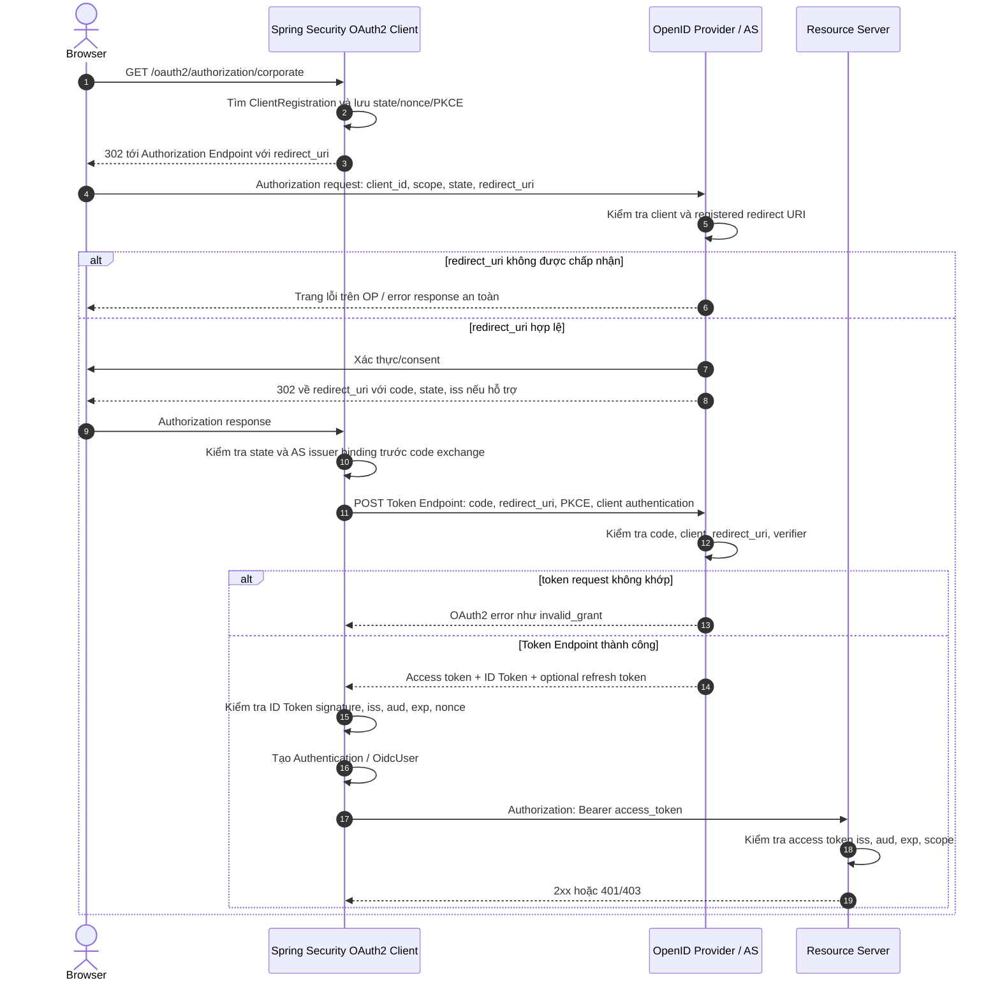
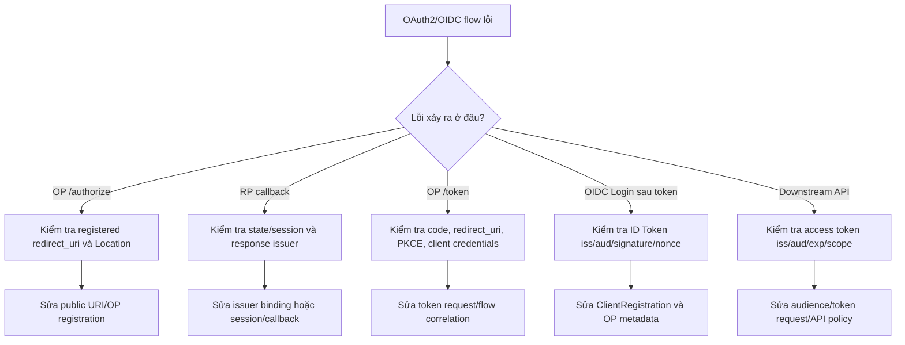

# 28.5. Redirect URI mismatch, sai issuer và sai audience

## 1. Nhận diện đúng lỗi trước khi thay đổi cấu hình

Trong **Spring Security OAuth 2.0/OIDC Client**, một luồng đăng nhập Authorization Code/OIDC thành công cần nhiều hệ thống đồng thuận về danh tính và URI:

- **OAuth2 Client / Relying Party (RP):** ứng dụng Spring Boot nhận browser callback.
- **Authorization Server (AS) / OpenID Provider (OP):** xác thực người dùng, cấp authorization code và token.
- **Browser:** đi qua những lần redirect.
- **Resource Server:** API downstream kiểm tra access token, nếu ứng dụng tiếp tục gọi API sau login.
- **Reverse proxy / ingress / gateway:** có thể thay đổi scheme, hostname, port hoặc path mà ứng dụng nhìn thấy.

Ba lỗi trong tiêu đề có thể cùng gây thông báo “login failed”, nhưng thực chất xuất hiện ở **những bước khác nhau**:

| Lỗi | Câu hỏi cốt lõi | Bên thường phát hiện | Dấu hiệu |
| --- | --- | --- | --- |
| **Redirect URI mismatch** | Browser/code có quay về đúng redirect URI đã đăng ký và đã dùng trong flow không? | AS tại Authorization Endpoint hoặc Token Endpoint | `invalid_redirect_uri`, `redirect_uri_mismatch`, đôi khi `invalid_grant` |
| **Issuer mismatch** | Authorization response/ID Token có đến từ đúng AS/OP dự kiến không? | OAuth2/OIDC Client | `iss` không khớp, OIDC validation failure, mix-up rejected |
| **Audience mismatch** | Token được cấp **cho ai** và đang được bên nhận đúng sử dụng không? | OIDC Client (ID Token) hoặc Resource Server (access token) | `aud` không chứa expected client/API, `401 invalid_token` |

**Đừng sửa bằng cách tắt signature, issuer, audience, state, nonce, PKCE hoặc CSRF validation.** Ba lỗi này thường tiết lộ một **mismatch về trust/configuration**, không phải “cấu hình bảo mật quá nghiêm”.

### 1.1. Mục tiêu bài học

Sau bài học, người đọc có thể:

1. Vẽ lại Authorization Code/OIDC flow và đánh dấu nơi mỗi lỗi có thể phát sinh.
2. Phân biệt `redirect_uri` trong authorization request với giá trị gửi khi code exchange.
3. Phân tích sai hostname/scheme/port/path do reverse proxy hoặc context path.
4. Phân biệt **issuer trong metadata**, **`iss` của authorization response RFC 9207** và **`iss` claim của ID Token**.
5. Phân biệt `aud` của **ID Token** và `aud` của **access token** dùng ở downstream API.
6. Chẩn đoán login failure khác với API `401/403`.
7. Thiết kế cấu hình Spring Security Servlet/WebFlux phù hợp public URL.
8. Bổ sung audience validation cho JWT Resource Server mà không làm yếu issuer/signature validation.
9. Tạo log, metrics và correlation IDs **không tiết lộ code/token/secret**.
10. Xây dựng ma trận test cho các lỗi URI, issuer, audience và multi-provider.
11. Hiểu biện pháp khắc phục trong môi trường nhiều tenant, nhiều pods và rotation metadata.
12. Biết khi nào cần sửa cấu hình IdP, ứng dụng, reverse proxy hoặc Resource Server.

## 2. Bản đồ toàn bộ luồng OIDC Login và API call



Mỗi mũi tên có một **hợp đồng riêng**:

1. Authorization Endpoint xác nhận OAuth client và **redirect URI**.
2. Client xác nhận callback `state` và **AS thực sự phát hành response**.
3. Token Endpoint kiểm tra code đã được cấp cho client, PKCE và redirect URI.
4. OIDC Client kiểm tra **ID Token issuer và audience**.
5. Resource Server kiểm tra **access token issuer, audience và quyền**.

Một lỗi tại bước 5 **không có nghĩa** bước 1–4 sai. Ngược lại, login thành công **không chứng minh** access token phù hợp mọi downstream API.

### 2.1. Một bảng định vị lỗi theo thời điểm

| Khi nào lỗi xuất hiện? | Bắt đầu từ đâu? | Cần kiểm tra |
| --- | --- | --- |
| Browser rời RP nhưng OP hiện trang lỗi ngay | Authorization Endpoint | `client_id`, registered `redirect_uri`, scheme/host/path |
| OP xác thực xong nhưng callback vào sai endpoint | Browser → RP | Public callback URL, proxy rewrite, context path |
| Callback tới RP nhưng state missing/mismatch | RP trước token exchange | Authorization request store, cookie/session, callback URI, CSRF state |
| Callback có `iss` sai | RP trước token exchange | Expected AS/issuer theo transaction, RFC 9207 |
| Token Endpoint trả `invalid_grant` | RP → AS token exchange | Code TTL/reuse, redirect_uri, PKCE verifier, client binding |
| ID Token bị từ chối do `iss` | RP sau token exchange | OIDC issuer discovery/config, tenant/realm, metadata |
| ID Token bị từ chối do `aud`/`azp` | RP sau token exchange | Expected `client_id` và OIDC audience rules |
| Login thành công nhưng API trả 401 | RP → Resource Server | Access token `iss`, `aud`, signature/introspection, expiry |
| API trả 403 | Resource Server authorization | Scope/roles/entitlements, không tự suy ra issuer/redirect lỗi |

## 3. Redirect URI là gì và vì sao phải khớp?

**`redirect_uri`** là endpoint của OAuth2 Client mà AS gửi authorization response về sau bước xác thực. Trong Authorization Code flow có thể thấy:

```text
https://portal.example.com/login/oauth2/code/corporate
```

Giá trị này khác với:

```text
https://login.example.com/realms/staff/authorize
https://login.example.com/realms/staff/token
```

Hai URL cuối thuộc Authorization Server; `redirect_uri` thuộc OAuth2 Client.

### 3.1. Ba nơi phải nhất quán

Có ba giá trị cần đối chiếu:

**(A) Registered redirect URI tại OP/AS**

```text
https://portal.example.com/login/oauth2/code/corporate
```

**(B) Redirect URI RP gửi trong Authorization Request**

```text
GET /authorize?...&
redirect_uri=https%3A%2F%2Fportal.example.com%2Flogin%2Foauth2%2Fcode%2Fcorporate
```

**(C) Redirect URI RP gửi tại Token Request (nếu có)**

```text
POST /token
Content-Type: application/x-www-form-urlencoded

grant_type=authorization_code&
code=FAKE_CODE&
redirect_uri=https%3A%2F%2Fportal.example.com%2Flogin%2Foauth2%2Fcode%2Fcorporate
```

Với Authorization Code Grant, nếu `redirect_uri` có trong authorization request thì **Token Endpoint yêu cầu giá trị đó phải trùng** với giá trị đã được sử dụng. Điều này ràng buộc code với đúng client/callback. Provider có thể yêu cầu bổ sung các quy tắc hoặc giá trị chính xác theo client registration.

Nếu A ≠ B, AS thường từ chối ở Authorization Endpoint. Nếu B ≠ C, AS thường từ chối tại Token Endpoint, đôi khi bằng `invalid_grant`.

### 3.2. Exact matching: khác một ký tự cũng có thể là khác URI

| Registered URI | URI thực gửi | Vấn đề |
| --- | --- | --- |
| `https://portal.example.com/login/oauth2/code/corporate` | Cùng giá trị | Có thể hợp lệ |
| URI trên | `http://portal.example.com/login/oauth2/code/corporate` | Khác scheme |
| URI trên | `https://portal.example.com:8443/login/oauth2/code/corporate` | Khác port |
| URI trên | `https://portal.example.com/login/oauth2/code/corporate/` | Trailing slash khác |
| URI trên | `https://portal.example.com/app/login/oauth2/code/corporate` | Context path khác |
| URI trên | `https://internal-svc:8080/login/oauth2/code/corporate` | Host nội bộ |
| URI trên | `https://portal.example.com/login/oauth2/code/partner` | Registration ID khác |
| URI trên | `https://portal.example.com/login/oauth2/code/corporate?foo=1` | Query khác |
| URI trên | `https://PORTAL.example.com/login/oauth2/code/corporate` | Provider comparison/canonicalization cần kiểm tra; đừng dựa vào giả định |

OAuth 2.0 Security BCP (RFC 9700) yêu cầu AS dùng **exact redirect URI matching** ngoại trừ ngoại lệ hẹp cho **loopback redirect của native apps**. Ngoại lệ đó **không phải** lý do để Spring web app dùng wildcard, prefix matching hoặc callback tùy ý.

**Không đăng ký `https://*.example.com/*` một cách tùy tiện** chỉ để tránh lỗi; nó có thể mở rộng bề mặt code leakage/open redirect.

### 3.3. `redirect_uri` bị URL-encode không có nghĩa nó khác

Trong Authorization Request:

```text
redirect_uri=https%3A%2F%2Fportal.example.com%2Flogin%2Foauth2%2Fcode%2Fcorporate
```

Sau giải mã form query, giá trị là:

```text
https://portal.example.com/login/oauth2/code/corporate
```

Đừng so sánh **chuỗi raw encoded** với URI đã đăng ký một cách ngây thơ, và đừng `URLDecoder.decode()` **hai lần** lên request parameter mà Servlet/WebFlux đã parse.

Những lỗi encoding thường gặp:

- Dùng double-encoded path: `%252F` thay cho `%2F`.
- Ghép query bằng string concatenation mà không encode `&`/`?`.
- Encode toàn bộ URL ở lớp URI builder rồi encode thêm lần nữa.
- Ghép route có trailing slash dư.
- Không giữ `basePath` khi app ở context path `/app`.

## 4. Cấu hình Spring Boot cho Authorization Code/OIDC Login

Ví dụ cấu hình một registration:

```yaml
spring:
  security:
    oauth2:
      client:
        registration:
          corporate:
            provider: corporate-oidc
            client-id: ${CORPORATE_CLIENT_ID}
            client-secret: ${CORPORATE_CLIENT_SECRET}
            client-authentication-method: client_secret_basic
            authorization-grant-type: authorization_code
            redirect-uri: "{baseUrl}/login/oauth2/code/{registrationId}"
            scope:
              - openid
              - profile
              - email

        provider:
          corporate-oidc:
            issuer-uri: https://login.example.com/realms/staff
```

Trong đó:

- `registrationId` là `corporate`; nó trở thành path segment của callback mặc định.
- `redirect-uri` là template, **không** phải URL tuyệt đối cố định.
- `{baseUrl}` là public base URL được suy ra từ request/context; có thể sai nếu proxy không được cấu hình đúng.
- `{registrationId}` mở rộng thành `corporate`.
- `issuer-uri` là issuer của OP, **không phải URL callback hoặc API**.
- Client ID/secret phải đúng với registration của RP tại OP.
- Scope `openid` biến flow thành OpenID Connect authentication khi provider hỗ trợ.

Nếu deployment có public URL:

```text
https://portal.example.com
```

thì callback dự kiến:

```text
https://portal.example.com/login/oauth2/code/corporate
```

Phải đăng ký **chính xác URI này** tại OP và kiểm tra request thực tế được gửi đi.

### 4.1. Spring Security Servlet config

```java
@Configuration
class OidcLoginSecurityConfig {

    @Bean
    SecurityFilterChain securityFilterChain(HttpSecurity http)
            throws Exception {

        http
            .authorizeHttpRequests(authorize -> authorize
                .requestMatchers("/", "/assets/**", "/login")
                    .permitAll()
                .anyRequest().authenticated())
            .oauth2Login(Customizer.withDefaults())
            .oauth2Client(Customizer.withDefaults());

        return http.build();
    }
}
```

Đây là cấu hình Servlet (`spring-boot-starter-web`). Nếu dùng callback mặc định, Spring Security xử lý:

```text
/login/oauth2/code/{registrationId}
```

**Không tự đổi path ở một phía**. Nếu thay endpoint callback trong security config, phải đồng bộ với `ClientRegistration.redirectUri`, public ingress route và URI đăng ký ở OP.

### 4.2. Spring Security WebFlux config

```java
@Configuration
@EnableWebFluxSecurity
class ReactiveOidcLoginSecurityConfig {

    @Bean
    SecurityWebFilterChain securityWebFilterChain(
            ServerHttpSecurity http) {

        return http
            .authorizeExchange(exchanges -> exchanges
                .pathMatchers("/", "/assets/**", "/login")
                    .permitAll()
                .anyExchange().authenticated())
            .oauth2Login(Customizer.withDefaults())
            .oauth2Client(Customizer.withDefaults())
            .build();
    }
}
```

Ở WebFlux (`spring-boot-starter-webflux`), callback và authorization request processing dùng **Reactive** security infrastructure, không dùng `HttpServletRequest` hay Servlet `OAuth2LoginAuthenticationFilter`.

**Lưu ý:** YAML client registration có thể giống nhau giữa Servlet/WebFlux, nhưng Java security chain, session và repository APIs khác nhau. Không trộn `ClientRegistrationRepository` blocking với `ReactiveClientRegistrationRepository` một cách tùy tiện.

## 5. Reverse proxy, ingress và `redirect_uri` bị biến thành URL nội bộ

Một tình huống production phổ biến:

```text
Browser:
  https://portal.example.com

Nginx/Ingress:
  https://portal.example.com -> http://portal-svc:8080

Spring Boot:
  http://portal-svc:8080
```

Nếu Spring không biết public scheme/host, `{baseUrl}` có thể thành:

```text
http://portal-svc:8080
```

và RP gửi:

```text
http://portal-svc:8080/login/oauth2/code/corporate
```

trong khi OP chỉ đăng ký:

```text
https://portal.example.com/login/oauth2/code/corporate
```

### 5.1. Các yếu tố proxy ảnh hưởng callback

| Yếu tố | Bên ngoài | Bên trong | Rủi ro |
| --- | --- | --- | --- |
| Scheme | `https` | `http` | `http://...` bị OP từ chối |
| Host | `portal.example.com` | `portal-svc` | Host nội bộ không khớp |
| Port | `443` | `8080` | `:8080` xuất hiện trong callback |
| Path prefix | `/app` | `/` | Mất `/app` khi build URI |
| Context path | Public `/portal` | Spring context khác | Callback route 404 |
| Proxy headers | Trusted forwarded values | Untrusted client headers | Host spoofing/open redirect |

Spring Boot có thể dùng:

```yaml
server:
  forward-headers-strategy: framework
```

Điều này hữu ích khi ingress cung cấp các headers forwarded đúng. Nhưng **chỉ bật tin forwarded headers khi ingress là nguồn đáng tin**: proxy phải loại bỏ/ghi đè `Forwarded`, `X-Forwarded-Proto`, `X-Forwarded-Host`, `X-Forwarded-Port`, `X-Forwarded-Prefix` từ client không đáng tin.

### 5.2. Một cấu hình proxy minh họa

Ví dụ reverse proxy Nginx (cần điều chỉnh theo topology thực tế):

```nginx
location / {
    proxy_pass http://portal-svc:8080;

    proxy_set_header Host portal.example.com;
    proxy_set_header X-Forwarded-Proto https;
    proxy_set_header X-Forwarded-Host portal.example.com;
    proxy_set_header X-Forwarded-Port 443;
}
```

Đây **không phải** cấu hình Nginx hoàn chỉnh; production cần xử lý TLS, upstream, DNS, access controls và sanitize headers. Đừng copy một cách máy móc khi app có nhiều public hosts.

### 5.3. Kiểm tra public URL thực tế

Quy trình khuyến nghị:

1. Gọi public route bắt đầu login:

   ```text
   https://portal.example.com/oauth2/authorization/corporate
   ```

2. Quan sát header **`Location`** của response 302 từ RP (qua tool HTTP/network logs đã được kiểm soát).
3. Parse query của Authorization Endpoint URL.
4. Lấy giá trị **decoded** của `redirect_uri`.
5. Đối chiếu với **allowed redirect URI ở OP** và `ClientRegistration.redirectUri`.
6. Xác minh callback path của ingress được route về đúng Spring handler.
7. Không log nguyên `state`, authorization code, PKCE verifier hoặc URL chứa token.

Một công cụ debug có thể hiển thị Location dài; chỉ ghi ra những trường đã được xử lý an toàn như scheme, host, port, path và `registrationId`.

### 5.4. Khi nào nên dùng redirect URI cố định?

Nếu public host là cố định, có thể cấu hình:

```yaml
spring:
  security:
    oauth2:
      client:
        registration:
          corporate:
            redirect-uri: https://portal.example.com/login/oauth2/code/corporate
```

Ưu điểm: ít phụ thuộc `X-Forwarded-*`. Hạn chế:

- Phải có cấu hình riêng dev/staging/production.
- Public URL thay đổi thì cần đổi config và cập nhật OP registration.
- Tenant/domain động không thể đơn giản dùng một URL cố định chung.
- Callback handler vẫn phải lắng nghe đúng path, proxy vẫn phải route đúng.

Không hard-code URL production trong các bài test/staging rồi mong redirect URI tự sửa theo môi trường.

## 6. Redirect URI mismatch xảy ra ở hai thời điểm khác nhau

### 6.1. Thời điểm 1: Authorization Endpoint từ chối

Browser đi tới:

```http
GET /authorize?response_type=code
  &client_id=portal-web
  &redirect_uri=http%3A%2F%2Fportal-svc%3A8080%2Flogin%2Foauth2%2Fcode%2Fcorporate
  &scope=openid%20profile
  &state=FAKE_STATE
```

Nhưng client registration tại OP chỉ cho:

```text
https://portal.example.com/login/oauth2/code/corporate
```

OP có thể hiển thị một trang lỗi như:

```text
invalid redirect_uri
redirect_uri_mismatch
Invalid parameter: redirect_uri
```

**Tên lỗi và HTTP status phụ thuộc provider.** Một AS không nên redirect lỗi tới một `redirect_uri` không hợp lệ vì như vậy có thể tạo open redirect hoặc làm lộ authorization information.

**Khắc phục:** sửa URI được RP gửi hoặc cập nhật OP registered URI đúng public URL đã được phê duyệt; không nới allowlist tùy tiện.

### 6.2. Thời điểm 2: Token Endpoint từ chối code exchange

Authorization Request dùng:

```text
redirect_uri=https://portal.example.com/login/oauth2/code/corporate
```

Nhưng Token Request vô tình gửi:

```text
redirect_uri=http://portal-svc:8080/login/oauth2/code/corporate
```

AS có thể trả:

```http
HTTP/1.1 400 Bad Request
Content-Type: application/json

{
  "error": "invalid_grant"
}
```

`invalid_grant` **không chỉ có một nguyên nhân**; nó cũng có thể do code hết hạn/đã dùng, code dành cho client khác, sai PKCE verifier hoặc redirect URI không khớp.

Cần đối chiếu **giá trị URI đã gửi ở cả hai requests**, không đoán ngay code bị reuse.

### 6.3. Đừng chẩn đoán nhầm `state` mismatch thành URI mismatch

Nếu callback đến RP nhưng mất session hoặc state:

```text
authorization_request_not_found
invalid_state
OAuth2AuthenticationException
```

thì có thể nguyên nhân là:

- Cookie/session bị mất qua browser redirect.
- Multi-pod không chia sẻ authorization request/session.
- `SameSite` cookie không phù hợp với response mode.
- Session hết hạn do user mất nhiều thời gian MFA.
- Redirect callback tới domain khác nên RP không nhận cookie.
- Custom code đã xóa authorization request trước khi login filter đọc.

Một callback có đúng URI **không đảm bảo** state còn hợp lệ. Không sửa lỗi state bằng cách bỏ state/PKCE validation.

## 7. `redirect_uri` khác `post_logout_redirect_uri`

Một nguồn nhầm lẫn phổ biến trong OIDC:

```text
Login callback:
    redirect_uri=https://portal.example.com/login/oauth2/code/corporate

OIDC RP-Initiated Logout:
    post_logout_redirect_uri=https://portal.example.com/signed-out
```

Hai URI có lifecycle khác nhau:

| Thuộc tính | Login `redirect_uri` | Logout `post_logout_redirect_uri` |
| --- | --- | --- |
| Khi nào? | Authorization request và code exchange | RP yêu cầu OP logout |
| Browser quay về với gì? | Authorization code, state, đôi khi `iss` | Tùy chọn logout `state` |
| Handler | Spring OAuth2 Login callback | Landing page hoặc logout callback |
| Có đăng ký tại OP? | Có, OAuth client redirect URIs | Có, danh sách post-logout redirects |
| Có code exchange? | Có | Không |
| Sau callback có user session? | Đang tạo session | Thường session đã bị xóa |

**Đăng ký `/signed-out` ở mục OAuth2 login redirects không tự sửa `redirect_uri_mismatch` khi login.** Ngược lại, sửa login callback không tự sửa lỗi post-logout redirect.

## 8. Issuer (`iss`) là gì?

**Issuer** định danh Authorization Server/OpenID Provider phát hành token hoặc authorization response. Một issuer phổ biến:

```text
https://login.example.com/realms/staff
```

Đừng nhầm issuer với:

```text
https://login.example.com/realms/staff/protocol/openid-connect/token
```

Token Endpoint có thể nằm dưới cùng hostname nhưng **không phải** issuer identifier.

Một OP metadata minh họa:

```json
{
  "issuer": "https://login.example.com/realms/staff",
  "authorization_endpoint": "https://login.example.com/realms/staff/authorize",
  "token_endpoint": "https://login.example.com/realms/staff/token",
  "jwks_uri": "https://login.example.com/realms/staff/certs",
  "authorization_response_iss_parameter_supported": true
}
```

Các paths chỉ là **ví dụ**; không tự xây endpoint bằng nối chuỗi vào issuer nếu provider đã công bố metadata.

### 8.1. Có nhiều điểm kiểm tra issuer

| Bước | Issuer được xem xét | Bên kiểm tra | Mục tiêu |
| --- | --- | --- | --- |
| Discovery/onboarding | `issuer` trong metadata | Client/config control plane | Metadata đúng với OP được tin |
| Authorization response | `iss` query/form theo RFC 9207 nếu hỗ trợ | OAuth2 Client | Chống AS mix-up **trước code exchange** |
| ID Token | Claim `iss` trong ID Token | OIDC Client | Token thực sự từ OP dự kiến |
| JWT access token tại API | Claim `iss` | Resource Server | Token đến từ AS được API tin |

Một lỗi `issuer mismatch` **phải được đặt đúng bước**. Nếu chỉ nhìn message “invalid issuer” mà không biết nó xảy ra trong metadata discovery, callback hay token validation, rất dễ sửa nhầm.

## 9. Issuer mismatch khi đọc Discovery Metadata

Spring Boot thường cấu hình:

```yaml
spring:
  security:
    oauth2:
      client:
        provider:
          corporate-oidc:
            issuer-uri: https://login.example.com/realms/staff
```

Với provider hỗ trợ OpenID Connect Discovery/RFC 8414 metadata, framework lấy thông tin endpoints và issuer.

Nếu metadata nhận được:

```json
{
  "issuer": "https://login.example.com/realms/customer",
  "token_endpoint": "https://login.example.com/realms/customer/token"
}
```

thì `issuer` không khớp expected `.../realms/staff`.

Đây **không phải** lỗi user gõ sai mật khẩu. Nó có thể là:

- `issuer-uri` cấu hình sai realm/tenant.
- Reverse proxy của OP rewrite base URL không đúng.
- Discovery endpoint trỏ sai environment.
- Cache metadata lỗi thời hoặc cross-tenant.
- Provider đổi canonical issuer mà chưa đồng bộ clients.
- Một nguồn metadata không đáng tin, có nguy cơ mix-up/SSRF.

**Không tắt metadata issuer matching** để tránh lỗi. Cần đối chiếu canonical issuer từ nhà cung cấp và cấu hình URL cho đúng, đồng thời kiểm tra TLS/trust.

### 9.1. HTTPS và issuer canonical value

Ví dụ:

```text
Expected: https://login.example.com/realms/staff
Actual:   http://login.example.com/realms/staff
```

OP có thể đang ở sau TLS-terminating proxy và tạo metadata bằng internal scheme. Cần sửa cấu hình public hostname/scheme của OP/proxy.

Tương tự, trailing slash:

```text
https://login.example.com/realms/staff
https://login.example.com/realms/staff/
```

có thể là hai issuer strings khác nhau. Không tự “chuẩn hóa” bằng xóa slash trên callback hoặc ID Token; phải thống nhất canonical issuer được OP công bố.

### 9.2. Issuer và JWKS URI

Một JWKS endpoint hợp lệ về HTTP không bảo đảm issuer đúng.

Sai cách nghĩ:

> “ID Token xác minh chữ ký thành công với một key đã tải thì chắc chắn token thuộc tenant hiện tại.”

Một key có thể phục vụ nhiều realms hoặc metadata có thể bị tráo. OIDC Client vẫn phải xác minh **`iss`** và **`aud`** độc lập với signature.

Nếu JWKS request lỗi DNS/TLS/404, đó là **khóa xác minh/token validation availability issue**, không nên tự gọi là issuer mismatch nếu chưa biết actual issuer.

## 10. Issuer mismatch tại authorization response: RFC 9207

Trong hệ thống có nhiều Authorization Servers, RFC 9207 cho phép AS trả `iss` cùng code và state:

```http
HTTP/1.1 302 Found
Location: https://portal.example.com/login/oauth2/code/corporate?code=FAKE_CODE&state=FAKE_STATE&iss=https%3A%2F%2Flogin.example.com%2Frealms%2Fstaff
```

Client cần so sánh:

```text
expectedIssuer = issuer của selected ClientRegistration
receivedIssuer = iss trong authorization response
```

Kết quả:

```text
expected == received -> có thể tiếp tục nếu state/PKCE/contract hợp lệ
expected != received -> reject, KHÔNG gửi authorization code tới Token Endpoint
```

Đây là kiểm tra **trước token exchange** để chống **Authorization Server Mix-Up**.

### 10.1. Vì sao ID Token issuer validation không thay thế bước này?

Với Authorization Code flow thông thường:

```text
Browser callback: code + state + iss (nếu RFC 9207)
    ↓
RP gọi Token Endpoint
    ↓
RP nhận ID Token
    ↓
RP kiểm tra ID Token iss
```

Nếu chọn nhầm Token Endpoint, **code và có thể cả client credentials/PKCE verifier đã bị gửi sai đích trước khi có ID Token để kiểm tra**.

Vì vậy cần phân biệt:

- **Authorization response `iss`:** xác nhận nguồn callback trước Token Endpoint.
- **ID Token `iss`:** xác nhận nguồn token đã được nhận từ Token Endpoint.

`state` và PKCE rất quan trọng nhưng **không phải giấy phép bỏ issuer-response defense** khi client hỗ trợ nhiều AS.

### 10.2. Quy tắc so sánh issuer theo RFC 9207

Issuer response phải được so sánh với expected issuer bằng **simple string comparison** sau khi decode HTTP form/query đúng cách.

Ví dụ:

| Expected | Received | Kết quả |
| --- | --- | --- |
| `https://login.example.com/realms/staff` | Cùng chuỗi | Khớp |
| URI trên | `https://login.example.com/realms/staff/` | Không khớp |
| URI trên | `https://login.example.com/realms/admin` | Không khớp |
| URI trên | `http://login.example.com/realms/staff` | Không khớp |
| URI trên | `https://other.example.com/realms/staff` | Không khớp |

Không chỉ so hostname hoặc tự đổi URL thành một “issuer tương đương” dựa trên guesswork. Một hostname có thể chứa nhiều issuers khác nhau bằng realm/path.

### 10.3. Khi callback thiếu `iss`

Metadata có thể công bố:

```json
"authorization_response_iss_parameter_supported": true
```

Nếu AS quảng bá hỗ trợ RFC 9207, response **phải** có `iss`, kể cả authorization error response theo đặc tả. Nếu thiếu hoặc sai: **reject**, không âm thầm tiếp tục.

Nếu một AS legacy không hỗ trợ response `iss`, client dùng nhiều AS vẫn phải có **biện pháp chống mix-up khác được thiết kế rõ**, chẳng hạn distinct redirect URI theo RFC 9700 với validation. Không coi thiếu `iss` là lý do chấp nhận code từ bất kỳ provider nào.

### 10.4. Không định tuyến Token Endpoint theo `iss` từ callback

Sai:

```java
String issuerFromCallback = request.getParameter("iss");
String tokenUri = issuerFromCallback + "/token";
```

`iss` từ browser callback là **giá trị cần xác minh**, không phải nguồn cấu hình endpoint. Kể cả có `iss`, token endpoint vẫn phải đến từ **trusted registration** đã được chọn lúc khởi tạo authorization request.

## 11. OIDC ID Token issuer mismatch sau token exchange

Một ID Token minh họa có claims:

```json
{
  "iss": "https://login.example.com/realms/staff",
  "sub": "user-742",
  "aud": "portal-web",
  "exp": 1790000000,
  "iat": 1789996400,
  "nonce": "FAKE_NONCE"
}
```

Những values này chỉ để mô tả shape; không phải một JWT hợp lệ ngoài test setup.

OIDC Client đã chọn registration:

```text
issuer = https://login.example.com/realms/staff
clientId = portal-web
```

Nếu ID Token trả:

```json
"iss": "https://login.example.com/realms/customer"
```

thì ID Token **không thuộc expected issuer**. Phải từ chối authentication.

### 11.1. Một số nguyên nhân thường gặp

| Tình huống | Hướng kiểm tra |
| --- | --- |
| App dùng `issuer-uri` của realm khác | ClientRegistration/OP metadata |
| OP public hostname khác internal hostname | Reverse proxy của OP, issuer canonical |
| Browser bắt đầu với corporate nhưng callback/token dùng partner registration | `registrationId`, state/issuer binding |
| JWKS lấy từ đúng host nhưng sai realm | `jwkSetUri`/issuer mapping |
| Token response từ AS test thay vì prod | Environment variables và deployment config |
| Custom OIDC decoder không kiểm tra issuer | Token validators/security config |
| Multi-tenant config cache stale | Snapshot version và callback timing |

Không sửa bằng cách chấp nhận mọi issuer có suffix `/realms/*` hoặc chỉ khớp domain. Phải tìm issuer dự kiến đúng theo **registration và transaction**.

### 11.2. `sub` không thay thế issuer

Claim `sub` thường chỉ unique **trong phạm vi issuer**. Hai OP có thể cùng cấp `sub="123"` cho hai người khác nhau.

Với ứng dụng đa tenant, identity key an toàn thường là:

```text
(issuer, subject)
```

và authorization thêm tenant membership/entitlements. Việc ID Token hợp lệ về issuer/audience **chưa chứng minh** user có quyền đọc dữ liệu tenant khác.

### 11.3. `nonce`, chữ ký và thời hạn là các kiểm tra riêng

ID Token issuer đúng nhưng:

- Chữ ký sai.
- `aud` sai.
- Token hết hạn.
- Nonce sai.
- `azp` không hợp lệ khi cần.
- Thuật toán không được phép.

thì authentication vẫn phải bị từ chối. Không tập trung sửa `iss` rồi bỏ các validators còn lại.

## 12. Audience (`aud`) là gì?

**Audience** định danh **bên nhận dự kiến** của token. Tuy cùng tên claim `aud`, ý nghĩa của nó phụ thuộc token là **ID Token** hay **access token**.

### 12.1. ID Token audience

Với OIDC, ID Token được cấp cho **Relying Party/OIDC Client**. Theo OIDC Core, `aud` phải chứa **OAuth2 `client_id` của RP**.

Ví dụ:

```json
{
  "iss": "https://login.example.com/realms/staff",
  "sub": "user-742",
  "aud": "portal-web",
  "exp": 1790000000
}
```

Trong đó `portal-web` là `spring.security.oauth2.client.registration.corporate.client-id`.

Sai:

```json
{
  "aud": "inventory-api"
}
```

khi RP đang mong `portal-web`.

Ngay cả khi issuer và chữ ký đúng, ID Token dành cho một client khác **không được dùng để đăng nhập client hiện tại**.

### 12.2. Access token audience

Access token được gửi đến **Resource Server/API**. Ví dụ:

```json
{
  "iss": "https://login.example.com/realms/staff",
  "sub": "user-742",
  "aud": ["inventory-api"],
  "scope": "inventory.read",
  "exp": 1790000000
}
```

Nếu ứng dụng gọi:

```http
GET /api/items HTTP/1.1
Host: inventory-api.example.com
Authorization: Bearer <access-token>
```

thì Inventory API cần xác minh token **có audience phù hợp chính nó** và đủ quyền.

Access token có:

```json
"aud": ["billing-api"]
```

không nên được Inventory API chấp nhận chỉ vì signature/issuer hợp lệ.

### 12.3. Tóm tắt: ID Token và access token

| Thuộc tính | ID Token (OIDC) | Access Token (OAuth2) |
| --- | --- | --- |
| Bên nhận | **OIDC Client/RP** | **Resource Server** |
| `aud` dự kiến | Client ID của RP | API/resource identifier |
| Gửi ở đâu? | OP → RP qua OIDC token response (theo flow) | RP → API với Bearer |
| Dùng đăng nhập user? | Được OIDC Client xác minh để xác thực danh tính | Không mặc định thay thế ID Token |
| Dùng gọi business API? | **Không** | Có, nếu phù hợp audience/scope |
| Dạng token | Thường JWT | Có thể JWT hoặc opaque |
| Validation chủ yếu | Issuer, audience, signature, time, nonce/azp | Issuer, audience, signature/introspection, time, scope, policy |

**Một lỗi cực thường gặp:** gửi `oidcUser.getIdToken().getTokenValue()` tới API vì nó là JWT có `sub` và `email`. Resource Server cần **access token**, không nên chấp nhận ID Token làm bearer credential.

## 13. ID Token có nhiều audiences và `azp`

OIDC ID Token `aud` có thể là một string hoặc array, tùy trường hợp. Nếu có nhiều audiences, OIDC Core quy định các điều kiện liên quan tới **`azp` — authorized party** và cách client phải xác minh.

Ví dụ minh họa:

```json
{
  "iss": "https://login.example.com/realms/staff",
  "sub": "user-742",
  "aud": ["portal-web", "some-other-client"],
  "azp": "portal-web",
  "exp": 1790000000
}
```

Điều quan trọng:

1. `aud` phải bao gồm `client_id` của RP.
2. Khi có nhiều audiences, RP nên xác minh `azp` có mặt theo OIDC rules.
3. Nếu `azp` hiện diện, RP nên xác minh nó bằng client ID của mình.
4. Không bỏ `aud` validation chỉ vì `azp` nhìn đúng.
5. Không tự coi một array chứa API name là hợp lệ cho ID Token nếu RP client ID vắng mặt.

Spring Security OIDC login thông thường có validator phù hợp phiên bản/config. Khi viết custom `OidcIdTokenDecoderFactory`/custom decoder, không được vô tình bỏ validators mặc định.

### 13.1. Sai audience ID Token có thể đến từ đâu?

- `client-id` trong YAML không khớp client registered tại OP.
- Cùng OP nhưng đăng nhập bằng registration của ứng dụng khác.
- Custom client registration repository trả nhầm `ClientRegistration`.
- Token response được cache/đọc nhầm giữa tenants/clients.
- Một proxy/test mock trả ID Token cho client ID không đúng.
- Provider phát nhiều audiences nhưng configuration/validation chưa phù hợp.
- Attacker cố dùng token của một RP khác (token substitution).

**Không sửa bằng cách hard-code `expectedAudiences = any`** hoặc bỏ kiểm tra client ID. Phải xác định client registration nào đã yêu cầu token.

## 14. Access token audience mismatch tại Resource Server

Hãy giả sử login OIDC hoàn tất thành công:

```text
Browser -> Portal -> Corporate OP
Portal đã có OidcUser hợp lệ.
```

Portal sau đó gọi Reports API bằng access token:

```http
GET /api/reports/me HTTP/1.1
Host: reports-api.example.com
Authorization: Bearer FAKE_ACCESS_TOKEN
```

Reports API trả:

```http
HTTP/1.1 401 Unauthorized
WWW-Authenticate: Bearer error="invalid_token"
```

Có thể token:

- Hết hạn.
- Có `iss` không được Reports API tin.
- Chữ ký/JWKS validation sai.
- Bị revoked/introspection inactive.
- Có `aud` chỉ dành cho Portal/Inventory/Billing, **không có Reports**.
- Không phải access token mà là ID Token.
- Không đúng token type/binding policy.

**Đừng đoán mọi `401` là audience mismatch**; cần xem server-side sanitized validator outcome và token metadata trong test environment.

### 14.1. API trả 401 và 403 khác nhau

| HTTP | Bearer challenge thường gặp | Ý nghĩa |
| --- | --- | --- |
| `401 Unauthorized` | `invalid_token` hoặc challenge không có error | API không chấp nhận credential |
| `403 Forbidden` | `insufficient_scope` | Token được xác minh nhưng không đủ quyền |
| `401/403` không có Bearer challenge | Có thể do custom policy, proxy hoặc gateway | Cần kiểm tra cụ thể |

Ví dụ:

```http
HTTP/1.1 403 Forbidden
WWW-Authenticate: Bearer error="insufficient_scope",
                  scope="reports.admin"
```

Một access token có `aud=["reports-api"]` **vẫn có thể bị từ chối** nếu endpoint yêu cầu scope `reports.admin` mà token chỉ có `reports.read`.

**Audience trả lời “token dành cho API nào?”; scope/roles/domain entitlements trả lời “được làm gì?”**.

### 14.2. Audience của access token có thể không giống Client ID

Cấu hình:

```text
OAuth Client ID  = portal-web
Reports Audience = reports-api
```

Đây là tình huống bình thường. Không ép Reports API chấp nhận access token chỉ vì `aud=portal-web` nếu token đó không dành cho API.

Một số IdPs dùng resource indicators (RFC 8707), API identifiers, `audience` parameter hoặc mapping scope/provider-specific để phát token đúng resource. Cần kiểm tra **đặc tả provider**, không giả định thêm field bất kỳ vào `application.yml` là tự động thay audience.

### 14.3. Opaque token thì sao?

Nếu access token là một opaque string, API không thể đọc JWT claims bằng cách decode base64. Nó cần token introspection hoặc cơ chế xác minh thích hợp của provider.

Khi dùng introspection, **issuer/audience/resource binding vẫn là yêu cầu bảo mật**, nhưng thông tin có thể đến từ introspection response/policy thay vì JWT `aud` claim.

Không cố biến opaque access token thành JWT bằng cách split dấu chấm rồi bỏ kiểm tra.

## 15. Cấu hình Resource Server: issuer validation không tự đồng nghĩa audience validation

Trong Spring Security Resource Server, có thể cấu hình:

```yaml
spring:
  security:
    oauth2:
      resourceserver:
        jwt:
          issuer-uri: https://login.example.com/realms/staff
```

Cấu hình này thường cho phép framework lấy metadata/JWKS và áp dụng validator chuẩn, trong đó có issuer validation. Tuy nhiên, **không nên giả định audience dành cho API cụ thể của bạn sẽ tự được enforce chỉ vì đã cấu hình issuer**.

Cần kiểm tra API có yêu cầu audience nào:

```text
reports-api
```

và cấu hình explicit audience validator hoặc tính năng cấu hình audience mà Spring Boot/Spring Security version của dự án hỗ trợ.

### 15.1. Java example: enforce issuer và API audience

Ví dụ Servlet Resource Server, sử dụng JWT:

```java
@Configuration
class ReportsResourceServerSecurity {

    @Bean
    JwtDecoder jwtDecoder() {
        String issuer =
            "https://login.example.com/realms/staff";

        String jwksUri =
            "https://login.example.com/realms/staff/certs";

        String requiredAudience = "reports-api";

        NimbusJwtDecoder decoder =
            NimbusJwtDecoder.withJwkSetUri(jwksUri).build();

        OAuth2TokenValidator<Jwt> withIssuer =
            JwtValidators.createDefaultWithIssuer(issuer);

        OAuth2TokenValidator<Jwt> withAudience =
            new JwtClaimValidator<List<String>>(
                "aud",
                audiences -> audiences != null
                    && audiences.contains(requiredAudience));

        decoder.setJwtValidator(
            new DelegatingOAuth2TokenValidator<>(
                withIssuer, withAudience));

        return decoder;
    }

    @Bean
    SecurityFilterChain securityFilterChain(
            HttpSecurity http) throws Exception {

        return http
            .authorizeHttpRequests(auth -> auth
                .requestMatchers("/public/**").permitAll()
                .anyRequest().authenticated())
            .oauth2ResourceServer(server ->
                server.jwt(Customizer.withDefaults()))
            .build();
    }
}
```

Các imports lược bỏ cho dễ đọc. Ví dụ yêu cầu Spring Security Resource Server/Jose dependencies.

**Điểm quan trọng:**

- `JwtValidators.createDefaultWithIssuer(issuer)` giữ các kiểm tra thời hạn/issuer chuẩn.
- Audience validator bổ sung **`requiredAudience`**.
- `DelegatingOAuth2TokenValidator` kết hợp hai chính sách; không thay default bằng một validator chỉ kiểm tra audience.
- JWKS URI là fixed **trusted endpoint**; không được xây từ `iss` trong token chưa xác minh.
- `List<String>` phản ánh biểu diễn `aud` thường được Spring Security JWT mapping chuyển thành danh sách; cần xác nhận với decoder/claim conversion của phiên bản thực tế.
- Trong production, issuer, JWKS URI và audience nên lấy từ cấu hình trusted/secret-management thay vì hard-code.

### 15.2. Với WebFlux Resource Server

Tương ứng dùng `SecurityWebFilterChain` và `ReactiveJwtDecoder`, ví dụ concept:

```java
@Bean
SecurityWebFilterChain apiSecurity(ServerHttpSecurity http) {
    return http
        .authorizeExchange(exchange -> exchange
            .pathMatchers("/public/**").permitAll()
            .anyExchange().authenticated())
        .oauth2ResourceServer(server ->
            server.jwt(Customizer.withDefaults()))
        .build();
}
```

Với custom reactive decoder có thể dùng `NimbusReactiveJwtDecoder` và `setJwtValidator(...)` theo API của phiên bản tương ứng. Không dùng blocking `JwtDecoder` trực tiếp trên Reactor event loop rồi coi đó là non-blocking.

**Đừng nhầm hai ứng dụng:** cấu hình `oauth2.resourceserver.jwt` trên Reports API **không sửa được ID Token validation trong `oauth2Login()` của Portal**. Chúng có mục đích, runtime và trust boundary khác nhau.

## 16. Một số cách cấu hình audience sai

### 16.1. API kiểm tra Client ID thay vì API audience

Giả sử:

```text
access token aud = ["reports-api"]
OAuth clientId   = "portal-web"
```

Nếu API validator đòi:

```text
requiredAudience = "portal-web"
```

thì API sẽ từ chối token đúng. Sửa **expected audience ở API** theo resource identifier thực sự đã thỏa thuận, không sửa token tùy ý.

### 16.2. Portal gửi ID Token đến API

```java
String wrongToken =
    oidcUser.getIdToken().getTokenValue();
```

API từ chối vì token có:

```json
"aud": "portal-web"
```

thay vì:

```json
"aud": "reports-api"
```

Giải pháp: lấy **access token** từ đúng `OAuth2AuthorizedClient`, gắn vào `Authorization: Bearer`, và bảo đảm AS cấp access token dành cho Reports API.

### 16.3. Một access token dùng cho mọi API

```text
Access token:
  aud = billing-api
```

Portal gửi cùng token đến:

```text
Billing API -> hợp lệ audience (nếu các điều kiện khác đạt)
Reports API -> sai audience
Inventory API -> sai audience
```

Không sửa bằng cách cho Reports/Inventory chấp nhận mọi token do cùng issuer ký. Chọn token acquisition strategy và resource indicators/audience phù hợp; có thể cần registrations/scopes/token exchange khác nhau tùy provider.

### 16.4. API chỉ kiểm tra issuer, bỏ audience

Một token được AS phát cho ứng dụng khác vẫn có thể có `iss` và chữ ký hợp lệ. Nếu API không kiểm tra `aud`, có nguy cơ **token substitution**: token cho resource A bị dùng ở resource B.

Áp dụng audience validation và authorization theo endpoint là kiểm soát riêng, không thể thay bằng issuer signature.

## 17. `OAuth2AuthorizedClient` và chọn đúng token khi gọi API

Spring Security OAuth2 Client lưu authorized client:

```java
OAuth2AuthorizedClient authorizedClient;
OAuth2AccessToken accessToken =
    authorizedClient.getAccessToken();
```

Access token này **không phải ID Token của `OidcUser`**.

### 17.1. Servlet: đưa access token vào outbound WebClient

Một ví dụ minh họa trong thành phần backend đã có authorized client đúng registration/user:

```java
Mono<Report> getReport(
        OAuth2AuthorizedClient authorizedClient) {

    return reportsWebClient.get()
        .uri("/api/reports/me")
        .headers(headers -> headers.setBearerAuth(
            authorizedClient.getAccessToken().getTokenValue()))
        .retrieve()
        .bodyToMono(Report.class);
}
```

`reportsWebClient` phải có trusted base URL của Reports API. Đây là API call reactive bằng `WebClient`; không có nghĩa `OAuth2AuthorizedClient` được tự động refresh nếu bạn chỉ truyền token vào header.

Nếu cần token lifecycle/refresh, nên dùng **`OAuth2AuthorizedClientManager`** hoặc OAuth2 exchange filter đúng stack và `registrationId`, thay vì lấy token từ storage rồi gửi mãi.

### 17.2. Reactive WebFlux

Trong WebFlux, có thể dùng `ReactiveOAuth2AuthorizedClientManager` và `ServerOAuth2AuthorizedClientExchangeFilterFunction` để gắn access token lên `WebClient`.

Ví dụ:

```java
Mono<Report> myReport(WebClient reports) {
    return reports.get()
        .uri("/api/reports/me")
        .attributes(
            ServerOAuth2AuthorizedClientExchangeFilterFunction
                .clientRegistrationId("reports-user"))
        .retrieve()
        .bodyToMono(Report.class);
}
```

Ví dụ yêu cầu `WebClient` đã được cấu hình OAuth2 filter và authenticated request context phù hợp. **Chỉ gọi `.clientRegistrationId(...)` mà không cấu hình filter không tự lấy token**.

### 17.3. Hãy chọn client registration theo downstream

Nếu một ứng dụng gọi nhiều APIs:

```text
reports-user -> Reports API
inventory-m2m -> Inventory API
billing-m2m -> Billing API
```

Mỗi registration/authorization policy có thể xin access token với audience/scopes khác nhau. Không dùng một default bearer filter gắn token vào mọi HTTP request, nhất là khi `.uri(...)` có thể nhận absolute URL do user cung cấp.

## 18. Cấu hình nhiều issuers và audience của từng tenant

Trong hệ thống multi-tenant:

```text
Tenant A:
  issuer = https://login.example.com/realms/acme
  login clientId = portal-acme
  reports audience = reports-acme

Tenant B:
  issuer = https://login.example.com/realms/beta
  login clientId = portal-beta
  reports audience = reports-beta
```

**Cùng hostname không có nghĩa cùng issuer**. Tenant/realm path có thể là một phần identifier.

Một API đa tenant cần policy:

```text
trusted issuer → allowed audiences → allowed tenants
```

Ví dụ:

```text
Issuer Acme:
    allowed audiences = reports-acme
    data tenant       = acme

Issuer Beta:
    allowed audiences = reports-beta
    data tenant       = beta
```

Không để request param `?tenant=beta` ghi đè security context vừa xác minh từ issuer Acme.

### 18.1. Multi-issuer Resource Server

Nếu API chấp nhận nhiều issuers, cần resolver/validators theo **allowlist chính thức**. Không tạo JWT decoder cho `iss` tùy ý lấy từ token chưa xác minh.

Ở Servlet, Spring Security cung cấp mô hình `JwtIssuerAuthenticationManagerResolver` hỗ trợ trusted issuers hoặc resolver tùy chỉnh. Khi thêm audience validation, nên ràng buộc **audience theo từng issuer/client/policy**, không đặt một tập audience chung quá rộng.

Ở Reactive, dùng các authentication manager resolvers tương ứng và non-blocking JWT decoders. Tùy API/version, cách wiring khác nhau; cần test integration thật.

### 18.2. Không dùng `sub` một mình để định danh user

OIDC `sub` thường unique trong issuer, không nhất thiết toàn cầu:

```text
(https://login.example.com/realms/acme, sub=123)
(https://login.example.com/realms/beta, sub=123)
```

Đây có thể là hai người dùng hoàn toàn khác nhau. Với multi-tenant, identity key nên chứa `(issuer, subject)` và tenant entitlements được xác minh độc lập.

### 18.3. Token cache cũng phải tách tenant/resource

Một `OAuth2AuthorizedClientService` cơ bản lưu theo:

```text
(registrationId, principalName)
```

Vì vậy:

- `registrationId` cần phân biệt issuer/client/audience khi architecture yêu cầu.
- `principalName` không được dùng một tên chung cho mọi user.
- Với extension token exchange theo subject/actor/target, có thể cần key/context binding phong phú hơn.
- Không reuse token của Acme cho Beta chỉ vì có cùng `sub`.

## 19. Quy trình chẩn đoán theo decision tree



### 19.1. Câu hỏi đầu tiên: request cuối cùng tới đâu?

Nếu user thấy lỗi ở màn hình OP, backend RP có thể chưa nhận callback. Đừng tìm `OidcUserService` exception khi Token Endpoint chưa từng được gọi.

Nếu RP callback đã chạy và báo `OAuth2AuthenticationException`, cần biết lỗi xảy ra **trước** hay **sau** token exchange. Nếu login đã tạo user session nhưng API trả 401, tìm ở downstream Resource Server trước.

### 19.2. Tìm ba URI và ba định danh

Cho một lỗi login, hãy thu thập **metadata an toàn**:

```text
registrationId = corporate
expectedIssuer = https://login.example.com/realms/staff
clientIdAlias  = portal-web

Authorization request redirect_uri decoded:
    https://portal.example.com/login/oauth2/code/corporate

Registered redirect URI at OP:
    https://portal.example.com/login/oauth2/code/corporate

Token request redirect_uri decoded:
    https://portal.example.com/login/oauth2/code/corporate
```

Nếu ID Token validation fail:

```text
expected ID Token issuer = corporate issuer
expected ID Token aud    = portal-web client ID
```

Nếu API fail:

```text
expected API issuer   = corporate issuer or approved issuer set
expected API audience = reports-api
```

**Không thu thập raw authorization code, ID Token, access token, refresh token, PKCE verifier hoặc client secret vào ticket/log.**

## 20. Debug không làm rò credential

### 20.1. Nên log những gì?

Ví dụ log đã làm sạch:

```text
event=oauth2_authorization_started
registrationId=corporate
redirectUriScheme=https
redirectUriHost=portal.example.com
redirectUriPath=/login/oauth2/code/corporate
issuerAlias=corp-staff
```

Khi callback:

```text
event=oauth2_callback
registrationId=corporate
statePresent=true
stateValidated=true
issuerMode=RFC9207
responseIssuerPresent=true
issuerMatches=true
tokenRequestSent=false
```

Khi token/ID Token lỗi:

```text
event=oidc_login_failure
registrationId=corporate
stage=id_token_validation
reason=audience_mismatch
expectedClientAlias=portal-web
```

Khi API lỗi:

```text
event=downstream_bearer_failure
downstream=reports
httpStatus=401
reason=invalid_token
issuerValidation=passed
audienceValidation=failed
```

Đây là **các event names đề xuất**, không phải log mặc định của Spring Security.

### 20.2. Không log những gì?

```text
code=<real-authorization-code>
state=<real-state>
nonce=<real-nonce>
code_verifier=<real-pkce-verifier>
id_token=<raw-id-token>
access_token=<raw-access-token>
refresh_token=<raw-refresh-token>
client_secret=<raw-client-secret>
Authorization: Bearer ...
Cookie: JSESSIONID=...
```

Full `Location` header từ login callback có thể chứa authorization code và state. Full OP Token Endpoint response có thể chứa access/ID/refresh tokens. Hãy tránh bật HTTP wire logging quá rộng ở production.

### 20.3. Log levels và Spring Security

Spring Security có các lớp logging hỗ trợ điều tra authentication/authorization, nhưng DEBUG/TRACE có thể tạo nhiều dữ liệu nhạy cảm tùy cấu hình khác và custom filters.

Cân nhắc:

```yaml
logging:
  level:
    org.springframework.security: INFO
    org.springframework.web: INFO
```

Khi cần debug, tăng level **có thời hạn**, chỉ trong môi trường kiểm soát, kết hợp sanitization tại HTTP proxy, gateway, error handler và tracing library. Không xem `TRACE` là an toàn chỉ vì framework cố tránh in token.

### 20.4. Các metrics hữu ích

| Metric/event | Dùng để phân tích |
| --- | --- |
| `oauth2_redirect_uri_rejected` | Sai đăng ký callback/public URL |
| `oauth2_authorization_state_missing` | Session/cookie/TTL/multi-pod |
| `oauth2_token_invalid_grant` | Code/PKCE/redirect_uri/client binding |
| `oauth2_response_issuer_mismatch` | RFC 9207/mix-up defense |
| `oidc_id_token_issuer_failure` | Issuer validation sau token exchange |
| `oidc_id_token_audience_failure` | Wrong clientId/registration |
| `api_access_token_audience_failure` | Token dành cho API khác |
| `api_invalid_token_401` | Expiry/issuer/aud/signature/introspection |
| `api_insufficient_scope_403` | Scope/permission policy |
| `proxy_external_url_mismatch` | Public scheme/host/path |
| `catalog_version_skew` | Multi-pod tenant config mismatch |

Các labels nên dùng `registrationId`, downstream alias, environment và coarse failure category. Tránh raw issuer URLs chứa tenant/customer IDs nếu policy privacy không cho phép; tránh labels từ user input gây high cardinality.

## 21. Ví dụ Java: so sánh issuer trước Token Endpoint

Một testable helper giúp diễn đạt yêu cầu issuer binding:

```java
public final class AuthorizationResponseIssuerGuard {

    public void requireMatch(
            String expectedIssuer,
            String responseIssuer) {

        if (expectedIssuer == null
                || expectedIssuer.isBlank()) {
            throw new IllegalArgumentException(
                "Missing trusted expected issuer");
        }

        if (responseIssuer == null
                || responseIssuer.isBlank()) {
            throw new IssuerMismatchException(
                "Required authorization response issuer is missing");
        }

        if (!expectedIssuer.equals(responseIssuer)) {
            throw new IssuerMismatchException(
                "Authorization response issuer mismatch");
        }
    }
}

class IssuerMismatchException extends RuntimeException {
    IssuerMismatchException(String message) {
        super(message);
    }
}
```

Đây là **policy helper của ứng dụng**, không phải một Spring Security built-in filter. Nó chỉ thích hợp khi provider/flow **đã được xác định dùng RFC 9207**.

Thực tế còn phải:

- Tra pending authorization request theo `state` và browser/session binding.
- Lấy expected issuer từ **approved `ClientRegistration` đã chọn khi bắt đầu flow**.
- Đảm bảo response `iss` đúng một giá trị, đã decode đúng một lần.
- Xử lý error responses và form_post mode nếu áp dụng.
- Chạy guard **trước mọi Token Endpoint request**.
- Tránh consume authorization request state hai lần khi custom filter và Spring login filter cùng truy cập.
- Không định tuyến Token Endpoint theo received `iss`.

**Đừng copy helper này vào success handler sau OIDC Login**, vì khi đó token exchange đã xảy ra. Với Spring Security version có support chính thức, ưu tiên dùng cơ chế framework và xác minh behavior bằng integration tests; khi cần custom phải hiểu lifecycle filter/provider thực tế.

### 21.1. Unit tests cho issuer guard

```java
class AuthorizationResponseIssuerGuardTest {

    private final AuthorizationResponseIssuerGuard guard =
        new AuthorizationResponseIssuerGuard();

    @Test
    void acceptsExactIssuer() {
        assertDoesNotThrow(() ->
            guard.requireMatch(
                "https://login.example.com/realms/staff",
                "https://login.example.com/realms/staff"));
    }

    @Test
    void rejectsAnotherRealmOnSameHost() {
        assertThrows(IssuerMismatchException.class, () ->
            guard.requireMatch(
                "https://login.example.com/realms/staff",
                "https://login.example.com/realms/beta"));
    }

    @Test
    void rejectsTrailingSlashDifference() {
        assertThrows(IssuerMismatchException.class, () ->
            guard.requireMatch(
                "https://login.example.com/realms/staff",
                "https://login.example.com/realms/staff/"));
    }

    @Test
    void rejectsMissingResponseIssuerWhenRequired() {
        assertThrows(IssuerMismatchException.class, () ->
            guard.requireMatch(
                "https://login.example.com/realms/staff",
                null));
    }
}
```

Những tests trên chỉ chứng minh **so sánh chuỗi**. Security integration test phải xác minh Spring callback **từ chối issuer mismatch trước token exchange** và **không có HTTP request** nào tới Token Endpoint khi `iss` sai.

## 22. Ví dụ Java: kiểm thử audience validator của JWT API

Giả sử Reports API yêu cầu:

```text
issuer = https://login.example.com/realms/staff
audience = reports-api
```

Một unit test có thể dùng `Jwt` object với **claims giả**:

```java
class ReportsAudienceValidatorTest {

    private final OAuth2TokenValidator<Jwt> audienceValidator =
        new JwtClaimValidator<List<String>>(
            "aud",
            audiences -> audiences != null
                && audiences.contains("reports-api"));

    @Test
    void acceptsReportsAudience() {
        Jwt jwt = Jwt.withTokenValue("FAKE_TEST_TOKEN")
            .header("alg", "RS256")
            .claim("iss", "https://login.example.com/realms/staff")
            .claim("aud", List.of("reports-api"))
            .issuedAt(Instant.parse("2026-01-01T00:00:00Z"))
            .expiresAt(Instant.parse("2027-01-01T00:00:00Z"))
            .build();

        assertFalse(
            audienceValidator.validate(jwt).hasErrors());
    }

    @Test
    void rejectsBillingAudience() {
        Jwt jwt = Jwt.withTokenValue("FAKE_TEST_TOKEN")
            .header("alg", "RS256")
            .claim("iss", "https://login.example.com/realms/staff")
            .claim("aud", List.of("billing-api"))
            .issuedAt(Instant.parse("2026-01-01T00:00:00Z"))
            .expiresAt(Instant.parse("2027-01-01T00:00:00Z"))
            .build();

        assertTrue(
            audienceValidator.validate(jwt).hasErrors());
    }
}
```

**Giới hạn:** `Jwt.withTokenValue(...)` tạo một object test **không chứng minh chữ ký JWT hợp lệ**. Đây chỉ là **unit test của audience predicate**; security integration test phải chạy JWT decoder/verification đầy đủ với test issuer/JWKS, không vô hiệu signature validation trong production.

Ngày `issuedAt`/`expiresAt` là dữ liệu test cố định. Vì test chỉ gọi audience validator, không dựa vào thời gian thực; nếu test cả expiry, dùng controllable clock hoặc cố định thời gian hợp lý.

### 22.1. Test issuer và audience validator không nên dùng chung một thông báo mơ hồ

Ví dụ bảng test:

| Token | `iss` | `aud` | Kỳ vọng |
| --- | --- | --- | --- |
| Token A | đúng | `reports-api` | Có thể chấp nhận nếu signature/time/scope đúng |
| Token B | sai | `reports-api` | Từ chối issuer |
| Token C | đúng | `billing-api` | Từ chối audience |
| Token D | sai | `billing-api` | Từ chối cả hai |
| Token E | đúng | thiếu `aud` | Từ chối audience |
| Token F | đúng | `reports-api`, `billing-api` | Chỉ chấp nhận nếu multi-audience policy cho phép |
| Token G | đúng | `reports-api` | Vẫn từ chối nếu expired/revoked |
| ID Token của Portal | đúng | `portal-web` | Không dùng thay Reports access token |

Không bao giờ chấp nhận token sai audience chỉ vì `iss` đúng.

## 23. Ma trận kiểm thử redirect URI, issuer, audience

| ID | Kịch bản | Kết quả kỳ vọng |
| --- | --- | --- |
| R01 | Registered URI và Authorization Request URI giống nhau | Authorization Request được xem xét |
| R02 | `https` được đăng ký nhưng gửi `http` | AS từ chối URI |
| R03 | Sai hostname (internal service) | AS từ chối URI |
| R04 | Sai external port | AS từ chối URI |
| R05 | Thiếu/khác context path | AS từ chối hoặc callback sai route |
| R06 | Trailing slash khác | Không trông đợi match |
| R07 | Registration ID khác trong callback | Không xử lý nhầm client |
| R08 | Token Request URI khác Authorization Request URI | Token Endpoint từ chối theo contract |
| R09 | Authorization code bị reuse | `invalid_grant` hoặc lỗi tương ứng |
| R10 | PKCE verifier sai | Token request thất bại |
| R11 | Callback không tìm thấy state | Client từ chối callback |
| R12 | Proxy forwarded Host bị giả mạo | Không tạo trusted redirect URI từ input giả |
| I01 | Discovery metadata issuer đúng | Registration có thể được tạo |
| I02 | Discovery issuer khác config | Từ chối metadata |
| I03 | Authorization response issuer đúng | Qua issuer guard |
| I04 | Response issuer sai | Reject trước token request |
| I05 | Provider quảng bá RFC9207 nhưng thiếu `iss` | Reject |
| I06 | Callback state đúng nhưng issuer sai | Reject |
| I07 | ID Token issuer khác expected | Reject OIDC login |
| I08 | ID Token issuer khác realm cùng hostname | Reject |
| I09 | ID Token signature sai | Reject |
| I10 | Multiple providers dùng same issuer nhưng endpoints khác trust | Reject catalog/alert |
| I11 | Provider issuer đổi giữa initiation/callback | Fail closed/versioned config |
| A01 | ID Token aud chứa client ID | Có thể hợp lệ nếu các check khác đạt |
| A02 | ID Token aud chỉ chứa API name | Reject OIDC login |
| A03 | ID Token multi-aud, azp không phù hợp | Reject theo OIDC policy |
| A04 | Access token aud đúng Reports | API xét tiếp signature/scope/tenant |
| A05 | Access token aud chỉ Billing | Reports reject |
| A06 | Access token aud thiếu | Reports reject theo audience policy |
| A07 | ID Token gửi làm Bearer token | Reports reject |
| A08 | Access token đúng aud nhưng thiếu scope | API `403`/policy denial |
| A09 | Access token đúng aud nhưng issuer sai | API reject |
| A10 | Opaque token/introspection sai resource | API reject |
| X01 | Login initiation pod A, callback pod B | Session/registration consistency |
| X02 | API dùng custom validator bỏ issuer | Test phát hiện policy lỗi |
| X03 | Logs chứa full redirect Location/code/token | Security test fail |

Mã HTTP/error cụ thể có thể khác giữa OP/AS/API. Test nên khẳng định **security outcome** và **đúng endpoint**, không chỉ một chuỗi message thân thiện.

## 24. MockMvc/WebTestClient: tập trung vào hành vi thực, không chỉ exception

### 24.1. Test Authorization Request tạo đúng redirect URI

Với Servlet `MockMvc`, tích hợp Spring Security và repository test:

```java
mockMvc.perform(get("/oauth2/authorization/corporate"))
    .andExpect(status().is3xxRedirection())
    .andExpect(header().exists(HttpHeaders.LOCATION));
```

Sau đó parse Location:

```text
Authorization Endpoint host = approved OP host
client_id = expected client ID
redirect_uri decoded = https://portal.example.com/login/oauth2/code/corporate
state = present
scope contains openid
```

Không snapshot/log toàn bộ Location vì chứa `state`/PKCE challenge hoặc dữ liệu flow.

### 24.2. Test redirect_uri ở Token Request

Dùng fake Token Endpoint như MockWebServer/WireMock hoặc một test AS sandbox. Với flow đã bắt đầu:

```text
Authorized redirect_uri = expected public callback
Token request redirect_uri = must match authorized value
```

Nếu thay URI tại Token Request, fake AS từ chối. Test tích hợp framework cần chứng minh **cùng một giá trị** được gửi ở hai bước.

### 24.3. Test issuer mismatch trước Token Endpoint

Given:

```text
Pending request:
  registrationId = corporate
  state = FAKE_STATE
  expectedIssuer = https://login.example.com/realms/staff
```

When callback:

```text
code = FAKE_CODE
state = FAKE_STATE
iss = https://login.example.com/realms/beta
```

Then:

```text
Response rejected.
Corporate Token Endpoint calls = 0.
Beta Token Endpoint calls = 0.
No authenticated SecurityContext.
No OAuth2AuthorizedClient saved.
No raw code or secret in logs.
```

Chỉ assert `login failed` không chứng minh client đã tránh gửi code/credential đến sai endpoint.

### 24.4. Test OIDC ID Token issuer/audience

Dùng test OP có signing key/JWKS và token fixtures hợp lệ về signature để tạo ID Token:

- Token A: issuer đúng, aud đúng → login có thể thành công.
- Token B: issuer sai, aud đúng → fail.
- Token C: issuer đúng, aud sai → fail.
- Token D: signature sai → fail.
- Token E: nonce sai → fail.
- Token F: expired → fail.

Đừng dùng `oidcLogin()` test postprocessor rồi cho rằng nó đã kiểm thử được **Token Endpoint và OIDC JWT validation thật**. Helper này có thể tạo authenticated test principal và bỏ qua luồng network/token validation. Để test các mismatch, cần **HTTP integration** với token decoder/validators thật hoặc test OP phù hợp.

### 24.5. Test API audience

Với MockMvc Resource Server hoặc WebTestClient:

```text
GET /api/reports
  Bearer access token signed by test issuer
  aud = reports-api
  scope = reports.read
  -> 2xx (nếu authorization khác đạt)

GET /api/reports
  Bearer access token signed by same test issuer
  aud = billing-api
  -> 401/invalid_token theo config

GET /api/reports/admin
  Bearer token aud = reports-api
  scope = reports.read
  -> 403 nếu policy yêu cầu reports.admin
```

Đừng tắt JWT validation trong Spring Security rồi “test audience” bằng cách mock toàn bộ Authentication. Unit tests với mock Authentication có chỗ dùng, nhưng không chứng minh API reject token sai audience.

### 24.6. WebFlux tương tự nhưng khác API

Trong WebFlux, sử dụng `WebTestClient`, `SecurityWebFilterChain`, `ReactiveClientRegistrationRepository` và `ReactiveJwtDecoder` phù hợp. Không dùng `MockHttpServletRequest`/Servlet filters trong bài test WebFlux.

Nếu test có network I/O, nên dùng fake HTTP endpoints cùng test security stack, không `.block()` ngay trong ứng dụng để workaround.

## 25. Các kịch bản vận hành đặc biệt

### 25.1. Multi-pod, session và trạng thái đã lưu

Browser khởi tạo login ở pod A, callback tới pod B:

```text
Pod A: Session contains state/nonce/registration
Pod B: Missing session/correlation
```

Triệu chứng có thể là state missing, không phải issuer hoặc redirect URI mismatch.

Giải pháp:

- Shared session store như Spring Session/Redis khi phù hợp.
- Session cookie domain/path/SameSite đúng.
- Consistent trusted registration catalog trên các pods.
- Không dùng in-memory authorization request repository nếu callback có thể rơi vào pod khác mà không có session affinity/store.
- TTL cho flow đủ phù hợp MFA, nhưng không vô hạn.

### 25.2. Metadata cache và secret rotation

OP đổi issuer/client secret/Token Endpoint hoặc application thay registration giữa khi authorization request đã bắt đầu và callback đến.

Nếu config mới được dùng để đổi code thuộc config cũ, có thể xảy ra `invalid_grant`, issuer mismatch hoặc wrong endpoint.

Giải pháp:

- Versioned registration snapshots.
- Grace period với secret rotation nếu OP hỗ trợ.
- Breaking change về issuer/client ID/endpoints cần kế hoạch migration.
- Không thử các Token Endpoints khác nhau với cùng code để “tìm ra cái đúng”.
- Quan sát version đang chạy trên từng pod.

### 25.3. Multi-tenant, same host nhưng khác realm

```text
https://sso.example.com/realms/acme
https://sso.example.com/realms/beta
```

`iss` khác nhau dù hostname giống nhau; `aud` có thể cũng là client IDs khác nhau. API có thể cần issuer-audience mapping per tenant và kiểm tra domain entitlements.

Không sửa bằng cách regex cho phép `https://sso.example.com/realms/*` trên mọi tenants khi chưa có whitelist và policy.

### 25.4. Development với localhost

Dev environment có thể dùng:

```text
http://localhost:8080/login/oauth2/code/corporate
```

chỉ khi OP/client registration cho phép URI đó theo policy. Với web apps, không viện dẫn loopback exception của native apps để mở wildcard ports/hosts ngoài policy. Nên giữ cấu hình dev/prod riêng, không thêm toàn bộ URL dev vào production client nếu không cần.

### 25.5. HTTP gateway thay đổi path hoặc encode

Nếu ingress public path `/app` nhưng backend app dùng `/`, hãy kiểm tra:

- `X-Forwarded-Prefix`.
- Spring context path vs gateway strip/rewrite.
- Browser-visible callback URI.
- Mapping Security filters.
- Value gửi trong Authorization Request và Token Request.

Đừng “chữa” lỗi 404 callback bằng cách đổi URI tại OP nếu browser callback đã đến path không tồn tại trong ứng dụng. Trước tiên cần thống nhất public URI và route mapping.

## 26. Những cách khắc phục sai cần tránh

**Sai 1 — Tắt kiểm tra `redirect_uri` ở AS.**  
Mở đường cho authorization code leakage/open redirect. Sửa public URI và client registration.

**Sai 2 — Tắt issuer validation để OIDC login thành công.**  
Có thể nhận token của issuer/tenant không được tin.

**Sai 3 — Tắt audience validation ở API.**  
Cho phép token dành cho resource khác được dùng trái mục đích.

**Sai 4 — Dùng ID Token làm Bearer token gọi API.**  
`aud` của ID Token là client ID, không phải API audience.

**Sai 5 — Chỉ so sánh hostname của issuer.**  
Nhiều realms/tenants có thể chung hostname.

**Sai 6 — Lấy Token Endpoint từ callback `iss`.**  
Dẫn đến code/secret leakage và SSRF.

**Sai 7 — Đổi issuer/Token Endpoint giữa Authorization Request và Token Request mà không version.**  
Gây trust boundary mix-up và code exchange failures.

**Sai 8 — Chấp nhận mọi callback khi `state` mất.**  
Mất CSRF/login correlation và dẫn đến authentication injection.

**Sai 9 — Retry mọi `invalid_grant` đến khi thành công.**  
Code có thể đã hết hạn/được dùng; retry không sửa cấu hình và dễ tạo load bất thường.

**Sai 10 — Cho phép wildcard redirect URI để phục vụ mọi tenants.**  
Tăng nguy cơ code bị gửi đến attacker-controlled host/path.

**Sai 11 — Tin `Host` hoặc `X-Forwarded-Host` từ browser.**  
Có thể gây sai callback URL, open redirect, host header injection.

**Sai 12 — Chỉ assert status `302` trong test.**  
Cần kiểm tra callback URI decoded và issuer/audience validation; một response 302 vẫn có thể trỏ sai host.

**Sai 13 — Chấp nhận mọi JWT ký bởi cùng JWKS.**  
Issuer, audience, token type, lifetime và domain permissions vẫn quan trọng.

**Sai 14 — Log toàn bộ HTTP requests/responses trong production.**  
Dễ lộ code, state, ID/access/refresh token và client secret.

**Sai 15 — Giải thích API `403` là do `redirect_uri`.**  
Nếu user đã login và access token được API xác minh, cần kiểm tra scopes/roles trước.

## 27. Tình huống thực hành

### Tình huống A — Sau khi deploy sau Nginx, login báo redirect_uri mismatch

**Bối cảnh:** RP chạy HTTP nội bộ, browser dùng HTTPS public.

**Phân tích:** Spring đã build `{baseUrl}` thành internal URL; OP chỉ đăng ký public HTTPS callback.

**Giải pháp:** trusted forwarded headers hoặc fixed public redirect URI; so sánh Location decoded và OP allowlist. Không thêm internal host vào OP registration.

### Tình huống B — Staging login lại chuyển về production

**Bối cảnh:** `redirect-uri` hard-coded production trong staging.

**Giải pháp:** cấu hình environment-specific redirect URI và OP clients tương ứng. Không dùng chung secret/registration nếu môi trường cần cách ly.

### Tình huống C — OP cho đăng nhập nhưng Token Endpoint trả `invalid_grant`

**Bối cảnh:** Authorization Request gửi callback HTTPS, Token Request gửi HTTP nội bộ.

**Giải pháp:** capture **sanitized decoded URI** ở cả hai bước, đồng bộ config; đồng thời kiểm tra code expiry/reuse và PKCE.

### Tình huống D — Hai OIDC realms cùng host

**Bối cảnh:** Config kỳ vọng `/realms/staff` nhưng ID Token `iss=/realms/contractors`.

**Giải pháp:** đúng issuer per registration, không so sánh host-only; xác minh user chọn đúng tenant/realm.

### Tình huống E — Metadata issuer có trailing slash

**Bối cảnh:** `issuer-uri` trong Spring và OP metadata khác nhau ở slash.

**Giải pháp:** xác định canonical issuer do OP công bố và sửa hai phía/cấu hình; không nới validator string comparison.

### Tình huống F — Login thành công nhưng Reports API trả 401

**Bối cảnh:** Portal dùng access token có `aud=inventory-api` để gọi Reports.

**Giải pháp:** xin token dành Reports theo AS/provider policy, không đổi validator Reports thành nhận mọi audience.

### Tình huống G — API nhận JWT nhưng vẫn trả 403

**Bối cảnh:** `aud=reports-api`, `iss` đúng, scope `reports.read`, endpoint cần `reports.admin`.

**Giải pháp:** authorization policy/scope/consent; không retry token refresh vô hạn.

### Tình huống H — Gửi ID Token thay access token

**Bối cảnh:** Developer lấy `OidcUser.getIdToken()` cho `Authorization: Bearer`.

**Giải pháp:** dùng `OAuth2AuthorizedClient.getAccessToken()` và đúng authorized client registration/manager.

### Tình huống I — Tenant A và Tenant B dùng chung IdP host

**Bối cảnh:** JWT từ realm A được API realm B chấp nhận vì chỉ kiểm tra JWKS.

**Giải pháp:** issuer exact + audience per tenant + domain membership, không chỉ signature.

### Tình huống J — RFC 9207 `iss` sai nhưng `state` đúng

**Bối cảnh:** Multi-AS callback có state hợp lệ, issuer là Partner thay vì Corporate.

**Giải pháp:** reject trước token exchange; kiểm tra integration assert zero outbound Token Endpoint calls.

### Tình huống K — Proxy inject forwarded host chưa được kiểm soát

**Bối cảnh:** Attacker tự gửi `X-Forwarded-Host: evil.example` làm `{baseUrl}` thay đổi.

**Giải pháp:** ingress sanitize forwarded headers, allowlist public hosts, không nhận client-supplied forwarded values.

### Tình huống L — Multi-pod callback mất state

**Bối cảnh:** Initiation pod A, callback pod B, in-memory session không dùng chung.

**Giải pháp:** shared session/correlation store hoặc routing thích hợp; không bỏ CSRF state.

### Tình huống M — Provider đổi client ID

**Bối cảnh:** Spring vẫn cấu hình `client-id=portal-old`, OP cấp ID Token `aud=portal-new`.

**Giải pháp:** đồng bộ client registration/provisioning và migration; không bỏ audience validation.

### Tình huống N — API resource identifier khác environment

**Bối cảnh:** Staging API yêu cầu `reports-staging`, token prod có audience `reports-prod`.

**Giải pháp:** tách resource/audience config và tokens giữa environments; không mở mọi prod/staging audiences để né lỗi.

### Tình huống O — API dùng opaque token

**Bối cảnh:** Team cố decode opaque access token thành JWT và báo không có `aud`.

**Giải pháp:** dùng introspection hoặc provider verification mechanism; chính sách audience/resource vẫn phải được enforce bằng thông tin tin cậy.

## 28. Câu hỏi ôn tập

**1. Ba lỗi trong tiêu đề khác nhau ở đâu?**  
Redirect URI liên quan callback/code binding; issuer liên quan nguồn phát hành response/token; audience liên quan bên nhận token.

**2. Nếu OP từ chối trước login, nên kiểm tra gì đầu tiên?**  
`client_id` và `redirect_uri` trong Authorization Request so với registration tại OP.

**3. Vì sao Token Endpoint có thể trả `invalid_grant` khi redirect URI sai?**  
Giá trị `redirect_uri` khi đổi code không khớp giá trị đã được dùng khi authorize, hoặc code/PKCE/client binding khác không hợp lệ.

**4. `{baseUrl}` có nguy cơ gì khi dùng reverse proxy?**  
Có thể suy ra internal scheme/host/port/path nếu forwarded headers không được xử lý đúng.

**5. `redirect_uri` và `post_logout_redirect_uri` có giống nhau không?**  
Không. Một URI nhận Authorization Code callback, một URI nhận browser sau OP logout.

**6. Vì sao không dùng wildcard redirect cho web app?**  
Có thể cho phép authorization code bị gửi đến host/path không đáng tin.

**7. Issuer có giống Token Endpoint không?**  
Không. Issuer là identifier của AS; Token Endpoint là URL thực hiện grants.

**8. `iss` của RFC 9207 xuất hiện ở đâu?**  
Trong authorization response, trước Token Endpoint request.

**9. Tại sao cần kiểm tra response issuer trước token exchange?**  
Để ngăn mix-up làm client gửi code/credential đến AS sai.

**10. `state` hợp lệ có đảm bảo issuer hợp lệ không?**  
Không tự động; cần issuer binding/mix-up defense thích hợp.

**11. Tại sao OIDC ID Token issuer validation vẫn quan trọng?**  
Để xác minh ID Token thuộc OP mà RP đã tin, sau token exchange.

**12. Issuer khác trailing slash có thể coi là tương đương không?**  
Không tự ý, vì các kiểm tra issuer yêu cầu exact/simple string comparison theo đặc tả tương ứng.

**13. ID Token `aud` thường chứa gì?**  
OAuth2 client ID của RP.

**14. Access token `aud` thường chứa gì?**  
Identifier của Resource Server/API mà token được phát cho, theo policy provider.

**15. API cần ID Token hay access token?**  
Access token phù hợp audience/scope, không phải ID Token.

**16. Vì sao issuer đúng chưa đủ để cho API chấp nhận token?**  
Token vẫn cần audience, expiry, signature/introspection, scope và domain authorization đúng.

**17. `401 invalid_token` có luôn do audience không?**  
Không. Có thể do expiry, signature, issuer, revocation, wrong token type, v.v.

**18. `403 insufficient_scope` nghĩa là gì?**  
Credential có thể hợp lệ nhưng thiếu quyền/scope cho thao tác.

**19. Tại sao cần audience validator riêng cho JWT API?**  
Vì chỉ cấu hình issuer chưa chắc enforce đúng API audience.

**20. Có thể bỏ các default JWT validators khi thêm audience check không?**  
Không. Cần kết hợp audience với issuer/time/signature validation.

**21. `sub` có globally unique không?**  
Không nhất thiết; identity đa issuer nên bao gồm `(iss, sub)`.

**22. Khi nhiều pods login/callback khác nhau, lỗi gì xuất hiện?**  
State mất, registration/issuer version không nhất quán hoặc token exchange failure.

**23. Khi issuer mismatch tại callback, có nên gọi Token Endpoint để xem có thành công không?**  
Không. Phải reject trước token request.

**24. Cách kiểm thử mạnh nhất để chứng minh mix-up defense?**  
Issuer mismatch phải tạo **0 Token Endpoint requests**.

**25. Logs nên ghi gì để tìm lỗi URI?**  
Scheme/host/port/path đã sanitize, registration ID và config version; không ghi code/state/token.

**26. Cấu hình `oauth2.resourceserver.jwt.issuer-uri` trên API có sửa OIDC Login issuer mismatch ở Portal không?**  
Không. Đây là hai trust boundaries khác nhau.

**27. Khi ID Token có nhiều audiences, cần xem claim nào khác?**  
`azp` theo quy tắc OIDC Core bên cạnh việc `aud` phải chứa client ID.

**28. Khi redirect URI đúng nhưng OP login không tạo session, nên kiểm tra gì?**  
State/cookie/session, callback routing, Token Endpoint errors, issuer/audience/signature/nonce validation.

**29. Vì sao không nên fetch issuer metadata theo URL do user nhập?**  
Có nguy cơ SSRF, tin AS giả và làm lộ authorization code/credentials.

**30. Với token dành Billing được gửi Reports, giải pháp gì?**  
Xin access token đúng Reports audience theo provider policy hoặc dùng token exchange/resource parameter phù hợp, không bỏ Reports audience validation.

## 29. Checklist vận hành trước khi đóng sự cố

### 29.1. Redirect URI

- [ ] `registrationId`, `clientId`, provider/environment đúng.
- [ ] URL được RP gửi trong Authorization Request đã được decode và xác minh.
- [ ] URI được OP đăng ký chính xác, không wildcard tùy ý.
- [ ] URI dùng ở Token Request (nếu có) giống URI ở Authorization Request.
- [ ] Public scheme/host/port/path đúng reverse proxy.
- [ ] `Forwarded`/`X-Forwarded-*` chỉ đến từ trusted proxy.
- [ ] Callback path khớp Spring Security handler.
- [ ] Browser session/state/PKCE verifier được giữ đúng.
- [ ] Không leak code/state trong HTTP logs.

### 29.2. Issuer

- [ ] Issuer config khớp OP metadata chính thức.
- [ ] Không so sánh hostname-only, không normalize tùy ý.
- [ ] Authorization response `iss` được xử lý theo RFC 9207 nếu provider hỗ trợ.
- [ ] Nếu multi-AS legacy, có mix-up defense khác được phê duyệt.
- [ ] Token Endpoint đến từ trusted registration, không từ callback input.
- [ ] ID Token `iss`, signature, time, nonce được validate.
- [ ] Multi-tenant issuers và registration IDs được phân tách.
- [ ] Cấu hình metadata/version nhất quán trên pods.
- [ ] Unknown issuer không tự được onboard qua user request.

### 29.3. Audience

- [ ] ID Token `aud` chứa client ID RP.
- [ ] `azp` được xử lý theo quy tắc OIDC khi có.
- [ ] Outbound API request dùng **access token**.
- [ ] Resource Server kiểm tra `iss` và **expected API `aud`**.
- [ ] API không chấp nhận token dành cho resource khác.
- [ ] Scope/role/domain authorization được kiểm tra riêng.
- [ ] Multi-issuer API có whitelist và per-issuer audience policy.
- [ ] Không chấp nhận token sai audience dù signature đúng.
- [ ] Opaque token được verify theo đúng provider/introspection contract.

### 29.4. Kiểm thử và quan sát

- [ ] Có tests cho URI sai scheme/host/path/port.
- [ ] Có tests cho mismatch Authorization vs Token Request redirect URI.
- [ ] Có tests cho state/PKCE mismatch.
- [ ] Có tests cho issuer mismatch/missing response `iss`.
- [ ] Assert **zero Token Endpoint requests** khi issuer không hợp lệ.
- [ ] Có tests ID Token wrong issuer/wrong audience.
- [ ] Có tests API access token wrong audience.
- [ ] Có tests proxy external URL và callback cross-pod.
- [ ] Logs không chứa token/code/secret/cookies.
- [ ] Có config/catalog version để điều tra migration.
- [ ] Sau sửa lỗi, kiểm thử từ browser đến API bằng test identities.

## 30. Tài liệu tham khảo

- [RFC 6749 — The OAuth 2.0 Authorization Framework](https://www.rfc-editor.org/rfc/rfc6749)
- [RFC 9700 — Best Current Practice for OAuth 2.0 Security](https://www.rfc-editor.org/rfc/rfc9700)
- [RFC 9207 — OAuth 2.0 Authorization Server Issuer Identification](https://www.rfc-editor.org/rfc/rfc9207)
- [RFC 8414 — OAuth 2.0 Authorization Server Metadata](https://www.rfc-editor.org/rfc/rfc8414)
- [RFC 7636 — Proof Key for Code Exchange](https://www.rfc-editor.org/rfc/rfc7636)
- [RFC 8707 — Resource Indicators for OAuth 2.0](https://www.rfc-editor.org/rfc/rfc8707)
- [RFC 6750 — The OAuth 2.0 Bearer Token Usage](https://www.rfc-editor.org/rfc/rfc6750)
- [RFC 9068 — JWT Profile for OAuth 2.0 Access Tokens](https://www.rfc-editor.org/rfc/rfc9068)
- [OpenID Connect Core 1.0](https://openid.net/specs/openid-connect-core-1_0.html)
- [OpenID Connect Discovery 1.0](https://openid.net/specs/openid-connect-discovery-1_0.html)
- [Spring Security Reference — OAuth 2.0 Login, Servlet](https://docs.spring.io/spring-security/reference/servlet/oauth2/login/index.html)
- [Spring Security Reference — OAuth 2.0 Login, Reactive](https://docs.spring.io/spring-security/reference/reactive/oauth2/login/index.html)
- [Spring Security Reference — OAuth 2.0 Resource Server JWT, Servlet](https://docs.spring.io/spring-security/reference/servlet/oauth2/resource-server/jwt.html)
- [Spring Security Reference — OAuth 2.0 Resource Server JWT, Reactive](https://docs.spring.io/spring-security/reference/reactive/oauth2/resource-server/jwt.html)
- [Spring Security API — JwtValidators](https://docs.spring.io/spring-security/reference/api/java/org/springframework/security/oauth2/jwt/JwtValidators.html)
- [Spring Security API — JwtClaimValidator](https://docs.spring.io/spring-security/reference/api/java/org/springframework/security/oauth2/jwt/JwtClaimValidator.html)
- [Spring Security API — ClientRegistration](https://docs.spring.io/spring-security/reference/api/java/org/springframework/security/oauth2/client/registration/ClientRegistration.html)
- [Spring Boot Reference — OAuth2](https://docs.spring.io/spring-boot/reference/web/spring-security.html)

**Ghi nhớ:** Khi Spring Security OAuth2/OIDC Client gặp lỗi đăng nhập hoặc API authorization, hãy xác định **bước nào từ chối** trước khi sửa. **Redirect URI mismatch** liên quan đến URI đã đăng ký, URI trong Authorization Request và URI khi đổi code; thường do public host/scheme/path hoặc proxy. **Issuer mismatch** liên quan đến OP metadata, authorization response `iss` và ID Token `iss`; với multi-AS phải chống mix-up **trước Token Endpoint**. **Audience mismatch** liên quan đến bên nhận token: ID Token dành cho **client ID của RP**, access token dành cho **Resource Server/API**. Không sửa bằng cách tắt các validators hoặc wildcard URI; hãy đối chiếu đúng expected values, xác minh ingress/metadata, kiểm thử cả chiều login và API, đồng thời giữ logs/traces không chứa credentials.
