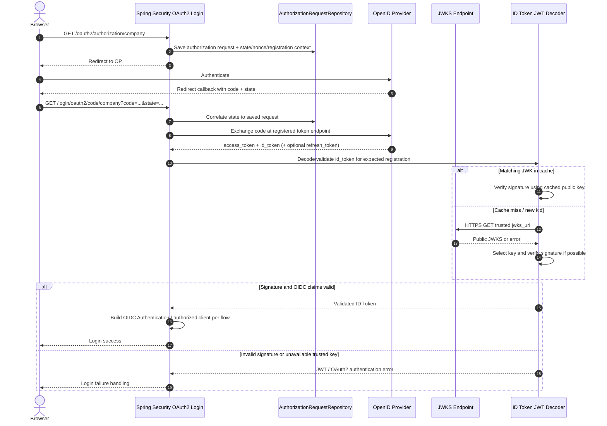

# 28.6. Chữ ký ID Token không hợp lệ và lỗi tải JWKS

## 1. Bối cảnh: OAuth2 callback đã nhận code nhưng đăng nhập OIDC vẫn thất bại

Một ứng dụng **Spring Security OAuth 2.0 / OpenID Connect Client** thường bắt đầu đăng nhập bằng Authorization Code Flow. Sau khi user xác thực tại OpenID Provider (OP), browser quay về callback mang `code` và `state`. Spring Security đổi authorization code tại Token Endpoint, nhận access token và **ID Token**. Để xác thực user, ứng dụng phải kiểm tra ID Token theo OIDC, trong đó có **chữ ký JWS** và các claims như issuer, audience, thời hạn và nonce.

Giả sử backend báo:

```text
OAuth2 login failed
caused by: JWT signature validation failed
```

Hoặc:

```text
Could not obtain the keys needed to validate JWT signature
HTTP 503 from JWKS endpoint
```

Hai tình huống có biểu hiện giống nhau ở giao diện — user không đăng nhập được — nhưng **khác nguyên nhân**:

- **Chữ ký không hợp lệ:** ID Token đã nhận **không xác minh được** với khóa và thuật toán phù hợp theo nguồn tin cậy đã chọn. Có thể do token bị sửa, AS ký bằng khóa khác, chọn nhầm issuer/registration, metadata sai, key rotation bất thường hoặc lỗi cấu hình thuật toán.
- **Không tải được JWKS:** ứng dụng **chưa lấy được khóa công khai** cần để xác minh. Có thể do DNS/TLS/proxy/network, JWKS endpoint trả 4xx/5xx, timeout, cấu hình `jwks_uri` sai hoặc cache/key rotation. **Không được kết luận chữ ký sai chỉ vì chưa có khóa để kiểm tra.**

Điểm quan trọng nhất:

> Khi không thể xác minh chữ ký ID Token hoặc chưa có khóa tin cậy để xác minh, **không tạo Authentication thành công và không dùng ID Token đó làm bằng chứng đăng nhập**. Chẩn đoán chính xác phải phân biệt “cryptographic validation failed” và “key retrieval failed”, nhưng cả hai đều dẫn đến **fail closed** đối với phiên đăng nhập chưa được xác minh.

Bài thuộc chương **28. Lỗi và quan sát**, đề mục **28.6. Chữ ký ID Token không hợp lệ và lỗi tải JWKS**, trong module **Spring Security OAuth 2.0 OIDC Client**. Các ví dụ tập trung vào **Java 17+, Spring Boot 3.x, Spring Security 6.x, Servlet/MVC**, và có ghi chú về WebFlux. Tên exception, lớp nội bộ, nội dung log và khả năng cache có thể khác theo phiên bản Spring Security, Spring Security OAuth2 JOSE, Nimbus JOSE + JWT và HTTP client.

### Mục tiêu học tập

Sau bài, bạn có thể:

1. Mô tả ID Token, JWS, JWKS, `kid`, `alg`, `iss` và `aud`; hiểu quan hệ giữa chúng.
2. Phân biệt lỗi chữ ký với lỗi tải JWKS, lỗi không tìm thấy khóa theo `kid` và lỗi claims validation.
3. Mô tả cách OIDC Client chọn `ClientRegistration`, expected issuer, JWKS URI và khóa xác minh.
4. Hiểu cơ chế tải/caching JWKS và các sự cố trong key rotation/rollover.
5. Chẩn đoán DNS, TLS, proxy, firewall, HTTP 404/429/503, response rỗng/malformed mà không vô hiệu hóa bảo vệ mật mã.
6. Thiết kế log/metric/trace có ích nhưng không lộ ID Token, access token, code, nonce hay client secret.
7. Cấu hình Spring Security OIDC Client và fail handler rõ ràng; biết giới hạn khi tùy biến decoder.
8. Thiết kế test với khóa ký/JWKS giả để phân biệt key mismatch, tampered token và key-fetch failure.
9. Hiểu sự khác nhau giữa lỗi OIDC ID Token và lỗi JWT Access Token ở Resource Server.
10. Tạo runbook điều tra và xử lý sự cố an toàn, có thể dùng trong môi trường nhiều issuer/tenant.

---

## 2. ID Token được ký và xác minh như thế nào?

### 2.1. ID Token dùng để chứng minh điều gì?

Trong OIDC, **ID Token** là token chứa các claims về sự kiện xác thực của end user, được phát hành bởi OP cho **Relying Party (RP)** — chính ứng dụng đăng nhập.

Một payload minh họa sau khi được parse:

```json
{
  "iss": "https://identity.example.com/realms/workforce",
  "sub": "subject-4821",
  "aud": "employee-portal-web",
  "iat": 1773800000,
  "exp": 1773803600,
  "nonce": "opaque-per-login-value"
}
```

Các giá trị chỉ để giải thích claim; không phải ID Token thực. Trước khi xác minh, payload JWT chỉ là **dữ liệu do bên phát token gửi đến**, không nên dùng để cấp quyền hoặc xác định user.

Trong OIDC login, ID Token khác với:

| Đối tượng | Mục đích | Cách sử dụng đúng |
| --- | --- | --- |
| **ID Token** | Khẳng định authentication của end user với OIDC Client | Xác minh theo OIDC trước khi tạo user Authentication |
| **Access token** | Gọi Resource Server theo scopes/audience | Resource Server xác thực/quyết định quyền truy cập |
| **Refresh token** | Xin token mới theo grant/OP policy | Chỉ dùng với Token Endpoint khi được phép |
| **Authorization code** | Credential ngắn hạn để đổi token | Token Endpoint + client authentication/PKCE |
| **Client secret/private key** | Xác thực OAuth Client | Bảo vệ trong secret store, không đưa vào browser |
| **JWKS** | Bộ **public keys** công bố để verifier kiểm tra JWS | Chỉ lấy từ issuer/URI tin cậy, đúng key/alg policy |

**Access token JWT cũng có thể có `iss`, `aud`, `sub`**, nhưng không vì vậy mà nó trở thành ID Token dùng để đăng nhập user.

### 2.2. Cấu trúc JWT dạng JWS Compact Serialization

Một ID Token dạng JWS phổ biến có ba phần:

```text
BASE64URL(header) . BASE64URL(payload) . BASE64URL(signature)
```

Ví dụ minh họa header:

```json
{
  "alg": "RS256",
  "kid": "workforce-key-2026-11",
  "typ": "JWT"
}
```

Trong đó:

- `alg`: thuật toán JOSE mà token tuyên bố đã dùng, chẳng hạn `RS256`.
- `kid`: **key ID** để tìm khóa phù hợp trong JWKS, không phải bí mật và không tự là bằng chứng key đáng tin.
- `typ`: thông tin loại token nếu được cung cấp; **không thay thế** kiểm tra issuer/audience.
- `signature`: chữ ký kiểm tra tính toàn vẹn và nguồn ký theo khóa/thuật toán được tin.

Verifier **không được tin header trước khi xác minh**. Nó có thể dùng `kid` như **gợi ý lựa chọn khóa trong JWKS đã tin cậy**, nhưng không được dùng `kid` hoặc `alg` để quyết định tải khóa từ một nguồn bất kỳ do token kiểm soát.

### 2.3. Chữ ký hợp lệ bảo đảm điều gì?

Trong ví dụ `RS256`:

1. OP giữ **RSA private key**.
2. OP ký phần `header.payload` bằng private key tương ứng.
3. OP công bố **public key** trong JWKS.
4. RP dùng public key để xác minh chữ ký.
5. Nếu verification pass, payload không bị sửa theo thuật toán/khóa vừa được xác minh.

Chữ ký hợp lệ **chưa đủ để login** nếu:

- `iss` không phải issuer RP mong đợi.
- `aud` không chứa client ID đang đăng nhập.
- `azp`/multi-audience không phù hợp.
- Token hết hạn hoặc claims thời gian không hợp lệ.
- Nonce không khớp authorization request khi cần.
- Token đúng issuer nhưng user không có quyền tenant/application.
- Khóa được lấy từ một JWKS không đáng tin.

Phải kiểm tra **cả cryptographic validation và semantic OIDC claims validation**.

### 2.4. Có phải mọi ID Token đều dùng RSA?

Không. OIDC/JWS hỗ trợ các thuật toán/kiểu khóa khác nhau theo profile, đăng ký client và khả năng của OP, ví dụ RSA, RSA-PSS, EC hoặc MAC-based algorithms ở những trường hợp phù hợp.

Điểm cần nhớ:

- Với **bất đối xứng** như `RS256` hoặc `ES256`, JWKS thường chứa public key để xác minh.
- Với **HMAC** như `HS256`, verifier dùng một symmetric secret được xác định theo hợp đồng OIDC; **không lấy một “public HMAC key” từ JWKS**.
- Không thể đổi `alg` trong header để buộc RP chấp nhận thuật toán khác.
- Spring Security OIDC Client có chính sách về thuật toán dự kiến; chỉ thay đổi khi OP/client registration được cấu hình tương ứng và bạn hiểu security consequences.
- Không chấp nhận `alg=none` như một cách sửa login.

Trong bài, **RS256 + JWKS public RSA keys** là trường hợp minh họa chính vì dễ quan sát key rotation và key mismatch.

---

## 3. JWKS là gì và có quan hệ thế nào với issuer?

### 3.1. JSON Web Key Set (JWKS)

**JWKS** là JSON object chứa mảng `keys`. Với RSA public key, một phần response ví dụ:

```json
{
  "keys": [
    {
      "kty": "RSA",
      "kid": "workforce-key-2026-10",
      "use": "sig",
      "alg": "RS256",
      "n": "<base64url-modulus>",
      "e": "AQAB"
    },
    {
      "kty": "RSA",
      "kid": "workforce-key-2026-11",
      "use": "sig",
      "alg": "RS256",
      "n": "<base64url-modulus-new-key>",
      "e": "AQAB"
    }
  ]
}
```

Các chuỗi `n` ở đây **không phải RSA modulus hợp lệ**; payload chỉ minh họa hình dạng JSON. Trên hệ thống thật, `n` và `e` xác định RSA public key; JWKS không được chứa private RSA parameters như `d`, `p`, `q` đối với public endpoint.

Các fields cần hiểu:

| Field | Ý nghĩa | Lỗi liên quan |
| --- | --- | --- |
| `keys` | Danh sách JWK | Rỗng/sai cấu trúc khiến không chọn được key |
| `kty` | Key type, ví dụ RSA/EC/OKP | Không hợp thuật toán |
| `kid` | Key ID | Token `kid` không tìm thấy; rotation |
| `use` | Key usage, ví dụ `sig` | Chọn nhầm encryption key |
| `key_ops` | Các operation được phép, nếu có | Không phù hợp verify |
| `alg` | Thuật toán của key, nếu được khai báo | Sai expected JWS algorithm |
| `n`, `e` | RSA public modulus/exponent | Key hỏng/không khớp signature |
| `x`, `y`, `crv` | EC public key parameters | Curve không hỗ trợ/sai key |

`kid` **không nhất thiết globally unique** giữa các issuers; hai OP có thể dùng cùng `kid`. Vì vậy cache key và trust source phải bao gồm **issuer/JWKS URI đã được cấu hình**, không phải chỉ `kid`.

### 3.2. Discovery liên kết issuer với JWKS URI

Một OP có thể công bố metadata ở đường dẫn discovery OIDC của issuer. Ví dụ cấu hình:

```text
issuer:
  https://identity.example.com/realms/workforce
```

Metadata minh họa:

```json
{
  "issuer": "https://identity.example.com/realms/workforce",
  "authorization_endpoint": "https://identity.example.com/realms/workforce/protocol/openid-connect/auth",
  "token_endpoint": "https://identity.example.com/realms/workforce/protocol/openid-connect/token",
  "jwks_uri": "https://identity.example.com/realms/workforce/protocol/openid-connect/certs",
  "id_token_signing_alg_values_supported": ["RS256"]
}
```

RP cần:

1. Chọn **trusted expected issuer** theo `ClientRegistration`, không theo ID Token chưa xác minh.
2. Lấy discovery metadata từ endpoint thuộc chính sách trust của issuer đó.
3. Xác nhận metadata `issuer` phù hợp exact issuer đã cấu hình.
4. Dùng `jwks_uri` từ metadata/cấu hình đã được kiểm soát.
5. Tải JWKS qua HTTPS/TLS hợp lệ, lựa chọn key phù hợp với `kid/alg/use/kty`.
6. Xác minh JWS signature, rồi OIDC claims.

### 3.3. Không tự “suy ra” JWKS URI bằng nối chuỗi

Các nhà cung cấp có đường dẫn khác nhau, chẳng hạn:

```text
.../protocol/openid-connect/certs
.../.well-known/jwks.json
.../keys
```

Đừng tự thay `token_uri` bằng `jwks` hoặc nối `/certs` vào mọi issuer URL. Hãy lấy từ **discovery metadata đáng tin hoặc cấu hình OP chính thức**.

Cần phân biệt:

- `issuer-uri`: nhận diện OP/AS.
- `authorization-uri`: browser chuyển tới để user xác thực/consent.
- `token-uri`: backend đổi code/refresh token.
- `jwk-set-uri`: backend tải public verification keys.
- `user-info-uri`: backend có thể gọi UserInfo Endpoint bằng access token.
- `end-session-endpoint`: liên quan logout OP, không phải JWKS.

Sai một URI có thể tạo lỗi khác nhau, không nên quy hết cho “ID Token lỗi”.

### 3.4. JWKS thường chỉ cần tải khi chưa có key trong cache

Framework/JOSE decoder thường **cache** bộ public keys và tái sử dụng chúng trong thời gian thích hợp. Tùy implementation, lần đầu verify token, cache miss hoặc `kid` không có trong cache có thể dẫn đến HTTP GET.

Vì thế:

- Không được kết luận **“không có HTTP GET /jwks trong mỗi login”** là lỗi; có thể cache đang hoạt động.
- Không nên giả định **“JWKS endpoint down thì mọi login lập tức fail”**; decoder có thể vẫn còn public key hợp lệ trong cache.
- Nhưng cũng không nên hứa availability khi JWKS unreachable: một `kid` mới sau rotation sẽ cần refresh key cache.
- Cache TTL, refresh trigger, HTTP conditional requests, circuit breaker và retry phụ thuộc implementation/phiên bản.

**Không tắt cache hoàn toàn** như một cách “khắc phục key rotation”, vì có thể làm JWKS endpoint thành dependency cho mọi login và tạo thác lỗi khi provider gặp sự cố.

---

## 4. Luồng thực tế trong Spring Security OIDC Client

### 4.1. Spring Security lựa chọn registration trước khi xử lý ID Token

Luồng điển hình trên Servlet/MVC:



Đây là **sequence logic**, không khẳng định thứ tự từng internal method hoặc caching implementation ở mọi Spring Security version.

### 4.2. Các lớp liên quan trong Spring Security Servlet

| Lớp/API | Vai trò thường gặp |
| --- | --- |
| `ClientRegistrationRepository` | Tìm client registration theo registration ID |
| `ClientRegistration` | Chứa client ID, issuer/provider details, redirect URI, scopes, JWK Set URI |
| `OAuth2AuthorizationRequestRepository` | Lưu authorization request và `state` trước callback |
| `OAuth2LoginAuthenticationFilter` | Tham gia xử lý callback OAuth2 Login |
| `OidcAuthorizationCodeAuthenticationProvider` | Xử lý một số bước OIDC Authorization Code, token/ID Token validation |
| `OidcIdTokenDecoderFactory` | Factory tạo `JwtDecoder` theo `ClientRegistration` cho OIDC ID Tokens |
| `JwtDecoder` / Nimbus JOSE | Decode/verify JWS và xử lý validation theo cấu hình |
| `OidcIdTokenValidator` | OIDC claims validation theo registration/flow |
| `OAuth2AuthenticationException` | Có thể phản ánh login failure hoặc wrapper của lỗi JWT bên dưới |
| `AuthenticationFailureHandler` | Chọn response user-facing khi OAuth2 Login thất bại |
| `OAuth2AuthorizedClientRepository/Service` | Lưu authorized client khi authorization thành công theo flow |

**Không nhầm** `OidcIdTokenDecoderFactory` dùng cho OIDC Client với `JwtDecoder` bean của Resource Server cho inbound access tokens. Chúng có thể cùng dùng Nimbus/JWKS nhưng **trust context và intended audience khác nhau**.

### 4.3. Khi nào fail trước bước kiểm tra chữ ký?

Một callback có thể thất bại trước khi ID Token được decode:

- `state` không khớp/authorization request không tìm được.
- Authorization Server trả `error=access_denied`.
- Token exchange thất bại do `invalid_client`, `invalid_grant` hoặc PKCE/redirect URI.
- HTTP timeout tại Token Endpoint.
- Token response thiếu `id_token` khi flow OIDC yêu cầu.
- Không có client registration phù hợp.

Những lỗi trên **không phải** “signature validation failed”, dù UI đều hiển thị “Đăng nhập thất bại”.

### 4.4. Khi nào fail sau khi chữ ký hợp lệ?

ID Token có thể verify JWS thành công nhưng fail vì:

- `iss` không khớp expected issuer.
- `aud` không chứa OAuth `client_id` của registration.
- `azp` không phù hợp trong ngữ cảnh multiple audiences.
- Token `exp` quá hạn hoặc `iat` không hợp lệ theo validator.
- `nonce` không khớp authorization request.
- User không có tenant membership hoặc application authorization.

Do đó cần phân loại:

```text
JWS signature valid
    ≠ ID Token fully valid
    ≠ application user authorized
```

---

## 5. Bảng lỗi: “không có khóa để kiểm tra” khác “đã kiểm tra nhưng chữ ký sai”

| Nhóm lỗi | Triệu chứng thường thấy | Điều nên kiểm tra trước |
| --- | --- | --- |
| **Signature mismatch** | Signature verification failed / Bad JWS signature | Đúng issuer, đúng key, đúng signing algorithm? Token có bị sửa? |
| **Unknown `kid`** | No matching key / Unable to find JWK | JWKS cập nhật chưa? OP đang rotate? Client cache còn cũ? |
| **Wrong `alg`** | Unsupported/disallowed JWS algorithm | Signing algorithm policy của OP/client, không bật `none` |
| **Wrong `kty`/`use`** | Không chọn được verification key | RSA vs EC, signing key vs encryption key |
| **JWKS HTTP 404** | Key endpoint not found | Wrong issuer, metadata path hoặc proxy route |
| **JWKS HTTP 401/403** | Forbidden/unauthorized | JWKS public endpoint bị policy/gateway chặn |
| **JWKS HTTP 429** | Rate limited | Token storm, cache/retry, provider limits |
| **JWKS HTTP 500/502/503/504** | Upstream unavailable | OP outage, gateway/proxy, retry budget |
| **JWKS DNS failure** | Unknown host / resolver error | DNS/egress/VPC/container network |
| **JWKS TLS failure** | PKIX path building failed / hostname mismatch | Truststore/CA/proxy/cert rotation |
| **JWKS timeout** | Connect/read timeout | Firewall, proxy, provider latency, HTTP client config |
| **Malformed JWKS** | JSON parse failure / invalid JWK | Unexpected HTML, schema, truncated response |
| **Empty JWKS** | No usable signing keys | Provider publication/rotation bug |
| **Wrong issuer/tenant** | Invalid issuer / unexpected JWKS | Registration-to-issuer mapping |
| **Wrong audience/nonce/expiry** | OIDC validation failed | Token claims vs authorization request |
| **Local clock skew** | Token not yet valid/expired (không phải signature) | NTP/time sync và validator skew policy |

Một thông điệp exception có thể bị wrapper bởi `OAuth2AuthenticationException` hoặc `JwtException`; **không xây monitoring dựa duy nhất trên substring exact của exception message** vì thông điệp thay đổi giữa phiên bản và nhiều failure categories có thể bị gộp.

---

## 6. Chẩn đoán “ID Token signature validation failed”

### 6.1. Xác định token được kiểm tra dưới đúng registration hay chưa

Điều đầu tiên không phải là đổi thuật toán. Hãy xác định:

```text
current login registrationId
  -> client_id
  -> expected issuer
  -> trusted JWKS URI
  -> allowed JWS algorithms
```

Ví dụ:

```text
registrationId = company-oidc
client_id = employee-portal-web
issuer = https://identity.example.com/realms/workforce
jwks_uri = https://identity.example.com/realms/workforce/protocol/openid-connect/certs
allowed_alg = RS256
```

Nếu `id_token` được phát hành bởi một issuer/realm khác nhưng RP thử xác minh dưới registration hiện tại, key không khớp hoặc claims issuer sai. Đây có thể là **authorization-server/client mix-up**, không phải OP tự nhiên ký sai.

Trong môi trường nhiều tenant:

```text
tenant A -> registration A -> issuer A -> JWKS A
tenant B -> registration B -> issuer B -> JWKS B
```

Không được fallback: “verify bằng JWKS A không được, thử mọi JWKS đang biết cho tới khi pass”. Làm vậy phá vỡ binding với authorization request, issuer và client ID.

### 6.2. Token có bị thay đổi trên đường đi không?

Với compact JWS, chỉ cần sửa một byte trong header/payload/signature cũng có thể khiến verification thất bại.

Những lỗi phổ biến do code/hạ tầng:

- Đổi chuỗi `id_token` thành chữ thường/uppercase.
- Decode rồi encode lại JSON với thứ tự fields/whitespace khác mà vẫn giữ signature cũ.
- Thêm hoặc xóa dấu chấm, line break, khoảng trắng khi lưu.
- Cắt token do database column/HTTP payload size limit.
- Nhầm `access_token` thành `id_token`.
- Dùng ID Token từ cache/session khác thay vì token response của authorization code hiện tại.
- Test fixture tự sửa `sub`, `exp` hoặc `aud` trong JWT payload nhưng không ký lại.
- Proxy/bridge tự rewrite response JSON không đúng hợp đồng.

Tuy vậy, thông thường backend nhận token response qua HTTPS từ Token Endpoint; **không suy đoán token bị sửa chỉ vì signature fail**. Cần xem xét đúng issuer/JWKS/kid/alg trước và điều tra transport nếu có bằng chứng.

**Đừng copy ID Token thật lên trang “JWT debugger” công khai** chỉ để xem header/payload. ID Token có thể chứa dữ liệu cá nhân, phiên và các claims nhạy cảm. Khi cần debug, dùng công cụ nội bộ an toàn hoặc synthetic token trong staging.

### 6.3. `kid` không tồn tại trong JWKS

Header:

```json
{
  "alg": "RS256",
  "kid": "signing-key-new-42"
}
```

JWKS cache:

```json
{
  "keys": [
    {"kty": "RSA", "kid": "signing-key-old-41", "use": "sig"}
  ]
}
```

Có thể là:

1. OP đã chuyển ký bằng key mới trước khi publish JWKS.
2. OP JWKS đã cập nhật, nhưng RP vẫn dùng cache cũ.
3. RP tải **JWKS của issuer khác**.
4. Discovery/JWKS URI sai hoặc trỏ tới OP replica chưa đồng bộ.
5. Key ID bị đổi trong signing service nhưng không tương ứng với public key.
6. Một số request đi qua proxy/cache trả version JWKS cũ.
7. Token dùng key loại/algorithm khác nên selector bỏ qua key dù `kid` trùng.

Không dùng `kid` làm chứng minh issuer. Nếu không có key phù hợp, hành động an toàn là **refresh JWKS theo policy hoặc fail authentication**, không bỏ qua signature.

### 6.4. `kid` tồn tại nhưng signature vẫn sai

Nếu JWKS có JWK với `kid` đúng, vẫn cần:

- Public key parameters `n/e` (RSA) hoặc `x/y/crv` (EC) khớp private key đã dùng ký.
- Algorithm phù hợp với loại key.
- Key được công bố dùng verify/signature, không phải encryption key.
- RP nhận đúng ID Token bytes.
- OP/AS không đưa key material mâu thuẫn dưới cùng `kid`.
- Không có lỗi provider ký bằng key A nhưng đặt `kid` của key B.

**Trùng `kid` không có nghĩa hai khóa giống nhau**. Khi OP thay key material mà vẫn tái sử dụng `kid`, các cache/instances có thể gặp lỗi khó dự đoán. Rotation đúng thường dùng `kid` khác cho key mới và có thời gian overlap.

### 6.5. Thuật toán `alg` không được phép

Ví dụ:

```text
Client expects: RS256
ID Token header: HS256
```

hoặc:

```text
Client expects: RS256
ID Token header: none
```

Client cần từ chối token không khớp policy; không nên tự động bật mọi thuật toán chỉ để “hết lỗi”.

Các vấn đề cần xem xét:

- OP thực sự được cấu hình ký ID Token bằng thuật toán nào?
- OAuth client có đăng ký/metadata thuật toán ký tương ứng không?
- Spring Security/Nimbus version có hỗ trợ thuật toán/kiểu key đó không?
- Có đang nhầm signed ID Token với encrypted ID Token (JWE) không?
- Có ai thay `alg` trong JWT test token nhưng không ký lại không?

Với `HS256`, điều kiện xác minh và quản lý secret khác `RS256`; không thể chỉ lấy RSA public JWKS rồi đổi resolver thành HS256.

### 6.6. Không tin JOSE header cung cấp URL khóa

Các JOSE header parameters như `jku` hoặc `x5u` có thể chứa URL. Nếu verifier tải từ URL do ID Token tự chỉ định mà không có trust policy, attacker có thể đưa public key do họ kiểm soát rồi ký token giả.

**Phản mẫu tư duy:**

```text
read JWT header.jku (untrusted)
  -> download any URL
  -> verify signature using that key
  -> accept user
```

**Nguyên tắc đúng:** Khóa phải được giới hạn vào JWKS/issuer trust configuration của **đúng ClientRegistration**. Không dùng `kid` làm path để truy cập file tùy ý, không nới lỏng `alg` theo header token, không tin URL từ payload/header trước khi xác minh.

### 6.7. Không dùng “decode” thay “verify”

Một JWT payload có thể được Base64URL decode thành JSON **mà không cần khóa**. Điều này giúp đọc cấu trúc ở môi trường test, nhưng **không chứng minh chữ ký**.

```text
Base64URL decode payload       -> chỉ đọc dữ liệu
JWS cryptographic verification -> kiểm tra chữ ký theo key/alg
OIDC claims validation         -> issuer/audience/time/nonce...
Application authorization      -> quyền user trong hệ thống
```

Không viết một custom `OidcUserService` nhận claims decode thô rồi tạo `OidcUser` khi decoder mặc định báo lỗi.

---

## 7. Chẩn đoán lỗi tải JWKS: từ DNS đến response JSON

### 7.1. Phân biệt ba bước

Khi xác minh ID Token có `kid` không có sẵn trong cache, decoder có thể cần tải JWKS:

```text
(1) Resolve/connect trusted JWKS URI
          |
          v
(2) HTTPS GET + receive HTTP response
          |
          v
(3) Parse JWKS, choose suitable key, verify signature
```

Mỗi bước có loại lỗi riêng. **Không phải mọi lỗi ở (1)/(2) đều là chữ ký mật mã sai**.

### 7.2. DNS và network egress

Triệu chứng:

```text
UnknownHostException
Name or service not known
ConnectException: Connection refused
No route to host
Connection timed out
```

Câu hỏi chẩn đoán:

- App container/VM có resolve được hostname của `jwks_uri` không?
- Firewall, Kubernetes NetworkPolicy, service mesh hoặc proxy có cho phép HTTPS outbound?
- DNS split-horizon/VPC/private endpoint có trỏ đúng nơi không?
- Host được đăng ký có đổi CNAME/IP sau migration không?
- Từ **môi trường ứng dụng** có truy cập được, hay chỉ laptop lập trình viên?
- Có NAT gateway/egress proxy đang lỗi?
- App chạy nhiều nodes: tất cả nodes đều kết nối được hay chỉ một nhóm?

Không sửa bằng cách thay JWKS URI sang một server khác chưa được tin cậy; cần khôi phục đường tới đúng OP key endpoint.

### 7.3. TLS và certificate validation

Các exception thường gặp:

```text
SSLHandshakeException
PKIX path building failed
unable to find valid certification path
Hostname verification failed
Certificate expired
```

Nguyên nhân:

- OP đổi certificate/CA chain.
- Java truststore thiếu CA nội bộ.
- Proxy TLS interception đưa certificate không được trust.
- Hostname trong certificate không khớp URI.
- Đồng hồ hệ thống sai làm TLS certificate tưởng hết hạn/chưa có hiệu lực.
- MTLS/proxy config vô tình áp sai cho JWKS request.

**Không làm:**

```text
Trust all certificates = true
Disable hostname verification = true
```

Đây là anti-pattern nguy hiểm: RP có thể tải JWKS giả rồi xác minh token do attacker ký. Hãy cập nhật truststore/CA đúng nguồn hoặc sửa certificate/hostname của provider.

### 7.4. HTTP status code

| HTTP status | Nguyên nhân có thể | Hành động |
| --- | --- | --- |
| 200 | Trả JWKS hoặc nội dung không mong đợi | Parse/validate JSON, key set |
| 301/302 | Endpoint chuyển hướng hoặc CDN migration | Kiểm tra chính sách redirects; không follow sang host lạ |
| 304 | Conditional request cache validation, nếu client hỗ trợ | Kiểm tra HTTP caching behavior |
| 400 | Endpoint/proxy không chấp nhận request | Kiểm tra URI, headers/proxy |
| 401/403 | Policy gateway/WAF/ACL chặn | JWKS thường public; kiểm tra AS config |
| 404 | Sai đường dẫn discovery/JWKS | Dùng metadata đúng issuer |
| 429 | Rate limiting | Cache/retry/backoff + provider quota |
| 500/502/503/504 | AS/CDN/proxy unavailable | Sự cố upstream, timeout/backoff và key-cache policy |

JWKS endpoint thường phục vụ **public keys** và không cần Bearer access token. Đừng thêm access token hoặc client secret vào `GET jwks_uri` chỉ vì response 401/403, trừ khi có profile enterprise riêng đã được bảo mật và hỗ trợ chính thức.

### 7.5. HTTP 200 nhưng không có key dùng được

Một reverse proxy có thể trả HTTP 200 với trang HTML login thay vì JSON JWKS. Hoặc JWKS response có dạng:

```json
{
  "keys": []
}
```

Hoặc:

```json
{
  "keys": [
    {
      "kid": "key-42",
      "kty": "oct",
      "k": "<symmetric-secret-placeholder>"
    }
  ]
}
```

Key loại `oct` không phải RSA public JWK dùng để xác minh `RS256` ID Token. Nếu public endpoint vô tình trả symmetric secret/private key, đó còn là sự cố nghiêm trọng của provider.

Đối chiếu:

- Response Content-Type và JSON structure.
- Có array `keys` hợp lệ.
- Có key phù hợp `kid`/`kty`/`use`/`alg`.
- RSA/EC public parameters đầy đủ, parse được.
- Không chứa private key material.
- Response size và JSON nesting nằm trong limits.
- Không bị cache/CDN trả nội dung của tenant khác.

### 7.6. Kiểm tra từ chính runtime network của app

Các lệnh minh họa dùng URL public keys, **không cần token/secret**:

```bash
# 1. Kiểm tra OIDC discovery ở issuer tin cậy.
curl --fail --silent --show-error --max-time 5 \
  "https://identity.example.com/realms/workforce/.well-known/openid-configuration"

# 2. Dùng đúng jwks_uri do metadata quảng cáo.
curl --fail --silent --show-error --max-time 5 \
  "https://identity.example.com/realms/workforce/protocol/openid-connect/certs"
```

Với một số provider, discovery path có thể nằm ở vị trí được chuẩn định theo issuer có path, hoặc provider có convention riêng. Lệnh trên **chỉ minh họa URL do ví dụ công bố**, không phải công thức tự nối path áp dụng mọi issuer.

Nếu có `jq` trong môi trường chẩn đoán:

```bash
curl --fail --silent --show-error --max-time 5 \
  "https://identity.example.com/realms/workforce/protocol/openid-connect/certs" \
  | jq '.keys[] | {kid, kty, use, alg}'
```

**Chỉ thực hiện với endpoint đã được quản trị tin cậy.** Tránh paste URL bất kỳ từ error message do attacker kiểm soát vào shell có quyền truy cập nội bộ. Khi điều tra production, kiểm tra từ cùng VPC/container/network path, nhưng tuân thủ quyền truy cập và không làm tăng tải ngoài cần thiết.

### 7.7. Kiểm tra truststore riêng Java

Nếu `curl` thành công nhưng Java báo `PKIX path building failed`:

- `curl` và JVM có thể dùng **trust stores khác nhau**.
- Proxy/OS CA trust có thể khác JDK truststore.
- JDK runtime trong container có thể thiếu CA nội bộ.
- JVM có thể cấu hình `javax.net.ssl.trustStore` riêng.
- Đừng chỉ sửa certificate trên laptop rồi nghĩ production container đã được cập nhật.

Nên xác định JDK image/truststore mà app chạy, chain certificate của OP và chính sách mTLS/proxy chính xác. Cập nhật CA trong image/runtime theo quy trình an toàn.

---

## 8. JWKS caching và key rotation: lỗi chỉ xuất hiện ở một số thời điểm

### 8.1. Vì sao OP phải rotate signing keys?

OP có thể thay signing key do:

- Chính sách bảo mật/chu kỳ rotation.
- Khóa bị nghi ngờ compromise.
- Thay thuật toán/loại khóa.
- Chuyển HSM/KMS.
- Di chuyển cluster/region.
- Hết hạn certificate liên quan, dù JWK không nhất thiết phải là X.509 certificate.

Trong rolling deployment, một OP cluster có thể có các instances ký bằng keys khác nhau trong một giai đoạn chuyển đổi. Public JWKS cần được công bố **đồng bộ và đủ sớm**.

### 8.2. Quy trình rotate an toàn với overlap

Ví dụ timeline:

```text
T0  JWKS publishes Key A (kid=A)
    OP signs ID Tokens with private Key A

T1  JWKS publishes Key A + Key B
    OP still signs with A
    Clients can refresh caches and learn B

T2  OP starts signing with Key B (kid=B)
    JWKS still publishes A + B
    New logins can verify using B
    Tokens signed by A can still be verified while valid

T3  After suitable overlap:
    old tokens signed with A have expired (plus cache/skew window)
    OP removes A from JWKS when policy allows
```

Chiến lược này giảm lỗi `unknown kid` khi provider chuyển sang ký bằng B.

Nếu OP **bắt đầu ký B trước khi công bố B**, clients không thể tìm public key B và login có thể fail hàng loạt. Ngược lại, nếu OP **xóa A quá sớm**, token vừa được phát hành bởi A nhưng còn hạn có thể không xác minh được khi cache refresh.

### 8.3. Tại sao chỉ một số nodes lỗi?

Một hệ thống có nhiều app instances:

```text
Node A: JWKS cache has Key A + Key B -> login passes
Node B: JWKS cache has only Key A   -> new kid=B needs refresh
Node C: network cannot reach JWKS   -> refresh fails
```

Biểu hiện:

- Lỗi ngắt quãng, phụ thuộc node.
- Login thành công sau khi app restart một node.
- Chỉ một region/VPC có lỗi.
- User đăng nhập với cùng OP nhưng bị lỗi khác nhau tùy routing.
- Spike JWKS GET sau khi OP bắt đầu ký bằng kid mới.

Phải đo **theo instance/region và issuer alias**, không chỉ đo tổng “login failure” toàn hệ thống.

### 8.4. Restart app không phải giải pháp key rotation bền vững

Restart có thể làm mất cache cũ, buộc lấy JWKS mới; có vẻ chữa lỗi. Nhưng restart cũng có thể làm lỗi **nặng hơn** nếu JWKS endpoint đang unavailable vì toàn bộ nodes đồng loạt cần tải key.

Ưu tiên:

1. Đối chiếu JWT `kid` theo debug an toàn với JWKS hiện tại.
2. Xác nhận expected issuer/JWKS URI và metadata.
3. Kiểm tra cache refresh behavior theo phiên bản thư viện.
4. Đảm bảo OP publish key mới trước khi ký.
5. Chẩn đoán network/proxy/cache-control tại các nodes lỗi.
6. Dùng rollout/retry có giới hạn nếu cần thay cấu hình.
7. Thực hiện runbook phối hợp với OP team.

Không đặt cache TTL bằng 0 mọi nơi như một bản sửa dài hạn.

### 8.5. Cache JWKS và emergency key revocation

Nếu một signing key bị compromise, tiếp tục giữ key đó trong cache làm tăng thời gian verifier có thể chấp nhận JWT được ký bởi key ấy. Nhưng xóa key khỏi JWKS ngay có thể làm login fail cho tokens mới/đang xử lý nếu OP chưa chuyển key.

Vì vậy policy phải cân đối:

- Rollover bình thường cần **overlap**.
- Emergency compromise có thể cần **remove/deny key ngay** và chấp nhận gián đoạn để bảo đảm an toàn.
- Cache invalidation/TTL phải nằm trong incident response của cả OP lẫn RP.
- Không giả định xóa key từ OP JWKS đồng nghĩa mọi RP lập tức ngừng tin key nếu cache còn hiệu lực.
- Không duy trì fallback key cũ vô hạn “để tránh lỗi user”.
- Nếu cần block `kid` bị compromise, thực hiện bằng policy/implementation hỗ trợ, có audit và rollout kiểm soát.

### 8.6. Lỗi caching do proxy/CDN

Một JWKS URI có thể đi qua CDN/reverse proxy. Cần kiểm tra:

- CDN có cache key bao gồm đúng host/path/tenant không?
- Response của realm A có bị trả cho realm B không?
- Cache-Control/ETag/Expires có hợp lý với rotation policy không?
- Một edge region có JWKS stale không?
- WAF có chặn/rate-limit requests thiếu User-Agent không?
- Proxy có sửa JSON response không?
- Có sự cố DNS/resolver trỏ tới old cluster sau migration không?

**Một `kid` giống nhau giữa các tenants không làm các JWKS interchangeable**. Key cache không được gộp theo `kid` global.

---

## 9. Spring Boot cấu hình OIDC Client chuẩn

### 9.1. Dependencies Servlet/MVC

Ví dụ Maven:

```xml
<dependencies>
    <dependency>
        <groupId>org.springframework.boot</groupId>
        <artifactId>spring-boot-starter-web</artifactId>
    </dependency>
    <dependency>
        <groupId>org.springframework.boot</groupId>
        <artifactId>spring-boot-starter-security</artifactId>
    </dependency>
    <dependency>
        <groupId>org.springframework.boot</groupId>
        <artifactId>spring-boot-starter-oauth2-client</artifactId>
    </dependency>
</dependencies>
```

Gradle Kotlin DSL:

```kotlin
dependencies {
    implementation("org.springframework.boot:spring-boot-starter-web")
    implementation("org.springframework.boot:spring-boot-starter-security")
    implementation("org.springframework.boot:spring-boot-starter-oauth2-client")
}
```

Sử dụng Spring Boot dependency management/BOM để giữ các versions tương thích. Đừng ép riêng Nimbus JOSE + JWT lên một phiên bản không phù hợp chỉ để thay lỗi `kid`; điều đó có thể tạo những incompatibilities hoặc vulnerabilities khác.

### 9.2. `application.yml` với issuer URI

```yaml
spring:
  security:
    oauth2:
      client:
        registration:
          company:
            provider: workforce
            client-id: ${OIDC_CLIENT_ID}
            client-secret: ${OIDC_CLIENT_SECRET}
            client-authentication-method: client_secret_basic
            authorization-grant-type: authorization_code
            redirect-uri: "{baseUrl}/login/oauth2/code/{registrationId}"
            scope:
              - openid
              - profile
              - email

        provider:
          workforce:
            issuer-uri: https://identity.example.com/realms/workforce
```

Khi dùng `issuer-uri`, Spring Boot có thể discover OP metadata và cấu hình các endpoints phù hợp (Authorization, Token, UserInfo, JWK Set) tùy phiên bản. Cần đảm bảo network tới discovery/JWKS từ runtime app.

**Không copy URL JWKS từ browser network tab của một realm khác** chỉ vì có tên provider giống nhau. Một issuer có path/realm cụ thể phải dùng đúng metadata/JWKS cho issuer đó.

### 9.3. Khi cần cấu hình `jwk-set-uri` riêng

Spring Boot client provider configuration có thể chỉ định endpoints tường minh:

```yaml
spring:
  security:
    oauth2:
      client:
        provider:
          workforce:
            issuer-uri: https://identity.example.com/realms/workforce
            jwk-set-uri: https://identity.example.com/realms/workforce/protocol/openid-connect/certs
```

Đây là **mảnh cấu hình bổ sung/ghi đè** theo provider, không phải một application YAML đầy đủ.

Chỉ dùng khi có hợp đồng OP hoặc nhu cầu vận hành rõ ràng và đã xác minh **JWKS đó đúng issuer**. Không dùng `jwk-set-uri` của issuer khác để làm chữ ký pass; nếu mismatch, phải sửa issuer/client registration hoặc OP publication.

### 9.4. SecurityFilterChain cho OAuth2 Login

```java
package com.example.portal.security;

import org.springframework.context.annotation.Bean;
import org.springframework.context.annotation.Configuration;
import org.springframework.security.config.Customizer;
import org.springframework.security.config.annotation.web.builders.HttpSecurity;
import org.springframework.security.web.SecurityFilterChain;

@Configuration
public class OidcWebSecurityConfig {

    @Bean
    SecurityFilterChain securityFilterChain(HttpSecurity http)
            throws Exception {

        return http
                .authorizeHttpRequests(requests -> requests
                        .requestMatchers("/", "/login", "/error").permitAll()
                        .anyRequest().authenticated())
                .oauth2Login(Customizer.withDefaults())
                .build();
    }
}
```

Đây là cấu hình **cơ bản**. Spring Security thực hiện OIDC token verification theo các thành phần được cấu hình khi dùng `openid` scope và provider phù hợp. Đừng tự biến ID Token thành Authentication ở controller để né decoder.

### 9.5. Tại sao không tự viết `JwtDecoder` với JWKS của mọi issuer?

Một ứng dụng có thể có:

```yaml
registration:
  company-a:
    provider: a
  company-b:
    provider: b
```

Nếu dùng một global decoder hardcoded:

```java
// PHẢN MẪU khi có nhiều issuers:
JwtDecoder decoder =
        NimbusJwtDecoder.withJwkSetUri(JWKS_FOR_ISSUER_A).build();
```

rồi đưa mọi ID Token của B qua decoder A, sẽ sinh lỗi chữ ký hoặc tệ hơn, code tùy biến có thể vô hiệu hóa issuer validation.

Trong OAuth2 Client, decoder cần **được chọn theo trusted ClientRegistration**. `NimbusJwtDecoder.withJwkSetUri(...)` là API hữu ích ở một số ngữ cảnh, đặc biệt Resource Server, nhưng **không tự thay thế toàn bộ OIDC Client flow và OIDC claims checks** khi được dùng đơn lẻ.

---

## 10. Tùy biến thuật toán ID Token: chỉ khi thật sự cần

### 10.1. Spring Security có `OidcIdTokenDecoderFactory`

Với Servlet OIDC Client, một extension point là `OidcIdTokenDecoderFactory`, tạo `JwtDecoder` dựa trên `ClientRegistration`. Nó có thể được cấu hình policy về JWS signing algorithm tùy phiên bản.

Trong trường hợp OP và client registration **đã thỏa thuận RS256**, factory default/được cấu hình đúng thường là đủ. Không nên tự custom decoder chỉ vì thấy một lỗi login chung.

### 10.2. Một fragment minh họa thuật toán ký được phép

```java
import org.springframework.security.oauth2.client.oidc.authentication.OidcIdTokenDecoderFactory;
import org.springframework.security.oauth2.jose.jws.SignatureAlgorithm;

OidcIdTokenDecoderFactory factory =
        new OidcIdTokenDecoderFactory();

factory.setJwsAlgorithmResolver(
        registration -> SignatureAlgorithm.RS256);
```

Đây là **fragment API minh họa**, không tự động thay đổi decoder của `oauth2Login()` nếu chỉ khai báo local variable như trên. Việc đăng ký/wiring custom `JwtDecoderFactory<ClientRegistration>` vào OIDC authentication provider cần thực hiện theo Spring Security version và cấu hình cụ thể.

**Cảnh báo:** Đừng đổi resolver sang `HS256`/nhiều algorithms chỉ vì ID Token header tuyên bố thuật toán đó. Hãy xác minh OP configuration, client authentication/ID Token signing method và trust model trước.

### 10.3. Không tự thay thế validator bằng signature-only check

Một custom decoder tự xác minh RSA signature nhưng bỏ `iss`, `aud`, `nonce` sẽ tạo lỗ hổng dù lỗi chữ ký biến mất.

Nếu thật sự customize OIDC decoder/provider:

- Giữ cryptographic JWS verification.
- Giữ expected issuer theo registration.
- Giữ ID Token audience/client ID và `azp` rules.
- Giữ validation expiration, issued time, nonce và các OIDC claims.
- Giới hạn algorithms/key types.
- Không accept JWT `alg=none`.
- Không tải JWK từ `jku/x5u` do token cung cấp.
- Không dùng access token làm ID Token.
- Thêm integration tests cho các trường hợp từ chối.

Một configuration custom thành công về compile **không chứng minh nó bảo toàn mọi security invariants**; cần security review riêng ở STEP 5/test suite của dự án thật.

---

## 11. User-facing lỗi đăng nhập và xử lý tại Spring Security

### 11.1. Không biến exception kỹ thuật thành thông tin lộ trên trình duyệt

Với lỗi JWKS fetch hoặc ID Token signature:

- RP phải từ chối login khi chưa xác minh được token.
- Người dùng cần thông báo hữu ích nhưng **không lộ ID Token, client secret, JWKS internals hay full exception stack**.
- Ops cần correlation ID và mã lỗi được phân loại để điều tra.
- Nếu JWKS outage gây lỗi transient, có thể khuyên người dùng thử lại sau, nhưng không bảo đảm retry chắc chắn thành công.
- Không mở “temporary bypass signature validation” để hỗ trợ đăng nhập.

Một thông báo UI phù hợp:

> Không thể hoàn tất đăng nhập an toàn. Vui lòng thử lại sau hoặc liên hệ hỗ trợ nếu sự cố tiếp diễn.

### 11.2. Ví dụ login failure handler Servlet

```java
package com.example.portal.security;

import org.springframework.context.annotation.Bean;
import org.springframework.context.annotation.Configuration;
import org.springframework.security.config.annotation.web.builders.HttpSecurity;
import org.springframework.security.web.SecurityFilterChain;
import org.springframework.security.web.authentication.SimpleUrlAuthenticationFailureHandler;

@Configuration
public class OidcFailureSecurityConfig {

    @Bean
    SecurityFilterChain securityFilterChain(HttpSecurity http)
            throws Exception {

        var failureHandler =
                new SimpleUrlAuthenticationFailureHandler(
                        "/login?error=oidc_failed");

        return http
                .authorizeHttpRequests(requests -> requests
                        .requestMatchers("/", "/login", "/error").permitAll()
                        .anyRequest().authenticated())
                .oauth2Login(oauth2 ->
                        oauth2.failureHandler(failureHandler))
                .build();
    }
}
```

Đây là **phương án thay thế** SecurityFilterChain cơ bản mục 9.4; **không tạo hai global chains trùng matcher**. Failure handler chỉ chọn URL phản hồi, **không tự phân loại root cause** và không giải quyết JWKS outage.

### 11.3. Safe categorization ở tầng logging/observability

Một `AuthenticationFailureHandler` tùy biến có thể:

- Trích mã lỗi đã phân loại bằng internal error classifier.
- Log request correlation ID cùng `registrationId` nếu lấy được từ request context đáng tin.
- Đếm metric theo `reason=invalid_signature|jwks_unavailable|invalid_claims|other`.
- Gửi response generic, không hiển thị exception raw.
- Không ghi `code`/`state`/`id_token`/headers/body vào logs.

Ví dụ **pseudo-code** để mô tả policy (không phải một exception API tự có):

```java
// PSEUDOCODE — classifier do ứng dụng tự xây, không phải Spring API.
String category = classifyOidcFailure(authenticationException);

safeAudit.record(
        "oidc_login_failure",
        trustedRegistrationAlias,
        category,
        correlationId);

response.sendRedirect("/login?error=oidc_failed");
```

Nếu cần truy dấu nested exception trong ops, giữ giới hạn quyền truy cập và mask mọi dữ liệu nhạy cảm. Exception message của HTTP client/token decoder có thể chứa URLs hoặc chi tiết không nên hiện trong browser.

### 11.4. Lỗi chữ ký không nên làm lưu authorized client thành công

Trong flow OIDC, nếu ID Token không được xác minh, ứng dụng **không được** tạo `OidcUser`/Authentication hợp lệ chỉ từ payload parse thô và không nên coi token response có nghĩa login thành công.

Nếu code custom lưu `OAuth2AuthorizedClient` trước khi hoàn tất ID Token validation rồi để nó được dùng bởi API client, đó là nguy cơ nâng quyền/mix-up. Hãy để framework quản lý lifecycle hoặc đảm bảo custom flow có trạng thái transaction/policy rõ và không “half-authenticate” user.

---

## 12. Lỗi JWKS khi startup, khi login và khi key rotation

### 12.1. Không nên gộp mọi loại outage

| Thời điểm | Thành phần có thể fail | Quan sát |
| --- | --- | --- |
| Startup/config binding | OIDC discovery metadata hoặc client registration validation | App có thể không tạo bean/startup fail tùy cấu hình/phiên bản |
| First login | JWKS cache chưa có key | JWKS GET fail → ID Token không được verify |
| Sau nhiều login thành công | Cache hit | Có thể tiếp tục dùng key cũ trong cache theo policy |
| OP key rotation | Token có `kid` mới | Decoder cần key mới; fail nếu cache/endpoint không sẵn sàng |
| OP revokes old key | Cache cũ vẫn còn | Có khả năng chấp nhận tokens theo cache/policy cho đến khi invalidated |
| Một node mới được deploy | Cold JWKS cache | Node mới fail khi endpoint đang down, node cũ vẫn pass |
| Multi-tenant onboarding | Issuer/JWKS của tenant mới | Chỉ tenant mới lỗi, hoặc SSRF block nếu cấu hình không tin cậy |

“Restart ứng dụng để sửa JWKS” có thể tạo cold caches và đẩy outage từ một nhóm users sang toàn bộ hệ thống. Luôn xác định **key cache, issuer và network path hiện tại** trước khi thực hiện rollout.

### 12.2. Cách đặt timeout/retry

Các HTTP calls đến discovery/JWKS cần:

- Connection timeout rõ ràng.
- Read/response timeout.
- Bounded retry với backoff/jitter **chỉ cho lỗi transient**.
- Giới hạn tổng thời gian login.
- Quản lý connection pool, DNS, proxy và circuit breaker theo dependency.
- Cache public keys theo thư viện/OP policy.
- Rate limiting để tránh retry storm nếu nhiều login đồng thời.
- Mạch observability tách JWKS GET khỏi Token Endpoint/UserInfo API requests.

**Không đặt retry vô hạn** rồi giữ login request treo, và không dùng một cấu hình “HTTP timeout 0” để né lỗi. Nếu JWKS thực sự không sẵn sàng và không có key hợp lệ trong cache, phải fail closed.

### 12.3. Có nên bundle public JWKS làm fallback?

Một số hệ thống kín có thể pin public signing keys theo hợp đồng cụ thể. Nhưng “lưu sẵn một file JWKS trong code để khi network lỗi thì verify” có nhiều rủi ro:

- Key cũ có thể bị thu hồi/compromise.
- App không biết key rotation mới.
- Một file được dùng nhầm giữa tenants.
- Deploy/rollover khó phối hợp.
- Có thể vô tình bypass trusted JWKS update policy.

Chỉ dùng pinning/offline keys nếu có **mô hình trust, rotation, revocation và incident response** rõ ràng. Không chấp nhận một `kid` mới bằng cách thử khóa từ một URL khác không kiểm soát.

### 12.4. Startup readiness có nên kiểm tra JWKS?

Có thể thiết kế readiness signal phù hợp, nhưng tránh biến mọi lần readiness probe thành `GET jwks_uri` gây tăng tải OP. Các phương án:

- Kiểm tra cấu hình issuer/registration ở startup.
- Warm key cache có kiểm soát nếu framework cho phép và risk model yêu cầu.
- Theo dõi key retrieval failure và login errors qua metrics.
- Probe metadata/JWKS ở một workflow quan sát riêng với interval/timeout hợp lý.
- Phân biệt “app đang chạy” với “OIDC login hiện có thể verify kid mới”.

Không đánh dấu toàn bộ application unavailable chỉ vì một optional tenant OP đang lỗi, nếu multi-tenant architecture có thể cô lập tenant đó. Nhưng không cấp Authentication cho tenant lỗi.

---

## 13. Observability: đo lỗi JWKS và chữ ký mà không lộ credential

### 13.1. Tách các giai đoạn để alert đúng nguyên nhân

Một login OIDC có thể chậm hoặc lỗi ở nhiều dependency:

```text
Browser OAuth2 authorization
    |
    +-- Authorization endpoint / consent
    |
    +-- Callback + state validation
    |
    +-- Token Endpoint / code exchange
    |
    +-- ID Token validation
    |       |
    |       +-- Local JWS signature verification
    |       +-- JWKS cache lookup
    |       +-- JWKS HTTPS GET (nếu cần)
    |       +-- OIDC claims issuer/audience/time/nonce
    |
    +-- UserInfo Endpoint (nếu được gọi)
    |
    +-- Local application user mapping/authorization
```

Nếu tất cả bị gom thành metric `oauth2_login_failure`, khó phân biệt:

- OP Token Endpoint chậm với JWKS endpoint chậm.
- Token bị ký sai với thiếu public key.
- ID Token hết hạn với issuer mismatch.
- UserInfo 503 với local user mapping fail.
- User sai quyền tenant với login protocol fail.

**Lưu ý:** Không phải mọi bước được framework expose thành metric sẵn. Ứng dụng có thể cần custom instrumentation theo API/HTTP client mà phiên bản hỗ trợ.

### 13.2. Metrics đề xuất

| Metric minh họa | Ý nghĩa | Nhãn khuyến nghị |
| --- | --- | --- |
| `oidc.login.attempts` | Số lần bắt đầu/hoàn tất login | registration alias, result |
| `oidc.login.failures` | Thất bại của OIDC flow | reason category, registration alias |
| `oidc.id_token.validation.failures` | Lỗi xác minh token | `reason=signature|claims|key_unavailable|unsupported_alg` |
| `oidc.jwks.fetch.requests` | HTTP calls tới JWKS | issuer alias, outcome |
| `oidc.jwks.fetch.duration` | Latency HTTP JWKS | issuer alias, region |
| `oidc.jwks.fetch.failures` | Lỗi retrieval | `category=dns|tls|timeout|http4xx|http5xx|parse` |
| `oidc.jwks.key_miss` | Không có verification key tương ứng | issuer alias |
| `oidc.jwks.rotation.detected` | Thấy key mới theo policy quan sát | issuer alias |
| `oidc.jwks.cache.hit` / `miss` | Hiệu quả cache | issuer alias, component |
| `oidc.id_token.issuer_mismatch` | Sai issuer trong ID Token | registration alias |
| `oidc.id_token.audience_mismatch` | Sai OAuth client audience | registration alias |
| `oidc.login.failure_handler.invocations` | Số login thất bại tới UI | response group |

Đây là **tên metric đề xuất**, không phải khẳng định Spring Security/Nimbus mặc định tạo chúng. Với Micrometer/OpenTelemetry, chọn labels có cardinality thấp và tránh:

- Raw token/`kid` do input tùy ý cung cấp.
- Email, `sub`, `state`, auth code, session ID.
- URI/query string có thể chứa secrets.
- URL issuer của tenant chưa onboarding.
- Full exception message làm label.

Nếu muốn phát hiện một `kid` mới, ghi nhận **một fingerprint/hash đã được chuẩn hóa hoặc event có kiểm soát**, không tạo hàng triệu metric series theo token header do internet gửi.

### 13.3. Log an toàn mẫu

```text
WARN event=oidc_id_token_validation_failed
     registration=company
     issuer_alias=workforce
     phase=jws_verify
     reason=signature_invalid
     correlation_id=login-7fe4a

WARN event=oidc_jwks_fetch_failed
     registration=company
     issuer_alias=workforce
     phase=jwks_fetch
     reason=tls_trust_failure
     duration_ms=145
     correlation_id=login-7fe4a

WARN event=oidc_login_failed
     registration=company
     reason=key_unavailable
     user_message_category=temporary_login_failure
     correlation_id=login-7fe4a
```

Không log:

```text
id_token=<raw.JWT.value>
Authorization: Bearer <token>
client_secret=<secret>
authorization_code=<code>
state=<state>
nonce=<nonce>
response_body={"id_token": "..."}
```

Khi debug cần inspect `kid/alg`, thực hiện trong môi trường có bảo vệ và chỉ lưu metadata đã kiểm soát. `kid` là dữ liệu không bí mật theo chuẩn, nhưng vẫn là input chưa tin cậy/có thể có cardinality cao và chứa chuỗi do attacker đặt.

### 13.4. Logging levels của Spring Security

Một cấu hình **tạm cho staging hoặc troubleshooting có kiểm soát**:

```yaml
logging:
  level:
    org.springframework.security.oauth2: DEBUG
    org.springframework.security.web.authentication: INFO
```

Cần kiểm tra policy/logging implementation theo phiên bản trước khi bật trong production:

- DEBUG có thể in nhiều thông tin request/security flow.
- TRACE/wiretap HTTP có thể log headers, body, query chứa tokens.
- Không bật global `org.springframework.security: TRACE` hoặc raw HTTP body logging như mặc định dài hạn.
- Dùng correlation ID thay vì log token value.
- Sau điều tra phải đưa logging về mức bình thường và rà soát retention.

Đừng suy từ `DEBUG` “không có token raw trong log” một cách tuyệt đối. Một custom filter/proxy/HTTP client có thể log dữ liệu nhạy cảm dù Spring Security không trực tiếp làm thế.

### 13.5. Trace phân tách HTTP và local crypto operations

Một trace có thể biểu diễn:

```text
request /login/oauth2/code/company
    |
    +-- oauth2.state.validate
    +-- oauth2.token.exchange (trusted token endpoint)
    +-- oidc.id_token.verify
    |       +-- jwks.cache.lookup
    |       +-- jwks.http.fetch (nếu cache miss)
    |       +-- jws.signature.verify
    |       +-- oidc.claims.validate
    +-- oauth2.authentication.finish
```

Spans nên chỉ có metadata:

- Registration alias.
- Issuer alias.
- Error category.
- HTTP status group.
- Duration.
- Backend region/node.

**Không đính kèm JWT header/payload/signature, token response body, Basic Authorization hoặc client secret vào trace attributes.**

### 13.6. Alert theo phạm vi ảnh hưởng

| Tình huống | Dấu hiệu | Ưu tiên điều tra |
| --- | --- | --- |
| Một issuer nhiều nodes lỗi cùng lúc | `jwks_fetch_failures` tăng, timeout/503 | OP outage/network/rotation |
| Một node lỗi, nodes khác pass | Region/node-specific timeout/cache | DNS, proxy, cache, TLS/truststore |
| Chỉ sau key rotation | `key_miss` tăng theo `kid` mới | JWKS publication/cache refresh |
| Tất cả users bị signature invalid | `signature_invalid` tăng nhưng JWKS GET 200 | Wrong key/alg/issuer/token handling |
| Chỉ một tenant lỗi | Registration/issuer/JWKS khác | Tenant config, discovery, provider |
| Một user fail | State/nonce/clock/session hoặc corrupted token | Phân loại cụ thể, tránh kết luận toàn OP lỗi |
| Sau deploy mới | TLS truststore/library/config khác | Image/JDK/BOM/config rollout |
| Sau đổi client ID | ID Token aud mismatch | Client registration/OP app configuration |

Monitoring cần phân biệt số lượng login attempts để không báo “100% thất bại” khi chỉ có một request trong một tenant rất ít lưu lượng.

---

## 14. Quy trình chẩn đoán an toàn tại hiện trường

### 14.1. Bước 1 — Xác định lỗi ở giai đoạn nào

Thu thập:

- Thời điểm xảy ra lỗi và vùng triển khai.
- `registrationId`/issuer alias từ request context đáng tin.
- HTTP response từ Token Endpoint có thành công không (không log token response).
- ID Token decoder có chạy chưa.
- Lỗi là `signature_invalid`, `key_missing`, `jwks_unavailable` hay claims validation.
- App instance/version/JDK/truststore.
- Sự kiện gần đây: OP key rotation, proxy change, certificate update, deploy, DNS/CDN change.

Không yêu cầu người dùng gửi raw ID Token/authorization code vào ticket chat công khai.

### 14.2. Bước 2 — So sánh expected issuer với metadata

Đọc cấu hình của đúng registration:

```text
registrationId = company
issuer-uri = https://identity.example.com/realms/workforce
```

Đối chiếu với discovery metadata:

```json
{
  "issuer": "https://identity.example.com/realms/workforce",
  "jwks_uri": "https://identity.example.com/realms/workforce/protocol/openid-connect/certs"
}
```

Kiểm tra:

- Exact issuer string.
- Không nhầm realm/environment (dev/staging/prod).
- `jwks_uri` thuộc trust profile của issuer.
- Host/path/port đúng public endpoint.
- Registration `client_id` đúng ứng dụng tại OP.

Nếu issuer sai, **sửa client/provider config**; không “thử mọi public key” để chấp nhận ID Token khác issuer.

### 14.3. Bước 3 — Kiểm tra JWKS từ môi trường runtime

Một lệnh GET public keys (không có token/secret):

```bash
curl --fail --silent --show-error --max-time 5 \
  "https://identity.example.com/realms/workforce/protocol/openid-connect/certs"
```

Đối chiếu:

- DNS resolution.
- TLS certificate chain/hostname.
- HTTP status.
- JSON có `keys`.
- Key selectors có `kid`/`alg/kty/use` phù hợp.

Nếu chỉ laptop được còn container lỗi, tập trung vào network/truststore của container. Đừng cấu hình browser CORS để “sửa JWKS” trong server-side validation: đây là backend-to-OP HTTP call, không phải JS fetch chạy trong browser.

### 14.4. Bước 4 — Xác định key rotation

Nếu OP xác nhận vừa rotate:

- Key mới đã được publish ở JWKS mọi region chưa?
- `kid` token mới có tồn tại trong public JWKS không?
- Key type/algorithm có đổi không?
- Old key có bị xóa trước khi tokens cũ hết hạn không?
- Cache/CDN có stale không?
- RP library có refresh JWKS khi unknown `kid` không, theo version?
- Cần invalidate cache hoặc rolling restart có kiểm soát theo runbook không?

**Không** sửa bằng cách giữ cả private key của OP trên RP. RP chỉ cần verification material phù hợp; private signing key phải thuộc OP.

### 14.5. Bước 5 — Nếu có key mà signature vẫn fail

Điều tra:

1. Token có được phát hành bởi expected AS không?
2. Token response có bị parse/serialize sai?
3. Header `alg/kid` tương thích trusted JWK không?
4. JWK public key material có trùng public key của signer OP không?
5. OP instance/region có ký bằng key chưa publish không?
6. Custom JWT decoder có đổi `alg` hoặc key source không?
7. Token có phải ID Token hay nhầm access token?
8. Có tài liệu OP về encrypted ID Tokens/JWE không?
9. Các validation claims xảy ra trước/sau chữ ký theo implementation nào?
10. Nếu OP bị compromise hoặc có token giả, đã kích hoạt security incident response chưa?

**Không log hoặc gửi raw token qua bên thứ ba để so sánh.** Với staging có thể tạo test ID Token synthetic từ keys giả để tái hiện.

### 14.6. Bước 6 — Khắc phục theo đúng nguyên nhân

| Nguyên nhân đã xác định | Hành động |
| --- | --- |
| Wrong registration/issuer | Sửa tenant/client routing và expected issuer; không nới issuer validation |
| Wrong JWKS URI | Sửa metadata/config theo trusted issuer |
| OP chưa publish key mới | OP publish key, overlap rotation |
| Old key bị xóa sớm | OP phối hợp recovery có kiểm soát, không chấp nhận bất kỳ key |
| Proxy/CDN stale | Sửa cache invalidation/metadata propagation |
| DNS/firewall/egress lỗi | Khôi phục network tới trusted JWKS |
| Java truststore thiếu CA | Cập nhật đúng CA/chain, không trust-all |
| TLS hostname mismatch | Sửa certificate/host, không disable verify |
| Unsupported signing algorithm | Cập nhật negotiated policy và compatible library có review |
| ID Token bị rewrite | Sửa token handling/serialization |
| Wrong ID Token audience | Đăng ký client/issuer đúng, không bỏ audience validator |
| App clock sai | Sửa NTP/time sync, không bỏ expiry checks |
| Backend JWKS cache cold + outage | OP/network recovery, warmup có kiểm soát |
| Signer OP dùng private key không khớp JWK | Sửa OP KMS/JWKS deployment |
| Possible key compromise | Incident response, revoke/rotate keys và cache policy |

### 14.7. Bước 7 — Xác nhận phục hồi bằng test thực tế

Sau thay đổi cấu hình/OP, kiểm tra:

- Login OIDC mới thành công với expected issuer/client.
- Token sai issuer/alg/signature **vẫn bị từ chối**.
- JWKS key mới có thể được tải/cached.
- UserInfo/claims validation không bị bypass.
- Các nodes/regions cùng phục hồi.
- Không phát sinh log token/secret.
- Alerts đã quay về baseline và incident được ghi nhận.

Không lấy “Login thành công sau khi tắt signature validation” làm tín hiệu recovery. Đó là **thay thế sự cố availability bằng sự cố security**.

---

## 15. Security failure modes và những phản mẫu tuyệt đối tránh

### 15.1. Bỏ signature check để người dùng login

Phản mẫu:

```java
// PHẢN MẪU khái niệm:
Jwt jwt = parseWithoutVerifyingSignature(idToken);
Authentication auth = buildAuthenticatedUser(jwt.getClaims());
```

Nếu một người có thể gửi token tự tạo với `sub=admin`, ứng dụng sẽ bị chiếm quyền. **Không tạo Authentication từ claims chưa xác minh**.

### 15.2. Chấp nhận mọi `alg`

Phản mẫu:

```text
if header.alg == whatever:
    choose a verifier dynamically and accept
```

Chấp nhận algorithm do attacker tự chọn có thể dẫn đến algorithm confusion/downgrade. Verifier phải có **allowlist theo expected OP/client registration**, và phân biệt symmetric key với asymmetric public key.

### 15.3. Lấy `jku` từ ID Token rồi tải bất kỳ key

Phản mẫu:

```text
JWT header:
  jku = https://attacker.example/keys

RP:
  GET https://attacker.example/keys
  verify attacker's signed token
  accept login
```

Không cho JWT header hoặc payload tự chỉ định nguồn trust. JWKS URI phải được xác định từ expected issuer/registration đáng tin.

### 15.4. Bỏ qua issuer khi signature pass

Một token ký đúng bởi một OP khác vẫn không có quyền đăng nhập ứng dụng/tenant hiện tại. Đặc biệt với SaaS multi-tenant, cần binding:

```text
tenant -> ClientRegistration -> expected issuer -> JWKS
       -> ID Token aud/nonce -> verified (iss,sub)
       -> tenant membership
```

Không “thử mọi JWKS” rồi map `sub` thành user global.

### 15.5. Dùng access token làm ID Token

Một JWT Access Token có thể được signed bởi cùng OP nhưng `aud` dành cho Resource Server, không phải OAuth client ID. Nếu RP chỉ kiểm tra signature rồi tạo OIDC session, có thể xảy ra token substitution.

**Chỉ dùng `id_token` từ OIDC token response** và chạy đầy đủ OIDC validation.

### 15.6. Tự động fallback sang ID Token cũ

Nếu new login nhận ID Token không verify được, không lấy một ID Token từ session trước/cache rồi dùng để kết luận login mới thành công. Session trước có thể hết hạn, bị logout hoặc thuộc principal khác; issuer/client/nonce không còn liên kết authorization request hiện tại.

### 15.7. Dùng JWKS public key như client secret

JWKS chứa **verification public keys**, còn client secret dùng xác thực RP tại Token Endpoint. Hai mục đích khác nhau. Không gửi RSA private signing key của OP cho RP; không nghĩ JWKS có thể dùng làm OAuth client authentication.

### 15.8. Hardcode private/public key để né outage

Pinning một public key riêng có thể có chỗ đứng trong một môi trường kiểm soát nghiêm ngặt, nhưng phải có rotation/revocation plan. Không hardcode key cũ vĩnh viễn hoặc không qua issuer policy.

### 15.9. Log raw JWT vì “không phải access token”

ID Token vẫn là credential/identity assertion với claims nhạy cảm và có thể chứa thông tin định danh user. Không log full JWT. Nếu forensic yêu cầu dữ liệu nhạy cảm, cần quy trình incident handling riêng với quyền truy cập, encryption và retention.

### 15.10. Fix TLS bằng trust-all hoặc disable hostname verification

Đây là lỗi đặc biệt nghiêm trọng với JWKS: RP có thể tải **public keys giả** từ một MITM. Sửa truststore/certificate chain/hostname của OP, không làm giảm TLS bảo vệ kênh tải trust material.

---

## 16. Multi-tenant: JWKS cache và trust isolation

### 16.1. Hai tenants cùng `kid` có thể có public keys khác nhau

Ví dụ:

```text
Tenant North:
  issuer = https://login.north.example.com/oidc
  kid = main-key-1
  JWK = RSA Public Key N

Tenant South:
  issuer = https://login.south.example.net/oidc
  kid = main-key-1
  JWK = RSA Public Key S
```

Nếu application xây custom cache:

```java
// PHẢN MẪU: kid không unique xuyên issuers.
Map<String, PublicKey> cacheByKid;
```

North token có thể được xác minh bằng South key hoặc vice versa, gây false failures hoặc trust confusion khi implementation còn fallback nguy hiểm.

Key selection phải nằm trong context **expected issuer/registration/JWKS trust source**. Không dùng JWKS toàn cục trộn mọi tenants.

### 16.2. Một issuer phục vụ nhiều OAuth clients

Nếu cùng OP issuer phục vụ `employee-portal-web` và `admin-console`, chúng có thể chia sẻ JWKS trust source, nhưng ID Token vẫn phải được kiểm tra `aud` với client ID của từng registration.

Một chữ ký hợp lệ với OP key **không đủ** để ID Token dành cho `admin-console` dùng đăng nhập `employee-portal-web`.

### 16.3. Khi tenant đổi OP

Nếu tenant thay issuer:

- Cập nhật ClientRegistration/issuer/metadata theo approval workflow.
- Đảm bảo registration ID/storage namespace không bị tái dùng sai cho token/keys cũ.
- Không giữ JWKS của OP cũ trong cache trust set mới.
- Reauthorization hoặc account linking có xác minh, không tự đồng nhất `sub`.
- Thu hồi authorized clients/refresh tokens theo policy của OP cũ.
- Theo dõi kid/issuer mismatches sau cutover.

**Thay JWKS URL nhưng giữ issuer/client ID không xác minh** là thay đổi trust boundary; không coi đó là sửa cấu hình mạng đơn thuần.

### 16.4. BYO-IdP phải có SSRF protection

Nếu khách hàng có thể onboarding IdP của họ, metadata/JWKS URIs đến từ một quy trình admin được xác thực. Nhưng các endpoints vẫn có thể trỏ đến:

- Private IP.
- Link-local metadata service.
- Localhost/loopback.
- Internal management APIs.
- Redirect chain ra host khác.
- DNS names thay đổi đích khi request.

Cần:

- Registration process với quyền tenant admin.
- Exact issuer/metadata validation.
- HTTPS/TLS.
- SSRF-safe HTTP client/egress firewall.
- Redirect restrictions.
- Timeout/response size/cache limits.
- Audit/config versioning.
- Không để issuer của tenant A xác thực login của tenant B.

---

## 17. WebFlux/Reactive: lỗi tương tự, đường xử lý khác

### 17.1. Không copy Servlet APIs vào Reactive stack

| Servlet/MVC | WebFlux/Reactive |
| --- | --- |
| `SecurityFilterChain` | `SecurityWebFilterChain` |
| `HttpSecurity` | `ServerHttpSecurity` |
| `ClientRegistrationRepository` | `ReactiveClientRegistrationRepository` |
| `JwtDecoder` | `ReactiveJwtDecoder` trong reactive JWT contexts |
| `AuthenticationFailureHandler` | `ServerAuthenticationFailureHandler` |
| `HttpSession` | `WebSession` |
| `SecurityContextHolder` | `ReactiveSecurityContextHolder` |
| Blocking HTTP clients có thể dùng ngoài reactive event loop | `WebClient`/reactive HTTP transport được ưu tiên |

Spring Security Reactive OIDC Client cũng phải xác minh ID Token signature/claims với expected registration/issuer. Một lỗi tải JWKS có thể được phát trong reactive Publisher và được authentication filter chuyển thành login failure. **Không tự gọi `block()` trong event loop** để tải JWKS hoặc decode ID Token.

### 17.2. Cấu hình WebFlux Login cơ bản

```java
package com.example.portal.security;

import org.springframework.context.annotation.Bean;
import org.springframework.context.annotation.Configuration;
import org.springframework.security.config.Customizer;
import org.springframework.security.config.annotation.web.reactive.EnableWebFluxSecurity;
import org.springframework.security.config.web.server.ServerHttpSecurity;
import org.springframework.security.web.server.SecurityWebFilterChain;

@Configuration
@EnableWebFluxSecurity
public class ReactiveOidcSecurityConfig {

    @Bean
    SecurityWebFilterChain securityWebFilterChain(ServerHttpSecurity http) {

        return http
                .authorizeExchange(exchanges -> exchanges
                        .pathMatchers("/", "/login", "/error").permitAll()
                        .anyExchange().authenticated())
                .oauth2Login(Customizer.withDefaults())
                .build();
    }
}
```

Nội dung này chỉ là **WebFlux basic configuration**. Không tự khẳng định mọi HTTP client cho JWKS đã nhận timeout/proxy/circuit-breaker như ứng dụng production cần; kiểm tra customizations theo version.

### 17.3. Lỗi transport phải propagate, không bị nuốt

Phản mẫu:

```java
// PHẢN MẪU ý tưởng trong reactive token verification:
return fetchJwks()
        .onErrorResume(error ->
                Mono.just(allowAnyTokenKey()));
```

Đây là thay thế thất bại JWKS bằng một khóa giả hoặc no-op verifier, rất nguy hiểm. Nếu không thể xác minh bằng key tin cậy, Publisher phải lỗi và flow đăng nhập bị từ chối.

Một số ứng dụng cần fallback UI khi JWKS outage:

```text
JWKS unavailable
    -> security failure (no authenticated session)
    -> user-friendly retry page
    -> metrics/alert to ops
```

**Fallback UI không phải fallback authentication.**

### 17.4. Reactor context và việc gửi token sang API

Một WebFlux app có thể có cả OAuth2 Login và WebClient OAuth2 Client. Nếu một developer lưu `lastIdToken`/`lastAccessToken` vào singleton mutable field để “cache”, requests từ user/tenant khác có thể bị trộn.

Dùng authorized-client manager/repository theo Authentication và request context, không biến ID Token chưa verify thành shared security state. Nếu WebClient tự gắn access token, vẫn cần API destination allowlist.

---

## 18. Kiểm thử chữ ký/JWKS mà không dùng khóa hoặc token production

### 18.1. Ba tầng kiểm thử độc lập

Một bộ test tốt phải tách:

1. **Cryptography unit test:** Một JWS ký bằng private key A phải verify được bằng public key A và fail với public key B hoặc payload bị sửa.
2. **JWKS transport/cache integration test:** Decoder tải key từ mock JWKS HTTP endpoint, xử lý key mới, HTTP 503, timeout, JSON malformed, unknown kid theo policy.
3. **Spring Security OIDC Login integration test:** Callback đã correlation state, Token Endpoint trả ID Token, issuer/audience/nonce/expiry validation hoạt động và Authentication chỉ được tạo khi toàn bộ quy tắc pass.

Nếu chỉ viết unit test “RSA signature passes” mà không test expected issuer/client audience, hệ thống vẫn có thể mắc client/tenant confusion.

### 18.2. Dependencies cho test

Gradle Kotlin DSL:

```kotlin
dependencies {
    testImplementation("org.springframework.boot:spring-boot-starter-test")
    testImplementation("org.springframework.security:spring-security-test")
}
```

`spring-security-oauth2-jose` và Nimbus thường có sẵn gián tiếp trong OAuth2 Client starter theo BOM của Boot; nếu project cấu hình dependencies đặc biệt, cần kiểm tra các dependencies cần thiết cho test compile.

Với mock HTTP endpoint có thể dùng WireMock, MockWebServer hoặc một embedded mock server phù hợp với Spring Boot và Spring Security versions của dự án. Không gắn test vào OP production.

### 18.3. Unit test xác minh JWS bằng khóa RSA giả

Ví dụ sau **chỉ kiểm tra JWS signature**, không phải một integration test OIDC Login. Nó tự tạo key mới trong test, không dùng key thật:

```java
package com.example.portal.security;

import static org.junit.jupiter.api.Assertions.assertEquals;
import static org.junit.jupiter.api.Assertions.assertThrows;

import java.nio.charset.StandardCharsets;
import java.time.Instant;
import java.util.Base64;
import java.util.Date;

import com.nimbusds.jose.JOSEObjectType;
import com.nimbusds.jose.JWSAlgorithm;
import com.nimbusds.jose.JWSHeader;
import com.nimbusds.jose.crypto.RSASSASigner;
import com.nimbusds.jose.jwk.RSAKey;
import com.nimbusds.jose.jwk.gen.RSAKeyGenerator;
import com.nimbusds.jwt.JWTClaimsSet;
import com.nimbusds.jwt.SignedJWT;

import org.junit.jupiter.api.Test;
import org.springframework.security.oauth2.jwt.Jwt;
import org.springframework.security.oauth2.jwt.JwtException;
import org.springframework.security.oauth2.jwt.NimbusJwtDecoder;

class IdTokenJwsSignatureTest {

    @Test
    void verifiesCorrectSignatureAndRejectsPayloadTampering()
            throws Exception {

        // Synthetic test key, not a production signing key.
        RSAKey signingKey =
                new RSAKeyGenerator(2048)
                        .keyID("test-key-a")
                        .generate();

        JWTClaimsSet claims = new JWTClaimsSet.Builder()
                .issuer("https://issuer.example.test")
                .subject("synthetic-user")
                .audience("synthetic-client")
                .issueTime(Date.from(Instant.now()))
                .expirationTime(
                        Date.from(Instant.now().plusSeconds(3600)))
                .build();

        SignedJWT signedJwt = new SignedJWT(
                new JWSHeader.Builder(JWSAlgorithm.RS256)
                        .type(JOSEObjectType.JWT)
                        .keyID("test-key-a")
                        .build(),
                claims);

        signedJwt.sign(new RSASSASigner(signingKey.toPrivateKey()));

        String compact = signedJwt.serialize();

        // Decoder with the matching RSA public key.
        NimbusJwtDecoder decoder = NimbusJwtDecoder
                .withPublicKey(signingKey.toRSAPublicKey())
                .build();

        Jwt decoded = decoder.decode(compact);

        assertEquals("synthetic-user", decoded.getSubject());

        // Modify payload bytes but reuse the old signature.
        String[] parts = compact.split("\\.");

        String tamperedPayload = Base64.getUrlEncoder()
                .withoutPadding()
                .encodeToString(
                        "{\"sub\":\"attacker\"}"
                                .getBytes(StandardCharsets.UTF_8));

        String tampered = parts[0]
                + "." + tamperedPayload
                + "." + parts[2];

        assertThrows(
                JwtException.class,
                () -> decoder.decode(tampered));
    }
}
```

Giải thích:

- Test tạo một RSA private/public key pair bằng Nimbus.
- `SignedJWT` tạo token synthetic với `RS256`.
- `NimbusJwtDecoder.withPublicKey(...)` verify chữ ký bằng đúng public key.
- Tampered payload thay một phần của signed input trong khi giữ signature cũ → phải bị từ chối.
- Không có OP thật, JWKS network hoặc secrets production.

**Giới hạn:** `NimbusJwtDecoder` ở test này không tự thay thế toàn bộ các kiểm tra OIDC registration, `nonce` hoặc `azp` trong `oauth2Login`. Các kiểm tra đó phải được test qua Spring Security OIDC flow riêng.

### 18.4. Unit test khóa B không được xác minh chữ ký của A

Mô hình test:

```text
KeyPair A:
  private A signs ID Token
  public A verifies OK

KeyPair B:
  public B attempts verify token signed by A
  -> signature invalid
```

Các keys A/B cần được tạo **độc lập**. Nếu test chỉ thay `kid` của token mà không thay public key, đó là test key selection, không phải test cryptographic mismatch thuần túy.

### 18.5. Mock JWKS server

Một fake OP có thể công bố:

```http
HTTP/1.1 200 OK
Content-Type: application/json
Cache-Control: public, max-age=300

{
  "keys": [
    {
      "kty": "RSA",
      "kid": "test-key-a",
      "use": "sig",
      "alg": "RS256",
      "n": "<valid-test-rsa-modulus>",
      "e": "AQAB"
    }
  ]
}
```

Trong test thật, `n` phải lấy từ **public JWK sinh từ RSA key pair test**. Placeholder trong HTTP response ở trên không phải modulus dùng để chạy test.

Dùng mock HTTP server để điều khiển:

- HTTP 200 với key A.
- HTTP 200 với key A+B sau rotation.
- HTTP 200 với key B sau khi loại A.
- HTTP 404.
- HTTP 429 kèm Retry-After.
- HTTP 503.
- Connection timeout.
- TLS trust failure (ở integration environment thích hợp).
- JSON malformed.
- HTML response với Content-Type không phù hợp.
- JWKS empty/no matching `kid`.

### 18.6. Test rotation theo timeline

Một integration test có thể mô phỏng:

```text
T0:
  JWKS publishes Key A.
  OP signs token A with kid=A.
  Expected: verify succeeds.

T1:
  JWKS publishes Key A+B.
  OP still signs A.
  Expected: token A remains valid.

T2:
  OP signs token B with kid=B.
  Expected: decoder refreshes/selects Key B per cache policy
            and verify succeeds.

T3:
  JWKS endpoint returns 503.
  Expected: existing cached keys may be used
            only according to configured cache policy.
            Unknown kid must NOT be accepted.

T4:
  Attacker supplies token signed with key C.
  Expected: reject; never download arbitrary header.jku.
```

Cần tránh assumptions cứng về chính xác số HTTP GET hoặc cache TTL nếu chúng phụ thuộc Spring Security/Nimbus version. Test behavior theo **security contract**; instrument network interactions khi bạn có cấu hình cache cụ thể.

### 18.7. Test OIDC claims riêng

Với signed tokens **có chữ ký hợp lệ**, tạo các case sau:

| Test input | Expected |
| --- | --- |
| `iss` đúng, `aud` đúng, nonce đúng, thời gian hợp lệ | Login pass nếu mọi điều kiện khác hợp lệ |
| `iss` khác expected issuer | Reject |
| `aud` thiếu current OAuth client ID | Reject |
| `azp` không phù hợp khi profile yêu cầu | Reject |
| `exp` đã qua | Reject |
| `iat` tương lai quá policy | Reject theo validator |
| Nonce sai/missing khi flow yêu cầu | Reject |
| Token có signature pass nhưng thiếu claim OIDC bắt buộc | Reject |
| Access token JWT đưa vào vị trí ID Token | Reject |
| Same `kid` nhưng JWKS thuộc issuer khác | Reject theo trusted issuer/key source |

**Tất cả keys/tokens đều là test fixtures**. Không biến test ký bằng private key giả thành bằng chứng OP production có cấu hình đúng.

### 18.8. Test đúng giai đoạn thất bại

Một fake OIDC server có thể trả các tình huống:

```text
Case A:
  /authorize -> callback code + state
  /token -> HTTP 503
  Expected: token exchange failure, NOT ID Token signature failure.

Case B:
  /token -> 200 with signed ID Token
  /jwks -> HTTP 503
  Expected: key unavailable if no cached suitable key.

Case C:
  /token -> 200 with signed ID Token
  /jwks -> 200 with a different public key
  Expected: signature/key mismatch.

Case D:
  /token -> 200 with correctly signed ID Token
  ID Token iss -> wrong issuer
  Expected: claims validation failure.

Case E:
  /token -> 200 with ID Token signed by key B
  JWKS -> stale set only A
  Expected: unknown kid/key mismatch until trusted JWKS B available.

Case F:
  /token -> 200 with correctly signed ID Token
  state -> missing/incorrect
  Expected: callback rejected before successful login.
```

Đây là các kỳ vọng test, **không phải các tests đã chạy** trong bước viết Markdown.

---

## 19. Bảng tình huống thực hành

Các tình huống dưới đây giúp quyết định xử lý mà không nới lỏng bảo mật.

### 19.1. Case 1 — JWKS có `kid` đúng, signature không verify

```text
Current registration:
  issuer=workforce
  alg=RS256

ID Token header:
  kid=key-42

JWKS:
  kid=key-42, kty=RSA, use=sig

Error:
  signature invalid

Expected response:
  Không tạo Authentication.
  Kiểm tra public key material, OP signer, token bytes,
  selected issuer, caching, algorithm compatibility.
  Không bỏ JWS verification.
```

### 19.2. Case 2 — OP vừa rotate sang `kid=key-43`

```text
ID Token:
  kid=key-43

RP JWKS cache:
  key-42 only

OP published JWKS:
  key-42 + key-43

Expected:
  Decoder refresh key cache theo policy.
  Nếu tải được key-43, verify.
  Nếu không tải được, fail closed và alert.
```

### 19.3. Case 3 — OP ký key mới nhưng chưa publish

```text
ID Token:
  kid=key-43

OP JWKS:
  key-42 only

Expected:
  OP team sửa quy trình rotation,
  publish key-43 trước khi bắt đầu ký.
  RP không có cách xác minh key-43 đáng tin.
```

### 19.4. Case 4 — HTTPS tới JWKS bị PKIX

```text
HTTP client:
  javax.net.ssl.SSLHandshakeException
  PKIX path building failed

Expected:
  Kiểm tra CA chain/JDK truststore/certificate/proxy.
  Không trust-all hoặc disable hostname verification.
```

### 19.5. Case 5 — JWKS trả HTML login

```text
GET /jwks:
  HTTP 200
  Content-Type: text/html
  Body: <html>Sign in...</html>

Expected:
  Reject unusable JWKS.
  Kiểm tra proxy/gateway/SSO interception.
  Không parse HTML thành key hoặc hardcode fallback.
```

### 19.6. Case 6 — ID Token có `alg=HS256`, app mong RS256

```text
Expected:
  RS256 public key verification

Received:
  HS256

Expected:
  Reject theo algorithm policy.
  Xác minh OP signing method đã đăng ký.
  Không bật HS256 tùy tiện và không dùng public RSA JWK
  làm HMAC shared secret.
```

### 19.7. Case 7 — Chữ ký hợp lệ nhưng `iss` sai realm

```text
Expected issuer:
  https://identity.example.com/realms/workforce

Received iss:
  https://identity.example.com/realms/admin

Expected:
  Reject claims/issuer mismatch.
  Không coi cùng hostname là cùng issuer.
```

### 19.8. Case 8 — Chữ ký hợp lệ nhưng `aud` là client khác

```text
Expected client_id:
  employee-portal-web

Received aud:
  admin-console

Expected:
  Reject ID Token.
  Không dùng token dành cho OAuth client khác.
```

### 19.9. Case 9 — Hai tenants dùng cùng `kid`

```text
North:
  issuer A, kid=main, public key A

South:
  issuer B, kid=main, public key B

Expected:
  JWKS/key cache scoped to expected issuer/registration.
  Never select global kid=main without trust context.
```

### 19.10. Case 10 — Một node cold cache, node khác warm cache

```text
Node A:
  previously cached key A, login passes.

Node B:
  newly deployed, cannot reach JWKS, login fails.

Expected:
  Fix JWKS availability/network, not user credentials.
  Avoid restarting all instances simultaneously.
```

### 19.11. Case 11 — JWT payload được sửa trong test

```text
Original:
  signed ID Token, signature valid

Modification:
  payload claim sub changed without re-signing

Expected:
  Signature invalid.
  Không thể sửa claims bằng tay rồi giữ signature.
```

### 19.12. Case 12 — JWT header có `jku` lạ

```text
JWT header:
  jku=https://attacker.example/keys

Expected:
  Ignore/reject unsupported/untrusted key URL.
  Only trusted issuer JWKS source allowed.
```

### 19.13. Case 13 — Resource Server JWT lỗi sau OIDC Login thành công

```text
Portal:
  OIDC Login succeeded and user authenticated.

Employee API:
  returns 401 invalid_token for access token.

Expected:
  Điều tra Access Token validation ở Resource Server:
  API issuer/audience/scope/key config.
  Không mặc định đó là ID Token signature failure.
```

### 19.14. Case 14 — Token Endpoint timeout, JWKS bình thường

```text
/token:
  504 Gateway Timeout

/jwks:
  200 with correct keys

Expected:
  Login fails at token exchange.
  Không thay JWKS URL hay signing algorithm để xử lý.
```

### 19.15. Case 15 — Local clock sai

```text
ID Token signature:
  valid

Token exp/iat:
  not acceptable according to clock

Expected:
  Claims/time validation failure.
  Sửa NTP/time sync và skew policy có kiểm soát.
  Không bỏ exp hoặc signature validation.
```

### 19.16. Case 16 — JWKS trả 429 sau retry storm

```text
OP JWKS:
  HTTP 429 Too Many Requests

RP:
  many concurrent cold caches/new kid requests

Expected:
  Cache, bounded retry/backoff/jitter,
  examine rate limits and rollout/rotation strategy.
  Không retry unbounded.
```

### 19.17. Case 17 — UserInfo lỗi sau ID Token hợp lệ

```text
ID Token:
  signature, issuer, audience valid

UserInfo:
  500 Internal Server Error

Expected:
  Tách UserInfo availability error khỏi JWS/JWKS.
  Áp chính sách login failure/fallback đã được review.
```

### 19.18. Case 18 — OP signing key bị compromise

```text
Security incident:
  signing private key may be stolen

Expected:
  Incident response của OP/RP:
  rotate/revoke compromised key theo policy,
  cập nhật JWKS và cache invalidation,
  đánh giá tokens đã phát hành,
  không giữ key cũ như compatibility fallback.
```

### 19.19. Case 19 — JWKS endpoint thay URL sau migration

```text
Expected:
  Trusted discovery/ClientRegistration update,
  validate exact issuer and new JWKS origin,
  avoid sending any secrets to arbitrary replacement URL.
```

### 19.20. Case 20 — Browser báo lỗi nhưng backend không thấy JWKS GET

```text
Browser:
  Login failed

Backend:
  No new GET /jwks observed

Possible:
  Cached keys already present, signature failed locally;
  callback failed before decoder; token endpoint failed;
  JWKS cached by HTTP proxy.

Expected:
  Identify failure phase; không mặc định “app bỏ qua JWKS”.
```

---

## 20. Bảng đối chiếu nhanh cho vận hành

| Dấu hiệu | Có khóa để verify? | Chữ ký đã xác minh? | Nhóm xử lý |
| --- | --- | --- | --- |
| DNS failure tới JWKS | Có thể không | **Chưa** nếu không có cache key phù hợp | Network/DNS |
| TLS PKIX tới JWKS | Có thể không | Chưa nếu không có cached key | Truststore/certificate |
| HTTP 503 JWKS | Có thể không | Chưa nếu không có cache | OP/CDN availability |
| `kid` không có trong JWKS | **Không có key phù hợp** | Chưa | Rotation/issuer/cache |
| `kid` có, JWS verify false | **Có candidate key** | **Sai** | Crypto/signing/key material |
| Unsupported `alg` | Key/alg policy mismatch | Không được verify theo policy | OP/client algorithm config |
| Signature pass, `iss` sai | Có | **Đúng chữ ký nhưng claims sai** | Expected issuer/mix-up |
| Signature pass, `aud` sai | Có | Đúng chữ ký nhưng claims sai | OAuth client audience |
| Signature pass, `exp` sai | Có | Đúng chữ ký nhưng time sai | Token lifetime/NTP |
| Invalid `state` callback | Chưa cần decoder | Không áp dụng | OAuth correlation |
| Token Endpoint 401 | Chưa nhận ID Token hợp lệ | Không áp dụng | Client auth/token exchange |
| UserInfo 5xx | ID Token có thể đã valid | Tách riêng | UserInfo dependency |
| Resource Server 401 | OIDC login có thể đã valid | Khác token/path | Access token validation |

**Một câu hỏi hữu ích khi triage:** “Verifier đã có một trusted matching key và thực sự thử xác minh JWS chưa?” Nếu chưa, ưu tiên JWKS fetching/key selection. Nếu có nhưng sai, ưu tiên cryptographic key/signing/token bytes. Nếu signature pass, ưu tiên OIDC claims và application authorization.

---

## 21. Cây quyết định troubleshooting từ log tới nguyên nhân

```text
Ứng dụng báo OIDC Login Failure
       |
       v
Authorization callback/state đã được correlation thành công?
       |
       +-- Không -> State/session/callback/CSRF/authorization request
       |
       v
Token Endpoint đã trả token response OIDC hợp lệ về cấu trúc?
       |
       +-- Không -> invalid_client / invalid_grant / timeout / missing id_token
       |
       v
ID Token được xử lý bởi decoder của đúng registration?
       |
       +-- Không -> ClientRegistration/issuer/tenant routing
       |
       v
JWS alg thuộc allowlist và định dạng token đúng?
       |
       +-- Không -> algorithm policy / JWE vs JWS / malformed token
       |
       v
Có trusted verification key phù hợp kid/kty/use/alg?
       |
       +-- Có -> thử xác minh JWS signature
       |              |
       |              +-- Sai -> Key material / token bytes /
       |              |          signer OP / wrong issuer / compromised key
       |              |
       |              +-- Đúng -> OIDC claims validation
       |
       +-- Không -> JWKS cần được load/refresh?
                      |
                      +-- DNS/connect/TLS error
                      |       -> Network/truststore/certificate
                      |
                      +-- 404/401/403
                      |       -> Wrong URL/gateway/permissions
                      |
                      +-- 429/5xx/timeout
                      |       -> Rate limit/outage/cache/retry
                      |
                      +-- 200 but malformed/empty JWKS
                      |       -> Provider response/schema/rotation
                      |
                      +-- 200 valid JWKS but no matching kid
                              -> Key not published /
                                 stale CDN / wrong issuer /
                                 alg/key type mismatch
       |
       v
OIDC claims (iss/aud/azp/exp/iat/nonce) hợp lệ?
       |
       +-- Không -> Claims validation, không phải JWS crypto
       |
       v
Application user/tenant authorization có hợp lệ?
       |
       +-- Không -> Membership/account mapping/policy
       |
       v
OIDC Login thành công
       |
       v
Nếu downstream API trả 401/403:
  điều tra Access Token + Resource Server,
  không tự quy lỗi JWKS của ID Token
```

### 21.1. Một cách phân nhóm sự cố

Có thể phân loại thành bốn nhóm cấp cao:

**Nhóm A — Misconfiguration**

- Sai issuer URI, registration/client ID hoặc JWKS URI.
- Sai signing algorithm policy.
- Nhầm môi trường staging/production.
- Sai truststore sau deploy.
- Dynamic tenant config chưa được validate.

**Nhóm B — OP/publication/key rotation**

- OP ký bằng key chưa được publish.
- JWKS thiếu `kid` hoặc key parameters sai.
- JWKS rotation không overlap.
- CDN/JWKS replicas không đồng bộ.
- Private signing key bị compromise/đổi bất thường.

**Nhóm C — Availability/transport**

- DNS, proxy, firewall, TLS.
- HTTP 429/5xx hoặc timeout.
- Cold key cache khi OP outage.
- JWKS response malformed/HTML.
- Retry storm từ nhiều app instances.

**Nhóm D — Token/context misuse**

- ID Token bị sửa, cắt hoặc lấy nhầm.
- Dùng JWKS của issuer khác.
- Dùng Access Token thay ID Token.
- Bỏ expected `aud`/`iss`/nonce validation.
- Một user/tenant login được route sang registration khác.

Cách phân nhóm này giúp owner phù hợp tiếp nhận sự cố: App team, Identity/OP team, Network/Platform, Security hoặc nhiều nhóm phối hợp.

---

## 22. Câu hỏi thường gặp

### 22.1. “JWT signature invalid” và “Unable to retrieve JWKS” có giống nhau không?

**Không.** Chữ ký invalid nghĩa là đã thử xác minh (hoặc không thể khớp theo policy) và token không đạt yêu cầu. Lỗi tải JWKS nghĩa là **không lấy được trusted key cần thiết** để xác minh. Cả hai đều khiến login bị từ chối nhưng cần runbook khác nhau.

### 22.2. Chỉ cần ID Token có `kid` trong JWKS là chữ ký sẽ hợp lệ?

Không. `kid` là gợi ý key selection; public key material, thuật toán, key usage và signed input phải thực sự khớp. Một JWKS có key cùng `kid` nhưng RSA modulus khác sẽ không xác minh đúng chữ ký.

### 22.3. JWKS là public keys, vậy tại sao phải dùng HTTPS?

Vì RP phải tin rằng các public keys đó đến từ **đúng OP**, không bị MITM thay thế. JWKS public không cần giấu nội dung, nhưng cần bảo vệ **tính xác thực và toàn vẹn kênh tải**. Tắt TLS validation là cực kỳ nguy hiểm.

### 22.4. ID Token có thể được decode mà không tải JWKS không?

Có thể Base64URL decode payload để xem JSON, nhưng đó **không phải xác minh chữ ký**. Nếu decoder đã có key trong cache hoặc dùng key được cấu hình tin cậy, có thể verify không cần GET mới. Không vì vậy mà bỏ verify.

### 22.5. Khi nào decoder cần tải lại JWKS?

Tùy cache state, `kid`, TTL/refresh policy và implementation. Lần đầu, cache miss hoặc key rotation có thể tạo GET. Không hứa cứ thấy unknown kid là mọi decoder sẽ refresh ngay hoặc sẽ retry vô hạn.

### 22.6. Tại sao JWKS endpoint có HTTP 200 nhưng đăng nhập vẫn lỗi?

Có thể JSON không hợp lệ, `keys` rỗng, không có matching `kid`, wrong `kty/use/alg`, public key không khớp signer, ID Token bị sửa hoặc claims OIDC không hợp lệ.

### 22.7. Có thể hardcode JWKS URI để “sửa” discovery không?

Chỉ khi đó là endpoint **đúng issuer** và được cấu hình/quản trị tin cậy, có lý do rõ. Không dùng JWKS của issuer khác hoặc URL do token/browser cung cấp. Sửa discovery/provider config vẫn là hướng ưu tiên nếu nguồn metadata sai.

### 22.8. Có thể dùng public key của OP cũ để verify ID Token của OP mới không?

Không mặc định. Ngay cả khi cùng key material, expected issuer/client binding phải được xác minh. Khi chuyển OP, cần migration/trust policy rõ; không tự nhận mọi key cũ là đáng tin.

### 22.9. Nếu OP thay `kid` nhưng giữ cùng RSA key thì sao?

Vẫn có thể tạo key selection/cache miss, tùy decoder. Hệ thống nên publish JWK tương ứng `kid` mới đúng timing và có overlap. Không vì RSA modulus chưa đổi mà bỏ kiểm tra `kid`/key source.

### 22.10. Nếu OP đổi thuật toán RS256 sang ES256 thì cần làm gì?

Phải xác nhận OP/client registration đã đăng ký thuật toán mới, decoder/library hỗ trợ EC key curve phù hợp và cập nhật algorithm allowlist qua security review. Không tự bật tất cả thuật toán chỉ dựa trên JWT header.

### 22.11. Có nên cho phép `alg=none` để đăng nhập không?

**Không.** Điều đó bỏ chứng minh nguồn phát hành token. Với OIDC Client production, không sử dụng unsigned ID Token như một workaround cho lỗi JWKS.

### 22.12. Vì sao không thử JWKS của mọi tenant đến khi signature pass?

Vì sẽ đánh mất expected issuer/client binding và tăng nguy cơ cross-tenant authentication. Key selection phải nằm trong trust context của registration/issuer đã được chọn khi bắt đầu OAuth authorization request.

### 22.13. `NimbusJwtDecoder.withJwkSetUri(...)` có thay thế đầy đủ OIDC Login không?

Không. Nó là một JWT decoder configuration hữu ích, nhưng OIDC Login còn cần authorization request correlation, token exchange, ID Token issuer/client audience/nonce validation và Authentication lifecycle. Không dùng một decoder chữ ký đơn lẻ để tái triển khai toàn bộ OIDC flow.

### 22.14. Có phải Spring Security luôn fetch JWKS ngay khi app startup?

Không nên giả định. Metadata/registration có thể được resolve khi init, trong khi JWKS key retrieval có thể xảy ra ở first verification hoặc cache miss. Hành vi cụ thể tùy phiên bản/cấu hình. Theo dõi logs/metrics thay vì suy từ một trường hợp.

### 22.15. Restart app có giải quyết JWKS cache lỗi không?

Có thể tạm thay cache state, nhưng không giải quyết OP publishing/network/issuer config sai. Restart nhiều nodes có thể tạo cold-cache storm và làm outage tệ hơn. Cần xác định nguyên nhân rồi rolling recovery có kiểm soát.

### 22.16. Khi JWKS endpoint down, có thể dùng key cache cũ không?

Nếu decoder còn một **trusted matching key** trong cache và policy cho phép, một số tokens có thể vẫn verify. Không dùng token chưa xác minh hoặc chấp nhận unknown kid. Khi key bị compromise, cache cũ có thể cần invalidated khẩn cấp.

### 22.17. Có thể đặt JWKS cache TTL vô hạn để login luôn hoạt động?

Không nên. Key rotation/revocation cần được cập nhật. TTL vô hạn có thể tin key cũ quá lâu hoặc không học key mới; cần chính sách cân bằng availability và key lifecycle.

### 22.18. Vì sao `curl` tới JWKS thành công nhưng Java vẫn báo TLS lỗi?

JDK/JVM truststore và OS/curl CA store có thể khác nhau; app container cũng có network/proxy khác laptop. Kiểm tra đúng runtime JDK image, truststore, proxy và certificate chain.

### 22.19. Nếu chỉ một region lỗi thì nên điều tra gì?

Ưu tiên DNS, egress/NAT, proxy, CDN edge, JVM truststore, config rollout và JWKS cache của region đó. Không mặc định toàn bộ OP ký sai.

### 22.20. JWKS HTTP 401 có cần gửi client secret để tải keys không?

Thông thường public JWKS không cần client secret. 401/403 có thể là gateway/WAF misconfiguration hoặc provider policy đặc thù. Không tự thêm credentials vào key retrieval mà không có hợp đồng và threat review.

### 22.21. ID Token chữ ký hợp lệ có thể bị từ chối do `exp` không?

Có. `exp` là claims validation về thời hạn, khác cryptographic verification. Đồng hồ hệ thống, token TTL và allowed skew ảnh hưởng kết quả; không bỏ expiry check để “fix signature”.

### 22.22. ID Token chữ ký hợp lệ có thể sai `iss` hoặc `aud` không?

Có. Token có thể được OP ký đúng nhưng dành cho issuer/client context khác. Spring Security OIDC Client phải kiểm tra expected issuer và client audience cùng các claims bắt buộc.

### 22.23. `kid` có cần đưa vào metric label không?

Thường không nên đưa raw `kid` từ token chưa tin cậy vào metric labels vì high cardinality và có thể chứa dữ liệu attacker-controlled. Nếu cần theo dõi rotation, dùng event an toàn hoặc key alias/fingerprint được giới hạn.

### 22.24. Có nên log toàn bộ ID Token để hỗ trợ kỹ thuật?

Không. Dùng correlation ID, registration/issuer aliases, failure category và metadata được kiểm soát. Nếu cần forensic trong incident, dùng quy trình bảo mật riêng, không gửi token thật qua ticket/chat/log chung.

### 22.25. Có nên retry khi ID Token signature invalid?

Không retry việc chấp nhận cùng một token bằng cách bỏ bớt validation. Nếu nguyên nhân là **JWKS stale/unknown kid**, có thể refresh JWKS theo bounded policy; nếu chữ ký thực sự sai với trusted key, phải reject và điều tra signer/token bytes.

### 22.26. UserInfo Endpoint có sử dụng cùng JWKS không?

UserInfo response có thể là JSON hoặc signed/encrypted JWT theo OP/client profile. Đừng đồng nhất UserInfo HTTP errors với ID Token JWS failure. ID Token validation luôn phải đáp ứng OIDC contract riêng.

### 22.27. Resource Server trả 401 có phải ID Token verify lỗi?

Không mặc định. Sau OIDC Login thành công, backend có thể dùng **Access Token** gọi API. Resource Server 401 thường liên quan access token validity/issuer/audience/expiry hoặc policy của API, không phải ID Token của RP.

### 22.28. Nếu JWKS bị compromise hoặc key bị rò, nên làm gì?

Phân biệt **public JWKS bị thay đổi trái phép trên đường truyền** và **OP private signing key bị compromise**. Cả hai đều cần incident response, khôi phục trusted metadata/TLS, rotate/revoke keys phù hợp, invalidate caches và đánh giá tokens đã cấp. Không giữ một compromised key làm fallback.

### 22.29. Có thể dùng một JWKS chung cho nhiều issuers không?

Chỉ nếu đó là một **trust configuration chính thức** và vẫn xác minh exact issuer/client/audience. Không lấy key chung thành bằng chứng token từ mọi issuer đều hợp lệ. Với multi-tenant, giữ isolation theo trust domain.

### 22.30. Kiểm thử quan trọng nhất là gì?

Ít nhất phải có negative tests cho:

- Token có chữ ký không hợp lệ.
- Token ký bởi key của issuer khác.
- Token `kid` mới chưa được công bố.
- JWKS endpoint timeout/503.
- JWKS malformed/empty.
- Wrong `alg`/`kty`.
- Correct signature nhưng wrong `iss`/`aud`/nonce.
- Logging không chứa token/secret.
- Resource Server Access Token 401 được phân loại tách khỏi OIDC login.

---

## 23. Tổng kết

**Chữ ký ID Token không hợp lệ** và **lỗi tải JWKS** là hai vấn đề riêng, dù đều gây thất bại OIDC Login.

- **ID Token** là assertion xác thực user của OP dành cho OAuth client. Phải xác minh JWS signature **và** OIDC claims theo đúng registration/issuer/client.
- **JWKS** cung cấp public verification keys; mỗi key được lựa chọn trong **trusted issuer context** theo `kid`, `alg`, `kty`, `use` và chính sách JOSE.
- **Unknown kid** có thể do key rotation hoặc cache cũ; không tự đồng nghĩa token giả. Nhưng nếu không có matching trusted key, **không được chấp nhận token**.
- **Signature invalid** có thể do key mismatch, OP signing bug, token bị sửa, sai algorithm hoặc nhầm registration/issuer; không “fix” bằng bỏ verify.
- **JWKS fetch failures** cần điều tra DNS, TLS, Java truststore, HTTP 4xx/5xx, timeout, proxy/CDN, parsing và cache.
- **Key rotation** cần publish key mới trước khi ký, duy trì overlap phù hợp và quản lý cache/revocation.
- **Spring Security OIDC Client** đã có flow chuẩn; ưu tiên sửa issuer/client registration/OP config hơn tự viết JWT verifier.
- **Logging/observability** phải tách giai đoạn Token Endpoint, JWKS transport, JWS crypto, OIDC claims và Resource Server — không log raw tokens/secrets.
- **Multi-tenant** phải giữ binding tenant → registration → expected issuer/JWKS → OIDC identity, không thử khóa của mọi OP.
- **WebFlux** dùng reactive APIs nhưng vẫn fail closed và không block event loop.
- **Tests** nên dùng khóa và OP giả để chứng minh tokens giả, wrong issuer và unavailable JWKS đều bị từ chối.

Một công thức ghi nhớ:

```text
Trusted ClientRegistration
    -> Expected issuer + trusted JWKS URI
    -> Locate matching public verification key
    -> Verify JWS signature with allowed algorithm
    -> Validate ID Token iss / aud / azp / exp / iat / nonce
    -> Create Authentication only after validation succeeds
    -> Check application authorization separately
```

**Kết luận:** Nếu chưa có đủ trusted verification material, hãy **chẩn đoán sự cố JWKS**; nếu đã có đúng key nhưng chữ ký sai, hãy **chẩn đoán signer/token/algorithm**. Trong cả hai tình huống, **không được biến một ID Token chưa xác minh thành phiên đăng nhập hợp lệ**.

### Tài liệu tham khảo

- [Spring Security — OAuth2 Login (Servlet)](https://docs.spring.io/spring-security/reference/servlet/oauth2/login/index.html)
- [Spring Security — OAuth2 Login Core Configuration](https://docs.spring.io/spring-security/reference/servlet/oauth2/login/core.html)
- [Spring Security — OAuth2 Client Core Interfaces and Classes](https://docs.spring.io/spring-security/reference/servlet/oauth2/client/core.html)
- [Spring Security — Reactive OAuth2 Login](https://docs.spring.io/spring-security/reference/reactive/oauth2/login/index.html)
- [Spring Security API — OidcIdTokenDecoderFactory](https://docs.spring.io/spring-security/reference/api/java/org/springframework/security/oauth2/client/oidc/authentication/OidcIdTokenDecoderFactory.html)
- [Spring Security API — OidcAuthorizationCodeAuthenticationProvider](https://docs.spring.io/spring-security/reference/api/java/org/springframework/security/oauth2/client/oidc/authentication/OidcAuthorizationCodeAuthenticationProvider.html)
- [Spring Security API — NimbusJwtDecoder](https://docs.spring.io/spring-security/reference/api/java/org/springframework/security/oauth2/jwt/NimbusJwtDecoder.html)
- [Spring Security API — OAuth2AuthenticationException](https://docs.spring.io/spring-security/reference/api/java/org/springframework/security/oauth2/core/OAuth2AuthenticationException.html)
- [Spring Boot — OAuth2 Client Properties](https://docs.spring.io/spring-boot/reference/web/spring-security.html)
- [OpenID Connect Core 1.0 — ID Tokens and validation](https://openid.net/specs/openid-connect-core-1_0.html)
- [OpenID Connect Discovery 1.0](https://openid.net/specs/openid-connect-discovery-1_0.html)
- [RFC 7515 — JSON Web Signature (JWS)](https://www.rfc-editor.org/rfc/rfc7515)
- [RFC 7517 — JSON Web Key (JWK)](https://www.rfc-editor.org/rfc/rfc7517)
- [RFC 7518 — JSON Web Algorithms (JWA)](https://www.rfc-editor.org/rfc/rfc7518)
- [RFC 7519 — JSON Web Token (JWT)](https://www.rfc-editor.org/rfc/rfc7519)
- [RFC 8414 — OAuth 2.0 Authorization Server Metadata](https://www.rfc-editor.org/rfc/rfc8414)
- [RFC 9207 — Authorization Server Issuer Identification](https://www.rfc-editor.org/rfc/rfc9207)
- [RFC 9700 — OAuth 2.0 Security Best Current Practice](https://www.rfc-editor.org/rfc/rfc9700)
- [OWASP — JSON Web Token Cheat Sheet for Java](https://cheatsheetseries.owasp.org/cheatsheets/JSON_Web_Token_for_Java_Cheat_Sheet.html)
- [OWASP — SSRF Prevention Cheat Sheet](https://cheatsheetseries.owasp.org/cheatsheets/Server_Side_Request_Forgery_Prevention_Cheat_Sheet.html)
