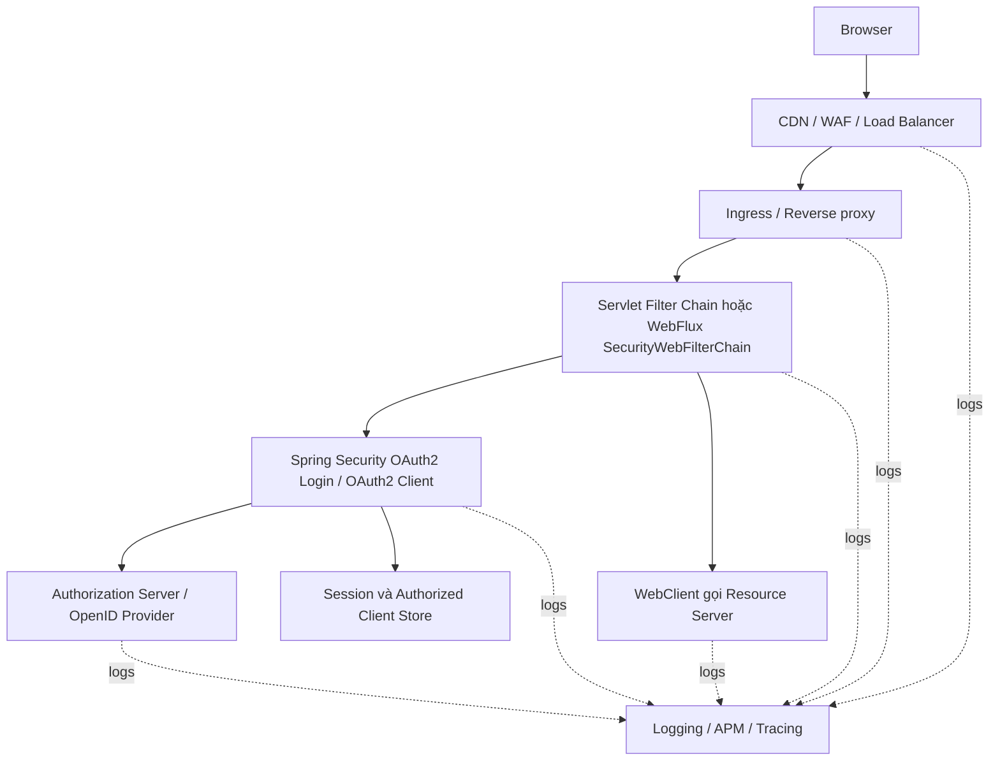

# 28.8. Bật log Spring Security theo môi trường và che dữ liệu nhạy cảm

> **Module:** Spring Security OAuth 2.0 OIDC Client  
> **Chương:** 28. Lỗi và quan sát  
> **Phạm vi:** Bật, giới hạn và tắt logging trong ứng dụng Spring Boot dùng Spring Security OAuth 2.0/OIDC Client trên Servlet hoặc WebFlux; xây observability giúp chẩn đoán lỗi đăng nhập, Token Endpoint, OIDC UserInfo và WebClient mà không làm lộ authorization code, token, secret, session hoặc dữ liệu cá nhân.

Một ứng dụng tích hợp OpenID Connect (OIDC) có thể đăng nhập thất bại vì sai `redirect_uri`, `state` không khớp, Token Endpoint từ chối Client authentication, ID Token sai issuer, WebClient chọn nhầm registration hoặc refresh token bị thu hồi. Trong những tình huống đó, log của Spring Security rất hữu ích để xác định filter/provider nào xử lý request, quyết định nào được áp dụng và điểm nào phát sinh lỗi.

Tuy nhiên, **bật DEBUG/TRACE toàn bộ security stack không đồng nghĩa có observability an toàn**. Một OAuth2 Client xử lý nhiều bí mật có giá trị cao: `authorization_code`, `access_token`, `refresh_token`, `id_token`, Client secret, PKCE `code_verifier` và session cookie. Thông tin này có thể đi vào log không chỉ qua chính Spring Security mà còn qua reverse proxy, Servlet container, HTTP wiretap, WebClient filter, request/response logging, APM hoặc exception handler tự viết.

Mục tiêu của bài là tạo một mô hình thực tế:

- **Production:** log đủ để vận hành, ưu tiên INFO/WARN/ERROR và structured security events đã được làm sạch.
- **Staging/test:** bật log chi tiết có giới hạn để xác minh một kịch bản, nhưng vẫn dùng synthetic credentials và redaction.
- **Local development:** có thể dùng DEBUG cho những logger cần thiết, hạn chế TRACE và các chế độ in raw request/headers.
- **Khi xử lý sự cố:** bật logging tạm thời, giới hạn phạm vi và thời gian, ghi nhận người phê duyệt, sau đó trả về cấu hình an toàn.

**Thông điệp trọng tâm:** phải phân biệt **mức log**, **nội dung được phép ghi**, **ai có quyền xem**, **log được lưu ở đâu** và **thời điểm phải tắt logging tăng cường**. Hạ logger xuống WARN không sửa được một custom filter vốn ghi token ở mức WARN.

---

## 1. Mục tiêu học tập

Sau bài này, bạn có thể:

1. Hiểu vai trò của SLF4J, Logback/Log4j2, Spring Boot logging configuration và Spring Security loggers.
2. Phân biệt ERROR, WARN, INFO, DEBUG, TRACE và mức độ chi tiết phù hợp với từng môi trường.
3. Sử dụng `application.yml`, `application-dev.yml`, `application-prod.yml` và environment variables để điều khiển logger levels.
4. Bật DEBUG có phạm vi cho `org.springframework.security`, OAuth2 Client, web security hoặc từng logger cụ thể.
5. Giải thích vì sao `@EnableWebSecurity(debug = true)` nguy hiểm trong môi trường dùng credentials thật.
6. Nhận diện nội dung nhạy cảm trong Authorization Code/OIDC Login, Token Endpoint, UserInfo và resource API calls.
7. Viết log sự kiện đăng nhập an toàn, không log raw `Authentication`, `OAuth2AuthorizedClient`, token values hoặc request query.
8. Sử dụng correlation ID và structured logging theo allowlist thay vì dump toàn bộ HTTP request.
9. Cấu hình request logging trên Servlet/WebFlux mà không bật header/body logging không kiểm soát.
10. Phân biệt logging của Spring Security với proxy, ingress, WAF, APM, telemetry và HTTP client wiretap.
11. Bảo vệ cookies, Authorization header, redirect Location và query chứa authorization code.
12. Hiểu cách bảo vệ log khi runtime log level được thay đổi qua Spring Boot Actuator.
13. Thiết lập retention, access control, alerting, redaction và incident response cho logs.
14. Kiểm thử bằng synthetic credentials để phát hiện rò rỉ trước khi triển khai.
15. Xây quy trình troubleshooting OAuth2 có thể tái sử dụng mà không bật TRACE toàn hệ thống.

## 2. Logging trong Spring Security gồm những lớp nào?

Một request OAuth2/OIDC có thể đi qua:



Bật:

```yaml
logging:
  level:
    org.springframework.security: DEBUG
```

chỉ thay mức logger thuộc namespace tương ứng trong **ứng dụng Spring Boot**. Nó không tự tắt hoặc làm sạch:

- NGINX access logs có `$request_uri`.
- Cloud load balancer/WAF logs.
- HTTP client wiretap.
- Browser analytics hoặc RUM.
- Database query logs.
- HTTP headers/body logs do custom filters tạo.
- Traces/exception payload mà APM agent tự thu.
- Log của Authorization Server ở hệ thống bên ngoài.

Vì thế, muốn “che dữ liệu nhạy cảm” phải có nhiều lớp phòng vệ, không chỉ một property trong Spring Boot.

## 3. Log level: càng chi tiết chưa chắc càng hữu ích

| Level | Vai trò thường gặp | Khuyến nghị trong OAuth2/OIDC Client |
|---|---|---|
| `ERROR` | Sự cố khiến operation không hoàn tất | Log mã lỗi an toàn, không dump request/token |
| `WARN` | Từ chối truy cập, lỗi security cần theo dõi, retry exhaustion | Phù hợp production, nhưng tránh noise và lộ dữ liệu |
| `INFO` | Sự kiện vận hành tổng hợp: login success, token refresh outcome, logout | Dùng structured fields an toàn |
| `DEBUG` | Nhánh xử lý, filter selection, registration/protocol diagnostics | Chủ yếu local/test; production bật có kiểm soát |
| `TRACE` | Luồng chi tiết, nội bộ framework | Hạn chế tối đa, chỉ khi thật sự cần và đã đánh giá secret exposure |
| `OFF` | Tắt logger | Có thể dùng cho logger tự viết không an toàn trong khi sửa, không thay giải pháp dài hạn |

Các logger khác nhau có thể phát những loại dữ liệu khác nhau tại cùng level. Ví dụ một logger framework có thể chỉ ghi tên filter, nhưng một logger do ứng dụng tự viết ở DEBUG lại có thể ghi raw token.

**Đừng xem DEBUG là “an toàn vì chỉ người phát triển dùng”.** Nếu log được forward lên hệ thống tập trung, credential có thể tiếp cận nhiều người và tồn tại trong backups.

## 4. SLF4J, logging backend và package logger

Trong Spring Boot, ứng dụng thường gọi SLF4J:

```java
import org.slf4j.Logger;
import org.slf4j.LoggerFactory;

final class LoginDiagnostics {
    private static final Logger log =
        LoggerFactory.getLogger(LoginDiagnostics.class);

    void successfulLogin(String registrationId) {
        log.info("oauth2_login_success registrationId={}", registrationId);
    }
}
```

SLF4J là API; backend như Logback hoặc Log4j2 thực hiện ghi log theo cấu hình. Spring Boot hỗ trợ cấu hình qua `logging.level.*`, file cấu hình backend và overrides từ môi trường.

### 4.1. Logger hierarchy

Ví dụ:

```text
org.springframework.security
  ├── org.springframework.security.web
  ├── org.springframework.security.authentication
  ├── org.springframework.security.oauth2
  │     ├── org.springframework.security.oauth2.client
  │     ├── org.springframework.security.oauth2.core
  │     └── ...
  └── ...
```

Đặt logger cha ở DEBUG có thể làm nhiều logger con phát thêm thông tin. Đặt một package/class cụ thể ở DEBUG thường có phạm vi nhỏ hơn.

### 4.2. Package name có thể thay đổi theo thành phần/version

Các class trong Servlet OAuth2 Login, reactive OAuth2 Client hoặc Resource Server không nhất thiết nằm cùng package. Khi cần xác định logger cụ thể, xem class/package trong stack trace hoặc tài liệu API của version đang dùng; không suy tất cả OAuth2 logs đều phát từ một namespace duy nhất.

## 5. Tách cấu hình theo Spring Boot profiles

Một cách tổ chức thông dụng:

```text
src/main/resources/
  application.yml
  application-dev.yml
  application-staging.yml
  application-prod.yml
  application-test.yml
```

**Base configuration** nên an toàn ngay cả khi ai đó quên bật profile:

```yaml
# application.yml
logging:
  level:
    root: INFO
    org.springframework.security: WARN
    org.springframework.web: INFO
    reactor.netty: WARN

management:
  endpoints:
    web:
      exposure:
        include: health,info
```

Các giá trị là baseline minh họa, không phải chuẩn bắt buộc cho mọi tổ chức.

### 5.1. Local development

```yaml
# application-dev.yml
logging:
  level:
    root: INFO
    org.springframework.security: DEBUG
    org.springframework.security.oauth2.client: DEBUG
    org.springframework.security.web: DEBUG
    org.springframework.web: INFO
    reactor.netty: WARN
```

Mục tiêu là quan sát SecurityFilterChain, OAuth2 Login và authorized-client decisions. Nó **không** cho phép log raw Authorization headers, token responses hoặc request body. Dù local, nên sử dụng OP test và credentials giả.

### 5.2. Staging

```yaml
# application-staging.yml
logging:
  level:
    root: INFO
    org.springframework.security: INFO
    org.springframework.security.oauth2.client: INFO
    org.springframework.security.web: INFO
    reactor.netty: WARN
```

Khi tái hiện sự cố, có thể override một package cần thiết sang DEBUG trong thời gian ngắn. Staging có thể chứa dữ liệu tương tự production; không mặc định staging là môi trường công khai để log secrets.

### 5.3. Production

```yaml
# application-prod.yml
logging:
  level:
    root: INFO
    org.springframework.security: WARN
    org.springframework.security.oauth2.client: WARN
    org.springframework.security.web: WARN
    org.springframework.web: WARN
    reactor.netty: WARN

management:
  endpoints:
    web:
      exposure:
        include: health,info
```

Trong production, application security events quan trọng vẫn nên ghi qua các logger tự quản lý ở INFO/WARN với **fields đã được kiểm soát**, không cần bật DEBUG toàn framework.

### 5.4. Test

```yaml
# application-test.yml
logging:
  level:
    root: WARN
    org.springframework.security.web.FilterChainProxy: DEBUG
    org.springframework.security.oauth2.client: INFO
```

Test có thể bật một class logger để quan sát quyết định filter selection; không bật full HTTP dumps mặc định và không dùng production tokens.

## 6. Kích hoạt profile như thế nào?

Ví dụ chạy local:

```shell
SPRING_PROFILES_ACTIVE=dev java -jar application.jar
```

Ví dụ cấu hình deployment production dùng biến môi trường:

```text
SPRING_PROFILES_ACTIVE=prod
```

Spring Boot hỗ trợ nhiều nguồn cấu hình: application files, environment variables, command-line arguments và các nguồn khác theo property precedence. Giá trị thực tế phụ thuộc deployment.

### 6.1. Đừng cho người dùng HTTP điều khiển profile

Không có một endpoint:

```text
/admin/set-spring-profile?value=dev
```

để thay profile bảo mật của toàn ứng dụng theo request. Profile và log levels cần được quản lý bởi deployment/admin tools có authentication, authorization và audit.

### 6.2. Đừng mặc định production luôn chọn prod

Nếu production quên `SPRING_PROFILES_ACTIVE=prod`, baseline `application.yml` vẫn cần đủ an toàn. Đặt `org.springframework.security: TRACE` trong base config rồi chỉ hạ ở prod là một thiết kế dễ lỗi khi thiếu profile.

## 7. Environment variables để override logger level

Spring Boot có thể nhận override từ environment variables. Với một package logger như:

```text
logging.level.org.springframework.security=DEBUG
```

một tên environment thường dùng là:

```text
LOGGING_LEVEL_ORG_SPRINGFRAMEWORK_SECURITY=DEBUG
```

Tuy nhiên, **đối với logger tên class cụ thể**, relaxed binding từ environment variables có giới hạn về phân biệt chữ hoa/chữ thường và dấu phân cách. Nếu cần override chính xác một fully qualified class name, ưu tiên cấu hình file, command-line property hoặc cơ chế Actuator loggers đã được bảo vệ và kiểm thử.

### 7.1. Không để debug override tồn tại qua deployment tiếp theo

Khi xử lý sự cố, cần:

1. Ghi lại logger nào được thay đổi.
2. Ghi rõ ai phê duyệt và phạm vi.
3. Thực hiện thay đổi qua deployment/config management.
4. Theo dõi log volume và secret exposure.
5. Khôi phục level an toàn sau khi xong.
6. Kiểm tra override không nằm sót trong Helm values, ConfigMap, secret, Docker Compose hoặc CI environment.

Một override còn sót thường khó phát hiện hơn một dòng DEBUG trong source code.

## 8. Bật DEBUG cho Spring Security có ích gì?

Những sự kiện có thể quan sát tùy version/config:

- SecurityFilterChain nào áp dụng cho request.
- Request bị chặn do authentication/authorization.
- Filter nào tham gia chain.
- Cách authentication entry point hoặc access denied handler được gọi.
- Một số quyết định authorization.
- OAuth2 Login hoặc authorized-client manager gặp lỗi.
- Ngữ cảnh lỗi khi không đọc được authorization request theo state.

**Không hứa mọi lỗi OIDC đều có một dòng log chuẩn** chứa nguyên nhân. Với Token Endpoint `invalid_grant`, nguồn gốc có thể nằm ở AS; với browser cookie SameSite, cần quan sát network flow; với JDBC authorized client storage, cần kiểm tra transaction/DB behavior.

### 8.1. Bắt đầu từ class/package nhỏ

Nếu muốn xem filter selection:

```yaml
logging:
  level:
    org.springframework.security.web.FilterChainProxy: DEBUG
```

Nếu muốn tìm hiểu OAuth2 Client:

```yaml
logging:
  level:
    org.springframework.security.oauth2.client: DEBUG
```

Không mặc định bật:

```yaml
logging:
  level:
    root: TRACE
```

vì nó làm tăng lượng logs của cả application/dependencies, bao gồm những phần không liên quan và có thể chứa sensitive metadata.

## 9. Phân biệt security logging với Spring Security debug mode

Trên Servlet stack, Spring Security có chế độ debug filter chain, ví dụ:

```java
import org.springframework.security.config.annotation.web.configuration.EnableWebSecurity;

@EnableWebSecurity(debug = true)
class DebugSecurityConfiguration {
    // Chỉ dành cho local/test đã kiểm soát.
}
```

Chế độ này phục vụ chẩn đoán cấu hình SecurityFilterChain và request handling, nhưng **có thể in thông tin request/security context rất chi tiết** và không nên dùng trong production hoặc với credentials thật.

### 9.1. DEBUG logger và debug=true không giống nhau

| Cách bật | Mục tiêu | Cảnh báo |
|---|---|---|
| `logging.level.org.springframework.security=DEBUG` | Tăng verbosity của logger | Có thể ghi metadata nhạy cảm tùy class/config |
| `logging.level...FilterChainProxy=DEBUG` | Tập trung filter-chain observations | Hạn chế phạm vi hơn nhưng vẫn xem log output |
| `@EnableWebSecurity(debug = true)` | Bật security debug mode trên Servlet | Có nguy cơ dump nhiều request/security details; không production |
| Custom HTTP logging filter | Do ứng dụng tự quyết nội dung | Rất dễ lộ query/header/body nếu viết thiếu redaction |
| Reactor Netty `wiretap` | Theo dõi HTTP/network data | Có thể lộ token headers/bodies, chỉ bật có kiểm soát |

**Không đưa debug=true vào cấu hình chung** để sửa một lỗi callback hiếm gặp; hãy chọn logger cụ thể và dùng synthetic traffic.

## 10. Thứ tự chẩn đoán OAuth2 Login trước khi tăng log level

Khi login thất bại, đi theo chuỗi:

```text
Browser request /oauth2/authorization/{registrationId}
    |
    v
Authorization Request + state + redirect_uri
    |
    v
OP authorize và redirect callback
    |
    v
Authorization Request Repository đối chiếu state
    |
    v
Token Endpoint: code exchange + Client authentication + PKCE
    |
    v
OIDC: ID Token verification, issuer/aud/nonce
    |
    v
Load user/UserInfo, map authorities
    |
    v
SecurityContext/session + redirect success
```

Với mỗi bước, ghi **mã lỗi, phase, registration ID và correlation ID**, không cần in raw token hoặc callback URL.

### 10.1. Phân loại theo phase

| Phase | Triệu chứng | Trường log an toàn có ích |
|---|---|---|
| Initiation | Không redirect tới OP | Route template, registration ID, filter chain, outcome |
| Authorization callback | `state` không khớp | Event code `state_mismatch`, registration (nếu xác định tin cậy), trace ID |
| Token exchange | `invalid_client` hoặc `invalid_grant` | Grant type, OAuth2 error code allowlist, HTTP status |
| ID Token verification | Issuer/audience/nonce không hợp lệ | Failure reason **không chứa raw claims/token** |
| UserInfo | HTTP error/timeout | Provider registration, endpoint category, status, duration |
| Authorized client save/load | JDBC/session storage error | Registration, storage type, error category |
| API call | HTTP 401/403 | Resource category, registration, API route template, status |
| Logout | Redirect hoặc end-session lỗi | Provider registration, logout phase, outcome |

Không nên thêm token values “để kỹ sư dễ đối chiếu”; cần kiểm tra thông số tương đương bằng mocks, cấu hình và metrics.

## 11. Dữ liệu nhạy cảm trong OAuth2/OIDC Client

| Dữ liệu | Tại sao nhạy cảm? | Cách xử lý khi logging |
|---|---|---|
| Authorization code | Credential giao dịch có thể bị interception | Không ghi query/callback code |
| Access token | Bearer credential gọi API | Không ghi raw value, kể cả JWT |
| Refresh token | Credential có thể xin token mới | Tuyệt đối không đưa vào logs/traces |
| ID Token | Chứa issuer, subject, claims cá nhân, session context | Không ghi raw token/JSON đầy đủ |
| Client secret | Xác thực confidential Client | Không log, không render trong error |
| Private key | Xác thực Client/ký request | Không log, bảo vệ trong vault |
| PKCE `code_verifier` | Ràng buộc authorization code | Không ghi Token Request body |
| `state` | Correlation/CSRF protection | Không ghi raw state; dùng trace ID riêng |
| `nonce` | Ràng buộc ID Token request | Không ghi raw value |
| Session cookie | Có thể đại diện phiên đăng nhập | Không log Cookie/Set-Cookie |
| `Authorization` header | Bearer hoặc Basic Client credentials | Không log header raw |
| Logout `id_token_hint` | Có thể chứa ID Token trong redirect URL | Redact Location/query |
| UserInfo response | Có thể chứa PII và nhóm quyền | Chỉ log trường tối thiểu được phê duyệt |
| Email/name/phone | Dữ liệu cá nhân | Tránh hoặc mask theo policy |
| Tenant/principal IDs | Có thể nhạy cảm, dễ correlate | Pseudonymous ID/allowlist, giới hạn labels |

**Không chỉ mask chuỗi `password`.** OAuth2 có nhiều credential không chứa từ “password”.

## 12. Authorization code trong callback URL: nguy cơ log lớn

Authorization Code Flow theo redirect thường có:

```http
GET /login/oauth2/code/corporate?code=<redacted>&state=<redacted> HTTP/1.1
Host: app.example.test
```

Code trong callback query là một phần bình thường của giao thức. Nhưng một logger ghi full request URI có thể đưa code/state vào SIEM.

### 12.1. Phản ví dụ trong Servlet

```java
// PHẢN VÍ DỤ: không dùng trong production.
log.info("request={} query={}",
    request.getRequestURI(),
    request.getQueryString());
```

`request.getRequestURI()` không bao gồm query, nhưng `getQueryString()` có thể chứa code/state. Một phép nối hai trường như trên làm lộ thông tin đăng nhập.

### 12.2. Không log callback URL từ exception

Tránh:

```java
// PHẢN VÍ DỤ.
log.error("OIDC callback failed at {}",
    request.getRequestURL() + "?" + request.getQueryString(),
    exception);
```

Exception message/cause cũng có thể chứa URL hoặc response body. Trước khi log raw exception, hiểu loại exception và sanitization của thư viện.

### 12.3. Trường nào có thể ghi?

Ghi nhận:

```text
event=oauth2_login_callback
route=/login/oauth2/code/{registrationId}
registrationId=corporate
outcome=state_mismatch
correlationId=opaque-72c
code=[not-logged]
state=[not-logged]
```

Route template và registration ID được lấy từ nguồn đã xác minh. Không tự suy registration từ một query parameter không tin cậy rồi đặt vào audit log như thể đã xác thực.

## 13. Access token, refresh token và ID token không nằm trong logs

Một OAuth2 authorized client có thể chứa:

```java
OAuth2AuthorizedClient client = ...;
client.getAccessToken().getTokenValue();
client.getRefreshToken();
```

Những giá trị đó cần cho protocol, **không phải dữ liệu observability**. Không đưa vào `log.debug`, `toString()`, JSON serialization hoặc tracing tags.

Phản ví dụ:

```java
// PHẢN VÍ DỤ: tránh in đối tượng chứa credential.
log.debug("authorizedClient={}", authorizedClient);
```

Dù một version `toString()` có thể che một số trường, dựa vào implementation của `toString()` để bảo đảm bảo mật dài hạn là không đáng tin. Hãy log từng trường được allowlist.

### 13.1. Token metadata nào có thể dùng?

Có thể ghi khi policy cho phép:

- Registration ID.
- Grant type.
- Token endpoint outcome.
- Relative TTL theo nhóm/bucket thay vì raw timestamps liên kết cá nhân khi không cần.
- HTTP status của API.
- Mã lỗi allowlist.
- Correlation ID.
- Authorized client storage operation (load/save/remove) và result.

Ngay cả metadata cũng cần privacy review: một registration có thể nhận diện khách hàng/tenant.

## 14. Token Endpoint request/response logging

Token Endpoint thường nhận POST form body:

```http
POST /oauth2/token HTTP/1.1
Host: login.example.test
Authorization: Basic <redacted-client-credentials>
Content-Type: application/x-www-form-urlencoded

grant_type=authorization_code&code=<redacted>&redirect_uri=<encoded>&code_verifier=<redacted>
```

Response có thể chứa:

```json
{
  "access_token": "<redacted>",
  "refresh_token": "<redacted>",
  "id_token": "<redacted>",
  "token_type": "Bearer",
  "expires_in": 300
}
```

Nếu bật body logging/wiretap trên HTTP Client mà Spring Security dùng để gọi Token Endpoint, cả code/verifier lẫn token response có thể bị ghi.

### 14.1. Tách lỗi protocol khỏi raw body

Thay vì log toàn bộ response:

```text
token_exchange_failed registrationId=corporate
grantType=authorization_code
httpStatus=400
errorCode=invalid_grant
durationMs=187
correlationId=ev-9d2
```

`invalid_grant` chỉ là mã lỗi cần phân tích thêm, không tự chứng minh code đã bị đánh cắp. Các nguyên nhân có thể là code hết hạn/đã dùng, PKCE mismatch, redirect URI không khớp hoặc refresh token invalid.

### 14.2. Không tự tắt TLS verification để debug

Nếu Token Endpoint lỗi do trust/certificate/hostname verification, không sửa bằng cách disable TLS hoặc cho Client gửi credentials qua HTTP. Ghi nhóm lỗi an toàn rồi xử lý certificate, issuer URL, proxy và trust store.

## 15. UserInfo và OIDC claims

`OidcUser` có thể chứa:

- `sub`, `iss`, `aud`.
- Email/name/locale.
- Profile attributes.
- Custom roles/groups.
- Thông tin tenant.
- ID Token/UserInfo attributes do OP cung cấp.

Không log toàn bộ:

```java
// PHẢN VÍ DỤ.
log.debug("oidcUser={}", oidcUser);
log.info("claims={}", oidcUser.getClaims());
```

Khi cần debug authority mapping, ghi event:

```text
event=oidc_authorities_mapping
registrationId=corporate
mappingPolicyVersion=v4
outcome=success
assignedAuthorityCount=3
correlationId=ev-9d2
```

Ngay cả tên authority cũng có thể tiết lộ chức danh/quyền nhạy cảm. Chỉ ghi role names khi policy cho phép và có nhu cầu điều tra cụ thể; tránh labels có dữ liệu cá nhân.

## 16. Cookie, session và CSRF

Một ứng dụng Spring Security Servlet thường sử dụng session cookie và có thể có CSRF token trong browser flow.

Không ghi:

- `Cookie`.
- `Set-Cookie`.
- Session ID.
- Raw CSRF token.
- HTTP Basic credentials.
- Authorization headers.
- OIDC Logout Token.
- OAuth2 `state`/`nonce` raw.

Việc lộ cookie phiên có thể dẫn đến session hijacking tùy cách bảo vệ khác. CSRF token, state và nonce không phải API Bearer tokens nhưng vẫn là dữ liệu ràng buộc security transaction.

### 16.1. Không dùng session ID như trace ID

Session ID vừa nhạy cảm vừa có thời hạn dài hơn một request. Dùng correlation ID riêng được sinh ngẫu nhiên hoặc do trusted tracing infrastructure cung cấp, không phải session identifier.

## 17. Logging an toàn bằng allowlist

Có hai hướng:

**Denylist/redaction:** nhận log thô rồi cố xóa `password`, `access_token`, `Authorization`...

**Allowlist:** chỉ đưa những fields đã được phê duyệt vào log ngay từ đầu.

Trong security logging, ưu tiên **allowlist**. Denylist regex là lớp phụ để bắt các trường hợp còn sót, không phải bảo đảm chính.

### 17.1. Vì sao regex redaction thường thiếu?

Token có thể xuất hiện dưới nhiều tên:

```text
access_token
refresh_token
id_token
id_token_hint
assertion
client_assertion
code
code_verifier
Authorization
Cookie
Set-Cookie
uri_query
http.url
page_location
```

Giá trị còn có thể URL encoded, Base64, JSON nested, header serialized hoặc nằm trong `Exception.getMessage()`.

Một regex chỉ thay `token=` sẽ bỏ sót nhiều trường hợp và có thể tạo cảm giác an toàn giả.

### 17.2. Structured logging mẫu

```java
log.info(
    "oauth2_login_result registrationId={} outcome={} phase={} traceId={}",
    safeRegistrationId,
    "failure",
    "token_exchange",
    safeCorrelationId
);
```

Các trường trên phải lấy từ context tin cậy/allowlist. Không đưa raw error description từ AS vào log vì nó có thể chứa nội dung chưa được kiểm soát.

## 18. Mẫu Servlet request logging an toàn

Có thể viết `OncePerRequestFilter` chỉ ghi **route category**, method, status và duration, không ghi raw URI/query/headers.

```java
package example.security.logging;

import java.io.IOException;
import jakarta.servlet.FilterChain;
import jakarta.servlet.ServletException;
import jakarta.servlet.http.HttpServletRequest;
import jakarta.servlet.http.HttpServletResponse;

import org.slf4j.Logger;
import org.slf4j.LoggerFactory;
import org.springframework.web.filter.OncePerRequestFilter;

public final class SafeSecurityRequestLoggingFilter
        extends OncePerRequestFilter {

    private static final Logger log =
        LoggerFactory.getLogger(SafeSecurityRequestLoggingFilter.class);

    @Override
    protected void doFilterInternal(
            HttpServletRequest request,
            HttpServletResponse response,
            FilterChain chain)
            throws ServletException, IOException {

        long start = System.nanoTime();
        String path = request.getRequestURI();
        String context = request.getContextPath();

        String route;
        if (path.startsWith(context + "/login/oauth2/code/")) {
            route = "/login/oauth2/code/{registrationId}";
        } else if (path.startsWith(context + "/oauth2/authorization/")) {
            route = "/oauth2/authorization/{registrationId}";
        } else {
            route = "other";
        }

        try {
            chain.doFilter(request, response);
        } finally {
            long elapsedMs =
                (System.nanoTime() - start) / 1_000_000L;

            // Không log getQueryString(), Cookie, Authorization,
            // authentication.toString() hoặc request body.
            log.info(
                "security_http route={} method={} status={} durationMs={}",
                route,
                request.getMethod(),
                response.getStatus(),
                elapsedMs
            );
        }
    }
}
```

### 18.1. Đây là ví dụ về dữ liệu được phép, không phải full production filter

Một hệ thống thực tế cần xét:

- Filter registration/order và interaction với Spring Security.
- Async dispatch behavior.
- Các route categories đã được phê duyệt.
- Log sampling để tránh volume quá lớn.
- Error/status visibility khi response bị committed hoặc request bị cancel.
- Audit event semantics độc lập với access logging.
- Correlation ID từ trusted tracing integration.

Ví dụ cố ý **không log URL còn nguyên**: một path không thuộc pattern sẽ được ghi là `other`, không phải path raw vì path cũng có thể chứa secret.

### 18.2. Bẫy logging route path

Ngay cả `request.getRequestURI()` không có query string, path có thể chứa:

```text
/reset-password/<secret>
/download/<signed-token>
```

Do đó không được mặc định log mọi path raw là an toàn. Ưu tiên route templates hoặc categories.

## 19. CommonsRequestLoggingFilter có thể làm lộ gì?

Spring Framework có `CommonsRequestLoggingFilter`. Nếu ứng dụng cấu hình:

```java
// Cấu hình mang tính cảnh báo, không khuyến nghị cho OAuth endpoints.
filter.setIncludeQueryString(true);
filter.setIncludeHeaders(true);
filter.setIncludePayload(true);
```

thì log có thể chứa callback `code/state`, Authorization/Cookie headers và payloads tùy request/filter behavior.

### 19.1. Nguyên tắc khi dùng request logging filter

- Không bật query logging cho OAuth callbacks.
- Không bật toàn bộ headers ở Token Endpoint hoặc bearer API calls.
- Không log payload chứa code/verifier/client_assertion/refresh token.
- Dùng allowlist những fields cần thiết.
- Thử cả login success, login error, 401 và logout.
- Kiểm tra logging level/formatter của filter và người đọc log.

### 19.2. Không chỉ cấu hình false rồi quên custom filters

Các teams có thể có `HandlerInterceptor`, `OncePerRequestFilter` hoặc Servlet filter khác tự in request. Cần kiểm kê toàn bộ code instrumentation, không chỉ Spring-provided filter.

## 20. Logging an toàn trên WebFlux

WebFlux dùng `ServerWebExchange`, `SecurityWebFilterChain` và Reactor, không dùng `HttpServletRequest`/`OncePerRequestFilter`.

Một `WebFilter` chỉ ghi route category:

```java
package example.security.logging;

import org.slf4j.Logger;
import org.slf4j.LoggerFactory;
import org.springframework.web.server.ServerWebExchange;
import org.springframework.web.server.WebFilter;
import org.springframework.web.server.WebFilterChain;
import reactor.core.publisher.Mono;

public final class SafeReactiveRequestLoggingFilter
        implements WebFilter {

    private static final Logger log =
        LoggerFactory.getLogger(SafeReactiveRequestLoggingFilter.class);

    @Override
    public Mono<Void> filter(
            ServerWebExchange exchange,
            WebFilterChain chain) {

        String path = exchange.getRequest()
            .getURI()
            .getRawPath();

        String route = path.startsWith("/login/oauth2/code/")
            ? "/login/oauth2/code/{registrationId}"
            : "other";

        long startNanos = System.nanoTime();

        return chain.filter(exchange)
            .doFinally(signal -> {
                long durationMs =
                    (System.nanoTime() - startNanos) / 1_000_000L;

                log.info(
                    "security_http_reactive route={} signal={} durationMs={}",
                    route,
                    signal.name(),
                    durationMs
                );
            });
    }
}
```

Ví dụ này không tự đăng ký filter bean; ứng dụng cần wiring rõ theo WebFlux config và đánh giá thứ tự filters.

### 20.1. Không block trong reactive logging

Không gọi `block()` để lấy principal, tenant hoặc authorized client chỉ để log. Điều đó có thể gây nghẽn event loop, lỗi runtime hoặc thậm chí làm authorization pipeline chạy lại.

### 20.2. Reactor Context và MDC

Trong reactive flow, execution có thể chuyển threads. MDC dựa trên ThreadLocal **không tự động** luôn được truyền qua mọi operator nếu không có integration/context propagation thích hợp.

Khi cần correlation ID, dùng tracing instrumentation tương thích Reactor Context hoặc Micrometer context propagation theo version/framework, không giả định MDC của servlet thread luôn còn ở WebFlux callbacks.

## 21. Spring MVC và WebFlux request-details logging

Spring Boot/Spring Framework có những tùy chọn cho phép log chi tiết request. Ví dụ hai properties thường gặp ở các bản Spring Boot tương ứng:

```yaml
spring:
  mvc:
    log-request-details: false
  codec:
    log-request-details: false
```

Mục tiêu là **không bật chi tiết headers/form parameters mặc định** khi xử lý credentials.

### 21.1. Kiểm tra đúng stack/version

- Servlet/MVC dùng một tập properties/loggers riêng.
- WebFlux codecs/WebClient có tập properties/loggers khác.
- Một property không áp dụng cho stack đang chạy có thể không có tác dụng.
- Framework/dependency versions có thể thay tên settings hoặc behavior.

Không dựa vào một property để cam kết mọi body/query đều được che; vẫn cần xem custom instrumentation, proxy và APM.

## 22. WebClient OAuth2 logging và HTTP body redaction

Spring Security có thể tích hợp `WebClient` với OAuth2 authorized-client manager. Request tới Resource Server thường có:

```http
GET /reports/current HTTP/1.1
Host: api.example.test
Authorization: Bearer <redacted>
```

Nếu logging filter in request headers hoặc Reactor Netty bật wiretap, token có thể xuất hiện.

Phản ví dụ:

```java
// PHẢN VÍ DỤ: không in toàn bộ headers của WebClient.
ExchangeFilterFunction unsafe = (request, next) -> {
    log.debug("headers={}", request.headers());
    return next.exchange(request);
};
```

### 22.1. Safe WebClient filter chỉ ghi method + category

```java
import org.springframework.web.reactive.function.client.ClientRequest;
import org.springframework.web.reactive.function.client.ExchangeFilterFunction;
import reactor.core.publisher.Mono;

ExchangeFilterFunction safeApiEvents() {
    return (request, next) -> {
        String method = request.method().name();

        // Route category cố định cho client này.
        String target = "reports-api";

        return next.exchange(request)
            .doOnNext(response ->
                log.info(
                    "api_call target={} method={} status={}",
                    target,
                    method,
                    response.statusCode().value()
                )
            );
    };
}
```

Không ghi `request.url()` nguyên vẹn nếu URL có query chứa PII/token; không ghi `request.headers()` hay response body. Ví dụ giả định filter chỉ được gắn với WebClient dành riêng cho reports-api, không dùng arbitrary destinations.

### 22.2. WebClient có thể tự follow redirect không?

Redirect behavior phụ thuộc connector/HTTP client config. Nếu có theo redirect, phải kiểm tra có giữ Authorization header khi đổi origin không. Đây là bài toán token leakage riêng; không mở log header để “quan sát” bằng cách làm lộ token.

## 23. Reactor Netty wiretap: cân nhắc rất kỹ

Reactor Netty hỗ trợ wiretap/logging network activity theo cấu hình. Một số chế độ có thể làm lộ HTTP headers/body tùy format.

Không bật cấu hình wiretap chi tiết cho OAuth2 Token Endpoint và API Bearer requests trong production chỉ vì cần debug timeout.

### 23.1. Thay thế an toàn

Để điều tra timeout:

- Ghi endpoint **category** như `token-endpoint`, không full URL chứa query.
- Ghi connect/response timeout category.
- Ghi status code và duration.
- Ghi retry count và transient failure class.
- Ghi trace ID.
- Kiểm tra TLS/DNS/connection pool metrics.
- Dùng mock AS với synthetic tokens khi cần packet-level trace.

Nếu bắt buộc wiretap trong môi trường cách ly, phải dùng credentials giả và có thời hạn bật/tắt cụ thể; log output phải bị coi là nhạy cảm.

## 24. Referrer, callback và browser analytics

Callback Authorization Code có URL:

```text
https://app.example.test/login/oauth2/code/corporate?code=<redacted>&state=<redacted>
```

URL này có thể bị:

- Lưu trong ingress logs.
- Ghi bởi browser/network telemetry.
- Thu bởi analytics `page_location` hoặc `window.location.href`.
- Truyền qua HTTP `Referer` header tùy `Referrer-Policy`.
- Copy vào support ticket hoặc screenshot.

### 24.1. Referrer-Policy giảm một phần rủi ro

Một cấu hình chặt cho Spring Security Servlet:

```java
import org.springframework.security.web.header.writers.ReferrerPolicyHeaderWriter.ReferrerPolicy;

http.headers(headers -> headers
    .referrerPolicy(referrer ->
        referrer.policy(ReferrerPolicy.NO_REFERRER)
    )
);
```

Cấu hình này là một phần của `SecurityFilterChain` và cần điều chỉnh theo Spring Security version.

**Không nhầm:** `Referrer-Policy: no-referrer` kiểm soát HTTP Referer; JavaScript trên trang vẫn có thể đọc `window.location.href` rồi gửi sang analytics. Callback nên được xử lý bởi security filter và redirect nhanh về URL sạch trước khi render third-party scripts.

### 24.2. Không dùng URL history để debug OAuth flow

Khi cần điều tra, đừng yêu cầu người dùng paste full callback URL chứa `code`/`state`. Hãy dùng mã lỗi/correlation ID không phải credential.

## 25. OIDC RP-Initiated Logout và id_token_hint

Trong một số OIDC RP-Initiated Logout flows, redirect tới OP có thể chứa:

```text
https://login.example.test/logout?id_token_hint=<redacted>&post_logout_redirect_uri=...
```

`id_token_hint` có thể là một ID Token. Dù không phải access token API, nó chứa identity claims nhạy cảm.

Cần:

- Chỉ dùng OP end-session endpoint đã được tin cậy.
- Không log `Location` header đầy đủ.
- Không đưa ID Token vào custom exception messages.
- Áp Referrer-Policy/redirect policy hợp lý.
- Đánh giá logs của ingress/proxy/browser.
- Giữ post-logout redirect URI trong allowlist.

Đừng coi login logging là phạm vi duy nhất; các redirect logout cũng có thể chứa token-like values.

## 26. Logs ở reverse proxy, ingress và WAF

Một NGINX pattern phổ biến:

```nginx
log_format unsafe '$remote_addr "$request" $status';
```

`$request` có thể chứa request line với query chứa authorization code. `$request_uri` thường gồm query string.

Một pattern giảm query leakage:

```nginx
log_format oauth_safe
  '$remote_addr method=$request_method path=$uri '
  'status=$status duration=$request_time';
access_log /var/log/nginx/access.log oauth_safe;
```

Trong NGINX, `$uri` thường không chứa query string; nhưng nó **vẫn có thể chứa path secrets hoặc PII**. Với các routes nhạy cảm, cần route normalization/masking hoặc log fixed route categories.

### 26.1. Không chỉ chỉnh một ingress

Một request có thể đi qua:

```text
CDN -> WAF -> Cloud Load Balancer -> Ingress -> Service Mesh
    -> Servlet container / WebFlux server -> Spring Security
```

Mỗi lớp có logs và retention độc lập. Hãy kiểm kê:

- `request_uri`/query-string logging.
- Cookies và Authorization headers.
- Response headers như `Location`.
- Error logs/5xx dumps.
- Sampling/tracing.
- Export tới SIEM hoặc bên thứ ba.
- Access controls và backup lifecycle.

### 26.2. HTTPS không ngăn proxy logs

TLS bảo vệ đường truyền tới TLS termination, nhưng proxy termination có thể nhìn thấy URL, headers và body; nó vẫn cần redaction và access controls.

## 27. Servlet container access logs

Tomcat, Jetty và Undertow có logging cấu hình riêng. Một pattern ghi raw request line có thể làm lộ query; một pattern ghi chỉ đường dẫn có thể giảm một phần rủi ro.

Trong Spring Boot, các property access logs của embedded server có thể khác nhau theo container/version. Không tự giả định `logging.level.org.springframework.security=WARN` đã thay đổi access log của container.

Các câu hỏi kiểm tra:

1. Pattern log request line hay request URI?
2. Có query string không?
3. Cookie/Header logging được bật ở đâu?
4. Error pages/uncaught exception có in full URL?
5. Có reverse proxy thứ hai ghi raw request?
6. Logs được gửi sang những destinations nào?
7. Có cần lưu path thực hay route template là đủ?

## 28. APM, tracing và RUM

Application Performance Monitoring có thể thu các thuộc tính:

```text
http.url
url.full
http.target
http.request.header.authorization
http.response.header.location
exception.message
span.attributes
browser.page_location
```

Tên cụ thể phụ thuộc OpenTelemetry semantic convention và vendor/version. Không mặc định một agent nào cũng thu mọi trường ở trên.

### 28.1. Privacy by design trong tracing

- Chỉ giữ route templates như `/login/oauth2/code/{registrationId}`.
- Không gắn `code`/`state`/`nonce` vào span.
- Không thu `Authorization`, `Cookie`, `Set-Cookie`.
- Không thu Token Endpoint bodies.
- Làm sạch `Location` headers khi chứa `id_token_hint`.
- Hạn chế user ID, email, tenant name trong span attributes.
- Dùng correlation ID không phải session ID.
- Có sampling và retention theo policy.

### 28.2. Không rely chỉ vào Spring logger levels

APM agent có thể tự lấy dữ liệu ở bytecode/HTTP instrumentations. Ngay cả khi Spring Security chỉ log WARN, traces vẫn có raw URL/query nếu agent không được cấu hình bảo vệ.

## 29. Tracing correlation ID thay vì token/user identifier

Một correlation ID phục vụ việc nối các logs của cùng request:

```text
traceId=8f4a...
spanId=2a91...
registrationId=corporate
phase=token_exchange
outcome=invalid_grant
durationMs=170
```

Không dùng:

```text
traceId=<access_token>
traceId=<session_cookie>
traceId=<authorization_code>
```

### 29.1. Servlet MDC

Trong ứng dụng Servlet truyền thống, MDC có thể dùng để lưu trace ID cho request thread với code/correlation filter thích hợp.

Điều quan trọng:

- Chỉ chấp nhận trace IDs từ trusted instrumentation hoặc validate input nếu cho client gửi.
- Xóa MDC cuối request để tránh leak qua thread reuse.
- Không đặt raw user email/token vào MDC.
- Khi asynchronous processing đổi thread, cần context propagation đúng.

### 29.2. WebFlux/Reactor Context

Reactive chains không bảo đảm chạy trên một thread. Dùng tracing integration tương thích Reactor Context; không mặc định MDC được sao chép xuyên `flatMap`, scheduling và `publishOn`.

## 30. Structured security event service

Thay vì mỗi component tự ghi message khác nhau, có thể tạo abstraction:

```java
public interface SecurityEventReporter {

    void loginSucceeded(String registrationId, String correlationId);

    void loginFailed(
        String registrationId,
        String reasonCategory,
        String correlationId);

    void tokenRefreshOutcome(
        String registrationId,
        String resultCategory,
        String correlationId);
}
```

Đây là interface **do ứng dụng định nghĩa**, không phải Spring Security API có sẵn.

Implementation chỉ ghi allowlisted values:

```java
import org.slf4j.Logger;
import org.slf4j.LoggerFactory;

public final class SafeSecurityEventReporter
        implements SecurityEventReporter {

    private static final Logger log =
        LoggerFactory.getLogger(SafeSecurityEventReporter.class);

    @Override
    public void loginSucceeded(
            String registrationId,
            String correlationId) {

        log.info(
            "security_event=login_succeeded registration={} traceId={}",
            registrationId,
            correlationId
        );
    }

    @Override
    public void loginFailed(
            String registrationId,
            String reasonCategory,
            String correlationId) {

        log.warn(
            "security_event=login_failed registration={} reason={} traceId={}",
            registrationId,
            reasonCategory,
            correlationId
        );
    }

    @Override
    public void tokenRefreshOutcome(
            String registrationId,
            String resultCategory,
            String correlationId) {

        log.info(
            "security_event=token_refresh registration={} result={} traceId={}",
            registrationId,
            resultCategory,
            correlationId
        );
    }
}
```

### 30.1. Reporter không tự sanitize arbitrary strings

Ví dụ này chỉ an toàn nếu call sites truyền registration ID, reason category và correlation ID từ **trusted allowlist**. Không truyền thẳng `exception.getMessage()` làm `reasonCategory` hoặc lấy correlation ID từ query parameter không kiểm tra.

Production implementation nên dùng enums/validated IDs, có giới hạn độ dài và kiểm soát cardinality/PII.

## 31. Success handler logging trong Servlet OAuth2 Login

Có thể mở rộng `SavedRequestAwareAuthenticationSuccessHandler` để giữ hành vi redirect trước đó và log event an toàn:

```java
import java.io.IOException;
import jakarta.servlet.ServletException;
import jakarta.servlet.http.HttpServletRequest;
import jakarta.servlet.http.HttpServletResponse;

import org.slf4j.Logger;
import org.slf4j.LoggerFactory;
import org.springframework.security.core.Authentication;
import org.springframework.security.oauth2.client.authentication.OAuth2AuthenticationToken;
import org.springframework.security.web.authentication.SavedRequestAwareAuthenticationSuccessHandler;

public final class SafeOAuth2SuccessHandler
        extends SavedRequestAwareAuthenticationSuccessHandler {

    private static final Logger log =
        LoggerFactory.getLogger(SafeOAuth2SuccessHandler.class);

    @Override
    public void onAuthenticationSuccess(
            HttpServletRequest request,
            HttpServletResponse response,
            Authentication authentication)
            throws ServletException, IOException {

        String registrationId = "other";

        if (authentication instanceof OAuth2AuthenticationToken oauth2) {
            registrationId =
                oauth2.getAuthorizedClientRegistrationId();
        }

        log.info(
            "oauth2_login_success registrationId={}",
            registrationId
        );

        super.onAuthenticationSuccess(request, response, authentication);
    }
}
```

### 31.1. Wiring

```java
.oauth2Login(login -> login
    .successHandler(new SafeOAuth2SuccessHandler())
)
```

Đây là đoạn nằm trong DSL cấu hình `SecurityFilterChain`, không phải method độc lập. Có thể dùng dependency injection/bean riêng theo kiến trúc.

### 31.2. Không log Authentication object

Phản ví dụ:

```java
// PHẢN VÍ DỤ:
log.info("user logged in: {}", authentication);
```

Authentication/principal có thể chứa claims và metadata không được phép ghi. Chỉ lấy registration ID và các fields đã phê duyệt.

## 32. Failure handler: log error code đã phân loại

Khi xử lý authentication failure, tránh:

```java
// PHẢN VÍ DỤ:
log.error("oauth2 failure {}", exception.getMessage(), exception);
```

Một số exception messages/cause có thể chứa request URL, headers hoặc AS error description. Để log ít rủi ro hơn, phân loại lỗi:

```java
import org.springframework.security.core.AuthenticationException;
import org.springframework.security.oauth2.core.OAuth2AuthenticationException;

static String failureCategory(AuthenticationException ex) {
    if (ex instanceof OAuth2AuthenticationException oauth2) {
        String code = oauth2.getError().getErrorCode();

        return switch (code) {
            case "invalid_grant" -> "invalid_grant";
            case "invalid_client" -> "invalid_client";
            case "invalid_scope" -> "invalid_scope";
            case "access_denied" -> "access_denied";
            default -> "oauth2_other";
        };
    }

    return "authentication_other";
}
```

Sau đó ghi `failureCategory(exception)`, phase (nếu có) và trace ID. Đoạn code chỉ là **classifier minh họa**; lỗi từ OP có thể không đi qua loại exception này, và error code raw từ remote AS vẫn phải được allowlist.

### 32.1. Không ẩn mọi lỗi bằng catch-all

Làm sạch log không có nghĩa nuốt exception hoặc trả HTTP 200 cho login thất bại. Vẫn thực thi failure handler/entry point đúng; chỉ thay cách ghi dữ liệu.

## 33. OAuth2AuthorizedClientManager và refresh token logs

Authorized client manager có thể:

- Load một authorized client còn hạn.
- Xin Client Credentials token mới.
- Refresh token khi đủ điều kiện.
- Lưu authorized client.
- Xóa/khắc phục token sau một số authorization errors.

Những sự kiện cần phân biệt:

```text
event=oauth2_authorization
registrationId=reports-m2m
grantType=client_credentials
outcome=success
durationMs=420
```

và:

```text
event=oauth2_refresh
registrationId=calendar-user
outcome=invalid_grant
retryable=false
```

### 33.1. Không log refresh token để debug invalid_grant

`invalid_grant` có thể do revoke, expiry, rotation race hoặc token reuse detection. Ghi raw refresh token sẽ biến một lỗi bảo mật thành rò rỉ credential.

Tốt hơn:

- Ghi registration ID và principal **pseudonymous/opaque** nếu thật sự cần.
- Ghi nhóm lỗi, attempt count và storage operation.
- Đếm refresh failures.
- Kiểm tra AS audit events bằng correlation metadata.
- Không retry vô hạn một refresh token cũ chỉ vì logs cho thấy mã lỗi giống nhau.

## 34. Phân biệt Servlet và WebFlux loggers

| Khía cạnh | Servlet | WebFlux |
|---|---|---|
| Security configuration | `HttpSecurity`, `SecurityFilterChain` | `ServerHttpSecurity`, `SecurityWebFilterChain` |
| Request context | `HttpServletRequest` | `ServerWebExchange` |
| Security context | Thread-bound trong một số parts; session repository | Reactive Context/security context |
| Request logging extension | Servlet Filter/OncePerRequestFilter | WebFilter/ExchangeFilterFunction |
| OAuth2 Client manager | Servlet manager/authorized client repository/service | Reactive manager/repository/service |
| Network logging | Servlet HTTP clients, RestClient/RestTemplate nếu dùng | WebClient/Reactor Netty |
| Tracing propagation | MDC cần cleanup | Reactor Context/propagation cần chú ý |

Một class logger có thể giống nhau về namespace nhưng cách truyền request context, thread, cancellation và retries khác nhau.

### 34.1. Retry có thể làm cùng operation xuất hiện nhiều lần

Trong WebFlux, `retryWhen` có thể subscribe lại authorization/WebClient pipeline tùy vị trí. Nếu log thấy hai token requests hoặc hai API calls cùng trace, đó có thể là retry/concurrency, không nhất thiết hai browser clicks.

Ghi attempt count, phase và idempotency/correlation context đã che dữ liệu. Không dùng raw bearer token làm khóa dedup logs.

## 35. Spring Boot Actuator Loggers

Spring Boot Actuator có endpoint `loggers` giúp xem hoặc thay đổi log level tại runtime khi đã được expose và có quyền phù hợp.

Đây là công cụ hữu ích trong incident, nhưng **rất nhạy cảm** vì nó có thể cho phép bật DEBUG/TRACE trong production.

### 35.1. Không expose toàn bộ management endpoints

Baseline production ví dụ:

```yaml
management:
  endpoints:
    web:
      exposure:
        include: health,info
```

Không làm:

```yaml
# PHẢN VÍ DỤ cho production.
management:
  endpoints:
    web:
      exposure:
        include: "*"
```

rồi cho rằng vì endpoint có tiền tố `/actuator` nên tự an toàn. Cần network isolation, authentication, authorization và audit.

### 35.2. Khi buộc phải mở loggers

Cần:

1. Expose ở management interface/port nội bộ phù hợp.
2. Chỉ admin/ops identities được phép thay logger.
3. Dùng mTLS/SSO/RBAC và firewall/private network theo kiến trúc.
4. Audit người thay, logger, old/new level, thời điểm, lý do.
5. Duy trì runbook khôi phục level.
6. Giới hạn thời gian và phạm vi logger.
7. Không bật request body/header wiretap chỉ vì đã mở logger.
8. Kiểm tra APM/log export và redaction vẫn hoạt động.

### 35.3. Request mẫu khi được phép

Endpoint minh họa:

```http
POST /actuator/loggers/org.springframework.security.oauth2.client HTTP/1.1
Host: management.internal.example.test
Content-Type: application/json
Authorization: Bearer <redacted-admin-credential>

{"configuredLevel":"DEBUG"}
```

Đây là **mẫu vận hành cho môi trường đã bảo vệ**, không phải lời khuyên expose actuator ra Internet. Để khôi phục có thể cấu hình level cụ thể an toàn hoặc đưa logger về inherited configuration tùy policy.

### 35.4. Runtime level có thể mất khi restart

Một thay đổi Actuator có thể chỉ tồn tại trong process. Sau restart/deploy, file/env config lại quyết định level. Điều này thuận lợi cho debugging tạm thời nhưng không nên dựa vào nếu cần chính sách cấu hình bền vững.

## 36. Log volume, sampling và cardinality

Bật DEBUG cho mỗi HTTP request trong production có thể:

- Tăng CPU và I/O.
- Tốn dung lượng/log ingestion.
- Làm nghẽn đường truyền tới collector.
- Tăng chi phí SIEM.
- Khiến sự kiện bảo mật quan trọng chìm trong noise.
- Tăng bề mặt rò rỉ thông tin.

### 36.1. Sample logs có kiểm soát

Có thể dùng sampling cho các events có tần suất cao, nhưng:

- Authentication failures và security incidents quan trọng có thể cần audit đầy đủ theo policy.
- Sampling không làm một log chứa token trở nên an toàn.
- Không dựa trên token value để chọn sample.
- Không làm mất sự kiện điều tra bắt buộc.

### 36.2. Metric labels cần cardinality thấp

Tốt:

```text
oauth2_login_attempts{registration="corporate",result="success"}
oauth2_token_failures{grant="refresh_token",error="invalid_grant"}
```

Không tốt:

```text
oauth2_token_failures{access_token="<raw>",email="user@example.test"}
```

Labels chứa token/PII vừa nguy hiểm vừa gây high-cardinality, tăng chi phí và khó vận hành.

## 37. Metrics thay vì thêm log chi tiết ở mọi request

Một số câu hỏi có thể trả lời bằng metrics:

- Tỷ lệ OAuth2 login success/failure theo registration.
- Thời gian token exchange và refresh.
- Tỷ lệ `invalid_grant`/`invalid_client`.
- Số lỗi UserInfo endpoint.
- Số API 401/403 theo target category.
- Số authorized-client save/load failures.
- Số sessions logout/revoked.
- Retry exhaustion, timeout và cancellation.

Các metric names cụ thể là **do ứng dụng/observability stack định nghĩa**, không phải tất cả đều được Spring Security phát mặc định.

### 37.1. Tránh truy vết bằng token values

Muốn biết hai failures có cùng một nguyên nhân, dùng correlation ID, registration, user internal opaque ID được phép, request IDs và timeline. Không ghi token hash tùy tiện nếu token có entropy/identity implications chưa được đánh giá.

## 38. Log levels theo kịch bản lỗi

| Triệu chứng | Bắt đầu từ đâu? | Có nên bật TRACE toàn bộ? |
|---|---|---|
| Không match SecurityFilterChain | `org.springframework.security.web.FilterChainProxy` DEBUG trong test | Không |
| Redirect đến sai OP | Registration routing + safe custom event + config | Không |
| `state` mismatch | Authorization Request Repository/session/cookie tracing an toàn | Không |
| `invalid_client` | Client authentication method, Client ID/secret references, AS event | Không log secret |
| `invalid_grant` | Code/redirect/PKCE/refresh status, clock, AS logs | Không log code/verifier |
| ID Token invalid issuer | Configured issuer/discovery, validation category | Không log ID Token |
| OIDC UserInfo 403/timeout | Endpoint category/status/latency, access scope | Không log token/body |
| `@PreAuthorize` 403 | Authorities/policy version, route/decision ID | Không dump principal claims |
| 401 sau logout | Session/authorized client lifecycle và RS validation | Không log cookie |
| Token refresh storm | Authorized client manager/concurrency metrics | Không log refresh token |
| WebClient timeout | Connect/response timeout, proxy/DNS/TLS metrics | Không bật wiretap với real credentials |
| Multi-tenant token mismatch | Tenant/registration mapping, issuer/audience checks | Không log raw tokens |

Đây là **lộ trình điều tra**, không phải hứa một logger cụ thể luôn giải quyết mọi tình huống.

## 39. Quan sát lỗi 401 và 403 mà không lộ quyền chi tiết

HTTP 401 thường biểu thị authentication không hợp lệ/thiếu; HTTP 403 thường là authorization không đủ. Trong thực tế, filter chain và RS policies quyết định cụ thể.

Safe logs:

```text
event=api_access_denied
route=/api/admin/reports
method=GET
status=403
decision=insufficient_authority
policyVersion=2026-11
traceId=...
```

Không ghi:

```text
Authorization: Bearer eyJ...
principal: {all claims...}
sessionCookie: ...
```

### 39.1. Không nhầm 403 với token hết hạn

Nếu thiếu scope/role, refresh token rồi retry có thể vẫn trả 403; việc tăng logging không nên che lỗi authorization policy. Ghi error category và inspect configured permissions/mapping.

## 40. Nhật ký bảo mật khác access log thông thường

Có thể chia:

**Access log:** method, normalized route, HTTP status, latency, request ID.

**Security event log:** login success/failure, logout, reauthorization, consent revoked, account disabled, suspicious activity.

**Audit log:** ai thay đổi quyền/cấu hình, thời điểm, đối tượng và kết quả theo compliance.

**Debug log:** chi tiết nội bộ framework phục vụ điều tra.

Bốn loại có mục tiêu, quyền xem và retention khác nhau. Không gộp hết thành một log stream có quyền truy cập rộng.

### 40.1. Audit không cần token values

Ví dụ:

```text
event=oauth_connection_revoked
registrationId=calendar-api
actorType=end_user
internalSubjectRef=opaque-user-42
result=local_disabled_remote_pending
traceId=...
```

Dù audit cần chứng cứ chính xác, access/refresh token raw không phải bằng chứng cần thiết để lưu.

## 41. Quyền đọc log và retention

Một hệ thống có thể log đúng fields nhưng vẫn gây rủi ro nếu:

- Mọi developer đọc được production identity/security logs.
- Log backup không mã hóa.
- Retention vô thời hạn.
- Logs được export sang vendor/region không được phê duyệt.
- Support dashboard hiển thị PII ngoài scope.
- Alerting webhook gửi nguyên exception payload.
- Temporary debug logs tồn tại nhiều năm.

Cần xác định:

1. Classification của log stream.
2. Role-based access và break-glass procedure.
3. Encryption in transit/at rest.
4. Retention/minimization.
5. Export/vendor policy.
6. Deletion/redaction workflow nếu xảy ra leak.
7. Audit người đã xem/đổi cấu hình.
8. Rotation và kiểm soát quyền của log files.

### 41.1. Không cam kết xóa ngay mọi bản sao

Một token bị ghi vào log có thể đã đến collectors, indices, snapshots, backups. Xóa một dòng trong application stdout không xóa các bản sao downstream. Incident response phải xác định toàn bộ data lineage.

## 42. Quy trình bật debug tạm thời ở production

Một runbook kỹ thuật có thể gồm:

1. **Xác định triệu chứng:** registration nào, phase nào, user impact nào, mã lỗi nào.
2. **Ưu tiên dữ liệu sẵn có:** metrics, safe security events, AS/provider status, config version.
3. **Tạo giả thuyết:** ví dụ sai callback URI hay token endpoint timeout.
4. **Chọn logger tối thiểu:** một class/package, không bật root TRACE.
5. **Đánh giá privacy:** logger có thể ghi URL, token/header/body hay claims không?
6. **Phê duyệt và giới hạn:** owner, thời hạn, danh sách nodes/instances, traffic sample.
7. **Bật qua kênh quản trị:** config deployment/Actuator secured.
8. **Quan sát:** kiểm tra ngay log output đầu tiên có secrets/PII không; nếu có, dừng và xử lý.
9. **Khôi phục:** đưa logger về baseline và xác nhận trên mọi instances.
10. **Điều tra dữ liệu:** nếu phát sinh leak, quét SIEM/APM/log collector.
11. **Document:** lưu kết luận, cải thiện metrics/allowlisted events.
12. **Regression:** tạo test tránh phải bật cùng debug nguy hiểm lần sau.

Đây là quy trình ví dụ; tổ chức có thể có chính sách change management/incident response cụ thể hơn.

## 43. Kiểm thử log bằng synthetic credentials

Không cần dùng token thật để xác minh một hệ thống có log raw token hay không.

Có thể tạo fixture:

```text
authorizationCode = TEST_CODE_MARKER_71F
accessToken        = TEST_ACCESS_TOKEN_MARKER_92A
refreshToken       = TEST_REFRESH_TOKEN_MARKER_44B
idToken            = TEST_ID_TOKEN_MARKER_18C
clientSecret       = TEST_SECRET_MARKER_3F2
state              = TEST_STATE_MARKER_887
codeVerifier       = TEST_VERIFIER_MARKER_45A
```

Các marker này **không phải credentials production**.

### 43.1. Quy trình test

1. Dùng test OP/AS và token fixtures.
2. Thực hiện Authorization Code callback synthetic.
3. Gọi API bằng Bearer token giả ở test environment.
4. Giả lập token refresh và invalid_grant.
5. Gây một authentication failure.
6. Thu logs ứng dụng, proxy, APM test và error reporter.
7. Quét xem markers nào xuất hiện.
8. Sửa logging layer bị lộ.
9. Chạy lại cùng kịch bản.
10. Đảm bảo còn route/status/error category để điều tra.

Không bật raw logging trong production rồi gửi token thật nhằm “kiểm thử redaction”.

## 44. Unit test cho safe event logging

Khi ứng dụng có `SecurityEventReporter`, có thể kiểm tra:

- Trường registration/outcome được ghi.
- Không có method nào nhận raw token values.
- Unknown error code được chuyển thành generic category.
- Long/untrusted values bị giới hạn/không đưa vào logs.
- Không log `Authentication.toString()`.
- Không log `OAuth2AuthorizedClient` object.

Dùng log capture trong unit test hoặc appender test backend phù hợp, với dữ liệu synthetic.

### 44.1. Tránh test quá phụ thuộc formatting

Mục tiêu quan trọng là **không có secrets trong output**, không nhất thiết exact whitespace/order của một log line. Structured logging fields giúp test contract ổn định hơn.

## 45. Integration test cho Referrer-Policy

Nếu ứng dụng đã cấu hình no-referrer:

```java
import static org.springframework.test.web.servlet.request.MockMvcRequestBuilders.get;
import static org.springframework.test.web.servlet.result.MockMvcResultMatchers.header;

mockMvc.perform(get("/"))
    .andExpect(header().string("Referrer-Policy", "no-referrer"));
```

Đây là ví dụ với `MockMvc` được cấu hình trong Spring Boot test và một endpoint tương ứng. Cần kiểm tra response thực tế ở callback/error routes và qua proxy/CDN, vì headers có thể bị thay đổi ở biên.

### 45.1. Header test không chứng minh query-free logs

Ngay cả khi no-referrer, ingress có thể đã ghi `/login/oauth2/code/...?code=...`. Phải kiểm thử từng lớp logging, không chỉ HTTP response header.

## 46. Lab A — Bật DEBUG theo profile

**Mục tiêu:** phân biệt dev/staging/prod log verbosity.

1. Tạo base `application.yml` với security WARN.
2. Tạo `application-dev.yml` bật security DEBUG.
3. Chạy app với profile dev và OP test.
4. Đăng nhập bằng synthetic account.
5. Quan sát filter chain và OAuth2 phases.
6. Chạy lại với profile prod.
7. So sánh log volume; xác nhận vẫn có safe security events ở INFO/WARN.
8. Kiểm tra không có callback code/refresh token trong cả hai profiles.

**Kết quả mong đợi:** DEBUG phục vụ chẩn đoán ở môi trường có kiểm soát, baseline production không verbose.

## 47. Lab B — So sánh debug=true với package DEBUG

**Mục tiêu:** hiểu tác động khi bật Spring Security debug mode.

1. Dùng môi trường local độc lập, token/credentials giả.
2. Bật `logging.level.org.springframework.security.web.FilterChainProxy=DEBUG`.
3. Gửi request login và một request 403.
4. Quan sát lượng output.
5. Trong một lần chạy test khác, bật `@EnableWebSecurity(debug=true)`.
6. So sánh thông tin request/security context có thể xuất hiện.
7. Tắt debug=true và trở về mức logger tối thiểu.
8. Ghi lại tại sao không dùng debug=true ở production.

**Kết quả mong đợi:** bật logger class chọn lọc thường ít rủi ro hơn debug filter chain toàn diện.

## 48. Lab C — Callback code qua proxy logs

**Mục tiêu:** thấy tại sao Spring WARN không ngăn proxy log query.

1. Cấu hình OP test trả synthetic authorization code.
2. Đưa callback qua NGINX/ingress test.
3. Dùng pattern `"$request"` để minh họa nguy cơ trong lab.
4. Quan sát code marker xuất hiện.
5. Thay log pattern chỉ ghi method + normalized path/status/latency.
6. Kiểm tra code marker không còn trong proxy access log.
7. Kiểm tra application filter và APM test cũng không ghi raw query.
8. Không sử dụng code/token thật.

**Kết quả mong đợi:** redaction là nhiệm vụ ở từng tầng, không chỉ Spring Security logger.

## 49. Lab D — Header/body logging và WebClient

**Mục tiêu:** phát hiện token bị in qua logging filter.

1. Mock Resource Server và token response.
2. Tạo WebClient gửi fake Bearer token.
3. Trong test, thêm một unsafe filter in headers để quan sát nguy cơ.
4. Xác nhận fake token marker xuất hiện trong log.
5. Gỡ unsafe filter, thay bằng `safeApiEvents()` chỉ ghi target/method/status.
6. Kiểm tra token marker không còn.
7. Thử HTTP redirect sang host khác để kiểm tra token forwarding policy.
8. Không bật wiretap với real credentials.

**Kết quả mong đợi:** Authorization header là nơi đúng để gửi Bearer token nhưng vẫn cần redaction.

## 50. Lab E — Structured login failure event

**Mục tiêu:** log đủ để điều tra không lộ token.

1. Dùng OP test trả `invalid_client`.
2. Failure handler phân loại reason thành `invalid_client`.
3. Ghi registration ID, phase, status, trace ID.
4. Không ghi Client secret, Token Request body hoặc raw response.
5. Lặp với `invalid_grant` và generic unknown error.
6. Kiểm tra unknown description không đi vào log.
7. Gắn metric failure count theo registration/error category.
8. Thử log sampling/retention theo policy.

**Kết quả mong đợi:** error triage vẫn khả thi khi không log raw credentials.

## 51. Lab F — Actuator Loggers có kiểm soát

**Mục tiêu:** thực hành runtime logging mà không mở management surface công khai.

1. Trong test environment, cấu hình Actuator `loggers` trên interface/port nội bộ.
2. Bảo vệ endpoint bằng authentication/authorization.
3. Kiểm tra caller không đủ quyền không thể đổi logger.
4. Bật DEBUG cho `org.springframework.security.oauth2.client`.
5. Quan sát log output bằng synthetic requests.
6. Ghi lại thời điểm và người đổi level.
7. Khôi phục WARN/INFO baseline.
8. Restart service và kiểm tra cấu hình bền vững.
9. Không expose `management.endpoints.web.exposure.include=*` ra Internet.

**Kết quả mong đợi:** thay logger level có quy trình, quyền và đường khôi phục rõ ràng.

## 52. Lab G — Tracing nhiều bước OAuth2

**Mục tiêu:** correlate login flow mà không log state/token.

1. Sinh correlation ID riêng từ lúc bắt đầu login hoặc dùng tracing instrumentation.
2. Bắt đầu Authorization Code Flow tại OP test.
3. Gắn correlation metadata server-side qua authorization transaction an toàn.
4. Khi callback, log phase/outcome với trace ID.
5. Khi Token Endpoint lỗi, log error category và duration.
6. Khi login thành công, ghi registration và success outcome.
7. Kiểm tra trace không chứa raw `state`, `code`, `id_token`, email.
8. Thử reactive flow có `publishOn` để xác minh correlation propagation trong Reactor.

**Kết quả mong đợi:** có thể xem toàn bộ chuỗi xử lý mà không dùng credential làm tracing key.

## 53. Lab H — Xử lý log đã lộ refresh token

**Mục tiêu:** thực hành incident response.

1. Tạo synthetic refresh token và cố ý ghi vào mock log store.
2. Secret scanner phát hiện marker.
3. Xác định source logger, collectors, exports, dashboards và backups.
4. Tắt nguồn log không an toàn.
5. Giả lập revoke/rotate token trong test AS.
6. Quarantine/redact log record và bản sao theo policy.
7. Ghi audit metadata và incident summary không chứa token raw.
8. Thêm regression test để ngăn tái diễn.

**Kết quả mong đợi:** phản ứng không chỉ xóa một dòng log; phải xử lý credential validity, data propagation và nguyên nhân nguồn.

## 54. Ma trận kiểm thử hệ thống

| Kịch bản | Kỳ vọng |
|---|---|
| Profile không được set | Base logging an toàn |
| Dev profile | DEBUG đúng package, không full credential logging |
| Prod profile | Spring Security WARN/INFO theo policy |
| Package logger override | Chỉ namespace dự kiến thay level |
| Debug=true | Chỉ trong test, không production |
| OAuth2 callback code/state | Không xuất hiện trong application/proxy/APM logs |
| Token Endpoint POST | Không log body/code_verifier |
| Token Endpoint response | Không log access/refresh/ID token |
| WebClient Bearer request | Không log Authorization header |
| Cookie-based session | Không log Cookie/Set-Cookie |
| OIDC Logout `id_token_hint` | Không log full Location |
| OIDC UserInfo | Không dump toàn bộ claims |
| Unknown AS error description | Mã hóa thành generic category |
| OAuth2 invalid_client | Có error category, không Client secret |
| OAuth2 invalid_grant | Có error category, không refresh token |
| Access denied 403 | Có route/policy category, không principal dump |
| Reactor async boundary | Trace correlation không mất theo cấu hình |
| Proxy query-string logging | Không có raw code/state |
| APM URL attributes | Normalized/sanitized |
| Browser analytics | Không thu full OAuth callback URL |
| Referrer-Policy | no-referrer trên flow nhạy cảm theo policy |
| Actuator loggers unauthorized | Không thể truy cập/thay đổi |
| Actuator loggers authorized | Có audit/rollback |
| Log retention | Theo policy, không vô thời hạn |
| Synthetic credential scan | Không tìm thấy marker trong sinks được kiểm tra |
| Multiple instances | Logging config nhất quán hoặc được theo dõi |
| Incident handling | Revoke/rotate, inventory và cleanup đủ phạm vi |

## 55. Bảng chẩn đoán lỗi logging

| Triệu chứng | Nguyên nhân khả dĩ | Hướng xử lý |
|---|---|---|
| Không thấy Spring Security DEBUG | Sai profile, logger namespace hoặc override precedence | Kiểm tra effective configuration |
| Bật DEBUG nhưng vẫn không thấy token exchange | Token response client/logger khác, chưa đủ tracing | Dùng safe phase/HTTP status events và AS logs |
| Log chứa `code=...` | Request query logging ở proxy/Servlet/APM | Loại raw query, dọn downstream copies |
| Log chứa Authorization header | WebClient filter, HTTP wiretap hoặc proxy headers log | Disable/redact header capture |
| Log chứa refresh token | Token response body logging/authorized client dump | Dừng source, revoke token nếu cần |
| Log chứa toàn bộ OidcUser | In principal/claims trực tiếp | Chỉ log allowlisted metadata |
| Prod ghi TRACE sau deploy | Environment override còn sót | Khôi phục deployment config |
| Actuator loggers mở công khai | Exposure và RBAC/network sai | Đóng/restrict endpoint, điều tra thay đổi |
| Có no-referrer nhưng APM vẫn thấy callback URL | Agent tự thu full URL | Sanitize APM attributes, redirect sạch |
| Một request có nhiều log events | Retry/reactive resubscription, nhiều filters | Ghi phase/attempt/correlation |
| Missing trace ID ở WebFlux | MDC không được propagate qua Reactor | Dùng tracing context integration |
| Error logs toàn raw exception | Unsafe exception handler | Phân loại error code, giữ safe metadata |
| Sau tắt DEBUG log vẫn chứa secrets | Dữ liệu đã ở SIEM/backups | Incident cleanup và retention |
| Không biết user bị từ chối vì đâu | Không có security event/decision category | Bổ sung allowlisted event + metrics |
| Logger level đổi sau restart | Runtime Actuator override không persistent | Cấu hình deployment baseline rõ |
| Metrics có token/email làm labels | Custom instrumentation sai | Thay labels bằng categories/opaque IDs |

## 56. Những hiểu lầm cần tránh

| Hiểu lầm | Cách hiểu đúng |
|---|---|
| “Spring Security DEBUG luôn an toàn.” | Logger output phụ thuộc component/version và custom code; phải đánh giá dữ liệu. |
| “WARN không thể lộ token.” | Một custom logger có thể in token ở WARN/ERROR. |
| “Chỉ cần tắt DEBUG của Spring là đủ.” | Proxy, APM, wiretap, analytics vẫn có thể log. |
| “debug=true giống logging.level=DEBUG.” | Debug filter mode có phạm vi/độ chi tiết khác. |
| “application-prod.yml tự áp dụng trên production.” | Profile phải thực sự được kích hoạt và overrides được kiểm tra. |
| “Staging có thể log secrets vì không phải production.” | Staging có thể chứa dữ liệu thật và logs được chia sẻ. |
| “Authorization code trong callback là sai protocol.” | Nó bình thường trong code flow; vấn đề là rò rỉ sau đó. |
| “HTTPS ngăn callback query xuất hiện trong logs.” | TLS termination, browser và app vẫn thấy URL. |
| “Referrer-Policy ngăn JavaScript đọc location.href.” | Nó chỉ kiểm soát HTTP Referer, không vô hiệu JS. |
| “Bearer header không cần redaction.” | Header logging vẫn có thể làm lộ token. |
| “Log Authentication.toString an toàn vì framework tự che.” | Không nên dựa vào toString để enforce privacy. |
| “Một regex mask token là đủ.” | Dữ liệu có nhiều keys/encodings và nested payloads. |
| “Trace ID có thể là session ID.” | Session ID là credential/identifier nhạy cảm. |
| “MDC tự chạy đúng trong mọi Reactor operator.” | Cần context propagation theo reactive runtime. |
| “Actuator loggers chỉ là công cụ quan sát, không cần bảo vệ.” | Nó có thể bật logging nhạy cảm trong production. |
| “Bật root TRACE sẽ giải quyết mọi OAuth2 lỗi.” | Thường tạo noise, chi phí và rò rỉ; phải chẩn đoán có mục tiêu. |
| “Xóa log source xóa mọi bản sao.” | Collectors, exports và backups có lifecycle riêng. |
| “Không log token nghĩa không thể điều tra sự cố.” | Safe events, metrics và correlation IDs thường đủ. |

## 57. Câu hỏi tự kiểm tra

**Câu 1.** Vì sao `logging.level.org.springframework.security=DEBUG` không tự làm sạch NGINX access logs?

*Gợi ý:* chúng thuộc những thành phần khác nhau trên đường HTTP request.

**Câu 2.** Khi production quên bật profile `prod`, cấu hình nào nên bảo đảm logging vẫn an toàn?

*Gợi ý:* baseline `application.yml`.

**Câu 3.** `@EnableWebSecurity(debug = true)` khác gì việc tăng logger level của một class?

*Gợi ý:* debug filter chain mode có thể hiển thị nhiều request/security details.

**Câu 4.** Authorization code xuất hiện ở đâu trong Authorization Code Flow?

*Gợi ý:* query string của registered redirect callback.

**Câu 5.** Tại sao không log `request.getQueryString()` ở OAuth2 callback?

*Gợi ý:* nó có thể chứa code/state.

**Câu 6.** Một `OAuth2AuthorizedClient` có thể chứa credential nào?

*Gợi ý:* access token và refresh token nếu AS cấp.

**Câu 7.** Vì sao không log `Authentication.toString()`?

*Gợi ý:* principal/claims/metadata có thể nhạy cảm.

**Câu 8.** Nên dùng trace ID hay session ID để correlate events?

*Gợi ý:* trace ID riêng, không phải session credential.

**Câu 9.** Một WebFlux app có thể dùng ThreadLocal MDC ổn định qua mọi Reactor operator không?

*Gợi ý:* không mặc định; cần context propagation.

**Câu 10.** Referrer-Policy no-referrer có ngăn analytics script gửi `location.href` không?

*Gợi ý:* không.

**Câu 11.** Bật `CommonsRequestLoggingFilter.includePayload=true` có nguy cơ gì?

*Gợi ý:* request body có thể chứa code_verifier, refresh token, Client auth data.

**Câu 12.** Vì sao `id_token_hint` ở OIDC logout cần che trong response Location logs?

*Gợi ý:* nó có thể chứa raw ID Token với dữ liệu định danh.

**Câu 13.** API Authorization Bearer header cần được bảo vệ ở logger nào?

*Gợi ý:* WebClient/HTTP client/proxy/APM và app custom filters.

**Câu 14.** Vì sao metric label không nên chứa raw user email hoặc token?

*Gợi ý:* privacy exposure và high cardinality.

**Câu 15.** Actuator `loggers` trong production cần biện pháp bảo vệ nào?

*Gợi ý:* private network/RBAC, audit, thời hạn/rollback.

**Câu 16.** Nếu refresh token đã bị log vào SIEM, chỉ tắt DEBUG có đủ không?

*Gợi ý:* không; cần revoke/rotation, downstream cleanup và incident process.

**Câu 17.** Nên test redaction bằng dữ liệu nào?

*Gợi ý:* synthetic credentials và test OP, không dùng production tokens.

**Câu 18.** Vì sao một OAuth2 login error nên có phase, reason category và registration ID?

*Gợi ý:* giúp chẩn đoán mà không in request/token values.

## 58. Checklist triển khai trước production

1. **Baseline:** `application.yml` có safe logging levels ngay khi không bật profile?
2. **Profiles:** Dev/staging/prod/test có log policies rõ, không trùng override ngoài ý muốn?
3. **Spring Security:** Đã xác định package/class loggers nào cần INFO/WARN, DEBUG chỉ tạm thời?
4. **Debug mode:** Không có `@EnableWebSecurity(debug=true)` trong production?
5. **Request logging:** Không log raw query string trên OAuth2 callback?
6. **Headers:** Authorization/Cookie/Set-Cookie/Location có redaction?
7. **Token Endpoint:** Không log request/response body, code_verifier, Client secret, tokens?
8. **UserInfo:** Không dump OIDC claims/PII/authorities?
9. **Authorized clients:** Không log objects/toString/JSON chứa tokens?
10. **WebClient:** Không bật unsafe filter/wiretap, token chỉ gửi đúng API target?
11. **Browser:** Callback redirect sạch, Referrer-Policy phù hợp, không analytics trên URL chứa code?
12. **Proxy:** CDN/WAF/ingress/load balancer/access log không giữ raw query?
13. **Container:** Tomcat/Jetty/Undertow access patterns đã được xem xét?
14. **APM:** Full URL, headers, bodies và exception attributes được sanitize?
15. **Tracing:** Dùng safe correlation ID, không dùng token/session ID?
16. **WebFlux:** Có Reactor context propagation đúng, không block để log?
17. **Actuator:** Loggers endpoint không public; chỉ admin có audit và rollback?
18. **Metrics:** Labels không chứa token/PII và có cardinality phù hợp?
19. **Retention:** Logs/SIEM/backups có encryption, access control và thời hạn?
20. **Tests:** Synthetic token markers không xuất hiện trong các log sinks đã kiểm tra?
21. **Incident:** Có runbook revoke/rotate và xử lý downstream copies?
22. **Review:** Custom filters/interceptors/exception handlers không bypass logging policy?

## 59. Tài liệu tham khảo

- [Spring Boot Reference — Logging](https://docs.spring.io/spring-boot/reference/features/logging.html): log levels, configuration và môi trường.
- [Spring Boot Reference — Profiles](https://docs.spring.io/spring-boot/reference/features/profiles.html): cấu hình theo profile.
- [Spring Boot Reference — Externalized Configuration](https://docs.spring.io/spring-boot/reference/features/external-config.html): property precedence và environment variables.
- [Spring Boot Actuator — Loggers Endpoint](https://docs.spring.io/spring-boot/reference/actuator/endpoints.html#actuator.endpoints.loggers): xem/thay logger levels có kiểm soát.
- [Spring Security Reference — Architecture](https://docs.spring.io/spring-security/reference/servlet/architecture.html): SecurityFilterChain, filter behavior và debugging.
- [Spring Security Reference — OAuth2 Login](https://docs.spring.io/spring-security/reference/servlet/oauth2/login/index.html): OAuth2/OIDC Authorization Code Login.
- [Spring Security Reference — Advanced OAuth2 Login](https://docs.spring.io/spring-security/reference/servlet/oauth2/login/advanced.html): authorization request, PKCE và extension points.
- [Spring Security Reference — OAuth2 Client](https://docs.spring.io/spring-security/reference/servlet/oauth2/client/index.html): authorized clients, token lifecycle.
- [Spring Security Reference — Reactive OAuth2 Client](https://docs.spring.io/spring-security/reference/reactive/oauth2/client/index.html): WebFlux, WebClient và reactive manager.
- [Spring Security Reference — HTTP Response Headers](https://docs.spring.io/spring-security/reference/servlet/exploits/headers.html): security headers, Referrer-Policy và cache control.
- [Spring Framework Reference — WebClient](https://docs.spring.io/spring-framework/reference/web/webflux-webclient.html): reactive HTTP client và filters.
- [Spring Framework API — CommonsRequestLoggingFilter](https://docs.spring.io/spring-framework/docs/current/javadoc-api/org/springframework/web/filter/CommonsRequestLoggingFilter.html): request logging, query/headers/payload options.
- [Project Reactor Reference — Context](https://projectreactor.io/docs/core/release/reference/advancedFeatures/context.html): Reactor Context và propagation.
- [Reactor Netty Reference](https://projectreactor.io/docs/netty/release/reference/): HTTP client và network instrumentation.
- [OpenTelemetry Semantic Conventions](https://opentelemetry.io/docs/specs/semconv/): attributes, URLs, HTTP tracing và privacy decisions.
- [RFC 6749 — OAuth 2.0](https://www.rfc-editor.org/rfc/rfc6749): Authorization Code, Token Endpoint và state.
- [RFC 6750 — Bearer Token Usage](https://www.rfc-editor.org/rfc/rfc6750): Authorization header và rủi ro token ở URI.
- [RFC 7636 — PKCE](https://www.rfc-editor.org/rfc/rfc7636): code verifier/challenge.
- [RFC 9700 — OAuth 2.0 Security BCP](https://www.rfc-editor.org/rfc/rfc9700): bảo vệ authorization code, tokens, redirect và Client.
- [OpenID Connect Core](https://openid.net/specs/openid-connect-core-1_0.html): ID Token, UserInfo, issuer/audience/nonce.
- [OpenID Connect RP-Initiated Logout](https://openid.net/specs/openid-connect-rpinitiated-1_0.html): end-session, `id_token_hint` và redirect.
- [MDN — Referrer-Policy](https://developer.mozilla.org/en-US/docs/Web/HTTP/Headers/Referrer-Policy): referrer leakage và browser policies.
- [OWASP Logging Cheat Sheet](https://cheatsheetseries.owasp.org/cheatsheets/Logging_Cheat_Sheet.html): dữ liệu không nên log, event design, log access và retention.
- [OWASP OAuth2 Cheat Sheet](https://cheatsheetseries.owasp.org/cheatsheets/OAuth2_Cheat_Sheet.html): best practices cho OAuth2 Client.

**Kết luận:** Bật log Spring Security đúng cách không phải chỉ đặt `DEBUG` khi gặp lỗi. Hãy bắt đầu từ **baseline logging an toàn**, áp profile dev/staging/prod rõ ràng, chọn logger nhỏ nhất phục vụ giả thuyết và tránh debug filter mode/wiretap với credentials thật. Ở mọi môi trường, phải ngăn authorization code, access/refresh/ID tokens, PKCE verifier, Client secret, Cookie, Authorization và logout `id_token_hint` đi vào logs, HTTP traces và analytics. Sử dụng **structured events theo allowlist, correlation ID riêng, route templates, error categories và metrics**, đồng thời kiểm tra toàn bộ đường proxy → application → APM → SIEM. Khi log level được tăng tạm thời, phải có quyền phê duyệt, thời hạn, rollback và incident response nếu phát hiện credentials đã bị ghi. Observability tốt là nhìn thấy **vì sao** đăng nhập hay API thất bại mà không làm lộ **thứ gì có thể được dùng để đăng nhập hoặc gọi API thay người dùng**.
