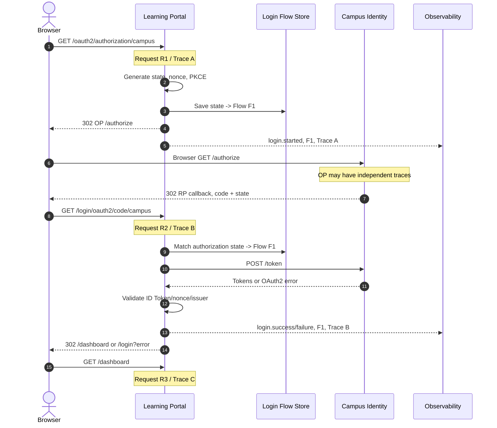

# 28.9. Correlation ID, request tracing và theo dõi qua redirect

## Mục tiêu bài học

Trong **Spring Security OAuth 2.0/OIDC Client**, một lượt đăng nhập thường vượt qua nhiều request, browser redirects, OpenID Provider (OP) và các lời gọi API phía server. Bài học này giúp bạn:

- Phân biệt **request ID**, **correlation ID**, **trace ID**, **span ID**, **login flow ID** với OAuth2 `state`, OIDC `nonce` và session ID.
- Hiểu vì sao **HTTP 302 qua browser không tự duy trì một distributed trace** và vì sao callback OIDC thường có trace ID mới.
- Thiết kế cách theo dõi toàn bộ Authorization Code Flow mà không lộ `authorization_code`, `state`, `nonce`, PKCE `code_verifier`, token hoặc cookie.
- Dùng **server-side flow correlation record**, gắn đúng một OAuth2 authorization transaction và có TTL/cleanup.
- Hiểu các điểm ghi sự kiện tại authorization request, callback, Token Endpoint, ID Token validation, UserInfo, persistence và API downstream.
- Áp dụng **Micrometer Observation/Tracing**, OpenTelemetry/W3C Trace Context, structured logs và MDC trong Spring Boot Servlet.
- Dùng **WebFilter** và Reactor Context đúng cách trên Spring WebFlux/Reactive.
- Phân biệt tracing HTTP back-channel với browser navigation tới OP; biết giới hạn những dữ liệu RP có thể quan sát từ OP bên thứ ba.
- Xác định nguyên nhân `invalid_state`, `invalid_grant`, sai issuer, mất session, redirect loop, refresh failure và HTTP 401/403 ở Resource Server.
- Thiết kế metrics, trace sampling, retention, privacy và bộ kiểm thử tích hợp theo đúng trust boundary.

---

## 1. Một lần đăng nhập có thể tạo nhiều HTTP requests

Giả sử **Learning Portal** là ứng dụng Spring Boot dùng Campus Identity cho OIDC Login.

Một lần đăng nhập:

```text
Browser:
  1. GET /oauth2/authorization/campus

Learning Portal:
  2. Tạo OAuth2AuthorizationRequest, state/nonce/PKCE
  3. Lưu authorization request
  4. Trả 302 Location: https://idp.example.org/authorize?...

Browser/OP:
  5. Điều hướng tới OP
  6. User xác thực, có thể thực hiện MFA/consent
  7. OP trả 302 về callback của Learning Portal

Browser:
  8. GET /login/oauth2/code/campus?code=...&state=...

Learning Portal:
  9. Xác minh authorization transaction/state
 10. POST /token (back-channel)
 11. Xác minh ID Token, nonce, issuer, audience
 12. Có thể gọi UserInfo Endpoint
 13. Lưu Authentication, session, authorized client
 14. Trả 302 về /dashboard

Browser:
 15. GET /dashboard
```

Một HTTP trace của bước 1 có thể kết thúc ngay lúc RP trả `302`. Bước 8 là **request mới** khi browser trở về từ OP. Bước 15 lại là request mới.

Nếu không có giải pháp correlation ở tầng nghiệp vụ, logs có thể chỉ cho bạn thấy:

```text
09:00:00  GET /oauth2/authorization/campus -> 302
09:00:08  GET /login/oauth2/code/campus -> 302 /login?error
09:00:08  OAuth2AuthenticationException: invalid_grant
```

Những dòng đó không nhất thiết đủ để biết callback thuộc authorization attempt nào, registration nào đã được chọn, token request đi tới đâu, hoặc một user đang mở bao nhiêu tab.

> **Tư duy đúng:** Distributed tracing theo dõi **operations và HTTP context propagation**; login flow correlation theo dõi **một hành trình đăng nhập**. Hành trình có thể chứa nhiều traces khác nhau.

## 2. Các định danh thường gặp

| Định danh | Phạm vi | Mục đích | Có nên log nguyên văn? |
| --- | --- | --- | --- |
| **Request ID** | Một inbound HTTP request | Tìm logs của request đó | Có, khi được tạo/validate tại trust boundary |
| **Trace ID** | Một distributed trace | Ghép các spans trong trace | Có, theo observability policy |
| **Span ID** | Một operation/span | Nhận diện công đoạn cụ thể | Có, theo observability policy |
| **Correlation ID** | Một workflow do hệ thống định nghĩa | Nối các sự kiện nghiệp vụ | Có, nếu là mã nonsecret, không chứa PII |
| **Login flow ID** | Một OIDC authorization attempt | Nối initiation với callback | Có, nếu là random nonsecret ID |
| **OAuth2 `state`** | Authorization transaction | CSRF/response binding | **Không** |
| **OIDC `nonce`** | OIDC authentication request | Ràng buộc ID Token với request | **Không** |
| **PKCE `code_verifier`** | Authorization Code exchange | Chứng minh client giữ PKCE verifier | **Không** |
| **Authorization Code** | One-time grant | Đổi lấy token | **Không** |
| **Session ID/cookie** | Browser session | Tìm/xác thực session | **Không** |
| **ID Token/Access Token/Refresh Token** | Xác thực/ủy quyền | Security credentials | **Không** |

### 2.1. Request ID

Một request có thể được RP trả:

```http
HTTP/1.1 302 Found
X-Request-ID: 64cd45a3-a034-48b1-a8a5-e65ba0f8e194
Location: https://idp.example.org/authorize?...
```

Request ID thường **khác nhau** giữa initiation, callback và dashboard request. Nó hữu ích khi hỗ trợ người dùng báo lỗi trên một HTTP response cụ thể.

### 2.2. Trace ID và Span ID

Distributed trace có một trace ID và nhiều spans:

```text
Trace A: 11111111111111111111111111111111
  Span A1: GET /oauth2/authorization/campus
  Span A2: internal registration lookup
```

Sau browser redirect:

```text
Trace B: 22222222222222222222222222222222
  Span B1: GET /login/oauth2/code/campus
  Span B2: POST OP /token
  Span B3: GET OP /userinfo
  Span B4: save application user/session
```

Hai traces vẫn có thể thuộc **cùng một lần đăng nhập**.

### 2.3. Login flow ID

Ứng dụng tự tạo ID riêng, ví dụ:

```text
loginFlowId = 73421f3c-a3e1-43bd-a3a0-33f3924479b0
```

Nó không mang email, user ID, token hoặc session ID. RP lưu metadata:

```text
OAuth2 state (internal lookup key)
    -> loginFlowId
    -> registrationId
    -> startedAt
    -> initialTraceId (optional)
    -> requested AppTenant đã được backend kiểm tra (optional)
```

Chỉ đưa `loginFlowId` vào log. **Không biến `state` thành flow ID**.

## 3. Sơ đồ một hành trình OIDC có nhiều traces



Điểm quan trọng:

- **Trace A** và **Trace B** có thể khác nhau.
- HTTP Token Endpoint call **từ RP** có thể có client span thuộc Trace B nếu HTTP client được instrument.
- OP không phải component mà RP mặc nhiên có quyền xem toàn bộ logs/traces.
- F1 cho phép tìm các sự kiện initiation/callback theo một workflow.
- Một browser redirect không được coi là lời gọi nội bộ server-to-server.

## 4. Vì sao HTTP redirect không tự truyền trace context?

HTTP `302` chỉ cung cấp vị trí cho **browser** điều hướng:

```http
Location: https://idp.example.org/authorize?client_id=...&state=...
```

Browser sẽ tạo một HTTP request mới tới domain của OP. Không có bảo đảm browser tự sao chép các headers `traceparent`, `tracestate` hoặc `baggage` từ RP response sang OP request.

Các nguyên nhân:

- Browser navigation không phải HTTP client call của RP.
- OP có thể là hệ thống bên thứ ba, không instrument cùng SDK.
- Login/MFA/consent tạo thêm nhiều redirects, origins và tương tác người dùng.
- Browser extensions/cookie policies có thể thay đổi luồng.
- Flow có thể kéo dài nhiều phút hoặc user hủy giữa chừng.

**Không** đưa tracing headers vào query của OP để cố giữ trace:

```text
/authorize?...&traceparent=...&baggage=...
```

Dữ liệu có thể bị ghi lại bởi OP, proxy, browser history và analytics. Nó còn dễ bị caller giả mạo và không bảo đảm tracing backend nối các spans.

### 4.1. Chặng nào có thể có propagation thực?

Trong callback:

```text
Learning Portal (Trace B)
   -> POST Token Endpoint
   -> GET UserInfo
   -> POST internal user service
   -> database/cache
```

Nếu những clients được instrument, trace context có thể truyền qua **HTTP headers** theo W3C giữa các hệ thống hỗ trợ.

Không mặc định OP sẽ công bố traces nội bộ cho RP, ngay cả khi nhận được `traceparent`.

### 4.2. Span Links và correlation nghiệp vụ

OpenTelemetry hỗ trợ khái niệm **Span Links** để liên kết contexts không có quan hệ parent-child tuyến tính. Nếu có trusted initial span context, hệ thống có thể cân nhắc linking callback span với initiation.

Tuy nhiên, Spring Security OAuth2 Login **không mặc định** tạo link giữa hai request qua `state`. Một giải pháp đơn giản, bền vững thường là lưu flow ID và query structured logs theo F1.

### 4.3. Đừng tạo một span kéo dài toàn bộ thời gian user nhập MFA

Một login có thể bắt đầu 09:00 và callback 09:10. Giữ server-side span mở mười phút chỉ để chờ browser thường không phù hợp.

Nên:

```text
Trace A: initiation request, kết thúc nhanh
Flow F1: chờ callback trong TTL hữu hạn
Trace B: callback xử lý, kết thúc
```

Business duration `startedAt -> completedAt` có thể đo riêng, không đồng nghĩa server latency.

## 5. OAuth2 `state`, OIDC `nonce` và correlation ID

### 5.1. `state` có mục đích bảo mật

Spring Security sử dụng authorization request repository để lưu thông tin giao dịch:

```text
Authorization Request
    response_type=code
    client_id=...
    redirect_uri=...
    scope=openid profile
    state=<opaque-state>
    nonce=<opaque-nonce>
    PKCE challenge nếu áp dụng
```

OP trả `state` trong callback để RP đối chiếu **đúng request**.

Nếu dùng:

```java
String correlationId =
    request.getParameter("state");
```

rồi ghi vào logs, bạn đã lan truyền một giá trị ràng buộc giao dịch nhạy cảm tới hệ thống observability.

### 5.2. `nonce` không phải `state`

`nonce` gắn ID Token với OIDC authentication request; `state` gắn OAuth2 authorization response với authorization request. Chúng có vai trò khác nhau và đều không nên là logging identifiers.

### 5.3. PKCE verifier là credential

`code_verifier` được dùng lúc trao đổi authorization code tại Token Endpoint. Không log verifier hoặc token request body để debug `invalid_grant`.

### 5.4. Chỉ log nonsecret flow ID

Tạo:

```java
String loginFlowId =
    UUID.randomUUID().toString();
```

Sau đó lưu:

```text
state -> loginFlowId
```

**trong trusted server-side store**. Cặp mapping phải có TTL, được dọn sau callback và không được expose qua endpoint công khai.

### 5.5. Flow ID không được dùng để bỏ xác thực

Một browser biết F1 không có quyền:

- Hoàn tất OIDC Login.
- Đổi `registrationId` hoặc tenant.
- Đọc session/ID Token.
- Truy cập logs của người dùng khác.

Correlation metadata **không thay thế** xác minh `state`, `nonce`, issuer, audience, token signature hoặc tenant membership.

## 6. Thiết kế một LoginFlowMetadata record

Một kiểu Java minh họa:

```java
public record LoginFlowMetadata(
    String flowId,
    String registrationId,
    String appTenantId,
    String initialRequestId,
    String initialTraceId,
    Instant createdAt,
    Instant expiresAt
) {}
```

Trong đó:

- `flowId` là random ID của attempt.
- `registrationId` chọn từ `ClientRegistrationRepository` đáng tin.
- `appTenantId` là optional; chỉ dùng khi backend đã resolve tenant.
- `initialRequestId` và `initialTraceId` giúp tra chặng bắt đầu.
- `expiresAt` bảo đảm records không được giữ mãi.

Không có raw `state`, `code`, `nonce`, token hoặc thông tin cá nhân trong record dùng để log. Store có thể giữ `state` **làm khóa nội bộ** nhưng không xuất nó.

### 6.1. Interface cho store

```java
public interface LoginFlowStore {

    void put(String oauth2State, LoginFlowMetadata metadata);

    Optional<LoginFlowMetadata> get(String oauth2State);

    Optional<LoginFlowMetadata> consume(String oauth2State);
}
```

Cách triển khai phải bảo đảm:

- Key state đủ khó đoán, do Spring Security/OAuth2 authorization flow tạo.
- Store có TTL và access control.
- `consume` một lần hoặc có cơ chế chống replay.
- Không cho user thay flow metadata qua HTTP query/header.
- Không để một flow của user A gắn với callback user B.
- Shared session/transaction storage khi chạy nhiều instances.

### 6.2. Phân biệt hai tầng repository

`LoginFlowStore` ở trên **không thay thế** Spring Security `AuthorizationRequestRepository` dùng để kiểm tra `state`. Nó chỉ là **sidecar metadata** phục vụ quan sát.

Spring Security repository vẫn phải lưu đầy đủ authorization request và thực hiện state matching. Nếu authentication transaction không hợp lệ, correlation record không thể làm callback trở nên hợp lệ.

## 7. Gắn correlation tại Authorization Request Repository (Servlet)

Spring Security Servlet dùng:

```java
AuthorizationRequestRepository<OAuth2AuthorizationRequest>
```

Một implementation phổ biến:

```java
HttpSessionOAuth2AuthorizationRequestRepository
```

Các method chính:

```java
OAuth2AuthorizationRequest loadAuthorizationRequest(
    HttpServletRequest request
);

void saveAuthorizationRequest(
    OAuth2AuthorizationRequest authorizationRequest,
    HttpServletRequest request,
    HttpServletResponse response
);

OAuth2AuthorizationRequest removeAuthorizationRequest(
    HttpServletRequest request,
    HttpServletResponse response
);
```

Một custom wrapper có thể:

1. Delegate việc lưu/tra cứu/xóa authorization request cho repository Spring Security.
2. Lúc save, tạo flow ID rồi lưu state-to-flow mapping server-side.
3. Lúc remove thành công, đặt flow ID vào request attribute có kiểm soát.
4. Authentication success/failure handler đọc request attribute và ghi event outcome.
5. Dọn metadata theo transaction/TTL.

### 7.1. Pseudocode đặt đúng extension point

```java
@Override
public void saveAuthorizationRequest(
        OAuth2AuthorizationRequest authorizationRequest,
        HttpServletRequest request,
        HttpServletResponse response) {

    delegate.saveAuthorizationRequest(
        authorizationRequest, request, response
    );

    if (authorizationRequest != null) {
        String flowId = UUID.randomUUID().toString();

        LoginFlowMetadata metadata =
            createMetadata(flowId, authorizationRequest, request);

        flowStore.put(
            authorizationRequest.getState(),
            metadata
        );

        logSafeEvent("oauth2.login.started", metadata);
    }
}
```

`createMetadata` và `logSafeEvent` là functions do ứng dụng tự định nghĩa; không phải Spring Security APIs. Implementation thật cần quản lý lỗi store, tính nguyên tử tương đối với repository, nullable request và multi-tab support.

### 7.2. Callback phải dùng transaction đã khớp

Một hướng xử lý:

```java
@Override
public OAuth2AuthorizationRequest removeAuthorizationRequest(
        HttpServletRequest request,
        HttpServletResponse response) {

    OAuth2AuthorizationRequest matched =
        delegate.removeAuthorizationRequest(request, response);

    if (matched != null) {
        flowStore.consume(matched.getState())
            .ifPresent(meta ->
                request.setAttribute(
                    "loginFlowId", meta.flowId()
                )
            );
    }

    return matched;
}
```

Chỉ dùng matched authorization request từ delegate. Không tin `request.getParameter("state")` như một danh tính hoặc như proof membership.

Phần này mới đưa nonsecret `loginFlowId` sang request context của callback; **chưa nói Authentication thành công**. Chỉ ghi event success sau bước token validation và Authentication thực tế.

### 7.3. Cấu hình repository cho OAuth2 Login

```java
@Bean
SecurityFilterChain securityFilterChain(
        HttpSecurity http,
        AuthorizationRequestRepository<OAuth2AuthorizationRequest>
            correlatingRepository)
        throws Exception {

    http
        .authorizeHttpRequests(auth -> auth
            .requestMatchers("/", "/assets/**").permitAll()
            .anyRequest().authenticated()
        )
        .oauth2Login(oauth2 -> oauth2
            .authorizationEndpoint(endpoint -> endpoint
                .authorizationRequestRepository(
                    correlatingRepository
                )
            )
        );

    return http.build();
}
```

Đoạn config giả định bean repository custom đã tồn tại, imports được bổ sung, OAuth2 Client registration hợp lệ. Không dùng `correlatingRepository` chưa có implementation trong production.

### 7.4. Callback không có matched request

Ghi:

```text
event=oauth2.callback.rejected
reason=missing_or_mismatched_state
registrationId=campus
requestId=R2
traceId=T2
flowId=unknown
```

Không:

```text
state=<raw-input>
code=<authorization-code>
```

và không bỏ qua state validation để callback đi tiếp.

## 8. Multi-tab, session timeout và nhiều instances

### 8.1. Hai tab

```text
Tab A:
  state=SA
  flowId=FA

Tab B:
  state=SB
  flowId=FB
```

Store đúng:

```text
SA -> FA
SB -> FB
```

Không dùng:

```text
session.lastFlowId = FB
```

vì callback A đến sau sẽ bị gắn sai vào FB.

Một số authorization request repositories đơn giản có thể không hỗ trợ nhiều pending flows trong cùng browser session; khi cần multi-tab, phải chọn/triển khai repository theo từng state, đồng thời giữ đầy đủ CSRF/state checks.

### 8.2. Session timeout

User bắt đầu login, rồi để màn hình MFA quá lâu. Session chứa authorization request có thể hết hạn. Callback với `state` cũ **không** được tự chấp nhận nhờ correlation ID.

Log lỗi category `authorization_request_expired` hoặc `invalid_state` theo chính sách; flow ID có thể không còn do TTL.

### 8.3. Multi-instance deployment

```text
Browser initiation -> Pod A
Browser callback   -> Pod B
```

Nếu authorization request và flow mapping chỉ ở bộ nhớ Pod A, Pod B có thể không tìm thấy. Dùng shared session store/Spring Session hoặc distributed transaction store có TTL, access control và consistency phù hợp.

Không khắc phục bằng cách chấp nhận state bất kỳ khi store không tìm được.

### 8.4. Dọn flow

Các kết cục:

```text
SUCCESS
AUTHENTICATION_FAILURE
INVALID_CALLBACK
EXPIRED / ABANDONED
USER_CANCELLED (nếu biết chắc)
```

Khi không có callback, chỉ có thể khẳng định flow đã **hết TTL mà không hoàn tất tại RP**. Không suy ngay là lỗi OP.

## 9. Sự kiện quan sát nên có

| Event | Khi nào | Fields an toàn |
| --- | --- | --- |
| `oauth2.login.started` | Authorization request đã được tạo/lưu | flowId, registrationId, requestId |
| `oauth2.login.redirect_issued` | RP trả 302 sang OP | flowId, provider alias, status |
| `oauth2.callback.received` | RP nhận callback | requestId, traceId, registrationId |
| `oauth2.callback.state_invalid` | State thiếu/không khớp | requestId, error category |
| `oauth2.token_exchange.started` | RP gọi Token Endpoint | grantType, provider alias |
| `oauth2.token_exchange.failed` | OP trả OAuth2 error/timeout | errorCode, duration, status |
| `oidc.id_token.rejected` | Token validation fail | validation category |
| `oauth2.login.succeeded` | RP Authentication thành công | flowId, registrationId, duration |
| `oauth2.login.failed` | RP Authentication thất bại | flowId nếu có, error category |
| `oauth2.login.abandoned` | Flow TTL hết, không có callback | registrationId, elapsed bucket |
| `oauth2.authorized_client.refreshed` | Refresh token hoàn tất | registrationId, grantType |
| `oauth2.resource_call.failed` | Resource Server trả lỗi | service alias, HTTP status |
| `oauth2.logout.started` | RP xử lý logout | requestId, provider alias |
| `oidc.logout.redirect_issued` | RP redirect end-session endpoint | provider alias, không log Location |

### 9.1. HTTP 302 không đồng nghĩa login thành công

Callback có thể trả:

```http
302 Location: /login?error
```

Business outcome là **failure**, dù HTTP status là 302. Event `login.succeeded` chỉ được ghi sau authentication/token validation và application policy cần thiết thành công.

### 9.2. Tách login khỏi refresh

`OAuth2AuthorizedClientManager` có thể refresh Access Token nhiều giờ sau login. Refresh success/failure handler **khác** UI login success handler.

Không giữ login flow ID như một tracking ID gắn vào mọi refresh của user mãi mãi.

### 9.3. Callback có thể không vào Token Endpoint

Nếu state mismatch, Spring Security có thể từ chối trước khi gọi `/token`. Không tạo event `token_exchange.failed` khi Token Endpoint chưa được gọi.

## 10. Micrometer Observation và Tracing trên Spring Boot

Với Spring Boot hiện đại, **Micrometer Observation** và **Micrometer Tracing** là nền tảng thường dùng để tạo observations, spans và xuất trace qua OpenTelemetry bridge.

Ví dụ dependency trên Spring Boot 3.x:

```groovy
dependencies {
    implementation 'org.springframework.boot:spring-boot-starter-actuator'
    implementation 'io.micrometer:micrometer-tracing-bridge-otel'
    runtimeOnly 'io.opentelemetry:opentelemetry-exporter-otlp'
}
```

Phiên bản thư viện nên do Spring Boot BOM quản lý; với Spring Boot/Spring Security phiên bản khác cần đối chiếu starter và property names tương ứng.

### 10.1. Ví dụ cấu hình

```yaml
management:
  tracing:
    sampling:
      probability: 0.10
  otlp:
    tracing:
      endpoint: http://otel-collector:4318/v1/traces
```

Địa chỉ collector trong ví dụ là dịch vụ nội bộ đáng tin, không phải endpoint production mặc định.

### 10.2. Trace không phải audit

Sampling `0.10` có thể chỉ xuất 10% traces theo chính sách của SDK. Không để **security audit** quan trọng phụ thuộc vào việc trace của sự kiện có được sample không.

Một thiết kế hợp lý:

```text
Traces  -> latency/spans, sampling phù hợp
Logs    -> flow events, correlation metadata
Metrics -> aggregate outcomes/durations
Audit   -> security events quan trọng, retention riêng
```

### 10.3. Không chắc mọi Spring Security method đều có span riêng

HTTP server instrumentation có thể tạo span inbound; nhưng không bảo đảm mặc định có spans riêng cho:

```text
ClientRegistration lookup
OIDC nonce validation
membership mapping
authorized client persistence
```

Khi cần, thêm **custom observations** ở code ứng dụng mà bạn sở hữu, không log raw tokens để bù thiếu spans.

## 11. W3C Trace Context và headers

Một trace context thường được truyền qua:

```http
traceparent: 00-aaaaaaaaaaaaaaaaaaaaaaaaaaaaaaaa-bbbbbbbbbbbbbbbb-01
tracestate: vendor=value
```

Và nếu ứng dụng dùng baggage:

```http
baggage: service-zone=internal
```

### 11.1. W3C headers dùng cho điều gì?

Một service gọi service khác có thể inject context trong outbound HTTP headers. Downstream instrumented service dùng context ấy để nối spans theo tracing policy.

### 11.2. Baggage dễ làm lộ dữ liệu

Không đưa vào baggage:

```text
email
sub
tenant secret
session ID
state
nonce
code
Access Token
Refresh Token
```

Baggage có thể truyền sang hệ thống khác nếu propagation được bật. Chỉ dùng keys được allowlist và giới hạn kích thước.

### 11.3. `traceparent` không xác thực caller

Một internet client có thể tự gửi tracing headers. Không dùng trace ID làm bằng chứng đăng nhập, tenant membership hoặc quyền API. Tại trust boundary có thể sanitize/ignore inbound trace context theo chính sách.

## 12. Servlet: request ID bằng OncePerRequestFilter

Một request ID độc lập giúp tìm một HTTP request ngay cả khi tracing chưa được cấu hình.

```java
@Component
public class RequestIdFilter extends OncePerRequestFilter {

    private static final String HEADER = "X-Request-ID";

    @Override
    protected void doFilterInternal(
            HttpServletRequest request,
            HttpServletResponse response,
            FilterChain filterChain)
            throws ServletException, IOException {

        String id = UUID.randomUUID().toString();

        request.setAttribute("requestId", id);
        response.setHeader(HEADER, id);

        try (MDC.MDCCloseable ignored =
                MDC.putCloseable("requestId", id)) {

            filterChain.doFilter(request, response);
        }
    }
}
```

Imports chính:

```java
import jakarta.servlet.FilterChain;
import jakarta.servlet.ServletException;
import jakarta.servlet.http.HttpServletRequest;
import jakarta.servlet.http.HttpServletResponse;
import org.slf4j.MDC;
import org.springframework.stereotype.Component;
import org.springframework.web.filter.OncePerRequestFilter;

import java.io.IOException;
import java.util.UUID;
```

### 12.1. Vì sao tự tạo ID thay vì tin header Internet?

Nếu nhận:

```http
X-Request-ID: attacker-controlled
```

rồi đưa vào log không kiểm tra, caller có thể gây log injection, spoofing hoặc cardinality abuse. Filter ví dụ **luôn sinh UUID mới**.

Nếu gateway có trusted request ID, cần xác định trust boundary, kiểm tra format/độ dài và tránh chấp nhận arbitrary headers do client công khai gửi.

### 12.2. Filter order

Muốn ghi request ID cho cả lỗi được Spring Security phát ra, filter cần chạy ở thứ tự phù hợp trước security processing. Khi dùng `FilterRegistrationBean` hoặc thêm filter trong `HttpSecurity`, tránh đăng ký một filter hai lần và tạo hai IDs.

### 12.3. Async Servlet và MDC

MDC là thread-local context. Nếu request chuyển sang executor/async dispatch, custom request ID có thể không tự đi theo thread mới. Dùng context propagation/instrumented executors và kiểm thử thực tế, không giả định `@Async` luôn giữ MDC.

### 12.4. Request ID không phải secret

Có thể trả một random request ID trong `X-Request-ID` để hỗ trợ, nhưng không tạo endpoint cho người dùng nhập request ID rồi truy cập logs/traces của bất kỳ ai.

## 13. Gắn trace ID trong log bằng Micrometer Tracer

Một component:

```java
@Component
class CurrentTraceInfo {

    private final Tracer tracer;

    CurrentTraceInfo(Tracer tracer) {
        this.tracer = tracer;
    }

    String traceIdOrNull() {
        Span span = tracer.currentSpan();
        return span == null
            ? null
            : span.context().traceId();
    }
}
```

Imports:

```java
import io.micrometer.tracing.Tracer;
import io.micrometer.tracing.Span;
import org.springframework.stereotype.Component;
```

Có thể ghi initial trace ID vào `LoginFlowMetadata` khi bắt đầu authorization, sau đó ở callback ghi trace ID mới.

### 13.1. Trace ID không phù hợp làm login flow ID

Không dùng:

```java
String loginFlowId = traceIdOrNull();
```

vì trace có thể không tồn tại, bị sampling, hoặc bao gồm nhiều operations. Login flow ID nên sinh độc lập và giữ trong flow store.

### 13.2. Ví dụ logging pattern

Với logging framework hỗ trợ MDC:

```yaml
logging:
  pattern:
    correlation: "[%X{traceId:-},%X{spanId:-}] "
```

Tùy Spring Boot/logback version mà correlation pattern và tự động tracing MDC có cách cấu hình khác. Khi thêm `requestId`, kiểm tra format logs thực tế, đặc biệt trên async/background threads.

### 13.3. Một event với nhiều IDs là bình thường

Bắt đầu:

```text
flowId=F1 requestId=R1 traceId=TA spanId=SA
```

Callback:

```text
flowId=F1 requestId=R2 traceId=TB spanId=SB
```

R1 và R2 khác, TA và TB có thể khác; chỉ F1 ổn định cho **một authorization attempt**.

## 14. Custom Observation cho bước nghiệp vụ

Ví dụ muốn đo latency của account lookup sau OIDC Login:

```java
@Service
class AccountLookupObservation {

    private final ObservationRegistry registry;

    AccountLookupObservation(ObservationRegistry registry) {
        this.registry = registry;
    }

    void observeLookup(
            String registrationId,
            Runnable lookupOperation) {

        Observation.createNotStarted(
                "oidc.account.lookup",
                registry
            )
            .lowCardinalityKeyValue(
                "registration.id", registrationId
            )
            .observe(lookupOperation);
    }
}
```

Imports:

```java
import io.micrometer.observation.Observation;
import io.micrometer.observation.ObservationRegistry;
```

### 14.1. Tags nào có cardinality thấp?

```text
registrationId = campus
outcome = success/failure
grantType = authorization_code
errorCategory = issuer_mismatch
targetService = course-api
```

Không dùng:

```text
flowId
requestId
traceId
email
subject
sessionId
authorizationCode
```

làm metric labels.

### 14.2. Không thay success handler mặc định chỉ để log

Spring Security Login và Authorized Client Manager có success/failure handlers để quản lý redirect, session và token persistence. Nếu custom handler chỉ ghi Observation rồi bỏ hành vi mặc định, bạn có thể làm hỏng security flow.

Hãy compose/delegate đúng extension point và đảm bảo event `login.succeeded` được ghi sau khi authentication thành công thực sự.

## 15. WebFlux: WebFilter và Reactor Context

Trong Spring WebFlux, không nên chỉ dùng ThreadLocal/MDC như Servlet đồng bộ.

Ví dụ `WebFilter`:

```java
@Component
class ReactiveRequestIdFilter implements WebFilter {

    @Override
    public Mono<Void> filter(
            ServerWebExchange exchange,
            WebFilterChain chain) {

        String requestId = UUID.randomUUID().toString();

        exchange.getAttributes().put(
            "requestId", requestId
        );

        exchange.getResponse().getHeaders().set(
            "X-Request-ID", requestId
        );

        return chain.filter(exchange)
            .contextWrite(context ->
                context.put("requestId", requestId)
            );
    }
}
```

Imports:

```java
import org.springframework.stereotype.Component;
import org.springframework.web.server.ServerWebExchange;
import org.springframework.web.server.WebFilter;
import org.springframework.web.server.WebFilterChain;
import reactor.core.publisher.Mono;
import java.util.UUID;
```

### 15.1. Đọc Reactor Context

```java
Mono<String> currentRequestId() {
    return Mono.deferContextual(context ->
        Mono.just(
            context.getOrDefault(
                "requestId", "unknown"
            )
        )
    );
}
```

Code này dùng Reactor Context của **request hiện tại**, không tồn tại tự động sau browser redirect sang OP rồi callback về.

### 15.2. MDC không tự đi qua mọi thread hop

Reactor `publishOn`, `flatMap`, scheduler và custom subscriptions có thể đổi thread. Cần Micrometer/Reactor context propagation đúng cấu hình, hoặc dùng `ServerWebExchange`/Reactor Context rõ ràng.

Không gọi `.block()` trong event loop chỉ để lấy trace ID. Không tự `.subscribe()` để chạy logging/persistence tách khỏi lifecycle mà framework đang quản lý.

### 15.3. Reactive authorization request repository

Spring Security WebFlux có:

```java
ServerAuthorizationRequestRepository<OAuth2AuthorizationRequest>
```

với một implementation như:

```java
WebSessionOAuth2ServerAuthorizationRequestRepository
```

Khi mở rộng để lưu flow ID, dùng state-indexed server-side mapping và reactive lifecycle phù hợp. Không copy `HttpSession`/Servlet filters vào `SecurityWebFilterChain`.

## 16. Các lớp instrumentation cần phân biệt

| Lớp | Spring Servlet | Spring WebFlux |
| --- | --- | --- |
| HTTP inbound | Servlet filters/observations | WebFilter/server observations |
| Security context | `SecurityContextHolder` theo flow Servlet | `ReactiveSecurityContextHolder` |
| Authorization request | `AuthorizationRequestRepository` | `ServerAuthorizationRequestRepository` |
| Session | `HttpSession`/Spring Session | `WebSession`/Reactive Spring Session |
| Request-local metadata | Request attributes/MDC | Exchange attributes/Reactor Context |
| HTTP outbound | Instrumented RestClient/WebClient/RestTemplate tùy version | Instrumented WebClient |
| Trace API | Micrometer Tracer | Micrometer Tracer + Reactor propagation |
| Flow correlation | Shared state-to-flow store | Shared reactive state-to-flow store |

Đừng sử dụng một `static String currentFlowId` để liên kết requests, vì nhiều users/requests có thể chạy đồng thời.

## 17. Token Endpoint tracing trong callback

Trong callback, Spring Security OAuth2 Client gọi Token Endpoint qua **back-channel**.

Ví dụ request ý nghĩa:

```http
POST /oauth2/token HTTP/1.1
Host: idp.example.org
Content-Type: application/x-www-form-urlencoded

grant_type=authorization_code&
code=<one-time-authorization-code>&
redirect_uri=...&
code_verifier=<pkce-verifier>
```

**Không bật HTTP body logging** của Token Endpoint trong production.

### 17.1. Các metadata an toàn hơn

```text
operation=oauth2.token.exchange
grantType=authorization_code
registrationId=campus
providerAlias=campus-op
httpMethod=POST
httpStatus=400
oauthErrorCode=invalid_grant
durationMs=...
```

Không ghi Client Secret, client assertion, code hoặc verifier.

### 17.2. Token client nào thực sự được instrument?

Tự tạo một `RestClient` có observation configuration trong ứng dụng **không tự chứng minh** Spring Security token client đang dùng instance đó.

Cần đối chiếu configuration của `OAuth2AccessTokenResponseClient`, HTTP client stack và tracing instrumentation trên Spring Security version đang dùng. Test tích hợp phải xác minh các client spans thực tế.

### 17.3. Error description có thể không an toàn để log

`OAuth2Error` có `errorCode`, `description`, `uri`. Provider-specific description có thể chứa request details hoặc dữ liệu không chuẩn. Ưu tiên **sanitized error category/code**, không dump raw exception body.

## 18. UserInfo, ID Token validation và downstream spans

Sau Token Endpoint:

```text
ID Token JWS verification
issuer/audience/expiry/nonce checks
optional UserInfo fetch
application user lookup
tenant membership
authorized client save
session persistence
```

Không phải mọi bước tự có span riêng. Thêm observations có giá trị ở những operations quan trọng do ứng dụng sở hữu.

### 18.1. Không ghi UserInfo body

UserInfo có thể chứa email, tên, profile, địa chỉ hoặc PII khác. Tracing backend không phải nơi lưu raw profile response.

### 18.2. Không ghi ID Token claims chưa kiểm chứng

Trước khi token được validate, claims từ JWT chỉ là untrusted data. Không lấy email/sub/tenant từ raw decoded JWT rồi gán security audit identity.

### 18.3. Phân biệt validation failures

Một số categories:

```text
invalid_signature
issuer_mismatch
audience_mismatch
token_expired
nonce_mismatch
userinfo_sub_mismatch
unsupported_algorithm
```

Log category + registration/flow ID, không log raw ID Token.

## 19. W3C propagation và trust boundaries

Một downstream API có thể nhận:

```http
traceparent: 00-aaaaaaaaaaaaaaaaaaaaaaaaaaaaaaaa-bbbbbbbbbbbbbbbb-01
```

Điều này giúp trace HTTP client ở RP với server span ở API nếu cả hai instrumented.

Nhưng:

- `traceparent` không phải proof of authentication.
- `tracestate`/`baggage` không được dùng làm tenant authorization.
- Không gửi PII hoặc credential qua baggage.
- Không gửi tracing context sang domain bất kỳ từ user-controlled URL.
- Không tự lấy Trace ID làm khóa token store.

Nếu RP gọi OP bên ngoài, một số tracing headers có thể được gửi theo client instrumentation. OP có thể bỏ qua; RP vẫn chỉ thấy **HTTP client span của mình**.

## 20. Redaction: URLs, query, headers và response Location

Trong OIDC Login các URLs nhạy cảm gồm:

```text
/authorize?state=...&nonce=...&code_challenge=...
/login/oauth2/code/campus?code=...&state=...
/logout?id_token_hint=...&post_logout_redirect_uri=...
```

Nếu log full URLs hoặc `Location` headers, token/authorization metadata có thể đi vào log store.

### 20.1. Nên log route template

Tốt:

```text
http.route=/login/oauth2/code/{registrationId}
http.method=GET
http.status_code=302
```

Không tốt:

```text
url.full=https://portal.example.org/login/oauth2/code/campus?code=...&state=...
```

### 20.2. Scrub cả response headers

- Authorization redirect `Location` có thể chứa `state`, `nonce`.
- OIDC Logout redirect có thể chứa `id_token_hint`.
- Callback URL có `code` và `state`.
- Token Endpoint request có Authorization header/client credentials.

Chỉ ẩn `Authorization` header mà vẫn log full `Location` hoặc query là chưa đủ.

### 20.3. Các trường cần chặn

```text
Authorization
Cookie
Set-Cookie
access_token
refresh_token
id_token
id_token_hint
authorization_code / code
state
nonce
code_verifier
client_secret
client_assertion
```

Những chuỗi đó không nên là metric tags, trace attributes hoặc log fields.

### 20.4. Bảo vệ trace backend

Áp dụng TLS/mTLS khi phù hợp, least-privilege access, retention giới hạn và tách environments. Trace IDs là nonsecret nhưng đôi khi cho phép người có quyền hệ thống liên kết sự kiện của một user; không expose truy vấn traces công khai.

## 21. Phân biệt lỗi qua từng giai đoạn

| Giai đoạn | Triệu chứng | Điều cần xác định |
| --- | --- | --- |
| Authorization initiation | Không thấy 302 OP | Registration/redirect request creation/session save |
| Browser navigation | Có 302 nhưng không có callback | User cancel, OP/network, redirect URI/browser |
| Callback | `invalid_state` | Session cookie, repository, missing/mismatched state |
| Token exchange | `invalid_grant` | Code expired/reused, PKCE, redirect URI |
| Token exchange | `invalid_client` | Client credential/method, rotation, issuer |
| ID Token validation | Issuer mismatch | OP/client registration mapping |
| ID Token validation | Nonce mismatch | Auth transaction replay/mix-up |
| UserInfo | Timeout/claim error | UserInfo HTTP client/OP policy |
| Session persistence | Login thành công nhưng API 401 | Session cookie/store/filter chain |
| Authorized-client persistence | Refresh lại dùng token cũ | Success handler/store issue |
| Resource Server | 401 `invalid_token` | Wrong aud/iss, expiry, revoked token |
| Resource Server | 403 `insufficient_scope` | Scope hoặc business authorization |
| Logout | RP 302 OP | OP logout chưa chắc đã thành công |

### 21.1. `invalid_state`

Có thể do:

- Authorization request không được lưu.
- Session/WebSession timeout khi user chờ MFA.
- Browser không gửi đúng cookie sau cross-site redirect.
- SameSite/Secure/path/domain sai.
- Callback sang instance khác không có shared store.
- Hai tab ghi đè pending authorization request.
- Callback bị thay đổi hoặc có tấn công.

Không tắt state verification để "sửa" lỗi.

### 21.2. `invalid_grant`

Ở Authorization Code Flow: code hết hạn/reused, PKCE verifier sai, redirect URI mismatch, grant bị OP từ chối. Ở Refresh Token Grant: refresh token expired/revoked/rotated.

Log `grantType` để phân biệt:

```text
grantType=authorization_code
errorCode=invalid_grant
```

khác:

```text
grantType=refresh_token
errorCode=invalid_grant
```

Không log raw code/refresh token.

### 21.3. OP outage

Nếu RP đã trả redirect nhưng browser không tới OP, RP có thể chỉ thấy flow không có callback. Nếu callback đã tới và Token Endpoint HTTP 503, RP có thể có span/error trực tiếp.

Đây là hai failure modes khác nhau.

## 22. Theo dõi redirect loop

Một loop có thể là:

```text
GET /dashboard
  -> 302 /oauth2/authorization/campus
    -> OP SSO auto-login
      -> callback
        -> 302 /dashboard
          -> RP không nhận session cookie
            -> 302 /oauth2/authorization/campus
```

Dấu hiệu:

- Nhiều `login.started` trong thời gian ngắn.
- Mỗi flow có ID mới.
- Callback có thể thành công nhưng request sau mất Authentication.
- Các request IDs/traces thay đổi liên tục.

Không cố kết nối loop bằng cùng một `state`; state phải được tạo mới cho mỗi authorization transaction.

### 22.1. Nguyên nhân

Kiểm tra:

```text
Session cookie path/domain/SameSite/Secure
Proxy/public base URL
Session storage giữa instances
SessionAuthenticationStrategy/SecurityContext persistence
Application authorization policy sau login
Frontend retry/redirect logic
```

### 22.2. Bảo vệ UX

Không tự retry redirect đến OP vô hạn; dừng tại trang lỗi có support reference/request ID và hành động rõ ràng.

## 23. Request tracing khi dùng Resource Server API

Một request sau login:

```text
Browser -> Learning Portal -> Course API
```

thường có trace theo request hiện tại. Nếu Access Token hết hạn, authorized client manager có thể gọi Token Endpoint refresh trước khi gửi Course API request.

Trace:

```text
GET /api/my-courses
  -> OAuth2AuthorizedClientManager.authorize
      -> refresh_token grant (nếu cần)
      -> save updated authorized client
  -> Course API GET /courses
```

Không cần kéo login flow span từ nhiều giờ trước tới request này.

### 23.1. `401` từ API không phải `invalid_state`

Một `401 invalid_token` của Course API có thể do Access Token sai audience/hết hạn/revoked, không chứng minh OIDC Login callback thất bại.

### 23.2. `403` không nhất thiết là lỗi token

Có thể do thiếu scope hoặc user không có quyền xem khóa học thuộc tenant đó. Không tự cấp quyền admin hoặc tắt audience validation để giải quyết.

### 23.3. Refresh token rotation

Hai requests có thể refresh đồng thời:

```text
A refresh RT1 -> AT2, RT2
B refresh RT1 -> invalid_grant
```

Nếu B xóa authorized client mới của A do race, logs có thể trông giống token bị revoke. Cần versioned persistence/single-flight/locking theo kiến trúc, và telemetry cho concurrent refresh.

## 24. Structured logging schema

Một login initiation event JSON:

```json
{
  "timestamp": "2026-11-16T03:05:00Z",
  "service": "learning-portal",
  "environment": "production",
  "event": "oauth2.login.started",
  "registrationId": "campus",
  "loginFlowId": "73421f3c-a3e1-43bd-a3a0-33f3924479b0",
  "requestId": "64cd45a3-a034-48b1-a8a5-e65ba0f8e194",
  "traceId": "aaaaaaaaaaaaaaaaaaaaaaaaaaaaaaaa",
  "spanId": "1111111111111111",
  "outcome": "started"
}
```

Callback event:

```json
{
  "timestamp": "2026-11-16T03:05:12Z",
  "service": "learning-portal",
  "environment": "production",
  "event": "oauth2.login.succeeded",
  "registrationId": "campus",
  "loginFlowId": "73421f3c-a3e1-43bd-a3a0-33f3924479b0",
  "requestId": "3bd4e26c-03bc-4a07-aec0-5cbf7db24a5e",
  "traceId": "bbbbbbbbbbbbbbbbbbbbbbbbbbbbbbbb",
  "spanId": "2222222222222222",
  "durationMs": 12000,
  "outcome": "success"
}
```

Hai `traceId` khác nhau không làm mất khả năng liên kết khi tra `loginFlowId`.

### 24.1. Event naming conventions

Nên nhất quán:

```text
oauth2.login.started
oauth2.login.redirect_issued
oauth2.callback.received
oauth2.login.succeeded
oauth2.login.failed
oauth2.login.abandoned
oauth2.token_exchange.failed
oauth2.authorized_client.refreshed
oauth2.resource_call.failed
```

### 24.2. Không ghi PII nếu không cần

Email, `sub`, tenant/client ID và IP đầy đủ có thể nhạy cảm. Chỉ thu thập metadata được chứng minh cần thiết, có retention/access controls. `registrationId` hoặc provider alias thường đủ để phân loại OAuth2 configuration issues.

## 25. Metrics cho OIDC Login và OAuth2 Client

Ví dụ:

```text
oauth2_login_started_total{registrationId}
oauth2_login_completed_total{registrationId,outcome,errorCategory}
oauth2_token_exchange_duration_seconds{registrationId,outcome}
oidc_token_validation_failures_total{registrationId,category}
oauth2_callback_invalid_state_total{registrationId}
oauth2_login_flow_abandoned_total{registrationId}
oauth2_client_refresh_total{registrationId,outcome}
oauth2_resource_call_failures_total{targetService,status}
```

### 25.1. Không tạo high-cardinality tags

Không đặt:

```text
flowId
requestId
traceId
spanId
email
sub
state
nonce
```

vào labels của Prometheus counters/histograms.

### 25.2. Phân biệt server latency và user interaction

Một flow chờ người dùng nhập MFA trong hai phút, dù Token Endpoint xử lý trong 100 ms.

Cần phân biệt:

```text
login_flow_elapsed_time = startedAt -> completedAt
callback_processing_latency
token_endpoint_latency
userinfo_latency
```

Không đánh giá OP Token Endpoint chậm dựa trên tổng thời gian user nhập mật khẩu.

### 25.3. Abandoned flow không tự là OP failure

Người dùng có thể đóng tab hoặc đổi ý. Định nghĩa metric theo TTL và phân nhóm rõ, không biến tất cả flows không callback thành incident.

## 26. Sampling, audit và bảo mật observability

Một ứng dụng có thể sample 10% traces nhưng vẫn cần audit authentication events trọng yếu.

### 26.1. Trace sampling

```text
Trace A sampled = true
Trace B sampled = false
```

Tình huống này bình thường. Flow correlation events vẫn có thể giúp tra cứu kết quả dù thiếu một span.

### 26.2. Audit riêng

Những sự kiện như:

```text
authentication denied
account linking
role/tenant change
client registration change
suspicious login failure
```

có thể cần audit retention riêng theo chính sách. Không chỉ giữ chúng khi trace sampled.

### 26.3. Bảo vệ logs/traces

- TLS và access control tới collectors/backends.
- Redact tokens, headers, URLs và PII.
- Tách dev/staging/prod.
- Retention giới hạn.
- Audit truy cập hệ thống logs/traces khi nhạy cảm.
- Không đưa secrets vào baggage hoặc span tags.
- Không công khai truy vấn bằng flow ID nếu không xác thực.

## 27. Bộ kiểm thử correlation qua OIDC redirects

### 27.1. E2E login thành công

```text
Given:
  Browser bắt đầu OIDC Login với campus
  OP test phát code/ID Token hợp lệ
  RP tạo flow F1 gắn với state SA

When:
  GET /oauth2/authorization/campus
  Browser navigate OP
  Callback với code và SA

Then:
  login.started event có F1
  login.succeeded event có F1
  Request IDs đầu và callback khác nhau
  Trace IDs có thể khác nhau
  Không log raw SA, code, nonce, ID Token
```

### 27.2. Callback state không khớp

```text
Given:
  Pending authorization SA, flow F1

When:
  Callback chứa SB không khớp

Then:
  Authentication bị từ chối
  Không tự gán callback vào F1 nếu state invalid
  Không log raw SB
  Log sanitized failure category
```

### 27.3. Hai tabs

```text
Tab A: SA -> FA
Tab B: SB -> FB
Callback B đến trước A
```

Nếu app cần hỗ trợ nhiều pending requests, cả hai phải map đúng. Nếu repository không hỗ trợ multi-tab flows, cần xác định policy và test fail closed thay vì gán sai flow.

### 27.4. Session expired

```text
Flow FA bắt đầu
HTTP session hết hạn
Callback tới
```

Kỳ vọng: Không bypass state binding, không tạo Authentication từ callback không có authorization request, flow ID có thể unavailable, log request ID/error category an toàn.

### 27.5. OP unavailable

Cho fake OP trả 503 ở authorization endpoint hoặc browser network error sau 302. Có thể không có callback. RP ghi `login.started`, rồi abandoned khi TTL; không log token exchange error khi Token Endpoint chưa từng được gọi.

### 27.6. Token Endpoint timeout

OP cho callback hợp lệ, nhưng `/token` timeout. Log category `token_endpoint_timeout` kèm flow/request/trace IDs. Không log `code_verifier` hoặc secret.

### 27.7. Redirect loop

OP SSO auto-login, RP session cookie không được lưu. Test browser phát hiện nhiều flow IDs trong thời gian ngắn và kết thúc ở trang lỗi, không lặp mãi.

## 28. Unit test request ID filter

Ví dụ Mock Servlet:

```java
@Test
void requestIdAppearsInMdcAndResponse()
        throws Exception {

    RequestIdFilter filter = new RequestIdFilter();

    MockHttpServletRequest request =
        new MockHttpServletRequest("GET", "/health");

    MockHttpServletResponse response =
        new MockHttpServletResponse();

    AtomicReference<String> seen =
        new AtomicReference<>();

    filter.doFilter(
        request,
        response,
        (req, res) ->
            seen.set(MDC.get("requestId"))
    );

    assertThat(seen.get()).isNotBlank();

    assertThat(response.getHeader("X-Request-ID"))
        .isEqualTo(seen.get());

    assertThat(MDC.get("requestId")).isNull();
}
```

Test cũng nên gửi header `X-Request-ID` giả, dài hoặc chứa ký tự điều khiển và xác nhận filter không đưa raw value đó vào logs.

### 28.1. Kiểm thử MDC qua async

Nếu app chạy `@Async`, executor hoặc Servlet async dispatch, phải test propagation đúng stack. Test đồng bộ ở trên chưa chứng minh MDC tồn tại ở các worker threads.

### 28.2. MockMvc không tự chạy full OIDC Login

`oidcLogin()` trong Spring Security Test tạo OIDC Authentication giả để test authorization. Nó không tự chạy:

```text
Browser redirect
Token Endpoint
ID Token JWS verification
state/nonce matching
```

Muốn test flow correlation thật cần fake OP hoặc integration tests với authorization request/callback.

## 29. WebFlux tests

WebTestClient có thể kiểm tra:

| Tình huống | Kỳ vọng |
| --- | --- |
| Inbound request | Có random `X-Request-ID` |
| Request thứ hai | Request ID khác |
| Reactor `flatMap` | Request ID đi theo context |
| Callback OIDC | Flow ID lấy từ transaction store |
| Session mất | Không bypass state validation |
| Multi-tab | Flow không bị ghi đè sai |
| Multi-node | Shared state/flow store |
| OP timeout | Error category an toàn |
| Resource Server 401 | Không gộp thành login invalid_state |
| Refresh grant | Quan sát theo request mới |
| Raw OAuth2 callback URL | Query credentials bị scrub |
| `Mono` bị bỏ không subscribe | Test phát hiện persistence/telemetry chưa chạy |

### 29.1. Không dùng `.block()` trong event loop

Nếu cần ghi log sau một reactive persistence action, chain publisher đúng:

```java
return repository.save(data)
    .doOnSuccess(ignored ->
        log.info("safe_event=flow.saved")
    );
```

Không:

```java
repository.save(data);
return Mono.empty();
```

vì publisher lazy thường không được thực thi.

## 30. Khi OP thuộc hệ thống khác

RP không mặc nhiên có traces của Campus Identity. Một phương án thực tế khi cần hỗ trợ provider:

1. Tìm `loginFlowId` trong RP logs.
2. Xác định initiation/callback có xuất hiện không.
3. Nếu callback có, xem Token Endpoint span, HTTP status và sanitized error.
4. Nếu callback không có, xem E2E browser telemetry, DNS/TLS, OP uptime, redirect URI.
5. Nếu OP cung cấp request ID trong headers/back-channel errors, lưu **OP request ID** với format được validate/sanitize.
6. Khi mở ticket với provider, gửi thời gian UTC, provider alias, safe client registration ID, error category/status.
7. Không gửi authorization code, raw state, ID Token, Access Token, cookie hay client secret.

### 30.1. OP request ID khác RP request ID

Có thể có:

```text
rpRequestId = R2
opRequestId = OP-6472
traceId = TB
loginFlowId = F1
```

Không đặt tên tất cả thành `correlationId` rồi làm mất ý nghĩa.

### 30.2. Không truyền user PII qua support ticket

Nếu cần xác định tài khoản, sử dụng quy trình bảo mật được phê duyệt, không dán nguyên token hoặc email/profile claims vào ticket công khai.

## 31. Bảng lỗi thường gặp

| Sai lầm | Hậu quả | Cách đúng |
| --- | --- | --- |
| Log OAuth2 `state` như correlation ID | Lộ transaction key | Random flow ID + server mapping |
| Log raw callback URL | Lộ authorization code/state | Route template, scrub query |
| Log full logout `Location` | Có thể lộ `id_token_hint` | Redact response headers |
| Cho rằng 302 giữ trace | Browser request mới | Separate traces + flow correlation |
| Đưa `traceparent` vào OP query | Rò dữ liệu/không chuẩn propagation | Không làm vậy |
| Tin caller-provided trace ID để authorize | Trace context không xác thực | Security checks độc lập |
| Dùng session.lastFlowId | Multi-tab mismatch | State-keyed metadata |
| Lưu mapping trong pod memory | Callback sang pod khác fail | Shared store |
| Không TTL/cleanup | Rò metadata, memory growth | TTL/consume |
| Ghi toàn bộ Token Endpoint body | Lộ code/secret/refresh | Safe error metadata |
| Gắn flow ID vào metrics labels | High cardinality | Logs/traces, metrics aggregate |
| Coi callback HTTP 302 là login success | Có thể redirect tới error | Business outcome events |
| Mất trace ID thì dùng state làm trace ID | Sai bảo mật | Request/flow IDs độc lập |
| Dựa vào MDC ThreadLocal trong WebFlux | Mất context khi đổi thread | Reactor Context/instrumentation |
| Dùng login flow ID cho mọi refresh sau này | Tracking quá lâu | Request-specific trace |
| Coi không callback là OP down | User có thể bỏ dở | Abandoned/unknown |
| Tắt state validation | Login CSRF/mix-up | Fix session/request repo |
| Bỏ issuer check khi thấy lỗi | Token confusion | Fix registration/trust |
| Dùng một `X-Request-ID` tùy ý từ Internet | Log spoofing/injection | Generate/validate |
| Trace sampling làm mất audit | Thiếu security events | Audit pipeline riêng |

## 32. Checklist trước production

### 32.1. Correlation

- Mỗi request có request ID an toàn.
- Mỗi authorization attempt có random login flow ID.
- Mapping state-to-flow là server-side, state-indexed, có TTL.
- Multi-tab và multi-node có hành vi rõ ràng.
- Callback invalid state fail closed.
- Flow ID không chứa PII và không thay thế authentication.

### 32.2. Tracing

- Có Micrometer/OpenTelemetry instrumentation phù hợp version.
- Inbound HTTP spans và outbound HTTP client spans đã được kiểm tra thật.
- Không giả định browser redirect giữ trace.
- Async/Reactive context propagation được test.
- Nếu callback trace khác initiation trace, flow ID vẫn liên kết được.

### 32.3. Logs và privacy

- Log lifecycle events với schema thống nhất.
- Có error categories tách state, token, ID Token, session, API.
- Không log raw code, state, nonce, token, secret, cookie.
- Scrub query và `Location` response.
- Metrics labels có cardinality thấp.
- Trace backend được giới hạn quyền, retention và sampling rõ ràng.

### 32.4. Tests

- Full OIDC Authorization Code Flow với fake OP.
- Missing/invalid state; session expiration.
- OP unavailable, Token Endpoint lỗi.
- Multi-tab login, cluster callback.
- Redirect loop và callback không đến.
- Resource Server 401/403 sau login.
- Refresh Token Grant không dùng login flow ID cũ.
- Không có credentials trong logs/traces.
- Audit events không phụ thuộc trace sampling.

## 33. Bài tập thực hành

### Bài tập 1 — Hai trace IDs

**Câu hỏi:** Initiation có trace TA và callback có TB. Có phải lỗi không?

**Đáp án:** Không. Redirect tạo browser request mới. Dùng F1 (flow ID) để nối events.

### Bài tập 2 — Chọn flow ID

**Câu hỏi:** Dùng raw OAuth2 `state` làm `X-Correlation-ID` được không?

**Đáp án:** Không nên. Tạo random nonsecret ID, lưu state-to-flow mapping riêng ở server.

### Bài tập 3 — Hai tabs

**Bài toán:** SA/FA và SB/FB cùng tồn tại.

**Đáp án:** Gắn flow theo state riêng; không giữ một session.lastFlowId.

### Bài tập 4 — Callback không khớp state

**Đáp án:** Fail closed, không cấp session/authentication; log sanitized category, không log raw state.

### Bài tập 5 — Token Endpoint 503

**Đáp án:** Nếu callback đã được xử lý đến bước token exchange, log request/span đó với safe status/category. Không dump HTTP body.

### Bài tập 6 — OP không có callback

**Đáp án:** Log flow abandoned/unknown sau TTL. Không tự kết luận OP outage.

### Bài tập 7 — WebFlux MDC

**Đáp án:** Dùng Reactor Context/context propagation; MDC không tự đi theo mọi thread hop.

### Bài tập 8 — Metrics tag

**Đáp án:** Không dùng unique flow ID làm Prometheus label.

### Bài tập 9 — Logout Location

**Đáp án:** Scrub `id_token_hint` và các query nhạy cảm khỏi logs/traces.

### Bài tập 10 — UserInfo

**Đáp án:** Đo latency và status/error category, không log raw profile response.

### Bài tập 11 — ID Token issuer mismatch

**Đáp án:** Ghi validation category + registration/flow ID, không bỏ issuer validation.

### Bài tập 12 — Refresh hôm sau

**Đáp án:** Tạo request trace mới, không kéo dài login span hôm trước.

### Bài tập 13 — Fake request ID

**Đáp án:** Không tin header client không qua trust boundary; generate hoặc validate.

### Bài tập 14 — Spring Session cluster

**Đáp án:** Shared authorization request/flow store; kiểm thử callback giữa hai pods.

## 34. Câu hỏi ôn tập

**1. Request ID là gì?**

> Định danh một HTTP request cụ thể.

**2. Trace ID là gì?**

> Định danh distributed trace có nhiều spans.

**3. Span ID là gì?**

> Định danh một span/operation trong trace.

**4. Login flow ID dùng để làm gì?**

> Nối authorization initiation với callback qua nhiều requests/traces.

**5. OAuth2 `state` có nên là logging correlation ID?**

> Không; state là giá trị ràng buộc transaction nhạy cảm.

**6. OIDC `nonce` có thay `state` không?**

> Không, chúng bảo vệ các mục đích khác nhau.

**7. HTTP 302 qua browser có giữ trace context không?**

> Không có bảo đảm; browser tạo request mới, OP thuộc trust domain riêng.

**8. Token Endpoint call có thể thuộc callback trace không?**

> Có, nếu outbound HTTP client được instrument và context được giữ.

**9. Có nên đưa `traceparent` vào query OP không?**

> Không; không bảo đảm propagation và có thể rò metadata.

**10. Flow mapping nên nằm ở đâu?**

> Trusted state-bound server-side store có TTL và cleanup.

**11. Callback `state` không khớp cần làm gì?**

> Từ chối, không suy user/tenant từ input không tin cậy.

**12. Vì sao flow ID không thích hợp làm metric label?**

> Unique/high cardinality, gây tốn tài nguyên và tăng privacy risk.

**13. Mất MDC trong WebFlux do đâu?**

> Thread hops/async context, cần Reactor propagation phù hợp.

**14. `login.succeeded` nên ghi lúc nào?**

> Khi authentication và các bước bảo mật cần thiết thực sự thành công.

**15. Không có callback có chứng minh OP down không?**

> Không, user có thể bỏ dở hoặc browser/cookie/redirect gặp lỗi.

**16. Có nên ghi full `Location` header không?**

> Không, có thể chứa state hoặc `id_token_hint`.

**17. Resource Server 401 có giống invalid_state không?**

> Không; API token failure khác authorization callback state error.

**18. Refresh Token Grant hôm sau có cần flow ID của login hôm trước không?**

> Không. Dùng trace/request context hiện tại.

**19. Traces bị sample có thay được security audit không?**

> Không. Audit quan trọng cần retention/pipeline riêng.

**20. Log an toàn cho `invalid_grant` gồm gì?**

> Registration, grant type, error category, request/trace/flow ID nếu có; không log code/verifier/refresh token.

---

## Ghi nhớ

Trong **Spring Security OAuth 2.0/OIDC Client**, một Authorization Code Flow trải qua nhiều requests và trust boundaries. **Request ID** gắn với HTTP request, **trace/span IDs** gắn với distributed operations, còn **login flow ID** gắn với một lần đăng nhập. Do **HTTP 302 qua browser không bảo đảm tiếp tục W3C Trace Context**, callback có thể nằm trong trace khác request khởi đầu. Giải pháp an toàn là **tạo random nonsecret login flow ID, lưu server-side mapping ràng buộc OAuth2 `state` có TTL, và ghi structured lifecycle events** mà không xuất raw state, nonce, code, tokens, cookies hay secret.

Sử dụng **Micrometer Observation/Tracing, OpenTelemetry, Servlet MDC hoặc WebFlux Reactor Context** để quan sát inbound requests, Token Endpoint/UserInfo và downstream API. Tách **authentication result** khỏi HTTP 302, tách Token Endpoint errors khỏi Resource Server 401/403, chú ý session timeout/multi-tab/multi-node và bảo vệ tracing backend bằng redaction, low-cardinality metrics, sampling/retention và audit độc lập. Một hệ thống quan sát tốt **giúp truy lỗi mà không làm yếu các kiểm tra OAuth2/OIDC**.

## Tài liệu tham khảo

- [Spring Security — Servlet OAuth2 Login](https://docs.spring.io/spring-security/reference/servlet/oauth2/login/index.html): Authorization Code Flow và callback.
- [Spring Security — OAuth2 Login Advanced](https://docs.spring.io/spring-security/reference/servlet/oauth2/login/advanced.html): AuthorizationRequestRepository/Resolver và extension points.
- [Spring Security — Reactive OAuth2 Login](https://docs.spring.io/spring-security/reference/reactive/oauth2/login/index.html): OIDC Login trên WebFlux.
- [Spring Security — OAuth2 Client Core](https://docs.spring.io/spring-security/reference/servlet/oauth2/client/core.html): authorized client lifecycle và refresh.
- [Spring Boot — Observability](https://docs.spring.io/spring-boot/reference/actuator/observability.html): Micrometer Observation.
- [Spring Boot — Tracing](https://docs.spring.io/spring-boot/reference/actuator/tracing.html): Micrometer Tracing/OTLP.
- [Micrometer — Observation](https://docs.micrometer.io/micrometer/reference/observation.html): observations và cardinality.
- [Micrometer — Tracing](https://docs.micrometer.io/tracing/reference/): tracing abstraction.
- [OpenTelemetry — Context Propagation](https://opentelemetry.io/docs/concepts/context-propagation/): span context propagation.
- [W3C — Trace Context](https://www.w3.org/TR/trace-context/): traceparent và tracestate.
- [W3C — Baggage](https://www.w3.org/TR/baggage/): baggage và privacy.
- [RFC 6749 — OAuth 2.0](https://www.rfc-editor.org/rfc/rfc6749): authorization code và state.
- [RFC 7636 — PKCE](https://www.rfc-editor.org/rfc/rfc7636): code challenge/verifier.
- [RFC 9700 — OAuth 2.0 Security Best Current Practice](https://www.rfc-editor.org/rfc/rfc9700): OAuth2 security.
- [OpenID Connect Core 1.0](https://openid.net/specs/openid-connect-core-1_0.html): nonce, ID Token và token validation.
- [OWASP — Logging Cheat Sheet](https://cheatsheetseries.owasp.org/cheatsheets/Logging_Cheat_Sheet.html): log injection, secrets và dữ liệu nhạy cảm.
