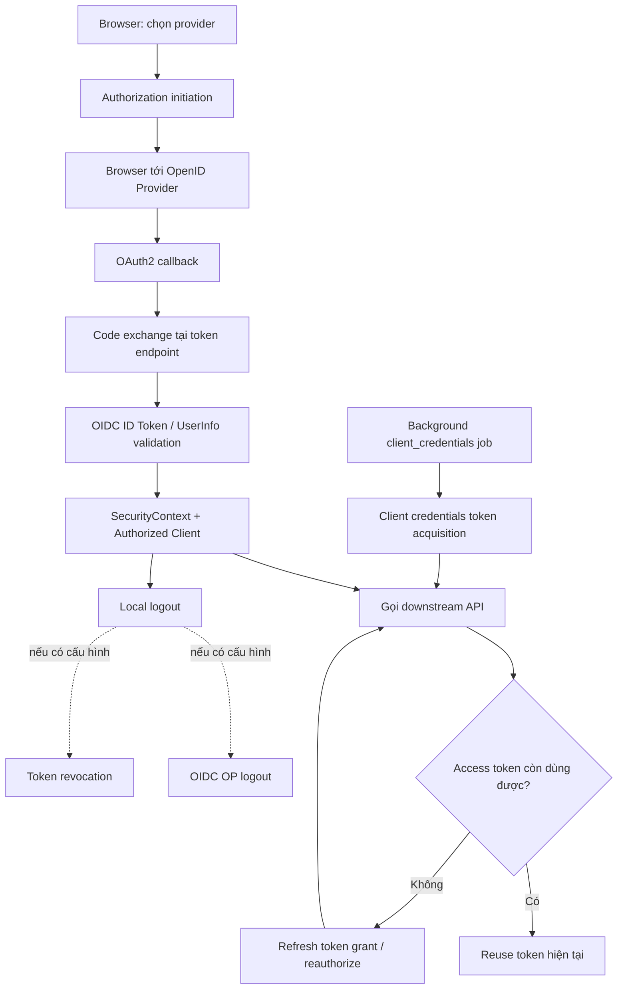
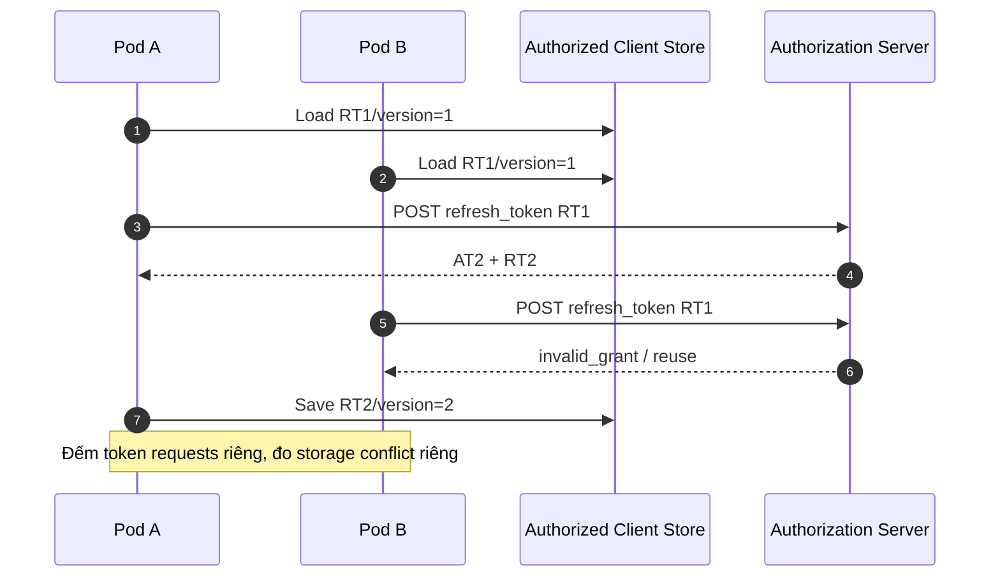

# 28.10. Metrics cho login, token acquisition, refresh và logout

Trong **Spring Security OAuth 2.0 / OpenID Connect (OIDC) Client**, người dùng có thể gặp những triệu chứng tưởng giống nhau nhưng thuộc các giai đoạn khác nhau: nút đăng nhập không chuyển hướng, callback trả lỗi `invalid_state`, trao đổi authorization code lấy token thất bại, ứng dụng đã đăng nhập nhưng gọi API trả 401, refresh token bị từ chối, hoặc logout tại ứng dụng thành công nhưng OpenID Provider vẫn còn phiên SSO.

Nếu chỉ thu thập HTTP 5xx của ứng dụng, đội vận hành rất khó trả lời: **bao nhiêu người bắt đầu đăng nhập, bao nhiêu callback thực sự thành công, token endpoint của provider nào đang chậm, refresh token có bị lỗi đồng loạt không, và logout đã kết thúc phiên ứng dụng hay mới chỉ gửi redirect?** Đây là lý do cần thiết kế metrics theo **các ranh giới nghiệp vụ và kỹ thuật thực sự** của OAuth2/OIDC Client.

Bài **“28.10. Metrics cho login, token acquisition, refresh và logout”** thuộc chương **28. Lỗi và quan sát** hướng dẫn cách xây dựng mô hình đo lường với **Micrometer, Spring Boot Actuator, Prometheus/Grafana và OpenTelemetry/Observation**; nêu các điểm gắn instrumentation trong **Servlet** và **WebFlux Reactive**; phân biệt counters, timers, gauges, distributions, traces, logs; đưa ra PromQL và tiêu chí cảnh báo; đồng thời bảo vệ dữ liệu nhạy cảm như authorization code, access token, refresh token, ID Token, session ID và danh tính người dùng.

> **Nguyên tắc quan trọng:** Metric phải có **ngữ nghĩa rõ ràng**. Một request `GET /oauth2/authorization/{registrationId}` được nhận không đồng nghĩa người dùng đã hoàn tất đăng nhập. Một lần `OAuth2AuthorizedClientManager.authorize(...)` trả về client không đồng nghĩa vừa gọi token endpoint. Một HTTP 302 sau logout không chứng minh refresh token đã bị thu hồi hoặc OP đã kết thúc SSO session.

## 1. Mục tiêu học tập

Sau bài này, bạn có thể:

1. Vẽ luồng OIDC Login từ authorization initiation đến callback, token exchange, ID Token validation và tạo `SecurityContext`.
2. Định nghĩa metrics có ý nghĩa cho **login started, login completed/failed, token acquisition, refresh và local/remote logout**.
3. Chọn đúng **Counter, Timer, Gauge, LongTaskTimer** hoặc histogram tùy tín hiệu.
4. Phân biệt latency ở browser/OP với latency xử lý trong JVM và latency token endpoint.
5. Dùng `MeterRegistry`/`Timer`/`Counter`/`ObservationRegistry` mà không làm thay đổi logic xác thực.
6. Gắn instrumentation vào success/failure handlers, `OAuth2AccessTokenResponseClient`, HTTP transport và Reactive `Mono`.
7. Phân loại nguyên nhân thất bại thành **tập nhãn hữu hạn** thay vì đưa raw exception, email, user ID hoặc URL vào metrics.
8. Triển khai Actuator Prometheus endpoint an toàn và xây dashboard, SLI/SLO/alert cơ bản.
9. Xử lý đúng dữ liệu khó đo như người dùng đóng browser, đăng nhập bị hủy ở OP hoặc timeout không có callback.
10. Kiểm thử metrics đúng semantics, không đếm trùng và không làm lộ bí mật qua metrics/tracing/logging.

## 2. Quan sát toàn cảnh OAuth2/OIDC Client

Một ứng dụng vừa đăng nhập người dùng, vừa gọi API thay họ, vừa chạy background jobs dùng `client_credentials`. Mỗi hành động có metrics khác nhau:



### 2.1. Những gì backend có thể thấy

| Giai đoạn | Backend có quan sát trực tiếp không? | Tín hiệu đáng tin |
|---|---|---|
| Trang chọn provider được render | Có | HTTP request/view metric |
| Authorization request bắt đầu | Có | Resolver/filter tạo hoặc chuyển hướng request |
| Browser đang nhập mật khẩu ở OP | **Không trực tiếp** | Chỉ thấy redirect đi, chưa có callback |
| User đóng tab giữa chừng | **Không trực tiếp** | Có thể suy luận phiên login intent đã hết TTL |
| Callback đến Portal | Có | Spring Security OAuth2 callback processing |
| Đổi code lấy token | Có | OAuth2 token response client + HTTP client |
| Verify ID Token/UserInfo | Có | Authentication success/failure + JWK/HTTP calls |
| Tái sử dụng access token còn hạn | Có nếu instrument đúng manager/cache path | Không phát sinh POST token endpoint |
| Refresh token tại token endpoint | Có | Grant `refresh_token` ở token response client |
| User nhấn logout | Có nếu request đến đúng chain | Logout request/handler/success |
| OP thực sự kết thúc SSO session | **Không tự biết** chỉ qua 302 redirect | Cần protocol/callback/ack phù hợp; đôi khi không có confirmation |
| AS đã revoke token | Có thể thấy response của revocation call | Không đồng nghĩa mọi API sẽ từ chối token ngay |

### 2.2. Phân biệt sự kiện, kết quả và thời lượng

Ví dụ với một đăng nhập:

```text
T0: user GET /oauth2/authorization/company-login
    -> login.started +1
T1: browser redirect tới OP
T2: browser callback /login/oauth2/code/company-login
    -> login.callback.received +1
T3: Portal POST /token (authorization_code)
    -> token.request.duration ghi 1 quan sát
T4: Portal xác minh ID Token, lưu SecurityContext
    -> login.completed{outcome="success"} +1
T5: request sau gọi API bằng access token cũ
    -> token.request không tăng
T6: sau đó refresh token
    -> token.request.duration{grant="refresh_token"} ghi 1 quan sát
T7: user POST /logout
    -> logout.local.completed +1 sau khi local logout thành công
```

Một login thành công có thể kéo theo một token request ban đầu, nhiều UserInfo/JWKS calls và nhiều refreshes sau đó. **Không cộng tất cả làm một chỉ số “số lần login”.**

## 3. Thiết kế metric contract trước khi viết code

Tên metrics có thể được đặt theo namespace ứng dụng. Ví dụ dưới đây là **metrics custom đề xuất**, **không khẳng định Spring Security tự phát chúng theo mặc định**.

| Tên Micrometer | Loại | Ý nghĩa chuẩn |
|---|---|---|
| `app.oauth2.login.started` | Counter | Authorization request khởi tạo thành công ở Portal |
| `app.oauth2.login.callback.received` | Counter | Portal nhận callback có liên quan tới OAuth2 login |
| `app.oauth2.login.completed` | Counter | Callback xử lý tới kết quả success/failure trong ứng dụng |
| `app.oauth2.login.callback.duration` | Timer | Thời gian backend xử lý callback; không gồm thời gian user ở OP |
| `app.oauth2.login.journey.duration` | Timer | Thời gian từ login start đến callback completion **nếu có correlation hợp lệ** |
| `app.oauth2.login.intent.expired` | Counter | Pending login intent hết TTL mà không hoàn tất; chỉ ước lượng abandonment |
| `app.oauth2.token.request.duration` | Timer | Một lần gọi token response client theo grant và outcome |
| `app.oauth2.token.reused` | Counter | Manager sử dụng client/token hiện có mà không gọi token endpoint, nếu instrument được |
| `app.oauth2.authorized_client.missing` | Counter | Không tìm thấy authorized client ở storage khi ứng dụng cần |
| `app.oauth2.logout.local.completed` | Counter | Local logout pipeline hoàn tất theo định nghĩa |
| `app.oauth2.logout.provider.request` | Counter/Timer | Request OIDC OP logout được tạo hoặc phản hồi callback, phân biệt trạng thái |
| `app.oauth2.token.revocation.duration` | Timer | Backend gọi token revocation endpoint và nhận kết quả/exception |
| `app.oauth2.provider.http.duration` | Timer/Observation | Outbound HTTP discovery/token/JWKS/UserInfo/revocation |

Tên nên phản ánh **event cụ thể**. Nếu hệ thống muốn “một counter cho mọi refresh”, có thể dùng `token.request.duration` với tag `grant="refresh_token"` thay vì tạo metric khác có nội dung trùng. Không tạo nhiều counters cùng đếm một hành động mà không giải thích quan hệ giữa chúng.

### 3.1. Các mẫu nhãn được phép

| Tag | Ví dụ | Quy tắc |
|---|---|---|
| `registration` | `company-login`, `partner-login` | Chỉ từ allowlist cấu hình server |
| `grant` | `authorization_code`, `refresh_token`, `client_credentials` | Tập hữu hạn |
| `phase` | `initiation`, `callback`, `token`, `userinfo` | Tập hữu hạn |
| `outcome` | `success`, `failure`, `cancelled` | Chuẩn hóa, không gắn thông báo lỗi động |
| `reason` | `invalid_grant`, `state_mismatch`, `network`, `unknown` | Chỉ từ taxonomy được phê duyệt |
| `provider` | `corporate`, `partner` | ID nội bộ từ cấu hình, không dùng URL tự do |
| `tenant` | `north`, `south` | **Chỉ** khi số tenant giới hạn và tag đã kiểm soát; nếu hàng nghìn tenant thì không dùng |

### 3.2. Những thứ tuyệt đối không nên làm metric tag

Không dùng:

```text
email, username, principalName, OIDC sub
Authorization header, access_token, refresh_token, id_token
authorization code, OAuth2 state, nonce, PKCE code_verifier
session ID, request ID duy nhất, trace ID
raw request URI có query, redirect_uri đầy đủ do user gửi
exception.getMessage(), stacktrace, response body
tenantId được tạo tự do từ browser input
```

Một tag có giá trị khác nhau cho từng người dùng hoặc từng request tạo **high cardinality**, tăng bộ nhớ/chi phí TSDB và có thể rò thông tin nhạy cảm qua Prometheus/Grafana.

### 3.3. Tại sao giới hạn tags quan trọng?

Giả sử:

```text
registration: 4 giá trị
grant:        3 giá trị
outcome:      4 giá trị
reason:       8 giá trị
instance:     12 giá trị
```

Về lý thuyết, một metric có thể có `4 × 3 × 4 × 8 × 12 = 4.608` series nếu mọi kết hợp được tạo. Thêm `principalName` với 100.000 users sẽ biến bài toán thành hàng triệu series. Không nên ghép tất cả tags vào mọi metric; chọn **số ít chiều phân tích thực sự cần thiết**.

## 4. Counter, Timer, Gauge và Observation khác nhau thế nào?

### 4.1. Counter

Counter tăng khi một sự kiện xảy ra:

```java
Counter.builder("app.oauth2.login.started")
        .description("OAuth2 authorization requests initiated")
        .tag("registration", "company-login")
        .register(registry)
        .increment();
```

Không dùng Counter làm “số người đang đăng nhập” hoặc “số token còn hạn”; đây là **trạng thái hiện tại**, không phải số sự kiện tích lũy. Counter có thể reset khi process restart; phân tích bằng `rate(...)`/`increase(...)` trên Prometheus.

### 4.2. Timer

Timer ghi **thời lượng và số lần quan sát**:

```java
Timer.builder("app.oauth2.token.request.duration")
        .description("Latency of provider token requests")
        .tag("grant", "refresh_token")
        .tag("outcome", "success")
        .register(registry)
        .record(() -> callTokenEndpoint());
```

`callTokenEndpoint()` là hàm minh họa; Timer không tự hiểu “token request” nếu bạn bọc nhầm toàn bộ login flow hoặc chỉ bọc load từ cache.

### 4.3. Gauge

Gauge phù hợp cho số lượng đang tồn tại tại thời điểm lấy mẫu:

- Số kết nối HTTP client pool đang active/pending.
- Số login intents đang chờ callback **nếu** repository cung cấp phép đo rẻ và an toàn.
- Số circuit breaker đang mở (thường qua instrumentation chuyên dụng).

Không quét toàn bộ database refresh tokens hoặc đếm mọi browser sessions mỗi lần Prometheus scrape chỉ để tạo gauge; chi phí và quyền truy cập có thể lớn. Tận dụng metrics của pool/cache/store sẵn có khi có contract phù hợp.

### 4.4. Observation và trace

`ObservationRegistry` có thể biểu diễn operation có start/stop, low-cardinality key-values cho metrics và high-cardinality details cho traces khi tracing handler được cấu hình. Tracing giúp điều tra **một request cụ thể**, còn metrics giúp quan sát **tỷ lệ và xu hướng**.

Đừng giả định mọi Observation tự xuất hiện trên Prometheus nếu chưa cấu hình observation handlers/registry. Và đừng dùng tracing như một lý do để ghi token hoặc PII vào span attributes.

## 5. Chuẩn hóa kết quả: success, failure và unknown

Một hệ thống quan sát tốt không chỉ có `success=true/false`. Với OAuth2/OIDC, cần biết **điểm phát sinh lỗi**:

| Nhóm | Ví dụ lỗi | Có thể do người dùng hay hạ tầng? |
|---|---|---|
| `user_cancelled` | User từ chối consent tại OP | Có thể là hành vi bình thường |
| `state_mismatch` | Callback không khớp request ban đầu | Session/CSRF/correlation; cần theo dõi bảo mật |
| `invalid_grant` | Code đã dùng/hết hạn hoặc refresh token không hợp lệ | Credential lifecycle, race, provider policy |
| `invalid_client` | Client authentication bị từ chối | Cấu hình client secret/mTLS/key rotation |
| `provider_5xx` | Token endpoint trả lỗi server | Sự cố provider |
| `rate_limited` | HTTP 429 hoặc chính sách quota | Burst/retry/request scheduling |
| `network` | Connect/read timeout, DNS | Mạng, proxy, pool, OP |
| `tls` | PKIX/SAN/handshake failure | Certificate trust/protocol |
| `id_token_invalid` | Issuer/audience/signature/nonce sai | Trust/validation/configuration |
| `authorized_client_missing` | Không tải được token đã cấp | Storage/session/registration/principal |
| `unknown` | Không phân loại được | Cần điều tra trace/log được lọc |

Phân loại phải **giới hạn và có kiểm soát**; một `OAuth2Error.getErrorCode()` không nhất thiết luôn nằm trong tập chuẩn, vì provider có thể trả mã riêng. Không đưa error code bất kỳ từ response vào label nếu chưa allowlist.

### 5.1. Một helper giữ cardinality hữu hạn

```java
import org.springframework.security.oauth2.core.OAuth2AuthorizationException;

final class OAuth2MetricTags {

    static String registration(String id) {
        return switch (id == null ? "" : id) {
            case "company-login" -> "company-login";
            case "partner-login" -> "partner-login";
            case "inventory-service" -> "inventory-service";
            default -> "other";
        };
    }

    static String oauthError(Throwable failure) {
        if (failure instanceof OAuth2AuthorizationException oauth) {
            return switch (oauth.getError().getErrorCode()) {
                case "invalid_grant" -> "invalid_grant";
                case "invalid_client" -> "invalid_client";
                case "temporarily_unavailable" -> "provider_unavailable";
                case "access_denied" -> "user_cancelled";
                default -> "oauth_error";
            };
        }
        return "other_error";
    }

    private OAuth2MetricTags() {}
}
```

Trong hệ thống thật, hãy bổ sung phân loại `SSLHandshakeException`, `UnknownHostException`, `SocketTimeoutException`, HTTP 429/5xx... qua cause chain/error model của HTTP client **nhưng vẫn trả nhãn hữu hạn**. Không đưa `exception.toString()` vào tag.

## 6. Đo login: định nghĩa chính xác từng giai đoạn

OIDC Login thường bao gồm một **browser round-trip** qua OpenID Provider. Không thể đo toàn bộ quá trình bằng một Timer bọc Java method đơn lẻ.

### 6.1. Login started

Định nghĩa mạnh:

> `login.started` tăng khi Spring Security đã tạo `OAuth2AuthorizationRequest` hợp lệ cho một registration và chuẩn bị redirect đến OP.

Cách đo gần đúng là đếm `GET /oauth2/authorization/{registrationId}`, nhưng cách này có thể tính cả request sai registration, bị chặn trước filter hoặc không tạo được authorization request.

Nếu muốn semantics chính xác, đo tại **authorization request resolver/filter** sau khi resolve thành công. Nếu chỉ dùng HTTP server metrics, hãy gọi đó là `login.start.endpoint.requests`, không dùng tên khiến người đọc nghĩ flow đã được khởi tạo.

### 6.2. Login callback received

Callback HTTP request tới `/login/oauth2/code/{registrationId}` chưa chắc thành công:

- State có thể mất hoặc sai.
- Authorization code có thể bị từ chối.
- TLS tới token endpoint có thể lỗi.
- ID Token có thể không hợp lệ.
- User có thể không có membership/role trong ứng dụng.

Vì vậy `callback.received` khác `login.completed{outcome="success"}`.

### 6.3. Login completed

Trong ứng dụng Servlet, `AuthenticationSuccessHandler` chạy sau khi OAuth2/OIDC authentication đã thành công theo flow Spring Security. Khi handler này được gọi, ta có thể tăng `login.completed{outcome="success"}`.

`AuthenticationFailureHandler` dùng để ghi callback failure. Nếu business authorization diễn ra **sau** success handler, chỉ số này là “Spring Security authentication success” chứ **chưa** phải “người dùng đã được cấp quyền vào tenant/ứng dụng”.

Đặt tên metric theo ranh giới rõ ràng, ví dụ:

```text
login.authentication.completed -> xác thực Spring Security
login.business.access.denied   -> không được quyền sử dụng Portal
```

Đừng báo cáo “100% người dùng đã vào ứng dụng” chỉ vì ID Token hợp lệ.

### 6.4. Journey duration và callback duration

`login.callback.duration`:

```text
T bắt đầu xử lý callback tại Portal
-> token exchange, ID Token validation, UserInfo, save context
T kết thúc callback
```

`login.journey.duration`:

```text
T user khởi động authorization ở Portal
-> browser chuyển tới OP, người dùng nhập mật khẩu/MFA/consent
-> browser callback và xử lý tại Portal
T hoàn tất login
```

Journey duration gồm **thời gian suy nghĩ/thao tác của người dùng, MFA, mạng browser** nên không thể xem là latency riêng của Portal hay OP. Khi đo journey, cần correlation transaction được bảo vệ (thường liên quan `state` và server-side request repository), TTL và xử lý trường hợp không callback.

### 6.5. Abandonment chỉ là ước lượng

Nếu 100 login starts và chỉ 65 callbacks, không được khẳng định 35 lần “thất bại do provider”:

- User có thể đóng tab.
- Có thể có bot hoặc người dùng bấm nhiều nút.
- Login được hoàn tất ở phiên khác.
- State có thể hết TTL.
- Một callback có thể đến sau khoảng quan sát.
- OP có thể từ chối hoặc browser bị network issue.

Muốn đo abandonment có ý nghĩa, lưu **pending login intent** có TTL, đo expiry của những intent chưa completed; vẫn ghi rõ đây là **ước lượng**, không phải bằng chứng user đã từ bỏ hay OP đã lỗi.

## 7. Spring Boot Actuator và Micrometer

Một Spring Boot web application có thể dùng:

```xml
<dependencies>
    <dependency>
        <groupId>org.springframework.boot</groupId>
        <artifactId>spring-boot-starter-actuator</artifactId>
    </dependency>
    <dependency>
        <groupId>io.micrometer</groupId>
        <artifactId>micrometer-registry-prometheus</artifactId>
    </dependency>
    <dependency>
        <groupId>org.springframework.boot</groupId>
        <artifactId>spring-boot-starter-oauth2-client</artifactId>
    </dependency>
</dependencies>
```

Spring Boot Actuator hỗ trợ instrumentation và expose metrics khi được cấu hình; Micrometer là facade để ứng dụng ghi Counter/Timer/Observation. Mỗi registry/exporter quyết định cách trình bày tên/labels.

### 7.1. Ví dụ cấu hình management

```yaml
management:
  endpoints:
    web:
      exposure:
        include: health,info,prometheus
  endpoint:
    health:
      show-details: when_authorized
  metrics:
    tags:
      application: reports-portal
    distribution:
      percentiles-histogram:
        app.oauth2.token.request.duration: true
        app.oauth2.login.callback.duration: true
      slo:
        app.oauth2.token.request.duration:
          - 250ms
          - 500ms
          - 1s
          - 3s
          - 10s
```

Các ngưỡng là ví dụ, không phải SLO mặc định. Cấu trúc thuộc tính và cách histogram được xuất phụ thuộc phiên bản Spring Boot/Micrometer/Prometheus registry. Hãy khớp với version dùng trong dự án.

**Không công khai Actuator `/actuator/prometheus` cho Internet không xác thực.** Giới hạn bằng network policy, ingress allowlist, authentication/authorization theo môi trường. Metrics có thể tiết lộ kiến trúc, tên registrations, trạng thái hạ tầng và tần suất lỗi.

### 7.2. Metrics tự định nghĩa có tự xuất hiện không?

Không. Cấu hình Actuator và Prometheus registry chỉ tạo hạ tầng xuất metrics. `app.oauth2.login.completed` và `app.oauth2.token.request.duration` **chỉ tồn tại khi application thực sự ghi vào MeterRegistry**.

Với HTTP server/client, Spring Boot có các observations/metrics có sẵn tùy starter, version và instrumentation. Chúng cung cấp latency/status HTTP, nhưng không tự hiểu một request `POST /token` là refresh hay code exchange, không tự biết logout local đã xóa token store.

### 7.3. Prefix tên metric khi xuất Prometheus

Một Micrometer Counter:

```text
app.oauth2.login.completed
```

có thể được exporter Prometheus thể hiện theo dạng:

```text
app_oauth2_login_completed_total{
  registration="company-login",
  outcome="success"
}
```

Timer `app.oauth2.token.request.duration` thường xuất các series liên quan `_seconds_count`, `_seconds_sum` và `_seconds_bucket` nếu có histogram. Tên chính xác cần kiểm tra output của exporter đang chạy, nhất là khi nâng cấp Micrometer/Prometheus registry.

## 8. Servlet: đo login success/failure mà không phá flow

Spring Security cho phép cấu hình `AuthenticationSuccessHandler` và `AuthenticationFailureHandler` cho `oauth2Login()`.

### 8.1. Ghi success theo registration

```java
import io.micrometer.core.instrument.Counter;
import io.micrometer.core.instrument.MeterRegistry;
import org.springframework.security.oauth2.client.authentication
        .OAuth2AuthenticationToken;
import org.springframework.security.web.authentication
        .AuthenticationSuccessHandler;
import org.springframework.security.web.authentication
        .SavedRequestAwareAuthenticationSuccessHandler;

AuthenticationSuccessHandler loginSuccessMetrics(
        MeterRegistry registry) {

    var delegate = new SavedRequestAwareAuthenticationSuccessHandler();

    return (request, response, authentication) -> {
        String registration = "unknown";
        if (authentication instanceof OAuth2AuthenticationToken oauth2) {
            registration = OAuth2MetricTags.registration(
                    oauth2.getAuthorizedClientRegistrationId());
        }

        Counter.builder("app.oauth2.login.completed")
                .description("Completed OAuth2 login authentications")
                .tag("registration", registration)
                .tag("outcome", "success")
                .register(registry)
                .increment();

        delegate.onAuthenticationSuccess(
                request, response, authentication);
    };
}
```

Đây là method tạo handler minh họa. `delegate` được dùng để duy trì hành vi điều hướng về saved request thông thường thay vì trả response trống; nếu ứng dụng đã có custom success handler, cần **bọc/delegate chính handler đó**, không thay vô ý logic business, session hoặc navigation.

### 8.2. Ghi failure bằng taxonomy có giới hạn

```java
import io.micrometer.core.instrument.Counter;
import io.micrometer.core.instrument.MeterRegistry;
import org.springframework.security.web.authentication
        .AuthenticationFailureHandler;
import org.springframework.security.web.authentication
        .SimpleUrlAuthenticationFailureHandler;

AuthenticationFailureHandler loginFailureMetrics(
        MeterRegistry registry) {

    var delegate =
            new SimpleUrlAuthenticationFailureHandler("/login?error");

    return (request, response, exception) -> {
        Counter.builder("app.oauth2.login.completed")
                .tag("registration", "unknown")
                .tag("outcome", "failure")
                .tag("reason",
                        OAuth2MetricTags.oauthError(exception))
                .register(registry)
                .increment();

        delegate.onAuthenticationFailure(
                request, response, exception);
    };
}
```

Ở failure path không phải lúc nào cũng còn `OAuth2AuthenticationToken`. Ví dụ dùng tag `registration="unknown"` thay vì cố đọc tên registration từ query parameter do caller có thể sửa. Nếu cần phân tích theo registration, phải lấy **correlation được server bảo vệ** từ authorization request/session hoặc lớp filter đã biết đúng registration trước khi lỗi.

Khi dùng cùng metric cho success/failure, có thể muốn tag `reason="none"` cho success để chuẩn hóa dimensions, nhưng điều đó không bắt buộc nếu query/dashboard đã được thiết kế đúng. Tránh metrics có label sets không nhất quán theo cách làm PromQL khó hiểu; xác định schema một cách có chủ đích.

### 8.3. Kết nối handler vào oauth2Login

```java
http.oauth2Login(oauth2 -> oauth2
        .loginPage("/login")
        .successHandler(loginSuccessMetrics(registry))
        .failureHandler(loginFailureMetrics(registry)));
```

Đây là đoạn bên trong `SecurityFilterChain`, không phải toàn bộ security configuration. Nếu hệ thống dùng thêm `OidcUserService`, success business validation, multiple security chains hoặc custom request cache, giữ nguyên những behaviors đó khi thêm metrics.

**Không ghi trực tiếp access token/ID Token vào counter tags hoặc logs trong handler**. `Authentication.getName()` cũng không nên là metric label.

### 8.4. Đếm login initiation ở đâu?

Có thể bọc `OAuth2AuthorizationRequestResolver` để tăng counter khi `resolve(...)` trả `OAuth2AuthorizationRequest` hợp lệ. Với nhiều overloads, phải tránh **đếm hai lần** nếu `resolve(request)` nội bộ gọi `resolve(request, registrationId)`.

Một pattern an toàn là:

```text
Counter tăng tại đúng một lớp:
  - resolver success
  HOẶC
  - filter redirect success
Không tăng cả resolver và HTTP filter cho cùng request
```

Nếu chỉ đếm `GET` trong filter request logging, đặt metric khác tên và ý nghĩa như `app.oauth2.login.start.http.requests`.

## 9. Đo token acquisition ở đúng nơi

Trong Spring Security OAuth2 Client, `OAuth2AuthorizedClientManager.authorize(...)` có thể:

1. Trả về authorized client đã tồn tại.
2. Refresh access token khi cần.
3. Xin token `client_credentials` khi chưa có token hợp lệ.
4. Khởi động/hoàn tất authorize tùy grant và ngữ cảnh.
5. Trả `null` hoặc thất bại khi không thể authorize theo contract.

**Manager trả về một `OAuth2AuthorizedClient` không tự đồng nghĩa token endpoint vừa được gọi.** Nếu đo token acquisition bằng cách đếm mọi lời gọi manager, metric sẽ bị phóng đại nghiêm trọng khi token cache hit.

### 9.1. Ranh giới đo chính xác

Để đếm một **token request thật**, hãy instrument `OAuth2AccessTokenResponseClient` (Servlet) hoặc `ReactiveOAuth2AccessTokenResponseClient` (WebFlux), là nơi thực hiện grant-specific request/response theo API Spring Security.

| Grant | Ngữ cảnh | Điều cần đo |
|---|---|---|
| `authorization_code` | Callback login | Code exchange attempt/outcome/latency |
| `refresh_token` | Token renewal | Refresh attempt/outcome/latency, token rotation |
| `client_credentials` | Service-to-service | Machine token acquisition/cache efficiency |
| `token_exchange` nếu được hỗ trợ | Đổi token theo policy | Exchange attempt/outcome/latency |

Không nên gộp mọi grant rồi gọi là “refresh count”.

### 9.2. Ví dụ wrapper đồng bộ cho token response client

```java
import io.micrometer.core.instrument.MeterRegistry;
import io.micrometer.core.instrument.Timer;
import java.util.concurrent.TimeUnit;
import org.springframework.security.oauth2.client.endpoint
        .AbstractOAuth2AuthorizationGrantRequest;
import org.springframework.security.oauth2.client.endpoint
        .OAuth2AccessTokenResponseClient;
import org.springframework.security.oauth2.core.endpoint
        .OAuth2AccessTokenResponse;

final class MeteredTokenResponseClient<
        T extends AbstractOAuth2AuthorizationGrantRequest>
        implements OAuth2AccessTokenResponseClient<T> {

    private final OAuth2AccessTokenResponseClient<T> delegate;
    private final MeterRegistry registry;
    private final String grant;

    MeteredTokenResponseClient(
            OAuth2AccessTokenResponseClient<T> delegate,
            MeterRegistry registry,
            String grant) {
        this.delegate = delegate;
        this.registry = registry;
        this.grant = grant; // Giá trị cố định từ server config.
    }

    @Override
    public OAuth2AccessTokenResponse getTokenResponse(T request) {
        long startedNanos = System.nanoTime();
        String outcome = "success";
        String reason = "none";

        String registration = OAuth2MetricTags.registration(
                request.getClientRegistration().getRegistrationId());

        try {
            return delegate.getTokenResponse(request);
        } catch (RuntimeException failure) {
            outcome = "failure";
            reason = OAuth2MetricTags.oauthError(failure);
            throw failure; // Không nuốt lỗi OAuth2.
        } finally {
            Timer.builder("app.oauth2.token.request.duration")
                    .description("Duration of OAuth2 token request")
                    .tag("registration", registration)
                    .tag("grant", grant)
                    .tag("outcome", outcome)
                    .tag("reason", reason)
                    .register(registry)
                    .record(System.nanoTime() - startedNanos,
                            TimeUnit.NANOSECONDS);
        }
    }
}
```

Điểm quan trọng:

- `grant` được truyền từ cấu hình ứng dụng, không lấy từ query của browser.
- `registration` được giới hạn qua allowlist.
- Mỗi lần delegate token response client thực thi có **một** duration observation.
- Exception được ném lại để Spring Security xử lý đúng; metrics không thay đổi auth semantics.
- Không ghi `getAccessToken().getTokenValue()`, refresh token hoặc response body.
- Vì Timer có count, có thể tính tỷ lệ failure từ `_seconds_count` theo tags; không nhất thiết thêm một Counter khác cho cùng request.

**Định nghĩa đo:** wrapper này đo **thời gian phương thức token client** (serialization, HTTP, parsing/error handling theo delegate). Nếu có generic retry bên trong delegate, số lần HTTP thực tế có thể lớn hơn một lần gọi wrapper. Muốn đo từng network attempt, cần instrumentation thêm ở HTTP client. Không nên tự động cộng cả hai cấp làm “số requests” mà không phân biệt.

### 9.3. Áp cho các grant riêng

Ví dụ conceptual:

```java
OAuth2AccessTokenResponseClient<OAuth2AuthorizationCodeGrantRequest>
        authorizationCodeClient = new MeteredTokenResponseClient<>(
                actualAuthorizationCodeClient,
                registry,
                "authorization_code");

OAuth2AccessTokenResponseClient<OAuth2RefreshTokenGrantRequest>
        refreshClient = new MeteredTokenResponseClient<>(
                actualRefreshClient,
                registry,
                "refresh_token");
```

`actualAuthorizationCodeClient` và `actualRefreshClient` là delegates được tạo bằng token response clients tương ứng phiên bản Spring Security đang dùng. Cần import các grant request classes, cấu hình TLS/timeout đúng, rồi gắn vào **đúng extension point** ở login/authorized client provider. Chỉ tạo wrapper bean mà không wire vào provider thì metrics sẽ không xuất hiện.

### 9.4. Không quên client_credentials trong background jobs

Một service manager có thể thực hiện:

```java
OAuth2AuthorizeRequest request =
        OAuth2AuthorizeRequest.withClientRegistrationId(
                "inventory-service")
            .principal("service:nightly-job")
            .build();

OAuth2AuthorizedClient client = manager.authorize(request);
```

Nếu client còn hợp lệ và service manager lấy từ store, **không có token HTTP call mới**. Chỉ đếm `client_credentials` acquisition khi token response client thật sự chạy. Có thể instrument thêm cache hit/miss để biết hiệu quả tái sử dụng.

## 10. Metrics dành riêng cho refresh token

Refresh token có trạng thái đặc biệt do có thể **rotation** và bị từ chối `invalid_grant`. Nhóm metrics:

| Metric/chiều | Ý nghĩa |
|---|---|
| `token.request.duration{grant="refresh_token"}` | Mỗi lần refresh HTTP/client request |
| `outcome="success"` | Có token response hợp lệ từ provider |
| `reason="invalid_grant"` | Refresh token không hợp lệ/hết hạn/reused hoặc grant bị từ chối |
| `reason="network"` / `"tls"` | Lỗi transport tới token endpoint |
| `authorized_client.missing` | Không thấy token store record trước refresh |
| `refresh.concurrent_collisions` (custom) | Race/version conflict khi lưu rotating refresh token |
| `refresh.reauthorization_required` (custom) | User cần authorize lại theo policy sau refresh failure |

### 10.1. Vì sao invalid_grant không luôn là provider outage?

`invalid_grant` có thể do:

- Refresh token hết hạn hoặc user/administrator đã revoke.
- Refresh token đã rotation và token cũ bị reuse.
- Hai instances refresh đồng thời bằng cùng token cũ.
- Logout/cleanup race làm lưu sai token.
- Client registration/principal mapping bị thay đổi.
- Provider policy mới hoặc consent bị thu hồi.

Không gom `invalid_grant` vào HTTP 5xx của OP, và không tự retry một refresh token bị từ chối để “tăng tỷ lệ thành công”.

### 10.2. Refresh failure không đồng nghĩa login session đã kết thúc

Một browser vẫn có `SecurityContext` authenticated trong session, dù access token để gọi API đã hết hạn và refresh bị từ chối. Metrics cần tách:

```text
web.authentication.session.valid = true
refresh.token.request = failure
downstream.api.call = denied_or_reauth_required
```

Đừng cộng mỗi lỗi refresh thành một `login.failure`. Có thể thêm metric riêng về user cần reauthorization nếu ứng dụng thực sự khởi động lại flow.

### 10.3. Refresh rotation và unknown outcome



Nếu response chứa RT2 bị mất do timeout, client không biết OP đã xử lý RT1 hay chưa. Metric transport nên ghi `outcome="failure"`, `reason="network"` hoặc nhóm `unknown_outcome` nếu có bằng chứng; **không khẳng định provider đã thất bại**. Retry mù quáng có thể kích hoạt reuse detection.

### 10.4. Refresh SLI nên tính thế nào?

Có thể xem:

```text
refresh_success_ratio =
  successful_refresh_token_response_client_calls
  /
  all_completed_refresh_token_response_client_calls
```

Nhưng phân tích thêm theo reason:

- `invalid_grant` tăng đột biến: kiểm rotation/user revocations.
- `network`/`tls`/`provider_5xx` tăng đồng thời: nghi vấn outage.
- Refresh attempts tăng đột biến nhưng active users không tăng: kiểm token cache/session/principal key, refresh skew hoặc race.

Chỉ số success rate chung có thể xấu do nhiều user bị revoke hợp lệ; không nên tự gán mọi failure là sự cố hạ tầng.

## 11. Reactive WebFlux: instrumentation không chặn event loop

Ở Spring WebFlux, một grant HTTP request thường trả `Mono<OAuth2AccessTokenResponse>`. Không dùng `block()` để “đo thời gian” và không bắt đầu stopwatch ở lúc **tạo Publisher**, bởi Publisher có thể được subscribe muộn hoặc nhiều lần.

### 11.1. Wrapper token client Reactive

```java
import io.micrometer.core.instrument.MeterRegistry;
import io.micrometer.core.instrument.Timer;
import java.util.concurrent.TimeUnit;
import java.util.concurrent.atomic.AtomicReference;
import org.springframework.security.oauth2.client.endpoint
        .AbstractOAuth2AuthorizationGrantRequest;
import org.springframework.security.oauth2.client.endpoint
        .ReactiveOAuth2AccessTokenResponseClient;
import org.springframework.security.oauth2.core.endpoint
        .OAuth2AccessTokenResponse;
import reactor.core.publisher.Mono;

final class MeteredReactiveTokenClient<
        T extends AbstractOAuth2AuthorizationGrantRequest>
        implements ReactiveOAuth2AccessTokenResponseClient<T> {

    private final ReactiveOAuth2AccessTokenResponseClient<T> delegate;
    private final MeterRegistry registry;
    private final String grant;

    MeteredReactiveTokenClient(
            ReactiveOAuth2AccessTokenResponseClient<T> delegate,
            MeterRegistry registry,
            String grant) {
        this.delegate = delegate;
        this.registry = registry;
        this.grant = grant;
    }

    @Override
    public Mono<OAuth2AccessTokenResponse> getTokenResponse(T request) {
        return Mono.defer(() -> {
            long startedNanos = System.nanoTime();
            var outcome = new AtomicReference<>("cancelled");
            var reason = new AtomicReference<>("none");
            String registration = OAuth2MetricTags.registration(
                    request.getClientRegistration().getRegistrationId());

            return delegate.getTokenResponse(request)
                    .doOnSuccess(response -> outcome.set(
                            response == null ? "empty" : "success"))
                    .doOnError(error -> {
                        outcome.set("failure");
                        reason.set(OAuth2MetricTags.oauthError(error));
                    })
                    .doFinally(signal -> {
                        Timer.builder("app.oauth2.token.request.duration")
                                .tag("grant", grant)
                                .tag("registration", registration)
                                .tag("outcome", outcome.get())
                                .tag("reason", reason.get())
                                .register(registry)
                                .record(System.nanoTime() - startedNanos,
                                        TimeUnit.NANOSECONDS);
                    });
        });
    }
}
```

Ví dụ chủ đích:

- `Mono.defer(...)` bắt đầu đếm tại **subscription**, không lúc tạo Publisher.
- `doFinally` ghi một lần với các signal complete/error/cancel.
- `AtomicReference` giữ kết quả của từng subscription riêng, không chia sẻ global.
- `cancelled` không được tự coi là provider 5xx; có thể là caller timeout/cancellation.
- Không gọi `block()`, không làm mất backpressure hoặc thay đổi behavior của token response client.

Trong hệ thống thật, thêm reason cho cancellation nếu đã có taxonomy, và tránh số lượng distinct tags cao. Cần gắn wrapper vào token provider/client thực sự của security chain.

### 11.2. Reactive login success/failure

`ServerAuthenticationSuccessHandler` và `ServerAuthenticationFailureHandler` là extension points phù hợp cho WebFlux OAuth2 Login. Khi thêm metrics:

1. Bảo toàn handler redirect/saved request trước đó.
2. Không thay OAuth2 state/nonce/PKCE validation.
3. Dùng request context của `ServerWebExchange` và Authentication do Spring Security xác minh.
4. Nếu failure chưa có registration tin cậy, dùng tag `unknown` hoặc correlation server-side.
5. Không gọi blocking JDBC/remote service chỉ để ghi metric.

MeterRegistry increment thường nhẹ; nếu metrics backend đang chậm, exporter nên được xử lý theo cơ chế registry/scrape thay vì thực hiện network export synchronous bên trong login handler.

### 11.3. Đo WebClient outbound traffic

Một `WebClient` tới OP có thể được instrument qua Spring Boot Observation/HTTP client instrumentation. Tách:

```text
Reactive token client -> business semantic:
  grant, registration, token outcome

Reactor Netty/WebClient -> transport semantic:
  HTTP method, host allowlisted, status, connect/response timing
```

Nếu token client thực hiện retry bên trong HTTP stack, transport observations có thể ghi nhiều HTTP attempts trong khi semantic token request chỉ có một. Đó là hai cấp đo khác nhau, không phải “số liệu bất nhất” nếu contract được nêu rõ.

## 12. Logout metrics: local logout và OP logout khác nhau

### 12.1. Local logout

Local logout có thể dọn:

- `SecurityContext` / `Authentication`.
- `HttpSession` hoặc `WebSession`.
- Cookie hoặc session store records theo cấu hình.
- Authorized client local storage nếu ứng dụng có custom cleanup.

`LogoutSuccessHandler` ở Servlet hoặc `ServerLogoutSuccessHandler` ở Reactive là điểm quan sát **response của local logout pipeline**, nhưng không tự chứng minh OP session đã hết hoặc token ở AS đã bị revoke.

Metric nên gọi:

```text
app.oauth2.logout.local.completed
```

thay vì `logout.everywhere.success`.

### 12.2. Ví dụ bọc Servlet LogoutSuccessHandler

```java
import io.micrometer.core.instrument.Counter;
import io.micrometer.core.instrument.MeterRegistry;
import org.springframework.security.web.authentication.logout
        .LogoutSuccessHandler;
import org.springframework.security.web.authentication.logout
        .SimpleUrlLogoutSuccessHandler;

LogoutSuccessHandler meteredLocalLogout(MeterRegistry registry) {

    var delegate = new SimpleUrlLogoutSuccessHandler();
    delegate.setDefaultTargetUrl("/login?logout");

    return (request, response, authentication) -> {
        delegate.onLogoutSuccess(
                request, response, authentication);

        Counter.builder("app.oauth2.logout.local.completed")
                .tag("outcome", "success")
                .register(registry)
                .increment();
    };
}
```

Đây là mẫu minh họa cho **local logout redirect success**. Nếu cần OIDC RP-Initiated Logout, custom success handler phải **delegate tới `OidcClientInitiatedLogoutSuccessHandler` hoặc flow tương ứng** thay vì thay nó bằng redirect local. Trong Spring Security, success handler được gọi sau logout handlers, nhưng phải bảo đảm handler chain thật sự clear SecurityContext/session theo contract.

Nếu custom handlers dọn DB/OP từ xa có thể ném lỗi, hãy định nghĩa rõ:

- “Local logout thành công” là state nào đã được kết thúc?
- Exception được xử lý thế nào?
- Response sau logout đã gửi chưa?
- Có thể vẫn còn authorized client trong database hay không?

Không ghi `logout.local.completed{outcome="success"}` ngay khi nhận `POST /logout` nếu cleanup còn chưa thực hiện.

### 12.3. OIDC OP logout

Một ứng dụng có thể dùng RP-Initiated Logout:

```text
POST /logout tại Portal
-> local SecurityContext/session cleanup
-> redirect browser tới OP end_session_endpoint
-> OP xử lý SSO session
-> browser có thể redirect về post_logout_redirect_uri
```

**Gửi redirect thành công không có nghĩa OP đã xử lý xong.** Hãy dùng các metric có ngữ nghĩa khác nhau:

```text
app.oauth2.logout.provider.redirect_issued
app.oauth2.logout.provider.callback_received
app.oauth2.logout.provider.confirmed   (chỉ khi có xác nhận đủ tin cậy)
```

Với nhiều OP, không phải luôn có callback hoặc tín hiệu đáng tin để xác nhận session đã bị xóa. Không bịa ra metric “OP logout success” bằng cách nhìn HTTP 302 từ Portal.

### 12.4. Token revocation

Nếu Portal gọi token revocation endpoint:

```text
app.oauth2.token.revocation.duration
  registration = company-login
  outcome = success / failure
  reason = none / network / provider_error / ...
```

Đây là **kết quả lời gọi revocation** theo contract RFC 7009/provider, không phải bằng chứng mọi Resource Servers đã từ chối token cũ tại thời điểm đo. Ngay cả khi backend xóa authorized client record, AS token có thể vẫn tồn tại cho tới khi revoke/hết hạn.

### 12.5. Tỷ lệ logout cần chú ý mẫu số

`logout.local.completed / logout.request.received` có thể cho biết độ hoàn thành của **local pipeline** khi hai counters được đo đúng điểm. Nhưng không được dùng `logout.local.completed / login.started` để gọi là “tỷ lệ logout thất bại”: một người có thể đăng nhập trong nhiều ngày, không logout, session timeout hoặc browser bị đóng.

## 13. HTTP client metrics của các endpoint provider

Một lần OIDC Login có thể gọi nhiều endpoints:

| Endpoint | Tín hiệu HTTP cần đo |
|---|---|
| OIDC discovery | TLS/connect/response duration, HTTP status, cache/startup errors |
| Token | Transport timing, HTTP status, retry count, mTLS/PKIX failures |
| JWKS | Cache hit/miss, fetch latency, signature/key validation errors |
| UserInfo | HTTP response, token audience/authorization issues |
| Revocation | HTTP call status, response/transport error |
| Introspection nếu dùng | Latency, failure, throttling |

### 13.1. Server metrics vs client metrics

`http.server.requests` quan sát request **vào** Portal, ví dụ callback `/login/oauth2/code/...`. `http.client.requests` hoặc HTTP client observations quan sát request **ra** OP/API khi transport được instrument.

Nếu callback latency tăng, nguyên nhân có thể do:

```text
callback backend duration
  = application/security processing
  + token endpoint HTTP call
  + JWKS fetch nếu cần
  + UserInfo HTTP call nếu cần
  + authorized-client/session persistence
```

Phân tích breakdown bằng traces/HTTP client timers để không đổ lỗi nhầm cho OP khi database session đang chậm.

### 13.2. Token request khác token reuse

Hệ thống có thể có 10.000 API requests nhưng chỉ 200 token acquisitions/refreshes. Đây thường là hành vi tốt nếu authorized client cache và token expiry được quản lý đúng.

Nếu token acquisitions tăng ngang số API requests, kiểm:

- Principal key có thay đổi mỗi request không?
- Có lưu `OAuth2AuthorizedClient` đúng repository/service không?
- Nhiều pods đang dùng `InMemoryOAuth2AuthorizedClientService` riêng?
- Có refresh token rotation race?
- Clock skew quá lớn khiến token bị coi là hết hạn sớm?
- Client credentials manager có được tái sử dụng không?

Đo token reuse/cache path giúp giải thích, nhưng chỉ gọi “cache hit” khi có bằng chứng token được load và dùng mà không gọi token endpoint.

### 13.3. Tránh truyền bearer token trong URL/metric labels

Không ghi toàn bộ URI `/userinfo?access_token=...` hoặc callback `/login/oauth2/code/...?...code=...` thành tag. URL có query có thể chứa credential/state.

Với tracing HTTP client, dùng **URI template hoặc endpoint class** (`token`, `jwks`, `userinfo`) thay vì raw URL; giới hạn hostname ở các values đã được duyệt.

## 14. Latency: chỗ nào nên tính SLO?

### 14.1. Login callback processing p95

Đo:

```text
Callback HTTP request bắt đầu
-> Spring Security xử lý OAuth2/OIDC
-> response callback hoàn tất
```

Nó gần với latency mà ứng dụng/backend/provider gây ra, nhưng vẫn gồm các network calls tới OP. Nếu muốn tách thời gian Portal nội bộ, dùng traces và spans riêng cho token/JWKS/UserInfo/storage.

### 14.2. Token endpoint p95/p99

Đo latency của `OAuth2AccessTokenResponseClient` theo:

```text
grant=authorization_code
grant=refresh_token
grant=client_credentials
registration=company-login | partner-login | ...
outcome=success | failure
```

Khi phân tích latency, cân nhắc:

- Những call thất bại do timeout có thể kéo p99 lên mạnh.
- Các duration cực ngắn do lỗi validation local không phản ánh OP network time.
- Histogram buckets cần khớp SLO và mức mẫu.
- Ở ít traffic, p99 trong cửa sổ 5 phút có thể rất nhiễu.

### 14.3. Không dùng login journey p95 như “OP response time”

Người dùng có thể dừng để đọc consent, nhập MFA hoặc gọi hỗ trợ. Journey duration phù hợp đánh giá **trải nghiệm đăng nhập đầu-cuối**, không nên dùng trực tiếp làm bằng chứng provider chậm.

Nếu muốn đo UX, có thể kết hợp RUM (Real User Monitoring) được triển khai với privacy policy, chỉ ghi timestamps và các giai đoạn đã được chấp thuận, không thu thập mật khẩu/OTP/ID Token.

## 15. PromQL cho dashboard

Các câu truy vấn dưới đây giả định Prometheus exporter dùng tên metric như trong ví dụ. **Hãy đối chiếu tên thật tại `/actuator/prometheus`** trước khi áp dụng.

### 15.1. Số lượt login hoàn tất mỗi phút

```promql
sum by (registration, outcome) (
  rate(app_oauth2_login_completed_total[5m])
) * 60
```

Đây là **callback/authentication completion rate**, không phải số người dùng duy nhất. Một user login nhiều lần sẽ được tính nhiều lần.

### 15.2. Tỷ lệ thành công trong số login callback đã hoàn tất

```promql
sum(rate(
  app_oauth2_login_completed_total{outcome="success"}[10m]
))
/
clamp_min(
  sum(rate(app_oauth2_login_completed_total[10m])),
  0.000001
)
```

Kết quả này không tính những login start chưa quay về callback. Hãy đặt tiêu đề dashboard đúng: **“Authentication success among completed callback outcomes”**, không gọi là “tỷ lệ tất cả user login thành công”.

Trong khoảng không có lưu lượng, biểu thức có thể không có series hợp lệ hoặc mang ý nghĩa không đáng tin. Dashboard/alert cần thêm **minimum traffic volume** trước khi đánh giá ngưỡng.

### 15.3. Token request rate theo grant

```promql
sum by (registration, grant, outcome) (
  rate(app_oauth2_token_request_duration_seconds_count[5m])
)
```

Một Timer tạo count và sum; `_seconds_count` giúp tính số lần request đã được wrapper đo. Nếu wrapper bao cả retry ở bên trong, count là số **lời gọi wrapper**, không nhất thiết số raw HTTP attempts.

### 15.4. Refresh success ratio

```promql
sum(rate(
  app_oauth2_token_request_duration_seconds_count{
    grant="refresh_token",outcome="success"
  }[10m]
))
/
clamp_min(
  sum(rate(
    app_oauth2_token_request_duration_seconds_count{
      grant="refresh_token"
    }[10m]
  )),
  0.000001
)
```

Phân nhóm theo `registration` để phát hiện provider cụ thể. Không gộp tất cả environments vào cùng query khi SLO production khác development/staging.

### 15.5. p95 token request duration

Khi histogram được xuất:

```promql
histogram_quantile(
  0.95,
  sum by (le, registration, grant) (
    rate(
      app_oauth2_token_request_duration_seconds_bucket[10m]
    )
  )
)
```

Điều kiện:

- Histogram buckets có tồn tại với timer này.
- Mẫu đủ nhiều trong cửa sổ.
- Cần giữ `le` trong grouping của classic histogram.
- Không lấy trung bình các p95 của nhiều instances; tổng hợp buckets trước rồi mới tính quantile.

Nếu exporter dùng native histograms hoặc naming/version khác, query cần điều chỉnh.

### 15.6. Lỗi refresh invalid_grant theo provider

```promql
sum by (registration) (
  rate(
    app_oauth2_token_request_duration_seconds_count{
      grant="refresh_token",
      outcome="failure",
      reason="invalid_grant"
    }[5m]
  )
)
```

Theo dõi cùng số lượng refresh requests để không nhầm một ít lỗi tuyệt đối với một đợt outage quy mô lớn. Nếu metric taxonomy không tách `invalid_grant`, thêm phân loại trong wrapper có kiểm soát.

### 15.7. Local logout throughput

```promql
sum(rate(app_oauth2_logout_local_completed_total[15m]))
```

Đây là số sự kiện **local logout đã qua success handler** theo instrumentation, không phải bằng chứng OP logout hoặc token revocation thành công.

## 16. SLI, SLO và error budget

Một hệ thống có thể đặt SLO cho các hoạt động **có thể đo được và có ý nghĩa đối với người dùng**.

| Mục tiêu | SLI đề xuất | Điểm phải lưu ý |
|---|---|---|
| Xác thực callback | Success / completed callback outcomes | Không bao gồm user không quay lại |
| Token endpoint của OP | Successful token client calls / completed calls | Phân nhóm grant/provider, lỗi policy khác outage |
| Refresh availability | Refresh success khi request hợp lệ | Phân loại revoked/invalid_grant vs transport/provider |
| Local logout | Hoàn tất local cleanup / valid logout requests | Không bao gồm OP SSO nếu không đo riêng |
| Backend latency | p95/p99 callback/token processing | Không coi journey time là OP server latency |

Ví dụ **ngưỡng minh họa**, không phải mục tiêu bắt buộc:

```text
Callback authentication completion success:
  ≥ 99.5% trong 30 ngày khi lưu lượng đủ lớn

Token response client latency:
  p95 < 2s với successful code exchange

Local logout completion:
  ≥ 99.9% với valid POST logout requests
```

Việc tính SLO phải định nghĩa:

1. Mẫu số gồm loại requests nào.
2. Lỗi do người dùng chủ động hủy có tính không.
3. Những lỗi của provider có thuộc trách nhiệm đội vận hành không.
4. Khoảng thời gian và mức mẫu tối thiểu.
5. Tín hiệu từ client-side/browser nếu cần end-to-end UX.

Nếu định nghĩa không rõ, “99,9% thành công” có thể không phản ánh trải nghiệm hoặc làm đội vận hành chạy theo những lỗi không thể kiểm soát.

### 16.1. Alert không chỉ nhìn tỷ lệ lỗi chung

Ví dụ:

- **Login callback failure spike:** tỷ lệ failure tăng, đồng thời đủ số callbacks.
- **Token 5xx/TLS spike:** nhiều registrations cùng gặp provider transport failures.
- **Refresh invalid_grant spike:** nghi refresh rotation/race hoặc policy change.
- **JWKS validation failures:** có thể do signing key rotation/issuer issue.
- **Local logout pipeline failures:** người dùng không thể kết thúc session.
- **No-login-traffic** trên provider có expected baseline: có thể do UI/routing/edge outage, nhưng phải loại trừ thời gian thấp điểm.

Tránh alert trên `login.started - login.completed` trong một phút như “provider outage” vì browser/MFA/consent có độ trễ không đồng đều.

### 16.2. Multi-window burn-rate

Với SLO có error budget, có thể dùng burn-rate alerts ở cửa sổ ngắn/dài để phát hiện lỗi nhanh mà giảm nhiễu. Nhưng phải loại `user_cancelled` và những nguyên nhân không thuộc availability theo policy trước khi tính. Mẫu số nhỏ làm burn-rate dễ dao động; thêm volume gating.

## 17. Dashboard gợi ý

Một dashboard nhiều panel nhưng chung logic:

| Panel | Nội dung | Ý nghĩa vận hành |
|---|---|---|
| Login starts vs callback completions | Rates theo registration | Quan sát funnel, không kết luận abandonment ngay |
| Callback success/failure | Stacked rate theo outcome/reason | Phát hiện lỗi xác thực |
| Callback latency | p50/p95 và volume | Backend + provider response |
| Token requests theo grant | Count/rate theo code/refresh/client_credentials | Chẩn đoán token load |
| Token request duration | p95/p99 theo provider/grant | Phát hiện OP latency |
| Refresh failures | invalid_grant/network/tls/5xx | Phân biệt user/grant vs hạ tầng |
| Authorized client store | Missing/load/save/latency | Chẩn đoán không có token |
| Logout local | Requests, completed, failures | Kiểm session cleanup |
| OP logout và revocation | Redirect/request/callback/outcome riêng | Không nhầm với local logout |
| HTTP transport | DNS/TCP/TLS/response errors, pool pending | Điều tra kết nối provider |

Nếu hệ thống có hàng nghìn tenants, dashboard không nên tạo một series trên mỗi tenant. Sử dụng aggregated metrics theo registration/provider class, còn tra cứu tenant cụ thể qua logs/traces có kiểm soát truy cập và retention.

## 18. Tracing và correlation qua browser redirect

Một distributed trace server-side cho callback có thể gồm:

```text
HTTP GET /login/oauth2/code/{registrationId}
  ├─ OAuth2 code exchange
  │    └─ HTTP POST /token
  ├─ OIDC ID Token verification
  │    └─ HTTPS JWKS fetch (cache miss)
  ├─ UserInfo retrieval (nếu có)
  ├─ Local user provisioning / membership check
  ├─ Save OAuth2AuthorizedClient
  └─ Save SecurityContext/session
```

Khi user đi từ Portal sang OP bằng browser redirect, trace context **không tự xuyên qua mọi domain/browser/OP** như một RPC internal. Không được nhúng trace context/authorization code vào chỗ không an toàn để cố tạo một span xuyên suốt.

### 18.1. Correlation ID an toàn

Nên dùng correlation ID riêng của application hoặc trace/span ID nội bộ để kết nối logs của những service được phép. Nếu lưu pending login intent, dùng opaque state đã được framework bảo vệ để liên kết **nội bộ server-side**, không ghi raw state vào log.

Không đặt `traceId` làm metric label: nó duy nhất theo request và gây cardinality khổng lồ.

### 18.2. High-cardinality trace attributes có thể là PII

Tracing có thể chịu high cardinality hơn metrics, nhưng vẫn có yêu cầu privacy. Không tự động cho phép:

```text
user.email
OIDC sub
id_token
authorization.code
oauth2.state
client_secret
session.cookie
```

vào span attributes. Ưu tiên `registrationId` đã allowlist, grant type, error category, HTTP status và endpoint class. Nếu cần user/tenant correlation theo sự cố cụ thể, phải theo chính sách privacy, access control và retention.

## 19. Bảo mật Actuator, metrics và logs

### 19.1. Expose Prometheus endpoint có kiểm soát

`/actuator/prometheus` có thể tiết lộ:

- Tên nội bộ của providers/registrations.
- Tỷ lệ đăng nhập và logout.
- Lỗi xác thực, TLS, token endpoint.
- Thông tin deployment/service.

Chỉ cho phép Prometheus/scraper được ủy quyền truy cập qua network policy/ingress hoặc authentication phù hợp. Nếu management server chạy port riêng, bảo vệ cổng đó độc lập và kiểm tra `SecurityFilterChain`/`SecurityWebFilterChain` đang áp dụng.

### 19.2. Không log HTTP token request bodies

Trong quá trình debug, logging `WebClient`/`RestClient` wire data có thể làm lộ:

```text
Authorization: Basic <client_id:client_secret>
authorization code
refresh_token
access_token
ID Token
PKCE code_verifier
session cookies
```

Metrics chỉ cần timing/status/category, không cần raw token. Với OAuth2/OIDC, wire logging không redaction nguy hiểm hơn nhiều so với log một API public thông thường.

### 19.3. Observation không thay validation

Không được giảm xác minh `state`/`nonce`/`issuer`/`audience`/JWT signature hoặc bỏ CSRF để “tăng login success rate”. Một tỷ lệ thành công đẹp nhưng cơ chế bảo mật bị tắt không phải vận hành tốt.

## 20. Vấn đề double counting và retries

Một system có thể có:

```text
HTTP client automatic retry
  -> POST /token attempt A
  -> POST /token attempt B

TokenResponseClient wrapper
  -> một lần gọi delegate

OAuth2AuthorizedClientManager
  -> một lần authorize

User login attempt
  -> một authorization initiation
```

Nếu tăng cùng một counter tại cả 4 vị trí, dashboard sẽ cho “4 token requests” dù chỉ có 2 HTTP network attempts và 1 logical token acquisition.

### 20.1. Đặt tên theo cấp độ

```text
login.started                         = logical browser authorization initiation
token.request.duration               = logical token response client call
provider.http.request.duration       = physical HTTP attempt (nếu instrument)
authorized_client.manager.calls      = manager invocations (bao gồm reuse)
```

Đếm mỗi cấp riêng và tài liệu hóa. Với retry, bổ sung tag `attempt_type` hoặc metric retry riêng nếu có budget; không ghi token value hoặc raw request ID.

### 20.2. Không retry token grant thiếu hiểu biết

Authorization code là credential một lần; refresh token có thể rotation. Nếu response bị mất nhưng provider đã xử lý:

- Retry `authorization_code` với code cũ có thể trả `invalid_grant`.
- Retry `refresh_token` cũ có thể kích hoạt reuse detection.

Metrics cần tách **transport outcome unknown** khỏi **provider xác nhận từ chối**, không tự tăng `provider_failure` cho mọi timeout. Dùng bounded retries, policy có ý thức về grant và thống kê retry rõ ràng.

## 21. Phân biệt lỗi login với lỗi token/API

Giả sử Alice đăng nhập thành công:

```text
login.completed{outcome="success"} +1
```

Sau 30 phút, Portal refresh token nhưng bị `invalid_grant`:

```text
token.request.duration{
  grant="refresh_token",
  outcome="failure",
  reason="invalid_grant"
}
```

Không được quay lại và giảm số login success đã ghi; các metric là events ở **thời điểm khác nhau**. Nếu ứng dụng buộc Alice login lại, đó là một **authorization initiation mới**.

### 21.1. API 401 không luôn là refresh failure

Resource Server có thể trả 401 do:

- Access token hết hạn hoặc bị revoke.
- Sai audience/issuer.
- HTTP client không gửi bearer token.
- Token không đủ scope/quyền.
- API policy yêu cầu thêm authentication.

Đo HTTP API result ở outbound client, và chỉ ghi refresh failure khi refresh flow thực sự lỗi. Không dùng 401 của API để tự kết luận token endpoint bị outage.

### 21.2. Authorized client missing không đồng nghĩa login failure

`OAuth2AuthorizedClientService.loadAuthorizedClient(...)` trả `null` có thể vì:

- Client được lưu trong HTTP session repository khác service đang đọc.
- Registration ID/principal name sai.
- In-memory store mất sau restart.
- User chưa cấp quyền registration đó.
- Storage lỗi bị code biến thành empty.

Metric `authorized_client.missing` có thể có ích, nhưng cần phân biệt **record không tồn tại** và **database unavailable**. Không dùng `onErrorResume(e -> Mono.empty())` cho mọi lỗi rồi đếm là cache miss.

## 22. Thiết kế metrics cho hệ thống đa provider và đa tenant

Nhiều OP/tenants dễ gây high cardinality:

```text
company-login / Corporate OP
partner-login / Partner OP
tenant-00001 ... tenant-50000
```

Nếu tạo một time series trên mỗi tenant và mỗi reason/outcome/instance, chi phí có thể tăng rất mạnh.

### 22.1. Mô hình tags khuyến nghị

```text
registration = small finite set
provider     = small finite set
grant        = authorization_code | refresh_token | client_credentials
outcome      = success | failure | cancelled
reason       = known buckets only
```

Nếu `registrationId` là dynamic trên từng tenant (50.000 registrations), chính nó đã là high-cardinality. Cần nhóm theo **provider category/tenant tier** đã được server map và chuyển chi tiết từng tenant sang logs/traces/analytics có điều kiện.

### 22.2. Tenant không phải một metric label tự do

`request.getParameter("tenant")` hoặc `X-Tenant-ID` chưa được xác minh thì không được dùng tạo tag. Ngoài vấn đề bảo mật, caller có thể tạo hàng triệu strings khác nhau để gây **metrics cardinality exhaustion**.

Nếu cần metrics per-tenant do hợp đồng riêng, phải có allowlist/quotas, thiết kế metrics storage và data access phù hợp, không gắn raw tenant ID vào mọi metric mặc định.

### 22.3. Không gộp issuers theo email domain

Một user có thể dùng cùng email ở hai issuers; không được suy luận provider từ email để gắn metric. Dùng `ClientRegistration`/issuer mapping đã tin cậy, không dùng `Authentication.getName()` làm key của metrics.

## 23. Kiểm thử metrics với SimpleMeterRegistry

Metric là một contract kỹ thuật, có thể kiểm thử mà không cần gửi dữ liệu ra Prometheus thật.

### 23.1. Test counter

```java
import io.micrometer.core.instrument.simple.SimpleMeterRegistry;
import org.junit.jupiter.api.Test;

import static org.assertj.core.api.Assertions.assertThat;

class LoginMetricTest {

    @Test
    void successCounterIncreasesOnce() {
        try (SimpleMeterRegistry registry = new SimpleMeterRegistry()) {
            // Gọi application instrumentation đúng một lần.
            io.micrometer.core.instrument.Counter.builder(
                    "app.oauth2.login.completed")
                    .tag("registration", "company-login")
                    .tag("outcome", "success")
                    .register(registry)
                    .increment();

            double value = registry.find(
                    "app.oauth2.login.completed")
                    .tags("registration", "company-login",
                          "outcome", "success")
                    .counter()
                    .count();

            assertThat(value).isEqualTo(1.0);
        }
    }
}
```

Đây là test minh họa API `SimpleMeterRegistry`; trong test thực tế, gọi **handler/wrapper của ứng dụng** thay vì tự tăng counter ngay trong test, để test chứng minh instrumentation hoạt động.

### 23.2. Test token response wrapper

Một test có thể dùng delegate giả:

```text
Given:
  delegate token response client trả response hợp lệ
When:
  meteredClient.getTokenResponse(grantRequest) gọi 1 lần
Then:
  token.request.duration timer có count 1
  grant=authorization_code
  outcome=success
  delegate được gọi đúng 1 lần
```

Với delegate ném `OAuth2AuthorizationException("invalid_grant")`:

```text
Then:
  exception vẫn được ném cho caller
  timer count = 1
  outcome=failure
  reason=invalid_grant
  không có token value trong meter tags
```

Test nên kiểm **không đếm trùng** khi manager gọi wrapper, không chỉ kiểm tên metric có tồn tại.

### 23.3. Test reactive cancellation

Một Publisher bị cancel có thể không phát success/error. Kiểm:

```text
delegate = Mono.never()
subscriber subscribe
subscriber cancel
timer outcome=cancelled, count 1
```

Khi dùng `StepVerifier`, có thể dùng `thenCancel()` và kiểm `SimpleMeterRegistry` sau khi subscription kết thúc. Không dùng `block()` trong handler reactive của ứng dụng để đo metrics.

### 23.4. Test không lộ dữ liệu nhạy cảm

Tạo test principal/token giả có các chuỗi riêng biệt:

```text
email = fake-user-unique@example.invalid
accessToken = fake-secret-token-unique
authorizationCode = fake-code-unique
```

Sau khi chạy instrumentation, duyệt meter IDs/tags mà test có thể truy cập và assert **không có** những strings đó. Làm tương tự với trace attributes/log capture theo chính sách bảo mật.

### 23.5. Test login handler không phá redirect

```text
OAuth2 login success
  -> original success handler được gọi
  -> saved request hoặc default redirect vẫn đúng
  -> metrics success +1

OAuth2 login failure
  -> original failure handler được gọi
  -> không có raw OAuth2 error body/token đưa ra UI
  -> metrics failure +1
```

Metric instrumentation phải là **observer**, không thay security flow.

## 24. Kiểm thử integration và production readiness

| Tình huống | Kỳ vọng metrics |
|---|---|
| User bấm login Corporate, resolver thành công | `login.started +1` |
| User đóng tab ở OP | Không tự tăng callback success/failure; pending intent có thể expire |
| OP trả `access_denied` | Callback failure reason được phân loại; không thành provider outage |
| State mismatch | Login failure bucket state/correlation; không log raw state |
| Token endpoint `invalid_client` | Token request failure, registration/grant chính xác |
| Token endpoint TLS timeout | Token request failure reason network/tls; không retry vô hạn |
| Code exchange thành công | Token request success, login vẫn có thể fail nếu ID Token invalid |
| JWT signature validation fail | Login failure/validation metric; token request trước đó có thể success |
| Access token reuse | Không tăng token acquisition HTTP |
| Refresh success và RT rotation | Một refresh success; store update version test riêng |
| Refresh concurrent race | Có thể nhiều token attempts; conflict event nếu instrument |
| `client_credentials` cache hit | Manager invoked nhưng token request không tăng |
| Local logout success | `logout.local.completed +1` |
| Local logout xong OP SSO còn | Không đánh dấu provider logout confirmed |
| Revocation HTTP success | Revocation outcome success theo contract, không tự kết luận API đã chặn token |
| Prometheus scrape | Chỉ exposes metrics, không secrets/PII |
| App restart | Counters reset ở process; rate queries xử lý reset đúng |

### 24.1. Chạy thử với OP test riêng

Trong integration test có thể dùng mock OIDC provider/token endpoint với HTTPS và responses được kiểm soát, không cần production secrets. Tạo scenarios:

1. Successful code exchange.
2. Invalid authorization code.
3. Invalid client.
4. JWKS failure.
5. Refresh token rotation/reuse.
6. UserInfo timeout.
7. Local logout và optional OP logout redirect.

Sau mỗi scenario, kiểm number of events/timers **phù hợp điểm instrument**. Không gọi hệ thống production thật để tạo lỗi đăng nhập hàng loạt.

### 24.2. Chênh lệch giữa replicas

Metrics thường có nhãn instance/pod từ Prometheus target. Khi rolling restart, counters của pod mới bắt đầu lại từ 0; Prometheus `rate` thường xử lý reset. Query production nên aggregate theo service/registration một cách thích hợp.

Không thiết kế một global Counter trong Redis chỉ để “giữ số metrics” giữa restarts; đó là việc của metrics backend, không phải auth database.

## 25. Chẩn đoán bằng metrics: ba tình huống

### 25.1. Callback success giảm nhưng token endpoint vẫn tốt

```text
login.started: ổn định
callback.received: ổn định
token.request{grant=authorization_code,outcome=success}: ổn định
login.completed{outcome=failure}: tăng
```

Khả năng:

- ID Token issuer/signature/nonce validation đang fail.
- JWK Set retrieval/cache có vấn đề.
- Local membership/business admission bị từ chối nếu được đo trong completion.
- Session/security context persistence lỗi.

Không mặc định đó là lỗi HTTP token endpoint khi token exchange metric vẫn success.

### 25.2. Refresh invalid_grant tăng sau rollout

```text
login completed success: bình thường
refresh token attempts: tăng
refresh invalid_grant: tăng đột biến
pod count: vừa scale từ 2 lên 8
```

Điều tra:

- Authorized client storage có chia sẻ giữa pods không?
- Nhiều pods refresh cùng rotating refresh token?
- Principal key hoặc registration ID thay đổi sau deploy?
- Có stale write/`invalid_grant` handler xóa nhầm token mới?
- Có retry token POST sau unknown timeout?

Đây thường là vấn đề **token lifecycle/concurrency**, không nhất thiết OP outage.

### 25.3. Logout local success nhưng user vẫn “login lại ngay”

```text
logout.local.completed: success
session invalidation test: pass
login.started sau logout: tăng
new login.completed: success
```

Khả năng OP vẫn giữ SSO cookie và user được đăng nhập tự động trở lại. Đây có thể là hành vi bình thường nếu Portal chỉ thực hiện local logout, chưa phối hợp OIDC RP-Initiated Logout. Metrics giúp phân biệt **local logout chính xác** với **OP SSO session còn tồn tại**.

## 26. Checklist triển khai

| Câu hỏi | Quyết định cần rõ |
|---|---|
| `login.started` được tăng ở đâu? | Sau resolver success hay chỉ khi HTTP request đến |
| Callback success là authentication hay business access success? | Ranh giới được đặt tên rõ |
| Có đo journey duration không? | State correlation/TTL, privacy, abandonment approximation |
| Token acquisition đo ở đâu? | Token response client, không phải mọi manager invocation |
| Refresh và client_credentials có tách không? | Tag `grant` và policy riêng |
| Token reuse/cache hits có nghĩa gì? | Không đếm nhầm một manager call là HTTP token request |
| Logout metric đại diện state nào? | Local cleanup, OP redirect hay revocation |
| Error reason có hữu hạn không? | Allowlist, không raw exception/user input |
| Metric labels có PII/token/session không? | Không |
| Có high-cardinality tenant/registration không? | Grouping/quota/cost |
| Có phân biệt semantic và transport attempts không? | Không đếm trùng retry |
| HTTP clients/token grants có đủ instrumentation không? | Code/refresh/client_credentials, JWKS/UserInfo |
| Reactive metrics có dùng `Mono.defer`/`doFinally` không? | Subscription/cancel đúng |
| Actuator Prometheus endpoint có bảo vệ không? | Internal network/authentication |
| Histogram buckets và SLO hợp lý không? | Dựa trên latency/traffic thật |
| Alert có volume gating không? | Tránh nhiễu khi ít request |
| Logging/tracing có redaction không? | Không token/authorization code/state |
| Integration tests có kiểm semantics và duplicate count không? | Có |

## 27. Những lỗi thiết kế cần tránh

1. **Coi mỗi GET login initiation là một login thành công.**
2. **Coi không có callback là lỗi provider**, dù user có thể đóng tab hoặc hủy flow.
3. **Đếm mọi `OAuth2AuthorizedClientManager.authorize()` như một lần gọi token endpoint.**
4. **Dùng chung một counter cho authorization_code, refresh và client_credentials**, không gắn grant.
5. **Đếm trùng cùng HTTP token attempt tại manager, token response client và HTTP transport**.
6. **Gán mọi `invalid_grant` là provider outage**, bỏ qua rotation/revocation.
7. **Retry token POST vô điều kiện** rồi metric báo failure/latency thiếu ngữ nghĩa.
8. **Đánh dấu local logout success là OP logout success** chỉ vì có 302 redirect.
9. **Coi xóa OAuth2AuthorizedClient local là revocation thành công phía AS.**
10. **Dùng email, `sub`, principal name, session ID, state hoặc access token làm metric tags.**
11. **Dùng raw exception messages làm `reason`**, gây high cardinality và lộ thông tin.
12. **Gắn mọi tenant ID động vào mỗi metric** mà không có budget.
13. **Dùng Spring Boot Actuator rồi giả định đã có sẵn tất cả OAuth2 semantic metrics**.
14. **Thay login success/failure handler mà không delegate**, làm mất saved request/redirect logic.
15. **Tạo Timer quanh reactive Publisher creation thay vì subscription**, khiến duration sai.
16. **Không xử lý reactive cancel signal**, bỏ sót những request bị hủy.
17. **Giả định HTTP client metrics đo đúng grant** mà chưa instrument OAuth2 token client.
18. **Dùng p95 journey duration để quy trách nhiệm cho OP**, không xét MFA/user think time.
19. **Coi một số liệu success rate khi chỉ có 2 requests là SLO đáng tin**, không có volume gating.
20. **Bật wire logs token endpoint** để debug và làm lộ credentials.
21. **Expose Prometheus endpoint ra Internet công khai** mà không giới hạn.
22. **Dùng query có raw URI/query chứa authorization code**, tạo PII/credential leakage.
23. **Thiết kế alerts không phân biệt failure do user, provider hay storage**, gây nhiễu.
24. **Không test instrumentation** nên dashboard đẹp nhưng không phản ánh luồng thực.

## 28. Câu hỏi ôn tập

1. `login.started` khác `login.callback.received` và `login.completed` thế nào?
2. Vì sao backend không thể biết chắc user đã nhập mật khẩu thành công ở OP trước callback?
3. Có thể khẳng định `login.started - login.completed` là tỷ lệ provider outage không? Vì sao?
4. Counter, Timer và Gauge phù hợp những tín hiệu nào?
5. `OAuth2AuthorizedClientManager.authorize(...)` có phải lúc nào cũng gọi token endpoint không?
6. Nên đặt instrumentation nào để đo token request `authorization_code`, `refresh_token`, `client_credentials`?
7. Timer của token response client khác HTTP client span/timer ở điểm nào?
8. Vì sao không dùng `exception.getMessage()` làm metric tag `reason`?
9. Một hệ thống có 50.000 tenants có nên đặt raw tenant ID làm tag của mọi metric không?
10. Vì sao `clientId` hoặc registration ID chỉ nên được chọn từ allowlist đối với nhãn?
11. `invalid_grant` khi refresh có thể xuất hiện vì những nguyên nhân nào?
12. Timeout trong refresh token rotation khác provider trả `invalid_grant` có xác nhận thế nào?
13. Local logout success có chứng minh OP SSO session đã kết thúc không?
14. HTTP 200 từ revocation endpoint có chứng minh mọi API đã từ chối token ngay không?
15. Vì sao `WebClient` metrics có thể không đo hết latency của OIDC callback?
16. Tại sao một người login nhiều lần không thể được coi là nhiều unique users?
17. `Mono.defer` và `doFinally` giúp Reactive instrumentation đúng ở điểm nào?
18. Metric nào hữu ích khi scale số pods làm refresh failures tăng?
19. Vì sao cần giữ `le` khi tính classic Prometheus histogram quantile?
20. Vì sao không được lấy trung bình p95 từ các instances?
21. Khi ít traffic, alert success ratio nên có điều kiện gì?
22. Những thành phần nào có thể tăng callback latency ngoài token endpoint?
23. Vì sao trace ID nên dùng trong logs/traces mà không làm metric tag?
24. Test gì xác nhận instrumentation không làm thay đổi login redirect/saved request?
25. Làm sao test không có access token, refresh token hoặc session ID trong meter tags?
26. Khi logout local thành công nhưng browser login lại ngay, metrics giúp phân biệt nguyên nhân ra sao?
27. Tại sao cần bảo vệ `/actuator/prometheus` dù không có password trong metric?
28. Một metric có nghĩa “success” phải được phát ở thời điểm nào để tránh báo thành công sớm?

## Tài liệu tham khảo

- [Spring Security Reference — OAuth2 Client](https://docs.spring.io/spring-security/reference/servlet/oauth2/client/index.html)
- [Spring Security Reference — OAuth2 Login](https://docs.spring.io/spring-security/reference/servlet/oauth2/login/index.html)
- [Spring Security Reference — OAuth2 Client Authorized Clients](https://docs.spring.io/spring-security/reference/servlet/oauth2/client/authorized-clients.html)
- [Spring Security Reference — Logout (Servlet)](https://docs.spring.io/spring-security/reference/servlet/authentication/logout.html)
- [Spring Security Reference — OIDC Logout](https://docs.spring.io/spring-security/reference/servlet/oauth2/login/logout.html)
- [Spring Security Reference — Reactive OAuth2 Client](https://docs.spring.io/spring-security/reference/reactive/oauth2/client/index.html)
- [Spring Security Reference — Reactive OAuth2 Login](https://docs.spring.io/spring-security/reference/reactive/oauth2/login/index.html)
- [Spring Boot Reference — Observability](https://docs.spring.io/spring-boot/reference/actuator/observability.html)
- [Spring Boot Reference — Metrics](https://docs.spring.io/spring-boot/reference/actuator/metrics.html)
- [Spring Boot Reference — Prometheus](https://docs.spring.io/spring-boot/reference/actuator/metrics.html#actuator.metrics.export.prometheus)
- [Micrometer — Concepts: Counters](https://docs.micrometer.io/micrometer/reference/concepts/counters.html)
- [Micrometer — Concepts: Timers](https://docs.micrometer.io/micrometer/reference/concepts/timers.html)
- [Micrometer — Concepts: Histograms and Percentiles](https://docs.micrometer.io/micrometer/reference/concepts/histogram-quantiles.html)
- [Micrometer Observation Reference](https://docs.micrometer.io/micrometer/reference/observation.html)
- [Prometheus — Querying Functions](https://prometheus.io/docs/prometheus/latest/querying/functions/)
- [Prometheus — Metric and Label Naming](https://prometheus.io/docs/practices/naming/)
- [OpenTelemetry — Semantic Conventions](https://opentelemetry.io/docs/specs/semconv/)
- [RFC 6749 — OAuth 2.0 Authorization Framework](https://datatracker.ietf.org/doc/html/rfc6749)
- [RFC 7009 — OAuth 2.0 Token Revocation](https://datatracker.ietf.org/doc/html/rfc7009)
- [RFC 9700 — OAuth 2.0 Security Best Current Practice](https://www.rfc-editor.org/rfc/rfc9700.html)
- [OpenID Connect Core 1.0](https://openid.net/specs/openid-connect-core-1_0.html)
- [OpenID Connect RP-Initiated Logout 1.0](https://openid.net/specs/openid-connect-rpinitiated-1_0.html)
