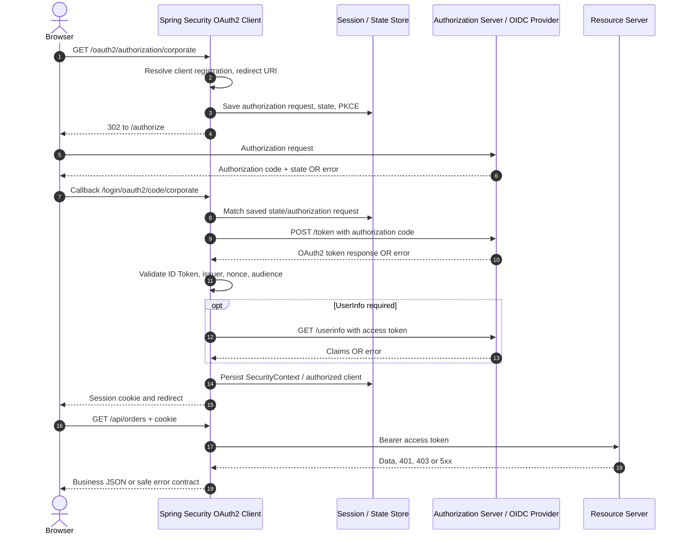

# 28.11. Thông báo lỗi cho người dùng và dữ liệu chẩn đoán cho vận hành

## 1. Một sự cố OAuth2/OIDC cần hai cách diễn đạt khác nhau

Trong một ứng dụng **Spring Security OAuth 2.0/OIDC Client**, cùng một lỗi có thể xuất hiện dưới hai góc nhìn:

- **Người dùng:** cần hiểu chuyện gì đã xảy ra, dữ liệu có được lưu hay không, có thể thử lại hoặc cần làm gì tiếp theo.
- **Đội vận hành:** cần phân biệt lỗi ở browser, Spring Security, Authorization Server, Token Endpoint, UserInfo Endpoint, Resource Server, HTTP client, session store hay chính sách ứng dụng; từ đó khoanh vùng và khắc phục.

Ví dụ: người dùng nhấn “Đăng nhập bằng tài khoản công ty”, nhưng Authorization Server từ chối xác thực OAuth2 client.

**Thông báo không nên hiển thị cho người dùng:**

```text
OAuth2AuthenticationException:
invalid_client
Client secret rejected at https://id.internal.example/oauth2/token
client_id=portal-prod-tenant-a
...
```

Thông báo phù hợp hơn:

> Không thể hoàn tất đăng nhập lúc này. Vui lòng thử lại sau ít phút. Nếu lỗi tiếp diễn, hãy cung cấp mã hỗ trợ `8a7c62f1` cho bộ phận hỗ trợ.

Với hệ thống vận hành, sự kiện liên quan có thể được ghi **theo cấu trúc, đã lược bỏ bí mật**:

```json
{
  "event": "oauth2.login.failure",
  "publicCode": "LOGIN_SERVICE_UNAVAILABLE",
  "internalReason": "CLIENT_AUTH_FAILED",
  "stage": "TOKEN_ENDPOINT",
  "providerAlias": "workforce",
  "tenantRef": "tenant-opaque-47",
  "correlationId": "8a7c62f1",
  "httpStatusClass": "4xx",
  "retryable": false,
  "outcome": "failure"
}
```

**Nguyên tắc:** cùng một `correlationId` cho phép hỗ trợ tìm đúng sự kiện; người dùng **không cần** biết client secret, token, issuer nội bộ hoặc stack trace.

### Sau bài học này, bạn có thể

1. Thiết kế thông báo lỗi dễ hiểu, không lộ dữ liệu và có hành động tiếp theo.
2. Phân loại lỗi theo **giai đoạn OAuth2/OIDC** và mức độ nghiêm trọng.
3. Ánh xạ các OAuth2 error codes như `access_denied`, `invalid_client`, `invalid_grant`, `invalid_scope` và `temporarily_unavailable` thành mã lỗi ứng dụng.
4. Phân biệt lỗi login callback với API chưa xác thực và API thiếu quyền.
5. Cấu hình `oauth2Login().failureHandler(...)`, `AuthenticationEntryPoint`, `AccessDeniedHandler` trong Spring Security Servlet.
6. Thiết kế JSON API error contract, tránh redirect login sai ngữ cảnh.
7. Tạo và truyền correlation ID, trace ID, request ID.
8. Thu thập structured logs, metrics, traces và audit events mà không log secrets/tokens.
9. Theo dõi lỗi `OAuth2AuthorizedClientManager`, refresh token, UserInfo và downstream API.
10. Xây dashboard/alert/runbook để khoanh vùng sự cố theo tenant/provider/stage.
11. Kiểm thử bảo mật của error messages, logs và authentication failure paths.
12. Xử lý sự cố mà không biến hoạt động chẩn đoán thành một nguồn rò rỉ credential.

Các domain, tên tenant, mã hỗ trợ và IDs trong ví dụ là **giả lập**. Mẫu code tập trung vào Spring Security Servlet/MVC; WebFlux được đối chiếu ở phần riêng.

---

## 2. Mục tiêu của thông báo lỗi: đúng, an toàn, hữu ích

Một thông báo cho người dùng nên trả lời bốn câu hỏi:

1. **Điều gì không hoàn tất?** Đăng nhập, kết nối tài khoản, đồng ý cấp quyền hay tải dữ liệu?
2. **Có thể làm gì?** Thử lại, đăng nhập lại, chọn đúng tài khoản, yêu cầu quản trị viên hay chờ hệ thống khắc phục?
3. **Có mất dữ liệu hay không?** Nếu không thể xác nhận, không nên khẳng định.
4. **Làm sao nhận hỗ trợ?** Một mã tham chiếu không nhạy cảm.

Ví dụ:

| Tình huống | Thông báo phù hợp |
|---|---|
| User hủy consent | “Bạn chưa cấp quyền này. Các tính năng khác vẫn có thể sử dụng bình thường.” |
| Phiên BFF hết hạn | “Phiên đăng nhập đã hết hạn. Vui lòng đăng nhập lại.” |
| Không thể kết nối IdP | “Hiện không thể kết nối dịch vụ đăng nhập. Vui lòng thử lại sau.” |
| Callback lỗi hoặc hết hạn | “Yêu cầu đăng nhập không còn hợp lệ. Vui lòng bắt đầu lại.” |
| Thiếu quyền truy cập API | “Bạn không có quyền thực hiện thao tác này.” |
| Cần cấp thêm scope | “Tính năng này cần thêm quyền truy cập. Chọn Kết nối để tiếp tục.” |
| Kết nối provider bị thu hồi | “Kết nối đã hết hiệu lực. Vui lòng kết nối lại.” |
| Thất bại khi lưu thao tác | “Không thể hoàn tất yêu cầu. Hãy kiểm tra trạng thái trước khi thử lại.” |

### 2.1. Không đổ lỗi cho người dùng

Không viết:

```text
Bạn nhập sai thông tin đăng nhập.
```

nếu ứng dụng không biết điều đó, chẳng hạn khi Token Endpoint trả `invalid_client` do cấu hình backend. Đó là lỗi tích hợp, không phải lỗi mật khẩu của người dùng.

### 2.2. Không nói “thử lại” với mọi lỗi

Một lỗi scope bị admin cấm, issuer mismatch, client secret sai hoặc OIDC signature validation failure thường **không tự khắc phục** khi người dùng nhấn thử lại liên tục.

Thông báo nên hướng tới bước tiếp theo chính xác: liên hệ hỗ trợ, yêu cầu quyền hoặc chờ hệ thống; đừng gây retry loop.

### 2.3. Không hứa đã lưu dữ liệu khi chưa biết

Nếu Token Endpoint hoặc upstream API timeout sau khi server đã gửi request, client không thể luôn biết server phía kia đã xử lý hay chưa.

Với thao tác như thanh toán, đổi tài khoản nhận tiền hay tạo đơn hàng, thông điệp nên hướng user **kiểm tra kết quả**; backend cần idempotency hoặc reconciliation theo nghiệp vụ.

---

## 3. Bản đồ điểm lỗi của một luồng OAuth2/OIDC Login



Mỗi mũi tên có thể thất bại. Chỉ nhìn thấy thông báo “OAuth2 login failed” không cho biết lỗi nằm ở **authorization endpoint**, **callback/state**, **token endpoint**, **ID Token validation**, **UserInfo**, **session store** hay **authorized client persistence**.

### 3.1. Một số giai đoạn nên chuẩn hóa

Có thể dùng enum nội bộ:

```text
LOGIN_INITIATION
AUTHORIZATION_REDIRECT
AUTHORIZATION_CALLBACK
STATE_VALIDATION
TOKEN_ENDPOINT
ID_TOKEN_VALIDATION
USERINFO_ENDPOINT
LOCAL_ACCOUNT_MAPPING
SESSION_PERSISTENCE
AUTHORIZED_CLIENT_LOOKUP
TOKEN_REFRESH
DOWNSTREAM_RESOURCE
LOGOUT
CONSENT
STEP_UP
```

Tên enum là **quy ước ứng dụng**, không phải một taxonomy bắt buộc của Spring Security. Mục đích là giảm những log chung chung như “OAuth error” khi phân tích sự cố.

---

## 4. Tách lỗi giao thức, lỗi tích hợp và lỗi nghiệp vụ

| Lớp | Ví dụ | Người dùng cần biết | Vận hành cần biết |
|---|---|---|---|
| User interaction | Từ chối consent | Có thể tiếp tục phần khác | `access_denied`, stage, provider |
| OAuth2 configuration | `invalid_client` | Dịch vụ tạm không thể kết nối | Registration, auth method, secret version |
| OAuth2 request | `invalid_scope` | Quyền chưa khả dụng | Scope policy và AS/client config |
| Callback integrity | `state` sai | Bắt đầu lại đăng nhập | Session/cookie/state correlation, không log state raw |
| OIDC validation | Issuer/audience/nonce sai | Không thể xác minh đăng nhập | Validation reason, expected provider alias |
| User profile | UserInfo 401/timeout | Không lấy được hồ sơ | UserInfo endpoint, HTTP status class, latency |
| Session/storage | Không lưu SecurityContext | Đăng nhập chưa hoàn tất | Session store latency/availability |
| Local identity policy | User bị disable | Không thể đăng nhập tài khoản này | Internal reason với quyền truy cập audit |
| Authorized client | Refresh token hết hạn | Kết nối đã hết hiệu lực | `invalid_grant`, registration, token lifecycle |
| Downstream API | 403 business authorization | Không có quyền | API operation, scope/ownership decision |
| Infrastructure | DNS, TLS, proxy, timeout | Thử lại hoặc chờ khắc phục | Network target alias, exception category |

### 4.1. Không áp nguyên error code từ provider vào UI

Lỗi OAuth2 có thể kèm `error_description`, `error_uri` và provider-specific payload.

Ví dụ:

```text
error=invalid_request
error_description=The redirect URI https://internal.example/... was rejected
```

`error_description` không được chuẩn hóa thành thông báo UX, có thể chứa chi tiết triển khai hoặc dữ liệu do bên ngoài kiểm soát. Không hiển thị trực tiếp cho user; **phân loại và map sang một allowlist**.

### 4.2. HTTP status không nói hết nguyên nhân

HTTP 400 từ Token Endpoint có thể là `invalid_grant`, `invalid_scope` hoặc `invalid_request`. HTTP 401 từ downstream API không tương đương HTTP 401 của BFF session.

Chẩn đoán phải kết hợp **source/stage + OAuth2 error code + status + operation**, không chỉ một status code.

---

## 5. Hai tầng mã lỗi: public code và internal reason

Nên thiết kế hai tập code riêng.

**Public code** dành cho frontend/support:

```text
LOGIN_NOT_COMPLETED
LOGIN_TRY_AGAIN
LOGIN_SERVICE_UNAVAILABLE
SESSION_EXPIRED
CONSENT_NOT_GRANTED
ACCOUNT_RECONNECT_REQUIRED
ACCESS_NOT_ALLOWED
TEMPORARY_ERROR
```

**Internal reason** cho vận hành:

```text
OAUTH_CALLBACK_STATE_MISMATCH
OAUTH_AUTHORIZATION_REQUEST_NOT_FOUND
TOKEN_ENDPOINT_INVALID_CLIENT
TOKEN_ENDPOINT_INVALID_GRANT
OIDC_ISSUER_MISMATCH
OIDC_AUDIENCE_MISMATCH
OIDC_NONCE_INVALID
USERINFO_UNAUTHORIZED
SESSION_REPOSITORY_UNAVAILABLE
REFRESH_TOKEN_REVOKED
DOWNSTREAM_INSUFFICIENT_SCOPE
DOWNSTREAM_BUSINESS_FORBIDDEN
```

### 5.1. Vì sao không trả internal reason?

Một code nội bộ có thể tiết lộ:

- Sản phẩm IdP/backend đang dùng.
- Sự tồn tại của một account/tenant.
- Tình trạng security checks như nonce, issuer, signature.
- Tên internal route, credentials hoặc cấu hình.
- Khả năng user enumeration.

Public codes nên ổn định, ít chi tiết và được tài liệu hóa theo UX. Internal reasons có thể chi tiết hơn nhưng vẫn phải được redacted.

### 5.2. Chỉ map các mã đã biết

Pseudocode:

```text
if stage == AUTHORIZATION_CALLBACK and error == access_denied:
    public = CONSENT_NOT_GRANTED or LOGIN_NOT_COMPLETED
    // Phụ thuộc pending intent: login hay incremental consent.

else if stage == TOKEN_ENDPOINT and error == invalid_client:
    public = LOGIN_SERVICE_UNAVAILABLE
    internal = TOKEN_ENDPOINT_INVALID_CLIENT

else:
    public = LOGIN_TRY_AGAIN
    internal = UNCLASSIFIED_AUTH_FAILURE
```

Không phải mọi `access_denied` đều là “người dùng hủy”: AS có thể áp policy hoặc admin restriction. UX chỉ nên diễn giải là user cancel nếu có bằng chứng trong flow/provider behavior.

---

## 6. Bảng ánh xạ các OAuth2/OIDC errors thường gặp

| Lỗi từ AS/OP | Giai đoạn thường gặp | Thông điệp UX an toàn | Chẩn đoán/vận hành |
|---|---|---|---|
| `access_denied` | Authorization redirect | “Yêu cầu cấp quyền không hoàn tất.” | User denial, tenant policy hay app authorization? |
| `invalid_request` | Authorization/Token Endpoint | “Không thể hoàn tất yêu cầu.” | Parameters, redirect URI, PKCE, provider contract |
| `unauthorized_client` | Authorization/Token Endpoint | “Dịch vụ đăng nhập chưa khả dụng.” | Grant/client permissions |
| `invalid_client` | Token Endpoint | “Không thể kết nối dịch vụ đăng nhập.” | Client authentication, secret rotation, mTLS |
| `invalid_grant` | Token Endpoint/refresh | “Yêu cầu đã hết hiệu lực. Vui lòng thử lại/kết nối lại.” | Code expired/reused hoặc refresh token invalid; **cần phân giai đoạn** |
| `unsupported_grant_type` | Token Endpoint | “Dịch vụ chưa hỗ trợ yêu cầu này.” | Grant registration/provider capability |
| `invalid_scope` | Authorization/Token Endpoint | “Quyền này hiện chưa khả dụng.” | Scope allowlist/consent/admin policy |
| `server_error` | Authorization redirect | “Dịch vụ đăng nhập đang gặp sự cố.” | AS outage/incident |
| `temporarily_unavailable` | Authorization redirect | “Dịch vụ tạm thời không sẵn sàng.” | Transient AS maintenance/overload |
| `login_required` | OIDC prompt=none | “Vui lòng đăng nhập để tiếp tục.” | Silent authorization cannot proceed |
| `consent_required` | OIDC prompt=none | “Cần cấp quyền để dùng tính năng.” | Interactive consent required |
| `interaction_required` | OIDC prompt=none | “Cần hoàn tất bước xác nhận.” | OP requires interaction |
| `account_selection_required` | OIDC prompt=none | “Vui lòng chọn tài khoản.” | Account chooser required |
| `invalid_token` | Resource Server Bearer | “Phiên/kết nối cần xác thực lại.” **Tùy nguồn** | Signature/expiry/audience/revocation |
| `insufficient_scope` | Resource Server Bearer | “Tính năng cần quyền truy cập bổ sung.” | Scope mapping, business permission |
| Không có OAuth2 error code | Network/TLS/storage | “Không thể kết nối lúc này.” | DNS/TLS/timeout/proxy/session store |

**Lưu ý về `invalid_grant`:** khi code exchange thất bại, có thể phải khởi động lại login; khi refresh thất bại, có thể cần reconnect user hoặc xử lý rotation race. Không coi hai trường hợp tương đương.

---

## 7. Lỗi bảo mật cần fail closed

Một số lỗi không phải tình huống UX đơn thuần:

```text
OAuth2 state không khớp
OIDC issuer không đúng registration
ID Token signature validation thất bại
ID Token audience không chứa expected client
OIDC nonce không khớp
Token response từ endpoint không được trust
Tenant/account binding không khớp callback
```

Với các lỗi này:

1. **Không tạo Authentication thành công.**
2. **Không chấp nhận access/ID Token** để dùng tiếp.
3. Không bỏ kiểm tra state/nonce/issuer nhằm “giúp user đăng nhập”.
4. Không trả raw ID Token hoặc callback query cho browser.
5. Ghi sanitized security event với correlation ID.
6. Nếu có dấu hiệu tấn công diện rộng, đánh dấu mức độ an ninh và cảnh báo.

### 7.1. Không gọi tất cả là “mật khẩu sai”

Spring OAuth2 Client thường không trực tiếp nhận password của người dùng từ IdP. Nếu ID Token không hợp lệ, không có cơ sở để khẳng định người dùng nhập mật khẩu sai.

### 7.2. Không retry silent các lỗi integrity

Một request có `state` sai hoặc issuer mismatch phải bị từ chối. User có thể được hướng dẫn **bắt đầu một flow mới**, không được “bỏ qua bước kiểm tra đã lỗi”.

---

## 8. Browser navigation và JSON API cần cách xử lý khác nhau

Khi user truy cập một trang HTML:

```http
GET /app
Accept: text/html
```

ứng dụng có thể redirect đến login hoặc trang giải thích lỗi.

Nhưng một SPA gọi:

```http
GET /api/orders
Accept: application/json
Cookie: SESSION=...
```

thường kỳ vọng **JSON và status code**, không phải HTML trang login từ Authorization Server.

### 8.1. Ví dụ hợp đồng API

Khi session BFF hết hạn:

```http
HTTP/1.1 401 Unauthorized
Content-Type: application/problem+json
Cache-Control: no-store
X-Correlation-ID: 2d4f6c9a
```

```json
{
  "type": "about:blank",
  "title": "Cần đăng nhập",
  "status": 401,
  "detail": "Phiên đăng nhập đã hết hạn.",
  "code": "SESSION_EXPIRED",
  "correlationId": "2d4f6c9a"
}
```

`code` và `correlationId` là **extension fields do ứng dụng định nghĩa** trên dạng problem details; Spring Framework cung cấp `ProblemDetail`, còn cấu trúc JSON thực tế phụ thuộc serializer/config.

### 8.2. Vì sao không redirect API call tới IdP?

Nếu một `fetch()` nhận 302 rồi theo redirect tới domain IdP, browser có thể gặp lỗi CORS, nhận HTML thay JSON hoặc xử lý session không như frontend mong muốn.

Thiết kế:

```text
GET /api/me -> 401 JSON (chưa có session)
Frontend -> top-level location.assign("/oauth2/authorization/corporate")
```

vừa rõ UX, vừa giúp phân loại lỗi.

### 8.3. 401 và 403 không thay thế nhau

- **401** ở BFF: chưa có authentication phù hợp hoặc session đã hết.
- **403** ở BFF: có authentication nhưng không được phép.
- **401** ở downstream Resource Server: Bearer token không được chấp nhận.
- **403** ở downstream: scopes hoặc business authorization không đủ.

Không chuyển nguyên downstream 401 thành `SESSION_EXPIRED` nếu BFF session vẫn hợp lệ nhưng token được cấp cho sai audience.

### 8.4. Không trả 500 cho mọi lỗi để “ẩn chi tiết”

Ẩn thông tin nhạy cảm là đúng, nhưng vẫn nên dùng status semantics hữu ích:

```text
401 session required
403 access denied
400/422 invalid business request theo API contract
409 conflict
429 rate-limited
502/503 upstream temporarily unavailable
500 unexpected internal failure
```

Việc chọn status cụ thể phụ thuộc API contract, không cần tiết lộ raw OAuth2 error.

---

## 9. Thiết kế payload lỗi nhất quán

Một contract API khả dụng:

```json
{
  "type": "https://docs.example/errors/connection-required",
  "title": "Cần kết nối lại",
  "status": 409,
  "detail": "Kết nối với nhà cung cấp đã hết hiệu lực.",
  "code": "ACCOUNT_RECONNECT_REQUIRED",
  "correlationId": "1c5e9f2a",
  "retryable": false,
  "nextAction": "RECONNECT_PROVIDER"
}
```

Các fields `code`, `correlationId`, `retryable`, `nextAction` là quy ước của ứng dụng, không phải fields bắt buộc của RFC 9457.

### 9.1. Không trả stack trace trong JSON

Tránh:

```json
{
  "exception": "OAuth2AuthorizationException",
  "stackTrace": "...",
  "clientSecret": "...",
  "accessToken": "..."
}
```

Kể cả ở môi trường staging, hãy hạn chế dump raw credentials để tránh lan sang log aggregation và screenshots.

### 9.2. `nextAction` là gợi ý UX

Một số giá trị:

```text
RETRY
SIGN_IN
RECONNECT_PROVIDER
REQUEST_PERMISSION
CONTACT_SUPPORT
CHECK_OPERATION_STATUS
NONE
```

Không cho frontend tự định nghĩa security policy chỉ vì thấy `nextAction`. Backend vẫn áp authentication/authorization khi user thực hiện hành động tiếp theo.

### 9.3. Không phải lỗi nào cũng có retryable=true

`invalid_client` không được sửa bằng user retry; lỗi network transient có thể retry giới hạn; `access_denied` cần user chủ động bắt đầu lại.

---

## 10. Spring Security: nơi nào bắt được lỗi nào?

Trong Servlet/MVC có nhiều extension points khác nhau:

| Điểm mở rộng | Xử lý tình huống |
|---|---|
| `oauth2Login().failureHandler(...)` | OAuth2 Login authentication failure tại filter/callback |
| `AuthenticationEntryPoint` | User chưa authenticated khi truy cập resource được bảo vệ |
| `AccessDeniedHandler` | Authenticated principal bị từ chối quyền |
| `OAuth2AuthorizationFailureHandler` | OAuth2AuthorizedClient authorization/refresh failure |
| `@RestControllerAdvice` | Exceptions đi qua MVC controller/service |
| `RestClient`/`WebClient` error handling | HTTP errors khi BFF gọi downstream API |
| Custom OAuth2 UserService/OidcUserService | Lỗi gọi UserInfo, mapping identity, policy |
| Observability/filters/interceptors | Correlation, metrics, trace, audit |

### 10.1. `@ControllerAdvice` không bắt mọi lỗi filter

OAuth2 Login callback thường đi qua Spring Security filters **trước** MVC controller. Vì vậy chỉ viết:

```java
@RestControllerAdvice
class GlobalExceptionHandler { ... }
```

không bảo đảm xử lý `OAuth2LoginAuthenticationFilter` failures.

Cần dùng đúng authentication failure handler/entrypoint.

### 10.2. Authentication và authorization khác nhau

- **AuthenticationFailureHandler:** không chứng minh được identity.
- **AuthenticationEntryPoint:** cần bắt đầu authentication.
- **AccessDeniedHandler:** identity đã có nhưng thiếu quyền.

Dùng sai handler làm frontend nhận thông báo sai hoặc phát sinh login loop.

---

## 11. Ví dụ OAuth2 Login failure handler an toàn

Spring Security cho phép:

```java
.oauth2Login(oauth2 -> oauth2
    .failureHandler(...)
)
```

Ví dụ dưới đây mapping sang **public codes cố định**, không hiện exception message hoặc provider `error_description`.

```java
import java.io.IOException;
import java.util.UUID;

import jakarta.servlet.ServletException;
import jakarta.servlet.http.HttpServletRequest;
import jakarta.servlet.http.HttpServletResponse;

import org.slf4j.Logger;
import org.slf4j.LoggerFactory;

import org.springframework.security.core.AuthenticationException;
import org.springframework.security.oauth2.core.OAuth2AuthenticationException;
import org.springframework.security.web.authentication.AuthenticationFailureHandler;

public final class SafeOAuth2LoginFailureHandler
        implements AuthenticationFailureHandler {

    private static final Logger log =
        LoggerFactory.getLogger(SafeOAuth2LoginFailureHandler.class);

    @Override
    public void onAuthenticationFailure(
            HttpServletRequest request,
            HttpServletResponse response,
            AuthenticationException exception)
            throws IOException, ServletException {

        // Correlation ID mới, không dùng trực tiếp browser input.
        String reference = UUID.randomUUID().toString();

        String code = "LOGIN_NOT_COMPLETED";
        String internalReason = "UNCLASSIFIED_AUTH_FAILURE";

        if (exception instanceof OAuth2AuthenticationException oauth) {
            String error = oauth.getError().getErrorCode();

            if ("access_denied".equals(error)) {
                code = "LOGIN_NOT_COMPLETED";
                internalReason = "PROVIDER_ACCESS_DENIED";
            }
            else if ("invalid_client".equals(error)) {
                code = "LOGIN_SERVICE_UNAVAILABLE";
                internalReason = "CLIENT_AUTH_FAILED";
            }
            else if ("invalid_grant".equals(error)) {
                code = "LOGIN_TRY_AGAIN";
                internalReason = "AUTHORIZATION_GRANT_REJECTED";
            }
        }

        // Chỉ log các hằng số/ID mới được ứng dụng tạo.
        // Không log exception.getMessage() hoặc raw error_description.
        log.warn(
            "event=oauth2_login_failure reason={} reference={}",
            internalReason, reference
        );

        response.setHeader("Cache-Control", "no-store");

        // Redirect tới route thuộc chính ứng dụng.
        // code chỉ nhận một trong các giá trị hardcoded ở trên.
        response.sendRedirect(
            request.getContextPath()
            + "/login?reason=" + code
            + "&reference=" + reference
        );
    }
}
```

### 11.1. Mẫu code trên cho thấy điều gì?

- Có một handler xử lý authentication failure của OAuth2 Login.
- User chỉ thấy **public code** đã allowlist.
- Internal reason được ghi nhận ở log mà không cần raw token.
- Reference mới được tạo; không dựa vào `state` hay `error_description` từ URL.
- Redirect không nhận `return_to` tùy ý.

Đây là **ví dụ nền tảng**: production thường nên sử dụng correlation ID đã được request filter cấp để nối log của nhiều bước, bổ sung stage/provider alias bằng dữ liệu đã xác minh, không log raw request URI/query.

### 11.2. Vì sao không dùng `exception.getMessage()` trong redirect?

Exception message có thể chứa provider diagnostics, URL, token request metadata hoặc thông điệp không an toàn do hệ ngoài cung cấp.

Không làm:

```java
response.sendRedirect(
    "/login?error=" + exception.getMessage()
);
```

Ngoài rủi ro information leakage, còn dễ lỗi URL encoding và tạo UI không ổn định.

### 11.3. Sự kiện log vẫn cần liên hệ với trace

Nếu một failure handler tự tạo reference hoàn toàn mới mà request filter/trace không dùng reference đó, support khó nối các spans. Trong production nên có:

```text
correlationId được tạo tại đầu request
    -> MDC
    -> failureHandler
    -> response
    -> logs/traces
```

Ví dụ ở phần sau minh họa việc thiết lập correlation ID thống nhất.

---

## 12. Gắn failure handler vào SecurityFilterChain

```java
import org.springframework.context.annotation.Bean;
import org.springframework.context.annotation.Configuration;
import org.springframework.http.HttpStatus;
import org.springframework.security.config.Customizer;
import org.springframework.security.config.annotation.web.builders.HttpSecurity;
import org.springframework.security.web.SecurityFilterChain;
import org.springframework.security.web.authentication.HttpStatusEntryPoint;
import org.springframework.security.web.util.matcher.AntPathRequestMatcher;
import org.springframework.security.web.authentication.AuthenticationFailureHandler;

@Configuration
public class BrowserSecurityConfiguration {

    @Bean
    SecurityFilterChain webSecurity(
            HttpSecurity http,
            AuthenticationFailureHandler loginFailureHandler)
            throws Exception {

        http
            .authorizeHttpRequests(auth -> auth
                .requestMatchers(
                    "/login", "/", "/assets/**", "/error"
                ).permitAll()
                .anyRequest().authenticated()
            )
            .oauth2Login(oauth2 -> oauth2
                .failureHandler(loginFailureHandler)
            )
            .oauth2Client(Customizer.withDefaults())
            .exceptionHandling(exceptions -> exceptions
                .defaultAuthenticationEntryPointFor(
                    new HttpStatusEntryPoint(HttpStatus.UNAUTHORIZED),
                    new AntPathRequestMatcher("/api/**")
                )
            );

        // Không disable CSRF cho browser-cookie session.
        return http.build();
    }

    @Bean
    AuthenticationFailureHandler loginFailureHandler() {
        return new SafeOAuth2LoginFailureHandler();
    }
}
```

**Giải thích:**

- Browser OAuth2 Login callback failures đi qua `failureHandler`.
- API không authenticated được trả 401 thay vì tự redirect tới IdP.
- OAuth2 Client support được bật cho các downstream calls nếu ứng dụng cần.
- CSRF vẫn bật cho session-cookie app.
- JSON body của 401 API trong ví dụ chưa được triển khai; muốn trả ProblemDetail nhất quán thì dùng custom `AuthenticationEntryPoint`.

### 12.1. Cần coi routing của API riêng biệt

Trong dự án lớn có nhiều `SecurityFilterChain`, đừng gắn cùng một handler vào mọi security chains rồi nghĩ tất cả hoạt động như một ứng dụng MVC.

Ví dụ một Resource Server Bearer API có thể cần `BearerTokenAuthenticationEntryPoint` và `BearerTokenAccessDeniedHandler` theo RFC 6750, khác BFF session-cookie API.

### 12.2. Login error page là route an toàn

Trang `/login` đọc `reason` từ **allowlist public codes**; không in mọi query parameter ra HTML. Một request do attacker tự tạo với `?reason=...` không được phép chèn HTML/JavaScript.

---

## 13. AuthenticationEntryPoint cho API chưa đăng nhập

Một API dùng browser session nên trả HTTP 401 khi chưa có Authentication hợp lệ.

Ví dụ `AuthenticationEntryPoint`:

```java
import java.io.IOException;
import java.util.LinkedHashMap;
import java.util.Map;

import com.fasterxml.jackson.databind.ObjectMapper;

import jakarta.servlet.http.HttpServletRequest;
import jakarta.servlet.http.HttpServletResponse;

import org.springframework.http.MediaType;
import org.springframework.security.core.AuthenticationException;
import org.springframework.security.web.AuthenticationEntryPoint;

public final class JsonApiAuthenticationEntryPoint
        implements AuthenticationEntryPoint {

    private final ObjectMapper mapper;

    public JsonApiAuthenticationEntryPoint(ObjectMapper mapper) {
        this.mapper = mapper;
    }

    @Override
    public void commence(
            HttpServletRequest request,
            HttpServletResponse response,
            AuthenticationException exception) throws IOException {

        response.setStatus(HttpServletResponse.SC_UNAUTHORIZED);
        response.setContentType(
            MediaType.APPLICATION_PROBLEM_JSON_VALUE
        );
        response.setHeader("Cache-Control", "no-store");

        Map<String, Object> body = new LinkedHashMap<>();
        body.put("type", "about:blank");
        body.put("title", "Cần đăng nhập");
        body.put("status", 401);
        body.put("detail", "Vui lòng đăng nhập để tiếp tục.");
        body.put("code", "AUTH_REQUIRED");

        mapper.writeValue(response.getOutputStream(), body);
    }
}
```

Đây là một API-specific entrypoint. `AuthenticationException` được nhận nhưng **không** serialize vào response. Correlation ID nên được thêm từ request-scoped tracing/correlation infrastructure, không lấy raw exception message.

### 13.1. Có nên trả `SESSION_EXPIRED` hay `AUTH_REQUIRED`?

Một backend thường không chứng minh được browser **đã từng có session rồi hết hạn** chỉ từ một request không có cookie hợp lệ. `AUTH_REQUIRED` là cách diễn đạt chắc chắn hơn khi chưa biết.

Chỉ dùng `SESSION_EXPIRED` nếu có cơ chế xác định trạng thái đó một cách đáng tin, không dựa trên client tự khai báo.

### 13.2. Thông báo API vẫn có thể đa ngôn ngữ

`code` nên ổn định:

```text
AUTH_REQUIRED
```

Frontend chọn bản dịch theo locale, hoặc backend dùng message catalog với locale phù hợp. Không đưa ngôn ngữ của provider `error_description` trực tiếp vào response.

---

## 14. AccessDeniedHandler: có login nhưng không có quyền

Một principal authenticated truy cập `/api/admin/reports` khi không có role cần thiết nên nhận 403, không phải redirect vô hạn tới login.

Ví dụ API response:

```http
HTTP/1.1 403 Forbidden
Content-Type: application/problem+json
Cache-Control: no-store
```

```json
{
  "type": "about:blank",
  "title": "Không được phép",
  "status": 403,
  "detail": "Bạn không có quyền thực hiện thao tác này.",
  "code": "ACCESS_NOT_ALLOWED"
}
```

### 14.1. Không tiết lộ tài nguyên tồn tại khi không có quyền

Với một số tài nguyên nhạy cảm, ứng dụng có thể chọn 404 thay vì 403 để tránh resource enumeration. Quyết định này thuộc business/API authorization policy.

Đừng đưa:

```text
User Alice không phải chủ tài khoản ngân hàng của Bob
```

vào thông báo public; đó là thông tin cá nhân và chi tiết quy tắc quyền.

### 14.2. Đừng xóa session chỉ vì 403

Một user không có quyền xem báo cáo admin vẫn có thể sử dụng phần còn lại của ứng dụng. 403 không chứng minh session invalid.

---

## 15. ControllerAdvice xử lý lỗi nghiệp vụ, không thay security filters

Trong Spring MVC, `@RestControllerAdvice` có thể dùng cho exceptions được controller/service ném ra:

```java
import java.util.Map;

import org.springframework.http.HttpStatus;
import org.springframework.http.ResponseEntity;
import org.springframework.web.bind.annotation.ExceptionHandler;
import org.springframework.web.bind.annotation.RestControllerAdvice;

@RestControllerAdvice
public class ApiBusinessExceptionHandler {

    @ExceptionHandler(FeatureDisabledException.class)
    public ResponseEntity<Map<String, Object>> featureDisabled(
            FeatureDisabledException ignored) {

        return ResponseEntity
            .status(HttpStatus.FORBIDDEN)
            .body(Map.of(
                "code", "FEATURE_NOT_AVAILABLE",
                "message", "Tính năng này chưa khả dụng."
            ));
    }
}
```

`FeatureDisabledException` là **custom application exception** phải được định nghĩa riêng.

### 15.1. Vẫn cần metadata vận hành

Một production API error nên có correlation ID đồng nhất ở header và body; handler có thể lấy request attribute đã được correlation filter thiết lập.

### 15.2. Đừng trả raw exception ở môi trường production

Không viết:

```java
return Map.of("error", exception.toString());
```

Exception/toString có thể chứa URL, token value, SQL parameters, headers hoặc internal paths.

---

## 16. Correlation ID: chìa khóa nối UX và chẩn đoán

Mỗi request nên có một identifier để liên hệ:

```text
Browser UI:
    "Mã hỗ trợ: 6c2139ef"

HTTP response:
    X-Correlation-ID: 6c2139ef

Backend log:
    correlationId=6c2139ef

Metrics/tracing:
    traceId=... (được liên kết qua structured log)
```

### 16.1. Phân biệt ID

| ID | Mục đích | Có thể hiển thị public? |
|---|---|---|
| `correlationId` | Gắn các sự kiện thuộc một request/workflow | Có, nếu ID ngẫu nhiên, không chứa bí mật |
| `traceId` | Nối distributed spans | Có thể, nếu chính sách tổ chức cho phép |
| `spanId` | Xác định một span cụ thể | Chủ yếu dùng nội bộ |
| `sessionId` | Credential định danh phiên | **Không** |
| OAuth2 `state` | Chống CSRF/correlation của authorization flow | **Không dùng làm support ID** |
| Authorization code | Credential ngắn hạn, dùng một lần | **Không** |
| ID Token `sub` | External identity identifier | Không mặc định |
| Access token/refresh token | OAuth2 credentials | **Tuyệt đối không** |
| `clientId` | OAuth2 client identifier | Chỉ log khi policy chấp nhận; không cần public |
| Tenant alias | Chẩn đoán theo tổ chức | Chỉ public nếu user có quyền thấy |

### 16.2. Tránh lấy raw `X-Correlation-ID` từ internet

Một attacker có thể gửi:

```http
X-Correlation-ID: <script>...</script>
```

hoặc chuỗi dài/hỏng format để làm log injection, metrics overload hoặc đánh lừa support.

Hai cách an toàn:

1. **Tạo ID mới** tại BFF public edge, lưu inbound ID riêng chỉ khi thực sự cần.
2. Chỉ chấp nhận inbound correlation ID từ reverse proxy đáng tin, kiểm tra charset, độ dài, tính duy nhất và provenance.

### 16.3. Một OAuth2 login gồm nhiều HTTP requests

OAuth2 Login thường qua các requests khác nhau:

```text
GET /oauth2/authorization/corporate
GET /login/oauth2/code/corporate
```

Hai request có thể có **correlation IDs khác nhau**. Nếu cần nhìn toàn bộ login transaction, tạo **login attempt ID riêng** trong server-side authorization request/pending intent và liên kết an toàn qua state repository.

Không dùng nguyên chuỗi OAuth2 `state` làm login attempt ID trong logs.

---

## 17. Tạo correlation ID bằng Servlet filter

Một ví dụ:

```java
import java.io.IOException;
import java.util.UUID;

import jakarta.servlet.FilterChain;
import jakarta.servlet.ServletException;
import jakarta.servlet.http.HttpServletRequest;
import jakarta.servlet.http.HttpServletResponse;

import org.slf4j.MDC;
import org.springframework.stereotype.Component;
import org.springframework.web.filter.OncePerRequestFilter;

@Component
public class CorrelationIdFilter extends OncePerRequestFilter {

    public static final String ATTRIBUTE =
        CorrelationIdFilter.class.getName() + ".correlationId";

    @Override
    protected void doFilterInternal(
            HttpServletRequest request,
            HttpServletResponse response,
            FilterChain chain)
            throws ServletException, IOException {

        String correlationId = UUID.randomUUID().toString();

        request.setAttribute(ATTRIBUTE, correlationId);
        response.setHeader("X-Correlation-ID", correlationId);

        try (MDC.MDCCloseable ignored =
                MDC.putCloseable("correlationId", correlationId)) {

            chain.doFilter(request, response);
        }
    }
}
```

### 17.1. Lưu ý filter ordering

Phải bảo đảm filter được gọi trước những security errors cần chẩn đoán. Spring Boot servlet filter registration và Spring Security filter chain có thứ tự riêng; nên kiểm thử thực tế xem correlation ID có mặt trên 302, 401, 403 và OAuth2 callback failures hay không.

### 17.2. MDC không tự truyền qua mọi async thread

SLF4J MDC thường gắn với thread. Với `@Async`, custom Executor, Reactor hoặc tasks chạy nền, MDC có thể không được truyền tự động.

Sử dụng task decorator/context propagation thích hợp và **clear context sau task** để tránh lẫn correlation ID hoặc tenant giữa requests.

### 17.3. Filter không cần log request body

Chức năng của filter là gắn correlation ID. Không biến nó thành “log all HTTP requests/responses”, vì OAuth2 callbacks, Token Endpoint requests và session cookies chứa dữ liệu nhạy cảm.

---

## 18. Distributed tracing: HTTP request không phải toàn bộ OAuth2 flow

Một request BFF gọi Token Endpoint có thể tạo trace gồm:

```text
HTTP GET callback
    |
    +-- Spring Security filter span
    +-- OAuth2 token endpoint HTTP client span
    +-- UserInfo HTTP client span
    +-- Database session/authorized client spans
```

Nhưng browser rời origin để đến Authorization Server rồi redirect về trong một request khác. Tracing không tự nối hai request trình duyệt thành một trace xuyên suốt nếu không có workflow correlation.

### 18.1. Tracing nên tập trung vào đâu?

- Thời gian từ callback đến token response.
- Timeout của Token Endpoint và UserInfo.
- Session/authorized client store latency.
- Outbound API calls.
- Điểm thất bại ở HTTP client hoặc authentication validation.
- Retry và circuit-breaker behavior.

### 18.2. Không đưa secrets vào span attributes

Không thêm:

```text
oauth2.access_token
oauth2.refresh_token
oauth2.authorization_code
http.request.header.authorization
http.request.header.cookie
oauth2.state
client_secret
```

Với tracing instrumentation tự động, cần kiểm tra cấu hình capture headers/query/body trước khi bật trong production.

### 18.3. Baggage có thể đi ra ngoài

W3C Baggage hoặc custom tracing headers có thể được chuyển tới upstream services. Không chứa email, access token, raw subject hoặc tenant secrets trong baggage.

Một opaque approved tenant reference có thể dùng nội bộ nếu policy cho phép và không truyền sang untrusted third parties.

---

## 19. Structured logging: những trường nên có

Một event chuẩn hóa:

```json
{
  "timestamp": "2026-11-16T08:05:00Z",
  "level": "WARN",
  "event": "oauth2.login.failure",
  "stage": "TOKEN_ENDPOINT",
  "publicCode": "LOGIN_SERVICE_UNAVAILABLE",
  "internalReason": "TOKEN_ENDPOINT_INVALID_CLIENT",
  "registrationAlias": "workforce",
  "tenantRef": "t-47",
  "correlationId": "c-8174",
  "loginAttemptRef": "la-25af",
  "oauth2ErrorFamily": "invalid_client",
  "remoteStatus": 401,
  "latencyMs": 143,
  "retryable": false,
  "result": "failure"
}
```

`oauth2ErrorFamily` được lấy từ **allowlist** và chuẩn hóa; không ghi nguyên unbounded provider response.

### 19.1. Những trường hữu ích

| Field | Lợi ích |
|---|---|
| `event` | Tập hợp đúng loại hoạt động |
| `stage` | Xác định vùng lỗi |
| `publicCode` | Đối chiếu với UX |
| `internalReason` | Chẩn đoán có kiểm soát |
| `correlationId` | Tìm request |
| `loginAttemptRef` | Liên kết authorization initiation/callback |
| `registrationAlias` | Provider/client route |
| `tenantRef` | Khoanh vùng tenant, nên pseudonymize |
| `remoteStatus` | Phân biệt network/AS errors |
| `oauth2ErrorFamily` | Phân loại từ OAuth2Error |
| `latencyMs` | Theo dõi hiệu năng |
| `retryable` | Chọn retry policy |
| `result` | Success/failure/cancel |
| `configVersion` | Phát hiện lỗi sau secret rotation/rollout |
| `deploymentVersion` | So sánh lỗi trước/sau deploy |

### 19.2. Cẩn thận với raw principal name

`Authentication.getName()` có thể là email, username hoặc external subject tùy provider và mapping. Đừng tự đưa nó vào log hoặc metrics. Dùng opaque internal user reference chỉ khi cần điều tra và được phân quyền.

### 19.3. Không log toàn bộ `Authentication`

Một `OAuth2AuthenticationToken`, `OidcUser` hoặc `OAuth2AuthorizedClient` có thể chứa attributes, ID Token claims hay access/refresh tokens. Không làm:

```java
log.info("auth={}", authentication);
log.info("client={}", authorizedClient);
```

mà chưa chắc chắn output không có dữ liệu nhạy cảm.

---

## 20. Redaction: dữ liệu nào tuyệt đối không được ghi?

Danh sách cần chặn trong HTTP logs, APM, exception reporting, metrics, traces, debug dumps, screenshots và support tickets:

```text
access_token
refresh_token
id_token
authorization_code
client_secret
client_assertion
private_key
code_verifier
session cookie
Authorization: Bearer ...
Authorization: Basic ...
Set-Cookie
Cookie
raw JWK private material
mTLS private key/certificate bundle secrets
raw token endpoint request/response body
```

### 20.1. Query string callback vẫn nhạy cảm

Ví dụ:

```text
/login/oauth2/code/corporate?code=AUTH_CODE&state=RANDOM_STATE
```

Nếu reverse proxy logs toàn bộ request URI, authorization code và state có thể bị lưu ngoài ý muốn. Redact query parameters hoặc log **route template**, không log full URL cho các endpoints auth.

### 20.2. Không in exception stack vô điều kiện

Một exception chain từ HTTP client hoặc provider SDK có thể chứa headers/body/URLs với secrets. Việc `log.error("...", exception)` trong production có thể làm leak dữ liệu nếu message và nested exceptions chưa được kiểm tra.

Hướng an toàn:

- Log **safe exception category/class** và internal reason.
- Chỉ bật gated diagnostic traces khi đã có redaction policy và người vận hành được ủy quyền.
- Không dump raw HTTP exchange từ Token Endpoint.
- Giới hạn retention và quyền truy cập logging.

### 20.3. Không dùng token hash làm correlation ID

Hash raw token vẫn có thể tạo stable fingerprint giúp correlate sessions và có rủi ro dữ liệu. Tạo **random ID riêng**; không sử dụng token value, token suffix hay hash của access/refresh token làm support code.

### 20.4. `error_description` có thể là dữ liệu không tin cậy

Không đưa `error_description` từ provider vào structured log field không giới hạn dung lượng hoặc vào UI, vì nó có thể chứa newline, HTML hay thông tin ngoài ý muốn.

Nếu thực sự cần lưu cho một incident, dùng sanitize/truncate, policy controls và tách khỏi log công khai.

---

## 21. Mã lỗi phải ổn định, thông điệp có thể thay đổi

Một hệ thống cần hỗ trợ i18n và product UX theo thời gian.

Ví dụ:

```text
Public code: ACCOUNT_RECONNECT_REQUIRED
vi-VN: "Kết nối đã hết hiệu lực. Vui lòng kết nối lại."
en-US: "Your connection has expired. Reconnect to continue."
```

Frontend không nên so sánh chuỗi message:

```javascript
if (error.message === "Kết nối đã hết hiệu lực") {
    ...
}
```

Thay bằng:

```javascript
switch (error.code) {
  case "ACCOUNT_RECONNECT_REQUIRED":
    showReconnectAction();
    break;
  case "AUTH_REQUIRED":
    showSignInAction();
    break;
  default:
    showSupportReference(error.correlationId);
}
```

**Lưu ý:** frontend chọn UX; backend vẫn phải xác thực quyền. Mã lỗi không phải quyền cấp API.

---

## 22. Giao diện xử lý OAuth2 Login failure

Một trang `/login` có thể đọc `reason` từ allowlist:

```text
LOGIN_NOT_COMPLETED:
  "Đăng nhập chưa được hoàn tất."
  "Bạn có thể thử lại hoặc chọn một phương thức đăng nhập khác."

LOGIN_SERVICE_UNAVAILABLE:
  "Hiện không thể kết nối dịch vụ đăng nhập."
  "Vui lòng thử lại sau. Nếu lỗi tiếp diễn, liên hệ hỗ trợ."

LOGIN_TRY_AGAIN:
  "Yêu cầu đăng nhập đã hết hiệu lực."
  "Vui lòng bắt đầu lại từ trang đăng nhập."
```

### 22.1. Không hiển thị raw provider error

Chặn:

```text
?reason=<script>alert(1)</script>
?message=Client secret foo rejected
```

Dù trang login cho phép query string, chỉ render các messages từ application catalog, đã HTML-escaped theo template engine.

### 22.2. Không hiển thị “tài khoản này không tồn tại” quá cụ thể

Với account mapping/local onboarding, thông báo có thể tiết lộ một email đã tồn tại hay tenant user bị disable. Quyết định thông báo cần xét user enumeration threat model.

### 22.3. UX có thể có nhiều mức hỗ trợ

- Nút **Thử lại** nếu request mới có ý nghĩa.
- Nút **Đăng nhập bằng phương thức khác** nếu provider outage nhưng business policy cho phép.
- Nút **Liên hệ quản trị viên** với mã hỗ trợ.
- Giải thích **đăng nhập thành công nhưng thiếu quyền** khác với login failure.
- Không tự retry login redirect vô hạn.

---

## 23. Phân biệt OAuth2 consent denial với login failure

Một người dùng đã đăng nhập BFF và chọn “Kết nối lịch”. IdP từ chối `calendar.readonly`.

Trường hợp này không giống người dùng không đăng nhập được.

```text
Local session:
    User Alice vẫn authenticated.

Incremental consent:
    Failed / denied.

Calendar feature:
    Not connected.

Dashboard:
    Vẫn hoạt động.
```

### 23.1. Mã công khai khác nhau

```text
LOGIN_NOT_COMPLETED
CONSENT_NOT_GRANTED
ACCOUNT_RECONNECT_REQUIRED
```

Cùng provider `access_denied` có thể cần UX khác tùy **trusted server-side intent** của flow.

### 23.2. Không dựa vào `?flow=consent` từ browser

Một callback kèm `flow=consent` tự khai báo không phải chứng cứ user đã bắt đầu consent. Dùng `state` và server-side pending intent để phân biệt loại authorization transaction.

---

## 24. Lỗi khi tải UserInfo/OIDC profile

Sau Token Endpoint trả access token/ID Token, Spring Security có thể gọi UserInfo Endpoint.

Các khả năng:

- HTTP 401/403 từ UserInfo.
- TLS certificate error.
- Timeout.
- JSON response không đúng format.
- Missing stable user-name attribute.
- Claims mâu thuẫn với ID Token `sub`.
- Custom `OAuth2UserService` mapping exception.
- Internal account disabled/tenant policy denied.

### 24.1. Thông điệp an toàn

User:

> Không thể xác minh thông tin tài khoản để hoàn tất đăng nhập. Vui lòng thử lại hoặc liên hệ hỗ trợ.

Vận hành:

```text
stage = USERINFO_ENDPOINT
providerAlias = corporate
internalReason = USERINFO_HTTP_UNAUTHORIZED
remoteStatus = 401
registrationConfigVersion = 13
correlationId = ...
```

### 24.2. Không trả raw UserInfo response

UserInfo có thể chứa email, địa chỉ, họ tên, nhóm, số điện thoại, birthdate hoặc custom claims. Không log toàn bộ JSON để “debug”.

### 24.3. `sub` mismatch là lỗi integrity

Với OIDC, cần kiểm tra UserInfo subject phù hợp ID Token subject theo giao thức. Nếu không khớp, đừng bỏ kiểm tra để login tiếp.

---

## 25. Lỗi `OAuth2AuthorizedClientManager` và refresh token

Sau khi người dùng đã đăng nhập, BFF có thể dùng:

```java
OAuth2AuthorizedClientManager
```

để load/authorize/refresh access token khi gọi downstream API.

Các lỗi thường gặp:

```text
invalid_grant
invalid_client
network timeout
token response invalid
missing authorized client
client registration not found
```

### 25.1. `invalid_grant` trong refresh token

Có thể có nhiều nguyên nhân:

- Refresh token hết hạn.
- User revoke consent.
- Admin thu hồi authorization.
- Token rotation xảy ra và token cũ bị dùng lại.
- Token không thuộc client hiện tại.
- Client registration/issuer đã thay đổi.

Vì vậy đừng log:

```text
"User revoked consent"
```

khi chỉ biết `invalid_grant`.

### 25.2. Failure handler và token storage

Spring Security có:

```java
OAuth2AuthorizationFailureHandler
```

Đối với một số authorized client managers, `invalid_grant` mặc định có thể khiến authorized client cũ được remove khỏi repository/service. Nếu triển khai refresh token rotation nghiêm ngặt và có concurrent requests, cần xem lại **cạnh tranh giữa stale refresh failure và token mới vừa lưu**.

Một stale failure không nên xóa authorized client mới nếu backend vừa refresh thành công ở request khác.

### 25.3. UX cho expired/revoked integration

Nếu session BFF còn hợp lệ nhưng provider authorization đã hết hiệu lực:

```json
{
  "code": "ACCOUNT_RECONNECT_REQUIRED",
  "detail": "Kết nối dịch vụ đã hết hiệu lực.",
  "nextAction": "RECONNECT_PROVIDER"
}
```

Không bắt user logout toàn app nếu chỉ một external integration cần reauthorization.

### 25.4. Không retry refresh vô hạn

Nếu AS trả `invalid_grant`, retry cùng refresh token nhiều lần có thể tăng rủi ro replay detection. Với timeout/5xx, retry có giới hạn/backoff và biết request có thể đã được xử lý phía AS.

---

## 26. Phân loại downstream Resource Server failures

Một BFF có thể đăng nhập thành công nhưng gọi Orders API thất bại.

```text
Browser -> BFF:
    Cookie SESSION=...

BFF -> Orders API:
    Authorization Bearer AT1

Orders API -> BFF:
    401 invalid_token hoặc 403 insufficient_scope
```

### 26.1. API Bearer 401

Các lý do có thể là:

- Token expired/revoked.
- Issuer không được tin.
- Audience sai.
- Signature/JWK configuration không đúng.
- Sender-constrained token thiếu proof.

Không mặc định 401 từ Orders API có nghĩa browser session hết hạn.

### 26.2. API Bearer 403

`insufficient_scope` có thể báo quyền OAuth2 thiếu. Nhưng 403 cũng có thể là business authorization denial.

**Chỉ hiển thị nút consent** khi backend xác minh đây là scope thiếu cho một feature hợp lệ. Không lấy raw `scope` do upstream trả rồi cho vào authorization request mà không allowlist.

### 26.3. Upstream 5xx

Thông điệp phù hợp:

> Không thể tải dữ liệu lúc này. Vui lòng thử lại sau.

Nếu có thể cache dữ liệu an toàn theo policy, UX có thể hiển thị trạng thái “dữ liệu cũ” kèm thời gian cập nhật; không tự tuyên bố dữ liệu mới nhất.

### 26.4. Không expose URL và credentials upstream

Tránh:

```json
{
  "message": "orders.internal.local:8443 returned 401 for Bearer eyJ..."
}
```

Chỉ dùng public code và correlation ID.

---

## 27. Logging cho Token Endpoint: những gì nên ghi

Ví dụ một token request thất bại:

```text
stage=TOKEN_ENDPOINT
grantType=authorization_code
registrationAlias=corporate
providerAlias=idp-a
httpStatusClass=4xx
oauth2ErrorFamily=invalid_client
durationMs=213
configVersion=14
correlationId=...
```

Không ghi:

```text
client_secret
authorization_code
code_verifier
refresh_token
Authorization header
request body
response body đầy đủ
```

### 27.1. Grant type là chẩn đoán hữu ích

`authorization_code` lỗi `invalid_grant` khác refresh token lỗi `invalid_grant`.

Ghi:

```text
grantType=authorization_code
```

hoặc:

```text
grantType=refresh_token
```

nếu thông tin đến từ trusted client configuration/operation, không chỉ từ browser input.

### 27.2. `client_id` đôi khi là metadata nhạy cảm

Client ID thường không phải secret theo OAuth2, nhưng có thể tiết lộ hạ tầng doanh nghiệp hoặc tenant. Không cần hiển thị cho user; có thể dùng opaque registration alias cho logs và giữ mapping có kiểm soát.

### 27.3. Config version giúp khoanh vùng rollout

Khi tỷ lệ `invalid_client` tăng sau secret rotation, `clientConfigVersion` có thể giúp xác định lỗi thuộc phiên bản nào mà **không phải log secret**.

---

## 28. Metrics: đo được chất lượng mà không tăng cardinality vô hạn

Một bộ metrics minh họa:

```text
oauth2_login_attempts_total{
  provider="workforce",
  outcome="success"
}

oauth2_login_failures_total{
  provider="workforce",
  stage="TOKEN_ENDPOINT",
  reason="INVALID_CLIENT"
}

oauth2_token_requests_total{
  grant_type="refresh_token",
  outcome="failure"
}

oauth2_token_request_duration_seconds{
  provider="workforce",
  grant_type="authorization_code"
}

oauth2_callback_failures_total{
  category="STATE_VALIDATION"
}
```

Các tên trên là **application-defined metrics**, không mặc định có sẵn nguyên tên trong Spring Boot/Spring Security.

### 28.1. Chọn labels low-cardinality

**Nên cân nhắc:**

```text
provider family
stage
outcome
sanitized error category
grant type
HTTP status class
deployment region
```

**Tránh:**

```text
access token
user email
raw subject
session ID
correlation ID
trace ID
request ID
full URL/query
unbounded tenant/user ID
raw error_description
```

Correlation ID nên nằm trong **logs/traces**, không phải metric label vì cardinality quá lớn.

### 28.2. Một tenant có thể cần dashboard riêng

Nếu số tenants lớn, không đặt raw tenant IDs làm metric labels cho toàn bộ hệ thống. Có thể dùng sampling, per-tenant logs, bounded top-N alerts, hoặc tenant tier/region như label.

Đối với security incidents cần truy xuất theo tenant, sử dụng protected log search/audit system.

### 28.3. Theo dõi mẫu số

Chỉ nhìn `oauth2_login_failures_total` tăng không đủ, vì login volume cũng có thể tăng.

Ví dụ:

\[
\text{Login failure rate} =
\frac{\text{failed attempts}}
{\text{completed attempts}}
\]

Nên phân biệt **user cancel** và **system errors**; một provider tăng `access_denied` do user từ chối consent không nhất thiết là outage.

---

## 29. Observability trong Spring Security và Spring Boot

Spring Boot tích hợp Micrometer Observation/metrics/tracing khi các dependencies và observability infrastructure tương ứng được cấu hình.

Spring Security cũng có khả năng tạo observations cho một số hoạt động filter chain, authentication và authorization. **Tên observations, filters và mức bật mặc định có thể thay đổi theo Spring Security version.**

### 29.1. Không chỉ dựa vào built-in metrics

Built-in observations có thể cho biết latency và kết quả ở security layers, nhưng thường không biết business meaning của một pending consent flow, token refresh policy, tenant-specific connection status hoặc support public code.

Ứng dụng nên bổ sung **custom structured events** và metrics cho những bước quan trọng.

### 29.2. Actuator endpoints

Spring Boot Actuator có thể hỗ trợ health, metrics, tracing integration và các operational endpoints khác.

Không public toàn bộ `/actuator/**` cho internet. Những endpoints có thể lộ configuration, runtime details và security data; phải kiểm soát exposure và quyền truy cập.

### 29.3. Sampling

Distributed tracing có thể sample một phần requests. Một failed login có correlation ID nhưng trace không được sample là điều có thể xảy ra.

Không hứa support **luôn có full trace** cho mọi mã hỗ trợ. Structured logs/audit với retention rõ ràng là fallback quan trọng.

---

## 30. Những alert thực sự có giá trị

Ví dụ các tín hiệu cần cảnh báo:

| Tín hiệu | Khả năng | Hành động |
|---|---|---|
| `invalid_client` tăng mạnh ở một registration | Secret rotation/config mismatch | Kiểm tra credential version và AS |
| Tỷ lệ callback `state` failures tăng | Cookie/session store, routing hoặc tấn công | Kiểm tra recent deployment và session behavior |
| OIDC issuer/signature failures tăng | IdP key/issuer mismatch hoặc compromise | Bảo mật ưu tiên; không bypass validation |
| Token Endpoint timeout tăng | Network/AS outage | Kiểm tra connectivity, provider status |
| `invalid_grant` refresh tăng | Revocation, token rotation race | Kiểm tra refresh concurrency và provider policy |
| UserInfo 401 tăng | Token UserInfo scopes/audience sai | Kiểm tra provider config |
| Session load errors tăng | Redis/JDBC failure | Kiểm tra health, failover, pool |
| Một tenant mất login nhưng tenants khác bình thường | Tenant-specific registration issue | So sánh tenant config version |
| Downstream API 401 tăng | Wrong audience/issuer/expiry | Kiểm tra token target/Resource Server |
| API 403 tăng | Scope/role policy rollout | Phân biệt `insufficient_scope` với business denies |
| Consent denials tăng | UX change/permission scope change | Product analysis, tránh coi luôn là outage |

### 30.1. Phân mức sự cố

- **SEV bảo mật:** issuer/nonce/signature validation anomalies, token leakage, bypass risk.
- **SEV khả dụng:** mọi tenants không login được hoặc Token Endpoint outage lớn.
- **Sự cố cấu hình:** một client registration sai secret/scope/redirect URI.
- **Lỗi người dùng có thể tự xử lý:** session hết hạn, user cancel consent.
- **Chất lượng UX:** consent fatigue, message không rõ, retry loop.

Phân loại giúp giảm alert noise; nhưng không hạ mức độ các dấu hiệu security validation failed.

### 30.2. Alert không nên dựa vào raw user data

Không dùng email, số điện thoại hoặc full subject làm alert key, và không gửi raw token/exceptions vào Slack/email incident notifications.

---

## 31. Runbook khi login thất bại

Một runbook vận hành theo thứ tự:

1. Nhận **public code + correlation ID + thời điểm** từ người dùng.
2. Xác nhận user đang ở đúng tenant/environment mà không yêu cầu gửi password/token.
3. Tra structured logs theo correlation ID.
4. Xem `stage`, `internalReason`, `providerAlias`, `registrationConfigVersion`.
5. So sánh với baseline của cùng provider/region.
6. Xác định lỗi có ảnh hưởng mọi user, một tenant hay một session.
7. Kiểm tra deployment/config/secret rotation gần đây.
8. Nếu callback/state lỗi, kiểm tra session store, cookie flags, proxy host/redirect URI và clock skew.
9. Nếu Token Endpoint lỗi, kiểm tra status/error family, TLS/proxy, client authentication và provider health.
10. Nếu OIDC validation lỗi, kiểm tra issuer/JWKS/audience/nonce nhưng **không bỏ validation**.
11. Nếu UserInfo lỗi, kiểm tra API permission và provider response contract.
12. Nếu authorized client refresh lỗi, kiểm tra token lifecycle và rotation race.
13. Ghi mitigation và postmortem metadata đã redacted.
14. Nếu cần liên hệ user, chỉ yêu cầu mã tham chiếu và mô tả hành động, **không yêu cầu token hoặc cookie**.

### 31.1. “Không tái hiện được” có thể vì nhiều session states

Login là một browser-redirect flow với state và PKCE verifier gắn phiên. Nếu support copy callback URL từ user sang máy khác, nó có thể không hoạt động, và làm lộ authorization code.

Thay vì yêu cầu user gửi callback URL đầy đủ, hãy tái hiện bằng một login attempt mới trên test account/tenant phù hợp.

### 31.2. Clock và proxy là nguồn lỗi khó thấy

Chẩn đoán:

```text
Cookie Secure/SameSite
Reverse proxy Forwarded headers
Session affinity/distributed session store
Authorization request TTL
OIDC/JWT clock skew
Redirect URI registration
PKCE verifier persistence
```

Một OAuth2 `state` mismatch không nhất thiết là tấn công; nhưng cũng không được bỏ check vì nghĩ chỉ là mất cookie.

---

## 32. Runbook Token Endpoint `invalid_client`

```text
Symptom:
    oauth2.login.failure
    stage=TOKEN_ENDPOINT
    internalReason=TOKEN_ENDPOINT_INVALID_CLIENT

Questions:
    Client secret vừa rotate?
    App version/configVersion nào gây lỗi?
    Client authentication method thay đổi?
    Registration client_id có đúng realm/tenant?
    Token URI có đúng IdP không?
    mTLS/private_key_jwt key/certificate còn hợp lệ?
    Provider có disable client?
```

### 32.1. Tránh thao tác sai

Không:

- Gửi client secret cho support ticket không được bảo vệ.
- Tạm tắt client authentication.
- Trỏ Token Endpoint sang một host “test” không được trust.
- Bật HTTP plaintext hoặc tắt TLS hostname verification.
- Đổ lỗi “người dùng nhập sai mật khẩu”.

### 32.2. Phục hồi

- Kiểm tra cấu hình từ secret manager.
- Đối chiếu provider console/admin settings.
- Roll forward/rollback config theo kế hoạch và tính hợp lệ của credentials.
- Quan sát tỷ lệ login success và `invalid_client` sau thay đổi.
- Nếu secret có thể đã lộ, thực hiện rotation và incident handling theo policy.

---

## 33. Runbook `invalid_grant` khi refresh

```text
Symptom:
    oauth2.token.refresh.failure
    error=invalid_grant
    provider=...
    tenant=...
```

Cần phân biệt:

1. Refresh token expired.
2. User revoke consent.
3. Admin revoke/disable client.
4. One-time-use refresh token rotation.
5. Hai requests dùng cùng RT1.
6. Old token được cache sau update.
7. Cross-tenant/principal token ownership mismatch.
8. Client/issuer changed.

### 33.1. Rotation race

Ví dụ:

```text
Thread A:
    RT1 -> RT2 (success)

Thread B:
    RT1 -> invalid_grant

Failure handler:
    Xóa authorized client theo key
```

Nếu B xóa record **mới** của A, user bị disconnect dù token RT2 hợp lệ. Chẩn đoán cần xem sequence/version events, không lưu raw RT1/RT2 vào log.

### 33.2. Những metadata hữu ích

```text
registrationAlias
principalRef pseudonymized
operation=refresh_token
cacheVersion/authorizationEpoch
result
time
correlationId
```

Không dùng token suffix/hash để đối chiếu.

### 33.3. UX

Nếu không thể refresh và account cần xác thực lại:

> Kết nối với nhà cung cấp đã hết hiệu lực. Vui lòng kết nối lại để tiếp tục.

Không buộc logout toàn ứng dụng nếu chỉ một integration bị mất token.

---

## 34. Multi-tenant observability và quyền riêng tư

Trong SaaS, một lỗi có thể chỉ xảy ra với tenant Alpha:

```text
tenant Alpha:
    issuer=https://id.alpha.example
    configVersion=18
    invalid_client spike

tenant Beta:
    login success bình thường
```

### 34.1. Tenant reference nên là opaque

Có thể dùng:

```text
tenantRef=t-0c28
```

thay vì domain nội bộ chứa tên doanh nghiệp nếu không cần thiết. Mapping về tenant thực cần RBAC ở hệ thống vận hành.

### 34.2. Đừng đưa tenant của user này vào thông báo cho user khác

Một message kiểu:

```text
Tenant Acme's client secret was rejected
```

không cần thiết cho user cuối và có thể tiết lộ hạ tầng/khách hàng.

### 34.3. Correlation ID không là capability token

Một người biết correlation ID **không được quyền tự đọc log hoặc thông tin người dùng**. Support console phải xác thực nhân viên, kiểm tra RBAC/tenant scope và audit mọi lượt truy vấn.

### 34.4. Tenant context từ browser không chắc đáng tin

Một header:

```http
X-Tenant: some-other-tenant
```

không đủ để gán log request cho tenant đó. Vận hành nên dùng **tenant đã được resolve và authorized** từ backend, không tin raw user input.

---

## 35. Sự kiện bảo mật và audit khác application log

**Application logs** phục vụ chẩn đoán, có thể được sampling/rotate.

**Audit records** phục vụ truy vết hành động nhạy cảm và policy decisions:

```text
User consent granted/revoked
Account linking/unlinking
Client registration changed
Step-up authentication succeeded/failed
Session invalidated by administrator
Tenant OAuth client disabled
Repeated OIDC issuer mismatch incidents
```

### 35.1. Audit không nên chứa secrets

Ví dụ:

```json
{
  "event": "tenant.oauth.client.disabled",
  "tenantRef": "t-0c28",
  "registrationAlias": "corporate",
  "actorRef": "admin-opaque-72",
  "reasonCode": "SECURITY_POLICY",
  "result": "SUCCESS",
  "correlationId": "c-c273"
}
```

Không lưu client secret, token hoặc ID Token vào audit.

### 35.2. Audit có thể có retention khác log

Cần chính sách riêng về:

- Ai xem được audit.
- Dữ liệu cá nhân được lưu bao lâu.
- Tamper-evidence hoặc append-only nếu bắt buộc.
- Export access và incident/legal hold.
- Xóa/anonymize theo policy và luật áp dụng.

Không tăng retention của mọi access log lên vô hạn chỉ vì muốn có audit.

### 35.3. Không đánh đồng event “login failed” với “security attack”

Một user cancel consent là hành vi bình thường. Security events có severity riêng; chỉ đưa vào alert nghiêm trọng khi có dấu hiệu bất thường về volume, source hoặc integrity checks.

---

## 36. Bảo mật logging tại các ranh giới HTTP

Một kiến trúc có nhiều hops:

```text
Browser
   |
   v
CDN / WAF / Reverse proxy
   |
   v
Spring Boot BFF
   |
   +----> Authorization Server / Token Endpoint
   |
   +----> UserInfo Endpoint
   |
   +----> Resource Server
   |
   +----> Session DB / Redis
```

Mỗi thành phần có thể lưu log riêng.

### 36.1. Reverse proxy

Cần kiểm tra cấu hình access log không lưu full callback query:

```text
/login/oauth2/code/... ?code=...&state=...
```

Với proxy, có thể log **path** và status; các query parameters chứa OAuth2 credentials phải được redacted.

### 36.2. HTTP client instrumentation

Không bật ghi đầy đủ request headers/body của Token Endpoint trong production. HTTP Basic/client assertion và refresh token nằm ngay trong request; token response lại chứa access/refresh tokens.

### 36.3. Session store

Redis/JDBC session có thể chứa SecurityContext hoặc authorized client tùy thiết kế. Không bật debug logs dump serialized session attributes.

### 36.4. Browser console/analytics

Không gửi token, code, state hoặc raw error_description tới browser console, client-side analytics hoặc crash reporting SDK.

---

## 37. `WWW-Authenticate` và các lỗi Bearer khác lỗi BFF session

Một Resource Server dùng OAuth2 Bearer có thể trả header:

```http
WWW-Authenticate: Bearer error="invalid_token"
```

hoặc:

```http
WWW-Authenticate: Bearer error="insufficient_scope",
    scope="orders.read"
```

Đây là lỗi **downstream Bearer authorization**.

Trong BFF session-cookie API, frontend thường không cần nhìn raw `WWW-Authenticate` từ Orders API. BFF có thể map thành:

```text
RESOURCE_CONNECTION_FAILED
RESOURCE_PERMISSION_REQUIRED
```

tùy backend policy, chứ không copy header từ upstream về browser một cách mù quáng.

### 37.1. Không tạo lỗ hổng thông qua error headers

Response từ upstream có thể chứa `Set-Cookie`, `Location`, diagnostics hoặc endpoint-specific headers. Không pass-through tất cả headers khi proxy API nếu có nguy cơ lộ credentials hoặc open redirect.

### 37.2. Nếu BFF cũng là Resource Server

Một ứng dụng có thể có hai security chains:

```text
Browser routes:
    Cookie session + OAuth2 Login

Machine API routes:
    Bearer access token + Resource Server
```

Các error handlers phải được chọn đúng chain để tránh một Bearer client nhận HTML login redirect hoặc browser nhận `WWW-Authenticate` không phù hợp.

---

## 38. Spring WebFlux/reactive counterpart

Trong WebFlux, ý tưởng UX và dữ liệu chẩn đoán giữ nguyên, nhưng APIs thay đổi:

| Servlet/MVC | WebFlux |
|---|---|
| `HttpSecurity` | `ServerHttpSecurity` |
| `SecurityFilterChain` | `SecurityWebFilterChain` |
| Servlet authentication failure handler | Reactive authentication failure handler |
| `AuthenticationEntryPoint` | `ServerAuthenticationEntryPoint` |
| `AccessDeniedHandler` | `ServerAccessDeniedHandler` |
| `OAuth2AuthorizedClientManager` | `ReactiveOAuth2AuthorizedClientManager` |
| Servlet request/MDC | `ServerWebExchange` + Reactor Context |
| `RestClient`/Servlet HTTP | `WebClient` reactive HTTP |
| `@RestControllerAdvice` | Reactive-compatible controller advice |

### 38.1. Reactor Context khác ThreadLocal MDC

Reactive request có thể di chuyển qua nhiều threads. Không dựa thuần vào `MDC.put()` ở đầu filter rồi tin tất cả spans/logs đều giữ cùng correlation ID.

Sử dụng Reactor Context + context propagation integration phù hợp với phiên bản Spring Boot/Micrometer đang dùng.

### 38.2. Không `.block()` trong reactive error handling

Một handler lỗi WebFlux không nên block event loop để đọc DB/audit hoặc gọi provider API; dùng reactive APIs hoặc offload blocking operations.

### 38.3. Response đã commit có giới hạn

Nếu WebFlux/Servlet đã bắt đầu stream response, handler lỗi có thể không thể đổi status hoặc body theo ý muốn. Thiết kế streaming endpoints và retry semantics riêng thay vì luôn trả JSON error.

---

## 39. Kiểm thử thông báo và dữ liệu nhạy cảm

Các test nên xác minh **cả UX output và operational log behavior**.

### 39.1. Unit tests cho mapper lỗi

```text
OAuth2 access_denied
    -> public code LOGIN_NOT_COMPLETED/CONSENT_NOT_GRANTED theo intent

Token Endpoint invalid_client
    -> LOGIN_SERVICE_UNAVAILABLE

Refresh invalid_grant
    -> ACCOUNT_RECONNECT_REQUIRED khi không thể phục hồi

Unknown exception
    -> TEMPORARY_ERROR / LOGIN_TRY_AGAIN theo stage

OIDC issuer mismatch
    -> deny login; safe generic message
```

### 39.2. Không chỉ test HTTP status

Test cần kiểm tra response **không chứa**:

```text
client_secret
access_token
refresh_token
id_token
authorization_code
code_verifier
raw session ID
raw provider error_description
stack trace
```

### 39.3. Test error page against injection

Gửi:

```text
/login?reason=<script>alert(1)</script>
```

và kiểm tra page chỉ hiển thị allowlisted safe message, không render untrusted HTML.

### 39.4. Test correlation ID

- Có `X-Correlation-ID` trên thành công/lỗi.
- ID không lấy trực tiếp từ user-controlled header.
- ID có mặt trong log event, không có trong metrics labels.
- Async workflow giữ được linking thông qua event metadata.
- Không lộ session ID hay OAuth2 state.

### 39.5. Test login callback lỗi

- Authorization `state` mismatch.
- Authorization request không tìm thấy.
- PKCE verifier sai.
- Token Endpoint `invalid_client`.
- `invalid_grant` khi code exchange.
- OIDC issuer/audience/signature/nonce sai.
- UserInfo timeout/401.
- Local account disabled.
- Session store unavailable.

Với mỗi test, xác nhận: **login không được công nhận thành công**, thông báo public an toàn, log phân loại đúng stage nếu có khả năng quan sát.

---

## 40. Ví dụ kiểm thử MockMvc cho API entrypoint

Một test khái niệm:

```java
import static org.springframework.test.web.servlet.request.MockMvcRequestBuilders.get;
import static org.springframework.test.web.servlet.result.MockMvcResultMatchers.status;
import static org.springframework.test.web.servlet.result.MockMvcResultMatchers.header;

@Test
void apiWithoutSessionReturns401AndCorrelationId() throws Exception {
    mockMvc.perform(get("/api/orders"))
        .andExpect(status().isUnauthorized())
        .andExpect(
            header().exists("X-Correlation-ID")
        );
}
```

Test cần project có `spring-security-test`, MockMvc đã được cấu hình với security filter chain và CorrelationIdFilter. Không phải cứ copy đoạn code là test chạy nếu thiếu setup.

### 40.1. Test phân biệt 401 và 403

- Không có Authentication -> 401 theo BFF API contract.
- Có Authentication nhưng thiếu quyền -> 403.
- OAuth2 Login failure -> safe login error page/redirect.
- Resource Server invalid token -> error được map theo source/stage, không mặc định là session expired.

### 40.2. Test log redaction

Dùng fake tokens:

```text
access_token = fake.access.secret
refresh_token = fake.refresh.secret
```

Kích hoạt failure path rồi capture logs/traces trong test environment. Assert strings trên **không xuất hiện**.

Không cần dùng token thật để kiểm tra redaction.

### 40.3. Test retry safety

Một timeout khi gọi downstream POST không nên tự gửi request lần nữa nếu nghiệp vụ không có idempotency protection.

Test API contract về `retryable` và `nextAction` để tránh frontend retry nhầm các giao dịch không idempotent.

---

## 41. Dashboard quan sát OAuth2 Client

Một dashboard có thể gồm các khối:

```text
Authentication:
    Login success rate by provider
    Auth callback failure rate
    OAuth2 state/nonce validation failures

Token lifecycle:
    Token Endpoint success/error rate
    Refresh invalid_grant by registration
    Client auth invalid_client incidents

Dependencies:
    IdP latency and 5xx
    UserInfo latency/errors
    Session/authorized client DB errors
    Downstream Resource Server 401/403/5xx

User experience:
    Consent denied vs system errors
    Session-expired frequency
    Reconnect-required rate
    Retry-loop signals
```

### 41.1. Dùng baseline theo provider

Một nhà cung cấp IdP có thể tạm bảo trì trong khi các providers khác hoạt động bình thường. Nếu chỉ nhìn aggregate “login failure rate” của toàn nền tảng, lỗi riêng của một provider có thể bị che khuất.

### 41.2. Dùng timeline so với deployment/config changes

Đưa lên dashboard metadata:

```text
Spring Boot app version
Spring Security dependency version
Tenant client config version
Secret rotation event
IdP incident window
```

Không cần log secret value để biết một sự cố bắt đầu sau rotation.

### 41.3. Không để metrics thành user tracking

Không đặt raw user identity hoặc session IDs vào dashboard time series.

---

## 42. Tình huống chẩn đoán theo giai đoạn

### Tình huống A: User bấm login nhưng nhận trang lỗi

**User:** “Không thể hoàn tất đăng nhập. Mã hỗ trợ: ...”

**Ops:** kiểm tra `LOGIN_INITIATION`, `AUTHORIZATION_CALLBACK`, `TOKEN_ENDPOINT` và `ID_TOKEN_VALIDATION` theo correlation/login attempt ID.

### Tình huống B: User tự bấm “Từ chối” consent

**User:** “Bạn chưa cấp quyền; vẫn dùng được các tính năng khác.”

**Ops:** `access_denied` ở consent intent, không đánh dấu outage.

### Tình huống C: Token Endpoint `invalid_client` sau rotation

**User:** “Dịch vụ đăng nhập chưa khả dụng.”

**Ops:** so sánh configVersion, client auth method và IdP settings; không yêu cầu user cung cấp password.

### Tình huống D: Callback không tìm thấy OAuth2 `state`

**User:** “Yêu cầu đăng nhập không còn hợp lệ. Bắt đầu lại.”

**Ops:** session store, `SameSite`, reverse proxy, duplicate tabs và auth request TTL; không log raw state.

### Tình huống E: ID Token issuer mismatch

**User:** “Không thể xác minh đăng nhập.”

**Ops:** security event ở `ID_TOKEN_VALIDATION`, kiểm tra issuer/registration trust; không disable validation.

### Tình huống F: UserInfo timeout

**User:** “Tạm thời không thể lấy thông tin tài khoản.”

**Ops:** UserInfo endpoint latency, TLS/proxy và response parser.

### Tình huống G: OIDC login thành công nhưng local account disabled

**User:** “Tài khoản này không thể truy cập ứng dụng. Liên hệ quản trị viên.”

**Ops:** internal account policy; không nhầm là OAuth2 provider outage.

### Tình huống H: Spring Session Redis mất kết nối

**User:** “Phiên đăng nhập hiện không sẵn sàng.”

**Ops:** session repository health và cluster failover; không xóa token hoặc bỏ session protection chỉ để app chạy.

### Tình huống I: BFF API fetch gặp 302 tới IdP

**User:** có thể thấy CORS/network error khó hiểu.

**Ops:** sửa API entrypoint trả 401 JSON cho `/api/**`, điều hướng login bằng top-level browser navigation.

### Tình huống J: Downstream Orders API trả `insufficient_scope`

**User:** “Bạn cần cấp quyền bổ sung để sử dụng tính năng này.”

**Ops:** audience/scope mapping theo API, chỉ đề xuất consent khi backend feature allowlist cho phép.

### Tình huống K: 403 do resource ownership

**User:** “Bạn không có quyền với tài nguyên này.”

**Ops:** business authorization, không mở consent/reauth vô ích.

### Tình huống L: Refresh token rotation race

**User:** “Kết nối cần được xác thực lại” nếu không thể phục hồi.

**Ops:** concurrent authorized client updates, stale invalid_grant failure, conditional storage.

### Tình huống M: Login error page hiển thị raw `error_description`

**User:** có thể thấy URL, tên internal service hoặc nội dung HTML độc hại.

**Ops:** áp allowlist public codes và output encoding, review logging/incident.

### Tình huống N: Correlation ID được lấy từ header tùy ý

**Rủi ro:** log injection, collision, metrics amplification.

**Ops:** tự tạo hoặc validate từ trusted edge; không cho input tự do vào MDC.

### Tình huống O: Support muốn user gửi access token để debug

**Hướng đúng:** từ chối thu thập credentials; dùng correlation ID, test account và redacted events.

### Tình huống P: Một tenant fail login, tenants khác bình thường

**Ops:** xem client registration/config version và provider endpoint của tenant đó, đồng thời bảo vệ tenant metadata.

### Tình huống Q: Provider trả `temporarily_unavailable`

**User:** thử lại sau một khoảng phù hợp.

**Ops:** provider health, rate-limiting, bounded retry, không mở OAuth2 redirect loop.

### Tình huống R: Token B có audience sai

**User:** “Không thể tải dữ liệu.”

**Ops:** Resource Server 401, token audience, issuer và registration, không đổ lỗi phiên browser.

### Tình huống S: Trace không xuất hiện dù có mã hỗ trợ

**Ops:** có thể do tracing sampling hoặc span propagation; tìm structured logs theo correlation ID.

### Tình huống T: Bật full HTTP DEBUG để điều tra

**Rủi ro:** raw authorization codes, cookies, Basic credentials, tokens vào log.

**Hướng đúng:** gated diagnostics và safe metadata, masking ở proxy, HTTP clients, SDK và APM.

---

## 43. Câu hỏi tự kiểm tra

**1. Vì sao lỗi OAuth2/OIDC cần hai cách trình bày?**  
Người dùng cần thông báo an toàn và hành động; vận hành cần metadata để điều tra nguyên nhân mà không lộ secrets.

**2. Có nên hiện `OAuth2AuthenticationException.getMessage()` không?**  
Không. Message có thể chứa dữ liệu hệ thống/provider; map sang public code.

**3. Correlation ID có nên là OAuth2 state không?**  
Không. State phục vụ bảo vệ authorization flow; dùng random support ID riêng.

**4. Có nên dùng session ID làm support reference không?**  
Không. Session ID là credential.

**5. `invalid_client` thường liên quan điều gì?**  
Client authentication hoặc registration/provider configuration.

**6. `invalid_grant` có luôn là user revoke không?**  
Không. Nó còn có thể do code expired/reuse, refresh rotation hoặc client mismatch.

**7. User `access_denied` có luôn phải logout không?**  
Không. Consent của một feature bị từ chối có thể không ảnh hưởng local login session.

**8. Callback state mismatch xử lý thế nào?**  
Từ chối flow, hướng user bắt đầu lại và ghi sanitized event; không bỏ state validation.

**9. Spring Security filter authentication failure có được bắt bởi `@RestControllerAdvice` không?**  
Không phải mọi trường hợp; nên cấu hình OAuth2 Login failure handler.

**10. `AuthenticationEntryPoint` khác `AccessDeniedHandler` ra sao?**  
EntryPoint dùng khi cần authentication; AccessDeniedHandler dùng khi không đủ quyền.

**11. API fetch nên nhận HTML login page hay 401?**  
Thông thường nên trả 401 JSON cho API, rồi frontend chủ động top-level navigate login.

**12. Resource Server 401 có phải browser session hết hạn không?**  
Không nhất thiết. Đó có thể là token audience/issuer/expiry failure.

**13. Tại sao log không nên chứa query string callback?**  
Có thể chứa authorization code và state.

**14. Tại sao không log `OAuth2AuthorizedClient`?**  
Object có thể chứa access/refresh tokens.

**15. `correlationId` có phù hợp làm metrics label không?**  
Không. Nó có cardinality cao; dùng logs/traces.

**16. Một trace có tự nối OAuth2 redirect qua browser không?**  
Không đảm bảo. Cần workflow/login attempt correlation riêng.

**17. Có nên log `error_description` nguyên văn không?**  
Không. Dữ liệu ngoài có thể chứa secrets, PII hoặc log injection.

**18. Khi nào cần reauthorization UX?**  
Khi authorization connection thực sự hết hiệu lực hoặc thiếu scope và user có thể cấp lại theo provider policy.

**19. 403 do business permission có nên mở consent screen không?**  
Không. Consent OAuth2 không thay business authorization.

**20. Khi nào nên alert lỗi `invalid_client`?**  
Khi lỗi có pattern bất thường như tăng sau rotation/deploy hoặc ảnh hưởng nhiều users/tenants.

**21. Có nên public toàn bộ Actuator endpoints để dễ debug không?**  
Không. Phải kiểm soát exposure và RBAC.

**22. Vì sao retry token refresh cần giới hạn?**  
Có thể gây refresh token replay detection, rate limits và xử lý trùng.

**23. Có nên yêu cầu người dùng gửi screenshot chứa callback URL không?**  
Không. Callback có thể chứa authorization code/state.

**24. XSS có được ngăn chỉ nhờ không lộ error descriptions không?**  
Không. Cần output escaping/CSP, HTTP security, backend authorization và tránh token exposure.

**25. Khi điều tra lỗi theo tenant cần lưu gì?**  
Opaque tenant reference, provider alias, stage, error family, config version và correlation ID; không cần raw subject/token.

---

## 44. Bảng ghi nhớ cho triển khai

| Mối quan tâm | Nguyên tắc |
|---|---|
| User-facing message | Ngắn, đúng, hành động được, không leak |
| Public error code | Allowlist ổn định, phục vụ i18n/UX |
| Internal reason | Có cấu trúc, phân loại theo stage |
| Correlation ID | Random, không chứa secrets, nhất quán trong request |
| Login attempt ID | Liên kết các HTTP requests của OAuth2 redirect flow |
| OAuth2 `state` | Dùng cho authorization correlation, không dùng làm support ID |
| `error_description` | Untrusted; không echo vào UI/log |
| `oauth2Login().failureHandler(...)` | Xử lý login authentication failures |
| `AuthenticationEntryPoint` | Chưa authenticated |
| `AccessDeniedHandler` | Authenticated nhưng không được phép |
| `@RestControllerAdvice` | MVC/controller exceptions, không thay filter handlers |
| `OAuth2AuthorizationFailureHandler` | Authorization/refresh failures |
| `OAuth2AuthorizedClient` | Có thể chứa access/refresh tokens: không serialize/log |
| API Problem Details | 4xx/5xx đúng semantics, no-store, public code |
| Token Endpoint diagnostics | Grant type, error family, HTTP status, duration |
| UserInfo diagnostics | Sanitized endpoint alias, status/latency |
| Resource Server diagnostics | Phân biệt 401 invalid_token, 403 insufficient_scope và business deny |
| Structured logs | Event, stage, reason, trace/correlation, safe metadata |
| Metrics | Low-cardinality labels và denominators |
| Tracing | Trace/span propagation, tránh baggage chứa PII |
| Security audit | Sự kiện thay đổi quyền/cấu hình, access controls và retention |
| Error redaction | Không ghi tokens, code, secret, cookie, raw request/response |
| Retry policy | Phân loại transient/non-transient, bounded retries |
| Runbook | Bắt đầu từ reference và stage, không thu thập credentials |
| Multi-tenant | Trusted tenant context và opaque references |
| Alert | SLO/latency/error-rate bất thường, phân biệt user cancel |
| Testing | Xác nhận status/UX đúng và không có bí mật trong output |

### Kết luận

Thiết kế lỗi trong **Spring Security OAuth 2.0/OIDC Client** không dừng ở việc bắt một exception và hiện thông báo. Một hệ thống có thể vận hành tốt cần **hai đầu ra liên kết nhưng tách biệt**:

1. **Người dùng** nhận thông báo an toàn, đúng ngữ cảnh, không bị đổ lỗi sai, biết có thể thử lại, kết nối lại hay liên hệ hỗ trợ. Khi cần, hiển thị một mã tham chiếu ngẫu nhiên, không nhạy cảm.
2. **Đội vận hành** nhận dữ liệu có cấu trúc: stage của flow, provider/registration alias, standardized error family, internal reason, latency, correlation/trace IDs, config version và health của dependencies — **không nhận raw secrets/tokens/callback parameters** trong logs.

Cần đặc biệt phân biệt lỗi OAuth2 Login với consent denied, session hết hạn, refresh token thất bại và Resource Server authorization. `invalid_client`, `invalid_grant`, `invalid_scope`, `state` mismatch, OIDC issuer/nonce validation và HTTP 401/403 đều có nguyên nhân và hành động khác nhau.

**Một error handler tốt vừa bảo vệ người dùng khỏi thông tin nhạy cảm, vừa cung cấp đủ tín hiệu để vận hành chẩn đoán mà không phải bật chế độ log có khả năng làm lộ credential.**

## Tài liệu tham khảo

- [Spring Security — Advanced OAuth2 Login Configuration](https://docs.spring.io/spring-security/reference/servlet/oauth2/login/advanced.html) — OAuth2 Login callback, UserInfo và các điểm tùy chỉnh.
- [Spring Security API — OAuth2LoginAuthenticationFilter](https://docs.spring.io/spring-security/reference/api/java/org/springframework/security/oauth2/client/web/OAuth2LoginAuthenticationFilter.html) — xử lý Authorization Code response và OAuth2 Login.
- [Spring Security API — OAuth2ErrorCodes](https://docs.spring.io/spring-security/reference/api/java/org/springframework/security/oauth2/core/OAuth2ErrorCodes.html) — danh sách error code hỗ trợ.
- [Spring Security API — DefaultOAuth2AuthorizedClientManager](https://docs.spring.io/spring-security/reference/api/java/org/springframework/security/oauth2/client/web/DefaultOAuth2AuthorizedClientManager.html) — authorized client failure handling.
- [Spring Security — OAuth2 Client Authorized Clients](https://docs.spring.io/spring-security/reference/servlet/oauth2/client/authorized-clients.html) — authorized client manager, persistence và token lifecycle.
- [Spring Security — Observability (Servlet)](https://docs.spring.io/spring-security/reference/servlet/integrations/observability.html) — observations trong Spring Security.
- [Spring Boot — Actuator Observability](https://docs.spring.io/spring-boot/reference/actuator/observability.html) — Micrometer Observation, tracing/metrics integration.
- [Spring Security — Exception Handling](https://docs.spring.io/spring-security/reference/servlet/architecture.html) — filter chain/security architecture.
- [Spring Security — CSRF Protection](https://docs.spring.io/spring-security/reference/servlet/exploits/csrf.html) — bảo vệ session-cookie requests.
- [RFC 6749 — OAuth 2.0 Authorization Framework](https://www.rfc-editor.org/rfc/rfc6749) — authorization/token endpoint error handling.
- [RFC 6750 — OAuth 2.0 Bearer Token Usage](https://www.rfc-editor.org/rfc/rfc6750) — Bearer `invalid_token`/`insufficient_scope`.
- [OpenID Connect Core 1.0](https://openid.net/specs/openid-connect-core-1_0.html) — ID Token validation và authentication error semantics.
- [RFC 9457 — Problem Details for HTTP APIs](https://www.rfc-editor.org/rfc/rfc9457) — HTTP API error representation.
- [W3C Trace Context](https://www.w3.org/TR/trace-context/) — distributed trace propagation.
- [OWASP — Logging Cheat Sheet](https://cheatsheetseries.owasp.org/cheatsheets/Logging_Cheat_Sheet.html) — log event design, sensitive data exclusion và log injection.
- [OWASP — Error Handling Cheat Sheet](https://cheatsheetseries.owasp.org/cheatsheets/Error_Handling_Cheat_Sheet.html) — safe error messages.
- [RFC 9700 — OAuth 2.0 Security Best Current Practice](https://www.rfc-editor.org/rfc/rfc9700) — OAuth2 security guidelines.
