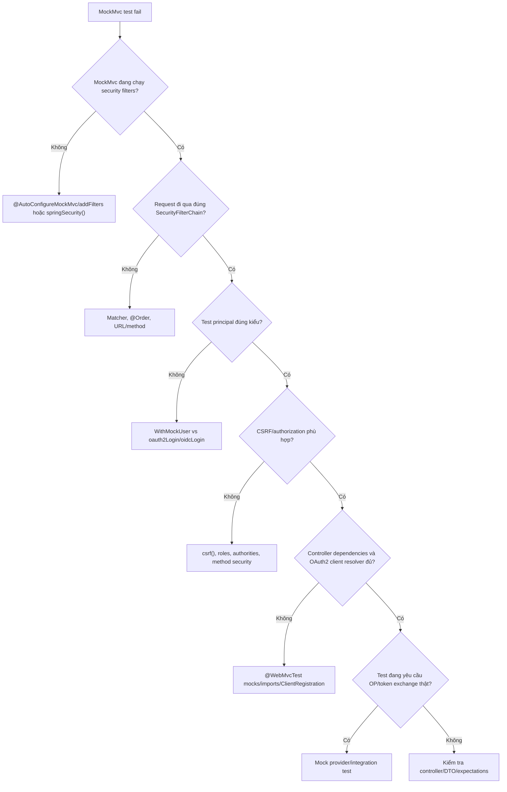

# 29.1. Thiết lập spring-security-test và MockMvc

Trong một ứng dụng **Spring Security OAuth 2.0 / OpenID Connect (OIDC) Client chạy trên Servlet**, việc cấu hình `oauth2Login()`, `oauth2Client()`, `SecurityFilterChain` và controller chỉ là một nửa công việc. Nửa còn lại là **kiểm thử những điều ứng dụng thật sự cho phép hoặc từ chối**: request chưa đăng nhập có bị chặn không, principal sau OIDC login được sử dụng ra sao, CSRF có được bảo vệ, quyền truy cập có bị nhầm, và controller có lấy đúng authorized client để gọi downstream API hay không.

Spring Security cung cấp module **`spring-security-test`** để dựng security context giả lập và kiểm tra kết quả bảo mật. Khi kết hợp với **Spring MVC Test `MockMvc`**, ta có thể gửi **HTTP requests giả lập đi qua Servlet filter chain** mà không cần khởi động một server HTTP thực.

Ví dụ:

```java
mockMvc.perform(get("/account/me")
        .with(oidcLogin()
            .idToken(token -> token.claim("sub", "user-123"))))
    .andExpect(status().isOk())
    .andExpect(jsonPath("$.sub").value("user-123"));
```

Test này minh họa một user đã được xác thực bằng OIDC trong ngữ cảnh MockMvc. Nó **không** tự gọi OpenID Provider, không thực hiện Authorization Code exchange, không xác minh JWKS thật và không tự chứng minh `state`/`nonce`/PKCE đã được xử lý đúng ở callback. Những luồng đó cần kiểm thử riêng với provider giả lập hoặc môi trường tích hợp phù hợp.

Bài học hướng dẫn **thiết lập `spring-security-test` và MockMvc từ đầu**, phân biệt các mức test, đưa security filter chain vào MockMvc, tạo user/OIDC principal/authorized client cho request, kiểm tra quyền và CSRF, tránh false positives khi tắt filter, xử lý Bean/configuration trong Spring Boot, và thiết kế bộ kiểm thử Servlet có độ tin cậy cao.

> **Mục tiêu:** sau bài học, người học có thể tạo một project test **chạy qua security filters thật của ứng dụng** khi cần, nhưng vẫn **giả lập danh tính OAuth2/OIDC có kiểm soát** để test controller/service mà không phải kết nối OP ở mọi lần chạy.

## 1. Cần kiểm thử những lớp nào?

Một ứng dụng OIDC Client điển hình gồm:

```text
Browser
  |
  | GET /orders
  v
Servlet Filter Chain
  |
  +-- Spring Security FilterChainProxy
  |     +-- SecurityContext persistence
  |     +-- CSRF
  |     +-- Authorization
  |     +-- OAuth2 Login filters
  |     +-- Logout
  |
  v
DispatcherServlet
  |
  +-- MVC Controller
  |     +-- @AuthenticationPrincipal
  |     +-- @RegisteredOAuth2AuthorizedClient
  |
  v
Service / WebClient
  |
  | Authorization: Bearer Access Token
  v
Downstream Resource Server
```

Không phải mọi test đều nên chạy toàn bộ chuỗi này. Một bộ test tốt biết rõ **lớp nào đang được kiểm tra**.

| Mục tiêu | Loại test phù hợp | Có kiểm tra HTTP Security Filter Chain? |
|---|---|---|
| Business service tính toán hoặc ánh xạ DTO | Unit test JUnit/Mockito | Không cần. |
| Controller trả JSON đúng cho `OidcUser` | `@WebMvcTest` + `MockMvc` + `oidcLogin()` | Có thể, nếu filters được bật. |
| Endpoint yêu cầu role/authority | `MockMvc` + security chain/method security phù hợp | Có, và cần không vô hiệu hóa filters. |
| Controller nhận `OAuth2AuthorizedClient` | MockMvc + `oauth2Client()` post-processor / cấu hình resolver | Có thể, theo tầng được cấu hình. |
| SecurityFilterChain thực của ứng dụng | `@SpringBootTest` + `@AutoConfigureMockMvc` | Có theo mặc định thông thường. |
| URL bắt đầu login redirect tới OP | MockMvc với registration provider metadata đã cấu hình | Có cho request phát redirect. |
| Authorization Code callback trao đổi token với OP | Integration test có mock HTTP provider/OP phù hợp | Có thể, nhưng cần thêm network simulation. |
| Browser cookie, SameSite và nhiều redirects | Browser/E2E test | MockMvc không mô phỏng browser hoàn chỉnh. |
| Resource Server xác minh JWT thật | Integration test Resource Server riêng | Không được chứng minh chỉ bằng `oidcLogin()`. |

### 1.1. MockMvc là gì?

`MockMvc` cho phép kiểm tra Spring MVC request handling qua một Servlet environment được mô phỏng. Test xây request bằng `MockMvcRequestBuilders`, cho request đi qua MVC infrastructure và đọc kết quả bằng `ResultMatchers`.

Ví dụ:

```java
mockMvc.perform(get("/health"))
    .andExpect(status().isOk())
    .andExpect(content().string("OK"));
```

Nếu có Spring Security và filters đã được đăng ký đúng, request còn đi qua security chain như một HTTP request tới ứng dụng.

### 1.2. MockMvc không phải WebTestClient

| Tiêu chí | MockMvc | WebTestClient |
|---|---|---|
| Stack chính | Spring MVC/Servlet | Spring WebFlux/Reactive, cũng có thể dùng một số kiểu test server khác |
| Test client API | `mockMvc.perform(...)` | `webTestClient.get().uri(...).exchange()` |
| Spring Security test helpers | `SecurityMockMvcRequestPostProcessors` | `SecurityMockServerConfigurers` / reactive test helpers |
| Context | Servlet request/session | `ServerWebExchange`/reactive context |
| OIDC request helper | `oidcLogin()` cho MockMvc | Reactive helper phù hợp theo WebFlux |
| HTTP server thật | Không cần | Có thể bind controller/context hoặc server tùy cấu hình |

Bài này nói về **Servlet**, không phải chỉ «ứng dụng có thêm dependency `WebClient`». Một project dùng `spring-boot-starter-web` cùng `WebClient` vẫn có thể là Servlet server và cần MockMvc.

## 2. `spring-security-test` cung cấp gì?

Module `org.springframework.security:spring-security-test` chứa các utility dành cho kiểm thử, trong đó quan trọng với MockMvc:

- `SecurityMockMvcConfigurers.springSecurity()`: tích hợp Spring Security với MockMvc được dựng thủ công.
- `SecurityMockMvcRequestPostProcessors.user(...)`: tạo user authentication giả lập.
- `SecurityMockMvcRequestPostProcessors.anonymous()`: chạy request không xác thực.
- `SecurityMockMvcRequestPostProcessors.csrf()`: thêm CSRF token phù hợp với test request.
- `SecurityMockMvcRequestPostProcessors.oauth2Login()`: giả lập một authentication từ OAuth2 Login.
- `SecurityMockMvcRequestPostProcessors.oidcLogin()`: giả lập authentication với `OidcUser`/ID Token.
- `SecurityMockMvcRequestPostProcessors.oauth2Client(...)`: cung cấp authorized client cho request trong test.
- `@WithMockUser`: cung cấp mock user qua Spring Security Test context listener.
- `@WithUserDetails` và `@WithSecurityContext`: tạo authentication từ UserDetails hoặc custom security context.
- Các matchers và request builders phục vụ các use cases security/CSRF/logout.

Không phải helper nào cũng chạy Authorization Server thật. **Request post-processor** thường đặt test state trực tiếp vào request/security context để tập trung vào hành vi cần kiểm tra.

### 2.1. Không đưa `spring-security-test` vào runtime production

Dependency này phục vụ test, không phải một phần authentication infrastructure cho production. Dùng test scope:

```gradle
testImplementation("org.springframework.security:spring-security-test")
```

hoặc `<scope>test</scope>` trong Maven.

Không dùng `implementation` cho dependency test chỉ vì có một class không compile được ở `src/main/java`. Test helpers phải nằm trong `src/test/java` hoặc test source set tương ứng.

## 3. Tạo project Spring Boot Servlet để học

Các dependencies ứng dụng điển hình:

- Spring Web (Servlet/MVC).
- Spring Security.
- Spring OAuth2 Client.
- Spring Boot Test/JUnit.
- Spring Security Test.

Một project structure có thể là:

```text
src/
  main/
    java/com/example/
      Application.java
      config/SecurityConfiguration.java
      web/AccountController.java
      web/OrdersController.java
      service/OrdersApiClient.java
    resources/
      application.yml
  test/
    java/com/example/
      web/AccountControllerWebMvcTest.java
      security/SecurityIntegrationTest.java
      security/OidcLoginMockMvcTest.java
    resources/
      application-test.yml
```

Đây là cấu trúc minh họa. Tên package/filename có thể khác nhưng nên giữ test rõ ràng và không trộn test fixture với production code.

### 3.1. Điều kiện để dùng MockMvc

MockMvc dùng với **Spring MVC Servlet**. Nếu project chủ yếu là WebFlux, hãy dùng WebTestClient và reactive test helpers thay vì sao chép test MockMvc.

Nếu project có cả `spring-boot-starter-web` và `spring-boot-starter-webflux`, cần xác nhận application type thực tế. Không chỉ nhìn thấy `reactor.core.publisher.Mono` trong controller rồi tự kết luận server đang reactive.

## 4. Cài dependency bằng Gradle Kotlin DSL

Ví dụ `build.gradle.kts`:

```kotlin
plugins {
    java
    id("org.springframework.boot") version "<spring-boot-version>"
    id("io.spring.dependency-management") version "<dependency-management-version>"
}

java {
    toolchain {
        languageVersion.set(JavaLanguageVersion.of(21))
    }
}

dependencies {
    implementation("org.springframework.boot:spring-boot-starter-web")
    implementation("org.springframework.boot:spring-boot-starter-security")
    implementation("org.springframework.boot:spring-boot-starter-oauth2-client")

    testImplementation("org.springframework.boot:spring-boot-starter-test")
    testImplementation("org.springframework.security:spring-security-test")
}

tasks.test {
    useJUnitPlatform()
}
```

Hai placeholder version được để tường minh vì phải chọn **bộ phiên bản Spring Boot, plugin và JDK tương thích** với project. Trong một project đã được Spring Initializr hoặc build management cấu hình, **không thêm lại plugin block** nếu đã có; chỉ bổ sung test dependency cần thiết.

### 4.1. Vì sao không tự pin phiên bản Spring Security Test?

Nếu dự án dùng Spring Boot BOM/dependency management, thường nên để nó quản lý phiên bản của:

```text
spring-security-core
spring-security-config
spring-security-web
spring-security-oauth2-client
spring-security-test
```

Tránh thêm một phiên bản `spring-security-test` quá khác với Spring Security runtime, vì API/method signatures và test infrastructure có thể không tương thích.

### 4.2. JUnit và AssertJ từ đâu?

`spring-boot-starter-test` thông thường cung cấp JUnit Jupiter, AssertJ, Mockito, Spring Test và các thành phần test phổ biến theo version đang dùng. Module `spring-security-test` bổ sung phần test security đặc thù.

Không cần thêm `junit-jupiter` riêng nếu starter/BOM đã cung cấp đủ cho nhu cầu.

### 4.3. Nếu dùng Gradle Groovy DSL

`build.gradle`:

```gradle
dependencies {
    implementation 'org.springframework.boot:spring-boot-starter-web'
    implementation 'org.springframework.boot:spring-boot-starter-security'
    implementation 'org.springframework.boot:spring-boot-starter-oauth2-client'

    testImplementation 'org.springframework.boot:spring-boot-starter-test'
    testImplementation 'org.springframework.security:spring-security-test'
}

tasks.named('test') {
    useJUnitPlatform()
}
```

Trong Gradle Groovy, có thể dùng dấu nháy đơn hoặc kép theo convention project.

## 5. Cài dependency bằng Maven

Ví dụ phần `dependencies` của `pom.xml`:

```xml
<dependencies>
    <dependency>
        <groupId>org.springframework.boot</groupId>
        <artifactId>spring-boot-starter-web</artifactId>
    </dependency>

    <dependency>
        <groupId>org.springframework.boot</groupId>
        <artifactId>spring-boot-starter-security</artifactId>
    </dependency>

    <dependency>
        <groupId>org.springframework.boot</groupId>
        <artifactId>spring-boot-starter-oauth2-client</artifactId>
    </dependency>

    <dependency>
        <groupId>org.springframework.boot</groupId>
        <artifactId>spring-boot-starter-test</artifactId>
        <scope>test</scope>
    </dependency>

    <dependency>
        <groupId>org.springframework.security</groupId>
        <artifactId>spring-security-test</artifactId>
        <scope>test</scope>
    </dependency>
</dependencies>
```

Đoạn này giả định project đã có Spring Boot parent/BOM hoặc dependency management tương thích. Không phải `pom.xml` độc lập đầy đủ.

### 5.1. Test classpath phải có Servlet Security

Nếu import:

```java
import static org.springframework.security.test.web.servlet.request
    .SecurityMockMvcRequestPostProcessors.oidcLogin;
```

bị báo không tìm thấy, cần kiểm tra:

- `spring-security-test` có trên **testCompileClasspath** hay không.
- Maven/Gradle có import phiên bản Spring Security đồng bộ không.
- Test source nằm trong `src/test/java`.
- IDE đã reload Gradle/Maven project.
- Import là Servlet MockMvc helper, không phải WebFlux helper.
- Không có dependency exclusion hoặc version conflict.

Chỉ thêm dependency vào production source set để làm IDE hết đỏ là xử lý sai nguyên nhân.

## 6. Hai chiến lược dựng MockMvc

Có hai tình huống thông dụng.

### 6.1. Spring Boot tự cấu hình MockMvc

Dùng:

```java
@SpringBootTest
@AutoConfigureMockMvc
class SecurityIntegrationTest {
    @Autowired
    MockMvc mockMvc;
}
```

Spring Boot tạo application context tương đối đầy đủ và cung cấp MockMvc với filters tùy cấu hình. Đây là cách phù hợp khi muốn chạy **SecurityFilterChain thực của ứng dụng** trong test context.

Hoặc:

```java
@WebMvcTest(AccountController.class)
class AccountControllerTest {
    @Autowired
    MockMvc mockMvc;
}
```

`@WebMvcTest` tạo một MVC test slice nhỏ hơn, có thể auto-configure MockMvc nhưng không load tất cả services/repositories như `@SpringBootTest`.

### 6.2. Tự dựng bằng `MockMvcBuilders`

Nếu dùng Spring Test context:

```java
import static org.springframework.security.test.web.servlet.setup
    .SecurityMockMvcConfigurers.springSecurity;

import org.junit.jupiter.api.BeforeEach;
import org.springframework.beans.factory.annotation.Autowired;
import org.springframework.web.context.WebApplicationContext;
import org.springframework.test.web.servlet.MockMvc;
import org.springframework.test.web.servlet.setup.MockMvcBuilders;

class ManualMockMvcConfigurationExample {

    @Autowired
    WebApplicationContext context;

    MockMvc mockMvc;

    @BeforeEach
    void setUp() {
        mockMvc = MockMvcBuilders
            .webAppContextSetup(context)
            .apply(springSecurity())
            .build();
    }
}
```

Đây là fragment minh họa được đặt trong **một test context có `WebApplicationContext`**; một class JUnit thuần không tự được Spring tiêm `context` nếu thiếu Spring Test extension/annotation tương ứng.

Điểm then chốt là:

```java
.apply(springSecurity())
```

nó tích hợp `FilterChainProxy`/security test infrastructure và hỗ trợ `SecurityContext` test trong cách tự dựng MockMvc.

### 6.3. Không dựng thêm MockMvc nếu đã có Bean phù hợp

Nếu `@AutoConfigureMockMvc` đã tạo và autowire MockMvc đúng, thường **không cần tạo lại** bằng `MockMvcBuilders`. Tạo hai MockMvc instances với filter setup khác nhau có thể khiến test nọ pass, test kia fail vì một instance đã bỏ security chain.

Chọn một cách dựng chính cho mỗi test class và hiểu rõ những filters có hiệu lực.

## 7. Vì sao `springSecurity()` quan trọng khi tự dựng MockMvc?

Khi dùng:

```java
MockMvcBuilders.webAppContextSetup(context)
    .apply(springSecurity())
    .build();
```

Spring Security Test configurer giúp gắn Spring Security FilterChainProxy và support request post-processors cho security context.

Nếu chỉ viết:

```java
MockMvcBuilders.standaloneSetup(controller)
    .build();
```

thì request có thể đi thẳng tới controller mà **không qua authorization, CSRF hoặc OAuth2 login filters**.

Một test:

```java
mockMvc.perform(get("/admin"))
    .andExpect(status().isOk());
```

có thể pass trong standalone setup vì đã **bỏ qua filter chain**, trong khi ứng dụng production trả 401/302/403. Đó là **false confidence** khi mục tiêu là test security.

### 7.1. Standalone setup vẫn có chỗ dùng

`standaloneSetup(controller)` hữu ích để test:

- Mapping URL.
- JSON serialization/deserialization.
- Validation.
- Controller advice.
- Những behavior của controller không phụ thuộc security filter.

Nhưng **không dùng kết quả standalone MVC test làm bằng chứng endpoint đã được Spring Security bảo vệ**.

Nếu cố test controller dùng `@AuthenticationPrincipal` ở standalone setup, cần cài argument resolvers/security context phù hợp; lúc ấy test complexity tăng và dễ khác production. Với security tests, `@WebMvcTest`/`@SpringBootTest` có security integration thường đáng tin hơn.

### 7.2. Spring Security Test không tự bảo đảm mọi cấu hình

Ngay cả khi gọi `springSecurity()`, bạn vẫn phải:

- Cấu hình đúng `SecurityFilterChain`.
- Để request match đúng chain.
- Không vô hiệu hóa filters ở Boot test.
- Không mock security manager/filter chain theo cách bỏ qua behavior cần test.
- Biết controller có method security hay không.
- Biết test principal có đại diện đúng loại `Authentication` production hay không.

## 8. `@WebMvcTest` khác `@SpringBootTest` như thế nào?

| Tiêu chí | `@WebMvcTest` | `@SpringBootTest + @AutoConfigureMockMvc` |
|---|---|---|
| Phạm vi | Controller/MVC slice và các thành phần liên quan được chọn | Application context rộng hơn |
| Tốc độ | Thường nhanh hơn | Thường chậm hơn |
| Service/repository | Thường phải mock/import rõ | Có thể load thật hoặc stub theo test |
| SecurityFilterChain | Phụ thuộc slice/import/auto-config | Có thể chạy cấu hình ứng dụng thật |
| OIDC provider wiring | Có thể thiếu registrations nếu chỉ slice | Cần cấu hình test không vô tình discovery network thật |
| Phù hợp | Test endpoint và principal/controller behavior | Test security routing/wiring tích hợp |
| Hạn chế | Không tự chứng minh toàn hệ thống | Vẫn không mô phỏng browser/OP đầy đủ |

**Đừng dùng mọi test bằng `@SpringBootTest`**, vì startup context có thể tốn thời gian, phụ thuộc hạ tầng và làm suite chậm. Ngược lại, đừng dùng duy nhất `@WebMvcTest` nếu mục tiêu là bảo đảm các security chain/method security của ứng dụng thực sự được cấu hình đúng.

### 8.1. Khi controller phụ thuộc service

Ví dụ:

```java
@RestController
@RequestMapping("/orders")
public class OrdersController {

    private final OrdersService service;

    public OrdersController(OrdersService service) {
        this.service = service;
    }

    @GetMapping
    public List<OrderSummary> list() {
        return service.list();
    }
}
```

Với `@WebMvcTest(OrdersController.class)`, Bean `OrdersService` thường không được load tự động. Có thể dùng mock bean trong test:

```java
@MockitoBean
OrdersService service;
```

Tên annotation phụ thuộc Spring Boot/Spring Framework version. Trong các phiên bản hiện đại có `@MockitoBean`; các bản Boot cũ có thể dùng `@MockBean`. Hãy dùng API phù hợp dependency version của project; không trộn tùy ý hai loại annotation.

### 8.2. Không mock cả controller đang cần test

Nếu tạo mock của `OrdersController` thay vì service dependency, test có thể chỉ xác nhận Mockito stubbing, không chạy logic controller thật. Với MVC slice, giữ controller thật; mock những dependencies ngoài phạm vi.

## 9. Bắt đầu với một controller OIDC tối thiểu

Controller nhận `OidcUser`:

```java
package com.example.web;

import java.util.Map;

import org.springframework.security.core.annotation.AuthenticationPrincipal;
import org.springframework.security.oauth2.core.oidc.user.OidcUser;
import org.springframework.web.bind.annotation.GetMapping;
import org.springframework.web.bind.annotation.RequestMapping;
import org.springframework.web.bind.annotation.RestController;

@RestController
@RequestMapping("/account")
public class AccountController {

    @GetMapping("/me")
    public Map<String, String> me(
            @AuthenticationPrincipal OidcUser principal) {

        return Map.of(
            "sub", principal.getSubject()
        );
    }
}
```

Đây là use case đơn giản để chứng minh:

- Controller được map tại `GET /account/me`.
- Controller cần principal **OIDC**, không chỉ một username string.
- Nếu authentication thiếu, security chain phải bảo vệ endpoint.
- Test có thể truyền `OidcUser` giả lập mà không gọi OP.

### 9.1. Security config cho test slice

Để ví dụ độc lập với security setup của production, test có thể import một cấu hình đơn giản yêu cầu authentication và dùng HTTP Basic entry point cho **kết quả anonymous 401 xác định**. Đây là test fixture, **không thay cho cấu hình OAuth2 Login production**.

```java
package com.example.web;

import org.springframework.boot.test.context.TestConfiguration;
import org.springframework.context.annotation.Bean;
import org.springframework.security.config.Customizer;
import org.springframework.security.config.annotation.web.builders.HttpSecurity;
import org.springframework.security.web.SecurityFilterChain;

@TestConfiguration
public class AccountTestSecurityConfiguration {

    @Bean
    SecurityFilterChain testSecurityFilterChain(HttpSecurity http)
            throws Exception {

        return http
            .authorizeHttpRequests(auth -> auth
                .requestMatchers("/account/me").authenticated()
                .anyRequest().permitAll()
            )
            .httpBasic(Customizer.withDefaults())
            .build();
    }
}
```

**Giới hạn:** vì test fixture dùng HTTP Basic thay vì `oauth2Login()`, nó chỉ giúp kiểm tra **controller và request security context** với kết quả nhất quán. Test cấu hình OIDC Login thật cần các integration tests riêng.

## 10. Test `@WebMvcTest` với `oidcLogin()`

Một test class:

```java
package com.example.web;

import static org.springframework.security.test.web.servlet.request
    .SecurityMockMvcRequestPostProcessors.oidcLogin;
import static org.springframework.test.web.servlet.request
    .MockMvcRequestBuilders.get;
import static org.springframework.test.web.servlet.result
    .MockMvcResultMatchers.jsonPath;
import static org.springframework.test.web.servlet.result
    .MockMvcResultMatchers.status;

import org.junit.jupiter.api.Test;
import org.springframework.beans.factory.annotation.Autowired;
import org.springframework.boot.test.autoconfigure.web.servlet.WebMvcTest;
import org.springframework.context.annotation.Import;
import org.springframework.test.web.servlet.MockMvc;

@WebMvcTest(AccountController.class)
@Import(AccountTestSecurityConfiguration.class)
class AccountControllerWebMvcTest {

    @Autowired
    MockMvc mockMvc;

    @Test
    void oidcUserCanReadOwnSubject() throws Exception {
        mockMvc.perform(get("/account/me")
                .with(oidcLogin()
                    .idToken(token -> token
                        .claim("sub", "user-123"))))
            .andExpect(status().isOk())
            .andExpect(jsonPath("$.sub").value("user-123"));
    }

    @Test
    void anonymousCannotReadAccount() throws Exception {
        mockMvc.perform(get("/account/me"))
            .andExpect(status().isUnauthorized());
    }
}
```

Trong đoạn này:

1. `@WebMvcTest(AccountController.class)` tạo MVC slice cho controller.
2. `@Import(...)` bảo đảm test sử dụng security chain riêng của fixture.
3. `@Autowired MockMvc` lấy MockMvc đã được Boot cấu hình.
4. `oidcLogin()` tạo authentication với một `OidcUser` dùng trong request.
5. `@AuthenticationPrincipal` nhận principal và controller trả JSON `sub`.
6. Request anonymous nhận **401** vì test fixture bật `httpBasic()` và yêu cầu authenticated.

Nếu thay security fixture bằng `oauth2Login()` production, request anonymous có thể bị **redirect tới trang login/OP** thay vì nhận 401. Không viết assertion 401 cho mọi loại endpoint mà không xét authentication entry point.

### 10.1. Vì sao `oidcLogin()` hữu ích?

Nó giúp tạo một principal có **OIDC claims** như `sub`, `email` và `name` mà không phải:

- Mở browser thật.
- Khởi chạy OpenID Provider.
- Phát authorization code thật.
- Gọi token endpoint.
- Ký ID Token thật hoặc tải JWKS.

Điều đó giúp test controller nhanh, ổn định và có thể chạy offline.

### 10.2. Vì sao không dùng `@WithMockUser` cho controller trên?

`@WithMockUser` thông thường tạo một authentication kiểu username/password cho test, không phải `OAuth2AuthenticationToken` với `OidcUser`.

Nếu controller khai báo:

```java
@AuthenticationPrincipal OidcUser principal
```

thì chỉ có `@WithMockUser` **không bảo đảm** Spring MVC đưa vào một `OidcUser`; injection có thể thành `null` hoặc không khớp kiểu tùy resolver/config.

Khi cần kiểm tra code sử dụng OIDC claims, ưu tiên `oidcLogin()` hoặc custom security context tạo đúng kiểu authentication.

## 11. `@WithMockUser` dành cho trường hợp nào?

Ví dụ một endpoint chỉ cần biết user đã đăng nhập:

```java
@GetMapping("/hello")
public String hello(Authentication authentication) {
    return "Hello " + authentication.getName();
}
```

Test:

```java
import org.springframework.security.test.context.support.WithMockUser;

@Test
@WithMockUser(username = "alice")
void returnsAuthenticatedName() throws Exception {
    mockMvc.perform(get("/hello"))
        .andExpect(status().isOk())
        .andExpect(content().string("Hello alice"));
}
```

`@WithMockUser` tiện để kiểm tra các quy tắc:

- `authenticated()`.
- `hasRole(...)`.
- `hasAuthority(...)`.
- Controller chỉ cần `Authentication.getName()`.
- Method security không phụ thuộc trực tiếp OIDC claim structure.

### 11.1. `roles` và `authorities`

Ví dụ:

```java
@WithMockUser(username = "admin", roles = "ADMIN")
```

thường tạo authority `ROLE_ADMIN`. Nếu kiểm tra:

```java
hasRole("ADMIN")
```

thì Spring Security so với role prefix theo convention.

Ngược lại:

```java
@WithMockUser(
    username = "api-reader",
    authorities = "orders:read"
)
```

cấp đúng authority `orders:read`.

**`ROLE_ADMIN`, `orders:read` và `SCOPE_orders.read` không phải cùng một chuỗi.** Test phải dùng đúng authority model của ứng dụng.

### 11.2. `@WithMockUser` không mô phỏng OAuth2 login end-to-end

Test này không chứng minh:

- OIDC ID Token được xác minh.
- Issuer/audience/nonce hợp lệ.
- UserInfo endpoint được gọi.
- OAuth2 authorities mapping hoạt động.
- Authorized client được lưu đúng registration/principal.
- Authorization Code Flow có PKCE/state protection.

Nó chỉ cung cấp authentication giả lập cho lớp cần test.

## 12. `oauth2Login()` dùng khi không cần OIDC

Spring Security OAuth2 Login có thể hoạt động với một OAuth2 provider không phải OIDC. Trong test, có thể dùng:

```java
import static org.springframework.security.test.web.servlet.request
    .SecurityMockMvcRequestPostProcessors.oauth2Login;

mockMvc.perform(get("/profile")
        .with(oauth2Login()
            .attributes(attributes ->
                attributes.put("name", "Alice"))))
    .andExpect(status().isOk());
```

Điểm khác:

| Helper | Principal phổ biến | Dùng cho |
|---|---|---|
| `user("alice")` | Spring Security `UserDetails` | Username/role-centric test. |
| `@WithMockUser` | Mock username/password authentication | Security rule đơn giản. |
| `oauth2Login()` | `OAuth2User`/OAuth2 authentication | OAuth2 Login không yêu cầu OIDC user. |
| `oidcLogin()` | `OidcUser`/OAuth2 authentication | OIDC Login và ID Token/UserInfo claims. |
| `oauth2Client("registrationId")` | Authorized client association | Controller/filter cần OAuth2 client token. |

### 12.1. Không thay `oauth2Login()` bằng `oidcLogin()` vô điều kiện

Nếu production provider trả OAuth2 user attributes nhưng không cấp ID Token, một test dùng `oidcLogin()` có thể **giả lập khả năng OIDC mà provider thực không có**.

Chọn helper theo **giao thức và principal type thật** của ứng dụng.

### 12.2. Cùng một user có thể có nhiều authorized clients

`oidcLogin()` chỉ giải quyết authentication được mô phỏng. Một ứng dụng có thể cần Access Token cho registration khác. Lúc đó cần kiểm thử `OAuth2AuthorizedClient`/repository/manager theo use case, không nghĩ rằng cứ có OIDC principal thì mọi registration đều có token.

## 13. Cấu hình claims bằng `oidcLogin()`

Khi controller đọc thêm claims:

```java
@GetMapping("/account/profile")
public Map<String, String> profile(
        @AuthenticationPrincipal OidcUser user) {

    return Map.of(
        "subject", user.getSubject(),
        "email", user.getEmail() == null ? "" : user.getEmail()
    );
}
```

Test:

```java
@Test
void exposesApprovedProfileFields() throws Exception {
    mockMvc.perform(get("/account/profile")
            .with(oidcLogin()
                .idToken(token -> token
                    .claim("sub", "subject-42")
                    .claim("email", "alice@example.org")
                    .claim("email_verified", true))))
        .andExpect(status().isOk())
        .andExpect(jsonPath("$.subject").value("subject-42"))
        .andExpect(jsonPath("$.email").value("alice@example.org"));
}
```

Giải thích:

- `idToken(...)` điều chỉnh claims trong **ID Token giả lập** của test.
- `sub` giúp controller tìm định danh user.
- `email` chỉ là claim; không nên dùng nó làm identity key bất biến nếu application không có policy riêng.
- `email_verified` trong mock là dữ liệu được test cung cấp, không phải proof OP đã xác minh.

### 13.1. Test case thiếu claim

Một ứng dụng có thể gặp ID Token không chứa `email` hoặc claim optional khác. Test cần xác định behavior fallback của controller/service.

Ví dụ:

```java
mockMvc.perform(get("/account/profile")
        .with(oidcLogin()
            .idToken(token -> token
                .claim("sub", "subject-without-email"))))
    .andExpect(status().isOk())
    .andExpect(jsonPath("$.email").value(""));
```

**Không tự giả định mọi OP đều cung cấp email** chỉ vì scope `email` được yêu cầu. Provider/consent/policy quyết định claims thực tế.

### 13.2. Test authorities từ OIDC

Có thể chọn authorities tường minh:

```java
import org.springframework.security.core.authority.SimpleGrantedAuthority;

mockMvc.perform(get("/reports")
        .with(oidcLogin()
            .authorities(
                new SimpleGrantedAuthority("ROLE_REPORT_VIEWER")
            )))
    .andExpect(status().isOk());
```

Test này kiểm tra behavior **khi authentication đã có authority đó**. Nó **không** kiểm tra authority được map từ ID Token/UserInfo claims như thế nào.

Muốn test mapping thật, cần unit/integration test đối với `GrantedAuthoritiesMapper`, `OidcUserService` hoặc custom authentication converter của ứng dụng.

## 14. `oauth2Client()`: mock authorized client theo registration

Trong OAuth2 Client, authorized client đại diện cho **một ClientRegistration đã được cấp Access Token** trong ngữ cảnh principal.

Test helper:

```java
import static org.springframework.security.test.web.servlet.request
    .SecurityMockMvcRequestPostProcessors.oauth2Client;

mockMvc.perform(get("/api/orders")
        .with(oauth2Client("company")))
    .andExpect(status().isOk());
```

Đây là ví dụ hình thức. Để request thật sự được xác thực và tới controller, có thể cần **kết hợp authentication** (ví dụ `oidcLogin()`) và security chain phù hợp:

```java
mockMvc.perform(get("/api/orders")
        .with(oidcLogin())
        .with(oauth2Client("company")))
    .andExpect(status().isOk());
```

### 14.1. Khác biệt giữa `oidcLogin()` và `oauth2Client()`

| Helper | Dữ liệu giả lập chính | Mục đích |
|---|---|---|
| `oidcLogin()` | `Authentication` với `OidcUser`/ID Token claims | Controller/security thấy một user OIDC đã login. |
| `oauth2Client("company")` | `OAuth2AuthorizedClient` của registration `company` | Cho phép logic authorized-client resolution dùng token test. |

Một user đã đăng nhập **không mặc nhiên có authorized client cho mọi registration**; tương tự một authorized client trong store **không tự tạo browser session authenticated** trong mọi trường hợp.

### 14.2. Access Token giả lập không phải token thật

Một test tạo Access Token cố định:

```java
import java.time.Instant;
import java.util.Set;

import org.springframework.security.oauth2.core.OAuth2AccessToken;

OAuth2AccessToken token = new OAuth2AccessToken(
    OAuth2AccessToken.TokenType.BEARER,
    "test-access-token",
    Instant.parse("2030-01-01T00:00:00Z"),
    Instant.parse("2030-01-01T01:00:00Z"),
    Set.of("orders.read")
);
```

Giá trị `test-access-token` chỉ dùng trong test. Không dùng production token/Refresh Token làm fixture; test logs, CI và reports không phải nơi lưu credential thật.

Với post-processor phù hợp phiên bản:

```java
mockMvc.perform(get("/api/orders")
        .with(oidcLogin())
        .with(oauth2Client("company")
            .accessToken(token)))
    .andExpect(status().isOk());
```

Một Access Token giả lập **không được Spring Security tự kiểm tra signature/audience** khi bạn đã inject authorized client thẳng vào request. Đây là đặc điểm của test fixture, không phải bằng chứng Resource Server sẽ chấp nhận token ấy.

### 14.3. Principal name trong authorized client

Nếu controller/service lookup token theo `principalName`, test cần thống nhất giữa:

- Authentication của request.
- `OAuth2AuthorizedClient.getPrincipalName()`.
- Registration ID.
- Repository/manager được dùng.

Một mismatch giữa `oidcLogin()` principal và authorized client mock có thể chỉ ra lỗi test setup hoặc một bug trong logic identity mapping. Không chữa bằng cách cho service lấy «token đầu tiên trong store».

## 15. `@RegisteredOAuth2AuthorizedClient` trong MVC Controller

Ví dụ controller nhận authorized client:

```java
package com.example.web;

import java.util.Map;

import org.springframework.security.oauth2.client.OAuth2AuthorizedClient;
import org.springframework.security.oauth2.client.annotation.RegisteredOAuth2AuthorizedClient;
import org.springframework.web.bind.annotation.GetMapping;
import org.springframework.web.bind.annotation.RestController;

@RestController
public class AuthorizedClientController {

    @GetMapping("/client/registration")
    public Map<String, String> registration(
            @RegisteredOAuth2AuthorizedClient("company")
            OAuth2AuthorizedClient client) {

        return Map.of(
            "registrationId",
            client.getClientRegistration().getRegistrationId()
        );
    }
}
```

Test:

```java
@Test
void resolvesAuthorizedClientForRequestedRegistration() throws Exception {
    mockMvc.perform(get("/client/registration")
            .with(oidcLogin())
            .with(oauth2Client("company")))
        .andExpect(status().isOk())
        .andExpect(jsonPath("$.registrationId")
            .value("company"));
}
```

Test này chỉ có ý nghĩa khi MVC test context đã có **argument resolver/authorized-client infrastructure** cần thiết và helper gắn vào đúng repository mechanism. Nếu `@WebMvcTest` cắt bỏ các OAuth2 Client beans cần thiết, cần **import/test-configure những thành phần còn thiếu**, hoặc dùng `@SpringBootTest` cho use case đó.

### 15.1. Không đơn giản mock Bean rồi tưởng đã test resolver

Nếu controller được test như một Java method trực tiếp:

```java
controller.registration(fakeAuthorizedClient);
```

bạn có thể kiểm tra mapping body, nhưng **không kiểm tra** Spring MVC argument resolution của `@RegisteredOAuth2AuthorizedClient`.

Để kiểm tra MVC integration, request phải đi qua `MockMvc` với argument resolver/security infrastructure tương ứng.

### 15.2. Dùng đúng registration ID

`company` trong:

```java
@RegisteredOAuth2AuthorizedClient("company")
```

là **client registration ID**, không phải issuer URL, provider key hoặc `client_id`.

Test nên có case sai hoặc thiếu registration để tránh fallback nguy hiểm sang authorized client khác, nhất là ứng dụng có nhiều OIDC providers.

### 15.3. Không trả raw token chỉ để xác nhận test

Một endpoint production không nên có:

```java
return client.getAccessToken().getTokenValue();
```

chỉ để test nhận diện token nào được chọn. Dùng metadata an toàn hoặc mock outbound HTTP client và kiểm tra Bearer header tại test boundary, **không công bố token cho browser**.

## 16. Test POST và CSRF protection

Một trong những chỗ `spring-security-test` đem lại giá trị rõ là `csrf()`.

Giả sử có endpoint:

```java
@PostMapping("/account/preferences")
public ResponseEntity<Void> savePreferences(
        @RequestBody PreferencesRequest request) {

    preferencesService.save(request);
    return ResponseEntity.noContent().build();
}
```

Nếu security chain bật CSRF protection và browser dùng cookie session, một request POST không có CSRF token hợp lệ thường bị từ chối.

Test không có CSRF:

```java
@Test
void postWithoutCsrfIsForbidden() throws Exception {
    mockMvc.perform(post("/account/preferences")
            .with(oidcLogin())
            .contentType(MediaType.APPLICATION_JSON)
            .content("{\"theme\":\"dark\"}"))
        .andExpect(status().isForbidden());
}
```

Test với CSRF hợp lệ:

```java
@Test
void postWithCsrfCanReachController() throws Exception {
    mockMvc.perform(post("/account/preferences")
            .with(oidcLogin())
            .with(csrf())
            .contentType(MediaType.APPLICATION_JSON)
            .content("{\"theme\":\"dark\"}"))
        .andExpect(status().isNoContent());
}
```

Để ví dụ compile, test class cần các static imports của `post`, `status`, `csrf` và `MediaType`. Đồng thời `PreferencesRequest` và `preferencesService` cần fixture/Bean hoặc mock tương ứng.

### 16.1. Invalid CSRF token

```java
mockMvc.perform(post("/account/preferences")
        .with(oidcLogin())
        .with(csrf().useInvalidToken())
        .contentType(MediaType.APPLICATION_JSON)
        .content("{\"theme\":\"dark\"}"))
    .andExpect(status().isForbidden());
```

Đây là cách kiểm thử một request có token nhưng **không hợp lệ**.

### 16.2. Authentication và CSRF là hai điều kiện độc lập

Một user đã authenticated không được miễn CSRF đối với các unsafe methods chỉ vì họ login bằng OIDC.

Vì thế:

```java
.with(oidcLogin())
```

không thay thế:

```java
.with(csrf())
```

Khi một test POST thất bại 403, cần phân biệt **thiếu CSRF** với **thiếu quyền**. Không tự tắt CSRF để làm test pass.

### 16.3. Nếu API đã được cấu hình stateless Bearer

Một API Resource Server nhận Bearer token từ `Authorization` header có thể có CSRF policy khác browser endpoints dùng session cookie. Test phải phản ánh security chain thực tế.

Không áp dụng `csrf()` máy móc vào mọi endpoint hoặc tắt toàn app để tránh cần phân biệt browser và API security.

## 17. Test authorization: anonymous, authenticated, admin

Một policy:

```java
http.authorizeHttpRequests(auth -> auth
    .requestMatchers("/public/**").permitAll()
    .requestMatchers("/admin/**").hasRole("ADMIN")
    .anyRequest().authenticated()
);
```

Các trường hợp cần kiểm tra:

| Request | Principal | Kết quả kỳ vọng |
|---|---|---|
| `GET /public/info` | Anonymous | Cho phép theo policy. |
| `GET /account/me` | Anonymous | Yêu cầu authentication. |
| `GET /account/me` | OIDC user hợp lệ | Cho phép nếu endpoint không đòi thêm quyền. |
| `GET /admin/report` | OIDC user không có `ROLE_ADMIN` | 403 hoặc access-denied behavior phù hợp. |
| `GET /admin/report` | User có `ROLE_ADMIN` | Vượt filter; kết quả phụ thuộc controller/service. |

Test thiếu authority:

```java
mockMvc.perform(get("/admin/report")
        .with(oidcLogin()))
    .andExpect(status().isForbidden());
```

Test đủ authority:

```java
mockMvc.perform(get("/admin/report")
        .with(oidcLogin()
            .authorities(
                new SimpleGrantedAuthority("ROLE_ADMIN")
            )))
    .andExpect(status().isOk());
```

Những assertions status 200 chỉ đúng nếu controller/service được fixture trả thành công. Với endpoint khác, có thể assert response phù hợp thay vì cố định 200.

### 17.1. Không ngầm coi OIDC `scope` là Spring authority

Một ID Token có claim và một Access Token có scopes, nhưng **OAuth2 Login principal authorities** phụ thuộc provider/user service/mapper.

Trong test, tạo:

```java
.authorities(new SimpleGrantedAuthority("ROLE_ADMIN"))
```

là **cấp quyền test tường minh**, không kiểm tra role mapping từ OP claims. Để test mapping, phải chạy logic mapper thực và cung cấp token/UserInfo claims tương ứng.

### 17.2. Test cả case bị từ chối

Một bộ test chỉ kiểm tra admin vào được mà không kiểm tra user thường bị chặn có thể bỏ sót misconfiguration `permitAll()` hoặc matcher quá rộng.

Nên có các negative cases cho endpoint nhạy cảm, nhất là khi `SecurityFilterChain` có nhiều matcher/chain ordering.

## 18. Method Security và MVC filters

Spring Security có thể bảo vệ ở hai lớp:

1. Request authorization trong `HttpSecurity.authorizeHttpRequests(...)`.
2. Method authorization bằng `@PreAuthorize`/`@PostAuthorize` khi method security được bật.

Ví dụ service:

```java
@Service
public class ReportService {

    @PreAuthorize("hasAuthority('report:export')")
    public byte[] export() {
        return new byte[0];
    }
}
```

Để `@PreAuthorize` có hiệu lực trong Servlet app, cần cấu hình method security phù hợp, thường là `@EnableMethodSecurity` ở nơi thích hợp.

### 18.1. Test slice có thể không kích hoạt method security thật

`@WebMvcTest` cắt giảm application context. Nếu `ReportService` được mock, test controller có thể không thực thi `@PreAuthorize` đặt trên method service thật.

Nếu mục tiêu là test **method security integration**:

- Đảm bảo method security được bật trong test context.
- Đảm bảo method được kiểm tra đi qua Spring proxy.
- Không mock class/method cần xác minh annotation.
- Sử dụng `@SpringBootTest` hoặc test configuration tập trung cho method security khi cần.
- Kiểm tra cả case allowed và denied.

Một unit test gọi `new ReportService().export()` trực tiếp cũng không chứng minh `@PreAuthorize` đã được Spring AOP áp dụng.

### 18.2. RequestMatcher và method security bổ sung cho nhau

Request matcher có thể hạn chế endpoint theo URL/method. Method security kiểm tra quyền ở tầng service. Hai lớp nên nhất quán nhưng không đồng nghĩa.

MockMvc có thể test cả hai khi context/proxy đúng; nếu test chỉ import controller và mock service, chủ yếu đang test HTTP layer.

## 19. `@SpringBootTest` và `@AutoConfigureMockMvc`

Một integration test thường có dạng:

```java
import org.junit.jupiter.api.Test;
import org.springframework.beans.factory.annotation.Autowired;
import org.springframework.boot.test.autoconfigure.web.servlet.AutoConfigureMockMvc;
import org.springframework.boot.test.context.SpringBootTest;
import org.springframework.test.web.servlet.MockMvc;

@SpringBootTest
@AutoConfigureMockMvc
class OAuth2SecurityIntegrationTest {

    @Autowired
    MockMvc mockMvc;

    @Test
    void protectedPageRejectsAnonymousRequest() throws Exception {
        // Assertion cụ thể phụ thuộc entry point:
        // HTTP Basic thường 401, oauth2Login thường redirect.
    }
}
```

Đây là skeleton để minh họa annotations. `@SpringBootTest` load application rộng hơn; test có thể cần mock downstream services, database hoặc cấu hình riêng để tránh dependency thật.

### 19.1. MockMvc không khởi động HTTP server thật

`@SpringBootTest` mặc định có thể chạy web environment dạng mock Servlet context. `@AutoConfigureMockMvc` tạo MockMvc và đăng ký filters phù hợp.

Nếu mục tiêu là kiểm thử browser/TLS reverse proxy, `Set-Cookie` behavior qua server thật hoặc cross-site redirects, cần **test layer khác**. MockMvc hữu ích nhưng không thay E2E/browser tests.

### 19.2. `addFilters=false` là cạm bẫy

Ví dụ:

```java
@AutoConfigureMockMvc(addFilters = false)
```

sẽ làm filters không được đăng ký với MockMvc theo lựa chọn này. Nếu mục tiêu là test Spring Security, đây có thể khiến test pass dù production thực sự từ chối request.

Chỉ dùng `addFilters=false` khi **cố ý kiểm tra controller tách biệt bảo mật**, và không gọi kết quả ấy là security integration test.

### 19.3. Context loading và external dependencies

Nếu application production cấu hình `issuer-uri` dẫn Spring Security tới discovery metadata lúc startup, `@SpringBootTest` có thể bị phụ thuộc network/OP.

Nên có **test profile/configuration dùng endpoints giả lập hoặc provider metadata được chỉ định rõ**, không phải gọi OP production trong mỗi lượt test.

## 20. Cấu hình ClientRegistration trong môi trường test

Một OIDC client thường được cấu hình:

```yaml
spring:
  security:
    oauth2:
      client:
        registration:
          company:
            provider: company-oidc
            client-id: ${OIDC_CLIENT_ID}
            client-secret: ${OIDC_CLIENT_SECRET}
            authorization-grant-type: authorization_code
            redirect-uri: "{baseUrl}/login/oauth2/code/{registrationId}"
            scope:
              - openid
              - profile
        provider:
          company-oidc:
            issuer-uri: https://id.company.example/realms/main
```

Nếu chỉ test controller/authorization rule, không cần discovery metadata thật. Với integration tests, có thể tạo `ClientRegistrationRepository` test bean hoặc cấu hình provider endpoints test rõ ràng.

### 20.1. Test profile với endpoint giả

Ví dụ `application-test.yml`:

```yaml
spring:
  security:
    oauth2:
      client:
        registration:
          company:
            provider: test-company
            client-id: test-client
            client-secret: test-secret
            client-authentication-method: client_secret_basic
            authorization-grant-type: authorization_code
            redirect-uri: "{baseUrl}/login/oauth2/code/{registrationId}"
            scope: [openid, profile]
        provider:
          test-company:
            authorization-uri: https://id.example.test/authorize
            token-uri: https://id.example.test/token
            jwk-set-uri: https://id.example.test/jwks
            user-info-uri: https://id.example.test/userinfo
            user-name-attribute: sub
```

Không cấu hình `issuer-uri` ở test provider ví dụ để tránh việc **Spring tự discovery từ issuer đó**, nhưng lưu ý nếu `application.yml` mặc định vẫn khai báo issuer cùng key thì profile merging có thể giữ giá trị cũ. Cần đảm bảo test profile **thực sự thay thế** production registration/provider settings hoặc sử dụng test Bean override.

### 20.2. Đây là fixture, không phải OP đang chạy

Domain `id.example.test` chỉ là endpoint minh họa và không có server thật. Test có thể kiểm tra **RP tạo redirect URL** mà không truy cập endpoint đó.

Muốn kiểm tra callback/token exchange/JWKS, phải dựng **stub HTTP server** hoặc provider giả lập có thể nhận request và trả metadata/token/JWKS hợp lệ. Một URL test chỉ được khai báo **không có nghĩa** các request mạng sẽ thành công.

### 20.3. Không đưa client secret thật vào test

`test-secret` là chuỗi fixture. Không dùng secret sản xuất hoặc token user thật trong:

- Source tests.
- CI environment.
- Snapshot/reports.
- HTTP request recording.
- Logs/traces.
- Mock responses.

Một test offline nên có dữ liệu synthetic và key/certificate dành riêng cho test khi cần ký JWT.

## 21. Test endpoint khởi động OAuth2 Login

Nếu đã cấu hình registration `company` và `oauth2Login()`, Spring Security Servlet thường có default authorization request endpoint:

```text
GET /oauth2/authorization/company
```

Test:

```java
import static org.hamcrest.Matchers.startsWith;
import static org.springframework.test.web.servlet.request.MockMvcRequestBuilders.get;
import static org.springframework.test.web.servlet.result.MockMvcResultMatchers.header;
import static org.springframework.test.web.servlet.result.MockMvcResultMatchers.status;

@Test
void startLoginRedirectsToApprovedAuthorizationEndpoint()
        throws Exception {

    mockMvc.perform(get("/oauth2/authorization/company"))
        .andExpect(status().is3xxRedirection())
        .andExpect(header().string(
            "Location",
            startsWith("https://id.example.test/authorize")
        ));
}
```

Khi test dùng registration test và security chain thực, assertion này có thể chứng minh RP **khởi tạo authorization request và redirect tới configured authorization URI**.

### 21.1. Cần kiểm tra thêm gì ở authorization URL?

Một test tập trung vào OAuth2 Login có thể parse `Location` để kiểm tra:

- `response_type=code`.
- `client_id` đúng registration.
- `redirect_uri` đúng callback.
- `scope` chứa các scopes mong đợi.
- `state` tồn tại, không rỗng, có tính ngẫu nhiên giữa flows.
- `code_challenge`/`code_challenge_method` khi PKCE được yêu cầu.
- `nonce` khi OIDC flow/cấu hình yêu cầu.

Không hardcode một giá trị `state` cụ thể, vì framework tạo ngẫu nhiên mỗi flow. Khi kiểm tra `Location`, parse query theo encoding thay vì so nguyên cả chuỗi URL nếu thứ tự tham số không ổn định.

### 21.2. Test redirect không chứng minh callback hoàn tất

Một redirect đúng không nói rằng:

- OP sẽ chấp nhận client ID/redirect URI.
- Authorization code được phát.
- Token endpoint có thể đổi code.
- ID Token signature/issuer/nonce đúng.
- Authorized client được lưu.
- Session fixation protection chạy.

Các phần đó cần integration tests sâu hơn.

## 22. Mock callback Authorization Code: giới hạn và lựa chọn

Callback Servlet thường là:

```text
GET /login/oauth2/code/{registrationId}?code=...&state=...
```

Để test callback thực sự, không thể chỉ gọi:

```java
mockMvc.perform(get("/login/oauth2/code/company")
    .param("code", "fake")
    .param("state", "fake"));
```

rồi kỳ vọng login thành công. Spring Security cần **authorization request tương ứng đã lưu**, state hợp lệ, một token endpoint response phù hợp và xác minh OIDC.

### 22.1. Hai lớp test tách biệt

**Lớp 1 — controller/security rule tests:** dùng `oidcLogin()` để giả lập authentication **sau khi login đã thành công**.

**Lớp 2 — OAuth2 Login flow tests:** dùng test OP/stub endpoints cùng session/state thực để đi qua authorization redirect, callback, token exchange, JWKS và OIDC validation.

Không trộn hai mục tiêu và mô tả một test `oidcLogin()` là đã «kiểm thử toàn bộ OAuth2 callback».

### 22.2. Vai trò của WireMock/MockWebServer hoặc test OP

Một server giả lập ở địa chỉ loopback/localhost dành riêng cho test có thể:

- Trả OIDC metadata test.
- Cung cấp authorization/token/JWKS endpoints.
- Phát authorization response/code theo test flow.
- Trả ID Token được ký bằng key test.
- Mô phỏng lỗi `invalid_grant`, timeout, `invalid_client`.

Vì những thư viện này không phải dependency bắt buộc để **thiết lập spring-security-test + MockMvc**, bài này không giả định một mock server cụ thể được cài sẵn. Khi xây integration tests đầy đủ, chọn thư viện và phiên bản phù hợp với stack.

### 22.3. Browser behavior vẫn cần E2E

MockMvc không mô phỏng đầy đủ:

- SameSite cookie policy giữa OP/RP origins.
- Browser history/back/forward.
- Third-party cookies/tracking protection.
- Cross-site form POST.
- Real TLS/reverse proxy chain.
- Browser JavaScript auto-login và redirect loops.

Đó là lý do **browser E2E** bổ sung chứ không thay thế MockMvc integration tests.

## 23. Testing authorized client cùng `OAuth2AuthorizedClientService`

Trong ứng dụng dùng service-backed persistence, `OAuth2AuthorizedClientService` lưu authorized client theo:

```text
(clientRegistrationId, principalName)
```

MockMvc có `oauth2Client(...)` để dựng authorized client cho request theo cơ chế test. Nhưng khi nghiệp vụ gọi **service trực tiếp**, test có thể cần **mock hoặc populate chính `OAuth2AuthorizedClientService`** theo cách được ứng dụng dùng.

### 23.1. Chọn tầng đang cần test

| Controller/service hoạt động | Nên mock ở đâu? |
|---|---|
| Controller nhận `@RegisteredOAuth2AuthorizedClient` | Request post-processor, resolver/repository integration. |
| Service gọi `authorizedClientService.loadAuthorizedClient(...)` | Mock/fake service hoặc test database. |
| WebClient OAuth2 filter chọn registration | Manager/repository hoặc authorized client request attribute. |
| Token refresh grant | Stub token endpoint + manager/provider. |
| DB persistence/encryption | Repository/service integration test riêng. |

Không cố dùng `oauth2Client(...)` thay cho mọi loại persistence. Nó tạo test request state, không tự chứng minh database save/read, refresh rotation hoặc KMS encryption.

### 23.2. Không dùng raw token production

Test về token reuse nên dùng giá trị giả và xác minh **token được đưa tới đúng downstream request** trong một HTTP stub boundary. Không trả Access Token/Refresh Token từ controller chỉ để test dễ assert.

## 24. Kiểm tra đúng user và tenant

Với ứng dụng nhiều providers/tenants, nên có test:

| Trường hợp | Kỳ vọng |
|---|---|
| Tenant alpha + user alpha đã login | Cho phép đúng endpoint của alpha. |
| Tenant beta + user alpha | Không cho vượt quyền tenant. |
| Cùng email nhưng hai issuer khác nhau | Không mặc định cùng internal account. |
| Registration `company` và `partner` | Không dùng token provider này cho API provider kia. |
| User thiếu linked provider authorization | Không fallback sang machine token. |
| Principal key khác saved authorized client | Không tự lấy token user khác. |

`oidcLogin()` có thể giả lập claims/authorities để kiểm tra controller-side policy; nhưng account linking/tenant membership **phải chạy qua business security logic thật** trong mức test phù hợp.

### 24.1. `sub` không duy nhất trên mọi issuer

OIDC identity thường được xác định bằng cặp:

```text
(issuer, subject)
```

Nếu chỉ mock `sub` mà controller còn dựa trên issuer, test nên cung cấp đúng OIDC claims/provider context hoặc custom fixture. Không dùng email chưa xác minh làm khóa identity lâu dài.

### 24.2. Mock role không chứng minh mapping thật

Test:

```java
.with(oidcLogin()
    .authorities(new SimpleGrantedAuthority("ROLE_TENANT_ADMIN")))
```

kiểm tra policy khi authority đã tồn tại, **không kiểm tra** logic tạo authority từ tenant membership/provider claims. Cần test mapper/authorization service riêng.

## 25. SecurityFilterChain matcher: tránh false positives

Một application có thể có hai chains:

```text
/api/** -> API security
/**     -> browser OIDC Login
```

Nếu test request `GET /api/orders` nhưng bạn kỳ vọng behavior của browser OIDC chain, kết quả có thể sai.

Các yếu tố cần kiểm tra:

- `@Order` trên các `SecurityFilterChain`.
- `securityMatcher(...)` của từng chain.
- `requestMatchers(...)` trong authorization rules.
- Login start/callback URLs có nằm trong chain phù hợp.
- Dispatcher type và error/forward requests nếu dùng.
- CSRF policy giữa browser và API.
- Entry point: redirect/401/403 theo chain.

### 25.1. Test trên URL thực tế

Không test `/orders` nếu production endpoint là `/api/v1/orders` và hai paths đi qua chains khác nhau. Dùng đúng URL, method, content-type và headers đại diện cho request thật.

### 25.2. Assertion 401, 302 và 403 khác nhau

| Status | Ý nghĩa điển hình | Trường hợp |
|---|---|---|
| `401 Unauthorized` | Thiếu hoặc sai authentication theo entry point thích hợp. | API/basic/bearer authentication. |
| `302/303 Redirect` | Browser login entry point chuyển hướng. | OAuth2 login cho user chưa authenticated. |
| `403 Forbidden` | Đã authenticated nhưng thiếu quyền, hoặc CSRF/điều kiện bảo mật từ chối. | Authorization/CSRF failures. |
| `200/204` | Request qua security và nghiệp vụ thành công. | Controller/service trả kết quả hợp lệ. |

Không khẳng định 401 là response mặc định của mọi endpoint chỉ vì thiếu user. Với `oauth2Login()` browser flow, Spring Security thường redirect tới login entry point.

## 26. Các request post-processors cần nhớ

Một số patterns:

```java
// UserDetails authentication:
mockMvc.perform(get("/me")
    .with(user("alice").roles("USER")));

// OIDC authentication:
mockMvc.perform(get("/me")
    .with(oidcLogin()));

// OAuth2 (không nhất thiết OIDC) authentication:
mockMvc.perform(get("/me")
    .with(oauth2Login()));

// Authorized client cho registration cụ thể:
mockMvc.perform(get("/client")
    .with(oidcLogin())
    .with(oauth2Client("company")));

// POST có CSRF token:
mockMvc.perform(post("/save")
    .with(oidcLogin())
    .with(csrf()));

// Anonymous request:
mockMvc.perform(get("/public")
    .with(anonymous()));
```

Imports thường đến từ:

```java
import static org.springframework.security.test.web.servlet.request
    .SecurityMockMvcRequestPostProcessors.*;
import static org.springframework.test.web.servlet.request
    .MockMvcRequestBuilders.*;
import static org.springframework.test.web.servlet.result
    .MockMvcResultMatchers.*;
```

Trong code production/test nghiêm ngặt, có thể ưu tiên **explicit static imports** thay wildcard để đọc nhanh helper nào được dùng. Những fragment trên minh họa cách viết và yêu cầu security context/route fixture phù hợp.

### 26.1. Không dùng random claim làm bằng chứng xác thực

Một unit/mock test chấp nhận claim mà bạn tự truyền vào. Chỉ test luồng validation của OP/ID Token thật mới chứng minh ứng dụng không nhận token giả, issuer sai hoặc signature sai.

### 26.2. Test negative authentication cases

Ngoài `oidcLogin()` cho success, nên kiểm tra:

- Request anonymous tới route protected.
- User authentication đúng loại nhưng thiếu role.
- OIDC principal thiếu optional claims.
- Sai tenant hoặc registration.
- CSRF token thiếu/sai.
- Service/API trả 401/403 để BFF xử lý.
- Logout xong session không còn quyền.

## 27. `@WithUserDetails` và custom security context

Khi ứng dụng cần mock user từ `UserDetailsService`:

```java
@WithUserDetails(
    value = "alice",
    userDetailsServiceBeanName = "testUserDetailsService"
)
```

Annotation có thể tải UserDetails từ service trong test context và đặt authentication tương ứng.

Nhưng điều này vẫn **không tự tạo `OidcUser`**. Với ứng dụng mà controller/service phụ thuộc provider-specific principal, có thể viết custom `@WithSecurityContext` annotation để tạo đúng authentication type.

### 27.1. Khi nào nên viết custom `@WithSecurityContext`?

Có thể hữu ích nếu nhiều tests cần cùng một OIDC principal phức tạp:

```text
@WithCompanyOidcUser(
    subject = "user-42",
    tenant = "alpha",
    roles = {"REPORT_VIEWER"}
)
```

Factory cho annotation đó cần tạo `SecurityContext` hợp lệ, authentication và authorities theo chính sách test.

Tuy nhiên, nếu chỉ cần OIDC principal trong một MockMvc request, `oidcLogin()` thường **đơn giản và rõ ràng hơn**.

### 27.2. Tránh một «god fixture» tạo mọi quyền

Một helper luôn cấp `ROLE_ADMIN`, mọi scopes và mọi tenants khiến tests success pass quá dễ, che lấp authorization bugs. Nên chọn **mức quyền tối thiểu** cho từng scenario.

## 28. Test logout trong Servlet

Local logout thường có:

```text
POST /logout + CSRF token + session cookie
```

Một test có thể dùng request builder:

```java
import static org.springframework.security.test.web.servlet.request
    .SecurityMockMvcRequestBuilders.logout;

mockMvc.perform(logout())
    .andExpect(status().is3xxRedirection());
```

Kết quả redirect cụ thể phụ thuộc logout success handler của ứng dụng. Nếu ứng dụng dùng **OIDC RP-Initiated Logout**, redirect có thể tới OP `end_session_endpoint`; không nên hardcode local success URL khi policy thực không dùng nó.

### 28.1. Test nào kiểm tra logout thật?

Để xác nhận session được invalidated:

1. Bắt đầu từ request đã authenticated bằng một flow có session thực.
2. Giữ `MockHttpSession`/session cookie trong cùng test flow.
3. Gửi logout đúng method/CSRF.
4. Gửi request protected sau logout với session cũ.
5. Xác nhận authentication không còn được chấp nhận.

Không dùng duy nhất `oidcLogin()` post-processor trên **mọi request** rồi kết luận logout không có tác dụng. Nếu request sau logout lại thêm `with(oidcLogin())`, bạn đã **chủ động đăng nhập giả lập lại** trên request đó.

### 28.2. Session fixation tests khác OIDC principal tests

`oidcLogin()` có thể bypass authentication-success flow của OAuth2 Login filter. Vì vậy nó **không đủ** để kiểm tra chiến lược `changeSessionId()` sau callback thật.

Muốn test session fixation, cần một authentication path thực sự kích hoạt session authentication strategy và so sánh session ID trước/sau trong test flow, hoặc dùng integration/browser tests phù hợp.

## 29. Làm sao không gọi OP thật trong controller tests?

Một bộ test tốt nên chia:

- Controller tests: `oidcLogin()`/`oauth2Login()` và mock services.
- Security configuration tests: context rộng hơn, registration test/static endpoints.
- OAuth2 flow integration tests: mock OP HTTP server, giả lập token/JWKS.
- External-provider contract tests: môi trường được ủy quyền, không bắt buộc chạy mỗi commit.
- Browser E2E: kiểm tra cookies/redirects/UX thật.

### 29.1. Vì sao tránh OP thật trong CI?

Nếu mọi test cần provider production:

- Dễ flaky do mạng/availability/rate limit.
- Có thể tạo tài khoản/tokens thật ngoài ý muốn.
- Khó tái hiện lỗi khi OP thay đổi.
- Có nguy cơ ghi credential vào CI logs.
- Có thể phụ thuộc MFA hoặc CAPTCHA.
- Chậm và không phù hợp unit/slice tests.

Test fixtures nên synthetic và cô lập; chỉ những contract/e2e tests được quản lý mới gọi môi trường IdP dành riêng cho test khi cần.

### 29.2. MockMvc không tự tải JWKS khi dùng `oidcLogin()`

`oidcLogin()` cung cấp OIDC principal giả lập. Nếu test không chạy token parsing/validation, Spring Security không cần kiểm tra signature của ID Token qua JWKS.

Điều này chính là lợi ích về tốc độ nhưng cũng là **giới hạn về bằng chứng bảo mật**.

## 30. Kiểm tra WebClient outbound khi controller cần Access Token

Một BFF OIDC Client có thể:

```text
Browser --session cookie--> Spring MVC Controller
  |
  +-- @RegisteredOAuth2AuthorizedClient("company")
  |
  v
Service + WebClient
  |
  +-- Authorization: Bearer Access Token
  v
orders-api Resource Server
```

Để test **controller**, có thể mock service và chỉ xác nhận controller chọn đúng registration/object.

Để test **WebClient filter**, cần một downstream HTTP stub và một authorized client fixture, sau đó kiểm tra:

- Request tới **đúng API origin**.
- Header `Authorization` được gắn đúng cho request cần credential.
- Không gửi token tới host khác.
- Hành vi 401/403 được xử lý theo contract.
- Không rò token trong JSON response hoặc logs.

### 30.1. Mocked token không chứng minh token audience

Nếu downstream stub chấp nhận `test-access-token`, bạn mới chứng minh client gửi header tương ứng. Resource Server thật còn phải xác minh issuer/audience/scope/signature/introspection.

Không gọi WebClient test ấy là «đã test OAuth2 security end-to-end».

### 30.2. Không bật default token trên mọi WebClient request

Một WebClient được cấu hình tự gắn default authorized client vào mọi request có nguy cơ gửi token sai host. Test nên có **negative case không gửi Authorization header** cho endpoint không yêu cầu token.

## 31. Dữ liệu test và security regression suite

Một bộ test có thể tổ chức theo ma trận:

| Scenario | User/credential | HTTP request | Kỳ vọng |
|---|---|---|---|
| Public | Anonymous | `GET /public/info` | Allowed. |
| Protected | Anonymous | `GET /account/me` | 401/redirect theo entry point. |
| OIDC principal | `oidcLogin(sub=user-1)` | `GET /account/me` | Trả user-1. |
| OAuth2 principal | `oauth2Login()` | `GET /oauth2/attributes` | Đọc attributes phù hợp. |
| Admin denied | OIDC user thiếu admin role | `GET /admin` | 403. |
| Admin allowed | OIDC user có `ROLE_ADMIN` | `GET /admin` | Thành công theo controller. |
| CSRF missing | Authenticated | `POST /preferences` | 403 nếu CSRF required. |
| CSRF valid | Authenticated + `csrf()` | `POST /preferences` | Qua CSRF filter. |
| Authorized client | User + `oauth2Client("company")` | `GET /client/registration` | Đúng registration. |
| Wrong registration | User chỉ có registration khác | API cần `company` | Không dùng token registration khác. |
| Login start | Anonymous, test ClientRegistration | `GET /oauth2/authorization/company` | Redirect tới approved authorization URI. |
| Logout | Authenticated session | `POST /logout` | Local session bị invalidate theo policy. |
| Role mapping | Claims của OP qua mapper thật | Authorization rule | Quyền được ánh xạ đúng. |
| Token refresh | Expiring token + stub OP | Manager authorize | Refresh/save/failure đúng. |
| Multi-tenant | User alpha thử beta | Tenant endpoint | Từ chối truy cập chéo tenant. |

Không cần gom mọi case vào một test class khổng lồ. Tách theo behavior và layer giúp dễ tìm lỗi và giảm test context time.

### 31.1. Naming theo hành vi

Tên test rõ:

```text
anonymousCannotReadAccount()
oidcUserCanReadOwnSubject()
postWithoutCsrfIsForbidden()
userWithoutAdminAuthorityGetsForbidden()
startLoginRedirectsToApprovedAuthorizationEndpoint()
wrongRegistrationIsNotUsedForOrdersApi()
logoutInvalidatesBrowserSession()
```

Tên test nên giải thích **kỳ vọng nghiệp vụ/bảo mật**, không chỉ `test1()`, `happyPath()`.

## 32. Chẩn đoán lỗi `MockMvc` thường gặp

| Lỗi/triệu chứng | Nguyên nhân có thể | Hướng xử lý |
|---|---|---|
| `cannot find symbol oidcLogin` | Chưa có `spring-security-test` hoặc import sai. | Test scope, BOM và static import. |
| `MockMvc` Bean không có | Thiếu `@WebMvcTest`/`@AutoConfigureMockMvc` hoặc context sai. | Chọn test annotation phù hợp. |
| Test protected endpoint trả 200 dù anonymous | Security filters bị tắt/bỏ qua, matcher sai. | Kiểm tra `addFilters`, chain matching, setup. |
| Test trả 401 nhưng kỳ vọng 302 | Test fixture bật HTTP Basic, app real dùng OAuth2 Login. | Căn theo authentication entry point đúng. |
| Test trả 302 nhưng kỳ vọng 401 | Browser OAuth2 Login redirect tới entry point. | Sửa expectation hoặc dùng đúng API chain. |
| `@WithMockUser` không inject `OidcUser` | Principal type không đúng. | Dùng `oidcLogin()`. |
| POST trả 403 dù `oidcLogin()` | Thiếu/sai CSRF token hoặc authorization. | `csrf()` và kiểm tra policy. |
| Controller test không load Service Bean | `@WebMvcTest` chỉ tạo slice. | `@MockitoBean`/`@MockBean` hoặc `@Import`. |
| `@PreAuthorize` không chặn trong slice | Method security không bật hoặc method bị mock. | Context/proxy phù hợp, integration test. |
| `OAuth2AuthorizedClient` không resolve | Test thiếu resolver/repository hoặc registration mismatch. | Tích hợp `oauth2Client()` và OAuth2 client infrastructure. |
| Test startup cố gọi issuer thật | `issuer-uri` kích hoạt discovery/network dependency. | Test profile với endpoint test hoặc override registration Bean. |
| Login-start URL trả 404 | Security chain không bắt `/oauth2/authorization/**`. | Đúng matcher/filter và registration repository. |
| Callback `authorization_request_not_found` | Chưa lưu original request/state/session. | Test full flow có session, không tự tạo code/state bừa. |
| CSRF test pass khi không có token | Security filters/CSRF disabled trong test chain. | Xác nhận đúng security configuration. |
| `oauth2Client("company")` nhưng controller dùng partner | Registration IDs không khớp. | Chọn fixture đúng, không fallback token khác. |
| Test dùng real secret từ environment | Fixture/config bị phụ thuộc production. | Synthetic credentials và test profile cô lập. |
| Session fixation test luôn giữ ID | `oidcLogin()` bypass real authentication success lifecycle. | Dùng actual auth flow cho session strategy. |
| Test suite flaky khi chạy parallel | Shared mutable static state, token store, session fixture. | Per-test data, isolate contexts/stubs, tránh singleton token state. |

### 32.1. Quy trình xử lý khi test fail



Luồng giúp tránh sửa sai lớp. Ví dụ request GET anonymous bị redirect là behavior của authentication entry point, không nhất thiết lỗi CSRF. Callback thiếu state không được giải quyết bằng cách tắt kiểm tra state.

## 33. Vài cạm bẫy thiết kế test

### 33.1. Bật `addFilters=false` rồi xác nhận bảo mật

Nếu Spring Security không chạy, test không chứng minh endpoint được bảo vệ.

### 33.2. Dùng `@WithMockUser` cho mọi OIDC test

Mock user thường không có `OidcUser`/ID Token; test có thể đi qua nhánh khác production.

### 33.3. Nghĩ `oidcLogin()` đã kiểm tra signature/nonce/JWKS

Nó mock authentication thành công, không gọi OP hoặc xác minh chữ ký thật.

### 33.4. Bỏ `csrf()` rồi sửa bằng cách disable CSRF

POST bị từ chối có thể là behavior đúng. Sửa fixture hoặc test policy, không mở lỗ hổng production.

### 33.5. Kiểm tra 401 cứng cho mọi anonymous request

`oauth2Login()` browser entry point có thể redirect 302. Xác định đúng chain và entry point.

### 33.6. Dùng production client secret và token trong test

CI artifacts/logs có thể rò credential. Luôn dùng synthetic fixture hoặc secret test environment theo kiểm soát riêng.

### 33.7. Mock service mà vẫn khẳng định đã test method security trên service

Method bị mock không đi qua authorization logic/proxy thật. Cần test riêng.

### 33.8. Test callback bằng code/state tự đặt tùy ý

Authorization Code Flow cần saved authorization request, state correlation, token endpoint và OIDC validation. Không thể chỉ fake query rồi mong login thành công.

### 33.9. Test một route nhưng production dùng chain khác

Security matchers và `@Order` quyết định filter chain. Dùng URL/method thật.

### 33.10. Dùng một global OIDC fixture có mọi quyền

Dễ bỏ sót unauthorized/tenant isolation cases. Dùng quyền tối thiểu cho từng scenario.

### 33.11. Nhầm Servlet MockMvc với Reactive WebFlux

`SecurityMockMvcRequestPostProcessors` không phải reactive request helpers. Dùng đúng stack.

### 33.12. Coi test pass là đã an toàn trên browser thật

MockMvc không mô phỏng toàn bộ cookie policies, TLS termination, cross-origin redirects, OP SSO session hoặc browser JS.

## 34. Mẫu tư duy cấu hình test hiệu quả

```text
                      Java test source set
                              |
          +-------------------+-------------------+
          |                                       |
          v                                       v
     spring-boot-starter-test                spring-security-test
     JUnit / Mockito / Spring Test           oidcLogin / oauth2Login
                                             oauth2Client / csrf
          |                                       |
          +-------------------+-------------------+
                              |
                     Choose test scope
                              |
              +---------------+----------------+
              |                                |
              v                                v
       @WebMvcTest                        @SpringBootTest
       Controller slice                   Full context
       @MockitoBean deps                  @AutoConfigureMockMvc
              |                                |
              +---------------+----------------+
                              |
                             MockMvc
                              |
                    Spring Security Filters
                    (when configured/enabled)
                              |
                      Spring MVC Controller
                              |
                 Mocked or real business layer
                              |
                  Assert status/JSON/redirect
                              |
                Separate full OP flow tests
                Separate browser E2E tests
```

Một bộ test hiệu quả không bắt mọi test là «full integration». Thay vào đó:

- **Slice test** kiểm tra controller/principal behavior thật nhanh.
- **Security integration test** bảo đảm chains/filters/wiring production tương đối đầy đủ.
- **Provider simulation test** kiểm tra Authorization Code callback/token/JWKS khi cần.
- **Browser/E2E test** kiểm tra cookies, redirects và UX thực.
- **Service/unit test** kiểm tra mapping/authorization logic tách biệt.

Các lớp test bổ sung nhau để tránh false confidence.

## 35. Các bước triển khai thực tế

Khi thiết lập `spring-security-test` và MockMvc cho Spring Security OAuth2/OIDC Client Servlet:

1. **Xác nhận application là Servlet/MVC**, không phải WebFlux.
2. **Thêm `spring-boot-starter-test` và `spring-security-test` vào test scope**.
3. **Giữ dependency versions tương thích** với Spring Boot/Spring Security runtime.
4. **Dùng JUnit Jupiter**, bảo đảm test source và build tooling nhận diện tests.
5. **Chọn `@WebMvcTest` cho controller slice**, mock service dependencies khi cần.
6. **Chọn `@SpringBootTest + @AutoConfigureMockMvc`** khi cần security configuration/wiring rộng hơn.
7. **Khi tự dựng MockMvc, dùng `webAppContextSetup(...).apply(springSecurity())`** để tích hợp security.
8. **Không tắt filters** nếu mục tiêu là security tests.
9. **Dùng `@WithMockUser` cho authz đơn giản**, không nhầm nó với OIDC principal.
10. **Dùng `oidcLogin()` cho `OidcUser`/claims** và `oauth2Login()` cho OAuth2 user.
11. **Dùng `oauth2Client("registrationId")`** khi test authorized client resolution.
12. **Kiểm tra CSRF riêng** với requests có/không có `csrf()`.
13. **Test cả allowed và denied behavior**, đúng URL/method/chain.
14. **Cấu hình registration test không phụ thuộc OP production**, tránh discovery network ngoài ý muốn.
15. **Tách mock OIDC authentication khỏi Authorization Code flow thật**, không khẳng định test hơn phạm vi.
16. **Nếu cần callback/JWKS**, thêm stub OP trong integration layer phù hợp.
17. **Không dùng token/secret thật** và không log session/cookie/token trong test.
18. **Giữ test fixtures per-user/per-tenant/per-registration** để tránh lẫn credential.
19. **Bổ sung tests cho session/logout/method security** bằng lifecycle thực khi đó là mục tiêu.
20. **Duy trì bộ test rõ tầng và kỳ vọng** để phát hiện regression nhanh, ít flaky.

## 36. Tài liệu tham khảo

- [Spring Security Reference — Testing (Servlet)](https://docs.spring.io/spring-security/reference/servlet/test/index.html)
- [Spring Security Reference — MockMvc](https://docs.spring.io/spring-security/reference/servlet/test/mockmvc/index.html)
- [Spring Security Reference — MockMvc Setup](https://docs.spring.io/spring-security/reference/servlet/test/mockmvc/setup.html)
- [Spring Security Reference — MockMvc Authentication](https://docs.spring.io/spring-security/reference/servlet/test/mockmvc/authentication.html)
- [Spring Security Reference — MockMvc OAuth2](https://docs.spring.io/spring-security/reference/servlet/test/mockmvc/oauth2.html)
- [Spring Security Reference — MockMvc CSRF](https://docs.spring.io/spring-security/reference/servlet/test/mockmvc/csrf.html)
- [Spring Security Reference — MockMvc Request Post Processors](https://docs.spring.io/spring-security/reference/servlet/test/mockmvc/request-post-processors.html)
- [Spring Security Reference — OAuth2 Login](https://docs.spring.io/spring-security/reference/servlet/oauth2/login/index.html)
- [Spring Security Reference — OAuth2 Client](https://docs.spring.io/spring-security/reference/servlet/oauth2/client/index.html)
- [Spring Framework Reference — MockMvc](https://docs.spring.io/spring-framework/reference/testing/spring-mvc-test-framework.html)
- [Spring Boot Reference — Testing Spring Boot Applications](https://docs.spring.io/spring-boot/reference/testing/spring-boot-applications.html)
- [Spring Boot Reference — Testing Auto-Configured MVC Tests](https://docs.spring.io/spring-boot/reference/testing/spring-boot-applications.html#testing.spring-boot-applications.spring-mvc-tests)
- [OpenID Connect Core 1.0](https://openid.net/specs/openid-connect-core-1_0.html)
- [OAuth 2.0 Authorization Framework — RFC 6749](https://www.rfc-editor.org/rfc/rfc6749)
- [OAuth 2.0 Security Best Current Practice — RFC 9700](https://www.rfc-editor.org/rfc/rfc9700)

**Kết luận:** để kiểm thử Spring Security OAuth2/OIDC Client trên **Servlet**, cần thêm **`spring-security-test` vào test scope** và cấu hình **MockMvc đi qua Spring Security Filter Chain**. Dùng **`@WebMvcTest`** cho controller slice, **`@SpringBootTest + @AutoConfigureMockMvc`** cho tích hợp rộng hơn, **`@WithMockUser`** cho quy tắc authentication/authorization đơn giản, **`oauth2Login()`/`oidcLogin()`** để mock OAuth2/OIDC principal, **`oauth2Client()`** cho authorized client và **`csrf()`** khi gửi state-changing requests. Quan trọng nhất là hiểu giới hạn: **mock authentication giúp kiểm thử controller và security rules, không tự xác minh Authorization Code Flow, ID Token signature hay browser cookie policy**. Phân tầng test rõ, không vô hiệu hóa filters để làm test pass và dùng toàn bộ fixture synthetic sẽ tạo nền tảng kiểm thử vừa nhanh vừa có ý nghĩa bảo mật.
