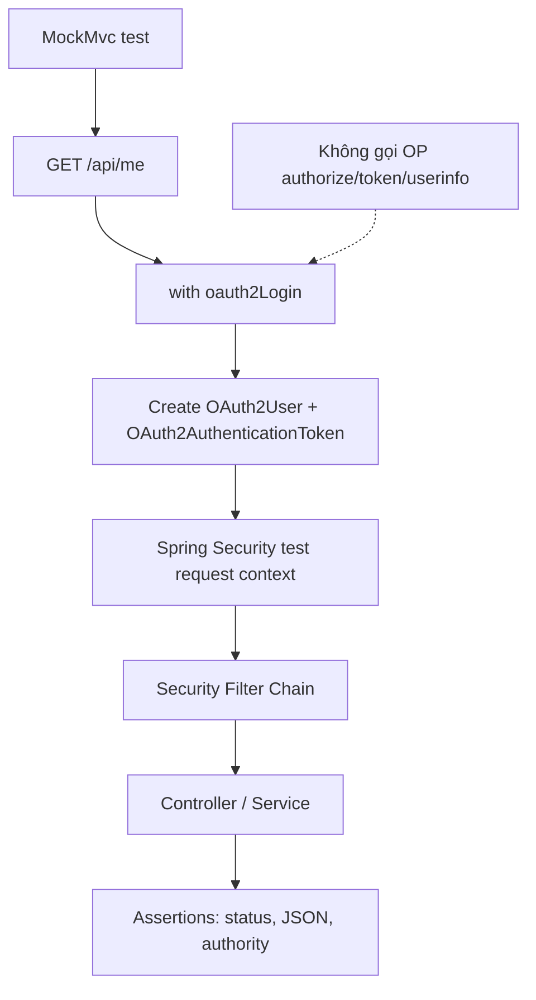
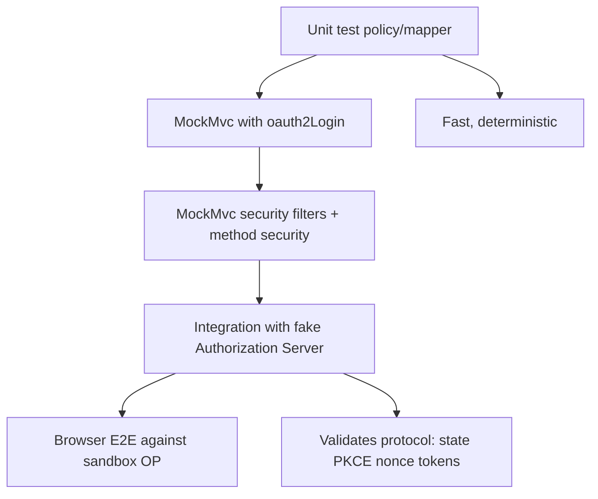

# 29.2. oauth2Login() để mô phỏng người dùng OAuth 2.0

Trong ứng dụng **Spring Security OAuth 2.0 / OpenID Connect (OIDC) Client** chạy bằng **Spring MVC/Servlet**, controller hoặc service thường cần biết **người dùng OAuth2 đã đăng nhập là ai**, có những attributes nào và được cấp những authorities nào. Nếu mỗi bài kiểm thử lại mở browser, redirect đến Authorization Server (AS), nhập tài khoản và đổi authorization code lấy token, bộ test sẽ chậm, dễ lỗi mạng và phụ thuộc vào hệ thống danh tính bên ngoài.

**Spring Security Test** cung cấp một công cụ rất hữu ích:

```java
SecurityMockMvcRequestPostProcessors.oauth2Login()
```

Khi dùng trong `MockMvc`, `oauth2Login()` tạo **một ngữ cảnh xác thực OAuth 2.0 giả lập** cho request được kiểm thử. Nhờ vậy, bạn có thể kiểm tra controller, URL authorization, method security, xử lý `OAuth2User` và một số trường hợp sử dụng `OAuth2AuthorizedClient` mà **không cần thực hiện Authorization Code Flow thật**.

> **Điểm cốt lõi:** `oauth2Login()` trong bài này là **`RequestPostProcessor` của `spring-security-test`**. Nó thiết lập một `OAuth2AuthenticationToken` và `OAuth2User` giả cho **MockMvc request**. Nó **không** gửi request đến OP, không xác minh chữ ký token, không xử lý `state`/PKCE/nonce, và không chứng minh cấu hình đăng nhập thật hoạt động.

Bài viết sử dụng **Spring Boot 3.x, Spring Security 6.x, JUnit 5, Spring Security Test và MockMvc**. Các ví dụ áp dụng cho **Servlet**, không dùng cho WebFlux; bài sẽ nêu helper reactive tương ứng ở phần cuối.

## 1. Mục tiêu học tập

Sau bài, bạn có thể:

1. Phân biệt `oauth2Login()` test post-processor với `HttpSecurity.oauth2Login()` trong cấu hình ứng dụng.
2. Biết cách thêm dependencies và thiết lập `MockMvc` với Spring Security filter chain.
3. Dùng `.with(oauth2Login())` để mô phỏng một người dùng OAuth2 đã xác thực.
4. Hiểu đối tượng `OAuth2AuthenticationToken`, `OAuth2User`, attributes, authorities và `ClientRegistration` được tạo trong test.
5. Tùy chỉnh `attributes(...)`, `authorities(...)`, `oauth2User(...)` và `clientRegistration(...)`.
6. Viết test cho `@AuthenticationPrincipal OAuth2User`, `Authentication` và registration ID.
7. Kiểm thử URL authorization, `@PreAuthorize` và trường hợp 401/403/redirect phù hợp filter chain.
8. Dùng `csrf()` khi test request thay đổi trạng thái.
9. Hiểu vai trò của `OAuth2AuthorizedClient` giả và những lưu ý khi `@RegisteredOAuth2AuthorizedClient`.
10. Chọn đúng helper giữa `oauth2Login()`, `oidcLogin()`, `oauth2Client()`, `jwt()` và `@WithMockUser`.
11. Tránh giả định rằng mock login tương đương kiểm thử OAuth2/OIDC protocol thật.
12. Tổ chức test fixtures, negative tests, multi-provider và bảo mật thông tin test.

## 2. Ba tên `oauth2Login` rất dễ gây nhầm

Trong Spring Security có những cách dùng tên tương tự nhưng mục đích khác nhau:

| Cú pháp | Vị trí | Trách nhiệm |
| --- | --- | --- |
| `http.oauth2Login(...)` | Cấu hình `HttpSecurity` | Bật và tùy biến OAuth2/OIDC Login trong **ứng dụng thật** |
| `oauth2Login()` nhập từ `SecurityMockMvcRequestPostProcessors` | `MockMvc.perform(...).with(...)` | **Mô phỏng user đã đăng nhập** trong request test |
| `oauth2Login(...)` trong cấu hình WebFlux | `ServerHttpSecurity` | Bật browser login reactive; **không phải MockMvc post-processor** |

Ví dụ cấu hình production:

```java
@Bean
SecurityFilterChain securityFilterChain(HttpSecurity http)
        throws Exception {

    http
        .authorizeHttpRequests(auth -> auth
                .requestMatchers("/", "/public/**").permitAll()
                .anyRequest().authenticated())
        .oauth2Login(Customizer.withDefaults());

    return http.build();
}
```

Ví dụ test:

```java
mvc.perform(get("/api/me").with(oauth2Login()))
        .andExpect(status().isOk());
```

**Khác biệt căn bản:**

- Cấu hình `HttpSecurity` tạo filter chain xử lý browser OAuth2 Login trong runtime.
- Test `RequestPostProcessor` **đặt authentication giả vào request**. Nó bypass quá trình redirect/callback/token exchange nhằm kiểm tra logic *sau khi đăng nhập*.
- Một test sử dụng `oauth2Login()` **không kiểm chứng** rằng production configuration, redirect URI hay Token Endpoint đang hoạt động đúng.

### 2.1. Mô hình kiến trúc



Công cụ này tốt nhất cho **post-login behavior**: lấy thông tin người dùng, phân quyền, nội dung response, gắn principal, xử lý thiếu attributes và các business rules theo authorities.

## 3. Những đối tượng được tạo khi gọi `oauth2Login()`

Spring Security Test chuẩn bị một request đã có một số thành phần giả:

1. **`OAuth2User`:** principal giả, chứa attribute map và tập `GrantedAuthority`.
2. **`OAuth2AuthenticationToken`:** một `Authentication` thể hiện OAuth2 login, với principal và registration ID.
3. **`SecurityContext`:** được liên kết với request để controller/filter dùng như một người dùng đã xác thực.
4. **`OAuth2AuthorizedClient`:** một authorized client đơn giản được đặt trong mock `HttpSessionOAuth2AuthorizedClientRepository` theo cơ chế test.

Các giá trị là **fixture khai báo**, không yêu cầu access token hay ID Token thực sự hợp lệ.

### 3.1. Giá trị mặc định của principal

Theo tài liệu Spring Security Test, `oauth2Login()` mặc định tạo `OAuth2User` có attribute:

```json
{
  "sub": "user"
}
```

và authority:

```text
SCOPE_read
```

Trong ví dụ không tùy biến, principal name thường được lấy từ attribute `sub`.

Điều này tiện để test nhanh, nhưng có một điểm cần ghi nhớ: **`SCOPE_read` ở đây là giá trị test mặc định**, không phải bằng chứng OP production đã cấp scope `read` hoặc ứng dụng thật sẽ map chính xác authority này. Khi logic yêu cầu scope/role khác, hãy tùy chỉnh explicitly.

### 3.2. Các khái niệm liên quan

| Kiểu | Vai trò trong test |
| --- | --- |
| `OAuth2User` | Attributes và authorities của principal |
| `DefaultOAuth2User` | Một implementation đơn giản để tự tạo principal |
| `OAuth2AuthenticationToken` | Authentication của người dùng OAuth2 đã login |
| `ClientRegistration` | Metadata của OAuth2 client, gồm registration ID, client ID, endpoints và scopes |
| `OAuth2AuthorizedClient` | Client đã được cấp token giả trong session repository của test |
| `SecurityContextHolder` | Truy cập authentication trên Servlet request thread khi filter integration đúng |
| `@AuthenticationPrincipal` | Inject principal vào controller argument |
| `@RegisteredOAuth2AuthorizedClient` | Resolve authorized client theo repository/configuration |
| `GrantedAuthority` | Đầu vào của URL/method authorization |

### 3.3. `oauth2Login()` không tự tạo `OidcUser`

OAuth2 Login và OIDC Login gần nhau nhưng không đồng nghĩa:

- `oauth2Login()` mô phỏng **`OAuth2User`** cho OAuth2 login không phụ thuộc OIDC.
- `oidcLogin()` mô phỏng **`OidcUser`**, `OidcIdToken` và các thông tin OIDC tương ứng.

Nếu controller gọi `getIdToken()`, `getClaims()` hoặc yêu cầu `OidcUser`, hãy dùng **`oidcLogin()`** thay vì ép `OAuth2User` mặc định thành OIDC user.

## 4. Dependencies cho Spring Boot + MockMvc

### 4.1. Maven

Ví dụ cấu hình cho một dự án Servlet với OAuth2 Client:

```xml
<dependencies>
    <dependency>
        <groupId>org.springframework.boot</groupId>
        <artifactId>spring-boot-starter-web</artifactId>
    </dependency>
    <dependency>
        <groupId>org.springframework.boot</groupId>
        <artifactId>spring-boot-starter-security</artifactId>
    </dependency>
    <dependency>
        <groupId>org.springframework.boot</groupId>
        <artifactId>spring-boot-starter-oauth2-client</artifactId>
    </dependency>

    <dependency>
        <groupId>org.springframework.boot</groupId>
        <artifactId>spring-boot-starter-test</artifactId>
        <scope>test</scope>
    </dependency>
    <dependency>
        <groupId>org.springframework.security</groupId>
        <artifactId>spring-security-test</artifactId>
        <scope>test</scope>
    </dependency>
</dependencies>
```

Trong Spring Boot project, hãy để dependency management của Boot quản lý các phiên bản tương thích. Không ép `spring-security-test` sang một major version khác `spring-security-web`/`spring-security-config`.

### 4.2. Gradle

```groovy
dependencies {
    implementation 'org.springframework.boot:spring-boot-starter-web'
    implementation 'org.springframework.boot:spring-boot-starter-security'
    implementation 'org.springframework.boot:spring-boot-starter-oauth2-client'

    testImplementation 'org.springframework.boot:spring-boot-starter-test'
    testImplementation 'org.springframework.security:spring-security-test'
}

tasks.named('test') {
    useJUnitPlatform()
}
```

`spring-boot-starter-test` cung cấp JUnit Jupiter và Spring MVC Test; `spring-security-test` cung cấp `oauth2Login()`, `oidcLogin()`, `csrf()` cùng các Security test helpers.

### 4.3. Import chính xác

```java
import static org.springframework.security.test.web.servlet.request
        .SecurityMockMvcRequestPostProcessors.oauth2Login;

import static org.springframework.test.web.servlet.request
        .MockMvcRequestBuilders.get;

import static org.springframework.test.web.servlet.result
        .MockMvcResultMatchers.status;
```

**Đừng import `oauth2Login` từ package reactive hoặc nhầm với DSL configuration.** Đường dẫn static import chính là một trong những lỗi thường gặp nhất.

## 5. Chuẩn bị ứng dụng Servlet mẫu

Để học rõ cơ chế, giả sử ứng dụng có endpoint `/api/me` trả một số thông tin lấy từ principal đã được xác thực.

### 5.1. Security configuration

```java
import org.springframework.context.annotation.Bean;
import org.springframework.context.annotation.Configuration;
import org.springframework.security.config.Customizer;
import org.springframework.security.config.annotation.web.builders.HttpSecurity;
import org.springframework.security.web.SecurityFilterChain;

@Configuration
public class SecurityConfig {

    @Bean
    SecurityFilterChain securityFilterChain(HttpSecurity http)
            throws Exception {

        return http
                .authorizeHttpRequests(auth -> auth
                        .requestMatchers(
                                "/", "/login", "/error")
                            .permitAll()
                        .requestMatchers("/api/admin/**")
                            .hasRole("ADMIN")
                        .anyRequest()
                            .authenticated())
                .oauth2Login(Customizer.withDefaults())
                .build();
    }
}
```

`oauth2Login(Customizer.withDefaults())` là cấu hình **runtime**. Khi chạy app thật, nó cần một `ClientRegistrationRepository` có cấu hình hợp lệ.

### 5.2. Controller dùng `@AuthenticationPrincipal OAuth2User`

```java
import java.util.Map;

import org.springframework.security.core.annotation.AuthenticationPrincipal;
import org.springframework.security.oauth2.core.user.OAuth2User;
import org.springframework.web.bind.annotation.GetMapping;
import org.springframework.web.bind.annotation.RestController;

@RestController
public class ProfileController {

    @GetMapping("/api/me")
    public Map<String, Object> me(
            @AuthenticationPrincipal OAuth2User user) {

        return Map.of(
                "subject", user.getName(),
                "displayName", user.getAttribute("name") == null
                        ? ""
                        : user.getAttribute("name"));
    }
}
```

Controller này làm một việc nhỏ: đọc principal đã được Spring Security cung cấp và tạo JSON.

Ở runtime, `OAuth2User` thường đến từ OAuth2 login user service. Trong test, `oauth2Login()` sẽ cung cấp principal giả.

### 5.3. Một registration dùng trong profile test

Nếu `@SpringBootTest` bật cấu hình `oauth2Login()`, ứng dụng vẫn có thể cần một client registration hợp lệ để khởi tạo security chain. Có thể đặt trong `src/test/resources/application-test.yml` hoặc cung cấp qua test properties:

```yaml
spring:
  security:
    oauth2:
      client:
        registration:
          demo:
            provider: demo-provider
            client-id: test-client
            client-secret: test-secret-only
            authorization-grant-type: authorization_code
            client-authentication-method: client_secret_basic
            redirect-uri: "{baseUrl}/login/oauth2/code/{registrationId}"
            scope:
              - profile
        provider:
          demo-provider:
            authorization-uri: https://idp.test/authorize
            token-uri: https://idp.test/token
            user-info-uri: https://idp.test/userinfo
            user-name-attribute: sub
```

Đây là **OAuth2 non-OIDC fixture**, không yêu cầu discovery qua network vì endpoints được khai báo trực tiếp. `idp.test` là tên giả; test dùng `oauth2Login()` **không gọi endpoint**. Đừng dùng client secret thật trong test config.

Khi dùng file `application-test.yml`, kích hoạt profile:

```java
@ActiveProfiles("test")
```

Nếu project đã có test registrations phù hợp, không cần tạo thêm chỉ để thử post-processor.

## 6. Test đơn giản nhất: `with(oauth2Login())`

```java
import static org.springframework.security.test.web.servlet.request
        .SecurityMockMvcRequestPostProcessors.oauth2Login;
import static org.springframework.test.web.servlet.request
        .MockMvcRequestBuilders.get;
import static org.springframework.test.web.servlet.result
        .MockMvcResultMatchers.jsonPath;
import static org.springframework.test.web.servlet.result
        .MockMvcResultMatchers.status;

import org.junit.jupiter.api.Test;
import org.springframework.beans.factory.annotation.Autowired;
import org.springframework.boot.test.autoconfigure.web.servlet.AutoConfigureMockMvc;
import org.springframework.boot.test.context.SpringBootTest;
import org.springframework.test.context.ActiveProfiles;
import org.springframework.test.web.servlet.MockMvc;

@SpringBootTest
@AutoConfigureMockMvc
@ActiveProfiles("test")
class ProfileControllerTest {

    @Autowired
    MockMvc mvc;

    @Test
    void oauth2UserCanReadOwnProfile() throws Exception {
        mvc.perform(get("/api/me").with(oauth2Login()))
                .andExpect(status().isOk())
                .andExpect(jsonPath("$.subject").value("user"))
                .andExpect(jsonPath("$.displayName").value(""));
    }
}
```

Giải thích:

1. `get("/api/me")` tạo mock HTTP GET request.
2. `with(oauth2Login())` gắn OAuth2 authentication giả.
3. Spring Security filters thấy user đã được xác thực.
4. `@AuthenticationPrincipal` nhận `OAuth2User`.
5. Controller trả `subject="user"` vì đó là `sub` mặc định.
6. `jsonPath(...)` kiểm tra response, không cần AS.

### 6.1. Có cần gọi `/oauth2/authorization/demo` trước không?

**Không.** Với test `oauth2Login()`, bạn đang mô phỏng **trạng thái sau login**, không chạy flow browser.

Không cần:

```text
GET /oauth2/authorization/demo
Redirect to OP
Callback ?code=...&state=...
POST /token
GET /userinfo
```

Đó là ưu điểm để test logic ứng dụng. Nếu cần kiểm tra những bước trên, hãy viết **integration test riêng** với AS/OP test double.

### 6.2. Có cần `@WithMockUser` không?

Không cần. `with(oauth2Login())` đã tạo `Authentication` phù hợp OAuth2 login cho request.

Kết hợp `@WithMockUser` và `.with(oauth2Login())` trên cùng test có thể làm khó xác định principal nào được dùng; hãy chọn một mô hình xác thực nhất quán cho mỗi test.

## 7. Tùy chỉnh attributes bằng `attributes(...)`

Trong ứng dụng thực, `OAuth2User` có thể chứa `sub`, `name`, `email` hoặc các attributes do provider công bố.

Muốn test controller với tên hiển thị:

```java
@Test
void oauth2UserWithNameAttribute() throws Exception {
    mvc.perform(get("/api/me")
            .with(oauth2Login()
                    .attributes(attrs -> {
                        attrs.put("sub", "subject-123");
                        attrs.put("name", "Nguyen An");
                        attrs.put("email", "an@example.test");
                    })))
            .andExpect(status().isOk())
            .andExpect(jsonPath("$.subject").value("subject-123"))
            .andExpect(jsonPath("$.displayName").value("Nguyen An"));
}
```

`attributes(...)` nhận một `Consumer<Map<String, Object>>` để sửa attribute map của principal mock.

### 7.1. Attributes là dữ liệu để kiểm thử xử lý, không phải dữ liệu đã xác minh

Bất kỳ chuỗi nào bạn đưa vào `attributes(...)` sẽ được test helper đặt vào principal. Nó **không chứng minh** rằng AS thật đã xác minh email hay claim, cũng không tự thực hiện attribute mapping của custom `OAuth2UserService`.

Ví dụ:

```java
.with(oauth2Login()
    .attributes(attrs -> attrs.put("email_verified", true)))
```

sẽ cho controller thấy attribute `email_verified=true`; **test không kiểm tra chữ ký ID Token, OIDC UserInfo provenance hay chính sách xác thực email**. Với yêu cầu trust cao, cần test service mapping/OP integration riêng.

### 7.2. Thay `sub` có làm đổi principal name không?

Default mock `OAuth2User` dùng `sub` làm name attribute. Khi custom principal cần một field khác (ví dụ `user_name`), nên tạo `DefaultOAuth2User` với **`nameAttributeKey` rõ ràng**, dùng `oauth2User(...)` ở phần sau.

### 7.3. Test trường hợp thiếu attribute

Có thể xóa hoặc không cung cấp một field tùy chọn:

```java
@Test
void missingOptionalNameUsesEmptyDisplayName() throws Exception {
    mvc.perform(get("/api/me")
            .with(oauth2Login()
                    .attributes(attrs -> attrs.remove("name"))))
            .andExpect(status().isOk())
            .andExpect(jsonPath("$.displayName").value(""));
}
```

Khi test app production, hãy kiểm tra cả **field bắt buộc** và cách app xử lý lỗi thay vì mặc định mọi OP trả cùng một tập claims.

## 8. Tùy chỉnh authorities bằng `authorities(...)`

Một principal đã xác thực **không mặc nhiên có mọi quyền**. Spring Security phân quyền theo `GrantedAuthority` mà authentication được gắn.

Ví dụ endpoint yêu cầu scope:

```java
import org.springframework.context.annotation.Bean;
import org.springframework.context.annotation.Configuration;
import org.springframework.security.config.annotation.web.builders.HttpSecurity;
import org.springframework.security.web.SecurityFilterChain;

@Configuration
public class ReportSecurityConfig {

    @Bean
    SecurityFilterChain securityFilterChain(HttpSecurity http)
            throws Exception {

        return http
                .authorizeHttpRequests(auth -> auth
                        .requestMatchers("/api/reports/**")
                            .hasAuthority("SCOPE_reports.read")
                        .anyRequest()
                            .authenticated())
                .oauth2Login(org.springframework.security.config
                        .Customizer.withDefaults())
                .build();
    }
}
```

**Ví dụ cấu hình này là phương án thay thế** cho `SecurityConfig` ở mục 5. Không khai báo hai filter chains cùng matcher một cách vô tình trong cùng project demo.

### 8.1. Test được phép

```java
import org.springframework.security.core.authority.SimpleGrantedAuthority;

@Test
void reportReaderIsAllowed() throws Exception {
    mvc.perform(get("/api/reports/summary")
            .with(oauth2Login()
                    .authorities(new SimpleGrantedAuthority(
                            "SCOPE_reports.read"))))
            .andExpect(status().isOk());
}
```

Test giả định ứng dụng có handler `GET /api/reports/summary` trả thành công; bạn cần tạo controller hoặc mock service tương ứng. Điểm cần kiểm tra là **authorization matcher**.

### 8.2. Test bị từ chối

```java
@Test
void oauth2UserWithoutReportScopeIsForbidden() throws Exception {
    mvc.perform(get("/api/reports/summary")
            .with(oauth2Login()
                    .authorities(new SimpleGrantedAuthority(
                            "SCOPE_profile.read"))))
            .andExpect(status().isForbidden());
}
```

User vẫn **authenticated** nhưng không có authority `SCOPE_reports.read`, nên Spring có thể trả **403 Forbidden** cho API đã được bảo vệ theo cấu hình.

**Phân biệt:** unauthenticated request có thể nhận **302 redirect** về login page nếu app dùng OAuth2 Login browser flow, hoặc **401** nếu app đã cấu hình entry point cho API. Không hardcode “mọi request thiếu user đều 401” trong test của một OAuth2 Login web app.

### 8.3. Authorities không phải chính scopes trong token thật

Mock:

```java
oauth2Login().authorities(
        new SimpleGrantedAuthority("SCOPE_reports.read"))
```

cho phép kiểm tra **điều kiện security**. Nhưng nó không chứng minh:

- AS đã cấp scope `reports.read`.
- Token thực có scope tương ứng.
- Application `GrantedAuthoritiesMapper` tạo đúng authorities từ provider.
- User thật có tenant membership phù hợp.
- Downstream API sẽ chấp nhận access token.

Phải có các test riêng cho mapping và integration.

## 9. Vai trò của `ROLE_*` khác `SCOPE_*`

Spring Security thường dùng:

```java
hasRole("ADMIN")
```

để kiểm tra authority:

```text
ROLE_ADMIN
```

Còn:

```java
hasAuthority("SCOPE_reports.read")
```

kiểm tra chính xác chuỗi:

```text
SCOPE_reports.read
```

Test:

```java
@Test
void adminAreaRequiresRoleAdmin() throws Exception {
    mvc.perform(get("/api/admin/dashboard")
            .with(oauth2Login()
                    .authorities(new SimpleGrantedAuthority(
                            "ROLE_ADMIN"))))
            .andExpect(status().isOk());
}
```

Và negative case:

```java
@Test
void scopeDoesNotAutomaticallyBecomeAdminRole() throws Exception {
    mvc.perform(get("/api/admin/dashboard")
            .with(oauth2Login()
                    .authorities(new SimpleGrantedAuthority(
                            "SCOPE_admin"))))
            .andExpect(status().isForbidden());
}
```

Các tests trên giả định `/api/admin/dashboard` có route handler trả thành công khi được phép. **`SCOPE_admin` không bằng `ROLE_ADMIN`** trừ khi application tự định nghĩa mapping rõ ràng.

Không lấy một attribute `role="admin"` do user tự gửi mà trực tiếp tạo authority; production mapper phải lấy roles/groups từ **nguồn đáng tin cậy**, có policy theo issuer, tenant và account.

## 10. Tự tạo `OAuth2User` bằng `oauth2User(...)`

Mặc định `oauth2Login()` dùng `sub` làm principal name. Nhưng một số OAuth2 providers không phải OIDC dùng attribute khác như `id` hoặc `user_name`.

Ví dụ controller:

```java
@GetMapping("/api/principal-name")
public String principalName(
        @AuthenticationPrincipal OAuth2User user) {
    return user.getName();
}
```

Tạo `DefaultOAuth2User` với attribute key `user_name`:

```java
import java.util.Map;

import org.springframework.security.core.authority.AuthorityUtils;
import org.springframework.security.oauth2.core.user.DefaultOAuth2User;
import org.springframework.security.oauth2.core.user.OAuth2User;

@Test
void customPrincipalNameAttribute() throws Exception {

    OAuth2User user = new DefaultOAuth2User(
            AuthorityUtils.createAuthorityList(
                    "SCOPE_profile.read"),
            Map.of(
                    "user_name", "alice_partner",
                    "display_name", "Alice"),
            "user_name");

    mvc.perform(get("/api/principal-name")
            .with(oauth2Login().oauth2User(user)))
            .andExpect(status().isOk())
            .andExpect(content().string("alice_partner"));
}
```

Cần static import:

```java
import static org.springframework.test.web.servlet.result
        .MockMvcResultMatchers.content;
```

### 10.1. Khi nào nên dùng `oauth2User(...)` thay `attributes(...)`?

Dùng `attributes(...)` khi chỉ cần thêm/sửa vài fields trong **default user**.

Dùng `oauth2User(...)` khi:

- Muốn thay **name attribute key**.
- Có custom class triển khai `OAuth2User`.
- Cần kiểm tra một mapping authority/attribute cụ thể.
- Cần đầy đủ attribute map riêng, không muốn lệ thuộc default `sub`.
- Muốn tái sử dụng một fixture user giữa nhiều tests.

### 10.2. Không nhầm với `DefaultOidcUser`

Nếu class controller yêu cầu:

```java
@AuthenticationPrincipal OidcUser oidcUser
```

thì tạo `DefaultOAuth2User` **không phải cách đúng** để cung cấp ID Token. Sử dụng `oidcLogin()` cùng OIDC fixtures của Spring Security Test.

## 11. Tùy chỉnh `ClientRegistration` bằng `clientRegistration(...)`

Một ứng dụng có thể sử dụng nhiều OAuth2 clients:

```text
company-login
partner-login
github-login
```

Để kiểm tra controller đọc registration ID và xử lý dựa trên provider, có thể truyền `ClientRegistration` giả vào `oauth2Login()`.

### 11.1. Tạo registration hoàn toàn trong test

```java
import org.springframework.security.oauth2.client.registration
        .ClientRegistration;
import org.springframework.security.oauth2.core.AuthorizationGrantType;
import org.springframework.security.oauth2.core.ClientAuthenticationMethod;

private static ClientRegistration partnerRegistration() {
    return ClientRegistration
            .withRegistrationId("partner-login")
            .clientId("partner-test-client")
            .clientSecret("dummy-test-secret")
            .clientAuthenticationMethod(
                    ClientAuthenticationMethod.CLIENT_SECRET_BASIC)
            .authorizationGrantType(
                    AuthorizationGrantType.AUTHORIZATION_CODE)
            .redirectUri(
                    "{baseUrl}/login/oauth2/code/{registrationId}")
            .authorizationUri("https://partner-idp.test/authorize")
            .tokenUri("https://partner-idp.test/token")
            .userInfoUri("https://partner-idp.test/userinfo")
            .userNameAttributeName("sub")
            .scope("profile", "partner.read")
            .clientName("Partner Test")
            .build();
}
```

Các địa chỉ `.test` không dùng trên Internet thật. Test helper này tạo **metadata tĩnh**, không truy cập discovery endpoint.

### 11.2. Controller đọc registration ID

```java
import java.util.Map;

import org.springframework.security.oauth2.client.authentication
        .OAuth2AuthenticationToken;
import org.springframework.web.bind.annotation.GetMapping;
import org.springframework.web.bind.annotation.RestController;

@RestController
public class AuthContextController {

    @GetMapping("/api/auth/context")
    public Map<String, String> context(
            OAuth2AuthenticationToken authentication) {

        return Map.of(
                "registrationId",
                authentication.getAuthorizedClientRegistrationId(),
                "principalName",
                authentication.getName());
    }
}
```

Test:

```java
@Test
void oauth2AuthenticationUsesSelectedRegistration()
        throws Exception {

    mvc.perform(get("/api/auth/context")
            .with(oauth2Login()
                    .clientRegistration(partnerRegistration())
                    .attributes(attrs ->
                            attrs.put("sub", "partner-subject-7"))))
            .andExpect(status().isOk())
            .andExpect(jsonPath("$.registrationId")
                    .value("partner-login"))
            .andExpect(jsonPath("$.principalName")
                    .value("partner-subject-7"));
}
```

### 11.3. Registration ID là gì?

Trong `OAuth2AuthenticationToken`:

```java
authentication.getAuthorizedClientRegistrationId()
```

trả **registration ID** mà authentication thuộc về, ví dụ `partner-login`. Nó không phải:

- `client_id` do OP cấp.
- `issuer`.
- Email domain.
- Tenant membership.
- Một quyền được đảm bảo chỉ vì provider có tên “partner”.

Để kiểm tra user thực sự thuộc tổ chức đối tác, ứng dụng vẫn phải xác minh danh tính/provider mapping và tenant authorization ở cấp service/policy.

### 11.4. Client registration giả có được gọi Token Endpoint không?

**Không.** Khi dùng `oauth2Login()`, `ClientRegistration` giúp định hình mock authentication/authorized client. Không có cuộc gọi đổi code, UserInfo hoặc real client authentication.

Vì vậy test này không chứng minh client secret, authorization endpoint hay TLS certificate production đã cấu hình đúng. Những thứ đó cần integration/contract tests riêng.

## 12. `OAuth2AuthorizedClient` giả được lưu ở đâu?

Một chi tiết dễ bỏ qua trong Spring Security Test: `oauth2Login()` không chỉ tạo `Authentication`; nó còn liên kết với **một `OAuth2AuthorizedClient` giả** thông qua mock authorized client repository đặt trong session/request context của MockMvc.

Điều này hữu ích khi controller dùng:

```java
@RegisteredOAuth2AuthorizedClient("partner-login")
OAuth2AuthorizedClient client
```

hoặc các integrations cần authorized client của OAuth2 Login.

### 12.1. Thế nào là authorized client?

`OAuth2AuthorizedClient` chứa:

- `ClientRegistration`: OAuth2 client metadata.
- `principalName`: tên principal liên kết authorization.
- `OAuth2AccessToken`: một access token được cấp.
- `OAuth2RefreshToken`: có thể có nếu AS cấp.

Trong test, các token là **giả và không cần có chữ ký/giá trị được chấp nhận bởi OP**.

### 12.2. Điểm quan trọng về repository tương thích

Spring Security Test dùng mock `HttpSessionOAuth2AuthorizedClientRepository` cho cơ chế này. Nếu ứng dụng thực đang cấu hình:

- `AuthenticatedPrincipalOAuth2AuthorizedClientRepository`,
- `OAuth2AuthorizedClientService` trong database,
- custom `OAuth2AuthorizedClientRepository`,
- hoặc một manager/service đọc token từ storage khác,

thì **đừng mặc định mock client trong session sẽ tự có mặt ở mọi storage đó**.

Đặc biệt, các tests cho `@RegisteredOAuth2AuthorizedClient` cần một repository bean/cấu hình tương thích với cách Spring Test đặt client vào session. Tài liệu API Spring Security Test nêu rõ có thể cần đăng ký `HttpSessionOAuth2AuthorizedClientRepository` bean cho test.

### 12.3. Test configuration của repository

Một phương án chỉ dùng cho test:

```java
import org.springframework.boot.test.context.TestConfiguration;
import org.springframework.context.annotation.Bean;
import org.springframework.security.oauth2.client.web
        .HttpSessionOAuth2AuthorizedClientRepository;
import org.springframework.security.oauth2.client.web
        .OAuth2AuthorizedClientRepository;

@TestConfiguration
public class AuthorizedClientTestConfig {

    @Bean
    OAuth2AuthorizedClientRepository authorizedClientRepository() {
        return new HttpSessionOAuth2AuthorizedClientRepository();
    }
}
```

Có thể import cấu hình này vào test context nếu application không tự cung cấp bean tương thích. **Không thêm bean thứ hai cùng loại vào production một cách vô ý**, vì nó có thể thay đổi security semantics và cách lưu refresh tokens. Kiểm tra thực tế resolver/repository selection khi có custom integration.

### 12.4. Controller chỉ xem metadata, không trả token

```java
import java.util.Map;

import org.springframework.security.oauth2.client.OAuth2AuthorizedClient;
import org.springframework.security.oauth2.client.annotation
        .RegisteredOAuth2AuthorizedClient;
import org.springframework.web.bind.annotation.GetMapping;
import org.springframework.web.bind.annotation.RestController;

@RestController
public class AuthorizedClientMetadataController {

    @GetMapping("/api/connection")
    public Map<String, String> connection(
            @RegisteredOAuth2AuthorizedClient("partner-login")
            OAuth2AuthorizedClient client) {

        return Map.of(
                "registrationId",
                client.getClientRegistration().getRegistrationId(),
                "principal",
                client.getPrincipalName());
    }
}
```

Một test minh họa với `HttpSessionOAuth2AuthorizedClientRepository` được wiring đúng:

```java
@Test
void authorizedClientIsAvailableInCompatibleSessionRepository()
        throws Exception {

    mvc.perform(get("/api/connection")
            .with(oauth2Login()
                    .clientRegistration(partnerRegistration())))
            .andExpect(status().isOk())
            .andExpect(jsonPath("$.registrationId")
                    .value("partner-login"));
}
```

**Không trả `OAuth2AuthorizedClient` object trực tiếp thành JSON**: object chứa access/refresh token hoặc client secret liên quan; controller nên trả DTO/metadata tối thiểu.

### 12.5. Khi nào dùng `oauth2Client("registrationId")`?

Nếu test **chỉ cần authorized client** mà không cần mô phỏng một user đã đăng nhập qua OAuth2, helper chuyên dụng hơn là:

```java
import static org.springframework.security.test.web.servlet.request
        .SecurityMockMvcRequestPostProcessors.oauth2Client;

mvc.perform(get("/api/connection")
        .with(oauth2Client("partner-login")));
```

Chú ý: `oauth2Client()` không có mục tiêu thay `Authentication` của người dùng. Nếu endpoint yêu cầu user đã xác thực, cần cung cấp Authentication phù hợp hoặc dùng `oauth2Login()` nếu mô hình kiểm thử là đăng nhập OAuth2.

## 13. Kiểm thử `@AuthenticationPrincipal`

`@AuthenticationPrincipal` có thể inject principal theo đúng kiểu.

### 13.1. Controller lấy email

```java
import java.util.Map;

import org.springframework.security.core.annotation.AuthenticationPrincipal;
import org.springframework.security.oauth2.core.user.OAuth2User;
import org.springframework.web.bind.annotation.GetMapping;
import org.springframework.web.bind.annotation.RestController;

@RestController
class EmailController {

    @GetMapping("/api/email")
    Map<String, String> email(
            @AuthenticationPrincipal OAuth2User user) {

        String email = user.getAttribute("email");
        return Map.of("email", email == null ? "" : email);
    }
}
```

Test:

```java
@Test
void oauth2PrincipalEmailIsInjected() throws Exception {
    mvc.perform(get("/api/email")
            .with(oauth2Login()
                    .attributes(attrs ->
                            attrs.put("email", "learner@example.test"))))
            .andExpect(status().isOk())
            .andExpect(jsonPath("$.email")
                    .value("learner@example.test"));
}
```

### 13.2. Khi attribute thiếu hoặc sai kiểu

UserInfo response từ các providers có thể trả field thiếu hoặc kiểu không như mong đợi. Test nên có:

- Email missing/null.
- `email_verified` false/missing nếu business policy cần.
- Attribute object thay string.
- Provider đổi `user_name` thành `id`.
- Authorities thiếu.
- Empty group list.
- Dữ liệu tên Unicode hoặc dài bất thường.

`oauth2Login()` cho phép dựng dữ liệu tùy ý để kiểm tra **độ bền của controller/service**. Nhưng nó không kiểm tra UserInfo endpoint thật hoặc source trust; đó là công việc của integration tests.

## 14. Test đăng nhập mặc định và user không đăng nhập

Hai test nên được đặt cạnh nhau để chứng minh filter chain thực sự phân biệt authenticated và anonymous request.

### 14.1. Authenticated request

```java
@Test
void authenticatedOauth2UserCanViewProfile() throws Exception {
    mvc.perform(get("/api/me").with(oauth2Login()))
            .andExpect(status().isOk());
}
```

### 14.2. Anonymous request

```java
@Test
void anonymousBrowserMustAuthenticate() throws Exception {
    mvc.perform(get("/api/me"))
            .andExpect(status().is3xxRedirection());
}
```

Test anonymous giả định ứng dụng dùng `oauth2Login()` theo kiểu browser, và entry point redirect đến login. Nếu app đã tùy biến entry point cho REST API sang `401 Unauthorized`, kỳ vọng phải điều chỉnh.

### 14.3. Kiểm tra địa chỉ redirect

Đừng dựa vào 302 chung chung nếu logic yêu cầu điều hướng đến màn hình cụ thể. Một test có thể assert `Location` hoặc `redirectedUrlPattern(...)` phù hợp cấu hình:

```java
mvc.perform(get("/api/me"))
        .andExpect(status().is3xxRedirection())
        .andExpect(header().exists("Location"));
```

Cần static import `MockMvcResultMatchers.header`. Vị trí redirect thực tế tùy login page/authorization request resolver của application; đừng hardcode sai endpoint khi có nhiều providers.

## 15. Kiểm thử `@PreAuthorize` với người dùng OAuth2

`@PreAuthorize` bảo vệ **method**, không chỉ URL. Nếu ứng dụng bật method security:

```java
import org.springframework.context.annotation.Configuration;
import org.springframework.security.config.annotation.method.configuration
        .EnableMethodSecurity;

@Configuration
@EnableMethodSecurity
public class MethodSecurityConfig {}
```

Service:

```java
import org.springframework.security.access.prepost.PreAuthorize;
import org.springframework.stereotype.Service;

@Service
public class InvoiceService {

    @PreAuthorize("hasAuthority('SCOPE_invoice.read')")
    public String readInvoice() {
        return "invoice-ok";
    }
}
```

Controller:

```java
import org.springframework.web.bind.annotation.GetMapping;
import org.springframework.web.bind.annotation.RestController;

@RestController
public class InvoiceController {

    private final InvoiceService invoices;

    public InvoiceController(InvoiceService invoices) {
        this.invoices = invoices;
    }

    @GetMapping("/api/invoice")
    public String invoice() {
        return invoices.readInvoice();
    }
}
```

Test:

```java
@Test
void invoiceReadRequiresScope() throws Exception {
    mvc.perform(get("/api/invoice")
            .with(oauth2Login().authorities(
                    new SimpleGrantedAuthority(
                            "SCOPE_invoice.read"))))
            .andExpect(status().isOk())
            .andExpect(content().string("invoice-ok"));
}

@Test
void oauth2UserWithoutInvoiceScopeGetsForbidden() throws Exception {
    mvc.perform(get("/api/invoice")
            .with(oauth2Login().authorities(
                    new SimpleGrantedAuthority("SCOPE_profile.read"))))
            .andExpect(status().isForbidden());
}
```

Điều kiện:

- `@EnableMethodSecurity` phải thực sự được load vào test context.
- Service được Spring quản lý qua proxy, không tự tạo bằng `new InvoiceService()` bên ngoài Spring rồi hy vọng annotation được áp dụng.
- Filter chain/SecurityContext phải hoạt động trong MockMvc.
- Nếu `@WebMvcTest` mock `InvoiceService` bằng Mockito, `@PreAuthorize` trên implementation thật **không được kiểm tra theo đúng cách**. Dùng integration/service security test với bean thật khi cần.

### 15.1. Phạm vi của test

Test này chứng minh service method authorization kiểm tra **authority do test cấp**. Nó không chứng minh AS thực sự phát scope đó hoặc authority mapper production xây quyền đúng. Cần test mapping và access policy độc lập.

## 16. POST/PUT/DELETE: cần `csrf()` khi app bật CSRF

Một người dùng đã authenticated chưa đủ để thực hiện POST thay đổi trạng thái trong ứng dụng Servlet dùng session/CSRF protection.

Ví dụ endpoint:

```java
@PostMapping("/api/settings")
public ResponseEntity<Void> updateSettings() {
    return ResponseEntity.noContent().build();
}
```

Test đúng:

```java
import static org.springframework.security.test.web.servlet.request
        .SecurityMockMvcRequestPostProcessors.csrf;
import static org.springframework.test.web.servlet.request
        .MockMvcRequestBuilders.post;

@Test
void authenticatedOauth2UserWithCsrfMayUpdate() throws Exception {
    mvc.perform(post("/api/settings")
            .with(oauth2Login())
            .with(csrf()))
            .andExpect(status().isNoContent());
}
```

Test thiếu CSRF:

```java
@Test
void missingCsrfIsRejectedEvenWithOauth2Login()
        throws Exception {

    mvc.perform(post("/api/settings")
            .with(oauth2Login()))
            .andExpect(status().isForbidden());
}
```

### 16.1. Vì sao CSRF vẫn quan trọng?

Nếu browser dùng session cookie, website khác có thể cố gửi request thay đổi trạng thái thay mặt user. OAuth2 Login không tự miễn CSRF protection.

**Không tắt CSRF toàn bộ app chỉ để test `oauth2Login()` POST thành công.** Nếu API dùng stateless Bearer token với threat model khác, cấu hình CSRF có thể khác; test phải phản ánh kiến trúc thực tế.

### 16.2. CSRF token có được `oauth2Login()` sinh tự động không?

Không nên giả định vậy. Test helper `oauth2Login()` tập trung vào **Authentication**, còn `csrf()` là một `RequestPostProcessor` riêng.

Sử dụng:

```java
.with(oauth2Login())
.with(csrf())
```

cho requests cần CSRF, thay vì coi OAuth2 authentication đồng nghĩa đã có anti-CSRF token.

## 17. Kiểm tra đúng loại Authentication

Một controller có thể nhận `Authentication`:

```java
@GetMapping("/api/auth/type")
public String authenticationType(Authentication authentication) {
    return authentication.getClass().getSimpleName();
}
```

Khi request dùng `oauth2Login()`, kỳ vọng là `OAuth2AuthenticationToken`; không phải `UsernamePasswordAuthenticationToken`, `JwtAuthenticationToken` hay `BearerTokenAuthentication`.

Test:

```java
@Test
void mockUserIsOauth2AuthenticationToken() throws Exception {
    mvc.perform(get("/api/auth/type")
            .with(oauth2Login()))
            .andExpect(status().isOk())
            .andExpect(content().string(
                    "OAuth2AuthenticationToken"));
}
```

Đây là một cách kiểm tra đơn giản trong demo. Trong ứng dụng production, không nên xây business logic chỉ bằng `getClass().getSimpleName()`; dùng đúng interfaces/types nếu cần phân biệt authentication.

### 17.1. Lấy principal qua `SecurityContextHolder`

Trong Servlet stack khi Spring Security filters chạy:

```java
Authentication authentication =
        SecurityContextHolder.getContext()
                .getAuthentication();
```

Tuy nhiên trong controller, **dependency injection của `Authentication` hoặc `@AuthenticationPrincipal` thường dễ test và ít coupling hơn**.

Không dựa vào `SecurityContextHolder` global khi code chạy asynchronous thread mà không có context propagation. `oauth2Login()` test request không tự xác minh thread propagation trong background jobs.

## 18. `MockMvc` phải gắn Spring Security

Một lỗi test là dùng `MockMvcBuilders.standaloneSetup(...)` mà không gắn Spring Security filter chain, rồi thấy `oauth2Login()` không xuất hiện như mong đợi hoặc annotation security không hoạt động.

### 18.1. Dùng `@SpringBootTest` + `@AutoConfigureMockMvc`

```java
@SpringBootTest
@AutoConfigureMockMvc
class OAuth2MvcIntegrationTest {

    @Autowired
    MockMvc mvc;
}
```

Cấu hình này thường tự tích hợp MVC/security filters từ application context, phù hợp khi muốn test cả security configuration và controller.

### 18.2. Dùng `MockMvcBuilders.webAppContextSetup(...)`

Nếu tự cấu hình `MockMvc`:

```java
import static org.springframework.security.test.web.servlet.setup
        .SecurityMockMvcConfigurers.springSecurity;

import org.springframework.test.web.servlet.setup.MockMvcBuilders;

// Trong @BeforeEach hoặc setup code có WebApplicationContext:
mvc = MockMvcBuilders
        .webAppContextSetup(context)
        .apply(springSecurity())
        .build();
```

`springSecurity()` là integration point quan trọng để post-processors và `SecurityContext` tương thích với MockMvc filter chain.

### 18.3. Vì sao standalone setup dễ sai?

Một test:

```java
MockMvc mvc = MockMvcBuilders
        .standaloneSetup(new ProfileController())
        .build();
```

chỉ dựng controller layer, **không tự load toàn bộ Spring Security filter chain**. Test này có thể bỏ qua URL/method authorization, CSRF hoặc không truyền context như runtime.

Nếu muốn test authorization, ưu tiên `webAppContextSetup(...).apply(springSecurity())` hoặc Boot test configuration thực sự có filters. Standalone setup chỉ phù hợp khi chủ đích test controller đơn thuần và biết giới hạn.

## 19. `@WebMvcTest`: test slice có giới hạn

`@WebMvcTest` thường chỉ nạp MVC controllers, filters và một tập beans hạn chế. Nếu production `SecurityConfig` phụ thuộc `ClientRegistrationRepository`, `OAuth2AuthorizedClientService` hoặc custom principal mapper, test slice có thể thiếu beans và không startup.

Ví dụ:

```java
@WebMvcTest(ProfileController.class)
@Import(TestSecurityConfiguration.class)
class ProfileMvcSliceTest {

    @Autowired
    MockMvc mvc;

    @Test
    void profileIsVisible() throws Exception {
        mvc.perform(get("/api/me")
                .with(oauth2Login()))
                .andExpect(status().isOk());
    }
}
```

`TestSecurityConfiguration` là bean cấu hình **do dự án tự viết**, không phải class Spring có sẵn. Nó cần:

- Security chain phù hợp mục tiêu test.
- Các beans cần thiết để chain khởi động.
- Không vô tình disable security nếu đang test authorization.
- Có mock service hoặc fixture đúng phạm vi.

### 19.1. Khi nào chọn `@SpringBootTest` thay vì `@WebMvcTest`?

Dùng `@WebMvcTest` để test nhanh **MVC contract + security filters đã có đủ beans**.

Dùng `@SpringBootTest` khi cần:

- Tương tác giữa security chain và nhiều business services.
- `@EnableMethodSecurity`/authorization proxies thật.
- Custom authorized client repository/registration service.
- Session lifecycle hoặc cross-layer security behavior.
- Config integration đa provider phức tạp.

Không nâng mọi controller unit test lên full context chỉ vì thiếu một mock bean; chọn mức test có mục tiêu rõ.

## 20. `oauth2Login()` và `oidcLogin()`: chọn đúng helper

Trong OIDC Client, principal thường là `OidcUser` với `OidcIdToken` và `OidcUserInfo`.

| Tiêu chí | `oauth2Login()` | `oidcLogin()` |
| --- | --- | --- |
| Mô phỏng principal | `OAuth2User` | `OidcUser` |
| Authentication | `OAuth2AuthenticationToken` | `OAuth2AuthenticationToken` |
| Có mock ID Token? | Không phải mục tiêu của helper | Có |
| Tùy chỉnh principal attributes | `attributes(...)`, `oauth2User(...)` | `idToken(...)`, `userInfo(...)`, `oidcUser(...)` |
| Tùy chỉnh authorities | Có | Có |
| Tùy chỉnh `ClientRegistration` | Có | Có |
| Trường hợp dùng | OAuth2 login không OIDC, controllers dùng `OAuth2User` | Controllers cần OIDC claims/`OidcUser` |
| Có chạy Authorization Code/Token Endpoint? | Không | Không |

### 20.1. Ví dụ `oidcLogin()`

```java
import static org.springframework.security.test.web.servlet.request
        .SecurityMockMvcRequestPostProcessors.oidcLogin;

mvc.perform(get("/api/oidc/me")
        .with(oidcLogin()
                .idToken(token -> token
                        .subject("oidc-subject-42")
                        .claim("email", "alice@example.test"))))
        .andExpect(status().isOk());
```

Ví dụ giả định có controller nhận `OidcUser` tại `/api/oidc/me`. Khi test OIDC, cần hiểu khác biệt **ID Token claims** và **UserInfo claims**. Mock OIDC helper không có nghĩa OP signature, nonce, `at_hash` hay issuer validation đã diễn ra.

### 20.2. Đừng ép OAuth2User thành OidcUser một cách ngầm định

Nếu endpoint:

```java
@GetMapping("/api/oidc/me")
String me(@AuthenticationPrincipal OidcUser user) {
    return user.getIdToken().getSubject();
}
```

thì `oauth2Login()` mặc định không tạo `OidcUser`. Chọn `oidcLogin()`, không tự cast `OAuth2User` sang OIDC type.

## 21. `oauth2Login()`, `oauth2Client()`, `jwt()` và `@WithMockUser`

Cả bốn hỗ trợ kiểm thử bảo mật nhưng đại diện **những cách xác thực khác nhau**.

| Helper | Dùng để mô phỏng | Principal/Authentication điển hình | Khi phù hợp |
| --- | --- | --- | --- |
| **`oauth2Login()`** | Browser user đăng nhập qua OAuth2 Client | `OAuth2User` / `OAuth2AuthenticationToken` | Post-login MVC controllers |
| **`oidcLogin()`** | Browser user đăng nhập OIDC | `OidcUser` / `OAuth2AuthenticationToken` | OIDC claims/ID Token |
| **`oauth2Client("id")`** | Authorized client/token trong repository | Không nhất thiết có user authentication | `@RegisteredOAuth2AuthorizedClient`/outbound client |
| **`jwt()`** | Incoming Bearer JWT được Resource Server xác thực (giả lập) | `JwtAuthenticationToken` | REST API/resource-server authorization |
| **`@WithMockUser`** | Username/password-style security user | Thường `UsernamePasswordAuthenticationToken` | Generic role/method security |
| **`user("...")`** | Security UserDetails | Username-password authentication | Các controller dùng `UserDetails` |

### 21.1. Browser OAuth2 login khác Resource Server JWT

Một ứng dụng có thể đồng thời:

- Là **OAuth2 Client** để login người dùng bằng browser.
- Là **Resource Server** để nhận JWT từ mobile/service.

Nếu controller chỉ được gọi với `JwtAuthenticationToken` do API Bearer token, `jwt()` phù hợp hơn `oauth2Login()`. Chọn helper theo **authentication mechanism của endpoint**, không theo việc dự án có dependency OAuth2.

### 21.2. Vì sao `@WithMockUser` có thể gây false positive?

Một test:

```java
@WithMockUser(roles = "ADMIN")
@Test
void adminCanRead() ...
```

có thể chứng minh `hasRole("ADMIN")` nhưng **không chứng minh OAuth2 principal mapping**. Controller nhận `OAuth2User` có thể không hoạt động nếu principal thật là `UserDetails`. Sử dụng `oauth2Login()` khi kiểu OAuth2 là một phần của contract cần test.

### 21.3. Một app có nhiều cơ chế authentication

Nếu có cùng URL dành cho session browser và API Bearer token, phải kiểm tra đúng SecurityFilterChain và entry point. Test với `oauth2Login()` chỉ đi theo mô hình mock session OAuth2; test `jwt()` mô phỏng cơ chế khác. Hai test có thể cùng tồn tại nếu production security chain thực sự hỗ trợ cả hai.

## 22. Mô phỏng nhiều providers trong cùng một test suite

Giả sử app có `company` và `partner`. Bạn có thể tạo fixtures riêng:

```java
private static ClientRegistration companyRegistration() {
    return ClientRegistration
            .withRegistrationId("company")
            .clientId("company-test-client")
            .clientSecret("company-test-secret")
            .clientAuthenticationMethod(
                    ClientAuthenticationMethod.CLIENT_SECRET_BASIC)
            .authorizationGrantType(
                    AuthorizationGrantType.AUTHORIZATION_CODE)
            .authorizationUri("https://company-idp.test/authorize")
            .tokenUri("https://company-idp.test/token")
            .userInfoUri("https://company-idp.test/userinfo")
            .userNameAttributeName("sub")
            .redirectUri(
                    "{baseUrl}/login/oauth2/code/{registrationId}")
            .scope("profile")
            .build();
}
```

Và `partnerRegistration()` ở mục 11.

Test:

```java
@Test
void companyOauth2LoginUsesCompanyRegistration() throws Exception {
    mvc.perform(get("/api/auth/context")
            .with(oauth2Login()
                    .clientRegistration(companyRegistration())))
            .andExpect(status().isOk())
            .andExpect(jsonPath("$.registrationId").value("company"));
}

@Test
void partnerOauth2LoginUsesPartnerRegistration() throws Exception {
    mvc.perform(get("/api/auth/context")
            .with(oauth2Login()
                    .clientRegistration(partnerRegistration())))
            .andExpect(status().isOk())
            .andExpect(jsonPath("$.registrationId")
                    .value("partner-login"));
}
```

### 22.1. Test trên chỉ kiểm tra phần nào?

Nó chứng minh controller đọc đúng **mock registration ID** do test gắn. Nó không kiểm tra:

- Home Realm Discovery / routing trước login.
- OP discovery metadata và issuer pinning.
- State binding giữa authorization request và callback.
- OIDC `iss` + `sub` identity mapping.
- Client secret hoặc `private_key_jwt` thực.
- Cross-tenant token isolation trong database.
- OP SSO cookie/logout.

Để kiểm tra nhiều providers thật, cần integration tests cho `/oauth2/authorization/{registrationId}` và callbacks với OP fixtures riêng.

### 22.2. Provider name không cấp role

Một bài kiểm thử nguy hiểm:

```java
.with(oauth2Login()
        .clientRegistration(companyRegistration())
        .authorities(new SimpleGrantedAuthority("ROLE_ADMIN")))
```

cho user quyền admin vì **test đã cấp authority**, không phải vì company registration tự tạo quyền ấy. Đừng suy từ test này rằng mọi user đăng nhập bằng Corporate OP đều phải có `ROLE_ADMIN`.

Test policy thực tế phải xác minh mapping từ **verified identity, tenant membership và nguồn authority tin cậy**, không từ tên registration do test chọn.

## 23. Mock không chứng minh mapping của `OAuth2UserService`

Ở runtime, OAuth2 Login có thể gọi:

```java
OAuth2UserService<OAuth2UserRequest, OAuth2User>
```

hoặc implementation tùy biến để lấy UserInfo và chuyển attributes/authorities.

Khi bạn dùng `oauth2Login().oauth2User(...)`, **Spring Security Test đã đưa principal giả trực tiếp vào SecurityContext**. Vì vậy:

- Custom `OAuth2UserService` có thể **không được gọi**.
- UserInfo HTTP client không được gọi.
- OP response mapping chưa được kiểm thử.
- Claims validation theo issuer/provider chưa được chứng minh.
- Database mapping user chưa chắc đã chạy.

### 23.1. Test mapping riêng

Nếu có service:

```java
public interface ExternalIdentityMapper {
    InternalUser map(String registrationId, OAuth2User user);
}
```

hãy unit test:

```text
Given:
  registrationId = company
  user.attributes = {id: "123", email: "...", groups: [...]}

When:
  mapper.map(...)

Then:
  expected internal user/roles
  unknown groups are ignored
  missing subject is rejected
  untrusted provider cannot create admin
```

Sau đó integration test controller/security behavior với `oauth2Login()` và **fixture đã được map như production**. Không coi việc tự đặt `ROLE_ADMIN` trong post-processor là test của mapper.

### 23.2. Không tự hợp nhất account theo email khi test

Nếu hai providers trả cùng email, danh tính thực có thể khác. `oauth2Login()` không xác minh `iss` hoặc ownership. Account linking trong ứng dụng cần test riêng với các identities đã được thẩm định; không dùng attributes mock để bỏ qua enrollment policy.

## 24. Test `@RegisteredOAuth2AuthorizedClient` và token access

Một vài controller dùng authorized client để gọi downstream APIs. Test có thể có hai mức:

**Mức A — Controller/service contract:** Mock authorized client và HTTP API, kiểm tra service lấy registration đúng và không trả token ra client.

**Mức B — Protocol integration:** Chạy Authorization Code/token exchange với AS test double, kiểm tra token persistence/refresh/failure handling thực.

`oauth2Login()` thường phù hợp mức A, không thay mức B.

### 24.1. Cảnh báo khi giả định token luôn có mặt

Nếu test dùng `oauth2Login()` nhưng app tự khai báo repository theo database, controller `@RegisteredOAuth2AuthorizedClient` có thể không thấy mock token. Khắc phục bằng **test wiring repository tương thích** hoặc test `oauth2Client(...)`/service mock theo đúng đường production.

Không sửa production bằng cách thay `OAuth2AuthorizedClientService` sang in-memory chỉ để một test pass, và không tắt authentication check.

### 24.2. Không dùng token giả để gọi API thật

Mock `OAuth2AuthorizedClient` chứa token fixture, thường không được Resource Server production chấp nhận. Trong tests:

- Stub/mocks cho HTTP downstream.
- Dùng WireMock hoặc fake API/AS trong integration environment.
- Đặt test credentials khác production.
- Assert Authorization header được gắn **với đúng mock token**, tránh in token trong logs.
- Test không leak access token sang API host không tin cậy.

Không gửi `test-access-token` của mock vào một API công khai rồi coi HTTP 401 là lỗi Spring Test.

## 25. Ngữ cảnh session của MockMvc và phạm vi test

`oauth2Login()` là **per-request post-processor**. Mỗi lần `mvc.perform(...)` bạn áp dụng nó cho request được chọn.

### 25.1. Không giả định authentication tồn tại ở request tiếp theo

Ví dụ:

```java
mvc.perform(get("/api/me").with(oauth2Login()))
        .andExpect(status().isOk());

mvc.perform(get("/api/me"));
```

Request thứ hai **không tự động dùng lại cùng security context** chỉ vì test thứ nhất đã mô phỏng login. Nếu muốn mô phỏng cùng browser session, cần chủ động quản lý `MockHttpSession`/`SecurityContextRepository` và lifecycle theo kiến trúc.

### 25.2. Một user giả khác cho mỗi request

```java
@Test
void differentRequestsCanUseDifferentOAuth2Users() throws Exception {
    mvc.perform(get("/api/me")
            .with(oauth2Login()
                    .attributes(attrs ->
                            attrs.put("sub", "user-A"))))
            .andExpect(jsonPath("$.subject").value("user-A"));

    mvc.perform(get("/api/me")
            .with(oauth2Login()
                    .attributes(attrs ->
                            attrs.put("sub", "user-B"))))
            .andExpect(jsonPath("$.subject").value("user-B"));
}
```

Điều này giúp kiểm tra controller không dùng static/global user state. Nhưng nó **không tự kiểm tra** session fixation, logout invalidation, same-browser account switching hoặc token storage isolation. Những vấn đề đó cần session integration tests riêng.

### 25.3. Tests chạy song song

Tránh dùng `SecurityContextHolder` hoặc user fixture **mutable static** chia sẻ không đồng bộ giữa các tests. `OAuth2User` và attribute maps nên được tạo mới per test khi cần. Token service/database fixtures nên được isolate theo test context/transaction.

## 26. Cách tổ chức fixture để test dễ bảo trì

Khi nhiều tests cần cùng patterns, tạo helper class **chỉ trong test sources**:

```java
import java.util.Map;

import org.springframework.security.core.authority.AuthorityUtils;
import org.springframework.security.oauth2.core.user.DefaultOAuth2User;
import org.springframework.security.oauth2.core.user.OAuth2User;

public final class OAuth2TestUsers {

    private OAuth2TestUsers() {}

    public static OAuth2User companyViewer(String subject) {
        return new DefaultOAuth2User(
                AuthorityUtils.createAuthorityList(
                        "SCOPE_profile.read",
                        "ROLE_VIEWER"),
                Map.of(
                        "sub", subject,
                        "name", "Test Viewer"),
                "sub");
    }

    public static OAuth2User companyAdmin(String subject) {
        return new DefaultOAuth2User(
                AuthorityUtils.createAuthorityList(
                        "ROLE_ADMIN"),
                Map.of(
                        "sub", subject,
                        "name", "Test Admin"),
                "sub");
    }
}
```

Dùng:

```java
mvc.perform(get("/api/me")
        .with(oauth2Login()
                .oauth2User(
                        OAuth2TestUsers.companyViewer(
                                "viewer-101"))))
        .andExpect(status().isOk());
```

### 26.1. Fixture an toàn cần điều kiện gì?

- Dùng dữ liệu giả hoàn toàn.
- Không dùng email/subject/refresh token thật.
- Mỗi case thể hiện **một chính sách/identity** rõ ràng.
- Không mặc định admin role cho tất cả users.
- Không nhầm `OAuth2User` với `OidcUser`.
- Không tạo test assertions chỉ xác nhận data mình vừa tự inject mà thiếu business behavior.
- Với negative tests, chỉ định missing/extra authorities rõ ràng.

### 26.2. Ưu tiên test có tên nói rõ hành vi

Tên test tốt:

```text
oauth2ViewerCanReadOwnProfile
oauth2UserWithoutInvoiceScopeIsForbidden
oauth2LoginWithPartnerRegistrationShowsPartnerContext
missingEmailAttributeUsesFallback
csrfIsRequiredEvenWhenOAuth2UserIsAuthenticated
```

Tên kém:

```text
testOAuth2
test1
loginWorks
```

Vì `oauth2Login()` **không kiểm tra login protocol**, tránh đặt tên `loginWorks` để không tạo hiểu nhầm coverage.

## 27. Những negative tests quan trọng

Positive test “OAuth2 user có thể xem trang” là chưa đủ. Cần kiểm thử những thứ **không nên được phép**.

| Nhóm | Tình huống | Kết quả mong đợi |
| --- | --- | --- |
| Anonymous | Không có `oauth2Login()` | Bị redirect/401 theo entry point |
| Missing scope | Chỉ có `SCOPE_profile.read` khi endpoint cần `SCOPE_invoice.read` | 403 |
| Wrong role | `SCOPE_admin` nhưng cần `ROLE_ADMIN` | 403 |
| Invalid/missing attribute | Không có `email`/`user_id` | Fallback hoặc validation error có kiểm soát |
| Suspended internal account | OAuth2User giả nhưng account disabled trong DB | Bị từ chối theo application policy |
| Cross-tenant access | User A gọi dữ liệu tenant B | Bị từ chối dù user đã authenticated |
| Wrong registration | User có registration `partner` nhưng route chỉ cho company | Bị từ chối theo explicit policy |
| Missing CSRF | POST/DELETE với OAuth2 login nhưng không có CSRF | 403 khi CSRF được bật |
| Authorization object leak | Controller trả cả `OAuth2AuthorizedClient` | Test phải ngăn response lộ credential |
| Unknown provider | `registrationId` không trong allowlist | Không tự tạo trusted issuer |
| Concurrency | Hai requests có principals khác nhau | Không dùng static user/session state |
| Tampered downstream URL | User chọn URL ngoài nhưng service gắn token | Bị chặn bởi allowlist |
| Missing authorized client | User auth có nhưng storage không có token | Recovery/error policy rõ ràng |

**Không đánh đồng mock user với security trust.** Nếu application đang sử dụng input do test cấp làm nguồn quyền, test sẽ pass dù logic production có thể sai. Hãy kiểm thử policy thực tế với dữ liệu đáng tin cậy.

## 28. Các lỗi thường gặp và cách xử lý

| Triệu chứng | Nguyên nhân có thể | Cách xử lý |
| --- | --- | --- |
| Không tìm thấy `oauth2Login()` | Thiếu `spring-security-test` hoặc static import | Thêm test dependency, import đúng class |
| Test trả 302 thay vì 200 | Mock auth không gắn đúng vào security filters hoặc URL cần config khác | Kiểm tra `springSecurity()`/`@AutoConfigureMockMvc` |
| Test trả 403 dù đã `oauth2Login()` | Thiếu authority hoặc CSRF | Xác minh `hasRole/hasAuthority` và `csrf()` |
| `@AuthenticationPrincipal OAuth2User` là null | Không có auth, wrong test setup hoặc injection type không khớp | Dùng `with(oauth2Login())` và Spring Security filters |
| Principal không có ID Token | `oauth2Login()` tạo `OAuth2User`, không phải `OidcUser` | Dùng `oidcLogin()` |
| `ClassCastException` giữa `OAuth2User` và `OidcUser` | Ép sai loại principal | Chọn đúng helper, không cast |
| `user.getAttribute("email")` null | Default chỉ có `sub` | Thêm `attributes(...)` hoặc custom user |
| Expected `ROLE_ADMIN` nhưng chỉ có `SCOPE_admin` | Không có implicit mapping | Cấp authority đúng hoặc test production mapper |
| `getName()` không trả username mong đợi | Name attribute key khác | Dùng `DefaultOAuth2User(..., "user_name")` |
| `@RegisteredOAuth2AuthorizedClient` null | Mock repository khác repo mà resolver đọc | Wiring `HttpSessionOAuth2AuthorizedClientRepository` hoặc test config |
| `ClientRegistrationRepository` bean missing | OAuth2 Login runtime config yêu cầu registration trong test context | Thêm test registration fixture |
| `@WebMvcTest` không load custom service | Slice thiếu bean | `@MockBean`/Mockito mock theo Boot version hoặc dùng full context |
| `@PreAuthorize` không được kiểm tra | Thiếu `@EnableMethodSecurity` hoặc service bị mock | Load service/proxy thực |
| Anonymous test expected 401 nhưng nhận 302 | OAuth2 Login browser entry point redirect | Test theo entry point thực |
| OAuth2 callback không được kiểm thử | `oauth2Login()` bypass OAuth2 protocol | Viết fake OP integration tests |
| Test dùng token giả gọi API thật | Mock token không hợp lệ ngoài test | Stub HTTP downstream |
| Test khác bị lẫn user | Mutable static fixture/thread-local/session reuse | Isolate fixtures, cleanup và session |
| HTTP POST trả 403 do CSRF | Chỉ có `oauth2Login()` | Thêm `csrf()` nếu policy yêu cầu |
| Code test dùng helper reactive trong MockMvc | Sai stack | Dùng Servlet `SecurityMockMvcRequestPostProcessors` |
| Test startup gọi OIDC issuer ngoài | Test config dùng `issuer-uri` discovery | Dùng test endpoints tĩnh hoặc fake OP |
| Multi-provider test cho role admin “pass quá dễ” | Tự đặt `ROLE_ADMIN` bằng helper | Test mapping/business policy riêng |

### 28.1. Quy trình chẩn đoán

1. Xác nhận test đang chạy **Spring MVC/Servlet + MockMvc**, không phải WebFlux.
2. Xác nhận có `spring-security-test` đúng version.
3. Kiểm tra static import `SecurityMockMvcRequestPostProcessors.oauth2Login`.
4. Kiểm tra `MockMvc` đã tích hợp Spring Security filters.
5. Xem request có `.with(oauth2Login())` không.
6. Kiểm tra principal type/controller argument.
7. Kiểm tra attributes/authorities default hoặc custom.
8. Nếu POST/DELETE, kiểm tra CSRF.
9. Nếu authorized client missing, kiểm tra repository binding.
10. Nếu đang cố test redirect/token exchange, chuyển sang **integration test giả lập OP** thay vì ép post-processor làm nhiệm vụ không được thiết kế.

## 29. Anti-pattern cần tránh

### 29.1. Coi `oauth2Login()` là test Authorization Code Flow

Sai vì helper không đi qua `/authorize`, không nhận `code`, không gọi `/token`, không verify state/PKCE/nonce. Nó mô phỏng **kết quả đã đăng nhập**, không mô phỏng toàn bộ grant.

### 29.2. Dùng `@WithMockUser` rồi cast principal sang `OAuth2User`

`@WithMockUser` thường tạo principal `UserDetails`, không phải OAuth2User. Dùng đúng helper phù hợp controller contract.

### 29.3. Tạo `OAuth2User` với thiếu name attribute key

`DefaultOAuth2User` cần key để xác định principal name. Nếu key không có trong attributes, construction có thể thất bại hoặc principal name không như mong đợi. Kiểm tra fixture.

### 29.4. Cho mọi mock OAuth2 user `ROLE_ADMIN`

Tạo false-positive về authorization. Chỉ cấp authorities testcase thực sự yêu cầu và luôn có negative tests.

### 29.5. Bỏ kiểm thử CSRF vì đã “đăng nhập OAuth2”

Authentication và CSRF là hai cơ chế khác nhau. Test với POST/DELETE có session phải giữ CSRF policy.

### 29.6. Trả cả `OAuth2AuthorizedClient` ra browser

Mock token có thể không nhạy cảm trong fixture nhưng production object có access/refresh tokens. Thiết kế controller chỉ trả metadata cần thiết, không lộ secret.

### 29.7. Khẳng định test đã xác minh `OAuth2UserService`

Post-processor đã tự inject principal, bypass bước gọi UserInfo và mapping service trong login flow. Test mapper/integration riêng.

### 29.8. Dựa vào registration ID để suy quyền user

Registration chỉ chọn OAuth2 client; quyền phải lấy từ verified identity, internal membership và authority mapping có kiểm soát.

### 29.9. Dùng OAuth2 Login mock để kiểm tra JWT Resource Server

Một Bearer-token API có `JwtAuthenticationToken`, không phải OAuth2AuthenticationToken; dùng `jwt()` và integration resource-server tests phù hợp.

### 29.10. Bỏ Spring Security filters trong MockMvc

Không gắn `springSecurity()` có thể làm test không phản ánh runtime authorization/CSRF behavior.

### 29.11. Dùng provider/token production trong test fixture

Không cần OP thật cho `oauth2Login()`. Dùng fake endpoints/test users, không đưa credentials production vào CI logs hoặc test reports.

### 29.12. Dùng `oauth2Login()` để test lỗi ID Token signature

Helper không verify cryptographic signatures. Cần integration tests của OIDC decoder/token validation với OP fixture.

## 30. Từ MockMvc unit test đến integration test OIDC đầy đủ

Nên chia testing strategy thành các tầng:



### 30.1. Tầng 1 — Unit test pure functions

Kiểm tra mapping `(registrationId, attributes) -> user/roles`, account linking, tenant membership, deny policy.

Không cần MockMvc/HTTP.

### 30.2. Tầng 2 — MockMvc với `oauth2Login()`

Kiểm tra:

- `@AuthenticationPrincipal`.
- OAuth2AuthenticationToken type và registration.
- URL authorization và method security.
- Xử lý thiếu attributes.
- DTO/output không leak tokens.
- CSRF khi update.
- Authorized client resolution với repository phù hợp.

Đây là **tầng trọng tâm của bài**.

### 30.3. Tầng 3 — Spring Security OAuth2 Login integration

Dùng một OP giả lập được kiểm soát (test doubles, mock HTTP server) để kiểm tra:

1. `GET /oauth2/authorization/{registrationId}`.
2. Redirect đúng Authorization Endpoint, `client_id`, `redirect_uri` và scopes.
3. `state`, PKCE `code_challenge` và OIDC `nonce` khi áp dụng.
4. Browser session/correlation.
5. Callback với `code` và `state` phù hợp/không phù hợp.
6. Token Endpoint authorization code exchange.
7. UserInfo/ID Token validation theo protocol.
8. Authorized client persistence/refresh.
9. Error paths (invalid state, wrong issuer, invalid_grant, expired code).
10. Multi-provider isolation và account mapping.

`oauth2Login()` không thực hiện các bước này thay bạn.

### 30.4. Tầng 4 — OP sandbox / browser E2E

Kiểm tra cookie, SameSite, reverse proxy, HTTPS, consent, MFA/assurance, SSO, logout và thực tế provider behavior. Không đưa credential production vào automated tests.

### 30.5. Coverage có ý nghĩa

Một bộ test “100% controllers đã dùng `oauth2Login()`” vẫn có thể bỏ trống những lỗi nghiêm trọng ở protocol, client registration, mapping quyền hoặc token lifecycle. Hãy mô tả coverage theo **trách nhiệm được kiểm tra**, không theo số lượng lần dùng helper.

## 31. Servlet và Reactive khác nhau

`MockMvc` dùng Servlet API. Khi ứng dụng là WebFlux, dùng `WebTestClient` và helpers trong:

```java
org.springframework.security.test.web.reactive.server
        .SecurityMockServerConfigurers
```

Ví dụ minh họa:

```java
import static org.springframework.security.test.web.reactive.server
        .SecurityMockServerConfigurers.mockOAuth2Login;

webTestClient
        .mutateWith(mockOAuth2Login())
        .get()
        .uri("/api/me")
        .exchange()
        .expectStatus()
        .isOk();
```

**Đây là ví dụ dành cho test WebFlux**, không dùng cùng `MockMvc`. Tên/availability các test configurators và builder methods phải đối chiếu Spring Security version đang dùng. Với OIDC reactive, helper tương ứng thường là `mockOidcLogin()`.

Nếu dự án chạy Servlet, giữ `MockMvc + oauth2Login()` và không trộn `ServerWebExchange`/`ReactiveSecurityContextHolder` vào controller test thông thường.

## 32. Bài tập thực hành

**Bài 1 — Cùng tên, khác chức năng.** `HttpSecurity.oauth2Login()` khác `SecurityMockMvcRequestPostProcessors.oauth2Login()` như thế nào?

> Một bên cấu hình runtime OAuth2 Login filter chain; bên còn lại đưa mock OAuth2 authentication vào một MockMvc request, không chạy OP flow.

**Bài 2 — Test đơn giản.** Controller nhận `@AuthenticationPrincipal OAuth2User` và trả `user.getName()`. Làm thế nào mock user?

> `mvc.perform(get("/...").with(oauth2Login()))`. Default principal có `sub="user"`.

**Bài 3 — Default authority.** `oauth2Login()` mặc định có authority nào?

> Theo tài liệu Spring Security Test: `SCOPE_read`. Đừng suy từ đó production OP đã cấp scope này.

**Bài 4 — Custom attribute.** Controller cần `user_id` bằng `OAuth2User.getAttribute("user_id")`.

> Dùng `oauth2Login().attributes(attrs -> attrs.put("user_id", "1234"))`.

**Bài 5 — Custom name key.** Provider dùng `user_name` làm principal name thay `sub`.

> Tạo `DefaultOAuth2User` với `nameAttributeKey="user_name"` và truyền qua `oauth2Login().oauth2User(...)`.

**Bài 6 — Phân quyền scope.** URL yêu cầu `SCOPE_invoice.read` nhưng test user chỉ có `SCOPE_profile.read`.

> Authenticated nhưng thiếu quyền, kỳ vọng 403 khi security matcher/service được wiring đúng.

**Bài 7 — Role khác scope.** `SCOPE_admin` có tự bằng `ROLE_ADMIN` không?

> Không. `hasRole("ADMIN")` thường kiểm tra authority `ROLE_ADMIN`. Cần mapping rõ ràng nếu product có chính sách khác.

**Bài 8 — Test POST.** User OAuth2 đã authenticated nhưng `POST /api/settings` trả 403.

> Kiểm tra CSRF; thêm `.with(csrf())` nếu ứng dụng bật CSRF. Không disable CSRF chỉ để test pass.

**Bài 9 — OIDC principal.** Controller gọi `OidcUser.getIdToken()`. Dùng `oauth2Login()` hay `oidcLogin()`?

> `oidcLogin()`, vì nó tạo OIDC principal và ID Token giả.

**Bài 10 — Authorized client.** Controller dùng `@RegisteredOAuth2AuthorizedClient` nhưng không tìm được client mock.

> Kiểm tra `OAuth2AuthorizedClientRepository` mà resolver dùng; mock session repository của test phải được wiring tương thích.

**Bài 11 — Test client credentials.** Một scheduled job cần authorized client nhưng không có browser OAuth2 user.

> `oauth2Login()` không mô phỏng đúng background grant. Unit test manager/service hoặc dùng `oauth2Client(...)` cho HTTP context phù hợp; integration test client credentials riêng.

**Bài 12 — Multiple providers.** Muốn controller thấy `registrationId="partner-login"`.

> Dùng `oauth2Login().clientRegistration(partnerRegistration())`, nhưng nhớ đây chỉ là mock registration.

**Bài 13 — Anonymous behavior.** Vì sao một request chưa đăng nhập nhận 302 thay vì 401?

> Với browser OAuth2 Login, entry point thường redirect đến login. Kỳ vọng phụ thuộc cấu hình security chain.

**Bài 14 — Security filter absent.** Test standalone MockMvc pass dù production endpoint cần role.

> Có thể filter chain chưa được tích hợp. Dùng `@AutoConfigureMockMvc` hoặc `webAppContextSetup(...).apply(springSecurity())` khi kiểm tra security.

**Bài 15 — Account mapping.** `oauth2Login()` test có `ROLE_ADMIN`. Điều đó chứng minh custom `OAuth2UserService` của production map role đúng chưa?

> Chưa. Test tự gắn role và bypass flow load/mapping. Viết test riêng cho mapper/OP integration.

**Bài 16 — OIDC `state`.** `oauth2Login()` test pass; có chứng minh callback không thể bị login CSRF không?

> Chưa. Cần integration test authorization request/callback correlation với `state`, PKCE và nonce theo flow.

**Bài 17 — Session.** Gọi `mvc.perform(...with(oauth2Login()))` rồi một request khác không có post-processor. Request sau có mặc định authenticated không?

> Không được mặc định. Cần chủ động quản lý mock session/security context nếu muốn test nhiều requests cùng browser.

**Bài 18 — User thật.** Có nên sử dụng access token production để tạo `OAuth2AuthorizedClient` giả trong test?

> Không. Dùng token fixture, fake APIs hoặc AS test double. Không để credentials thật xuất hiện trong source/CI.

**Bài 19 — Resource Server.** Endpoint nhận Bearer JWT và controller dùng `JwtAuthenticationToken`.

> Dùng `jwt()` test post-processor, không phải `oauth2Login()`.

**Bài 20 — Multi-tenant.** Test chọn registration `company` và tự gán `ROLE_ADMIN`; có chứng minh user thật thuộc tenant company?

> Không. Cần identity mapping/tenant membership tests với nguồn dữ liệu được xác minh.

## 33. Checklist sử dụng `oauth2Login()` đúng mục đích

- [ ] Test chạy **Spring MVC/Servlet**, dùng `MockMvc`.
- [ ] Có `spring-security-test` tương thích với Spring Security runtime.
- [ ] Import đúng `SecurityMockMvcRequestPostProcessors.oauth2Login`.
- [ ] `MockMvc` được tích hợp **Spring Security filters** khi test authorization.
- [ ] Controller/service thực sự cần **`OAuth2User`/`OAuth2AuthenticationToken`**.
- [ ] Assertions kiểm tra business/security behavior, không chỉ kiểm tra dữ liệu vừa inject.
- [ ] `attributes(...)` được dùng khi cần mock claims/attributes tùy chọn.
- [ ] `authorities(...)` được dùng khi cần scope/role cụ thể.
- [ ] `oauth2User(...)` được dùng khi cần custom principal hoặc name attribute.
- [ ] `clientRegistration(...)` được dùng khi cần kiểm tra registration-specific logic.
- [ ] `@RegisteredOAuth2AuthorizedClient` có repository tương thích trong test context.
- [ ] Request POST/PUT/DELETE giữ CSRF policy nếu ứng dụng dùng cookie/session.
- [ ] Có negative tests cho anonymous, wrong scope, wrong role, thiếu attributes.
- [ ] Với OIDC controller, dùng `oidcLogin()` thay vì cố cast `OAuth2User`.
- [ ] Với Bearer JWT Resource Server, dùng `jwt()` thay vì `oauth2Login()`.
- [ ] Không xem mock login là test của `state`, PKCE, nonce, issuer/audience hoặc JWT signature.
- [ ] Có integration/contract tests riêng cho OP, UserInfo mapping, token storage và security configuration.
- [ ] Không đưa secrets/tokens/user data thật vào fixtures và test logs.

## 34. Tổng kết

```text
                   SPRING MVC / SERVLET TEST
                             |
                             v
              MockMvc.perform(get("/api/..."))
                             |
                             v
                    .with(oauth2Login())
                             |
            +----------------+------------------+
            |                |                  |
            v                v                  v
         OAuth2User     OAuth2Authentication  Mock authorized
         attributes     Token + Security     client in session
         authorities    Context              repository
            |                |                  |
            +----------------+------------------+
                             |
                             v
                 Spring Security Filter Chain
                             |
              +--------------+---------------+
              |                              |
              v                              v
       URL/method security          Controller/service
              |                     @AuthenticationPrincipal
              |                     Authentication
              v                              |
       200 / 403 / redirect                   v
                                   JSON / business behavior
                             |
                             v
                         Assertions

        KHÔNG diễn ra trong oauth2Login() mock:
          - OP login/consent
          - /authorize redirect + callback
          - authorization code exchange
          - Token Endpoint client authentication
          - ID Token signature / issuer / nonce validation
          - PKCE/state protocol validation
          - HTTP UserInfo call
          - Production token refresh/revocation
```

**Mười điều cần nhớ:**

1. **`oauth2Login()` của Spring Security Test là một `MockMvc RequestPostProcessor`**, khác `http.oauth2Login()` trong cấu hình runtime.
2. **Default principal là `OAuth2User`** với `sub="user"` và authority `SCOPE_read` theo tài liệu Spring Security Test.
3. Nó đưa vào request **`OAuth2AuthenticationToken` và security context**, đồng thời tạo mock authorized client theo session repository của test.
4. **`attributes(...)`, `authorities(...)`, `oauth2User(...)`, `clientRegistration(...)`** giúp dựng chính xác dữ liệu cho controller và authorization tests.
5. **`@AuthenticationPrincipal OAuth2User`** có thể được test mà không cần AS thật.
6. Với **`@RegisteredOAuth2AuthorizedClient`**, phải đảm bảo repository mà argument resolver dùng tương thích với mock session authorized client.
7. **`oauth2Login()` không thay CSRF test**: POST/DELETE với session thường cần `csrf()`.
8. **`oidcLogin()` dành cho OIDC principal**, `jwt()` dành cho Resource Server Bearer JWT, `oauth2Client()` dành cho authorized client không phụ thuộc login.
9. **Mock authentication không kiểm tra OAuth2/OIDC protocol**, UserInfo mapping hoặc chữ ký/issuer/audience/nonce; cần integration tests riêng.
10. **Chỉ cấp authorities/attributes như fixture kiểm thử**, không suy rằng OP production đã cấp quyền như vậy hoặc user đã được xác minh thuộc tenant.

### Tài liệu tham khảo

- [Spring Security Reference — Testing OAuth 2.0 (Servlet/MockMvc)](https://docs.spring.io/spring-security/reference/servlet/test/mockmvc/oauth2.html).
- [Spring Security Reference — Testing Servlet Security with MockMvc](https://docs.spring.io/spring-security/reference/servlet/test/mockmvc/index.html).
- [Spring Security Reference — MockMvc Setup](https://docs.spring.io/spring-security/reference/servlet/test/mockmvc/setup.html).
- [Spring Security API — SecurityMockMvcRequestPostProcessors](https://docs.spring.io/spring-security/reference/api/java/org/springframework/security/test/web/servlet/request/SecurityMockMvcRequestPostProcessors.html).
- [Spring Security API — OAuth2LoginRequestPostProcessor (Spring Security 6.1)](https://docs.spring.io/spring-security/site/docs/6.1.x/api/org/springframework/security/test/web/servlet/request/SecurityMockMvcRequestPostProcessors.OAuth2LoginRequestPostProcessor.html).
- [Spring Security Reference — OAuth 2.0 Login (Servlet)](https://docs.spring.io/spring-security/reference/servlet/oauth2/login/index.html).
- [Spring Security Reference — OAuth 2.0 Client (Servlet)](https://docs.spring.io/spring-security/reference/servlet/oauth2/client/index.html).
- [Spring Security Reference — Method Security](https://docs.spring.io/spring-security/reference/servlet/authorization/method-security.html).
- [Spring Security Reference — CSRF (Servlet)](https://docs.spring.io/spring-security/reference/servlet/exploits/csrf.html).
- [Spring Security Reference — Testing Reactive OAuth 2.0](https://docs.spring.io/spring-security/reference/reactive/test/web/oauth2.html).
- [Spring Boot Reference — Testing Spring MVC with MockMvc](https://docs.spring.io/spring-boot/reference/testing/spring-boot-applications.html).
- [Spring Framework Reference — MockMvc](https://docs.spring.io/spring-framework/reference/testing/spring-mvc-test-framework.html).
- [RFC 6749 — OAuth 2.0 Authorization Framework](https://www.rfc-editor.org/rfc/rfc6749).
- [OpenID Connect Core 1.0](https://openid.net/specs/openid-connect-core-1_0.html).
- [RFC 9700 — OAuth 2.0 Security Best Current Practice](https://www.rfc-editor.org/rfc/rfc9700).
