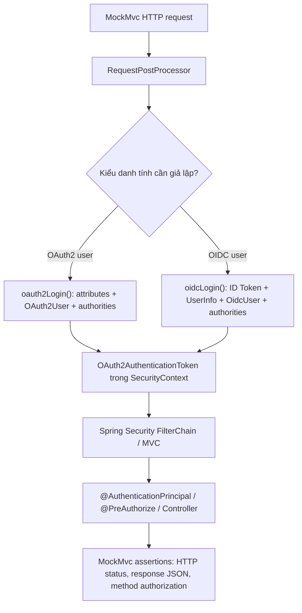

# 29.4. Tùy chỉnh attributes, ID Token claims và authorities trong test

Khi một ứng dụng **Spring Security OAuth 2.0 / OpenID Connect (OIDC) Client** dùng đăng nhập qua Google, Microsoft Entra ID, Keycloak hoặc một OpenID Provider (OP) nội bộ, controller và business service thường không chỉ cần biết **“đã đăng nhập”**. Chúng có thể đọc `sub`, `email`, `tenant_id`, `preferred_username`, nhóm/quyền của người dùng và cả registration đã sử dụng.

Ví dụ một controller:

```java
@GetMapping("/me")
Map<String, Object> me(@AuthenticationPrincipal OidcUser user) {
    return Map.of(
        "subject", user.getIdToken().getSubject(),
        "issuer", user.getIdToken().getIssuer().toString());
}
```

Để kiểm thử controller này bằng **MockMvc**, chỉ thêm `@WithMockUser` thường không đủ: nó cung cấp một Spring Security username/password-style Authentication giả lập, **không bảo đảm principal là `OidcUser` có ID Token**.

Spring Security Test hỗ trợ hai `RequestPostProcessor` rất hữu ích trên **Servlet**:

- **`oauth2Login()`**: tạo một `OAuth2AuthenticationToken` với principal kiểu `OAuth2User` và các OAuth2 user attributes.
- **`oidcLogin()`**: tạo một `OAuth2AuthenticationToken` với principal kiểu **`OidcUser`**, bao gồm mock `OidcIdToken`, `OidcUserInfo` và authorities.

Bài học thuộc chương **29. Kiểm thử Servlet**. Chúng ta sẽ thực hành thay **OAuth2 attributes**, **OIDC ID Token claims**, **UserInfo claims**, **GrantedAuthority** và **principal name**, đồng thời kiểm thử `@AuthenticationPrincipal`, `@PreAuthorize`, `@RegisteredOAuth2AuthorizedClient`, trường hợp thiếu quyền và các lỗi thường gặp.

> **Phạm vi:** Java 17+, Spring Boot 3.x, Spring Security 6.5, JUnit 5, MockMvc và `spring-security-test`. Những token/claims trong bài là **test fixtures**, không phải token xác thực thật. Ví dụ không yêu cầu gọi một OP thật. Dùng tài liệu của phiên bản Spring Security thực tế nếu API khác.

---

## 1. Vì sao kiểm thử OAuth2/OIDC bằng MockMvc cần công cụ riêng?

Một request sau khi login thực tế có thể đi qua:

```text
Browser -> /oauth2/authorization/company
       -> OpenID Provider: Authorization Code + PKCE
       -> /login/oauth2/code/company?code=...&state=...
       -> Token Endpoint
       -> ID Token validation + UserInfo
       -> SecurityContext chứa OAuth2AuthenticationToken
       -> Controller/Service
```

Để kiểm thử logic của **controller hoặc method security**, phần lớn bài test không cần khởi động toàn bộ flow ở phía trên. Chúng ta chỉ cần một **SecurityContext phản ánh đúng loại Authentication** mà phần code đang sử dụng.



Điều này tránh phải:
- Sinh authorization code và correlation state cho mọi controller test;
- Chạy một OIDC Provider test server chỉ để trả về một tên người dùng;
- Ký JWT thật và cung cấp JWKS cho các kiểm thử không tập trung vào token validation;
- Đưa client secret, refresh token hoặc thông tin người dùng thật vào test fixtures.

**Ranh giới quan trọng:** `oidcLogin()` và `oauth2Login()` **giả lập trạng thái đã xác thực**, không thực hiện authorization redirect, PKCE exchange, signature validation hay network call tới OP. Khi cần kiểm thử những điều đó, hãy dùng integration tests với mock Authorization Server/OP và HTTP client phù hợp.

## 2. Chọn đúng loại test và post-processor

| Mục tiêu | Công cụ nên dùng | Điều không được suy ra |
| --- | --- | --- |
| Controller chỉ cần `Authentication.getName()` hoặc generic Principal | `@WithMockUser` hoặc `user()` | Không chứng minh OIDC login |
| Controller đọc `OAuth2User.getAttributes()` | **`oauth2Login()`** | Không phải ID Token OIDC |
| Controller đọc `OidcUser.getIdToken()` | **`oidcLogin()`** | ID Token mock không được verify cryptographically |
| Controller đọc `OidcUser.getUserInfo()` | **`oidcLogin().userInfoToken(...)`** | Không gọi UserInfo endpoint |
| Filter/method security kiểm tra role/scope | `oidcLogin().authorities(...)` hoặc `oauth2Login().authorities(...)` | Claim không tự biến thành role |
| Controller dùng `@RegisteredOAuth2AuthorizedClient` | `oauth2Client()` hoặc authorized client do login post-processor tạo | Không tự thực hiện refresh token |
| Resource Server nhận Bearer JWT | **`jwt()`** | Không giống OAuth2 Client OIDC Login |
| Bắt đầu login/callback/token endpoint thật | Integration test với mock OP, MockWebServer/WireMock/Testcontainers tương ứng | Không thể chứng minh chỉ bằng `oidcLogin()` |

### 2.1. Ba class dễ bị nhầm

- `OAuth2User`: principal chung của OAuth2 Login, có attributes và authorities.
- `OidcUser`: principal cho OIDC Login, kế thừa OAuth2User và cung cấp `getIdToken()`, `getUserInfo()`.
- `JwtAuthenticationToken`: Authentication thường thấy trong **OAuth2 Resource Server** dùng bearer JWT; nó không thay thế `OAuth2AuthenticationToken` của OAuth2 Client login.

**Không dùng `jwt()` để kiểm thử controller cần `OidcUser`, và không dùng `@WithMockUser` rồi ép principal sang `OidcUser`.**

---

## 3. Dependency và import cần thiết

### 3.1. Maven

```xml
<dependencies>
    <dependency>
        <groupId>org.springframework.boot</groupId>
        <artifactId>spring-boot-starter-web</artifactId>
    </dependency>
    <dependency>
        <groupId>org.springframework.boot</groupId>
        <artifactId>spring-boot-starter-security</artifactId>
    </dependency>
    <dependency>
        <groupId>org.springframework.boot</groupId>
        <artifactId>spring-boot-starter-oauth2-client</artifactId>
    </dependency>

    <dependency>
        <groupId>org.springframework.boot</groupId>
        <artifactId>spring-boot-starter-test</artifactId>
        <scope>test</scope>
    </dependency>
    <dependency>
        <groupId>org.springframework.security</groupId>
        <artifactId>spring-security-test</artifactId>
        <scope>test</scope>
    </dependency>
</dependencies>
```

Spring Boot parent/BOM thường quản lý phiên bản các dependencies. Không tự ép `spring-security-test` sang phiên bản khác với Spring Security runtime.

### 3.2. Gradle

```groovy
dependencies {
    implementation 'org.springframework.boot:spring-boot-starter-web'
    implementation 'org.springframework.boot:spring-boot-starter-security'
    implementation 'org.springframework.boot:spring-boot-starter-oauth2-client'

    testImplementation 'org.springframework.boot:spring-boot-starter-test'
    testImplementation 'org.springframework.security:spring-security-test'
}

tasks.named('test') {
    useJUnitPlatform()
}
```

Đây là đoạn cấu hình minh họa để hiểu test dependencies. Trong bước soạn tài liệu, chúng ta **không chạy Gradle** và không sửa build của repository.

### 3.3. Static imports trong test

```java
import static org.springframework.security.test.web.servlet.request
    .SecurityMockMvcRequestPostProcessors.oauth2Login;
import static org.springframework.security.test.web.servlet.request
    .SecurityMockMvcRequestPostProcessors.oidcLogin;

import static org.springframework.test.web.servlet.request
    .MockMvcRequestBuilders.get;
import static org.springframework.test.web.servlet.result
    .MockMvcResultMatchers.status;
import static org.springframework.test.web.servlet.result
    .MockMvcResultMatchers.jsonPath;
```

Những static imports dài có thể được đặt trên một dòng theo style của dự án:

```java
import static org.springframework.security.test.web.servlet.request.SecurityMockMvcRequestPostProcessors.oauth2Login;
import static org.springframework.security.test.web.servlet.request.SecurityMockMvcRequestPostProcessors.oidcLogin;
```

Không nhầm các request post-processors trên với `SecurityMockServerConfigurers.mockOidcLogin()` dành cho **Reactive WebFlux/WebTestClient**.

---

## 4. Hiểu những giá trị mặc định của oauth2Login() và oidcLogin()

Ví dụ:

```java
mvc.perform(get("/me").with(oidcLogin()));
```

Spring Security Test tạo một Authentication hợp lệ **về mặt request test context**, với mặc định tiện lợi.

| Dữ liệu | `oauth2Login()` | `oidcLogin()` |
| --- | --- | --- |
| Authentication | `OAuth2AuthenticationToken` | `OAuth2AuthenticationToken` |
| Principal | `OAuth2User` | **`OidcUser`** |
| Subject mặc định | Attribute `sub=user` | ID Token claim `sub=user` |
| Authorities mặc định trong test | Một authority **`SCOPE_read`** | Một authority **`SCOPE_read`** |
| UserInfo | Không có model OIDC UserInfo | Mock `OidcUserInfo` mặc định rỗng |
| ID Token | Không | Có mock `OidcIdToken` |
| Authorized client | Có mock authorized client liên kết | Có mock authorized client liên kết |
| Network call đến OP | Không | Không |
| Chữ ký JWT/JWKS validation | Không | Không |

**Đừng áp những mặc định này lên production.** Chính sách authorities trong ứng dụng thật phụ thuộc OP, scopes, OIDC user service và role mapping. Test post-processor không tự chạy những bước mapping production tùy chỉnh.

### 4.1. RequestPostProcessor làm gì?

Trong `mvc.perform(get(...).with(oidcLogin()))`, processor sửa **MockHttpServletRequest** để gắn Authentication/SecurityContext và mô phỏng authorized client. Để MVC/Spring Security thấy context đúng, MockMvc cần được tích hợp Spring Security filters.

Hai cách thường dùng:
- Spring Boot Test với `@AutoConfigureMockMvc` và security auto-configuration;
- Standalone MockMvc với `.apply(springSecurity())` hoặc filter setup tương đương.

Nếu quên gắn Spring Security vào MockMvc, `@AuthenticationPrincipal` có thể thành `null` dù test có gọi `.with(oidcLogin())`.

---

## 5. oauth2Login().attributes(): tùy chỉnh OAuth2 User attributes

Với OAuth2 Login không dùng OIDC, một controller có thể đọc attributes:

```java
import org.springframework.security.core.annotation.AuthenticationPrincipal;
import org.springframework.security.oauth2.core.user.OAuth2User;
import org.springframework.web.bind.annotation.GetMapping;
import org.springframework.web.bind.annotation.RestController;

@RestController
class GenericOAuthUserController {

    @GetMapping("/oauth2/profile")
    String profile(@AuthenticationPrincipal OAuth2User user) {
        return user.getAttribute("user_id");
    }
}
```

Trong test:

```java
mvc.perform(get("/oauth2/profile")
        .with(oauth2Login()
            .attributes(attrs -> attrs.put("user_id", "acct-123"))))
    .andExpect(status().isOk())
    .andExpect(content().string("acct-123"));
```

`attributes(...)` nhận một `Consumer<Map<String, Object>>`. Nó cho phép sửa Map attributes được tạo trong test:

```java
mvc.perform(get("/oauth2/profile")
    .with(oauth2Login().attributes(attrs -> {
        attrs.put("user_id", "acct-123");
        attrs.put("preferred_username", "tester");
        attrs.put("email_verified", Boolean.TRUE);
        attrs.put("groups", java.util.List.of("readers", "auditors"));
    })));
```

### 5.1. Chọn type đúng

Các giá trị trong Map có type `Object`, không mặc nhiên là String.

Ví dụ:

```java
Boolean verified = user.getAttribute("email_verified");
List<String> groups = user.getAttribute("groups");
String userId = user.getAttribute("user_id");
```

Nếu test đặt `email_verified="true"` (String) nhưng production dùng `Boolean.TRUE`, bạn có thể che hoặc tạo lỗi type conversion sai. Test fixtures cần mô phỏng **type thực tế của dữ liệu provider**.

### 5.2. Đổi hoặc xóa attributes

```java
.with(oauth2Login().attributes(attrs -> {
    attrs.remove("email");
    attrs.put("user_id", "acct-999");
}))
```

Dùng negative case này để kiểm tra ứng dụng xử lý missing attribute ra sao.

**Không gán quyền truy cập chỉ vì attribute `role="admin"`.** Để `hasAuthority("ROLE_ADMIN")` thành công, Authentication cần authority tương ứng hoặc pipeline mapping quyền thực sự được chạy trong test.

### 5.3. Khi nào không nên dùng oauth2Login()?

Nếu controller khai báo:

```java
@AuthenticationPrincipal OidcUser user
```

thì `oauth2Login()` không phải fixture đúng. Nó mô phỏng `OAuth2User` chung, không bảo đảm có `getIdToken()`. Trong trường hợp đó hãy dùng **`oidcLogin()`**.

---

## 6. oidcLogin().idToken(): tùy chỉnh ID Token claims

Một controller OIDC có thể đọc claims trong ID Token:

```java
import org.springframework.security.core.annotation.AuthenticationPrincipal;
import org.springframework.security.oauth2.core.oidc.user.OidcUser;
import org.springframework.web.bind.annotation.GetMapping;
import org.springframework.web.bind.annotation.RestController;

@RestController
class OidcIdentityController {

    @GetMapping("/identity/tenant")
    String tenant(@AuthenticationPrincipal OidcUser user) {
        return user.getIdToken().getClaimAsString("tenant_id");
    }
}
```

Trong MockMvc:

```java
mvc.perform(get("/identity/tenant")
        .with(oidcLogin()
            .idToken(token -> token
                .claim("sub", "employee-42")
                .claim("tenant_id", "tenant-a")
                .claim("email", "learner@example.test")
                .claim("email_verified", true))))
    .andExpect(status().isOk())
    .andExpect(content().string("tenant-a"));
```

`idToken(...)` nhận một `Consumer<OidcIdToken.Builder>`. Mỗi `claim(name, value)` sửa claims của **mock ID Token**.

### 6.1. Các claims thường gặp

| Claim | Type thường gặp | Ý nghĩa | Cách dùng trong test |
| --- | --- | --- | --- |
| `sub` | String | Subject định danh user trong issuer | Kiểm thử identity key |
| `iss` | String/URI representation | Issuer đã phát ID Token | Mô phỏng issuer, không kiểm tra signature |
| `aud` | String/List | Audience của ID Token | Kiểm thử code đọc metadata, không thay JWT validation |
| `email` | String | Email claim | Test có/thiếu/đổi email |
| `email_verified` | Boolean | Trạng thái email verified | Kiểm thử logic xử lý boolean |
| `preferred_username` | String | Username hiển thị | Kiểm thử principal naming |
| `name` | String | Display name | Kiểm thử UI |
| `tenant_id` | String tùy OP | Tenant/business context | Kiểm thử tenant-aware logic |
| `groups` | List hoặc provider-specific | Nhóm từ OP | Kiểm thử mapping trong service chuyên trách |
| `auth_time` | Epoch seconds/time representation | Thời điểm xác thực | Kiểm thử policy freshness khi code hỗ trợ |
| `nonce` | String | Binding authentication request | Chỉ là test claim, không tự validate OIDC nonce |

Ví dụ một case có claim dạng list:

```java
.with(oidcLogin()
    .idToken(token -> token
        .claim("sub", "employee-42")
        .claim("groups", List.of("engineering", "reports-read"))))
```

### 6.2. Dữ liệu mock không tự được xác thực

Một test có thể viết:

```java
.with(oidcLogin().idToken(token -> token
    .claim("iss", "https://untrusted.example.test")
    .claim("exp", 1L)))
```

và controller vẫn nhận được `OidcUser` trong request test. **Đó không phải lỗ hổng được chứng minh**: request post-processor đã bỏ qua login protocol và tự tạo Authentication để bạn kiểm thử layer sau login.

Nếu muốn bảo đảm issuer, signature, audience, expiry hoặc nonce bị từ chối, hãy kiểm thử:
- OIDC login authentication provider/ID Token decoder ở layer tương ứng;
- Authorization Code callback + token/JWKS test server;
- Hoặc configuration/integration tests thực sự đi qua token validation.

**Không dùng `oidcLogin()` để tuyên bố ứng dụng đã kiểm thử thành công xác minh JWT chữ ký thật.**

### 6.3. Đừng đưa ID Token làm access token

`OidcIdToken` là token định danh cho client. Resource Server API thường nhận **access token** với audience/scope riêng. Trong MockMvc:
- `oidcLogin().idToken(...)` mô phỏng OIDC identity;
- `oauth2Client()` hoặc `@RegisteredOAuth2AuthorizedClient` liên quan access token dùng outbound;
- `jwt()` mô phỏng inbound JWT trong Resource Server tests.

Không dùng `getIdToken().getTokenValue()` làm Bearer token cho API chỉ để test pass.

---

## 7. oidcLogin().userInfoToken(): tùy chỉnh UserInfo claims

OIDC có thể cung cấp thông tin user ở **UserInfo endpoint**, khác ID Token.

Spring Security 6.5 test API sử dụng tên method:

**`userInfoToken(Consumer<OidcUserInfo.Builder>)`**.

Ví dụ:

```java
mvc.perform(get("/identity/profile")
    .with(oidcLogin()
        .idToken(idToken -> idToken.claim("sub", "user-123"))
        .userInfoToken(info -> info
            .claim("name", "Nguyễn An")
            .claim("locale", "vi-VN")
            .claim("department", "finance"))));
```

Tên method **`userInfoToken(...)`** là điểm cần nhớ khi dùng Spring Security Test Servlet 6.5. Không thay bằng `.userInfo(...)` theo phỏng đoán; hãy đối chiếu Javadoc của dependency thực tế.

### 7.1. ID Token và UserInfo được đọc bằng API khác nhau

```java
OidcIdToken idToken = user.getIdToken();
String subject = idToken.getSubject();

OidcUserInfo userInfo = user.getUserInfo();
String name = userInfo == null
    ? null
    : userInfo.getClaimAsString("name");
```

Để test chính xác nơi controller đọc dữ liệu, hãy đặt fixture ở **đúng nguồn**:
- Controller đọc `getIdToken().getClaimAsString("tenant_id")` → dùng `idToken(...)`.
- Controller đọc `getUserInfo().getClaimAsString("name")` → dùng `userInfoToken(...)`.
- Controller đọc `getClaims()` hoặc `getAttribute()` của `OidcUser` → dữ liệu có thể được tổng hợp từ ID Token và UserInfo; test cần mô phỏng đúng trường hợp trùng hoặc thiếu claims.

### 7.2. UserInfo mặc định trong test là rỗng

Theo tài liệu Spring Security Test, `oidcLogin()` mặc định tạo **OidcUserInfo không có claims**. Vì vậy test code đọc `user.getUserInfo().getClaimAsString("name")` có thể trả `null` nếu bạn không tùy chỉnh.

Điều đó giúp phát hiện code phụ thuộc một UserInfo claim nhưng test fixture không cung cấp.

### 7.3. Không giả định UserInfo luôn tồn tại trong production

Tùy provider, scopes, permissions, token policy và user service:
- OP có thể không cung cấp UserInfo endpoint;
- Client có thể không gọi UserInfo;
- Một claim có thể chỉ có trong ID Token hoặc chỉ có trong UserInfo;
- UserInfo có thể trả dữ liệu không như mong đợi;
- Khi UserInfo được sử dụng, `sub` phải được đối chiếu phù hợp với ID Token theo OIDC Core.

Test tốt nên có case **UserInfo thiếu** và **claim thiếu**, không chỉ happy path có tất cả dữ liệu.

---

## 8. authorities(): quyền của Authentication trong test

Spring Security authorization thường kiểm tra **`GrantedAuthority`** thay vì trực tiếp đọc claim bất kỳ.

Ví dụ controller:

```java
@PreAuthorize("hasAuthority('ROLE_REPORT_READER')")
@GetMapping("/reports")
String reports() {
    return "report-ok";
}
```

Để request được phép:

```java
mvc.perform(get("/reports")
    .with(oidcLogin()
        .authorities(
            new SimpleGrantedAuthority("ROLE_REPORT_READER"))))
    .andExpect(status().isOk());
```

Để chứng minh không có quyền tương ứng:

```java
mvc.perform(get("/reports")
    .with(oidcLogin()
        .authorities(
            new SimpleGrantedAuthority("SCOPE_read"))))
    .andExpect(status().isForbidden());
```

**`authorities(...)` cấp các authorities mà test Authentication sẽ có.** Đừng mặc định nó cộng dồn với các authorities mặc định `SCOPE_read`; nếu cần cả hai, khai báo rõ cả hai:

```java
.with(oidcLogin().authorities(
    new SimpleGrantedAuthority("SCOPE_read"),
    new SimpleGrantedAuthority("ROLE_REPORT_READER")))
```

### 8.1. Role và scope khác nhau

| Cách viết | Authority thực tế | Ví dụ |
| --- | --- | --- |
| `hasRole("ADMIN")` | Kiểm tra `ROLE_ADMIN` theo default role prefix | Quyền admin nghiệp vụ |
| `hasAuthority("ROLE_ADMIN")` | Kiểm tra chính xác `ROLE_ADMIN` | Tương đương khi default prefix |
| `hasAuthority("SCOPE_reports.read")` | Kiểm tra chính xác `SCOPE_reports.read` | OAuth2 scope |
| `hasAuthority("reports.read")` | Kiểm tra chuỗi `reports.read` | Không bằng `SCOPE_reports.read` |

Một claim:

```json
{
  "groups": ["report-readers"]
}
```

**không tự tạo** authority `ROLE_REPORT_READER`. Với ứng dụng thực, cần custom user service/authority mapper/provisioning logic để chuyển nhóm đã được xác minh sang quyền nghiệp vụ. Trong test, nếu dùng `.authorities(...)`, bạn đang **mô phỏng kết quả mapping**, không kiểm tra mapping đó.

### 8.2. Hai tầng test nên tách

**Test A — kiểm tra controller authorization:** đặt đúng authorities bằng post-processor rồi xác minh 200/403.

**Test B — kiểm tra role mapping:** đưa claims giả vào **mapper thật** và assert authorities được sinh ra. Không mock mapper trong test mà bạn muốn chứng minh chính mapping logic đó.

### 8.3. Không tùy tiện nâng quyền từ email/claim

Ví dụ dữ liệu OP gửi:

```json
{
  "email": "director@example.test",
  "tenant_id": "west"
}
```

Không tự cấp `ROLE_ADMIN` chỉ vì email hoặc tenant string phù hợp một pattern. Authorization mapping cần policy tin cậy, verified issuer/subject, tenant boundary và dữ liệu đã được xác minh.

---

## 9. Ví dụ hoàn chỉnh: controller nhận OidcUser

Tạo một controller minh họa có hai endpoint: một trả claims, một bảo vệ bằng method security.

```java
package example.web;

import java.util.LinkedHashMap;
import java.util.Map;

import org.springframework.http.HttpStatus;
import org.springframework.security.access.prepost.PreAuthorize;
import org.springframework.security.core.annotation.AuthenticationPrincipal;
import org.springframework.security.oauth2.core.oidc.user.OidcUser;
import org.springframework.web.bind.annotation.GetMapping;
import org.springframework.web.bind.annotation.RestController;
import org.springframework.web.server.ResponseStatusException;

@RestController
class ProfileController {

    @GetMapping("/api/profile")
    Map<String, Object> profile(@AuthenticationPrincipal OidcUser user) {
        if (user == null) {
            throw new ResponseStatusException(
                HttpStatus.UNAUTHORIZED, "OIDC login required");
        }

        Map<String, Object> result = new LinkedHashMap<>();
        result.put("subject", user.getIdToken().getSubject());
        result.put("department",
            user.getIdToken().getClaimAsString("department"));

        String displayName = user.getUserInfo() == null
            ? null
            : user.getUserInfo().getClaimAsString("name");

        result.put("displayName", displayName);
        return result;
    }

    @GetMapping("/api/reports")
    @PreAuthorize("hasAuthority('ROLE_REPORT_READER')")
    String reports() {
        return "report-ok";
    }
}
```

Đây là controller mô hình dùng để học; không trực tiếp xuất token hoặc claims nhạy cảm. Với sản phẩm thật, chỉ trả dữ liệu user được phép xem và áp dụng authorization/tenant policy phù hợp.

### 9.1. Cấu hình Security cho WebMvcTest

Có thể tạo một **test-only SecurityFilterChain** để các asserts HTTP status ổn định mà không cần gọi OP:

```java
package example.web;

import org.springframework.boot.test.context.TestConfiguration;
import org.springframework.context.annotation.Bean;
import org.springframework.security.config.Customizer;
import org.springframework.security.config.annotation.method.configuration.EnableMethodSecurity;
import org.springframework.security.config.annotation.web.builders.HttpSecurity;
import org.springframework.security.web.SecurityFilterChain;

@TestConfiguration
@EnableMethodSecurity
class ProfileTestSecurityConfig {

    @Bean
    SecurityFilterChain testChain(HttpSecurity http) throws Exception {
        return http
            .authorizeHttpRequests(auth -> auth
                .anyRequest().authenticated())
            .httpBasic(Customizer.withDefaults())
            .build();
    }
}
```

**Vì sao dùng `httpBasic()` trong test configuration?** Để minh họa một client không authenticated nhận **401** thay vì browser OAuth2 login redirect. Nó **không thay thế SecurityFilterChain production**. Nếu bạn muốn kiểm tra chính xác chính sách OAuth2 Login của ứng dụng thật, hãy import đúng production security config hoặc dùng `@SpringBootTest` theo nhu cầu.

### 9.2. Bài test MockMvc với claims và authorities

```java
package example.web;

import org.junit.jupiter.api.Test;
import org.springframework.beans.factory.annotation.Autowired;
import org.springframework.boot.test.autoconfigure.web.servlet.WebMvcTest;
import org.springframework.context.annotation.Import;
import org.springframework.security.core.authority.SimpleGrantedAuthority;
import org.springframework.test.web.servlet.MockMvc;

import static org.springframework.security.test.web.servlet.request.SecurityMockMvcRequestPostProcessors.oidcLogin;
import static org.springframework.test.web.servlet.request.MockMvcRequestBuilders.get;
import static org.springframework.test.web.servlet.result.MockMvcResultMatchers.content;
import static org.springframework.test.web.servlet.result.MockMvcResultMatchers.jsonPath;
import static org.springframework.test.web.servlet.result.MockMvcResultMatchers.status;

@WebMvcTest(ProfileController.class)
@Import(ProfileTestSecurityConfig.class)
class ProfileControllerTest {

    @Autowired
    MockMvc mvc;

    @Test
    void profileReadsIdTokenAndUserInfo() throws Exception {
        mvc.perform(get("/api/profile")
            .with(oidcLogin()
                .idToken(token -> token
                    .claim("sub", "employee-42")
                    .claim("department", "engineering"))
                .userInfoToken(info ->
                    info.claim("name", "Nguyễn An"))))
            .andExpect(status().isOk())
            .andExpect(jsonPath("$.subject").value("employee-42"))
            .andExpect(jsonPath("$.department").value("engineering"))
            .andExpect(jsonPath("$.displayName").value("Nguyễn An"));
    }

    @Test
    void reportAllowedWithBusinessAuthority() throws Exception {
        mvc.perform(get("/api/reports")
            .with(oidcLogin().authorities(
                new SimpleGrantedAuthority("ROLE_REPORT_READER"))))
            .andExpect(status().isOk())
            .andExpect(content().string("report-ok"));
    }

    @Test
    void reportForbiddenWithoutBusinessAuthority() throws Exception {
        mvc.perform(get("/api/reports")
            .with(oidcLogin().authorities(
                new SimpleGrantedAuthority("SCOPE_read"))))
            .andExpect(status().isForbidden());
    }

    @Test
    void anonymousUserCannotAccessProfile() throws Exception {
        mvc.perform(get("/api/profile"))
            .andExpect(status().isUnauthorized());
    }

    @Test
    void missingOptionalClaimsAreHandled() throws Exception {
        mvc.perform(get("/api/profile").with(oidcLogin()))
            .andExpect(status().isOk())
            .andExpect(jsonPath("$.subject").value("user"));
    }
}
```

Trong ví dụ:
- `@WebMvcTest` tạo slice kiểm thử controller/MVC;
- `@Import(ProfileTestSecurityConfig.class)` bật policy test và `@EnableMethodSecurity`;
- `@AutoConfigureMockMvc` được tích hợp với `@WebMvcTest` qua Spring Boot test configuration, nên Spring Security filters được áp dụng trong setup thông thường;
- `oidcLogin()` cung cấp `OidcUser` mà controller yêu cầu;
- `idToken` và `userInfoToken` đặt dữ liệu vào hai nguồn khác nhau;
- `authorities` đặt quyền phù hợp/missing để test `@PreAuthorize`;
- Test 401 là kết quả của **test-only httpBasic config**; với production `oauth2Login()`, anonymous user có thể nhận **302 redirect**, không phải 401.

### 9.3. Không khẳng định bài test đã xác minh JWT

Không có test nào trong phần 9 gửi token tới OP, gọi JWKS, thực thi PKCE hoặc kiểm tra chữ ký. Chúng kiểm thử **controller + authorization behavior sau khi Authentication đã được giả lập**.

Khi kiểm thử filter chain production, hãy giữ chính SecurityFilterChain production thay vì thay bằng test config và đừng suy ra từ 401/403 của test-only chain rằng production browser UX giống hệt.

---

## 10. Tùy chỉnh OAuth2User hoàn chỉnh: oauth2Login().oauth2User(...)

Có tình huống provider trả username trong `user_name` thay vì `sub`, hoặc ứng dụng có implementation riêng của `OAuth2User`.

Ví dụ:

```java
import java.util.Map;

import org.springframework.security.core.authority.AuthorityUtils;
import org.springframework.security.oauth2.core.user.DefaultOAuth2User;
import org.springframework.security.oauth2.core.user.OAuth2User;

OAuth2User customUser = new DefaultOAuth2User(
    AuthorityUtils.createAuthorityList(
        "ROLE_SUPPORT",
        "SCOPE_profile.read"),
    Map.of(
        "user_name", "support-01",
        "user_id", "u-123",
        "email_verified", true),
    "user_name");

mvc.perform(get("/oauth2/profile")
    .with(oauth2Login().oauth2User(customUser)));
```

`DefaultOAuth2User` constructor nhận:
1. Authorities;
2. Map attributes;
3. **`nameAttributeKey`** — key dùng cho `getName()`.

Do đó:

```java
customUser.getName(); // "support-01"
```

**Nếu `nameAttributeKey` không tồn tại trong attributes**, DefaultOAuth2User có thể báo lỗi khi tạo principal. Khi kiểm thử custom principal, cần cung cấp đủ key.

### 10.1. Vì sao dùng oauth2User(...) thay vì attributes(...)?

`attributes(...)` đủ khi bạn chỉ thay các field trong Map và giữ behavior mặc định.

`oauth2User(customUser)` phù hợp khi:
- Dùng subclass/custom implementation;
- Muốn thay `getName()`;
- Muốn kiểm thử authorities gắn trực tiếp với principal;
- Controller dùng một method riêng của custom principal;
- Business service dựa trên user object production có cấu trúc đặc thù.

### 10.2. Tránh kết hợp cấu hình mâu thuẫn

Ví dụ:

```java
oauth2Login()
    .attributes(attrs -> attrs.put("user_id", "A"))
    .oauth2User(customUser)
```

Nếu bạn cung cấp `customUser` hoàn chỉnh, đừng kỳ vọng mọi thay đổi attributes trước đó nhất thiết được merge theo cách bạn nghĩ. Chọn **một chiến lược fixture rõ ràng**: hoặc chỉnh builder mặc định, hoặc cung cấp principal hoàn chỉnh.

---

## 11. Tùy chỉnh OidcUser hoàn chỉnh: oidcLogin().oidcUser(...)

Khi muốn kiểm thử principal name khác `sub` hoặc implementation `OidcUser` cụ thể, có thể tạo `DefaultOidcUser`.

```java
import org.springframework.security.core.authority.AuthorityUtils;
import org.springframework.security.oauth2.core.oidc.OidcIdToken;
import org.springframework.security.oauth2.core.oidc.user.DefaultOidcUser;
import org.springframework.security.oauth2.core.oidc.user.OidcUser;

OidcIdToken token = OidcIdToken.withTokenValue("synthetic-id-token")
    .claim("sub", "employee-42")
    .claim("preferred_username", "nguyen.an")
    .claim("tenant_id", "tenant-a")
    .build();

OidcUser custom = new DefaultOidcUser(
    AuthorityUtils.createAuthorityList(
        "SCOPE_read",
        "ROLE_REPORT_READER"),
    token,
    "preferred_username");

mvc.perform(get("/api/profile")
    .with(oidcLogin().oidcUser(custom)));
```

Ở đây:
- `OidcIdToken.withTokenValue(...)` tạo model token test, không phải token được OP ký.
- `DefaultOidcUser` nhận authorities, ID Token và `nameAttributeKey`.
- `getName()` có thể dựa trên `preferred_username` nếu được chọn.
- `getIdToken()` vẫn trả token vừa tạo.

### 11.1. Có cả OidcUserInfo

Nếu muốn tự dựng principal có UserInfo:

```java
import org.springframework.security.oauth2.core.oidc.user.OidcUserInfo;

OidcUserInfo userInfo = OidcUserInfo.builder()
    .claim("sub", "employee-42")
    .claim("name", "Nguyễn An")
    .claim("locale", "vi-VN")
    .build();

OidcUser custom = new DefaultOidcUser(
    AuthorityUtils.createAuthorityList("ROLE_REPORT_READER"),
    token,
    userInfo,
    "preferred_username");
```

Khi mô phỏng dữ liệu OIDC thực tế, **`sub` trong UserInfo phải tương thích với ID Token**. Nếu mục tiêu là kiểm thử chính sách từ chối UserInfo subject mismatch, không dùng `oidcLogin()` làm bằng chứng OIDC user service đã kiểm tra điều đó: post-processor đã bypass UserInfo retrieval/validation. Hãy kiểm thử user service thực bằng một integration test riêng.

### 11.2. Custom OidcUser khác với idToken(...) / userInfoToken(...)

- `idToken(...)`: đổi ID Token claims trong principal mock được tạo tự động.
- `userInfoToken(...)`: đổi UserInfo claims trong principal mock được tạo tự động.
- **`oidcUser(custom)`**: thay toàn bộ principal bằng object do bạn chuẩn bị.

Tránh gọi cả ba mà không biết thứ tự ưu tiên, nhất là khi claims mâu thuẫn.

---

## 12. Test missing, null và type không đúng

Tài liệu provider thường có những field tùy chọn; test chỉ có dữ liệu đầy đủ dễ che lỗi `NullPointerException` hoặc `ClassCastException`.

### 12.1. Không có email

```java
mvc.perform(get("/api/profile")
    .with(oidcLogin()
        .idToken(token ->
            token.claims(claims -> claims.remove("email")))));
```

Đây là ví dụ chỉnh builder để xóa optional claim trong test. Với phiên bản Spring Security dùng builder API khác, đối chiếu `OidcIdToken.Builder` trong Javadoc trước khi triển khai.

**Đừng tự bù `email` bằng `sub` rồi cho rằng đó là địa chỉ email đã xác minh.** Chúng là các identifier khác nhau.

### 12.2. email_verified có type Boolean

```java
.with(oidcLogin().idToken(token -> token
    .claim("email", "learner@example.test")
    .claim("email_verified", false)))
```

Đoạn này giúp kiểm thử nghiệp vụ có từ chối email chưa verified hoặc không dựa vào email như khóa liên kết account.

### 12.3. Claim list và map phức tạp

Một provider có thể phát:

```json
{
  "groups": ["reporting", "engineering"],
  "custom": {
    "department": "ops",
    "cost_center": "CC-17"
  }
}
```

Fixture:

```java
.with(oidcLogin().idToken(token -> token
    .claim("groups", List.of("reporting", "engineering"))
    .claim("custom", Map.of(
        "department", "ops",
        "cost_center", "CC-17"))))
```

Hãy test đúng **kiểu dữ liệu** và trường hợp rỗng, thiếu, sai type. Với provider-specific claims, không đoán tất cả strings đều là scopes/roles.

### 12.4. Claim “admin” không tự cấp ROLE_ADMIN

```java
.with(oidcLogin().idToken(token -> token
    .claim("groups", List.of("admin"))))
```

Không có gì trong đoạn trên chứng minh Authentication đã có `ROLE_ADMIN`. Nếu method security dựa trên role, phải:
- Gán role bằng `authorities(...)` khi test policy;
- Hoặc thực thi role mapper production trong test riêng để chứng minh conversion.

---

## 13. Kiểm thử custom role/authority mapper thay vì chỉ giả lập role

Một chính sách minh họa:

- `groups` có `reports-read` → cấp `ROLE_REPORT_READER`;
- Chỉ những group nằm trong allowlist mới được map;
- Không tự cấp `ROLE_ADMIN` từ mọi giá trị group;
- Claims phải đến từ issuer/provider đáng tin trong flow xác thực thực tế.

Một mapper thuần Java:

```java
package example.security;

import java.util.ArrayList;
import java.util.Collection;
import java.util.List;

import org.springframework.security.core.GrantedAuthority;
import org.springframework.security.core.authority.SimpleGrantedAuthority;
import org.springframework.security.oauth2.core.oidc.user.OidcUser;

public final class ReportRoleMapper {

    public Collection<GrantedAuthority> map(OidcUser user) {
        List<GrantedAuthority> result = new ArrayList<>();
        result.add(new SimpleGrantedAuthority("SCOPE_read"));

        List<String> groups =
            user.getIdToken().getClaimAsStringList("groups");

        if (groups != null && groups.contains("reports-read")) {
            result.add(
                new SimpleGrantedAuthority("ROLE_REPORT_READER"));
        }

        return result;
    }
}
```

Test mapper:

```java
@Test
void reportsReadGroupMapsToBusinessRole() {
    OidcIdToken idToken = OidcIdToken.withTokenValue("test")
        .claim("sub", "employee-42")
        .claim("groups", List.of("reports-read"))
        .build();

    OidcUser user = new DefaultOidcUser(
        AuthorityUtils.createAuthorityList("SCOPE_read"),
        idToken);

    Collection<GrantedAuthority> authorities =
        new ReportRoleMapper().map(user);

    assertThat(authorities)
        .contains(new SimpleGrantedAuthority("ROLE_REPORT_READER"));
}
```

Và negative test:

```java
@Test
void unknownGroupDoesNotBecomeAdmin() {
    OidcIdToken token = OidcIdToken.withTokenValue("test")
        .claim("sub", "employee-42")
        .claim("groups", List.of("arbitrary-admin"))
        .build();

    OidcUser user = new DefaultOidcUser(
        AuthorityUtils.createAuthorityList("SCOPE_read"),
        token);

    Collection<GrantedAuthority> authorities =
        new ReportRoleMapper().map(user);

    assertThat(authorities)
        .doesNotContain(new SimpleGrantedAuthority("ROLE_ADMIN"));
}
```

**Hai mức kiểm thử khác nhau**:

1. Mapper unit test: “Claim groups X được chuyển thành authorities Y đúng không?”
2. Controller authorization test: “Với authorities Y, endpoint/method có cho phép đúng không?”

Nếu bạn chỉ dùng `oidcLogin().authorities(...)` để kiểm thử cả hai, mapper có thể bị hỏng mà test vẫn xanh.

### 13.1. Claim từ UserInfo hay ID Token?

Mapper trên cố ý đọc `user.getIdToken()`. Nếu production mapper đọc `getUserInfo()` hoặc `getClaims()` thì fixture và test phải đặt claims tương ứng.

Không tự chuyển dữ liệu từ UserInfo sang ID Token trong test nếu production không làm điều đó.

### 13.2. Role mapper chạy ở bước nào trong production?

Spring Security có thể tích hợp custom mapping qua `GrantedAuthoritiesMapper` hoặc OIDC user service wrapper. `oidcLogin()` **không tự chạy lại toàn bộ pipeline đó**. Vì vậy:
- Test mapper trong unit/integration context chuyên biệt;
- Test authorization sau login bằng mock authorities;
- Có một số integration tests thực hiện real/mock OIDC login flow nếu muốn chứng minh wiring.

---

## 14. Kịch bản đa tenant và nhiều provider

Giả sử Portal có hai OIDC registrations:

```text
company -> issuer https://id.company.example.test
partner -> issuer https://id.partner.example.test
```

Cả hai cùng có `sub="42"` hoặc `email="an@example.test"` không có nghĩa đó là cùng một người.

OIDC identity key ít nhất là:

```text
(issuer, subject)
```

### 14.1. Đổi test ClientRegistration

`oidcLogin()` và `oauth2Login()` cung cấp:

```java
.clientRegistration(ClientRegistration registration)
```

Một registration test:

```java
import org.springframework.security.oauth2.client.registration.ClientRegistration;
import org.springframework.security.oauth2.core.AuthorizationGrantType;
import org.springframework.security.oauth2.core.ClientAuthenticationMethod;

ClientRegistration companyRegistration =
    ClientRegistration.withRegistrationId("company")
        .clientId("test-client-id")
        .clientSecret("test-only-secret")
        .clientAuthenticationMethod(
            ClientAuthenticationMethod.CLIENT_SECRET_BASIC)
        .authorizationGrantType(
            AuthorizationGrantType.AUTHORIZATION_CODE)
        .redirectUri("{baseUrl}/login/oauth2/code/{registrationId}")
        .authorizationUri("https://id.company.example.test/authorize")
        .tokenUri("https://id.company.example.test/token")
        .jwkSetUri("https://id.company.example.test/jwks")
        .issuerUri("https://id.company.example.test")
        .scope("openid", "profile")
        .clientName("Company")
        .build();
```

Dùng trong test:

```java
mvc.perform(get("/api/profile")
    .with(oidcLogin()
        .clientRegistration(companyRegistration)
        .idToken(token -> token
            .claim("sub", "employee-42")
            .claim("tenant_id", "tenant-a"))));
```

**`clientRegistration(...)` mô phỏng metadata client/authorized client**, không gọi OIDC Discovery. Dữ liệu issuer ở test này chỉ là fixture; không có kết quả signature validation nếu dùng `oidcLogin()`.

### 14.2. Đừng chỉ đổi issuer claim và nghĩ đã đổi registration

```java
.with(oidcLogin().idToken(token ->
    token.claim("iss", "https://id.partner.example.test")))
```

Không bảo đảm `OAuth2AuthenticationToken.getAuthorizedClientRegistrationId()` trở thành `partner`. Registration ID và token claims là **hai nhóm dữ liệu khác nhau**. Khi test logic đa provider, cần đặt cả **registration** và **claims** phù hợp.

### 14.3. Đừng cho role vượt tenant

Một test hữu ích:

```text
OIDC identity:
  issuer = company
  sub = user-42
  tenant_id = tenant-a

Business request:
  /tenants/tenant-b/reports

Expected:
  403 hoặc domain-specific denial,
  dù user có ROLE_REPORT_READER trong tenant-a.
```

Một authority toàn cục như `ROLE_REPORT_READER` không đủ để chứng minh user được quyền truy cập **mọi tenant**. Test cần chạy đúng production tenant authorizer/ACL logic hoặc service tương ứng, không chỉ test `hasAuthority` đơn giản.

---

## 15. Kiểm thử @RegisteredOAuth2AuthorizedClient

Một controller có thể cần access token của authorized client để gọi API:

```java
import org.springframework.security.oauth2.client.OAuth2AuthorizedClient;
import org.springframework.security.oauth2.client.annotation.RegisteredOAuth2AuthorizedClient;
import org.springframework.web.bind.annotation.GetMapping;
import org.springframework.web.bind.annotation.RestController;

@RestController
class ConnectionController {

    @GetMapping("/connection/registration")
    String registration(
        @RegisteredOAuth2AuthorizedClient OAuth2AuthorizedClient client) {

        return client.getClientRegistration().getRegistrationId();
    }
}
```

Theo tài liệu Spring Security Test, `oauth2Login()` và `oidcLogin()` không chỉ tạo principal mà còn liên kết **mock OAuth2AuthorizedClient** với một mock/repository phù hợp để hỗ trợ trường hợp như vậy.

```java
mvc.perform(get("/connection/registration")
    .with(oidcLogin().clientRegistration(companyRegistration)))
    .andExpect(status().isOk())
    .andExpect(content().string("company"));
```

Điều kiện: MVC context của bài test phải có **argument resolver/authorized client infrastructure** tương thích với `@RegisteredOAuth2AuthorizedClient`. Với một `@WebMvcTest` slice tối giản chưa đăng ký OAuth2 Client support, resolver có thể không tồn tại, nên ví dụ trên **không thể bảo đảm chạy chỉ bằng post-processor**. Khi đó:
- Import OAuth2 Client MVC configuration thích hợp;
- Hoặc dùng `@SpringBootTest` với cấu hình thực tế;
- Hoặc kiểm thử service/controller bằng cách giả lập dependency ở boundary phù hợp.

### 15.1. Khi user chưa login nhưng cần OAuth2 client token

Với `client_credentials` hoặc một registration độc lập với user, có thể dùng:

```java
import static org.springframework.security.test.web.servlet.request.SecurityMockMvcRequestPostProcessors.oauth2Client;

mvc.perform(get("/connection/registration")
    .with(oauth2Client()));
```

`oauth2Client()` chuyên cho **authorized client** không nhất thiết liên quan đến `OidcUser`. Không dùng `oidcLogin()` nếu điều bạn thực sự muốn kiểm tra là một service account/token của grant `client_credentials`.

### 15.2. Không tự log access token trong test

Tránh:

```java
// Không nên làm endpoint debug trả raw token.
return client.getAccessToken().getTokenValue();
```

Thay vào đó, test metadata không nhạy cảm (registrationId, token expiry category) hoặc mock outbound HTTP client để xác nhận Header Bearer đã được gắn đúng trong **test local** mà không ghi token thật ra logs.

### 15.3. Mock authorized client không chứng minh token refresh

MockMvc post-processor không thực hiện:
- Authorization Code token exchange thật;
- Refresh Token grant;
- Secret rotation;
- Token revocation;
- Remote Resource Server audience/scope validation.

Các phần đó cần test riêng ở OAuth2AuthorizedClientManager, client provider, RestClient/WebClient integration hoặc external mock servers.

---

## 16. @WithMockUser so với oidcLogin()

`@WithMockUser` rất hữu ích khi code chỉ kiểm tra:

```java
@PreAuthorize("hasRole('USER')")
@GetMapping("/basic")
String basic(Principal principal) {
    return principal.getName();
}
```

Test:

```java
@Test
@WithMockUser(username = "alice", roles = "USER")
void basicAccess() throws Exception {
    mvc.perform(get("/basic"))
        .andExpect(status().isOk());
}
```

Nhưng khi controller yêu cầu:

```java
@GetMapping("/oidc")
String oidc(@AuthenticationPrincipal OidcUser user) {
    return user.getIdToken().getSubject();
}
```

thì `@WithMockUser` không tạo `OidcUser`. Test có thể gặp `null` hoặc behavior không đúng với production login principal.

**Chọn `oidcLogin()` nếu code cần OIDC semantics.**

### 16.1. Có thể dùng @WithSecurityContext tùy chỉnh không?

Có. Với một test suite lớn, bạn có thể xây custom annotation `@WithMockOidcUser` bằng `@WithSecurityContext` và `WithSecurityContextFactory`.

Tuy nhiên, đó là abstraction phức tạp hơn, cần dựng `OidcUser`, `OAuth2AuthenticationToken` và nếu test cần `@RegisteredOAuth2AuthorizedClient` thì còn authorized client context. Đối với đa số controller tests, **`oidcLogin()`** đơn giản hơn và khớp contract sẵn có.

### 16.2. Khi nào dùng @WithMockUser vẫn đúng?

Nếu test chỉ kiểm tra một generic role-based policy và không đọc OAuth2/OIDC-specific principal, `@WithMockUser` là đủ. Không ép mọi test thành OIDC test nếu controller không phụ thuộc OIDC.

---

## 17. Test với @PreAuthorize và method security

`@PreAuthorize` không tự được thực thi trong một slice test nếu method security chưa bật hoặc controller/service không được proxied phù hợp.

Để test chính sách method security:
- Bật `@EnableMethodSecurity` trong configuration có hiệu lực;
- Đảm bảo bean được quản lý bởi Spring, không tạo bằng `new` rồi gọi trực tiếp khi muốn kiểm tra proxy;
- Tích hợp SecurityFilterChain;
- Chọn đúng authorities trong test;
- Có cả negative case.

### 17.1. Positive test chưa đủ

```java
mvc.perform(get("/api/reports")
    .with(oidcLogin()
        .authorities(new SimpleGrantedAuthority("ROLE_REPORT_READER"))))
    .andExpect(status().isOk());
```

Nếu quên bật method security, test trên vẫn có thể xanh vì endpoint không được bảo vệ bằng proxy.

Phải có:

```java
mvc.perform(get("/api/reports")
    .with(oidcLogin()
        .authorities(new SimpleGrantedAuthority("ROLE_OTHER"))))
    .andExpect(status().isForbidden());
```

Case thiếu quyền chứng minh method security đang thực sự chặn.

### 17.2. Phân biệt 401 và 403

- **401 Unauthorized**: request chưa authenticated và hệ thống trả HTTP 401.
- **403 Forbidden**: thường là đã authenticated nhưng không đủ quyền.

Trong browser OIDC Login production, user chưa authenticated thường được redirect (HTTP **302**) đến login entry point thay vì trả 401. Vì thế, trong MockMvc test **phải theo đúng SecurityFilterChain thực tế** hoặc ghi rõ test config như mục 9.

### 17.3. authorities trong Authentication khác raw claims

Một controller có:

```java
@PreAuthorize("hasAuthority('ROLE_ADMIN')")
```

sẽ kiểm tra collection `Authentication.getAuthorities()`. Thêm `.idToken(token -> token.claim("role","ADMIN"))` không tự tương đương với:

```java
.authorities(new SimpleGrantedAuthority("ROLE_ADMIN"))
```

Nếu production thực hiện custom role mapping, kiểm tra nó bằng mapper integration test. Không tạo false positive trong authorization test.

---

## 18. MockMvc setup và SecurityContext

### 18.1. Spring Boot @WebMvcTest

```java
@WebMvcTest(ProfileController.class)
@Import(ProfileTestSecurityConfig.class)
class ProfileControllerTest {
    @Autowired MockMvc mvc;
}
```

Trong cấu hình Spring Boot chuẩn, slice `@WebMvcTest` thường auto-configure MockMvc và Spring Security filters. Nhưng nếu test có `@AutoConfigureMockMvc(addFilters = false)` hoặc tùy chỉnh config, bạn có thể làm mất các filters đang muốn kiểm tra.

### 18.2. Standalone MockMvc

Một ví dụ khi tự dựng:

```java
import static org.springframework.security.test.web.servlet.setup.SecurityMockMvcConfigurers.springSecurity;

MockMvc mvc = MockMvcBuilders.webAppContextSetup(context)
    .apply(springSecurity())
    .build();
```

Nếu dùng `standaloneSetup(controller)`, phải cấu hình SecurityContext integration/filters đúng cách; không giả định chỉ `.with(oidcLogin())` là đủ khi không có security filter liên kết với request.

### 18.3. SecurityContext theo request

```java
mvc.perform(get("/api/profile")
    .with(oidcLogin().idToken(token ->
        token.claim("sub", "user-a"))));

mvc.perform(get("/api/profile")
    .with(oidcLogin().idToken(token ->
        token.claim("sub", "user-b"))));
```

Mỗi request có fixture riêng. Không lưu một `SecurityContextHolder` global static cho mọi test vì dễ gây nhiễm chéo giữa tests hoặc threads.

### 18.4. Khi dùng asynchronous MVC

Với async endpoint, MockMvc có thể cần `asyncDispatch(...)` để assert kết quả cuối. Spring Security có cơ chế propagation context cho async theo tích hợp framework, nhưng custom threads/executors cần xử lý riêng. Không suy ra `oidcLogin()` tự truyền mọi SecurityContext sang các custom threads.

---

## 19. Kiểm thử mapping principal name

Một OP có thể chọn `preferred_username` hoặc `user_name` làm principal name hiển thị.

### 19.1. oauth2Login() với DefaultOAuth2User

```java
OAuth2User user = new DefaultOAuth2User(
    AuthorityUtils.createAuthorityList("SCOPE_read"),
    Map.of(
        "user_name", "tester-01",
        "sub", "subject-42"),
    "user_name");

mvc.perform(get("/oauth2/username")
    .with(oauth2Login().oauth2User(user)));
```

### 19.2. oidcLogin() với DefaultOidcUser

```java
OidcUser user = new DefaultOidcUser(
    AuthorityUtils.createAuthorityList("SCOPE_read"),
    OidcIdToken.withTokenValue("synthetic")
        .claim("sub", "subject-42")
        .claim("preferred_username", "tester-01")
        .build(),
    "preferred_username");

mvc.perform(get("/oidc/username")
    .with(oidcLogin().oidcUser(user)));
```

### 19.3. Name hiển thị không phải identity key duy nhất

`preferred_username` có thể đổi hoặc trùng giữa users; `email` cũng không nên là định danh duy nhất giữa các issuers.

Trong OIDC đa provider, business identity nên dựa vào ít nhất `(iss, sub)` và policy liên kết account. Khi test principal name, đừng suy ra name được chọn cũng là unique identity key an toàn.

---

## 20. Dữ liệu fixture thực tế: tránh giả quá nhiều quyền

Một lỗi test thường gặp là tạo một OIDC principal “siêu quyền” dùng chung cho tất cả tests:

```java
static RequestPostProcessor superUser() {
    return oidcLogin().authorities(
        new SimpleGrantedAuthority("ROLE_ADMIN"),
        new SimpleGrantedAuthority("ROLE_REPORT_READER"),
        new SimpleGrantedAuthority("SCOPE_read"),
        new SimpleGrantedAuthority("SCOPE_write"));
}
```

Khi tất cả tests chạy bằng superUser, bạn không phát hiện endpoint đã cấp quyền quá rộng.

Tốt hơn, có các fixtures nhỏ theo mục đích:

```java
import org.springframework.test.web.servlet.request.RequestPostProcessor;
import org.springframework.security.core.authority.SimpleGrantedAuthority;

final class OidcFixtures {

    private OidcFixtures() {}

    static RequestPostProcessor basicEmployee() {
        return oidcLogin()
            .idToken(token -> token
                .claim("sub", "employee-42")
                .claim("tenant_id", "tenant-a"))
            .authorities(new SimpleGrantedAuthority("SCOPE_read"));
    }

    static RequestPostProcessor reportReader() {
        return oidcLogin()
            .idToken(token -> token
                .claim("sub", "employee-42")
                .claim("tenant_id", "tenant-a"))
            .authorities(
                new SimpleGrantedAuthority("SCOPE_read"),
                new SimpleGrantedAuthority("ROLE_REPORT_READER"));
    }
}
```

### 20.1. Không đặt fixtures trong production scope

Đặt classes/fixtures thuộc `src/test/java`. Đừng để một controller hoặc bean production có thể tạo Authentication tùy ý như `oidcLogin()`.

### 20.2. Không lưu token thật trong source

Fixture token values nên là chuỗi giả như `synthetic-id-token`. Đừng chép ID Token/access token thật từ staging/production vào test files hoặc CI logs.

### 20.3. Tách happy path và negative cases

Ví dụ bộ cases:

| Test scenario | Input | Kết quả cần assert |
| --- | --- | --- |
| OIDC subject | `sub=user-42` | Subject được dùng đúng |
| ID Token tenant | `tenant_id=tenant-a` | Controller đọc đúng tenant |
| UserInfo display name | `name=Nguyễn An` | UI hiển thị đúng |
| Không có email | Missing `email` | Không NPE/không giả email |
| Email unverified | `email_verified=false` | Chính sách ứng dụng xử lý đúng |
| Có ROLE_REPORT_READER | GrantedAuthority phù hợp | HTTP 200 theo policy |
| Thiếu ROLE_REPORT_READER | Chỉ có SCOPE_read | HTTP 403 |
| Role claim mà không mapped authority | Claim `role=ADMIN` nhưng không có authority | Không tự có quyền admin |
| Custom name key | `preferred_username` | Authentication name đúng |
| Hai registrations | Company/Partner fixtures | Không trộn issuer, sub, roles |
| Tenant mismatch | Tenant A gọi resource B | Từ chối theo ACL |
| Anonymous | Không post-processor | 401 hoặc 302 theo chain |
| @RegisteredOAuth2AuthorizedClient | Registration đúng | Resolver thấy authorized client |
| ID Token invalid signature | Token invalid qua real validation flow | Từ chối — **không dùng oidcLogin() để kiểm tra** |

---

## 21. Trường hợp claim bị thiếu hoặc không nhất quán

### 21.1. Claim không có

```java
.with(oidcLogin()
    .idToken(token ->
        token.claims(claims -> claims.remove("department"))))
```

Nếu controller dùng `Map.of("department", value)` và `value=null`, Map.of sẽ ném lỗi. Test negative case như vậy giúp thiết kế response null-safe hoặc explicit validation.

### 21.2. UserInfo và ID Token có claim trùng

Ví dụ:
- ID Token: `name="Alice A"`;
- UserInfo: `name="Alice B"`.

Nếu controller đọc `user.getClaims()` thay vì nguồn cụ thể, cần biết implementation của `OidcUser` hợp nhất claims ra sao. Trong test, tốt nhất:
- Nếu nghiệp vụ yêu cầu source rõ ràng, đọc `getIdToken()` hoặc `getUserInfo()`;
- Nếu dùng aggregate `getClaims()`, có test xác định precedence và behavior thiếu/mâu thuẫn theo Spring Security version.

Đừng coi hai claim khác nhau là bằng chứng OP bảo đảm cùng giá trị.

### 21.3. UserInfo subject mismatch

Một OIDC UserInfo response được kiểm tra theo OIDC Core cần nhất quán `sub` với ID Token.

Nếu viết:

```java
.with(oidcLogin()
    .idToken(token -> token.claim("sub", "user-a"))
    .userInfoToken(info -> info.claim("sub", "user-b")))
```

thì request test **có thể vẫn dựng được Authentication** vì validator không được thực thi qua mock login post-processor. Đây là **fixture âm tính cho business code** hoặc một ví dụ về giới hạn test, **không phải cách kiểm thử bảo đảm OIDC UserInfo subject validation trong production**.

---

## 22. Phân biệt kiểm thử claim mapping với kiểm thử token validation

Có ba tầng độc lập:

### 22.1. Tầng A — Controller/Service sau login

```java
mvc.perform(get("/api/profile")
    .with(oidcLogin()
        .idToken(token -> token.claim("tenant_id", "tenant-a"))))
    .andExpect(status().isOk());
```

**Mục tiêu:** controller nhận principal/claims đúng. **Không** ký token.

### 22.2. Tầng B — Custom mapping policy

```text
ID Token groups -> GrantedAuthoritiesMapper/OidcUserService
                  -> ROLE_REPORT_READER
                  -> @PreAuthorize
```

**Mục tiêu:** policy mapping đúng. Test trực tiếp mapper/service với mock inputs hoặc context phù hợp.

### 22.3. Tầng C — OIDC protocol và token validation

```text
GET /oauth2/authorization/company
    -> OP authorize redirect
    -> Callback code/state
    -> Token endpoint HTTP response
    -> JWKS / JwtDecoder / OIDC validators
    -> UserInfo validation
    -> Authentication
```

**Mục tiêu:** kiểm tra signature, issuer, audience, nonce, state, PKCE, token response và lỗi provider bằng mocked OP/integration flow thật.

`oidcLogin()` **không chạy tầng C**. Nếu một ID Token hết hạn trong fixture mà controller vẫn trả 200, đó không có nghĩa production bỏ expiry validation; chỉ chứng minh bạn đã **cung cấp Authentication đã xác thực bằng tay trong test**.

### 22.4. Không dùng jwt() nhầm tầng

`jwt()` thuộc **Resource Server inbound Bearer JWT testing**, tạo `JwtAuthenticationToken` để test API. `oidcLogin()` thuộc **OAuth2/OIDC Client login session testing**, tạo `OAuth2AuthenticationToken` và `OidcUser`.

---

## 23. Những vấn đề thường gặp khi chạy MockMvc OAuth2/OIDC test

| Triệu chứng | Nguyên nhân thường gặp | Cách xử lý |
| --- | --- | --- |
| `NoClassDefFoundError` cho SecurityMockMvcRequestPostProcessors | Thiếu `spring-security-test` | Thêm test dependency phù hợp version |
| `oidcLogin()` không được nhận diện | Sai static import hoặc chưa thêm test dependency | Dùng `SecurityMockMvcRequestPostProcessors.oidcLogin` |
| `@AuthenticationPrincipal OidcUser` là `null` | Dùng `@WithMockUser` hoặc MockMvc thiếu security filters | Dùng `oidcLogin()` và tích hợp Security vào MockMvc |
| Controller cần OAuth2User nhưng test chỉ có UsernamePasswordAuthenticationToken | Fixture không đúng loại | Dùng `oauth2Login()` |
| Không gọi được `userInfo(...)` | Tên method không khớp version | Với 6.5 dùng **`userInfoToken(...)`** |
| ID Token claim hiển thị null | Đặt claim ở UserInfo thay vì ID Token | Dùng `idToken(...)` đúng source |
| UserInfo name null | OidcUserInfo mock mặc định rỗng | Thêm `userInfoToken(...)` |
| `ClassCastException` Boolean/String | Fixture sai type | `email_verified` nên là Boolean |
| HasRole không match SCOPE_read | Scope != role | Dùng ROLE_* đúng hoặc sửa policy |
| Có groups claim nhưng thiếu ROLE_* | Mock processor không tự chạy role mapping | Test mapper riêng, đặt authorities đúng |
| `@PreAuthorize` có vẻ không chạy | Chưa bật method security/proxy | `@EnableMethodSecurity`, positive + negative tests |
| Anonymous trả 302 chứ không phải 401 | Production OAuth2 Login entry point | Assert theo SecurityFilterChain thực tế |
| Test 403 nhưng thiếu CSRF token khi POST | CSRF filter từ chối trước authorization | Dùng `csrf()` khi cần test policy sau CSRF |
| Test cần `@RegisteredOAuth2AuthorizedClient` nhưng resolver null | MVC OAuth2 client infrastructure không được nạp trong slice | Import đúng config hoặc dùng SpringBootTest |
| Registration ID không đúng | Chỉ đổi ID Token issuer claim | Dùng `clientRegistration(...)` |
| Custom name không đúng | `nameAttributeKey` chưa được cấu hình | `oauth2User(...)` / `oidcUser(...)` |
| Test pass dù ID Token bị “ký sai” | Mock bypass validation | Kiểm thử token validation thật ở layer khác |
| Query UserInfo làm network call trong test | Test đang chạy login thật, không dùng processor | Kiểm tra test scope và mock OP |
| Cùng fixture ROLE_ADMIN cho mọi tests | Over-privileged fixtures | Dùng least-privilege fixtures, negative cases |
| Test A ảnh hưởng test B | Reuse global SecurityContext/session mutable | Isolate per request/test, reset mutable state |
| Multi-tenant authorization không bị test | Chỉ assert role mà bỏ tenant | Thêm tenant mismatch tests |

### 23.1. Đừng sửa test bằng cách disable security

Sai:

```java
@AutoConfigureMockMvc(addFilters = false)
```

khi mục tiêu là test filter/method authorization. Tắt filters có thể làm 200 thay vì 403 và che security policy. Có thể tắt filters **chỉ khi chủ đích là một controller-unit test thuần**, nhưng khi đó không được gọi đó là kiểm thử authorization.

### 23.2. CSRF trong POST test

Nếu test một API state-changing:

```java
import static org.springframework.security.test.web.servlet.request.SecurityMockMvcRequestPostProcessors.csrf;

mvc.perform(post("/api/profile")
    .with(csrf())
    .with(oidcLogin()
        .authorities(new SimpleGrantedAuthority("ROLE_PROFILE_EDITOR"))));
```

`csrf()` phục vụ CSRF filter của request POST; nó không cấp role và không tạo OAuth2 state/PKCE nonce. Phân biệt HTTP CSRF protection với OAuth2 `state` correlation.

---

## 24. Trình tự xây dựng test suite cho một OAuth2/OIDC Client

Một workflow hợp lý:

1. Xác định controller/service cần `Principal`, `OAuth2User` hay `OidcUser`.
2. Chọn `@WithMockUser`, `oauth2Login()` hoặc `oidcLogin()` tương ứng.
3. Định nghĩa dữ liệu cần kiểm tra rõ nguồn: OAuth2 attributes, ID Token, UserInfo.
4. Đặt claim types đúng: String, Boolean, List, Map, Instant/epoch values khi thực sự cần.
5. Đặt authorities đúng với authorization rule; không tự giả định claims được map.
6. Kiểm tra controller response hoặc service result.
7. Thêm negative cases cho missing claims, wrong types, thiếu authority.
8. Với method security, kiểm tra `@EnableMethodSecurity` đang có hiệu lực.
9. Với multi-provider, thay `ClientRegistration` và bảo vệ identity key `(iss, sub)`.
10. Với `@RegisteredOAuth2AuthorizedClient`, đảm bảo argument resolver và authorized-client repository có mặt.
11. Với các trường hợp cryptographic trust, viết integration test riêng cho OIDC token validation.
12. Giữ test fixtures trong test source set; không commit client secrets/token thật.

### 24.1. Lựa chọn test level

| Level | Setup | Phù hợp với |
| --- | --- | --- |
| Java unit test | Tạo `DefaultOidcUser` thủ công | Mapper, business service |
| MockMvc @WebMvcTest | `oidcLogin()`/`oauth2Login()` | Controller, method security, response |
| MockMvc @SpringBootTest | Test toàn application context + OAuth2 fixtures | Security wiring, resolvers, persistence |
| OP integration test | Fake/test Authorization Server + token endpoint/JWKS | Authorization Code, PKCE, ID Token validation |
| End-to-end browser test | Browser thực và OP test | Redirects, cookie/session, provider UX |

Một test suite vững chắc có **nhiều tầng**, tránh dùng `oidcLogin()` như lời giải cho mọi loại kiểm thử.

---

## 25. Bài tập thực hành

### Bài 1 — Controller cần UserInfo name

Controller đọc:

```java
user.getUserInfo().getClaimAsString("name")
```

**Hỏi:** test nên dùng method nào?

> **`oidcLogin().userInfoToken(info -> info.claim("name", "Nguyễn An"))`**.

### Bài 2 — Controller cần ID Token tenant_id

**Hỏi:** đoạn test phù hợp?

> **`oidcLogin().idToken(token -> token.claim("tenant_id", "tenant-a"))`**.

### Bài 3 — OAuth2User không phải OIDC

Controller nhận `OAuth2User` và đọc attribute `user_id`.

> Dùng `oauth2Login().attributes(attrs -> attrs.put("user_id", "u-42"))`.

### Bài 4 — @WithMockUser không cung cấp getIdToken()

**Hỏi:** vì sao test bị null principal?

> `@WithMockUser` mô phỏng user chung, không tạo `OidcUser`. Dùng `oidcLogin()` khi code cần OIDC-specific principal.

### Bài 5 — Scope và role

Endpoint yêu cầu `hasAuthority("ROLE_REPORT_READER")`; fixture có `SCOPE_read`.

**Kết quả mong đợi?**

> Bị từ chối (thường HTTP 403 khi authenticated). Scope và business role không tự giống nhau.

### Bài 6 — Claim groups chứa admin

Test tạo:

```java
oidcLogin().idToken(token -> token.claim("groups", List.of("admin")))
```

**Hỏi:** Authentication tự có `ROLE_ADMIN` chưa?

> **Chưa**. Cần test custom mapping thật, hoặc đặt `authorities(...)` có chủ đích cho authorization test.

### Bài 7 — Chỉ test positive case

`@PreAuthorize` test với admin trả 200, nhưng test không có user thiếu quyền.

**Rủi ro?**

> Method security có thể chưa bật và test vẫn xanh. Thêm negative case 403 và kiểm tra `@EnableMethodSecurity`.

### Bài 8 — email_verified

Fixture dùng chuỗi `"true"` và production đọc `Boolean`.

**Hướng sửa?**

> Dùng `true` kiểu Boolean và thêm case `false`. Claims trong Map có type `Object`.

### Bài 9 — Đổi username

Provider muốn `preferred_username` làm principal name.

> Tạo `DefaultOidcUser` với nameAttributeKey `"preferred_username"` rồi truyền bằng `oidcLogin().oidcUser(customUser)`.

### Bài 10 — Có hai issuers cùng sub

Company và Partner cùng `sub=user-42`.

**Hỏi:** test identity key theo sub được chưa?

> Chưa. Ít nhất cần issuer + subject; account linking có policy riêng.

### Bài 11 — ID Token sai signature nhưng test vẫn 200

**Hỏi:** có phải ứng dụng bỏ signature validation?

> Không kết luận được. `oidcLogin()` tạo Authentication trực tiếp và không chạy decoder/JWKS validation. Cần integration test OIDC flow.

### Bài 12 — UserInfo subject khác ID Token subject

**Hỏi:** đặt hai claims khác nhau vào `oidcLogin()` có chứng minh OP validation không?

> Không. Test helper không xác minh UserInfo subject matching. Kiểm thử OIDC user service/validation logic ở tầng khác.

### Bài 13 — Missing department

Controller đọc `getIdToken().getClaimAsString("department")` và dùng `Map.of()` với null.

**Điều gì cần test?**

> Missing claim behavior. `Map.of()` không chấp nhận null; cần validation hoặc Map cho phép null theo contract API.

### Bài 14 — Test authorized client registration

Controller nhận `@RegisteredOAuth2AuthorizedClient` nhưng test slice không có resolver.

**Giải pháp?**

> Bổ sung OAuth2 Client MVC infrastructure hoặc sử dụng `@SpringBootTest`, cùng `clientRegistration(...)` hay `oauth2Client()` tùy flow.

### Bài 15 — Anonymous test trả 302

Application thật bật `oauth2Login()`, anonymous request trả 302 tới login page.

**Hỏi:** có phải test sai vì không phải 401?

> Không. Browser login thường redirect. Assert theo SecurityFilterChain thực tế.

### Bài 16 — Đầu vào REST là JWT Bearer

Controller/resource server dùng `JwtAuthenticationToken` chứ không phải `OidcUser`.

**Chọn helper nào?**

> `jwt()` (Resource Server test), không phải `oidcLogin()`.

### Bài 17 — POST API trả 403 trước method security

**Hỏi:** kiểm tra gì?

> CSRF filter và token CSRF. Có thể thêm `with(csrf())` để test authorization sau khi CSRF hợp lệ, nhưng không disable CSRF toàn cục.

### Bài 18 — Role mapper có bug

Test controller dùng `oidcLogin().authorities(ROLE_REPORT_READER)` và vẫn xanh.

**Hỏi:** có chứng minh role mapper đúng không?

> Không. `authorities()` bypass mapper. Cần test mapper với claims thực tế và negative cases.

### Bài 19 — Custom principal và attributes() chung request

Test dùng cả `oauth2User(custom)` và `attributes(...)` không rõ precedence.

> Chọn một cách mô phỏng principal nhất quán, tránh fixture có hai nguồn dữ liệu mâu thuẫn.

### Bài 20 — Không muốn network OP trong test controller

**Hỏi:** có phải cần tạo một ID Token ký RSA hợp lệ?

> Không. Dùng `oidcLogin()` để kiểm thử controller đã authenticated; giữ kiểm thử ký/issuer/JWKS ở integration tests riêng.

---

## 26. Sơ đồ quyết định sử dụng API test

```text
Bạn đang kiểm thử Spring Security trên Servlet?
    |
    v
Code cần dữ liệu Authentication nào?
    |
    +-- Principal.getName() / role chung
    |       -> @WithMockUser hoặc user()
    |
    +-- OAuth2User.getAttributes()
    |       -> oauth2Login()
    |             +-- attributes(...)
    |             +-- authorities(...)
    |             +-- oauth2User(custom)
    |             +-- clientRegistration(...)
    |
    +-- OidcUser.getIdToken()
    |       -> oidcLogin()
    |             +-- idToken(...)
    |             +-- authorities(...)
    |             +-- oidcUser(custom)
    |             +-- clientRegistration(...)
    |
    +-- OidcUser.getUserInfo()
    |       -> oidcLogin().userInfoToken(...)
    |
    +-- @RegisteredOAuth2AuthorizedClient
    |       -> oauth2Client() hoặc login helper
    |       -> bảo đảm MVC OAuth2 Client argument resolver
    |
    +-- Resource Server inbound Bearer Jwt
    |       -> jwt()
    |
    +-- Authorization Code, PKCE, issuer/JWK/nonce validation
            -> Integration test với test OP/token/JWKS
            -> KHÔNG suy ra từ oidcLogin() mock

Mọi test cần security filters/method security đúng scope.
```

### 26.1. Những nguyên tắc cốt lõi

1. **`oauth2Login()`** phù hợp với `OAuth2User` và **`attributes(...)`**.
2. **`oidcLogin()`** phù hợp với `OidcUser`, **`idToken(...)`** và **`userInfoToken(...)`**.
3. **`authorities(...)`** đặt quyền cho Authentication trong test; claims không tự động trở thành ROLE_*/SCOPE_*.
4. **`oidcUser(custom)`** và **`oauth2User(custom)`** dùng để đổi principal hoàn chỉnh, nhất là `getName()` hoặc custom implementation.
5. **`clientRegistration(...)`** mô phỏng registration gắn với authorized client; nó không tự xác minh issuer/token.
6. **`@WithMockUser`** đủ cho generic role tests nhưng không tạo `OidcUser`.
7. **Method security phải thực sự bật**, và cần cả test success lẫn forbidden.
8. **MockMvc cần Spring Security context/filter integration**; nếu thiếu, post-processor có thể không hoạt động như mong đợi.
9. **Mock login không kiểm thử cryptographic OIDC validation**. Tách controller/mapping tests và real-flow integration tests.
10. **Fixtures cần ít quyền nhất, đúng kiểu claim, đúng issuer/tenant**, không dùng token hoặc dữ liệu cá nhân thật.

### Tài liệu tham khảo

- [Spring Security 6.5 — Testing OAuth 2.0 trên Servlet / MockMvc](https://docs.spring.io/spring-security/reference/6.5/servlet/test/mockmvc/oauth2.html)
- [Spring Security 6.5 API — SecurityMockMvcRequestPostProcessors](https://docs.spring.io/spring-security/reference/6.5/api/java/org/springframework/security/test/web/servlet/request/SecurityMockMvcRequestPostProcessors.html)
- [Spring Security 6.5 API — OidcLoginRequestPostProcessor](https://docs.spring.io/spring-security/reference/6.5/api/java/org/springframework/security/test/web/servlet/request/SecurityMockMvcRequestPostProcessors.OidcLoginRequestPostProcessor.html)
- [Spring Security 6.5 API — OAuth2LoginRequestPostProcessor](https://docs.spring.io/spring-security/reference/6.5/api/java/org/springframework/security/test/web/servlet/request/SecurityMockMvcRequestPostProcessors.OAuth2LoginRequestPostProcessor.html)
- [Spring Security — Testing Method Security](https://docs.spring.io/spring-security/reference/6.5/servlet/test/method.html)
- [Spring Security — Testing Spring MVC](https://docs.spring.io/spring-security/reference/6.5/servlet/test/mockmvc/index.html)
- [Spring Security — OAuth2 Login](https://docs.spring.io/spring-security/reference/6.5/servlet/oauth2/login/index.html)
- [Spring Security — Reactive OAuth2 Login Testing (để phân biệt stack)](https://docs.spring.io/spring-security/reference/6.5/reactive/test/web/oauth2.html)
- [OpenID Connect Core 1.0](https://openid.net/specs/openid-connect-core-1_0.html)
