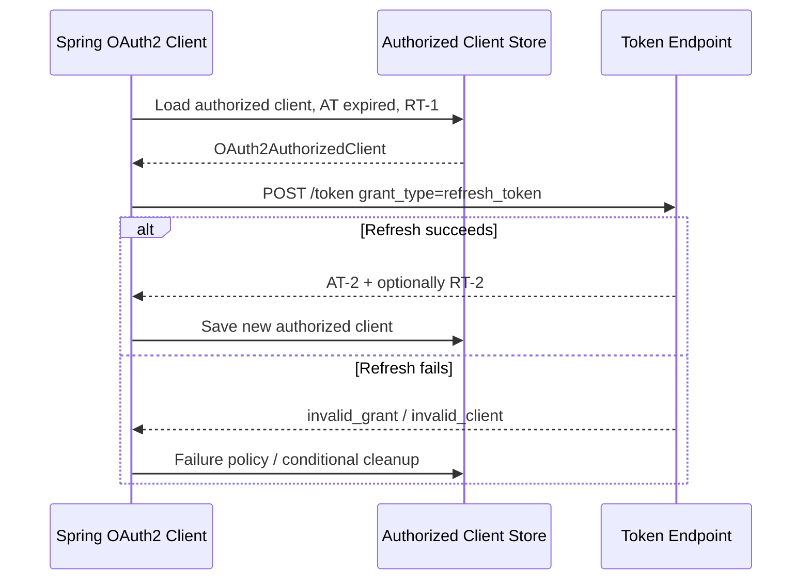

# 29.5. oauth2Client() để mô phỏng authorized client

Trong ứng dụng **Spring Security OAuth 2.0/OIDC Client** chạy trên Servlet stack, nhiều bài kiểm thử không cần gọi OpenID Provider (OP) thật. Một controller có thể chỉ cần một `OAuth2AuthorizedClient` đã tồn tại để đọc metadata, lấy access token hoặc chuyển token cho một service gọi API khác.

Spring Security Test cung cấp **`SecurityMockMvcRequestPostProcessors.oauth2Client()`** để chuẩn bị authorized client giả lập khi chạy `MockMvc`. Đây là cách kiểm thử các nhánh ứng dụng sử dụng OAuth2 Client mà không phải thực hiện Authorization Code Flow bằng trình duyệt, nhập tài khoản tại OP hay đổi authorization code thật lấy token.

Ví dụ:

```java
mockMvc.perform(get("/orders")
        .with(oidcLogin())
        .with(oauth2Client("orders")))
    .andExpect(status().isOk());
```

Trong đó:

- `oidcLogin()` tạo Authentication giả lập có principal kiểu OIDC.
- `oauth2Client("orders")` chuẩn bị authorized client liên kết với registration ID `orders`.
- `MockMvc` xử lý request qua Spring MVC và Security infrastructure trong test context.
- Không có bảo đảm AS đã phát access token, không có chữ ký JWT được xác minh và không có HTTP request đến Token Endpoint chỉ từ hai post-processors này.

**Điểm cốt lõi:** `oauth2Client()` phục vụ **kiểm thử authorized client trong Servlet request**, không phải một cách đăng nhập OIDC hay một implementation của OAuth authorization grant.

---

## 1. Mục tiêu bài học

Sau bài này, người đọc có thể:

1. Giải thích vai trò của `OAuth2AuthorizedClient`, `ClientRegistration` và `OAuth2AccessToken`.
2. Cấu hình `spring-security-test` và import `oauth2Client()` cho MockMvc.
3. Kiểm thử controller nhận `@RegisteredOAuth2AuthorizedClient`.
4. Tạo token fixture có scopes và thời hạn do test quyết định.
5. Kết hợp `oauth2Client()` với `oauth2Login()` hoặc `oidcLogin()`.
6. Tùy chỉnh `ClientRegistration` và principal name trong test.
7. Phân biệt OAuth2 Client testing với Resource Server `jwt()` và `opaqueToken()`.
8. Biết lúc nào phải mock `OAuth2AuthorizedClientManager` thay vì dùng request processor.
9. Tránh ảo giác test pass khi chưa kiểm tra token acquisition, redirect/PKCE/nonce, refresh rotation hoặc downstream API.
10. Tạo bộ test positive/negative cho registration, scope, principal isolation và token leakage.

## 2. Vị trí của OAuth2AuthorizedClient trong kiến trúc

Một `OAuth2AuthorizedClient` đại diện cho một OAuth client đã được cấp authorization trong ngữ cảnh principal.

```text
OAuth2AuthorizedClient
├── ClientRegistration
│   ├── registrationId = orders
│   ├── clientId = portal-client
│   ├── authorizationGrantType
│   ├── authorizationUri
│   ├── tokenUri
│   └── scopes
├── principalName = employee-725
├── OAuth2AccessToken
│   ├── value = AT-1
│   ├── type = Bearer
│   ├── issuedAt / expiresAt
│   └── scopes = orders.read
└── OAuth2RefreshToken (optional)
    └── value = RT-1
```

Các khái niệm dễ nhầm:

| Khái niệm | Vai trò | Liên hệ test |
|---|---|---|
| `ClientRegistration` | Cấu hình OAuth client với AS/OP | Có thể tạo fixture riêng |
| `registrationId` | Khóa local Spring cho registration | Truyền vào `oauth2Client("orders")` |
| `clientId` | Danh tính OAuth client tại AS | Không phải registration ID |
| `OAuth2AccessToken` | Credential gọi Resource Server | Truyền qua `.accessToken(...)` |
| `OAuth2RefreshToken` | Credential xin token mới khi được cấp | Thường test riêng với manager/refresh |
| `OAuth2AuthorizedClient` | Registration + principal + tokens | Object được mock |
| `OAuth2AuthorizedClientRepository` | Nạp/lưu client trong Servlet request context | Ảnh hưởng resolver hoạt động |
| `OAuth2AuthorizedClientService` | Lưu/nạp theo registration và principal, không phụ thuộc request | Có thể cần seed riêng |
| `OAuth2AuthorizedClientManager` | Cấp hoặc cấp lại token khi cần | Không được kiểm thử đầy đủ chỉ bằng processor |

### 2.1. Authorized client khác authenticated user

Người dùng có thể đã được xác thực bằng OIDC nhưng ứng dụng chưa có authorized client cho Orders API.

Ngược lại, backend có thể lưu authorized client của Client Credentials Grant mà **không có OIDC end-user session**.

```text
Authentication / SecurityContext
  -> Ai đang dùng ứng dụng?

OAuth2AuthorizedClient
  -> OAuth client có token nào được cấp trong ngữ cảnh nào?
```

Hai câu hỏi liên quan nhưng không thay thế nhau.

### 2.2. Access token khác ID Token

- **OIDC ID Token** dành cho Relying Party xác minh Authentication của End-User.
- **OAuth access token** dành cho Resource Server, mang quyền truy cập APIs.
- `oauth2Client()` liên quan access token trong authorized client.
- `oidcLogin()` liên quan OIDC Authentication và `OidcUser`.

Không lấy ID Token làm Bearer access token gọi API chỉ vì nó có định dạng JWT.

## 3. Phạm vi thật sự của oauth2Client()

`oauth2Client()` là một **MockMvc RequestPostProcessor** trong `spring-security-test`.

```text
JUnit test
   |
   v
MockMvc request builder
   |
   +-- .with(oauth2Client("orders"))
   |       -> prepares OAuth2AuthorizedClient fixture
   |
   +-- .with(oidcLogin())
   |       -> prepares authenticated OIDC principal
   |
   v
Spring Security filter chain
   |
   v
Spring MVC controller / argument resolver
```

Nó giúp ứng dụng thấy một authorized client trong request test. Nhưng **không**:

- Gọi Authorization Endpoint.
- Gọi Token Endpoint.
- Nhận authorization code thật.
- Kiểm tra `state`, PKCE hoặc nonce của browser login.
- Xác minh chữ ký JWT của ID Token hay access token.
- Gọi API downstream thay ứng dụng.
- Tự kiểm tra token có đúng issuer/audience thật.
- Mô phỏng đầy đủ refresh token rotation.
- Tự bảo đảm principal hiện tại đã authenticated.

Nếu test cần kiểm tra những việc đó, phải chọn thêm một tầng kiểm thử phù hợp.

## 4. Chuẩn bị dependencies và imports

Ví dụ Gradle trong dự án Spring Boot dùng Servlet MVC:

```groovy
dependencies {
    implementation 'org.springframework.boot:spring-boot-starter-web'
    implementation 'org.springframework.boot:spring-boot-starter-security'
    implementation 'org.springframework.boot:spring-boot-starter-oauth2-client'

    testImplementation 'org.springframework.boot:spring-boot-starter-test'
    testImplementation 'org.springframework.security:spring-security-test'
}
```

Để Spring Boot BOM quản lý phiên bản Spring Security Test tương thích với runtime.

Các static imports thường dùng:

```java
import static org.springframework.security.test.web.servlet.request.SecurityMockMvcRequestPostProcessors.oauth2Client;
import static org.springframework.security.test.web.servlet.request.SecurityMockMvcRequestPostProcessors.oauth2Login;
import static org.springframework.security.test.web.servlet.request.SecurityMockMvcRequestPostProcessors.oidcLogin;

import static org.springframework.test.web.servlet.request.MockMvcRequestBuilders.get;
import static org.springframework.test.web.servlet.result.MockMvcResultMatchers.status;
import static org.springframework.test.web.servlet.result.MockMvcResultMatchers.content;
```

Tên đầy đủ `SecurityMockMvcRequestPostProcessors` cho thấy đây là API **Servlet MockMvc**, không phải `WebTestClient` của WebFlux.

### 4.1. Với JUnit 5

```java
import org.junit.jupiter.api.Test;
import org.springframework.beans.factory.annotation.Autowired;
import org.springframework.boot.test.autoconfigure.web.servlet.AutoConfigureMockMvc;
import org.springframework.boot.test.context.SpringBootTest;
import org.springframework.test.web.servlet.MockMvc;
```

Đường dẫn package auto-configuration có thể khác khi nâng phiên bản Spring Boot. Ví dụ trong bài phản ánh cấu trúc thường thấy ở Spring Boot 3.x; dự án dùng Boot 4.x cần đối chiếu imports chính xác.

## 5. Ví dụ đầu tiên: controller nhận authorized client

Giả sử controller muốn kiểm tra registration và scope, nhưng **không** trả token value ra browser:

```java
import org.springframework.security.oauth2.client.OAuth2AuthorizedClient;
import org.springframework.security.oauth2.client.annotation.RegisteredOAuth2AuthorizedClient;
import org.springframework.web.bind.annotation.GetMapping;
import org.springframework.web.bind.annotation.RestController;

@RestController
public class OrdersClientInfoController {

    @GetMapping("/demo/orders-client")
    public String info(
            @RegisteredOAuth2AuthorizedClient("orders")
            OAuth2AuthorizedClient authorizedClient) {

        String registrationId = authorizedClient
            .getClientRegistration()
            .getRegistrationId();

        boolean hasReadScope = authorizedClient
            .getAccessToken()
            .getScopes()
            .contains("orders.read");

        return registrationId + ":" + hasReadScope;
    }
}
```

`@RegisteredOAuth2AuthorizedClient("orders")` yêu cầu Spring MVC argument resolution tìm authorized client theo registration ID `orders`.

Đây là **controller minh họa cho test**. Trong sản phẩm thực tế, Resource Server vẫn phải kiểm tra access token, scopes, audience, tenant và quyền trên dữ liệu. Không dùng kiểm tra scope trong controller làm cơ chế authorization duy nhất.

### 5.1. Test bằng default fixture

```java
@SpringBootTest
@AutoConfigureMockMvc
class OrdersClientInfoControllerTest {

    @Autowired
    MockMvc mvc;

    @Test
    void resolvesAuthorizedClient() throws Exception {
        mvc.perform(get("/demo/orders-client")
                .with(oidcLogin())
                .with(oauth2Client("orders")))
            .andExpect(status().isOk());
    }
}
```

Đoạn test giả định Spring context của ứng dụng có OAuth2 Client repository/argument resolver/security wiring đúng. Chỉ assert HTTP status là bước khởi đầu; các ví dụ sau sẽ kiểm tra scopes và nội dung response.

### 5.2. Tại sao thêm oidcLogin()?

Nếu ứng dụng bảo vệ `/demo/orders-client` bằng `authenticated()`, `oauth2Client()` một mình không cung cấp Authentication.

`oidcLogin()` giúp request có OIDC principal giả lập. Nếu ứng dụng là OAuth2-only Login, có thể dùng `oauth2Login()` thay thế.

## 6. Tạo OAuth2AccessToken có scope rõ ràng

Mọi test nên kiểm soát dữ liệu đầu vào, thay vì suy đoán default scopes.

```java
import java.time.Instant;
import java.util.Set;
import org.springframework.security.oauth2.core.OAuth2AccessToken;

Instant now = Instant.now();

OAuth2AccessToken ordersReadToken =
    new OAuth2AccessToken(
        OAuth2AccessToken.TokenType.BEARER,
        "test-access-token-orders-read",
        now.minusSeconds(30),
        now.plusSeconds(600),
        Set.of("orders.read")
    );
```

Các trường:

- `TokenType.BEARER`: loại access token.
- `tokenValue`: chuỗi giả lập, không phải token production.
- `issuedAt`: thời điểm cấp được giả lập.
- `expiresAt`: thời điểm hết hạn được giả lập.
- `scopes`: tập scope đã được cấp theo fixture.

### 6.1. Chèn token vào oauth2Client()

```java
mvc.perform(get("/demo/orders-client")
        .with(oidcLogin())
        .with(oauth2Client("orders")
            .accessToken(ordersReadToken)))
    .andExpect(status().isOk())
    .andExpect(content().string("orders:true"));
```

Điều này kiểm tra controller nhận đúng authorized client với `orders.read`.

### 6.2. Kiểm thử không có scope

```java
OAuth2AccessToken profileOnly =
    new OAuth2AccessToken(
        OAuth2AccessToken.TokenType.BEARER,
        "test-profile-token",
        now.minusSeconds(30),
        now.plusSeconds(600),
        Set.of("profile")
    );

mvc.perform(get("/demo/orders-client")
        .with(oidcLogin())
        .with(oauth2Client("orders")
            .accessToken(profileOnly)))
    .andExpect(status().isOk())
    .andExpect(content().string("orders:false"));
```

Hai tests xác nhận **hai nhánh của application logic**. Chúng không chứng minh OP thực tế có/không cấp `orders.read` cho client.

### 6.3. Không đưa token thật vào test source

Dùng:

```text
test-access-token-orders-read
```

không dùng access token lấy từ production OP hoặc token cất trong issue tracker. Token giả không có chữ ký/audience thật là điều mong muốn trong loại test này.

## 7. Tạo ClientRegistration dành riêng cho test

Default processor có thể tạo `ClientRegistration` thuận tiện. Nhưng nếu code cần kiểm tra `clientId`, `authorizationGrantType`, scopes hay endpoints, hãy tạo fixture rõ:

```java
import org.springframework.security.oauth2.client.registration.ClientRegistration;
import org.springframework.security.oauth2.core.AuthorizationGrantType;
import org.springframework.security.oauth2.core.ClientAuthenticationMethod;

ClientRegistration ordersRegistration =
    ClientRegistration.withRegistrationId("orders")
        .clientId("orders-client-test")
        .clientSecret("test-only-secret")
        .clientAuthenticationMethod(
            ClientAuthenticationMethod.CLIENT_SECRET_BASIC)
        .authorizationGrantType(
            AuthorizationGrantType.AUTHORIZATION_CODE)
        .authorizationUri("https://idp.test.invalid/authorize")
        .tokenUri("https://idp.test.invalid/token")
        .redirectUri("{baseUrl}/login/oauth2/code/{registrationId}")
        .scope("openid", "orders.read")
        .build();
```

Các hostname `.invalid` dành cho ví dụ, không phải service production. Tạo object này **không tự gửi HTTP request** đến endpoint.

### 7.1. Sử dụng clientRegistration(...)

```java
mvc.perform(get("/demo/orders-client")
        .with(oidcLogin())
        .with(oauth2Client("orders")
            .clientRegistration(ordersRegistration)
            .accessToken(ordersReadToken)))
    .andExpect(status().isOk())
    .andExpect(content().string("orders:true"));
```

Trong test, ba chỗ cần khớp:

```text
with(oauth2Client("orders"))
ordersRegistration.getRegistrationId() == "orders"
@RegisteredOAuth2AuthorizedClient("orders")
```

### 7.2. ClientRegistration là cấu hình, không phải grant đã được cấp

Có `ClientRegistration` không có nghĩa đã có `OAuth2AuthorizedClient`. Trong production, AS phải cấp access token phù hợp; trong MockMvc test, ta cố tình tạo trạng thái đã được cấp.

### 7.3. registrationId không bằng clientId

Trong ví dụ:

```text
registrationId = orders
clientId = orders-client-test
```

`@RegisteredOAuth2AuthorizedClient("orders")` dùng local registration ID, không nhận client ID.

## 8. Phân biệt ba post-processors quan trọng

| Processor | Dữ liệu giả lập | Test dùng để làm gì? |
|---|---|---|
| `oauth2Client("orders")` | `OAuth2AuthorizedClient`, access token, registration | MVC logic cần authorized client |
| `oauth2Login()` | `OAuth2AuthenticationToken` và `OAuth2User` | MVC logic cần OAuth2 Login principal |
| `oidcLogin()` | OIDC Authentication và `OidcUser`/ID Token | MVC logic cần OIDC user |

Và hai processors khác:

| Processor | Mô phỏng |
|---|---|
| `jwt()` | Resource Server nhận JWT Bearer authentication |
| `opaqueToken()` | Resource Server nhận opaque Bearer token |

### 8.1. OAuth2 client và Resource Server là hai vai trò

```text
OAuth2 Client:
  App có access token
  App gửi token ra Resource Server

Resource Server:
  App nhận Bearer token
  App kiểm tra hoặc introspect token
```

Dùng `jwt()` để test Resource Server authentication, **không phải** để đưa `OAuth2AuthorizedClient` vào Servlet repository.

### 8.2. OIDC Login không tương đương OAuth2 Client token

`oidcLogin()` giúp test code đọc OIDC claims trong `OidcUser`. Nếu controller còn cần access token của registration `orders`, phải tạo authorized client tương ứng.

### 8.3. Authentication không tương đương client authorization

`Authentication` trả lời “ai đang đăng nhập?”. `OAuth2AuthorizedClient` trả lời “client nào có token nào trong ngữ cảnh principal?”. Đừng trộn chúng khi test.

## 9. Kết hợp oidcLogin() và oauth2Client()

Controller có thể nhận cả hai:

```java
import org.springframework.security.core.annotation.AuthenticationPrincipal;
import org.springframework.security.oauth2.client.OAuth2AuthorizedClient;
import org.springframework.security.oauth2.client.annotation.RegisteredOAuth2AuthorizedClient;
import org.springframework.security.oauth2.core.oidc.user.OidcUser;
import org.springframework.web.bind.annotation.GetMapping;
import org.springframework.web.bind.annotation.RestController;

@RestController
public class UserOrdersController {

    @GetMapping("/demo/me/orders")
    String userOrders(
            @AuthenticationPrincipal OidcUser user,
            @RegisteredOAuth2AuthorizedClient("orders")
            OAuth2AuthorizedClient authorizedClient) {

        boolean canRead = authorizedClient.getAccessToken()
            .getScopes().contains("orders.read");

        return user.getSubject() + ":" + canRead;
    }
}
```

MockMvc:

```java
mvc.perform(get("/demo/me/orders")
        .with(oidcLogin())
        .with(oauth2Client("orders")
            .accessToken(ordersReadToken)))
    .andExpect(status().isOk());
```

Ở đây `oidcLogin()` tạo principal, còn `oauth2Client()` cung cấp authorized client. Nếu cần assert subject, nên tạo principal fixture explicit thay vì dựa vào default.

### 9.1. Không dùng user("alice") thay OidcUser tùy tiện

`user("alice")` của Spring Security Test tạo principal dạng user/password thông thường. Nó không tự có ID Token hoặc `OidcUser` methods.

Nếu controller cast principal thành `OidcUser`, dùng `oidcLogin()`.

### 9.2. OAuth2-only endpoint dùng oauth2Login()

```java
mvc.perform(get("/demo/orders-client")
        .with(oauth2Login())
        .with(oauth2Client("orders")
            .accessToken(ordersReadToken)))
    .andExpect(status().isOk());
```

Với OAuth2 provider không cấp ID Token, `oauth2Login()` thích hợp hơn `oidcLogin()`.

## 10. Tùy chỉnh OidcUser và principal name

Trong OIDC, external user identity thường dựa trên cặp `(iss, sub)`. Một mock OIDC user có thể tạo từ `OidcIdToken`.

```java
import java.time.Instant;
import java.util.List;
import java.util.Map;

import org.springframework.security.core.authority.SimpleGrantedAuthority;
import org.springframework.security.oauth2.core.oidc.OidcIdToken;
import org.springframework.security.oauth2.core.oidc.user.DefaultOidcUser;
import org.springframework.security.oauth2.core.oidc.user.OidcUser;

Instant issuedAt = Instant.now();

OidcIdToken idToken = new OidcIdToken(
    "test-id-token",
    issuedAt,
    issuedAt.plusSeconds(600),
    Map.of(
        "iss", "https://idp.test.invalid",
        "sub", "employee-725",
        "aud", List.of("portal-client-test")
    )
);

OidcUser employee = new DefaultOidcUser(
    List.of(new SimpleGrantedAuthority("ROLE_USER")),
    idToken,
    "sub"
);
```

Sử dụng:

```java
mvc.perform(get("/demo/me/orders")
        .with(oidcLogin().oidcUser(employee))
        .with(oauth2Client("orders")
            .principalName(employee.getName())
            .accessToken(ordersReadToken)))
    .andExpect(status().isOk())
    .andExpect(content().string("employee-725:true"));
```

### 10.1. OidcIdToken fixture không kiểm tra chữ ký

`"test-id-token"` ở trên là giá trị giả. `oidcLogin()` chuẩn bị Authentication mock; nó không chạy toàn bộ ID Token JWS signature, audience, issuer và nonce validation như login callback thật.

Muốn kiểm tra các validation đó, cần test OIDC token decoder/validator hoặc authorization flow với test OP/AS.

### 10.2. getName() có thể khác getSubject()

Nếu app cấu hình user-name attribute khác `sub`, `OidcUser.getName()` có thể trả một attribute khác. Khi mock authorized client, `principalName` cần khớp tên mà repository/service và manager dùng trong thực tế.

### 10.3. Không chỉ dùng email làm identity key

Trong multi-tenant, email có thể thay đổi hoặc giống nhau giữa issuers. Test cần phản ánh identity mapping an toàn, không lưu token chỉ theo email chưa được xác minh.

## 11. PrincipalName và authorized-client storage key

Một authorized client thường được lưu/nạp theo:

```text
(clientRegistrationId, principalName)
```

Ví dụ:

```text
(orders, employee-725) -> access token A
(orders, employee-813) -> access token B
```

### 11.1. Chọn principalName explicit trong fixture

`oauth2Client(...)` có thể hỗ trợ:

```java
.with(oauth2Client("orders")
    .principalName("employee-725")
    .accessToken(ordersReadToken))
```

Đừng nhầm `principalName` với `clientId` hoặc tenant name.

### 11.2. Khi test user A và user B

Nên có negative tests bảo đảm request của user B không nạp token A từ shared store. `oauth2Client()` giúp thiết lập request fixture, nhưng persistence/isolation tests phải kiểm tra đúng repository/service thực tế.

### 11.3. Không đưa principalName tùy ý vào production lookup

Anti-pattern:

```java
String principal = request.getParameter("principal");
OAuth2AuthorizedClient client =
    authorizedClientService.loadAuthorizedClient("orders", principal);
```

Nếu không có authorization, caller có thể lấy token user khác. Trong test, tùy chỉnh principal có ích để kiểm tra isolation; production cần dùng Authentication đáng tin cậy.

## 12. MockMvc với Spring Boot

Ví dụ JUnit class:

```java
import java.time.Instant;
import java.util.Set;

import org.junit.jupiter.api.Test;
import org.springframework.beans.factory.annotation.Autowired;
import org.springframework.boot.test.autoconfigure.web.servlet.AutoConfigureMockMvc;
import org.springframework.boot.test.context.SpringBootTest;
import org.springframework.security.oauth2.core.OAuth2AccessToken;
import org.springframework.test.web.servlet.MockMvc;

import static org.springframework.security.test.web.servlet.request.SecurityMockMvcRequestPostProcessors.oauth2Client;
import static org.springframework.security.test.web.servlet.request.SecurityMockMvcRequestPostProcessors.oidcLogin;
import static org.springframework.test.web.servlet.request.MockMvcRequestBuilders.get;
import static org.springframework.test.web.servlet.result.MockMvcResultMatchers.content;
import static org.springframework.test.web.servlet.result.MockMvcResultMatchers.status;

@SpringBootTest
@AutoConfigureMockMvc
class OrdersClientControllerTest {

    @Autowired
    MockMvc mvc;

    @Test
    void seesOrdersReadScope() throws Exception {
        Instant now = Instant.now();

        OAuth2AccessToken token = new OAuth2AccessToken(
            OAuth2AccessToken.TokenType.BEARER,
            "test-orders-token",
            now.minusSeconds(30),
            now.plusSeconds(600),
            Set.of("orders.read")
        );

        mvc.perform(get("/demo/orders-client")
                .with(oidcLogin())
                .with(oauth2Client("orders").accessToken(token)))
            .andExpect(status().isOk())
            .andExpect(content().string("orders:true"));
    }
}
```

### 12.1. Điều kiện để ví dụ hoạt động

Application context phải có Spring MVC controller, security configuration, `OAuth2AuthorizedClientRepository`/argument resolver integration phù hợp. Nếu application đã custom wiring, một fixture có thể không được lookup đúng nếu context không sử dụng repository như mặc định.

### 12.2. @SpringBootTest không bảo đảm offline tuyệt đối

Các beans custom của app có thể gọi discovery endpoint lúc startup hoặc gọi API khác. `oauth2Client()` không vô hiệu hóa network I/O do application code tự thực hiện.

Nếu cần test offline, tạo `ClientRegistration` test cố định và mock những external clients phát sinh calls.

### 12.3. Test secrets phải là dữ liệu giả

Không bật production profile chứa client secret thật chỉ để test controller. Dùng test profile, test registration hoặc fake IdP metadata.

## 13. Dùng @WebMvcTest cho controller slice

`@WebMvcTest` có thể giảm startup time:

```java
@WebMvcTest(OrdersClientInfoController.class)
class OrdersClientWebMvcTest {

    @Autowired
    MockMvc mvc;

    @Test
    void readsAuthorizedClient() throws Exception {
        mvc.perform(get("/demo/orders-client")
                .with(oidcLogin())
                .with(oauth2Client("orders")))
            .andExpect(status().isOk());
    }
}
```

Đây là khung minh họa, **không phải bảo đảm mọi dự án đều chạy ngay**. Một MVC slice có thể không load:

- Production `SecurityFilterChain`.
- `ClientRegistrationRepository`.
- `OAuth2AuthorizedClientRepository`.
- `OAuth2AuthorizedClientManager`.
- Service beans mà controller cần.
- Test customizations của application.

Khi cần, import cấu hình security tối thiểu hoặc các test beans, và dùng mock dependency tương ứng Spring Boot version.

### 13.1. Không vô hiệu filters để che thiếu security wiring

`@AutoConfigureMockMvc(addFilters = false)` có thể dùng cho MVC tests thuần route, nhưng nếu mục tiêu là kiểm tra `oauth2Client()` đi qua Security/argument resolution, tắt filters sẽ khiến test kém ý nghĩa.

### 13.2. Khi nào dùng full application context?

Dùng `@SpringBootTest` khi muốn kiểm tra wiring thật của repository, argument resolver, security chain hoặc controller-service integration. Dùng `@WebMvcTest` khi chỉ cần web slice đã có những beans tối thiểu cần thiết.

## 14. Spring Security MockMvc integration

Khi tạo `MockMvc` bằng tay thay vì Boot auto-configuration, cần áp dụng Spring Security:

```java
import static org.springframework.security.test.web.servlet.setup.SecurityMockMvcConfigurers.springSecurity;

MockMvc mvc = MockMvcBuilders
    .webAppContextSetup(webApplicationContext)
    .apply(springSecurity())
    .build();
```

Nếu thiếu filter chain hoặc test config, một `oauth2Client()` fixture có thể được tạo nhưng request thực tế không giống production.

### 14.1. Processor khác security filter

`oauth2Client()` chuẩn bị dữ liệu test; Spring Security filter chain vẫn chịu trách nhiệm bảo vệ routes.

### 14.2. Không dùng standalone setup thiếu dependencies rồi suy ra framework lỗi

`MockMvcBuilders.standaloneSetup(controller)` có thể hợp lý cho pure MVC, nhưng security integration/argument resolution cần cấu hình đúng.

### 14.3. Test phải assert behavior thật

Một response 200 khi security filters không chạy không xác nhận OIDC authenticated request hay authorized client lookup đúng.

## 15. Test positive và negative scope

Giả sử controller thực thi một policy minh họa:

```java
import org.springframework.http.HttpStatus;
import org.springframework.http.ResponseEntity;

@GetMapping("/demo/orders/check")
ResponseEntity<String> check(
        @RegisteredOAuth2AuthorizedClient("orders")
        OAuth2AuthorizedClient client) {

    boolean allowed = client.getAccessToken()
        .getScopes().contains("orders.read");

    if (!allowed) {
        return ResponseEntity.status(HttpStatus.FORBIDDEN)
            .body("missing-scope");
    }
    return ResponseEntity.ok("ready");
}
```

Đoạn code thuộc một controller minh họa đã import Spring MVC/security annotations và types.

### 15.1. Positive

```java
mvc.perform(get("/demo/orders/check")
        .with(oidcLogin())
        .with(oauth2Client("orders")
            .accessToken(tokenWithOrdersRead)))
    .andExpect(status().isOk())
    .andExpect(content().string("ready"));
```

### 15.2. Negative

```java
mvc.perform(get("/demo/orders/check")
        .with(oidcLogin())
        .with(oauth2Client("orders")
            .accessToken(tokenWithProfileOnly)))
    .andExpect(status().isForbidden())
    .andExpect(content().string("missing-scope"));
```

### 15.3. Cảnh báo về bảo mật

Đây là local scope branch test. Access token trong fixture có thể khai bất kỳ scope nào, vì nó không được AS xác minh. Resource Server authorization phải dựa trên verified token, audience, domain membership và object-level permissions.

## 16. Factory cho token fixture

Khi nhiều tests cần token, tạo factory đặt tại `src/test/java`:

```java
import java.time.Instant;
import java.util.Set;
import org.springframework.security.oauth2.core.OAuth2AccessToken;

public final class OAuthTestTokens {

    private OAuthTestTokens() {}

    public static OAuth2AccessToken bearer(
            String value,
            Set<String> scopes) {

        Instant now = Instant.now();

        return new OAuth2AccessToken(
            OAuth2AccessToken.TokenType.BEARER,
            value,
            now.minusSeconds(30),
            now.plusSeconds(600),
            scopes
        );
    }
}
```

Test:

```java
OAuth2AccessToken token = OAuthTestTokens.bearer(
    "test-orders-read",
    Set.of("orders.read"));

mvc.perform(get("/demo/orders-client")
        .with(oidcLogin())
        .with(oauth2Client("orders").accessToken(token)))
    .andExpect(content().string("orders:true"));
```

### 16.1. Không tạo ngẫu nhiên mọi thứ vô ích

Nếu mục tiêu test là scope branching, một synthetic token value ổn định đủ tốt. Random hóa mọi token string có thể khiến test/log khó đọc.

### 16.2. Không dùng real JWT access token

Nếu cần parser/decoder JWT, đó là bài test Resource Server/token validation khác. Với authorized client fixture, token value không nhất thiết là JWT.

## 17. Controller có thể cần cả principal và authorized client

Một bài test thường phải đáp ứng hai điều kiện:

```text
Authenticated OIDC principal exists
AND
OAuth2AuthorizedClient for registration orders exists
```

Ví dụ:

```java
mockMvc.perform(get("/demo/me/orders")
        .with(oidcLogin().oidcUser(employee))
        .with(oauth2Client("orders")
            .principalName(employee.getName())
            .accessToken(ordersReadToken)))
    .andExpect(status().isOk());
```

### 17.1. Thứ tự và defaults

Không nên phụ thuộc không kiểm soát vào default principal name, token scope hay registration metadata. Nếu test cần identity chính xác, đặt explicit.

### 17.2. Tránh nhiều Authentication processors chồng nhau

Một request dùng cả `user("alice")` và `oidcLogin()` có thể không tạo principal đúng ý định. Tạo một Authentication fixture chính xác.

### 17.3. Kiểm thử unauthenticated access

Nếu route yêu cầu authenticated user, chạy request chỉ với `oauth2Client()` có thể dẫn đến login redirect/401 tùy app policy. Không khẳng định luôn là 401: MVC browser login thường redirect tới trang đăng nhập.

## 18. Khi client registration trong processor không khớp

Endpoint:

```java
@RegisteredOAuth2AuthorizedClient("orders")
OAuth2AuthorizedClient client
```

Request:

```java
.with(oauth2Client("billing"))
```

không tự biến Billing token thành Orders authorized client.

Trong một số setup, resolver/manager có thể cố nạp hoặc authorize Orders client riêng nếu có registration; vì vậy kết quả có thể là lỗi thiếu client, bắt đầu authorization hoặc một behavior khác theo configuration.

**Test cần kiểm tra đúng hành vi app mong muốn**, không chỉ assert một HTTP status cố định cho mọi framework versions.

### 18.1. Multi-tenant

Nếu tenant Alpha có registration `orders-alpha` và tenant Beta có `orders-beta`, test phải xác nhận không có token cross-tenant leakage. Đừng dùng một fixture `orders` chung nếu production phân tách registrations.

### 18.2. clientId không phải registrationId

Một `ClientRegistration` có thể có:

```text
registrationId = orders-alpha
clientId = alpha-backend-001
```

Controller dùng `@RegisteredOAuth2AuthorizedClient("orders-alpha")`, không dùng client ID để resolve.

## 19. Kiểm thử missing authorized client

Nếu request đã authenticated nhưng chưa có authorized client cho registration `orders`:

```java
mvc.perform(get("/demo/orders-client")
        .with(oidcLogin()));
```

hành vi có thể phụ thuộc:

- Manager có tự authorize hay không.
- Grant type của registration.
- Repository/service còn token hay không.
- App có policy yêu cầu reconnect/reauthorization không.
- Controller có xử lý null/exception không.

### 19.1. Đừng tự giả định missing client luôn trả 404

Với Authorization Code Flow, thiếu authorized client có thể dẫn tới authorization flow mới; với Client Credentials Grant, manager có thể cấp token service-side.

### 19.2. Test nên kiểm tra user-facing policy

Ví dụ: “Cần kết nối lại tài khoản”, “Không tìm thấy quyền truy cập phù hợp”, hoặc error mapping an toàn do ứng dụng định nghĩa.

### 19.3. Đừng dùng token của registration khác để fallback

Nếu `orders` không có token, không lấy `billing` token chỉ vì cả hai thuộc cùng user. Audience/resource/tenant khác nhau.

## 20. OAuth2AuthorizedClientRepository và OAuth2AuthorizedClientService

Hai abstraction:

**`OAuth2AuthorizedClientRepository`** thường gắn với Servlet web request/session.

**`OAuth2AuthorizedClientService`** nạp/lưu authorized client theo registration ID và principal name, dùng cả ở request-independent contexts.

Một app có thể dùng:

- `HttpSessionOAuth2AuthorizedClientRepository`.
- `AuthenticatedPrincipalOAuth2AuthorizedClientRepository`.
- `JdbcOAuth2AuthorizedClientService`.
- Custom persistent service.
- Manager riêng cho scheduled jobs.

### 20.1. Vì sao test fixture có thể “biến mất”?

`oauth2Client()` chuẩn bị state cho request MockMvc. Nếu service phía sau trực tiếp gọi một **JDBC authorized client service khác** không đọc cùng nguồn, nó có thể không thấy token fixture.

### 20.2. Chọn đúng boundary

Nếu muốn test `@RegisteredOAuth2AuthorizedClient` injection, dùng processor trên request.

Nếu muốn test `JdbcOAuth2AuthorizedClientService`, seed/read test DB bằng service.

Nếu muốn test `OAuth2AuthorizedClientManager`, mock/customize manager token acquisition.

Nếu muốn test session persistence qua hai requests, giữ cùng session và repository phù hợp.

### 20.3. Không coi request fixture là durable record

Processor không chứng minh token đã tồn tại trong database production hay distributed session store.

## 21. Dùng session trong bài test

Một số bài test cần giữ `MockHttpSession` giữa requests:

```java
import org.springframework.mock.web.MockHttpSession;

MockHttpSession session = new MockHttpSession();

mvc.perform(get("/demo/orders-client")
        .session(session)
        .with(oidcLogin())
        .with(oauth2Client("orders")));
```

Nếu controller sử dụng session-backed repository và test muốn kiểm tra request thứ hai, có thể tiếp tục với cùng session:

```java
mvc.perform(get("/demo/orders-client")
        .session(session)
        .with(oidcLogin()));
```

**Quan trọng:** test chỉ có ý nghĩa nếu repository và principal binding thực sự hỗ trợ trạng thái qua hai requests như kỳ vọng. Không mặc định mọi cách mock authorized client đều là persistent session save trong toàn bộ các cấu hình Spring Security.

### 21.1. Không nhầm HttpSession với OP session

`MockHttpSession` là local Servlet session, không xác minh SSO session của OP hoặc front/back-channel logout.

### 21.2. Nếu Spring Session chia sẻ giữa nodes

Một MockMvc request test không tự kiểm tra Redis/JDBC Spring Session consistency hoặc distributed invalidation. Cần integration tests riêng với session store tương ứng.

## 22. Khi cần tự tạo OAuth2AuthorizedClient

Ngoài post-processor, có thể tạo object trực tiếp cho unit test hoặc repository tests:

```java
import org.springframework.security.oauth2.client.OAuth2AuthorizedClient;

OAuth2AuthorizedClient client =
    new OAuth2AuthorizedClient(
        ordersRegistration,
        "employee-725",
        ordersReadToken
    );
```

Nếu có refresh token:

```java
import org.springframework.security.oauth2.core.OAuth2RefreshToken;

OAuth2RefreshToken refreshToken =
    new OAuth2RefreshToken(
        "test-refresh-token",
        Instant.now().minusSeconds(120)
    );

OAuth2AuthorizedClient clientWithRefresh =
    new OAuth2AuthorizedClient(
        ordersRegistration,
        "employee-725",
        ordersReadToken,
        refreshToken
    );
```

### 22.1. Object không đồng nghĩa stored authorized client

Tạo `new OAuth2AuthorizedClient(...)` chỉ tạo Java object. Nếu service/manager cần load từ persistence, hãy lưu object vào đúng test store.

### 22.2. Test service persistence

```java
authorizedClientService.saveAuthorizedClient(
    clientWithRefresh,
    authentication
);
```

`authentication` phải là Authentication được tạo an toàn trong test, có principal name phù hợp. Điều này seed **service**; nó không tự seed mọi request repository không dùng cùng service.

### 22.3. Đừng chia sẻ token object mutable không có kiểm soát

`OAuth2AuthorizedClient` cung cấp token metadata, nhưng cách test giữ principal/session/store vẫn có thể ảnh hưởng test isolation. Reset fake service/db/session giữa các tests.

## 23. Client Credentials khác user-delegated Authorization Code

Với Client Credentials Grant, token dành cho service/workload, không nhất thiết có OIDC End-User.

Fixture:

```java
ClientRegistration serviceRegistration =
    ClientRegistration.withRegistrationId("reports")
        .clientId("reports-test-client")
        .clientSecret("test-only")
        .clientAuthenticationMethod(
            ClientAuthenticationMethod.CLIENT_SECRET_BASIC)
        .authorizationGrantType(
            AuthorizationGrantType.CLIENT_CREDENTIALS)
        .tokenUri("https://idp.test.invalid/token")
        .scope("reports.read")
        .build();
```

Processor:

```java
.with(oauth2Client("reports")
    .clientRegistration(serviceRegistration)
    .accessToken(reportsReadToken))
```

### 23.1. Nó mô phỏng điều gì?

Một authorized client cho `reports` đã có access token.

### 23.2. Nó không mô phỏng điều gì?

- Client secret được gửi đúng.
- AS cho phép `client_credentials` grant.
- Token Endpoint trả scopes thật.
- Service-to-service client auth và mTLS/private_key_jwt.
- Cache/single-flight token acquisition.

Muốn test các điều đó, phải test `OAuth2AuthorizedClientManager` và token response client/AS fixture.

## 24. Test access token expired

```java
Instant now = Instant.now();

OAuth2AccessToken expired =
    new OAuth2AccessToken(
        OAuth2AccessToken.TokenType.BEARER,
        "test-expired-token",
        now.minusSeconds(600),
        now.minusSeconds(30),
        Set.of("orders.read")
    );

mvc.perform(get("/demo/orders-client")
        .with(oidcLogin())
        .with(oauth2Client("orders").accessToken(expired)));
```

### 24.1. Expired token có thể kích hoạt reauthorization

Nếu `@RegisteredOAuth2AuthorizedClient`/manager code path kiểm tra expiry và có refresh provider, nó có thể thử refresh. Test có thể cần một fake token response client hoặc mocked manager để ngăn network call.

### 24.2. oauth2Client() không tự tạo refresh response

Nếu muốn xác minh refresh rotation, cần test grant/provider/manager riêng. Synthetic expired token không chứng minh refresh flow chạy đúng.

### 24.3. Tránh flakiness theo thời gian

Happy-path fixture nên có expiry cách hiện tại vài phút, không `now.plusMillis(5)`. Khi test logic thời gian, dùng `Clock` inject hoặc thời điểm cố định theo thiết kế, tránh `Thread.sleep`.

## 25. Test refresh token là một cấp độ khác

Một refresh flow thật:



`oauth2Client()` chỉ giúp tạo input authorized client. Để kiểm thử grant:

1. Mock token response client hoặc fake AS.
2. Cấu hình `OAuth2AuthorizedClientProvider` có `refreshToken()`.
3. Dùng manager đúng cho Servlet/background context.
4. Quan sát success/failure handlers.
5. Kiểm tra persistence đúng principal/registration.
6. Với refresh token rotation, kiểm tra concurrency/reuse handling.

### 25.1. Không retry refresh token cũ vô hạn

Một số AS rotate refresh token và từ chối token cũ. Duplicate refresh từ hai requests có thể trả `invalid_grant`, thậm chí revoke family theo policy.

### 25.2. Test storage concurrency riêng

Optimistic locking/CAS và per-key coordination không được chứng minh chỉ bởi một MockMvc request có `oauth2Client()`.

## 26. Khi test controller gọi service

Một pattern tốt là controller lấy client rồi gọi service/gateway:

```java
public interface OrdersGateway {
    String fetchSummary(OAuth2AccessToken token);
}
```

Controller:

```java
@RestController
public class OrdersController {

    private final OrdersGateway gateway;

    public OrdersController(OrdersGateway gateway) {
        this.gateway = gateway;
    }

    @GetMapping("/orders/summary")
    public String summary(
            @RegisteredOAuth2AuthorizedClient("orders")
            OAuth2AuthorizedClient client) {

        return gateway.fetchSummary(client.getAccessToken());
    }
}
```

### 26.1. Mockito kiểm tra controller-to-service handoff

```java
when(ordersGateway.fetchSummary(any(OAuth2AccessToken.class)))
    .thenReturn("summary-ok");

mvc.perform(get("/orders/summary")
        .with(oidcLogin())
        .with(oauth2Client("orders")
            .accessToken(ordersReadToken)))
    .andExpect(status().isOk())
    .andExpect(content().string("summary-ok"));
```

Đoạn này giả định test đã cung cấp mock `ordersGateway` theo cơ chế Mockito của project.

### 26.2. Verify token chính xác

```java
var captor = ArgumentCaptor.forClass(OAuth2AccessToken.class);

verify(ordersGateway).fetchSummary(captor.capture());

assertEquals(
    "test-access-token-orders-read",
    captor.getValue().getTokenValue()
);
```

### 26.3. Không trả token cho browser

Lấy token để assert trong test không có nghĩa endpoint production được serialize token về UI. Với BFF/confidential clients, token nên ở backend.

### 26.4. Mock gateway không phải downstream integration

Test trên chưa chứng minh HTTP client thật gắn `Authorization: Bearer ...`, TLS, target audience hoặc error mapping đúng.

## 27. RestClient/WebClient outbound tests

Trong Servlet app, service có thể dùng `RestClient` hoặc `WebClient` gửi access token tới Resource Server.

Để test outbound request cần thêm:

- `MockRestServiceServer` hoặc fake HTTP server phù hợp.
- HTTP client config có OAuth2 interceptor/filter thực.
- Registration/authorized client manager tương ứng.
- Token fixture và principal context.
- Assertions cho URL/headers/status/timeouts.

`oauth2Client()` chuẩn bị dữ liệu inbound MockMvc request, không tự intercept HTTP requests outbound.

### 27.1. Hai mô hình lấy token

**Model A — truyền token tường minh**

```text
@RegisteredOAuth2AuthorizedClient("orders")
  -> client.getAccessToken()
  -> OrdersGateway
  -> RestClient
```

**Model B — HTTP client tự lấy authorized client**

```text
RestClient/WebClient OAuth2 interceptor
  -> OAuth2AuthorizedClientManager
  -> repository/service
  -> token
  -> Authorization: Bearer
```

Model B có thể dùng service-based manager và không nhìn thấy authorized client mà `oauth2Client()` chuẩn bị trong request nếu context không được nối đúng.

### 27.2. Test chính xác data flow

Không giả định processor tự làm mọi manager/service caches có token. Nếu manager thật load từ JDBC service, seed đúng service hoặc mock manager.

### 27.3. Không gửi token tới host tùy ý

Outbound test nên chứng minh access token chỉ được gửi tới những Resource Server origins cho phép, không gửi token sang URL do caller/tenant chưa được xác minh chọn.

## 28. OAuth2 Client test khác JWT Resource Server test

Một Resource Server endpoint có thể được bảo vệ:

```java
http.oauth2ResourceServer(oauth2 -> oauth2.jwt());
```

Test:

```java
mvc.perform(get("/api/orders")
        .with(jwt()))
    .andExpect(status().isOk());
```

`jwt()` mô phỏng inbound JWT authenticated principal. Nó không tạo authorized client.

Ngược lại:

```java
.with(oauth2Client("orders"))
```

không có nghĩa server đã kiểm tra inbound Bearer JWT.

### 28.1. Một ứng dụng có thể vừa Client vừa Resource Server

Với kiến trúc API gateway/BFF:

- Một số endpoints nhận access token từ upstream.
- Backend đồng thời gọi downstream APIs bằng một authorized client khác.

Khi test, cần xác định chính xác token **inbound** và token **outbound**. Đừng dùng cùng một object/string để giả định hai trust domains tương đương.

## 29. Test với nhiều registrations và tenants

Giả sử:

```text
tenant alpha -> orders-alpha
tenant beta  -> orders-beta
```

Bạn có thể tạo hai fixtures:

```java
OAuth2AccessToken alphaToken = OAuthTestTokens.bearer(
    "test-alpha-token", Set.of("orders.read"));

OAuth2AccessToken betaToken = OAuthTestTokens.bearer(
    "test-beta-token", Set.of("orders.read"));
```

Test theo từng registration:

```java
mvc.perform(get("/tenants/alpha/orders")
        .with(oidcLogin())
        .with(oauth2Client("orders-alpha")
            .accessToken(alphaToken)));
```

### 29.1. Không cache theo issuer một mình

Hai tenants có thể cùng OP issuer nhưng client registrations, principals và access tokens khác. Test cần kiểm tra token isolation, không chỉ scopes.

### 29.2. Kiểm tra sai registration

Nếu endpoint cần `orders-alpha` nhưng fixture chỉ có `orders-beta`, expected behavior phải theo policy app và **không bao giờ fallback sang beta token**.

### 29.3. Không tự gắn role tenant từ registration ID

Đăng nhập bằng `orders-alpha` không chứng minh user có quyền đọc order Alpha. Domain membership/row-level access vẫn phải kiểm tra.

## 30. Kiểm thử không lộ token value

Vì access token là bearer credential, nên không render nó trong response chỉ để test tiện.

```java
var result = mvc.perform(get("/demo/orders-client")
        .with(oidcLogin())
        .with(oauth2Client("orders")
            .accessToken(ordersReadToken)))
    .andReturn();

String body = result.getResponse().getContentAsString();

assertFalse(body.contains("test-access-token-orders-read"));
```

### 30.1. Tránh debug output in toàn authorized client

Không log:

```text
OAuth2AuthorizedClient{accessToken=..., refreshToken=...}
```

### 30.2. Không chuyển token qua URL

Anti-pattern:

```text
Location: /app?access_token=test-access-token-orders-read
```

Token nên được gửi qua `Authorization` header khi gọi trusted API hoặc giữ server-side trong session/service store.

### 30.3. HTTP response test không thay log redaction test

Không thấy token trong response không chứng minh wire logs, traces hoặc debug interceptors không ghi token.

## 31. MockMvc security filter chain và protected endpoints

Có cấu hình:

```java
http.authorizeHttpRequests(auth -> auth
    .requestMatchers("/demo/**").authenticated()
    .anyRequest().denyAll());
```

Test chỉ với:

```java
mvc.perform(get("/demo/orders-client")
        .with(oauth2Client("orders")));
```

có thể bị redirect tới login vì request không có authenticated principal.

Test với cả hai:

```java
mvc.perform(get("/demo/orders-client")
        .with(oidcLogin())
        .with(oauth2Client("orders")));
```

### 31.1. Không hard-code mọi unauthenticated result là 401

Trong browser MVC, Spring Security thường redirect tới login; trong API, có thể trả 401. Test phải theo actual entry point/content negotiation của ứng dụng.

### 31.2. Bảo vệ authorization với roles

Nếu endpoint yêu cầu `ROLE_ADMIN`, cần tạo OIDC principal có appropriate authorities. `oauth2Client()` không tự cấp role.

### 31.3. Đừng tắt toàn bộ authorization chỉ để test passed

Test pass vì permit-all không bảo đảm production authorization đúng.

## 32. Test slice không nhận @RegisteredOAuth2AuthorizedClient

Nguyên nhân thường gặp:

1. Spring MVC argument resolver chưa được đăng ký vì context quá hẹp.
2. Không có authorized client repository hoặc manager cần thiết.
3. Registration ID không khớp.
4. Principal name không khớp.
5. Controller nằm trong security chain khác.
6. Code gọi service store không chia sẻ fixture.
7. Test đang dùng WebFlux thay vì MVC.

Cách xử lý:

- Kiểm tra `@WebMvcTest` imports/config.
- Cung cấp test `ClientRegistrationRepository` phù hợp.
- Đảm bảo SecurityFilterChain được bật.
- Dùng explicit principal and registration fixtures.
- Quan sát error từ argument resolver/manager, không bỏ filters tùy tiện.
- Nếu service cần `OAuth2AuthorizedClientService`, seed hoặc mock đúng service.

Không mặc định đây là lỗi `oauth2Client()`.

## 33. Phân biệt test code phát token và test code nhận token

Một token acquisition test nên mô phỏng:

```text
OAuth2AuthorizedClientManager
  -> OAuth2AuthorizedClientProvider
  -> Token Endpoint request
  -> OAuth2AccessTokenResponse
  -> save authorized client
```

Một MockMvc authorized-client test mô phỏng:

```text
already-authorized client
  -> Spring MVC argument resolver
  -> Controller/service logic
```

Cả hai quan trọng nhưng trả lời câu hỏi khác nhau.

### 33.1. Kiểm tra invalid_client / invalid_grant

Nếu cần mô phỏng AS trả:

```json
{"error":"invalid_grant"}
```

hãy test Token Endpoint integration hoặc manager error handler. `oauth2Client()` không tự trả lỗi này.

### 33.2. Kiểm tra token rotation

Khi RT-1 được thay bằng RT-2, cần kiểm tra save/update và concurrency. Một fake authorized client có token hợp lệ không cung cấp bằng chứng về rotation.

### 33.3. Kiểm tra PKCE/state/nonce

Dùng test OIDC OP hoặc security filter integration thực sự chạy Authorization Code Flow; `oidcLogin()` + `oauth2Client()` bypass phần giao thức này.

## 34. Dùng Mockito cho manager khi không có Servlet request

Một service:

```java
public final class ReportsService {

    private final OAuth2AuthorizedClientManager manager;

    public ReportsService(OAuth2AuthorizedClientManager manager) {
        this.manager = manager;
    }

    public String tokenForJob() {
        OAuth2AuthorizeRequest request =
            OAuth2AuthorizeRequest
                .withClientRegistrationId("reports")
                .principal("scheduled-job")
                .build();

        OAuth2AuthorizedClient client = manager.authorize(request);

        if (client == null) {
            throw new IllegalStateException("No authorized client");
        }

        return client.getAccessToken().getTokenValue();
    }
}
```

Unit test có thể mock:

```java
when(manager.authorize(any(OAuth2AuthorizeRequest.class)))
    .thenReturn(clientWithServiceToken);
```

### 34.1. Tại sao không dùng oauth2Client()?

Service method không chạy qua MockMvc request hoặc `@RegisteredOAuth2AuthorizedClient` resolver. `oauth2Client()` là RequestPostProcessor, không có lý do để dùng ở unit test này.

### 34.2. Test manager riêng

Nếu muốn xác nhận manager chọn đúng grant provider, refresh token và success/failure handler, dùng test tích hợp manager với mocked Token Endpoint response client thay vì luôn mock manager.

## 35. Khi nào cần WebFlux test tools?

Nếu ứng dụng là WebFlux:

```text
ServerHttpSecurity
SecurityWebFilterChain
ReactiveOAuth2AuthorizedClientManager
ReactiveClientRegistrationRepository
WebTestClient
```

Không áp dụng `SecurityMockMvcRequestPostProcessors.oauth2Client()` vào `WebTestClient`. Reactive test APIs có nhóm `SecurityMockServerConfigurers` và `SecurityMockServerConfigurers.OAuth2ClientMutator`/`mockOAuth2Client()` tùy Spring Security version.

Đọc tài liệu đúng reactive version trước khi chuyển mẫu test; không chỉ đổi `MockMvc` thành `WebTestClient` và giữ nguyên Servlet post-processor.

### 35.1. Servlet app có thể dùng WebClient outbound

Một Spring MVC app vẫn có thể dùng `WebClient` để gọi downstream. Khi test incoming request vẫn dùng MockMvc, nhưng outbound WebClient cần mock/stub HTTP và security-context propagation phù hợp.

### 35.2. Tránh block trên reactive event loop

Trong WebFlux thật, không gọi `.block()` để lấy authorized client trong filter chain. Test reactive pipeline theo non-blocking behavior.

## 36. Ma trận test thường gặp

| Mục tiêu | Mock nên dùng | Assertion |
|---|---|---|
| Controller đọc registration ID | `oauth2Client("orders")` | ID đúng |
| Controller đọc access token scope | `oauth2Client().accessToken(...)` | Scope branch |
| Controller đọc `OidcUser` | `oidcLogin()` | Subject/claims |
| Controller cần OIDC principal + client | Kết hợp hai processors | Identity + token |
| OAuth2-only principal | `oauth2Login()` | OAuth2 user attributes |
| Resource Server incoming JWT | `jwt()` | Roles/claims mapping |
| Opaque bearer resource server | `opaqueToken()` | Introspection authorities |
| Service gọi manager trực tiếp | Mock/fake manager | Manager request/result |
| Spring Client Credentials grant | Mock Token Endpoint + manager | Grant form/client auth |
| Refresh token rotation | Test manager/provider/store | Save RT-2, conflict policy |
| Outbound RestClient header | Fake downstream HTTP server | Bearer header, target URI |
| Repository principal isolation | Test DB/session repository | A không đọc được B |
| OIDC callback security | Test OP + flow | state, nonce, PKCE, issuer |
| End-to-end SSO | Test IdP + browser | Browser/session/logout integration |

Một bộ test mạnh cần nhiều tầng, không chỉ một processor.

## 37. Những lỗi thường gặp và cách xử lý

| Triệu chứng | Nguyên nhân có thể | Hướng kiểm tra |
|---|---|---|
| Request trả 302 login thay vì 200 | Chưa có Authentication | Dùng `oidcLogin()`/`oauth2Login()` |
| Authorized client null | Sai registration/principal/repository | Kiểm tra IDs, test beans |
| Test gọi AS thật | Manager/provider/discovery đang active | Stub endpoints/beans theo boundary |
| Test trả 200 nhưng production 403 | Filters bị tắt hoặc policies khác | Bật security chain |
| Token fixture có scope nhưng API từ chối | Mock token không phải real token | Test audience/issuer/API separately |
| Không thấy refresh token | Fixture không có hoặc grant không cấp | Tạo object/persistence test riêng |
| `invalid_grant` sau expired fixture | Manager cố refresh bằng token không hợp lệ | Mock token response client |
| Client registration không có metadata mong muốn | Default fixture quá đơn giản | `clientRegistration(...)` custom |
| Test dùng wrong principal | `getName()` khác `sub` | Explicit principalName |
| Spring MVC slice thiếu bean | Chưa import security/repository | Bổ sung test config |
| Token xuất hiện trong response | Controller serialize authorized client | Trả DTO/metadata an toàn |
| Một test ảnh hưởng test khác | Shared session/storage fixture | Cô lập/reset state |
| Tests flake gần token expiry | Expiration quá sát hiện tại | Stable time fixtures |

## 38. Anti-patterns phải tránh

### 38.1. Dùng oauth2Client() thay đăng nhập OIDC

`oauth2Client()` không xác thực End-User.

### 38.2. Dùng oidcLogin() thay test Authorized Client

`oidcLogin()` không bảo đảm authorized client cho mọi registration được yêu cầu.

### 38.3. Dùng jwt() thay OAuth2 client token

`jwt()` mô phỏng inbound bearer authentication, không phải authorized client outbound.

### 38.4. Dùng một registration/token cho mọi tenants

Che nguy cơ cross-tenant token leakage.

### 38.5. Dùng token thật từ production

Lộ secrets và tạo test phụ thuộc thời hạn/điều kiện bên ngoài.

### 38.6. Dùng HTTP status 200 làm assertion duy nhất

Không kiểm tra token selection/scope/registration behavior.

### 38.7. Tắt filters để test pass

Làm mất giá trị security integration test.

### 38.8. Không phân biệt request repository với service store

Processor có thể không seed đúng custom JDBC/service store.

### 38.9. Tự cấp scopes trong production từ YAML/test fixture

AS mới là bên cấp token; client không thể tự sửa token scopes theo ý muốn.

### 38.10. Đưa token vào response hoặc redirect query

Nguy cơ rò rỉ bearer credential.

### 38.11. Dùng expired fixture rồi giả định refresh đã được test

Cần test manager/provider/Token Endpoint riêng.

### 38.12. Tin rằng oauth2Client() xác minh token signature

Nó chỉ tạo request fixture, không phải JWT decoder.

### 38.13. Hard-code principalName cho mọi users

Có thể không phát hiện token collision/cross-principal access.

### 38.14. Để ClientRegistration metadata test quyết định tenant authorization

Tenant membership là domain policy, không tự suy ra từ registration.

### 38.15. Dùng Servlet post-processor trong WebFlux

Phải dùng reactive test tooling đúng version.

## 39. Checklist triển khai bài test

1. Có `spring-security-test` đúng version không?
2. Test đang chạy trên Servlet MockMvc hay Reactive WebTestClient?
3. Endpoint cần `OAuth2AuthorizedClient` hay chỉ Authentication?
4. Có cần `oauth2Login()` hoặc `oidcLogin()` đi cùng không?
5. `registrationId` trong processor có khớp endpoint/annotation không?
6. Có custom `ClientRegistration` nếu code cần metadata không?
7. Access token fixture có scopes/expiry rõ ràng không?
8. Principal name có khớp Authentication/repository key không?
9. Có Spring Security filter chain và argument resolver trong test context không?
10. Có dùng `@WebMvcTest` và thiếu beans nào không?
11. Nếu code dùng `OAuth2AuthorizedClientService`, fixture có nằm đúng store không?
12. Nếu dùng manager, test đã mock token acquisition chưa?
13. Có negative test thiếu scope/client/principal không?
14. Có test cross-user và cross-tenant isolation không?
15. Có assert token không xuất hiện trong HTTP response không?
16. Có stub outbound HTTP để kiểm tra Bearer header khi cần không?
17. Có tránh gọi OP production không?
18. Có tránh thời gian hết hạn khiến test flake không?
19. Có phân biệt ID Token và access token không?
20. Có tài liệu hóa phần protocol chưa được mock test kiểm tra không?

## 40. Kết luận

`oauth2Client()` là một công cụ hữu ích của **Spring Security Test** để mô phỏng **`OAuth2AuthorizedClient`** trong request **MockMvc Servlet**. Nó giúp test nhanh các controller và những lớp ứng dụng phụ thuộc authorized client, không cần dựng Authorization Server thật.

Mẫu sử dụng:

```java
mvc.perform(get("/demo/orders-client")
        .with(oidcLogin())
        .with(oauth2Client("orders")
            .accessToken(ordersReadToken)))
    .andExpect(status().isOk())
    .andExpect(content().string("orders:true"));
```

**Năm điểm cần ghi nhớ:**

- `oauth2Client()` cung cấp **authorized client**, không mặc định cung cấp **authenticated user**.
- `oidcLogin()` cung cấp **OIDC principal**, không phải bằng chứng access token của một Resource Server đã được cấp.
- `registrationId`, `clientId`, principal name và token scopes là những dữ liệu khác nhau.
- Test fixture không chứng minh token thật hợp lệ, Token Endpoint hoạt động hay OIDC callback có state/nonce/PKCE đúng.
- Repository/manager/outbound API behavior cần được kiểm thử ở đúng tầng, đặc biệt khi có refresh token, multiple tenants và persistent authorized clients.

Với ranh giới rõ ràng, `oauth2Client()` giúp làm cho Servlet OAuth2 Client tests **nhanh, lặp lại được, dễ đọc và có khả năng phát hiện sai sót ở tầng controller/integration**, đồng thời không tạo ảo giác đã kiểm thử toàn bộ protocol.

## 41. Tài liệu tham khảo

- [Spring Security — Testing OAuth 2.0 Clients, Logins, and Resource Servers](https://docs.spring.io/spring-security/reference/servlet/test/mockmvc/oauth2.html): `oauth2Client()`, `oauth2Login()`, `oidcLogin()`, `jwt()` và `opaqueToken()`.
- [Spring Security — MockMvc Security Testing](https://docs.spring.io/spring-security/reference/servlet/test/mockmvc/index.html): RequestPostProcessors và tích hợp security filter chain.
- [Spring Security — OAuth 2.0 Client](https://docs.spring.io/spring-security/reference/servlet/oauth2/client/index.html): `ClientRegistration`, authorized clients, manager.
- [Spring Security — OAuth 2.0 Login](https://docs.spring.io/spring-security/reference/servlet/oauth2/login/index.html): đăng nhập OAuth2/OIDC Servlet.
- [Spring Security — OAuth2AuthorizedClient API](https://docs.spring.io/spring-security/site/docs/current/api/org/springframework/security/oauth2/client/OAuth2AuthorizedClient.html): mô hình authorized client.
- [Spring Security — RegisteredOAuth2AuthorizedClient API](https://docs.spring.io/spring-security/site/docs/current/api/org/springframework/security/oauth2/client/annotation/RegisteredOAuth2AuthorizedClient.html): annotation MVC argument resolution.
- [Spring Security — OAuth2AuthorizedClientRepository API](https://docs.spring.io/spring-security/site/docs/current/api/org/springframework/security/oauth2/client/web/OAuth2AuthorizedClientRepository.html): repository trong Servlet request.
- [Spring Security — OAuth2AuthorizedClientService API](https://docs.spring.io/spring-security/site/docs/current/api/org/springframework/security/oauth2/client/OAuth2AuthorizedClientService.html): persistent authorized-client service.
- [Spring Security — OAuth2AuthorizedClientManager API](https://docs.spring.io/spring-security/site/docs/current/api/org/springframework/security/oauth2/client/OAuth2AuthorizedClientManager.html): cấp và cấp lại OAuth2 tokens.
- [Spring Security — Reactive OAuth 2.0 Testing](https://docs.spring.io/spring-security/reference/reactive/test/web/oauth2.html): phân biệt reactive WebTestClient với Servlet MockMvc.
- [Spring Boot — Testing](https://docs.spring.io/spring-boot/reference/testing/index.html): full context tests, MVC slice tests và MockMvc setup.
- [RFC 6749 — OAuth 2.0 Authorization Framework](https://www.rfc-editor.org/rfc/rfc6749): clients, grants và access/refresh tokens.
- [OpenID Connect Core 1.0](https://openid.net/specs/openid-connect-core-1_0.html): OIDC Authentication, ID Token và validated principal.
