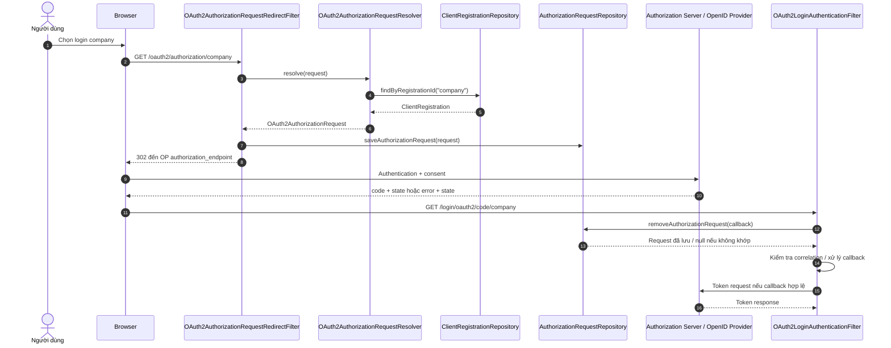

# 29.9. Kiểm thử resolver, authorization request và repository tùy chỉnh

Trong **Spring Security OAuth 2.0/OIDC Client trên Servlet**, bài kiểm thử đăng nhập không nên chỉ khẳng định rằng truy cập `/oauth2/authorization/company` trả HTTP 302. Một redirect có thể được tạo ra nhưng vẫn sai `client_id`, `redirect_uri`, `scope` hoặc làm mất các thông tin bảo vệ như **`state`, PKCE `code_verifier` và OIDC `nonce`**. Ngược lại, callback có thể chứa authorization code hợp lệ về hình thức nhưng **không có authorization request phù hợp trong phiên**, và Spring Security phải từ chối thay vì tiếp tục đổi token.

Ba thành phần đặc biệt quan trọng ở đầu Authorization Code Flow là:

1. **`OAuth2AuthorizationRequestResolver`**: nhận HTTP request và xác định cách xây một authorization request cho ClientRegistration phù hợp.
2. **`OAuth2AuthorizationRequest`**: đối tượng bất biến mô tả authorization request, các tham số được gửi cho Authorization Server và attributes nội bộ cần giữ tới callback.
3. **`AuthorizationRequestRepository<OAuth2AuthorizationRequest>`**: lưu, tìm lại và xóa authorization request giữa lần khởi tạo login và callback.

Khi có **resolver tùy chỉnh** (chọn provider theo tenant, thêm `prompt`, `login_hint` hay xử lý redirect URI) và **repository tùy chỉnh** (session phân tán, cookie, Redis, nhiều tabs), chúng trở thành những điểm có thể làm sai cả chức năng lẫn cơ chế bảo vệ chống login CSRF, authorization code injection và mix-up giữa nhà cung cấp.

Bài này hướng dẫn **kiểm thử Servlet** bằng JUnit 5, Spring Test `MockHttpServletRequest`/`MockHttpServletResponse`, Spring Security Test và MockMvc. Nội dung trình bày cách xây fixtures độc lập, kiểm tra contract của resolver, kiểm thử vòng đời save/load/remove của repository, lắp vào `SecurityFilterChain` và thiết kế negative tests. Những snippet là ví dụ để học và thích nghi với project thực tế; không có tuyên bố rằng mã đã được chạy hoặc Content QA.

> **Nguyên tắc:** Một test tốt phải kiểm tra **bất biến bảo mật** của flow, không chỉ kiểm tra một URL có chứa chuỗi mong đợi. Sai `state` hoặc mất authorization request phải dẫn tới **từ chối callback**, tuyệt đối không được chữa bằng bỏ validation.

## 1. Mục tiêu học tập

Sau bài, bạn có thể:

- Xác định vị trí resolver, authorization request và repository trong OAuth2 Authorization Code/OIDC Login.
- Phân biệt **request tạo tại RP** với **response callback do OP trả qua browser**.
- Viết unit test cho hai overload `resolve(HttpServletRequest)` và `resolve(HttpServletRequest, String)`.
- Kiểm tra registration ID, authorization URI, redirect URI, client ID, response type, scopes và `state`.
- Kiểm tra PKCE `code_challenge` được đưa vào front channel trong khi verifier giữ ở server-side attributes.
- Thiết kế tests không dựa vào giá trị ngẫu nhiên của `state`/`nonce`.
- Viết fixture tạo `OAuth2AuthorizationRequest` và kiểm thử `save`, `load`, `remove` bằng session giả.
- Tạo và kiểm thử một decorator repository tùy chỉnh, không làm mất semantics của repository gốc.
- Gắn resolver/repository chung vào Servlet `oauth2Login` và kiểm thử đường redirect qua MockMvc.
- Xác định negative/security tests cho callback replay, state mismatch, session timeout, multi-tab và nhiều providers.
- Phân biệt unit test, filter-level test và end-to-end test với OP giả lập.

## 2. Sơ đồ luồng Servlet cần kiểm thử



Ở thực tế, Spring Security quản lý thêm các bước như `state`, PKCE, OIDC ID Token validation, UserInfo và lưu `OAuth2AuthorizedClient`. Ba thành phần của bài nằm **trước token exchange**, nhưng nếu chúng sai thì các bước sau không có ngữ cảnh đáng tin.

### 2.1. Một số endpoint mặc định

| Mục đích | URI mẫu | Thành phần |
|---|---|---|
| Khởi tạo authorization | `/oauth2/authorization/{registrationId}` | `OAuth2AuthorizationRequestRedirectFilter` |
| Authorization Endpoint OP | `https://id.example.test/authorize` | Trình duyệt đi tới OP |
| Callback login | `/login/oauth2/code/{registrationId}` | `OAuth2LoginAuthenticationFilter` |
| Token Endpoint | `https://id.example.test/token` | RP gọi server-to-server |

Các path Servlet có thể tùy biến. Test phải bám **cấu hình filter chain thật**, không mặc định mọi ứng dụng dùng y nguyên các URI này.

### 2.2. Ba đối tượng khác nhau

```text
ClientRegistration:
  registrationId=company
  clientId=portal-web
  authorizationUri=https://id.example.test/authorize
  redirectUri={baseUrl}/login/oauth2/code/{registrationId}

OAuth2AuthorizationRequest:
  authorizationUri=https://id.example.test/authorize
  clientId=portal-web
  redirectUri=https://portal.example.test/login/oauth2/code/company
  state=<random>
  scopes=[openid, profile]
  additionalParameters={...}
  attributes={...}

AuthorizationRequestRepository:
  lưu OAuth2AuthorizationRequest khi bắt đầu login
  khôi phục theo đúng browser/session/state trên callback
  xóa một lần khi callback được xử lý
```

**`ClientRegistration` không phải `OAuth2AuthorizedClient`**. Authorized client chứa access/refresh token được cấp sau authorization; authorization request repository chỉ giữ thông tin flow còn chờ callback. Không lấy service lưu token để thay authorization request repository.

## 3. API của `OAuth2AuthorizationRequestResolver`

Trong Servlet, interface có hai overload:

```java
import jakarta.servlet.http.HttpServletRequest;
import org.springframework.security.oauth2.core.endpoint.OAuth2AuthorizationRequest;

public interface OAuth2AuthorizationRequestResolver {

    OAuth2AuthorizationRequest resolve(HttpServletRequest request);

    OAuth2AuthorizationRequest resolve(
        HttpServletRequest request,
        String clientRegistrationId
    );
}
```

Đây là **hình dạng API diễn giải để học**, không phải mã định nghĩa package chính thức nguyên văn; interface thực thuộc package `org.springframework.security.oauth2.client.web.OAuth2AuthorizationRequestResolver`.

### 3.1. Ý nghĩa overload một tham số

`resolve(request)` được dùng để xác định authorization request dựa trên request HTTP, thường theo URI `/oauth2/authorization/{registrationId}`.

Ví dụ:

```text
GET /oauth2/authorization/company
  -> registrationId = company
  -> tạo OAuth2AuthorizationRequest cho company
```

Nếu request **không phù hợp base URI/pattern** hoặc không thể resolve theo contract, resolver có thể trả `null` hoặc ném exception tùy trường hợp, chẳng hạn registration ID không tồn tại. Test cần phân biệt **non-matching request** với **invalid ClientRegistration**.

### 3.2. Ý nghĩa overload hai tham số

`resolve(request, registrationId)` cho phép caller cung cấp registration ID rõ ràng, phục vụ những đường tùy biến và các thành phần muốn chọn ClientRegistration mà không lấy ID qua path mặc định.

Một resolver tự viết cần xử lý cả hai overload **nhất quán**. Nếu chỉ tùy biến overload thứ nhất, flow khác gọi overload thứ hai có thể bỏ qua `prompt`, tenant checks hoặc security constraints.

### 3.3. `DefaultOAuth2AuthorizationRequestResolver`

Spring Security cung cấp triển khai mặc định:

```java
DefaultOAuth2AuthorizationRequestResolver resolver =
    new DefaultOAuth2AuthorizationRequestResolver(
        clientRegistrationRepository,
        "/oauth2/authorization"
    );
```

Nó có khả năng tùy biến authorization request builder qua `setAuthorizationRequestCustomizer(...)`. Cách làm này thường **ít rủi ro hơn** tự dựng OAuth2AuthorizationRequest từ đầu.

## 4. Thiết lập test fixture không cần kết nối OP

Unit tests cho resolver không cần chạy Authorization Server thật. Tạo `ClientRegistration` bằng builder và đặt tất cả URL thành domain giả.

```java
import org.springframework.security.oauth2.client.registration.ClientRegistration;
import org.springframework.security.oauth2.client.registration.InMemoryClientRegistrationRepository;
import org.springframework.security.oauth2.client.registration.ClientRegistrationRepository;
import org.springframework.security.oauth2.core.AuthorizationGrantType;
import org.springframework.security.oauth2.core.ClientAuthenticationMethod;

public final class TestRegistrations {

    private TestRegistrations() {}

    public static ClientRegistration company() {
        return ClientRegistration.withRegistrationId("company")
            .clientId("portal-company-client")
            .clientSecret("unit-test-only-secret")
            .clientAuthenticationMethod(
                ClientAuthenticationMethod.CLIENT_SECRET_BASIC
            )
            .authorizationGrantType(
                AuthorizationGrantType.AUTHORIZATION_CODE
            )
            .redirectUri(
                "{baseUrl}/login/oauth2/code/{registrationId}"
            )
            .scope("openid", "profile")
            .authorizationUri("https://id.company.example.test/authorize")
            .tokenUri("https://id.company.example.test/token")
            .jwkSetUri("https://id.company.example.test/jwks")
            .issuerUri("https://id.company.example.test")
            .clientName("Company OP")
            .build();
    }

    public static ClientRegistration partner() {
        return ClientRegistration.withRegistrationId("partner")
            .clientId("portal-partner-client")
            .clientSecret("unit-test-only-secret")
            .clientAuthenticationMethod(
                ClientAuthenticationMethod.CLIENT_SECRET_BASIC
            )
            .authorizationGrantType(
                AuthorizationGrantType.AUTHORIZATION_CODE
            )
            .redirectUri(
                "{baseUrl}/login/oauth2/code/{registrationId}"
            )
            .scope("openid", "profile")
            .authorizationUri("https://id.partner.example.test/authorize")
            .tokenUri("https://id.partner.example.test/token")
            .jwkSetUri("https://id.partner.example.test/jwks")
            .issuerUri("https://id.partner.example.test")
            .clientName("Partner OP")
            .build();
    }

    public static ClientRegistrationRepository repository() {
        return new InMemoryClientRegistrationRepository(
            company(), partner()
        );
    }
}
```

Ở fixture này **không có network discovery**: `ClientRegistration` được dựng thủ công. URL của `example.test` chỉ dùng trong test. Không đưa Client secret thật vào source/test fixtures.

### 4.1. Vì sao ưu tiên fake ClientRegistration?

- Test nhanh và quyết định được issuer/authorization URI.
- Không phụ thuộc OP đang online.
- Không chạm Client ID/secret production.
- Dễ tạo hai providers để kiểm tra registration routing.
- Có thể giả lập cấu hình sai một cách an toàn.

Unit test **không chứng minh** issuer discovery/JWKS và ID Token validation thật. Đó là nhiệm vụ của integration tests khác.

### 4.2. Tạo request Servlet giả sát thực tế

Spring Test có `MockHttpServletRequest`:

```java
import org.springframework.mock.web.MockHttpServletRequest;

public final class ServletRequests {

    private ServletRequests() {}

    public static MockHttpServletRequest authorizationGet(
            String registrationId) {

        String path = "/oauth2/authorization/" + registrationId;

        MockHttpServletRequest request =
            new MockHttpServletRequest("GET", path);

        request.setServletPath(path);
        request.setScheme("https");
        request.setServerName("portal.example.test");
        request.setServerPort(443);

        return request;
    }
}
```

`setServletPath(path)` giúp các request matchers dựa trên servlet path nhận được đúng đường dẫn. `setScheme`/`setServerName`/`setServerPort` giúp resolver expand `{baseUrl}` theo đúng public origin mong muốn.

Khi ứng dụng dùng servlet context path như `/portal`, fixture cần set `contextPath`, `requestURI` và servletPath tương ứng. Không dùng `requestURI` giả không khớp với context path rồi kết luận Spring resolver sai.

## 5. Unit test cho resolver mặc định

Ví dụ JUnit 5 với AssertJ:

```java
import org.junit.jupiter.api.Test;
import org.springframework.mock.web.MockHttpServletRequest;
import org.springframework.security.oauth2.client.web.DefaultOAuth2AuthorizationRequestResolver;
import org.springframework.security.oauth2.core.endpoint.OAuth2AuthorizationRequest;

import static org.assertj.core.api.Assertions.assertThat;

class AuthorizationRequestResolverTest {

    private final DefaultOAuth2AuthorizationRequestResolver resolver =
        new DefaultOAuth2AuthorizationRequestResolver(
            TestRegistrations.repository(),
            "/oauth2/authorization"
        );

    @Test
    void resolvesCompanyRegistrationAndPublicCallback() {
        MockHttpServletRequest httpRequest =
            ServletRequests.authorizationGet("company");

        OAuth2AuthorizationRequest authorization =
            resolver.resolve(httpRequest);

        assertThat(authorization).isNotNull();
        assertThat(authorization.getClientId())
            .isEqualTo("portal-company-client");
        assertThat(authorization.getAuthorizationUri())
            .isEqualTo("https://id.company.example.test/authorize");
        assertThat(authorization.getRedirectUri())
            .isEqualTo(
                "https://portal.example.test/login/oauth2/code/company"
            );
        assertThat(authorization.getScopes())
            .contains("openid", "profile");
        assertThat(authorization.getState()).isNotBlank();
    }

    @Test
    void ignoresUnrelatedServletPath() {
        MockHttpServletRequest request =
            new MockHttpServletRequest("GET", "/health");

        request.setServletPath("/health");

        assertThat(resolver.resolve(request)).isNull();
    }
}
```

### 5.1. Điều gì được kiểm chứng?

Test thứ nhất xác nhận đúng Client và authorization destination, callback host/path, scopes, state. Test thứ hai xác nhận resolver không “bắt” request của endpoint khác.

Chỉ test `HTTP 302` chưa đủ: trong resolver unit test, ta kiểm tra chính `OAuth2AuthorizationRequest` mà filter sẽ sử dụng.

### 5.2. Không assert chính xác `state` ngẫu nhiên

Sai:

```java
assertThat(authorization.getState())
    .isEqualTo("hardcoded-constant");
```

`state` phải khó đoán, không có mục tiêu cố định. Thay vào đó test:

```java
assertThat(authorization.getState()).isNotBlank();
```

Với unit test deterministic cần test correlation, có thể dùng fixture `state="test-state"` để kiểm thử repository; **không dùng state cố định trong request resolver production**.

### 5.3. Test overload hai tham số

```java
@Test
void explicitRegistrationIdUsesPartnerConfiguration() {
    MockHttpServletRequest request =
        ServletRequests.authorizationGet("company");

    OAuth2AuthorizationRequest authorization =
        resolver.resolve(request, "partner");

    assertThat(authorization).isNotNull();
    assertThat(authorization.getClientId())
        .isEqualTo("portal-partner-client");
    assertThat(authorization.getAuthorizationUri())
        .isEqualTo("https://id.partner.example.test/authorize");
}
```

Ở overload này, registration ID **do caller cung cấp**. Không lấy kết quả này làm bằng chứng rằng một browser request đã được phép tự chuyển provider; production code vẫn cần kiểm soát ai được chọn registration nào.

## 6. Kiểm thử `OAuth2AuthorizationRequest` đúng mức độ

Đối tượng `OAuth2AuthorizationRequest` chứa hai nhóm dữ liệu:

- **Nhóm được đưa vào authorization redirect:** `response_type`, `client_id`, `redirect_uri`, `scope`, `state`, `code_challenge`, OIDC `nonce` và parameters khác theo provider.
- **Nhóm attributes nội bộ:** dữ liệu framework cần giữ giữa initiation và callback, chẳng hạn original registration context, PKCE verifier và nonce context theo triển khai.

Không phải mọi key trong attributes là public API ổn định giữa mọi phiên bản. Nếu custom code phụ thuộc sâu vào internal attribute keys, hãy pin/test đúng Spring Security version và tránh thay đổi ngoài cơ chế builder chính thức.

### 6.1. Các getter thường dùng

```java
OAuth2AuthorizationRequest authorization = resolver.resolve(httpRequest);

String authorizationUri = authorization.getAuthorizationUri();
String redirectUri = authorization.getRedirectUri();
String clientId = authorization.getClientId();
String state = authorization.getState();

var scopes = authorization.getScopes();
var publicParameters = authorization.getAdditionalParameters();
var serverSideAttributes = authorization.getAttributes();
String fullRedirect = authorization.getAuthorizationRequestUri();
```

Đừng in `fullRedirect` trong logs production: nó có `state` và các parameters liên quan flow.

### 6.2. Kiểm thử response type

Với Authorization Code Flow:

```java
import org.springframework.security.oauth2.core.endpoint.OAuth2ParameterNames;

assertThat(authorization.getResponseType().getValue())
    .isEqualTo("code");
```

Không tự biến nó thành implicit/hybrid flow chỉ để phù hợp một provider cũ. Nếu ứng dụng dùng Authorization Code + PKCE, cần kiểm tra flow đúng.

### 6.3. Kiểm tra URL bằng URI parser, không chỉ `contains`

Để tránh false positive do encoding hoặc chuỗi nằm ở vị trí sai:

```java
import java.net.URI;

URI redirect = URI.create(authorization.getAuthorizationRequestUri());

assertThat(redirect.getScheme()).isEqualTo("https");
assertThat(redirect.getHost())
    .isEqualTo("id.company.example.test");
assertThat(redirect.getPath()).isEqualTo("/authorize");
```

Nếu cần kiểm tra query parameters, có thể dùng `UriComponentsBuilder` hoặc bộ phân tích URI hỗ trợ encoding. Không cắt chuỗi thủ công bằng `split("&")` khi values có percent encoding.

### 6.4. Kiểm tra redirect URI từ public origin

Một lỗi rất phổ biến sau reverse proxy:

```text
Browser: https://portal.example.test
Spring app: http://spring-app:8080

Sai:
  redirect_uri=http://spring-app:8080/login/oauth2/code/company

Đúng:
  redirect_uri=https://portal.example.test/login/oauth2/code/company
```

Test request fixture/proxy headers để chứng minh `redirectUri` là public HTTPS URI đã đăng ký với OP. Test chỉ thành công khi host/scheme đúng sẽ phát hiện lỗi deployment sớm.

## 7. Kiểm thử PKCE và OIDC nonce khi custom resolver

PKCE bảo vệ Authorization Code Flow khỏi việc một code bị lấy/đổi ngoài flow đã khởi tạo. Spring Security có utility customizer:

```java
import org.springframework.security.oauth2.client.web.DefaultOAuth2AuthorizationRequestResolver;
import org.springframework.security.config.oauth2.client.OAuth2AuthorizationRequestCustomizers;

var resolver = new DefaultOAuth2AuthorizationRequestResolver(
    TestRegistrations.repository(),
    "/oauth2/authorization"
);

resolver.setAuthorizationRequestCustomizer(
    OAuth2AuthorizationRequestCustomizers.withPkce()
);
```

Khi framework/version hỗ trợ customizer này, authorization request dùng `code_challenge`/`code_challenge_method` ở request gửi OP và giữ `code_verifier` riêng ở phần attributes cần cho token exchange.

### 7.1. Test PKCE không chỉ tìm chuỗi trong URL

```java
import org.springframework.security.oauth2.core.endpoint.PkceParameterNames;

var authorization =
    resolver.resolve(ServletRequests.authorizationGet("company"));

assertThat(authorization.getAdditionalParameters())
    .containsKey(PkceParameterNames.CODE_CHALLENGE);

assertThat(authorization.getAdditionalParameters())
    .containsEntry(PkceParameterNames.CODE_CHALLENGE_METHOD, "S256");

assertThat(authorization.getAttributes())
    .containsKey(PkceParameterNames.CODE_VERIFIER);
```

Ví dụ này giả định customizer với PKCE S256 được cấu hình và attributes chứa verifier theo Spring Security API/phiên bản đang dùng. Khi có custom resolver khác, hãy kiểm tra nó **giữ nguyên verifier** và không tự gửi verifier vào front-channel authorization URL.

### 7.2. Vì sao `code_verifier` không xuất hiện trong URL?

`code_challenge` được gửi cho OP để ràng buộc code. `code_verifier` là thông tin bí mật Client giữ cho Token Endpoint request. Nếu resolver đưa verifier vào URL, log browser hoặc OP có thể nhìn thấy và mục tiêu bảo vệ PKCE bị suy yếu.

Test cần kiểm tra **phân tách đúng hai giá trị**, không dump raw verifier vào stdout.

### 7.3. OIDC nonce là điều kiện khác PKCE

Với scope `openid`, OIDC có `nonce` dùng để ràng buộc ID Token với authentication request khi flow áp dụng. Tùy implementation, giá trị nonce gửi trong authorization URL có thể được xử lý/hash và một giá trị gốc được giữ server-side để validate ID Token.

Không copy tùy tiện authorization request bằng cách tạo object mới chỉ có `clientId`, `redirectUri` và `state`, làm mất nonce/context. Khi custom resolver thêm parameter, ưu tiên:

```java
OAuth2AuthorizationRequest.from(original)
    .additionalParameters(params -> params.put("prompt", "login"))
    .build();
```

`prompt=login` là ví dụ OIDC parameter yêu cầu reauthentication theo OP; chỉ sử dụng khi policy/provider cho phép. `from(original)` giúp giữ lại những field/attributes quan trọng. Test vẫn cần chứng minh rằng bản sao giữ `state`, PKCE verifier và các attributes cần thiết.

## 8. Resolver tùy chỉnh: viết bằng decorator thay vì dựng lại từ đầu

Ví dụ một resolver thêm `prompt` có kiểm soát cho OIDC registration, không thay endpoint và không tạo state mới:

```java
import jakarta.servlet.http.HttpServletRequest;
import org.springframework.security.oauth2.client.web.OAuth2AuthorizationRequestResolver;
import org.springframework.security.oauth2.core.endpoint.OAuth2AuthorizationRequest;

public final class PromptAuthorizationRequestResolver
        implements OAuth2AuthorizationRequestResolver {

    private final OAuth2AuthorizationRequestResolver delegate;

    public PromptAuthorizationRequestResolver(
            OAuth2AuthorizationRequestResolver delegate) {
        this.delegate = delegate;
    }

    @Override
    public OAuth2AuthorizationRequest resolve(
            HttpServletRequest request) {
        return customize(delegate.resolve(request));
    }

    @Override
    public OAuth2AuthorizationRequest resolve(
            HttpServletRequest request,
            String clientRegistrationId) {
        return customize(
            delegate.resolve(request, clientRegistrationId)
        );
    }

    private OAuth2AuthorizationRequest customize(
            OAuth2AuthorizationRequest original) {

        if (original == null) {
            return null;
        }

        return OAuth2AuthorizationRequest.from(original)
            .additionalParameters(parameters ->
                parameters.put("prompt", "login")
            )
            .build();
    }
}
```

Đây là một biến thể minh họa **re-authentication prompt cho providers OIDC tương thích**, không nên áp cho OAuth2-only provider hoặc mọi login request khi sản phẩm không cần.

### 8.1. Những invariant phải test

- `delegate.resolve(...) == null` ⇒ custom resolver cũng trả `null`.
- Đúng cả hai overload.
- Không thay `clientId`, `authorizationUri`, `redirectUri`, `responseType`, `scopes` khi mục đích chỉ thêm prompt.
- Không thay `state` của request gốc.
- Không làm mất `attributes` giữ PKCE/nonce.
- Chỉ thêm/sửa đúng parameter trong `additionalParameters`.
- Không cho browser tự quyết arbitrary `prompt`/`login_hint`/`redirect_uri` hoặc issuer.
- Không đưa PII/credential vào URL nếu không có nhu cầu và chính sách tương ứng.

### 8.2. Unit test cho decorator

```java
import org.junit.jupiter.api.Test;
import org.springframework.security.oauth2.client.web.DefaultOAuth2AuthorizationRequestResolver;

import static org.assertj.core.api.Assertions.assertThat;

class PromptAuthorizationRequestResolverTest {

    private final DefaultOAuth2AuthorizationRequestResolver delegate =
        new DefaultOAuth2AuthorizationRequestResolver(
            TestRegistrations.repository(),
            "/oauth2/authorization"
        );

    private final PromptAuthorizationRequestResolver custom =
        new PromptAuthorizationRequestResolver(delegate);

    @Test
    void addsPromptWithoutReplacingCoreFields() {
        var request = ServletRequests.authorizationGet("company");
        var base = delegate.resolve(request);
        var modified = custom.resolve(request);

        assertThat(modified.getAdditionalParameters())
            .containsEntry("prompt", "login");

        assertThat(modified.getAuthorizationUri())
            .isEqualTo(base.getAuthorizationUri());
        assertThat(modified.getRedirectUri())
            .isEqualTo(base.getRedirectUri());
        assertThat(modified.getClientId())
            .isEqualTo(base.getClientId());

        // State được sinh riêng mỗi lần resolve; hai lời gọi
        // độc lập không nên assert chúng bằng nhau.
        assertThat(modified.getState()).isNotBlank();
    }

    @Test
    void unrelatedRequestStillReturnsNull() {
        var request = new org.springframework.mock.web.MockHttpServletRequest(
            "GET", "/health"
        );
        request.setServletPath("/health");

        assertThat(custom.resolve(request)).isNull();
    }
}
```

**Lưu ý về state ngẫu nhiên:** nếu gọi delegate hai lần, mỗi lần có thể tạo state khác nhau. Để test **bảo toàn đúng state của cùng original**, nên mock delegate trả **chính một fixture cố định**, không so sánh state của hai requests khác nhau.

### 8.3. Kiểm thử giữ nguyên cùng original bằng mock delegate

```java
import static org.mockito.Mockito.*;
import static org.assertj.core.api.Assertions.assertThat;

var original = AuthorizationRequestFixtures.sample("state-A");
var delegate = mock(OAuth2AuthorizationRequestResolver.class);
var request = ServletRequests.authorizationGet("company");

when(delegate.resolve(request)).thenReturn(original);

var custom = new PromptAuthorizationRequestResolver(delegate);
var modified = custom.resolve(request);

assertThat(modified.getState()).isEqualTo(original.getState());
assertThat(modified.getAttributes())
    .containsAllEntriesOf(original.getAttributes());
assertThat(modified.getAdditionalParameters())
    .containsEntry("prompt", "login");
```

Ở đây `AuthorizationRequestFixtures.sample(...)` sẽ được định nghĩa trong phần fixture bên dưới. Test mock giúp so **một original cụ thể** thay vì nhầm giữa hai state random.

### 8.4. Test overload hai tham số bằng Mockito

```java
var original = AuthorizationRequestFixtures.sample("state-B");
var delegate = mock(OAuth2AuthorizationRequestResolver.class);
var request = ServletRequests.authorizationGet("company");

when(delegate.resolve(request, "partner")).thenReturn(original);

var custom = new PromptAuthorizationRequestResolver(delegate);
var modified = custom.resolve(request, "partner");

assertThat(modified).isNotNull();
assertThat(modified.getState()).isEqualTo("state-B");

verify(delegate).resolve(request, "partner");
```

Nếu một custom resolver quên override overload này, test sẽ giúp phát hiện sự thiếu nhất quán.

## 9. Kiểm thử parameter resolution và injection boundaries

Một resolver có thể nhận tenant, language, prompt hoặc login hint từ request. Không phải mọi input browser đều nên được đưa thẳng vào authorization URL.

### 9.1. `login_hint`

`login_hint` có thể chứa email/user identifier và xuất hiện trong redirect URL. Nếu cần, cần có chính sách privacy, URL logging và dữ liệu nguồn tin cậy. Test không nên ghi PII thật.

### 9.2. `prompt`

`prompt` của OIDC có những giá trị tiêu chuẩn, nhưng không nên nhận mọi chuỗi từ query param. Nếu UI cho chọn reauthenticate, backend nên map từ một tập giá trị hữu hạn:

```text
mode=standard -> không gửi prompt
mode=reauth   -> prompt=login
```

Không dựng URI bằng nối chuỗi thủ công `"&prompt=" + request.getParameter(...)`.

### 9.3. `redirect_uri`

`redirect_uri` phải khớp ClientRegistration và OP whitelist. Không cho browser chỉ định arbitrary callback URL rồi tin nó đã được cho phép chỉ vì có HTTPS.

### 9.4. Multi-provider/tenant

Nếu request chứa `registrationId=partner` hoặc `tenant=other`, backend phải xác minh provider/tenant được phép. Bất biến cần kiểm tra:

```text
authorization request state
  -> ClientRegistration ID được phép
  -> expected issuer
  -> authorization endpoint
  -> token endpoint
  -> redirect_uri
```

Không chọn Token Endpoint từ một issuer URI do user gửi tự do; cần chống authorization server mix-up, SSRF và token exfiltration.

## 10. Interface của `AuthorizationRequestRepository`

Trong Servlet, repository chứa `OAuth2AuthorizationRequest` giữa initiation và callback:

```java
import jakarta.servlet.http.HttpServletRequest;
import jakarta.servlet.http.HttpServletResponse;
import org.springframework.security.oauth2.core.endpoint.OAuth2AuthorizationRequest;

public interface AuthorizationRequestRepository<T extends OAuth2AuthorizationRequest> {

    T loadAuthorizationRequest(HttpServletRequest request);

    void saveAuthorizationRequest(
        T authorizationRequest,
        HttpServletRequest request,
        HttpServletResponse response
    );

    T removeAuthorizationRequest(
        HttpServletRequest request,
        HttpServletResponse response
    );
}
```

Đây là cấu trúc interface rút gọn để học. Package thật của repository là `org.springframework.security.oauth2.client.web.AuthorizationRequestRepository`.

### 10.1. Contract cần nhớ

- **`save`**: ghi request đang chờ callback vào storage phù hợp.
- **`load`**: tìm request tương ứng với browser/session/callback, không tự cấp Authentication.
- **`remove`**: trả lại request phù hợp và xóa nó sau khi được tiêu thụ theo contract.
- **Null/mismatch**: không được trả authorization request của browser, tenant hoặc flow khác.
- **Replay**: một request đã được xóa không được tự xuất hiện lại.
- **Giữ nguyên attributes**: PKCE verifier/nonce/context phải còn khi callback cần.
- **Storage isolation**: không để user A đọc request của user B chỉ vì biết state.

### 10.2. `HttpSessionOAuth2AuthorizationRequestRepository`

Spring Security có implementation dùng `HttpSession`. Đây là baseline tốt để kiểm thử:

```java
import org.springframework.security.oauth2.client.web.HttpSessionOAuth2AuthorizationRequestRepository;

var repository =
    new HttpSessionOAuth2AuthorizationRequestRepository();
```

Với lưu trữ session, cần lưu ý user có thể mở nhiều tabs, session timeout hoặc callback tới instance khác. Không mặc định repository/session management đáp ứng mọi mức concurrency bạn muốn; hãy viết tests cho UX thực tế.

## 11. Fixture tạo authorization request cố định

Để test repository, state nên cố định **trong fixture**, không trông chờ resolver random. Có thể dựng request như sau:

```java
import java.util.Set;
import org.springframework.security.oauth2.core.endpoint.OAuth2AuthorizationRequest;

public final class AuthorizationRequestFixtures {

    private AuthorizationRequestFixtures() {}

    public static OAuth2AuthorizationRequest sample(String state) {
        return OAuth2AuthorizationRequest.authorizationCode()
            .authorizationUri("https://id.company.example.test/authorize")
            .clientId("portal-company-client")
            .redirectUri(
                "https://portal.example.test/login/oauth2/code/company"
            )
            .scopes(Set.of("openid", "profile"))
            .state(state)
            .build();
    }
}
```

`state="test-state"` chỉ dùng trong bộ test. Application thực cần state ngẫu nhiên. Fixture được tạo độc lập với OP và không chứa credential thật.

### 11.1. Vì sao không dùng fixture từ callback query?

Callback `code=...&state=...` là **response**, không phải authorization request gốc. Repository phải trả lại request đã lưu trước đó. Không lấy callback parameter rồi tạo mới authorization request và coi đó là load thành công.

### 11.2. Vì sao không chỉ lưu state?

Nếu repository custom chỉ giữ một chuỗi state rồi khôi phục một request tối giản, có thể mất:

- Original authorization/redirect URI.
- Client registration context.
- PKCE verifier.
- OIDC nonce.
- Additional parameters và internal attributes.
- Flow metadata dùng để kiểm tra mix-up/claims.

Repository cần bảo toàn **toàn bộ đối tượng hoặc biểu diễn đủ thông tin đã được chứng minh tương đương**; không serialize thiếu fields một cách ngẫu nhiên.

## 12. Unit test `save → load → remove` bằng MockHttpServletRequest

```java
import org.junit.jupiter.api.Test;
import org.springframework.mock.web.MockHttpServletRequest;
import org.springframework.mock.web.MockHttpServletResponse;
import org.springframework.mock.web.MockHttpSession;
import org.springframework.security.oauth2.client.web.HttpSessionOAuth2AuthorizationRequestRepository;

import static org.assertj.core.api.Assertions.assertThat;

class SessionAuthorizationRequestRepositoryTest {

    private final HttpSessionOAuth2AuthorizationRequestRepository repository =
        new HttpSessionOAuth2AuthorizationRequestRepository();

    @Test
    void savesLoadsAndRemovesFromSameSession() {
        var pending =
            AuthorizationRequestFixtures.sample("test-state-123");

        var start = new MockHttpServletRequest(
            "GET", "/oauth2/authorization/company"
        );
        var startResponse = new MockHttpServletResponse();

        repository.saveAuthorizationRequest(
            pending, start, startResponse
        );

        MockHttpSession session =
            (MockHttpSession) start.getSession(false);

        assertThat(session).isNotNull();

        var callback = new MockHttpServletRequest(
            "GET", "/login/oauth2/code/company"
        );
        callback.setSession(session);
        callback.addParameter("state", "test-state-123");

        var callbackResponse = new MockHttpServletResponse();

        assertThat(repository.loadAuthorizationRequest(callback))
            .isNotNull()
            .extracting("state")
            .isEqualTo("test-state-123");

        var removed = repository.removeAuthorizationRequest(
            callback, callbackResponse
        );

        assertThat(removed).isNotNull();
        assertThat(removed.getState()).isEqualTo("test-state-123");

        assertThat(repository.loadAuthorizationRequest(callback))
            .isNull();
    }
}
```

**Test kiểm chứng:** cùng session, đúng state thì request được tìm lại; khi được tiêu thụ, nó biến mất. Điều này là cơ sở cho tính one-time của callback handling ở tầng RP.

### 12.1. Đừng hiểu `load` là xóa request

`loadAuthorizationRequest` đọc request mà không nhất thiết xóa ngay. `removeAuthorizationRequest` có nhiệm vụ xóa. Nếu một custom repository tự xóa trong `load`, các callers/filter lifecycle có thể không còn tìm thấy request lúc cần, gây lỗi khó đoán.

### 12.2. Test không cho phép browser khác đọc request

```java
@Test
void separateSessionCannotLoadAnotherSessionRequest() {
    var pending = AuthorizationRequestFixtures.sample("state-owner-A");

    var owner = new MockHttpServletRequest(
        "GET", "/oauth2/authorization/company"
    );

    repository.saveAuthorizationRequest(
        pending, owner, new MockHttpServletResponse()
    );

    var foreignCallback = new MockHttpServletRequest(
        "GET", "/login/oauth2/code/company"
    );
    foreignCallback.addParameter("state", "state-owner-A");

    assertThat(repository.loadAuthorizationRequest(foreignCallback))
        .isNull();
}
```

Một attacker biết `state` không được phép lấy request của session khác chỉ bằng cách đưa cùng chuỗi state vào callback.

### 12.3. Test state mismatch

```java
@Test
void mismatchedStateDoesNotResolvePendingRequest() {
    var pending = AuthorizationRequestFixtures.sample("expected-state");

    var start = new MockHttpServletRequest(
        "GET", "/oauth2/authorization/company"
    );

    repository.saveAuthorizationRequest(
        pending, start, new MockHttpServletResponse()
    );

    var callback = new MockHttpServletRequest(
        "GET", "/login/oauth2/code/company"
    );
    callback.setSession((MockHttpSession) start.getSession());
    callback.addParameter("state", "attacker-state");

    assertThat(repository.loadAuthorizationRequest(callback))
        .isNull();
}
```

Đây là security invariant. **Không được sửa repository để trả request gần nhất bất kể state** chỉ vì muốn khắc phục lỗi đa tab.

## 13. Kiểm thử `remove` và replay protection

Một callback đã xử lý phải không còn authorization request hợp lệ để dùng lần nữa. Có hai lớp bảo vệ:

1. RP repository tiêu thụ yêu cầu đang chờ.
2. Authorization Server chỉ chấp nhận authorization code đúng Client/PKCE và thường **một lần**.

Test ở repository chỉ kiểm tra lớp thứ nhất; nó **không chứng minh** OP đã ngăn authorization code replay.

### 13.1. Test xóa một lần

```java
var pending = AuthorizationRequestFixtures.sample("consume-once");

var start = new MockHttpServletRequest(
    "GET", "/oauth2/authorization/company"
);
repository.saveAuthorizationRequest(
    pending, start, new MockHttpServletResponse()
);

var callback = new MockHttpServletRequest(
    "GET", "/login/oauth2/code/company"
);
callback.setSession((MockHttpSession) start.getSession());
callback.addParameter("state", "consume-once");

assertThat(repository.removeAuthorizationRequest(
    callback, new MockHttpServletResponse()
)).isNotNull();

assertThat(repository.removeAuthorizationRequest(
    callback, new MockHttpServletResponse()
)).isNull();
```

Trong custom distributed repository, thao tác consume có thể cần **atomic get-and-delete** thay vì hai thao tác độc lập, nếu bạn cần chống hai callbacks đồng thời đều đọc được cùng request.

### 13.2. Save null và cleanup

Một số implementation xem `saveAuthorizationRequest(null, request, response)` là thao tác loại bỏ request phù hợp. Nếu contract/custom flow dựa vào hành vi này, cần viết test riêng cho cleanup, thay vì chỉ test save non-null.

Không giả định mọi repository custom tự hiểu null là một request hợp lệ. Hãy kiểm tra implementation contract đang dùng.

## 14. Xây repository tùy chỉnh bằng decorator có thể kiểm thử

Một trường hợp điển hình là thêm observability mà không làm thay đổi persistence semantics. Ta có thể wrap repository thật:

```java
import java.util.concurrent.atomic.AtomicInteger;

import jakarta.servlet.http.HttpServletRequest;
import jakarta.servlet.http.HttpServletResponse;

import org.springframework.security.oauth2.client.web.AuthorizationRequestRepository;
import org.springframework.security.oauth2.core.endpoint.OAuth2AuthorizationRequest;

public final class CountingAuthorizationRequestRepository
        implements AuthorizationRequestRepository<OAuth2AuthorizationRequest> {

    private final AuthorizationRequestRepository<
        OAuth2AuthorizationRequest> delegate;

    private final AtomicInteger saveCount = new AtomicInteger();
    private final AtomicInteger loadCount = new AtomicInteger();
    private final AtomicInteger removeCount = new AtomicInteger();

    public CountingAuthorizationRequestRepository(
            AuthorizationRequestRepository<
                OAuth2AuthorizationRequest> delegate) {
        this.delegate = delegate;
    }

    @Override
    public OAuth2AuthorizationRequest loadAuthorizationRequest(
            HttpServletRequest request) {
        loadCount.incrementAndGet();
        return delegate.loadAuthorizationRequest(request);
    }

    @Override
    public void saveAuthorizationRequest(
            OAuth2AuthorizationRequest authorizationRequest,
            HttpServletRequest request,
            HttpServletResponse response) {
        saveCount.incrementAndGet();
        delegate.saveAuthorizationRequest(
            authorizationRequest, request, response
        );
    }

    @Override
    public OAuth2AuthorizationRequest removeAuthorizationRequest(
            HttpServletRequest request,
            HttpServletResponse response) {
        removeCount.incrementAndGet();
        return delegate.removeAuthorizationRequest(request, response);
    }

    public int saves() {
        return saveCount.get();
    }

    public int loads() {
        return loadCount.get();
    }

    public int removes() {
        return removeCount.get();
    }
}
```

Decorator này dành cho demo/test. Trong production, dùng Micrometer metrics với tags cardinality thấp; **không dùng counters JVM đơn giản làm toàn bộ hệ thống quan sát phân tán**.

### 14.1. Test decorator giữ nguyên contract

```java
@Test
void decoratorDelegatesAndCountsLifecycle() {
    var underlying =
        new HttpSessionOAuth2AuthorizationRequestRepository();

    var observed =
        new CountingAuthorizationRequestRepository(underlying);

    var pending = AuthorizationRequestFixtures.sample("trace-state");

    var start = new MockHttpServletRequest(
        "GET", "/oauth2/authorization/company"
    );
    observed.saveAuthorizationRequest(
        pending, start, new MockHttpServletResponse()
    );

    var callback = new MockHttpServletRequest(
        "GET", "/login/oauth2/code/company"
    );
    callback.setSession((MockHttpSession) start.getSession());
    callback.addParameter("state", "trace-state");

    assertThat(observed.loadAuthorizationRequest(callback))
        .isNotNull();

    assertThat(observed.removeAuthorizationRequest(
        callback, new MockHttpServletResponse()
    )).isNotNull();

    assertThat(observed.saves()).isEqualTo(1);
    assertThat(observed.loads()).isEqualTo(1);
    assertThat(observed.removes()).isEqualTo(1);

    assertThat(underlying.loadAuthorizationRequest(callback))
        .isNull();
}
```

Một decorator an toàn không cần biết raw state trong logs và không lưu authorization request vào static map. Nó chỉ gọi delegate và đo metric.

### 14.2. Vì sao test delegate thực tốt hơn mock cho contract?

Với Mockito mock thuần, có thể xác nhận `save` được gọi nhưng không chứng minh request thực sự tồn tại hoặc bị xóa. Test decorator với repository thật, dùng MockHttpSession, kiểm tra **behavior có thể quan sát** qua save/load/remove.

Mockito vẫn hữu ích để xác nhận thứ tự gọi hoặc exception propagation, nhưng không thay contract test của storage.

## 15. Nếu repository tự viết dùng Redis, database hoặc cookie

Không phải mọi custom repository đều chỉ là decorator. Với session phân tán, có thể serialize authorization request vào Redis/database hoặc giữ một cookie đã ký/mã hóa.

### 15.1. Ranh giới bảo mật phải giữ

| Thiết kế | Điều phải kiểm tra |
|---|---|
| HttpSession | Session isolation, state matching, timeout, multi-tab |
| Spring Session Redis | Shared session visibility, TTL, namespace, serializer, Redis outage |
| DB table | Key ownership, concurrency, atomic consume, TTL/cleanup |
| Signed/encrypted cookie | Integrity, confidentiality, expiry, replay control, cookie flags/size |
| Browser local storage | Không phù hợp để giữ server-side secrets theo kiểu confidential backend |
| Distributed cache | Collision, eviction, stale writes, key rotation, atomicity |

**Không lưu PKCE verifier hoặc nonce secrets vào cookie plaintext có thể bị sửa**, không chỉ “Base64 encode rồi coi là an toàn”. Nếu thiết kế cookie-based repository, cần integrity/AEAD, key rotation, TTL, `Secure`, `HttpOnly`, `SameSite` và bảo vệ replay theo policy.

### 15.2. Các contract tests cho implementation riêng

Bất kể kho lưu nào, test:

1. Save rồi load với cùng browser context và đúng state.
2. Missing state không trả pending request.
3. Wrong state không trả pending request.
4. Other session/tenant không đọc request.
5. Remove một lần; load sau remove trả null.
6. Concurrent remove không cho hai requests nhận cùng pending request nếu contract đặt ra one-time consume.
7. Save null/cleanup theo semantics triển khai.
8. TTL expire hoặc session invalidation làm request không còn.
9. Token/attributes vẫn giữ nguyên sau serialization/deserialization.
10. Nhiều tabs/flows không ghi đè bất ngờ hoặc behavior được định nghĩa rõ.
11. Storage failure phải fail closed; không bỏ state validation.
12. Không log request, verifier, nonce và state thật.
13. Nếu có signed cookie, tamper/signature error bị từ chối.
14. Key rotation/old encrypted payload xử lý theo chính sách.
15. Không cho browser cung cấp arbitrary storage key hoặc userId để tra dữ liệu.

### 15.3. Lỗi serialization thường bị bỏ sót

Một custom JSON serializer có thể chỉ ghi:

```json
{
  "state": "EXAMPLE",
  "clientId": "portal-company-client"
}
```

Nhưng callback cần thêm redirect URI, PKCE verifier, nonce, registration context và attributes. **Tái dựng request thiếu các trường này là không an toàn**.

Test nên so sánh các field công khai và attributes thật sự cần thiết sau round trip, không chỉ kiểm tra `getState()`.

### 15.4. Atomicity ở storage phân tán

Một implemention có thể làm:

```text
GET state-key
DELETE state-key
```

Nếu hai requests song song, cả hai có thể GET thành công trước DELETE. Với threat model yêu cầu one-time consumption, nên dùng operation atomic thích hợp của kho lưu trữ (ví dụ transaction/script/get-and-delete có semantics được kiểm chứng), cùng TTL và ownership checks.

### 15.5. TTL không đồng nghĩa token lifetime

Authorization request thường có vòng đời rất ngắn và phục vụ callback sắp tới. Không dùng TTL bằng refresh token lifetime, cũng không giữ verifier/nonce nhiều ngày. TTL quá ngắn tạo callback missing; quá dài làm tăng diện tích replay và giữ dữ liệu nhạy cảm không cần thiết.

## 16. Nhiều tab: quyết định semantics rồi mới viết test

Trường hợp:

```text
Tab A: bắt đầu login company -> state A
Tab B: bắt đầu login partner -> state B
Tab A: callback state A
Tab B: callback state B
```

Một repository lưu **chỉ một authorization request trên session** có thể bị tab B ghi đè tab A. Một repository hỗ trợ nhiều flows có thể lưu map các pending requests theo state trong **cùng session**.

Cả hai thiết kế có thể được cân nhắc tùy yêu cầu, nhưng phải ghi rõ behavior. Không sửa bằng cách dùng “request cuối cùng” cho bất kỳ callback nào.

### 16.1. Nếu hỗ trợ nhiều pending flows

Test:

- Save A và B cùng session.
- Load callback A chỉ trả A.
- Load callback B chỉ trả B.
- Remove A không xóa B.
- Callback state C không trả A/B.
- Mỗi state chỉ được consume một lần.
- Quá số pending flows/TTL có cleanup giới hạn chống DoS.
- Registration A/B, PKCE verifier, nonce không bị trộn.

### 16.2. Nếu chỉ hỗ trợ một flow tại một thời điểm

Test rõ rằng flow mới làm flow cũ không thể callback thành công, và UI thông báo “Phiên đăng nhập đã hết hạn, vui lòng bắt đầu lại”. **Không trả request B cho callback state A**.

## 17. Đấu nối resolver và repository vào `SecurityFilterChain`

Ví dụ Servlet configuration:

```java
import org.springframework.context.annotation.Bean;
import org.springframework.context.annotation.Configuration;
import org.springframework.security.config.Customizer;
import org.springframework.security.config.annotation.web.builders.HttpSecurity;
import org.springframework.security.oauth2.client.registration.ClientRegistrationRepository;
import org.springframework.security.oauth2.client.web.AuthorizationRequestRepository;
import org.springframework.security.oauth2.client.web.DefaultOAuth2AuthorizationRequestResolver;
import org.springframework.security.oauth2.core.endpoint.OAuth2AuthorizationRequest;
import org.springframework.security.web.SecurityFilterChain;
import org.springframework.security.oauth2.client.web.HttpSessionOAuth2AuthorizationRequestRepository;

@Configuration
public class CustomOAuth2AuthorizationConfiguration {

    @Bean
    AuthorizationRequestRepository<OAuth2AuthorizationRequest>
    authorizationRequestRepository() {
        return new CountingAuthorizationRequestRepository(
            new HttpSessionOAuth2AuthorizationRequestRepository()
        );
    }

    @Bean
    SecurityFilterChain securityFilterChain(
            HttpSecurity http,
            ClientRegistrationRepository clientRegistrations,
            AuthorizationRequestRepository<OAuth2AuthorizationRequest> repository)
            throws Exception {

        var defaultResolver =
            new DefaultOAuth2AuthorizationRequestResolver(
                clientRegistrations,
                "/oauth2/authorization"
            );

        var customResolver =
            new PromptAuthorizationRequestResolver(defaultResolver);

        return http
            .authorizeHttpRequests(authorize -> authorize
                .requestMatchers("/", "/login", "/error").permitAll()
                .anyRequest().authenticated()
            )
            .oauth2Login(login -> login
                .authorizationEndpoint(endpoint -> endpoint
                    .authorizationRequestResolver(customResolver)
                    .authorizationRequestRepository(repository)
                )
            )
            .build();
    }
}
```

**Lưu ý:** Đoạn trên mô tả một bean repository **được dùng thống nhất** cho authorization initiation/callback trong flow Spring Security. Đừng tạo hai repository instances với storage khác nhau rồi mong login filter tìm được request do redirect filter lưu.

### 17.1. Test configuration này ở mức nào?

- Unit test resolver/repository: không cần khởi động Spring context.
- Integration test `SecurityFilterChain`: đảm bảo custom beans đã được đấu nối vào **đúng chain**, không bị chain khác nuốt request.
- Browser/OP integration test: đảm bảo authorization, callback, token và OIDC validation cùng hoạt động.

### 17.2. Nhiều filter chains

Một app có thể có:

```text
/api/**        -> stateless bearer Resource Server chain
/**            -> browser session + oauth2Login chain
```

Nếu request `/oauth2/authorization/company` lọt vào chain sai, resolver không được gọi hoặc callback bị chặn. Test phải xác nhận securityMatcher/filter ordering đúng, không chỉ test class resolver độc lập.

## 18. MockMvc: kiểm thử redirect thật qua filter chain

Một integration test có thể dùng:

```java
import org.junit.jupiter.api.Test;
import org.springframework.beans.factory.annotation.Autowired;
import org.springframework.boot.test.autoconfigure.web.servlet.AutoConfigureMockMvc;
import org.springframework.boot.test.context.SpringBootTest;
import org.springframework.test.web.servlet.MockMvc;

import static org.assertj.core.api.Assertions.assertThat;
import static org.springframework.test.web.servlet.request.MockMvcRequestBuilders.get;
import static org.springframework.test.web.servlet.result.MockMvcResultMatchers.status;

@SpringBootTest
@AutoConfigureMockMvc
class OAuth2AuthorizationRedirectIT {

    @Autowired
    MockMvc mvc;

    @Test
    void companyAuthorizationStartsAtExpectedOp() throws Exception {
        var result = mvc.perform(
                get("/oauth2/authorization/company")
                    .secure(true)
                    .with(request -> {
                        request.setScheme("https");
                        request.setServerName("portal.example.test");
                        request.setServerPort(443);
                        return request;
                    })
            )
            .andExpect(status().is3xxRedirection())
            .andReturn();

        String location = result.getResponse().getHeader("Location");

        assertThat(location)
            .startsWith("https://id.company.example.test/authorize?");
    }
}
```

Ví dụ trên **giả định test application context đã cung cấp ClientRegistrationRepository và SecurityFilterChain của các phần trước**. Nếu Boot context tự discovery đến OP thật, hãy thay bằng fixtures trong test configuration để test không phụ thuộc mạng.

### 18.1. Còn phải assert thêm gì?

Một test filter-level hữu ích cũng cần kiểm tra:

- `Location` dùng đúng authorization endpoint host/path.
- Có `response_type=code` và `client_id`.
- Có `redirect_uri` public HTTPS đúng.
- Có `state` không rỗng.
- Scope phù hợp ClientRegistration.
- Khi PKCE được bật, có `code_challenge` và `code_challenge_method=S256`.
- Repository được gọi save, và session giữ authorization request.
- Request tới path không liên quan không kích hoạt OAuth2 redirect.
- Hai registrations khác nhau dẫn tới hai OPs đúng.

Dùng URI/query parser thay vì chuỗi regex dễ nhầm encoding.

### 18.2. Kiểm tra callback test phải chuẩn bị state gốc

Sai:

```java
mvc.perform(get("/login/oauth2/code/company")
    .param("code", "any-code")
    .param("state", "any-state"));
```

rồi kỳ vọng login thành công mà chưa từng tạo authorization request trong session. Điều này phải bị từ chối. Muốn test happy path, cần:

1. Khởi tạo authorization qua `/oauth2/authorization/company`.
2. Giữ session cookie và saved authorization request.
3. Mock/stub OP Token Endpoint trả token hợp lệ cho code test.
4. Với OIDC, cung cấp JWK ký ID Token và claims hợp lệ.
5. Callback với state thực từ request ban đầu.
6. Kiểm tra Authentication/authorized client được tạo đúng.
7. Kiểm tra repository remove request sau sử dụng.

Không hard-code bất kỳ valid production token nào vào test.

## 19. Callback negative tests bằng MockMvc

Để kiểm thử bảo mật, có thể tạo callback request:

```java
mvc.perform(
    get("/login/oauth2/code/company")
        .param("code", "FAKE_CODE")
        .param("state", "WRONG_STATE")
);
```

Với session không có saved request hoặc `state` sai, **không được authenticate**. HTTP response status cụ thể có thể là redirect tới `/login?error`, 401 hoặc response từ custom failure handler tùy cấu hình. Vì thế assertion bảo mật cốt lõi là:

- Token Endpoint giả lập **không được gọi**.
- Không có authenticated principal mới.
- Failure handler có path/outcome an toàn.
- Không xuất code/state/raw exception ra response.
- Pending request không bị ghép với principal khác.

### 19.1. Test callback không có `state`

Nếu callback chứa code nhưng thiếu state, phải từ chối, kể cả khi cùng browser session đang có một pending request. Không áp dụng “lấy request gần nhất”.

### 19.2. Test callback sai session

Khởi tạo trong session A rồi callback bằng session B. Không được tìm pending request A chỉ vì callback có đúng state string.

### 19.3. Test replay callback

Callback đã được xử lý không thể dùng lại repository entry để tạo login mới. Nếu Token Endpoint đã cấp token, OP cũng phải từ chối reuse code.

### 19.4. Test OP trả `error=access_denied`

Đây là authorization response thất bại, không phải token exchange thành công. Spring nên đi theo failure path, không gọi Token Endpoint bằng một code không tồn tại.

### 19.5. Test multi-provider mix-up

Bắt đầu company, nhưng callback cố dùng registration partner hoặc OP issuer khác. Không được gửi code company sang Token Endpoint partner. Cần kiểm tra correlation, expected issuer và configuration.

## 20. Kiểm thử lỗi persistence và degraded behavior

Repository custom có thể lỗi khi Redis/DB không sẵn sàng.

### 20.1. Save thất bại

Nếu không lưu được authorization request:

- Không được tiếp tục flow như thể callback sau đó chắc chắn verify được state/PKCE.
- Ứng dụng cần error response/fallback an toàn, không leak secrets.
- Có metrics stage `AUTHORIZATION_INITIATION`, category `STORAGE`.
- Retry nếu được thiết kế phải có giới hạn và không tạo nhiều pending flows không kiểm soát.

### 20.2. Load thất bại

Nếu callback không thể truy cập storage:

- Không bỏ state validation.
- Không tạo một authorization request giả từ callback.
- Không tự chọn provider khác.
- Không gửi authorization code đến endpoint đoán từ URL.

Kết quả an toàn thường là từ chối và cho user bắt đầu lại khi hệ thống ổn định.

### 20.3. Remove thất bại

Nếu repository load được request nhưng không xóa sau callback, có nguy cơ replay hoặc dữ liệu tồn đọng. Với distributed custom store, test lỗi xóa và concurrency thật sự quan trọng.

### 20.4. Deserialization thất bại

Nếu bản phát hành mới thay schema của request storage, callback bắt đầu ở pod cũ và quay lại pod mới có thể fail. Test với rolling upgrade/serializer compatibility khi hệ thống dùng session Redis/DB.

## 21. Bảo mật của custom resolver và repository

### 21.1. Không log raw `OAuth2AuthorizationRequest`

Đối tượng có thể chứa state, PKCE verifier/nonce và attributes nhạy cảm. Những lệnh như:

```java
// Không khuyến nghị:
logger.debug("authorizationRequest={}", authorizationRequest);
```

có thể làm lộ dữ liệu. Hãy log:

```text
event=oauth2_authorization_request_saved
registrationId=company
outcome=success
correlationId=independent-random-id
```

### 21.2. Không nhận arbitrary issuer/redirect URL

Một resolver cho phép browser gửi `issuer=https://...` rồi backend tải discovery metadata có thể gặp SSRF và mix-up. Chỉ dùng nguồn issuer/registration đáng tin, đúng tenant và chính sách egress.

### 21.3. Không tự “tạo lại” state khi callback

State phải được sinh lúc initiation và lưu cùng request. Tạo state mới lúc callback làm hỏng correlation; bỏ đối chiếu lại tạo login CSRF risk.

### 21.4. Không dùng cookie unsigned chứa verifier

Nếu dùng cookie-based repository, chỉ Base64 encode JSON là không đủ. Cần integrity/authenticity, confidentiality nếu dữ liệu nhạy cảm, TTL, cookie flags, key rotation và replay policy.

### 21.5. Phân biệt application session và OP session

Repository của RP lưu pending authorization request. Nó không lưu/xóa OP browser SSO session. Logout OP là flow riêng với `end_session_endpoint` khi được hỗ trợ.

## 22. Logging và observability cho resolver/repository

Gợi ý schema event:

```json
{
  "event": "oauth2_authorization_request",
  "phase": "repository_remove",
  "registration_id": "company",
  "outcome": "success",
  "repository_type": "session",
  "request_age_bucket": "0-30s",
  "correlation_id": "independent-random-id"
}
```

Một bảng metrics minh họa:

| Metric | Labels hữu ích | Không dùng làm label |
|---|---|---|
| `oauth2.authorization.start` | registration, outcome | state, user email |
| `oauth2.authorization.repository.save` | repository type, outcome | serialized request |
| `oauth2.authorization.callback.mismatch` | registration, reason category | raw state, code |
| `oauth2.authorization.repository.remove` | outcome, storage | session ID, refresh token |
| `oauth2.authorization.callback.duration` | provider alias, outcome | full redirect URL |

Không đưa `state`, `nonce`, `code_verifier`, authorization code, session cookie, ID/access tokens hoặc Client secret vào logs/traces.

### 22.1. Một correlation ID khác OAuth2 state

`state` là security parameter; không dùng nó làm trace ID. Một ID độc lập được RP tạo có thể giúp nối events trong phạm vi server-side session/request mà không lộ state. Cẩn trọng khi truyền tracing headers sang OP qua browser.

### 22.2. Test logging an toàn

Nếu có custom resolver/repository decorator cho telemetry, test phải xác nhận log/metric không chứa:

- `getState()` literal.
- PKCE verifier.
- Authorization request full URL.
- Raw cookies.
- OAuth2 access/refresh/ID tokens.
- Provider credentials.

Test không nên snapshot nguyên cả request object.

## 23. Bảng troubleshooting

| Hiện tượng | Giai đoạn | Nguyên nhân có thể | Kiểm tra đầu tiên |
|---|---|---|---|
| `/oauth2/authorization/company` trả 404 | Resolver/filter | Registration/chain/path sai | SecurityFilterChain, base URI |
| `/oauth2/authorization/company-op` không chạy | Resolver | Dùng provider ID thay registration ID | YAML `registration.company` |
| Redirect tới host nội bộ | Resolver/base URL | Forwarded headers/proxy sai | Scheme/host/port của request |
| Thiếu PKCE challenge | Customizer/resolver | Chưa bật hoặc custom builder làm mất | `additionalParameters` |
| Token Endpoint báo PKCE verifier missing | Repository/attributes | Không lưu/khôi phục verifier | `attributes` round trip |
| Callback `authorization_request_not_found` | Repository/session | Cookie/TTL/pod/Redis | Saved request + session |
| Callback `state` mismatch | Repository/callback | Flow khác hoặc tamper | Session-bound state matching |
| Multi-tab chỉ tab sau thành công | Repository | Chỉ lưu một pending request | Concurrency semantics |
| Redirect company nhưng token tới partner | Resolver/mix-up | Provider/registration mapping sai | Expected issuer/token endpoint |
| Callback 302 `/login?error` | Authentication failure | Chưa xác định stage | Failure handler logs đã redact |
| Data lost after deploy | Storage/schema | Serialization/rolling upgrade | Serializer/version compatibility |
| Hai callbacks cùng success | Custom repository | Remove không atomic | Concurrent consume tests |
| Mất state sau restart | Session architecture | In-memory session | Spring Session/Redis/routing |
| Unknown cookie bị sửa vẫn load | Cookie repository | Thiếu integrity validation | Tamper test |
| Nút login hoạt động nhưng login fail | End-to-end | Token/JWKS/UserInfo ngoài phạm vi unit | Mock OP integration |

## 24. Bộ bài tập thực hành

### Bài 1 — Resolver không match

`resolve` trả `null` khi request `/health`.

**Giải thích:** Đó thường là đúng contract: resolver không xử lý URI không thuộc authorization initiation. Test cần phân biệt non-match với cấu hình registration không hợp lệ.

### Bài 2 — Dùng nhầm provider ID

YAML định nghĩa `registration.company` với `provider: company-op`. UI gọi `/oauth2/authorization/company-op`.

**Đáp án:** Đường dẫn login mặc định phải dùng **registration ID `company`**, không phải provider ID.

### Bài 3 — So sánh hai state

Test gọi `resolver.resolve(request)` hai lần rồi assert hai state bằng nhau.

**Đáp án:** Sai vì state có thể ngẫu nhiên theo mỗi flow. Khi muốn test custom resolver bảo toàn state, mock delegate trả một original request cố định.

### Bài 4 — PKCE verifier bị lộ

Custom resolver thêm `code_verifier` vào authorization URL.

**Đáp án:** Không làm vậy. Verifier phải ở ngữ cảnh Client/token exchange; authorization URL chỉ gửi code challenge/method.

### Bài 5 — Custom resolver chỉ override một overload

Resolver tùy chỉnh thêm prompt trong `resolve(request)` nhưng `resolve(request,id)` gọi trực tiếp default.

**Đáp án:** Viết test cho cả hai overload, dùng cùng hàm customize để tránh bypass.

### Bài 6 — Callback không có session

Callback có `code` và `state` nhưng request repository không tìm thấy original request.

**Đáp án:** Từ chối callback; kiểm tra cookie, Redis/session store, multi-node routing. Không tạo request giả từ callback.

### Bài 7 — Wrong state

Repository lưu state A nhưng callback state B.

**Đáp án:** `load` không được trả request A, không lấy pending request gần nhất.

### Bài 8 — Nhiều tabs

Một browser mở company và partner login trong hai tabs.

**Đáp án:** Xác định yêu cầu multiple pending flows. Nếu hỗ trợ, lưu/tìm theo state trong cùng session và remove độc lập; nếu không, từ chối callback cũ an toàn.

### Bài 9 — Remove không atomic

Hai callbacks đồng thời đều đọc được same request từ Redis trước delete.

**Đáp án:** Cần operation consume atomic theo contract, kết hợp authorization code one-time semantics ở OP.

### Bài 10 — Serializer chỉ lưu state

Custom repository serialize mỗi `state` rồi dựng lại request từ callback.

**Đáp án:** Có thể mất Client/redirect/PKCE/nonce attributes; phải round-trip toàn bộ context cần thiết và kiểm thử.

### Bài 11 — Cookie request không có chữ ký

Repository nhét JSON/Base64 vào cookie và tin browser không sửa.

**Đáp án:** Base64 không bảo vệ integrity. Cần cryptographic protection, TTL, cookie flags và replay policy.

### Bài 12 — ClientRegistration có issuer sai

Resolver chọn đúng registration ID nhưng issuer/Authorization Endpoint trỏ tenant khác.

**Đáp án:** Đúng string registration chưa đủ; kiểm tra expected issuer, redirect URI và provider trust.

### Bài 13 — MockMvc callback không khởi tạo login

Test gửi callback `code=fake` và mong user authenticated, nhưng không có original request.

**Đáp án:** Phải bị từ chối. Happy-path cần save request, mock OP Token/JWKS/ID Token hợp lệ và callback đúng state/session.

### Bài 14 — Logout bị nhầm với pending request

User logout portal rồi một callback cũ quay lại.

**Đáp án:** Session/logout policy cần vô hiệu pending authorization context; callback cũ không tự tạo authenticated session trái ý muốn. Test logout/callback race.

### Bài 15 — Quan sát state trên metrics

`oauth2_authorization{state="random"}`.

**Đáp án:** Không dùng state làm label hoặc correlation ID; nguy cơ rò dữ liệu và high cardinality.

### Bài 16 — Mất request sau rolling deployment

Pod A save request vào Redis với serializer cũ; Pod B load dùng format mới rồi thất bại.

**Đáp án:** Kiểm thử schema/version compatibility và failure-closed behavior, không bypass state.

### Bài 17 — Wrong redirect URI ở proxy

Browser public HTTPS nhưng resolver tạo `http://internal-host:8080`.

**Đáp án:** Cấu hình forwarded headers/trusted proxy, test Servlet request public origin và OP registration chính xác.

### Bài 18 — Có test redirect nhưng không test repository

Test chỉ assert HTTP 302 từ `/oauth2/authorization/company`.

**Đáp án:** Chưa đủ. Phải kiểm tra saved request, callback state correlation, remove và negative cases.

## 25. Checklist cho một bộ kiểm thử hoàn chỉnh

- [ ] Dựng ClientRegistration fixtures không phụ thuộc OP/network thật.
- [ ] Kiểm tra đúng `registrationId`, client ID, authorization endpoint và public redirect URI.
- [ ] Test resolver overload một và hai tham số.
- [ ] Test URI không phù hợp trả `null` hoặc behavior đúng contract.
- [ ] Test custom resolver không làm mất core fields, state và attributes.
- [ ] Test scope/response type/extra parameters theo provider policy.
- [ ] Test PKCE challenge/method và verifier được giữ server-side khi bật.
- [ ] Test OIDC nonce preservation khi custom resolver can thiệp.
- [ ] Không assert exact random state từ hai flow độc lập.
- [ ] Test `save → load → remove` với same session, state đúng.
- [ ] Test wrong state, missing state, cross-session và replay.
- [ ] Test session timeout/invalidated session.
- [ ] Test multi-tab/multiple pending flows theo thiết kế.
- [ ] Test repository null-save/cleanup nếu implementation dùng semantics đó.
- [ ] Test serialization round trip và expiry cho custom store.
- [ ] Test atomic consume/race khi storage phân tán yêu cầu.
- [ ] Test cookie tampering nếu dùng cookie-based repository.
- [ ] Test đúng repository instance/bean được lắp cả initiation/callback.
- [ ] Test filter chain chọn đúng OAuth2 login routes.
- [ ] MockMvc kiểm tra redirect HTTP và session save.
- [ ] Callback integration test dùng saved state và OP Token Endpoint/JWKS giả lập.
- [ ] Negative test không cho callback sai tạo authenticated session.
- [ ] Test multi-provider/tenant không mix-up issuer/registration.
- [ ] Test proxy/public HTTPS redirect URI.
- [ ] Không chạy token exchange bằng real client credentials trong unit tests.
- [ ] Logging/tracing không chứa state, nonce, PKCE verifier, code, cookies, tokens.
- [ ] Có phân biệt unit/filter/integration tests và phạm vi mỗi test.
- [ ] Không “fix” lỗi session/state bằng cách tắt protocol validation.

## 26. Tài liệu tham khảo

1. [Spring Security Reference — OAuth2 Login (Servlet)](https://docs.spring.io/spring-security/reference/servlet/oauth2/login/advanced.html): customization cho OAuth2 authorization request và login.
2. [Spring Security Reference — OAuth2 Login](https://docs.spring.io/spring-security/reference/servlet/oauth2/login/index.html): Authorization Code/OIDC Login flow.
3. [Spring Security API — OAuth2AuthorizationRequestResolver](https://docs.spring.io/spring-security/reference/api/java/org/springframework/security/oauth2/client/web/OAuth2AuthorizationRequestResolver.html): hai overload `resolve`.
4. [Spring Security API — DefaultOAuth2AuthorizationRequestResolver](https://docs.spring.io/spring-security/reference/api/java/org/springframework/security/oauth2/client/web/DefaultOAuth2AuthorizationRequestResolver.html): mặc định và customizer.
5. [Spring Security API — OAuth2AuthorizationRequest](https://docs.spring.io/spring-security/reference/api/java/org/springframework/security/oauth2/core/endpoint/OAuth2AuthorizationRequest.html): request builder/attributes/additional parameters.
6. [Spring Security API — AuthorizationRequestRepository](https://docs.spring.io/spring-security/reference/api/java/org/springframework/security/oauth2/client/web/AuthorizationRequestRepository.html): save/load/remove contract.
7. [Spring Security API — HttpSessionOAuth2AuthorizationRequestRepository](https://docs.spring.io/spring-security/reference/api/java/org/springframework/security/oauth2/client/web/HttpSessionOAuth2AuthorizationRequestRepository.html): session-backed repository.
8. [Spring Security API — OAuth2AuthorizationRequestRedirectFilter](https://docs.spring.io/spring-security/reference/api/java/org/springframework/security/oauth2/client/web/OAuth2AuthorizationRequestRedirectFilter.html): authorization initiation filter.
9. [Spring Security API — OAuth2LoginAuthenticationFilter](https://docs.spring.io/spring-security/reference/api/java/org/springframework/security/oauth2/client/web/OAuth2LoginAuthenticationFilter.html): callback filter.
10. [Spring Security Test Reference](https://docs.spring.io/spring-security/reference/servlet/test/index.html): MockMvc và Security Test.
11. [Spring Framework Test — MockHttpServletRequest](https://docs.spring.io/spring-framework/docs/current/javadoc-api/org/springframework/mock/web/MockHttpServletRequest.html): Servlet request fixture.
12. [RFC 6749 — The OAuth 2.0 Authorization Framework](https://www.rfc-editor.org/rfc/rfc6749): authorization request, code, redirect URI và state.
13. [RFC 7636 — Proof Key for Code Exchange](https://www.rfc-editor.org/rfc/rfc7636): PKCE `code_verifier`/`code_challenge`.
14. [RFC 9700 — OAuth 2.0 Security Best Current Practice](https://www.rfc-editor.org/rfc/rfc9700): state/PKCE/mix-up/redirect security.
15. [OpenID Connect Core 1.0](https://openid.net/specs/openid-connect-core-1_0.html): OIDC nonce/ID Token/issuer và authorization flow.

## 27. Tổng kết

Để kiểm thử một **Servlet OAuth2/OIDC authorization flow**, hãy bắt đầu từ ba hợp đồng rõ ràng:

**Resolver** phải chọn đúng `ClientRegistration`, tạo authorization URI/callback đúng, giữ các tham số giao thức và không chấp nhận provider/redirect URL tùy ý. Khi tùy biến, cần kiểm tra cả hai overload `resolve` và bảo toàn `state`, PKCE verifier, OIDC nonce cùng attributes gốc.

**`OAuth2AuthorizationRequest`** phải mang đầy đủ thông tin public cần gửi OP và thông tin private mà RP cần ở callback. Đừng kiểm thử bằng cách so state ngẫu nhiên với hằng số hoặc serialize chỉ một phần rồi cho rằng khôi phục được flow.

**Repository** phải save/load/remove theo đúng session/state, từ chối wrong session/mismatched state, bảo vệ one-time consumption và giữ nguyên dữ liệu sau round trip. Với Redis, DB, nhiều tabs hoặc cookie-based storage, cần bổ sung expiry, concurrency, tamper và serialization tests phù hợp.

Unit tests giúp xác minh contract của từng class; MockMvc xác minh filter chain và session wiring; integration test với OP giả lập mới xác minh end-to-end code/token/OIDC validation. Quan trọng nhất, **đừng biến một callback thiếu state, PKCE verifier hoặc authorization request thành login thành công chỉ để test xanh**. Những tình huống đó phải được từ chối an toàn, đúng bản chất của OAuth2/OIDC.
