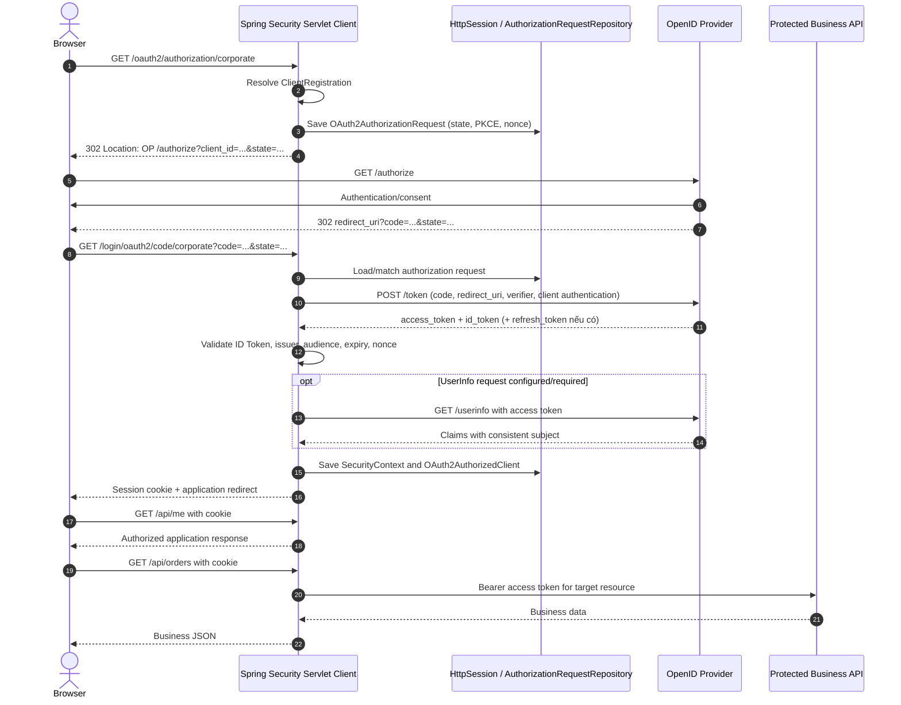
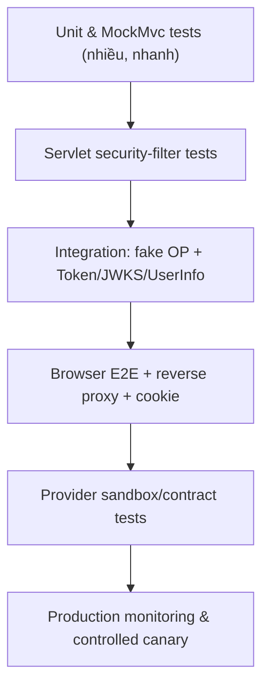

# 29.12. Giới hạn của mock login so với luồng redirect và trao đổi token thật

## 1. Vấn đề: MockMvc báo xanh nhưng OAuth2 Login thật vẫn thất bại

Một ứng dụng **Spring Security OAuth 2.0/OIDC Client** trên Servlet có thể vượt qua hàng trăm bài kiểm thử:

```java
mockMvc.perform(get("/api/me").with(oidcLogin()))
    .andExpect(status().isOk());
```

Thế nhưng, khi mở trình duyệt và chọn **Đăng nhập bằng tài khoản công ty**, người dùng lại gặp:

```text
authorization_request_not_found
invalid_state
invalid_grant
invalid_client
invalid_nonce
invalid_issuer
redirect_uri_mismatch
```

Không có nghịch lý nào ở đây. `oidcLogin()` trong **Spring Security Test** là một *request post-processor* chuẩn bị **một principal đã được xác thực giả lập** cho lần gọi `MockMvc`. Nó giúp kiểm thử phần ứng dụng **sau khi authentication được coi là thành công**; nó không cần browser chuyển hướng đến IdP, không đổi authorization code thành tokens, cũng không yêu cầu kiểm tra JWT bằng khóa công khai thật của provider.

**Bài học cốt lõi:**

> Test với `oauth2Login()` hoặc `oidcLogin()` chứng minh ứng dụng phản ứng thế nào với một OAuth2/OIDC principal đã được dựng trong test. Nó **không chứng minh** toàn bộ Authorization Code Flow, PKCE, OIDC ID Token validation hay môi trường redirect/session/cookie ngoài thực tế hoạt động đúng.

Đây là bài thuộc chương **29. Kiểm thử Servlet**. Nội dung phân biệt những gì có thể kiểm tra bằng `MockMvc`, khi nào phải chạy filter/callback thật cùng Authorization Server giả lập hoặc môi trường tích hợp, và khi nào cần browser end-to-end.

### Mục tiêu học tập

Sau bài này, bạn sẽ:

1. Mô tả những bước của OAuth2 Authorization Code/OIDC Login thật.
2. Biết `oauth2Login()`, `oidcLogin()`, `oauth2Client()` và `@WithMockUser` khác nhau ở đâu.
3. Không nhầm mock principal với OAuth2 tokens hợp lệ hoặc local session đã được thiết lập bởi login flow.
4. Viết MockMvc tests cho endpoint authorization, roles, claims, principal mapping, CSRF và business logic.
5. Kiểm tra redirect initiation, `ClientRegistration`, `state`, PKCE, scopes và redirect URI ở mức filter.
6. Xây integration test với Authorization Server giả lập kiểm soát được Token Endpoint, UserInfo và JWKS.
7. Kiểm tra callback, session continuity, ID Token issuer/audience/nonce/signature, error handling và token persistence.
8. Biết khi nào cần test với browser thật, HTTPS, cookie policy, proxy và IdP sandbox.
9. Dựng test matrix để không bỏ sót các lỗi mà mock login không thể phát hiện.
10. Hiểu giới hạn của cả mock AS và browser E2E, để không tuyên bố bảo mật vượt quá bằng chứng kiểm thử.

Các URL, secrets, users và tokens bên dưới là dữ liệu **minh họa**. Cú pháp code lấy Spring Boot 3.x/Spring Security 6.x Servlet làm ngữ cảnh; khi sử dụng dòng phiên bản khác cần đối chiếu API tương ứng.

---

## 2. Luồng Authorization Code/OIDC Login thật gồm những gì?

Một luồng OIDC Login thành công trên Servlet có thể được biểu diễn:



Ở mỗi bước tồn tại những điều kiện bảo mật hoặc cấu hình mà mock principal không tự kiểm tra.

| Giai đoạn | Các điều kiện cần kiểm chứng |
|---|---|
| Bắt đầu login | Registration có tồn tại, tenant/provider được phép, redirect URI đúng |
| Dựng authorize URL | `response_type=code`, `scope`, `client_id`, `state`, PKCE, nonce khi áp dụng |
| Lưu request | Authorization request được lưu đúng session/repository |
| Browser qua IdP | Redirect, cookies, `SameSite`, HTTPS, host/proxy |
| Callback | State khớp, không bị replay, code thuộc đúng request/client |
| Token Endpoint | Client auth, code verifier, redirect URI, network/TLS, response hợp lệ |
| OIDC ID Token | Signature/JWK, issuer, audience, expiry, nonce, timestamps |
| UserInfo | TLS, access token, issuer/user claims và `sub` consistency |
| Local account mapping | Stable `(iss,sub)`, tenant, trạng thái tài khoản |
| Session/authorized client | SecurityContext và token được lưu đúng repository/principal |
| Downstream API | Access token đúng audience/scope, API kiểm tra authorization |

**Mock login chủ yếu bắt đầu ở cuối sơ đồ:** một `Authentication` đã được giả lập tồn tại, sau đó request đi qua các security filters/controller của ứng dụng.

---

## 3. Bốn kiểu kiểm thử thường bị đánh đồng

### 3.1. `@WithMockUser`

```java
@Test
@WithMockUser(username = "alice", roles = "USER")
void profileEndpointRequiresUserRole() throws Exception {
    mockMvc.perform(get("/api/me"))
        .andExpect(status().isOk());
}
```

Nó cung cấp một Spring Security principal giả lập thông thường. Không có `OidcUser`, ID Token, `OAuth2AuthenticationToken` hay authorized client theo nghĩa OAuth2 Login.

Phù hợp cho các test **chỉ quan tâm authenticated user/roles**.

### 3.2. `oauth2Login()`

```java
mockMvc.perform(
        get("/api/me").with(oauth2Login())
    )
    .andExpect(status().isOk());
```

Nó cung cấp một `OAuth2AuthenticationToken` dựa trên `OAuth2User` giả lập, có thể tùy biến attributes và authorities. Spring Security Test cũng có khả năng dựng/đăng ký authorized client giả lập cho request theo hỗ trợ post-processor.

Nó **không gọi provider Authorization Endpoint hoặc Token Endpoint thật**.

### 3.3. `oidcLogin()`

```java
mockMvc.perform(
        get("/api/me").with(oidcLogin())
    )
    .andExpect(status().isOk());
```

Nó cung cấp một principal OIDC giả lập (`OidcUser`) với các claim/token test data. Có thể sửa ID Token claims, UserInfo và authorities.

Nó **không cryptographically verify** ID Token giả lập như khi nhận token response thật từ OpenID Provider.

### 3.4. `oauth2Client()`

```java
mockMvc.perform(
        get("/api/provider-data").with(oauth2Client("corporate"))
    )
    .andExpect(status().isOk());
```

Post-processor này phục vụ các test cần **OAuth2AuthorizedClient** trong request, ví dụ controller dùng `@RegisteredOAuth2AuthorizedClient`.

Nó không tự có nghĩa user đã đăng nhập bằng OIDC; khi endpoint cũng yêu cầu authentication, phải tạo principal phù hợp hoặc dùng cấu hình test tương ứng.

### 3.5. Bảng so sánh tổng quan

| Kiểu test | Giả lập Authentication? | Giả lập authorized client? | Browser redirect thật? | Code exchange thật? |
|---|---|---|---|---|
| `@WithMockUser` | Có, loại username/password-style mock | Không mặc định | Không | Không |
| `oauth2Login()` | Có, OAuth2 principal | Có khả năng gắn test authorized client | Không | Không |
| `oidcLogin()` | Có, OIDC principal | Có khả năng gắn test authorized client | Không | Không |
| `oauth2Client()` | Không nhất thiết đăng nhập user | Có | Không | Không |
| `MockMvc GET /oauth2/authorization/...` | Chưa đăng nhập | Không cần | Kiểm tra **302 được tạo**, không browser navigation | Không |
| `MockMvc callback + mock OP` | Qua Spring OAuth2 filters nếu dựng đủ flow | Có, theo wiring thật | Mô phỏng các HTTP hops | Có HTTP token exchange với mock server |
| Browser E2E + OP test | Qua login thật | Theo app thật | Có | Có |
| Production-like IdP sandbox | Qua login thật | Theo app thật | Có | Có với provider tương thích |

**Không có một kiểu test bao phủ mọi lớp.** Chiến lược phù hợp là phối hợp các tầng.

---

## 4. Điều `oauth2Login()` thực sự giúp kiểm thử

Một request:

```java
mockMvc.perform(
    get("/api/orders")
        .with(oauth2Login())
);
```

thường được dùng để chứng minh:

- Endpoint yêu cầu `Authentication` có thể tiếp tục khi user đã authenticated.
- SecurityFilterChain authorization rules hoạt động với authorities được cung cấp.
- Controller có thể nhận `Authentication`, `Principal` hoặc `OAuth2AuthenticationToken`.
- `@AuthenticationPrincipal OAuth2User` có attributes mong đợi.
- Business service dùng principal/claims theo rule đã lập trình.
- API response không lộ raw token/claims ngoài nhu cầu.
- Custom authorization checks xử lý role/tenant.
- Có thể chạy unit-like tests nhanh mà không cần mạng hoặc IdP.

### 4.1. Nhưng không chứng minh những thứ sau

`oauth2Login()` **không tự chứng minh**:

1. `/oauth2/authorization/{registrationId}` hoạt động.
2. URL 302 trỏ tới đúng issuer/provider.
3. State được randomize và lưu vào `AuthorizationRequestRepository`.
4. PKCE challenge được tạo đúng và verifier gửi đúng Token Endpoint.
5. Redirect URI khớp registration tại Authorization Server.
6. Browser gửi lại cookie/session khi callback.
7. Authorization code hợp lệ/một lần/đúng client.
8. `client_secret_basic`, `client_secret_post`, private key JWT hay mTLS hoạt động.
9. Token Endpoint reachable và xử lý OAuth2 protocol đúng.
10. OIDC ID Token signature, JWKS key, `iss`, `aud`, `exp`, `nonce` hợp lệ.
11. UserInfo Endpoint trả claims hợp lệ.
12. Authorized client thực sự được lưu vào JDBC/Redis/session như production.
13. Refresh token rotation, expiry hoặc revoked token xử lý đúng.
14. CDN/reverse proxy/`X-Forwarded-*` không làm sai callback URL.
15. HTTPS/SameSite cookie behavior tương thích browser thật.
16. Provider tenant/issuer metadata thực sự giống cấu hình.

### 4.2. Câu kết luận sai thường gặp

> “Test `oidcLogin()` xanh nên OIDC configuration đã chuẩn.”

Không đúng. Test này có thể chạy dù:

```yaml
spring.security.oauth2.client.registration.corporate.client-secret: wrong
spring.security.oauth2.client.provider.corporate.issuer-uri: https://wrong-idp.example
```

nếu test không bao giờ tạo flow hoặc gọi provider.

### 4.3. Câu kết luận chính xác hơn

> “Controller và authorization policy đã được kiểm thử với một OIDC principal giả lập có claims/authorities như dự kiến.”

Bằng chứng đó có giá trị, nhưng **chỉ trong phạm vi của test**.

---

## 5. Thiết lập dự án kiểm thử Servlet

Ví dụ dependencies Spring Boot 3.x:

```groovy
dependencies {
    implementation 'org.springframework.boot:spring-boot-starter-web'
    implementation 'org.springframework.boot:spring-boot-starter-security'
    implementation 'org.springframework.boot:spring-boot-starter-oauth2-client'

    testImplementation 'org.springframework.boot:spring-boot-starter-test'
    testImplementation 'org.springframework.security:spring-security-test'
}
```

Khi tích hợp Authorization Server mock hoặc browser E2E, thêm dependencies riêng theo framework đã chọn, chẳng hạn WireMock, MockWebServer, Testcontainers hoặc Playwright/Selenium.

Không cố dùng `spring-security-test` như một **thay thế cho một Authorization Server implementation**.

### 5.1. SecurityFilterChain minh họa

```java
import org.springframework.context.annotation.Bean;
import org.springframework.context.annotation.Configuration;
import org.springframework.security.config.Customizer;
import org.springframework.security.config.annotation.web.builders.HttpSecurity;
import org.springframework.security.web.SecurityFilterChain;

@Configuration
public class SecurityConfiguration {

    @Bean
    SecurityFilterChain securityFilterChain(HttpSecurity http)
            throws Exception {

        http
            .authorizeHttpRequests(authorize -> authorize
                .requestMatchers("/", "/login", "/assets/**").permitAll()
                .requestMatchers("/api/admin/**").hasRole("ADMIN")
                .requestMatchers("/api/**").authenticated()
                .anyRequest().authenticated()
            )
            .oauth2Login(Customizer.withDefaults())
            .oauth2Client(Customizer.withDefaults());

        // CSRF protection giữ mặc định.
        return http.build();
    }
}
```

Mã này cho phép test login authorization sau khi mock authentication được đưa vào request; nó chưa định nghĩa provider configuration, controllers hay một IdP.

### 5.2. `MockMvc` phải có security filter chain

Với `@SpringBootTest` và `@AutoConfigureMockMvc`, Spring Boot thường cấu hình MockMvc cùng filters của ứng dụng.

Nếu tự tạo standalone `MockMvcBuilders.standaloneSetup(...)`, cần tích hợp Spring Security thích hợp; test post-processors có thể không tạo ra cùng behavior như full `FilterChainProxy`.

Ví dụ:

```java
MockMvcBuilders.webAppContextSetup(context)
    .apply(springSecurity())
    .build();
```

Import `SecurityMockMvcConfigurers.springSecurity` tương ứng.

Một test đi qua controller nhưng không đi qua security filters **không chứng minh SecurityFilterChain đang bảo vệ endpoint**.

---

## 6. Ví dụ MockMvc với `oauth2Login()`

Giả sử có endpoint:

```java
import java.util.Map;

import org.springframework.security.core.annotation.AuthenticationPrincipal;
import org.springframework.security.oauth2.core.user.OAuth2User;
import org.springframework.web.bind.annotation.GetMapping;
import org.springframework.web.bind.annotation.RestController;

@RestController
class ProfileController {

    @GetMapping("/api/me")
    Map<String, Object> me(
            @AuthenticationPrincipal OAuth2User user) {

        return Map.of(
            "name", user.getAttribute("name") == null
                ? "Unknown" : user.getAttribute("name"),
            "providerUserId", user.getName()
        );
    }
}
```

Test:

```java
import static org.springframework.security.test.web.servlet.request
    .SecurityMockMvcRequestPostProcessors.oauth2Login;
import static org.springframework.test.web.servlet.request
    .MockMvcRequestBuilders.get;
import static org.springframework.test.web.servlet.result
    .MockMvcResultMatchers.jsonPath;
import static org.springframework.test.web.servlet.result
    .MockMvcResultMatchers.status;

import org.junit.jupiter.api.Test;
import org.springframework.beans.factory.annotation.Autowired;
import org.springframework.boot.test.autoconfigure.web.servlet.AutoConfigureMockMvc;
import org.springframework.boot.test.context.SpringBootTest;
import org.springframework.test.web.servlet.MockMvc;

@SpringBootTest
@AutoConfigureMockMvc
class ProfileMvcTest {

    @Autowired
    MockMvc mockMvc;

    @Test
    void oauth2UserCanReadProfile() throws Exception {
        mockMvc.perform(
                get("/api/me")
                    .with(oauth2Login()
                        .attributes(attributes -> {
                            attributes.put("sub", "provider-user-42");
                            attributes.put("name", "Alice");
                        }))
            )
            .andExpect(status().isOk())
            .andExpect(jsonPath("$.name").value("Alice"));
    }
}
```

### 6.1. Điều test này xác nhận

Nó cho thấy controller và security rules cho phép một OAuth2 principal mock với attribute `name=Alice` truy cập `/api/me`, đồng thời controller serialize response như mong đợi.

### 6.2. Điều test này không xác nhận

Nó **không** xác minh:

- Provider thực sự trả claim `name`.
- `sub` đã được xác minh từ IdP.
- `client-id`/`client-secret` hợp lệ.
- Có cookie session thật.
- Browser redirect/callback.
- UserInfo HTTP response và stable user-name attribute.
- OAuth2 token thực sự cho phép gọi downstream API.

### 6.3. Không giả định `getName()` luôn là OIDC sub

Với provider OAuth2 thuần, `OAuth2User.getName()` phụ thuộc cấu hình `userNameAttributeName`/user service. Có provider trả `id`, có provider trả username.

Nếu business logic dùng `getName()` làm local account ID, test cần kiểm tra mapping riêng; không suy cùng semantics cho mọi provider.

---

## 7. Ví dụ MockMvc với `oidcLogin()` và ID Token claims

```java
import static org.springframework.security.test.web.servlet.request
    .SecurityMockMvcRequestPostProcessors.oidcLogin;

@Test
void oidcPrincipalContainsExpectedClaims() throws Exception {
    mockMvc.perform(
            get("/api/me")
                .with(oidcLogin()
                    .idToken(token -> token
                        .claim("sub", "alice-sub-42")
                        .claim("email", "alice@example.test")
                        .claim("email_verified", true)
                    ))
        )
        .andExpect(status().isOk());
}
```

Có thể thêm `.authorities(...)` hoặc user info claims theo API của phiên bản Spring Security Test đang dùng.

### 7.1. Vì sao ID Token giả không chứng minh JWT validation?

Một ID Token mock có thể mang `iss`, `aud` và `sub` bất kỳ do test đặt. Test không nhất thiết dựng một signed JWT và **không gọi validator** của OAuth2/OIDC Login.

Ví dụ:

```java
.with(oidcLogin().idToken(token ->
    token.claim("iss", "https://untrusted.example")
))
```

có thể tạo một test principal mà controller nhận được. Nó **không chứng minh** ứng dụng production chấp nhận issuer đó. Ngược lại, nó cũng **không chứng minh** Spring Security sẽ từ chối issuer đó trong protocol flow, vì validator chưa chạy.

### 7.2. Phân biệt claim-level test và signature-level test

| Câu hỏi | Công cụ phù hợp |
|---|---|
| Controller hiển thị email đã có trong principal? | `oidcLogin()` |
| Business mapper kiểm tra `email_verified`? | `oidcLogin()` + service unit tests |
| ID Token JWT có chữ ký hợp lệ? | OIDC provider/decoder integration test |
| `iss` đúng configured issuer? | OIDC validation integration |
| `aud` chứa client ID? | OIDC validation integration |
| `nonce` khớp authorization request? | OIDC full flow integration |
| JWKS key rotation được xử lý? | OIDC/JWKS contract integration |
| Browser thực tế mang session qua redirect? | Browser E2E |

### 7.3. Không “nâng cấp” mock test bằng cách đặt thêm claims

Việc thêm:

```java
.claim("nonce", "expected")
.claim("aud", List.of("portal-client"))
```

không tự làm spring-security-test kiểm tra nonce hoặc audience như một ID Token thực nhận từ Token Endpoint.

---

## 8. Authorities giả lập và business authorization

Một bài test:

```java
import static org.springframework.security.test.web.servlet.request
    .SecurityMockMvcRequestPostProcessors.oidcLogin;
import static org.springframework.security.test.web.servlet
    .request.SecurityMockMvcRequestPostProcessors.csrf;

import org.springframework.security.core.authority.SimpleGrantedAuthority;

@Test
void adminCanUpdateSetting() throws Exception {
    mockMvc.perform(
            post("/api/admin/settings")
                .with(oidcLogin().authorities(
                    new SimpleGrantedAuthority("ROLE_ADMIN")
                ))
                .with(csrf())
                .contentType("application/json")
                .content("{\"enabled\":true}")
        )
        .andExpect(status().is2xxSuccessful());
}
```

Test xác nhận một request có role `ROLE_ADMIN` và CSRF token giả lập được đi qua rule tương ứng.

### 8.1. Test role mapping riêng

Nếu production tải `ROLE_ADMIN` từ:

- OIDC group claim.
- Local database.
- Tenant policy.
- Custom `OidcUserService`/success handler.

thì test trên **không chứng minh cơ chế map role thực sự tạo được role đó**.

Cần thêm test cho component mapping claims/groups → local authorities, gồm các negative cases:

```text
Group claim không được trust
Wrong issuer
Wrong tenant
Account disabled
Group name tương tự nhưng không thuộc allowlist
Missing required claim
```

### 8.2. Không dùng `hasRole("ADMIN")` như chứng cứ provider cấp admin

Một authority giả lập chỉ chứng minh Spring Security rule có hiệu lực **khi authority đã tồn tại**. Nó không kiểm tra provenance hoặc trust level của authority.

### 8.3. CSRF token từ test không chứng minh browser gửi đúng token

`.with(csrf())` giúp request MockMvc có CSRF token hợp lệ theo Spring Security Test. Browser thật vẫn phải lấy token, gửi header/form đúng tên và chịu cookie/SameSite policies.

Vì vậy cần test negative (thiếu CSRF phải bị từ chối) và integration/frontend tests cho CSRF delivery.

---

## 9. `oauth2Client()` và `@RegisteredOAuth2AuthorizedClient`

Đối với outbound API integration, controller có thể dùng:

```java
import org.springframework.security.oauth2.client.OAuth2AuthorizedClient;
import org.springframework.security.oauth2.client.annotation
    .RegisteredOAuth2AuthorizedClient;

@GetMapping("/api/provider-data")
public String providerData(
        @RegisteredOAuth2AuthorizedClient("corporate")
        OAuth2AuthorizedClient authorizedClient) {

    return authorizedClient.getAccessToken() == null
        ? "missing-token" : "token-present";
}
```

Một MockMvc test có thể cung cấp authorized client giả lập:

```java
import static org.springframework.security.test.web.servlet.request
    .SecurityMockMvcRequestPostProcessors.oauth2Client;
import static org.springframework.security.test.web.servlet.request
    .SecurityMockMvcRequestPostProcessors.oidcLogin;

@Test
void endpointSeesAuthorizedClient() throws Exception {
    mockMvc.perform(
            get("/api/provider-data")
                .with(oidcLogin())
                .with(oauth2Client("corporate"))
        )
        .andExpect(status().isOk());
}
```

Đoạn code cho thấy hướng dùng post-processors; chi tiết cách repository gắn request, registration/principal và authorized client resolver phải được kiểm tra trong test setup của chính ứng dụng.

### 9.1. Token giả có thể tùy biến

Spring Security Test hỗ trợ dựng test authorized clients/tokens theo API của phiên bản. Ví dụ các scopes:

```text
openid
profile
orders.read
```

Nhưng test token có scope `orders.read` **không chứng minh Token Endpoint sẽ cấp scope đó** và cũng không chứng minh Orders Resource Server chấp nhận token.

### 9.2. Test không được hiển thị raw token

Không viết assertions in:

```java
System.out.println(
    authorizedClient.getAccessToken().getTokenValue()
);
```

Kể cả token giả, production code có thể bị copy với việc log credentials. Test nên assert response **không chứa** `access_token`, `refresh_token` hoặc bearer token string.

### 9.3. Nếu controller gắn token vào HTTP client

Để kiểm tra BFF gửi:

```http
Authorization: Bearer fake-access-token
```

tới đúng Orders API, cần **mock outbound HTTP** bằng WireMock/MockWebServer hoặc mock service boundary, không chỉ assert controller 200.

---

## 10. Đăng nhập giả không giống session thật

Request post-processor đưa authentication vào môi trường request test. Nó **không bắt buộc**:

- Tạo một HTTP session theo OAuth2 Login thành công.
- Xoay session ID sau login theo session fixation policy.
- Persist SecurityContext vào `HttpSessionSecurityContextRepository`.
- Gửi `Set-Cookie: JSESSIONID/SESSION` giống container thật.
- Khôi phục login ở request thứ hai chỉ bằng cookie session.
- Tái tạo session từ Redis/JDBC khi request đến pod khác.
- Quản lý idle timeout/absolute lifetime.
- Bảo đảm `SameSite`/`Secure`/`HttpOnly` flags trên browser thật.

### 10.1. Hai requests với mock không là proof of persistence

Sai về mặt suy luận:

```java
mockMvc.perform(get("/api/me").with(oidcLogin()))
    .andExpect(status().isOk());

mockMvc.perform(get("/api/me").with(oidcLogin()))
    .andExpect(status().isOk());
```

Cả hai requests được **tự gắn Authentication**. Điều này không chứng minh request thứ hai có thể được xác thực chỉ nhờ session cookie mà request đầu tạo ra.

### 10.2. Test session continuity thật cần làm gì?

Một test integration cần:

```text
1. Bắt đầu OAuth2 authorization request.
2. Giữ cùng MockHttpSession/browser cookie cho callback.
3. Hoàn tất code exchange và authentication.
4. Truy cập /api/me mà KHÔNG gắn oidcLogin().
5. Xác nhận SecurityContext/session đã được persist.
```

Nếu dùng Spring Session/Redis và nhiều nodes, cần test với session repository phù hợp, không chỉ một in-memory MockHttpSession.

### 10.3. Cookie behavior vẫn cần browser

`MockHttpSession` không mô phỏng đầy đủ cookie policy của Chrome/Firefox/Safari, đặc biệt với cross-site OIDC redirects và `response_mode=form_post`.

---

## 11. Kiểm tra endpoint khởi tạo redirect bằng MockMvc

Không phải mọi test liên quan OAuth2 đều cần mock login. Có thể kiểm tra **bước đầu** thật qua security filter:

```java
@Test
void authorizationEndpointRedirectsToIdp() throws Exception {
    mockMvc.perform(
            get("/oauth2/authorization/corporate")
        )
        .andExpect(status().is3xxRedirection())
        .andExpect(header().string(
            "Location",
            org.hamcrest.Matchers.containsString(
                "https://login.example-idp.com"
            )
        ));
}
```

Test này yêu cầu `ClientRegistrationRepository` có registration `corporate` và OAuth2 Login filters được cấu hình.

### 11.1. Điều test này chứng minh

Spring OAuth2 Authorization Request Redirect Filter đã:

- Resolve registration tại URL.
- Xây authorization URL.
- Trả HTTP redirect.

Có thể kiểm tra thêm query parameters:

```text
response_type=code
client_id=...
redirect_uri=...
scope=...
state=...
code_challenge_method=S256 (nếu PKCE được bật)
```

### 11.2. Điều nó chưa chứng minh

- Browser thật có đi đến IdP không.
- IdP có chấp nhận redirect URI không.
- User có đăng nhập/consent thành công không.
- State có được khôi phục sau callback không.
- Token exchange có hợp lệ không.

### 11.3. Không assert chính xác toàn bộ URL nếu state ngẫu nhiên

`state` và `code_challenge` phải thay đổi phù hợp giữa các requests. Dùng query parser/URI matcher, không hardcode state value.

Ví dụ test mang ý nghĩa:

```text
Location must contain:
    response_type=code
    client_id=portal-client
    redirect_uri=app callback
    non-empty state
```

Với PKCE, check `code_challenge_method=S256` và non-empty `code_challenge` khi flow được cấu hình sử dụng PKCE.

### 11.4. PKCE của confidential client không luôn bật mặc định

Các version/config của Spring Security có rules khác nhau. Khi kiểm thử PKCE, phải xác minh **cấu hình ứng dụng** đã bật PKCE theo policy (ví dụ thông qua `OAuth2AuthorizationRequestCustomizers.withPkce()` nếu cần).

Đừng viết một test đòi PKCE S256 cho mọi confidential registration rồi coi mọi version/framework đều mặc định như vậy.

---

## 12. Kiểm tra `OAuth2AuthorizationRequestRepository`

Spring Security Servlet thường lưu authorization request để đối chiếu callback:

```java
HttpSessionOAuth2AuthorizationRequestRepository
```

Nó giữ thông tin như:

```text
state
authorization URI
client ID
redirect URI
scopes
additional parameters
attributes
PKCE code verifier (theo cấu hình)
OIDC nonce (theo flow)
```

### 12.1. Test request initiation và session

Ví dụ ý tưởng:

```java
MvcResult result = mockMvc.perform(
        get("/oauth2/authorization/corporate")
    )
    .andExpect(status().is3xxRedirection())
    .andReturn();

MockHttpSession session =
    (MockHttpSession) result.getRequest().getSession(false);
```

Khi session được tạo để lưu authorization request, `session` phải có giá trị. Test tiếp tục kiểm tra repository bằng đúng API/thực thi của Spring Security version đang dùng.

### 12.2. Không cần log `state`/verifier để debug

Có thể kiểm tra:

```text
state present
state unguessable/changes between flows
code_challenge present
code_verifier remains server-side
```

mà không ghi state hoặc verifier vào output CI logs.

### 12.3. Callback replay

Một test integration nên gửi cùng callback/code lần thứ hai. Nếu authorization request đã được consume hoặc code đã dùng, lần hai **không được tạo thêm login thành công**.

Mock login request post-processor không thực hiện consume/replay protection.

### 12.4. Mất session giữa redirect và callback

Một bài test thiết thực:

```text
Initiate login with session A.
Call callback using unrelated session B.
Expected: failure, no Authentication accepted.
```

Điều này phát hiện lỗi `authorization_request_not_found` và kiểm tra không có fallback nguy hiểm như “bỏ state validation để tiện login”.

---

## 13. PKCE: cần test cả challenge và verifier

PKCE (RFC 7636) bảo vệ authorization code bằng mối liên hệ:

```text
code_verifier
    --SHA-256 + base64url-->
code_challenge

authorize request:
    code_challenge=<derived>
    code_challenge_method=S256

token request:
    code_verifier=<original>
```

### 13.1. Mock login không cần verifier

`oidcLogin()` tạo Authentication, không gửi token request; do đó nó không thể phát hiện nếu backend:

- Không lưu `code_verifier`.
- Gửi verifier sai.
- Gửi challenge với method sai.
- Tạo challenge/verifier cố định.
- Mất verifier sau redirect.
- Dùng wrong authorization request trên nhiều tabs.

### 13.2. Tầng test phù hợp

- **Resolver/unit test:** PKCE customization tạo `code_challenge`, `code_challenge_method=S256`.
- **Filter integration:** authorization request lưu verifier server-side.
- **Mock AS contract:** Token Endpoint kiểm tra verifier khớp challenge từ authorize request.
- **Browser E2E:** session/callback thực tế bảo toàn PKCE transaction.

### 13.3. Test negative

```text
Token request code_verifier wrong
    -> AS returns invalid_grant
    -> Spring login fails
    -> no authenticated session
```

Đây là kiểm thử mà chỉ `.with(oidcLogin())` không thể thực hiện.

---

## 14. OAuth2 `state`: bảo vệ giao dịch, không chỉ một query parameter

`state` giúp liên kết authorization response với authorization request đã bắt đầu; nó là tuyến phòng thủ quan trọng chống login CSRF và flow confusion.

### 14.1. Test cần có

1. Mỗi initiation tạo state phù hợp và không đoán được.
2. State được lưu với đúng browser session.
3. Callback state đúng được chấp nhận **khi mọi điều kiện khác đúng**.
4. Callback state sai bị từ chối.
5. Callback thiếu state bị từ chối theo expected flow.
6. Replay callback/state sau khi consumed bị từ chối.
7. Callback của tenant/provider A không được xử lý như B.
8. Hai tabs đồng thời có behavior được policy xác định.

### 14.2. Không tự đặt `state` trong test callback rồi kết luận flow thành công

Một callback integration hợp lệ nên lấy state từ **authorization initiation trước đó**; không tạo một state tĩnh không có repository backing.

### 14.3. Session/cookie lỗi thường tạo lỗi state

Trường hợp production:

```text
Authorize started with HttpSession A.
Browser returns from IdP.
Cookie session not sent because SameSite/Domain/Secure/proxy issue.
```

Spring không tìm lại authorization request ở session A và callback fail. Mock login xanh vì nó **không cần callback session**.

---

## 15. OIDC `nonce`, issuer, audience và signature

OIDC ID Token validation là một trong những lý do quan trọng nhất cần integration test.

### 15.1. ID Token minh họa

```json
{
  "iss": "https://login.example-idp.com",
  "sub": "alice-stable-sub",
  "aud": "portal-client",
  "iat": 1980000000,
  "exp": 1980003600,
  "nonce": "nonce-correlated-with-login"
}
```

Không thể coi ID Token là hợp lệ chỉ vì JSON có những fields trên. Phải có chữ ký và được kiểm chứng theo OpenID Connect và cấu hình expected issuer/client.

### 15.2. Các điều kiện cần test

| Kiểm tra | Ví dụ negative |
|---|---|
| JWT signature | ID Token ký bằng key không có trong JWKS |
| Algorithm policy | JWT dùng thuật toán không cho phép |
| `iss` | Issuer không khớp configured provider |
| `aud` | Audience không chứa client ID |
| `azp` khi áp dụng | Authorized party không hợp lệ |
| `exp` | Token hết hạn |
| `iat`/time validation | Timestamps bất thường |
| `nonce` | Token không khớp nonce đã gửi |
| `sub` | Missing/invalid subject |
| JWK selection | `kid` không tồn tại hoặc key rotation lỗi |
| UserInfo subject | `sub` khác ID Token `sub` |

### 15.3. Mock `OidcUser` bỏ qua phần lớn điều này

Khi viết:

```java
.with(oidcLogin().idToken(token ->
    token.claim("iss", "https://wrong-issuer.example")))
```

test chỉ dựng một ID Token object với claim đó. Spring OIDC Login validation pipeline **không tự chạy** để từ chối issuer.

### 15.4. Test thay vì tự parse token

Không nên viết một custom unit test:

```java
String sub = parseBase64UrlPayload(idToken).get("sub");
```

rồi coi đã kiểm tra OIDC. Parse payload không chứng minh signature/issuer/audience/nonce.

Để kiểm thử thực tế, tạo **signed JWT test** từ fake OP với JWK public có thể discovery, rồi để Spring Security validate.

---

## 16. UserInfo Endpoint: mock attributes khác response thật

Với OIDC hoặc OAuth2 Login dùng UserInfo, Spring Security có thể gọi remote UserInfo Endpoint để lấy claims.

Một `oauth2Login().attributes(...)` chỉ đặt attributes trong principal giả:

```java
.with(oauth2Login().attributes(a -> {
    a.put("id", "4421");
    a.put("login", "alice-dev");
}))
```

Nó **không kiểm tra**:

- UserInfo URL có đúng không.
- Access token có được gửi đúng bearer header không.
- TLS/provider availability.
- JSON parsing/claim types.
- Configured `user-name-attribute`.
- UserInfo `sub` khớp ID Token trong OIDC.
- Error handling khi 401/403/timeout.
- Provider có trả attribute này trong thực tế không.

### 16.1. Contract test với mock UserInfo

```http
GET /userinfo
Authorization: Bearer test-access-token
```

```json
{
  "sub": "alice-stable-sub",
  "name": "Alice",
  "email": "alice@example.test",
  "email_verified": true
}
```

Test nên trả thêm:

```text
401 Unauthorized
500 Internal Server Error
slow response/timeout
malformed JSON
missing sub
different sub
```

và kiểm tra Spring OAuth2 Login thất bại **an toàn** nếu identity claims không còn đáng tin.

### 16.2. Không “fix test” bằng cách bỏ `sub` comparison

UserInfo subject mismatch là vấn đề integrity theo OIDC. Khi xảy ra, phải điều tra provider/mapping, không tắt validation để user có thể login.

---

## 17. Token Endpoint thật có những điểm lỗi nào?

Authorization Code Token Request thường gồm:

```http
POST /token HTTP/1.1
Content-Type: application/x-www-form-urlencoded
Authorization: Basic <client credentials, nếu dùng client_secret_basic>

grant_type=authorization_code
&code=one-time-code
&redirect_uri=https%3A%2F%2Fportal.example%2Flogin%2Foauth2%2Fcode%2Fcorporate
&code_verifier=...
```

Các chi tiết quan trọng:

- Client authentication method (`client_secret_basic`, `client_secret_post`, private key JWT, mTLS...) theo registration/IdP.
- Authorization code thực sự thuộc client và redirect URI đã phát.
- PKCE verifier khớp challenge.
- Token Endpoint có TLS và trust đúng.
- Response type/JSON chính xác.
- Access token, ID Token, refresh token (nếu cấp), `expires_in`, token type.
- Error codes và HTTP status.
- Timeout, retries, malformed responses.

### 17.1. `oidcLogin()` không gọi `/token`

Vì thế test chỉ có `oidcLogin()` không phát hiện:

```text
invalid_client: bad client secret
invalid_grant: code expired/reused/PKCE mismatch
invalid_request: redirect_uri incorrect
unsupported_grant_type
TLS certificate unknown
Token Endpoint network timeout
```

### 17.2. Client secret sai vẫn mock xanh

Nếu YAML:

```yaml
spring.security.oauth2.client.registration.corporate.client-secret: wrong
```

test `.with(oidcLogin())` vẫn có thể pass, vì token exchange chưa xảy ra.

### 17.3. Secret rotation và multiple pods

Một pod có secret v1, pod khác có secret v2; callback đi qua pod khác có thể fail tùy provider. Integration test/release checks phải kiểm tra config consistency và routing, không thể chỉ dùng mock principal.

---

## 18. Tầng tích hợp dùng Authorization Server giả lập

Để thực hiện gần đủ flow mà không gọi IdP thật trong mọi CI run, có thể dựng một **local fake OP/Authorization Server**.

### 18.1. Các lựa chọn

- WireMock/MockWebServer HTTP stubs cho discovery, JWKS, Token Endpoint, UserInfo.
- Một test authorization server như Spring Authorization Server cấu hình cho integration tests.
- Một IdP test container tương thích OIDC, nếu sản phẩm cần provider behavior cụ thể.
- Một contract sandbox của IdP thật cho kiểm tra cuối pipeline.

**Không có một fake OP universal** tự giống mọi IdP, đặc biệt với tenant discovery, custom claims, refresh rotation và consent UX.

### 18.2. Minimal endpoints cho test OIDC

Một fake OP thường cần:

```text
/.well-known/openid-configuration
/jwks
/authorize
/token
/userinfo (nếu cần)
```

Ví dụ discovery JSON (các URLs cùng fake server):

```json
{
  "issuer": "http://127.0.0.1:9009",
  "authorization_endpoint": "http://127.0.0.1:9009/authorize",
  "token_endpoint": "http://127.0.0.1:9009/token",
  "jwks_uri": "http://127.0.0.1:9009/jwks",
  "userinfo_endpoint": "http://127.0.0.1:9009/userinfo",
  "response_types_supported": ["code"],
  "subject_types_supported": ["public"],
  "id_token_signing_alg_values_supported": ["RS256"],
  "token_endpoint_auth_methods_supported": ["client_secret_basic"]
}
```

HTTP loopback chỉ là ví dụ trong local test environment. Production OIDC providers/token endpoints phải tuân TLS và security policy tương ứng.

### 18.3. JWK và signed ID Token

Để validator có việc thật phải làm:

1. Fake OP giữ **private key** test để ký JWT.
2. JWKS endpoint công bố **public JWK** tương ứng.
3. Token Endpoint trả ID Token signed với `iss`, `aud`, `sub`, `nonce`, `exp`.
4. Spring Security tải JWKS và xác minh chữ ký.
5. Test negative thay đổi issuer/audience/nonce/key/expiry để chắc chắn login fail.

**Không đưa private key sản xuất vào test repo.** Dùng test key riêng hoặc generate trong test fixture.

### 18.4. Không hardcode nonce sai

Nonce thường được tạo trong authorization request. Fake OP cần lấy **expected nonce** từ authorize request hoặc test transaction đã bắt đầu, rồi đặt claim tương ứng trong signed ID Token.

Nếu tạo ID Token mock với nonce cố định mà Spring đã phát nonce khác, integration callback phải thất bại — đó là hành vi đúng.

---

## 19. Cấu trúc integration test: gọi redirect rồi callback

Một test ở Servlet/filter level có thể theo luồng:

```java
// Pseudocode có tính minh họa, không phải full test độc lập.

MvcResult initiate = mockMvc.perform(
        get("/oauth2/authorization/corporate")
    )
    .andExpect(status().is3xxRedirection())
    .andReturn();

MockHttpSession session =
    (MockHttpSession) initiate.getRequest().getSession(false);

String location = initiate.getResponse()
    .getHeader("Location");

String state = parseQuery(location, "state");

// Fake OP phát code ngắn hạn, ràng buộc state,
// client_id, redirect_uri và PKCE challenge.
String code = fakeOp.issueCodeFromAuthorizationRequest(location);

MvcResult callback = mockMvc.perform(
        get("/login/oauth2/code/corporate")
            .param("code", code)
            .param("state", state)
            .session(session)
    )
    .andExpect(status().is3xxRedirection())
    .andReturn();

// Request sau không dùng .with(oidcLogin()):
mockMvc.perform(
        get("/api/me")
            .session(
                (MockHttpSession) callback.getRequest()
                    .getSession(false)
            )
    )
    .andExpect(status().isOk());
```

`parseQuery`, `fakeOp` là test helpers **do project tự triển khai**. Đoạn này trình bày structure, không phải Java test file có thể compile ngay.

### 19.1. Điều gì mới thực sự được kiểm tra?

Khi fake OP có HTTP endpoints/validation đầy đủ và Spring security chain dùng cấu hình thật, test sẽ đi qua:

```text
OAuth2AuthorizationRequestRedirectFilter
OAuth2LoginAuthenticationFilter
Authorization request repository
OAuth2 token response client
OIDC token validator
OIDC user service (theo config)
SecurityContext persistence
OAuth2AuthorizedClientRepository/Service
```

Các component được thực sự sử dụng còn phụ thuộc cấu hình của phiên bản Spring Security, custom handlers và test environment.

### 19.2. Đừng tự đặt session sau callback

Nếu test sau khi gọi callback lại gắn:

```java
.with(oidcLogin())
```

thì nó đã mất giá trị chứng minh **authentication persistence**. Request sau phải đi qua repository/session đã được login flow tạo ra.

### 19.3. Fake OP phải kiểm tra code

Nếu fake OP luôn trả token response cho mọi `code`, test sẽ không phát hiện code exchange dùng sai redirect URI hoặc bị replay.

Một fake OP đủ hữu ích cần:

```text
code is one-time
code belongs to client_id
code belongs to redirect_uri
PKCE challenge/verifier match
code expiry
issuer/client authentication policy
```

Bạn có thể kiểm soát behavior theo từng test để kiểm tra các failure paths.

---

## 20. Browser E2E: khác MockMvc ở đâu?

MockMvc chạy Servlet pipeline trong môi trường test mà không cần browser/network server đầy đủ. Browser E2E thực hiện navigation và cookies theo browser runtime.

### 20.1. Các lỗi chỉ browser/proxy test mới dễ phát hiện

| Vấn đề | Vì sao MockMvc chưa đủ? |
|---|---|
| `SameSite=Lax` và cross-site callback | MockMvc không mô phỏng đầy đủ browser cookie policy |
| `Secure` cookie với HTTPS termination | MockMvc không thay TLS/proxy topology thật |
| Redirect URI từ `X-Forwarded-Proto` sai | Cần reverse proxy tương tự deployment |
| Host-only cookie và subdomains | Browser thực tế quyết định gửi cookie |
| IdP `form_post` callback | Browser cross-site POST và cookie behavior |
| Consent screen/account chooser | Mock HTTP không kiểm thử UI/interaction provider |
| Browser privacy restrictions | Third-party cookies và tracking prevention |
| Multiple tabs/history | State/session concurrency và navigation behavior |
| CSP, mixed content | Browser thực thi security headers |
| SPA fetch nhận HTML login | Browser CORS/redirect behavior |
| Logout across domains | Browser redirects và OP session cookies |

### 20.2. E2E flow thực tế

```text
Playwright/Selenium:
    Open https://portal.test.example
    Click "Sign in"
    Follow redirect to test OP
    Complete test OP login
    Return to app callback
    Assert session cookie flags
    Navigate /api/me without injecting mock Authentication
    Refresh page
    Call protected API
    Logout
    Confirm old session no longer authorizes
```

### 20.3. Dùng test account và IdP sandbox

Không nên chạy CI tests bằng tài khoản production có dữ liệu thật hoặc cấp privileged scopes. Với IdP test sandbox, cần quản lý credentials đúng secret manager và có cleanup/revocation.

### 20.4. Browser E2E cũng có giới hạn

Ngay cả E2E thành công không chứng minh:

- Tất cả JWT tampering paths bị từ chối.
- Multi-node refresh race không thể xảy ra.
- Provider luôn có cùng uptime.
- Tất cả tenants/issuers hoạt động.
- Token revocation kịp thời trên mọi dependencies.

Bổ sung negative tests, load/concurrency tests và observability kiểm soát production.

---

## 21. Test đăng nhập với trạng thái HTTP session trong Servlet

Spring Security thường quản lý security context và OAuth2 authorization request theo HTTP session trong browser login flow.

### 21.1. Những test đáng có

1. Begin login -> session có authorization request.
2. Browser giữ session -> callback thành công.
3. Callback ở session khác -> bị từ chối.
4. Session expired -> login restart, không bỏ state check.
5. Session fixation protection -> session ID thay đổi theo configured policy.
6. `SecurityContext` tồn tại sau login và qua request tiếp theo.
7. Logout -> session invalidated; cookie cũ không xác thực.
8. Có Redis/JDBC Spring Session -> request trên node khác khôi phục được.
9. Cookie flags `HttpOnly`, `Secure`, `SameSite`, `Path` đúng trên browser/proxy.
10. Concurrent login tabs -> policy/routing không nhập nhằng.

### 21.2. `SessionCreationPolicy.STATELESS` có thể phá OAuth2 Login

Nếu security chain cấu hình sai:

```java
.sessionManagement(session ->
    session.sessionCreationPolicy(
        SessionCreationPolicy.STATELESS
    )
)
```

thì login flow dựa trên session có thể không lưu/khôi phục authorization request hay SecurityContext theo kỳ vọng.

`oidcLogin()` mock vẫn có thể cho controller chạy xanh vì authentication được injection trực tiếp. Integration test qua initiation/callback mới giúp phát hiện.

### 21.3. Stateful browser login và stateless Bearer API là hai flows

Ứng dụng có thể có hai security chains:

```text
Browser:
    OAuth2 Login + HttpSession/Cookie

Machine API:
    OAuth2 Resource Server + Bearer JWT
```

Test `oidcLogin()` ở browser chain **không chứng minh** JWT Resource Server decoder validation ở machine API chain; cần `jwt()` mock và JWT decoder integration riêng theo mục tiêu test.

---

## 22. Token persistence không giống mock principal persistence

Một hệ thống có thể dùng:

```text
AuthenticatedPrincipalOAuth2AuthorizedClientRepository
    -> OAuth2AuthorizedClientService
       -> InMemory / JDBC / custom

HttpSessionOAuth2AuthorizedClientRepository
    -> authorized clients trong HTTP session
```

### 22.1. Post-processor không chứng minh DB đã lưu token

Một request:

```java
.with(oauth2Login())
```

có thể thiết lập một test authorized client cho request, nhưng không đảm bảo service/repository production đã lưu record vào JDBC/Redis sau flow thật.

### 22.2. Test integration phải xác nhận

```text
After real callback:
    repository.loadAuthorizedClient(
        registrationId,
        authenticatedPrincipal,
        request
    )
```

trả đúng authorized client theo selected storage, và access token/refresh token fields phù hợp AS response.

### 22.3. Khóa principal rất quan trọng

`OAuth2AuthorizedClientService` thường keyed theo:

```text
(registrationId, principalName)
```

Nếu custom local principal mapping thay `getName()` sau login, token có thể bị lưu dưới external principal nhưng manager tìm dưới internal account ID.

Mock test dùng `oauth2Client()` thường cấp record theo cách test kỳ vọng và có thể **che dấu mismatch thực tế**.

### 22.4. Một token không dành cho mọi API

Test fake access token gắn `orders.read` chưa chứng minh đúng `aud=orders-api`. Cần Resource Server integration hoặc wire protocol contract để kiểm tra BFF gửi token tới đúng API và API từ chối audience sai.

---

## 23. Refresh token: mock login không kiểm tra vòng đời

`oidcLogin()` không đòi refresh token, không gọi `refresh_token` grant, không kiểm tra expiry hay rotation.

### 23.1. Các trường hợp phải có test riêng

| Tình huống | Kỳ vọng |
|---|---|
| Access token còn hạn | Reuse token, không refresh vô cớ |
| Access token gần hết hạn | Refresh theo manager/provider config |
| Không có refresh token | Reauthorize hoặc fail theo policy |
| Refresh Token Endpoint `invalid_grant` | Cleanup/reconnect đúng |
| Refresh token rotation RT1→RT2 | Store token mới atomically |
| Hai requests dùng RT1 đồng thời | Không làm mất token mới vì stale failure |
| Client secret đổi | Refresh với credential mới/rollback theo policy |
| User revoke consent | Không retry vô hạn cùng RT |
| Logout/disconnect trong khi refresh | Không “hồi sinh” authorized client |
| API trả 401 sau refresh | Phân loại issuer/audience/token problem |
| Multi-node authorized client store | Dữ liệu mới nhìn thấy giữa pods |

### 23.2. Mock authorized client giúp test ứng dụng nhưng không chứng minh refresh

Nếu test gắn một token còn hạn, downstream client có thể trả 200. Một production token hết hạn sau 5 phút mới phơi ra lỗi. Cần kiểm soát `Clock` và fake Token Endpoint để kiểm thử refresh.

### 23.3. Rotation race khó tái hiện bằng 1 request MockMvc

Nó liên quan concurrency, persistence và external AS one-time-use policy. Thử bằng deterministic concurrency test, barriers/latches và fake AS kiểm tra RT reuse.

---

## 24. `@WithMockUser`, `oauth2Login()` và `oidcLogin()` có thể tạo kỳ vọng sai về claims

### 24.1. `@WithMockUser` không có OIDC claims

Nếu controller:

```java
@AuthenticationPrincipal OidcUser user
```

một test với `@WithMockUser` có thể nhận null hoặc principal khác kiểu mong đợi. Đây là lúc dùng `oidcLogin()` phù hợp hơn.

### 24.2. `oauth2Login()` chưa chắc có OIDC ID Token

Một OAuth2 provider không phải OIDC có thể chỉ cung cấp `OAuth2User`, không phải `OidcUser`.

Nếu app yêu cầu `OidcUser` nhưng test chỉ dựng `oauth2Login()`, cần chú ý kiểu principal. Không ép toàn bộ OAuth2 providers vào OIDC semantics.

### 24.3. `oidcLogin()` cho phép tự đặt claims

Điều này hữu ích để test:

```text
email_verified = false
groups = []
tenant = tenant-a
role = limited
```

nhưng một test với `email_verified=true` không có nghĩa provider production thực sự trả claim đó.

### 24.4. Authorities mặc định của test không phải authorities production

Post-processors có default principal/authorities để thuận tiện; không được coi đó là business role mapping đã được IdP thực thi.

Nếu production custom `OidcUserService` map groups sang `ROLE_ADMIN`, phải test service mapping và issuer/tenant trust policy riêng.

---

## 25. Nhiều providers và tenant: vì sao mock dễ bỏ sót lỗi

Trong SaaS có thể có:

```text
tenant-alpha:
    registrationId=t_alpha__workforce
    issuer=https://id.alpha.example

tenant-beta:
    registrationId=t_beta__workforce
    issuer=https://id.beta.example
```

Mock test:

```java
.with(oidcLogin())
```

thường chỉ dựng một principal, chưa đi qua dynamic registration resolution hoặc tenant-specific login initiation.

### 25.1. Các lỗi thực tế

- Alpha request dùng Beta registration ID.
- Issuer B phát `sub=123`, app map nhầm với issuer A `sub=123`.
- Callback về shared host không tìm được tenant context.
- ClientRegistrationRepository cache version cũ.
- Tenant disabled nhưng callback vẫn tạo session.
- Redirect URI dùng hostname khác tenant.
- Authorized client store keyed quá chung.
- Provider group claim bị dùng như quyền nội bộ không kiểm tra tenant.

### 25.2. Test cần dùng trusted tenant context

Không chỉ gửi:

```http
X-Tenant-ID: tenant-alpha
```

rồi coi như authentication/authorization đã xác minh tenant. Integration test phải dùng đúng tenant resolution policy của ứng dụng: host, path, session hoặc account membership đã được validate.

### 25.3. OIDC `(iss,sub)` cần được kiểm thử

Hai signed ID Tokens:

```text
iss=A, sub=123
iss=B, sub=123
```

không được bị coi là một external identity chỉ vì cùng `sub`.

Test với `oidcLogin()` có thể kiểm tra **mapping business logic**, nhưng issuer validation và callback tenant binding cần integration tests.

---

## 26. OAuth2 Login failure handler: mock không kích hoạt callback failure

Cấu hình:

```java
http.oauth2Login(oauth2 -> oauth2
    .failureHandler(customFailureHandler)
);
```

Một test:

```java
mockMvc.perform(
        get("/api/me").with(oidcLogin())
    )
    .andExpect(status().isOk());
```

không gọi `customFailureHandler`. Không có OAuth2 callback failure ở đây.

### 26.1. Các failure paths nên được test

- Authorization Server trả `error=access_denied`.
- Callback `state` không khớp.
- Authorization request không còn trong session.
- Token Endpoint trả `invalid_client`.
- Token Endpoint trả `invalid_grant`.
- ID Token signature sai.
- Issuer/audience/nonce sai.
- UserInfo response không hợp lệ.
- Local account bị disable.
- Session DB không thể ghi.

### 26.2. Public response phải an toàn

Kiểm tra:

```text
Redirect /login?reason=LOGIN_NOT_COMPLETED
Correlation ID được phát
Không có client secret/raw error_description/token trong response
```

### 26.3. Không test lỗi bằng cách mock Authentication thành công

Nếu mục tiêu là biết failure handler xử lý `invalid_grant` như thế nào, phải tạo **một exception thực qua login filter/callback** hoặc test handler trực tiếp với exception giả lập, rồi có integration test chứng minh wiring.

---

## 27. `MockMvc` vẫn rất mạnh: sử dụng đúng tầng

Đừng hiểu giới hạn mock login là không nên dùng nó. Trái lại, đây là công cụ tốt để viết nhiều tests nhanh.

### 27.1. Khi nào chọn `oidcLogin()`?

- Endpoint cần OIDC principal/claims.
- Verify roles/authorities và account mapping với known inputs.
- UI BFF `/api/me`, `/api/profile`, settings.
- Controller argument resolving.
- API response shaping/redaction.
- CSRF và route authorization sau login.

### 27.2. Khi nào chọn `oauth2Login()`?

- App dùng OAuth2 Login không yêu cầu OIDC.
- Controller dựa trên `OAuth2User`.
- Mapping provider attributes/authorities.
- Authorization rules không phụ thuộc cryptographic validation.
- Bài test fast-running cho service policies.

### 27.3. Khi nào chọn `oauth2Client()`?

- Controller cần authorized client và access token metadata.
- Outbound API client cần token header giả để verify HTTP request.
- Test scopes, target API selection, error mapping.
- Không cần chạy browser redirect trong mỗi test.

### 27.4. Khi nào không đủ?

Nếu yêu cầu test nhắc tới:

```text
redirect
authorization code
state
PKCE
nonce
issuer
JWKS
token exchange
session cookie
refresh grant
real provider behavior
```

thì **chỉ mock login** là không đủ để chứng minh mục tiêu.

---

## 28. Lập kế hoạch test nhiều tầng

Một chiến lược cân bằng:



Không nhất thiết các tầng có thứ tự chính xác như sơ đồ trong mọi pipeline, nhưng mỗi tầng có một loại bằng chứng riêng.

### 28.1. Test pyramid khuyến nghị

| Tầng | Mục tiêu | Tốc độ/chi phí tương đối |
|---|---|---|
| Unit tests | Mapping claims, business policy, error mapper | Nhanh nhất |
| MockMvc `oauth2Login`/`oidcLogin` | Security rules/controller với authenticated principal | Nhanh |
| Servlet redirect tests | Authorize URL, registration, state/PKCE storage | Vừa |
| Fake OP integration | Code/token exchange, OIDC validation, persistence | Vừa–chậm |
| Browser E2E | Cookies, redirects, login UX, proxy topology | Chậm hơn |
| Provider sandbox | Vendor-specific behavior, certificates, consent | Chậm/khó ổn định |
| Production observability | Real-world failures và drift | Liên tục, không thay tests |

### 28.2. Không kiểm thử mọi business controller bằng browser

Nếu có 200 controllers, không nhất thiết chạy 200 interactive OIDC login flows. Dùng mock login cho hầu hết authorization/controller tests; dùng ít hơn nhưng cẩn thận integration flows cho giao thức.

### 28.3. Không chỉ có một E2E happy path

Một E2E login thành công không chứng minh app từ chối JWT sai chữ ký, OAuth2 state replay hoặc wrong issuer. Cần negative cases ở fake OP/filter integration.

---

## 29. Ma trận: test nào có thể phát hiện lỗi nào?

| Lỗi cần phát hiện | Mock login | Redirect filter test | Fake OP integration | Browser E2E |
|---|---|---|---|---|
| Controller cần role `USER` | **Có** | Không nhất thiết | Có | Có |
| Principal mapper xử lý missing claim | **Có**, nếu test trực tiếp | Không | Có | Có khi provider tạo được case |
| Registration không tồn tại | Không | **Có** | Có | Có |
| Redirect URI sai | Không | Có thể thấy URL | **Có**, nếu fake OP validate | **Có** với provider |
| Authorization request state không được lưu | Không | **Có** | **Có** | Có |
| State mismatch bị chấp nhận | Không | Không đầy đủ | **Có** | Có thể |
| PKCE code_verifier sai | Không | Chỉ challenge | **Có** | Có với test OP |
| Client secret sai | Không | Không | **Có** | Có |
| Token Endpoint TLS error | Không | Không | Có nếu mô phỏng transport | **Có** trong topology |
| ID Token signature sai | Không | Không | **Có** | Có nếu IdP test hỗ trợ |
| Wrong issuer/audience | Không | Không | **Có** | Có nếu cố tình cấu hình sai |
| OIDC nonce mismatch | Không | Không | **Có** | Có nếu test OP hỗ trợ |
| UserInfo subject mismatch | Không | Không | **Có** | Có nếu provider hỗ trợ test case |
| Session cookie SameSite sai | Không | Không | Không đầy đủ | **Có** |
| SecurityContext không persist | Không nếu từng request gắn mock | Không | **Có** | Có |
| Authorized client DB key mismatch | Có thể unit-test service | Không | **Có** | Có |
| Refresh token rotation race | Không | Không | **Có** khi fake AS/concurrency | Khó xác định |
| IdP custom consent screen | Không | Không | Có thể không | **Có** |
| Proxy forwarded headers sai | Không | Có thể test custom headers | Có thể | **Có** |
| BFF trả access token về JSON | **Có** | Không | Có | Có |
| Business authorization bypass | **Có** | Không nhất thiết | Có | Có |

“Có” không có nghĩa tự động: test phải được viết để kiểm tra điều kiện đó. Đây là bản đồ năng lực của các tầng, không phải một chứng chỉ bảo mật.

---

## 30. Test negative và fail-closed behavior

Security integration tests đặc biệt quan trọng với **fail-closed behavior**.

### 30.1. Các test không được phép bỏ qua

```text
Callback from wrong session -> deny.
Wrong state -> deny.
Wrong PKCE verifier -> token request rejected -> deny.
Wrong issuer -> deny.
Wrong audience -> deny.
Invalid JWT signature -> deny.
Expired ID Token -> deny.
Mismatched nonce -> deny.
UserInfo subject mismatch -> deny.
Disabled local account -> deny.
Disabled tenant -> deny.
Wrong tenant registration -> deny.
Logout session -> subsequent API unauthorized.
```

### 30.2. Không có “test xanh nhờ bỏ validation”

Nếu integration test thất bại vì nonce mismatch, đừng sửa app bằng cách tắt nonce validation. Phải sửa fake OP/test harness để tạo đúng nonce cho trường hợp positive và sai nonce cho negative.

### 30.3. Phân biệt 401 và 403 sau callback

Không authenticated → API 401 theo contract.

Authenticated nhưng thiếu quyền → API 403.

Downstream Resource Server 401/403 lại là một lớp khác và cần mapping phù hợp.

### 30.4. Test `access_denied` của provider

Một AS có thể trả callback:

```text
?error=access_denied&state=<issued-state>
```

Application nên xử lý thành safe login/consent error, không tạo session và không echo raw `error_description` không tin cậy.

---

## 31. Khi giả lập AS, fake quá đơn giản có thể tạo false confidence

Một fake OP kiểu:

```text
POST /token -> always 200, fixed fake ID Token
```

có thể chứng minh Spring client gọi được endpoint nhưng **không kiểm tra** code binding, PKCE, expiry, client authentication, nonce và issuer.

### 31.1. Fake OP tốt cần những contract nào?

- Exact issuer.
- Authorization code one-time và expiry.
- Code bound với client_id, redirect_uri.
- PKCE challenge/verifier checking.
- Client authentication method validation.
- JWT signing/JWKS publishing.
- ID Token issuer/audience/nonce and dates.
- Optional UserInfo subject consistency.
- Token response errors/statuses.
- Consent denial và provider-specific params khi cần.
- Refresh token invalid_grant/rotation behavior nếu test refresh.

### 31.2. Không phải fake nào cũng mô phỏng được người dùng thật

Mock HTTP server có thể phản hồi OAuth2 redirects nhưng không mô phỏng hành vi browser account chooser, IdP SSO cookies, MFA, UX consent và third-party cookie restrictions.

### 31.3. Thận trọng với metadata discovery trong test

Nếu `issuer-uri` trỏ tới fake OP, discovery metadata phải công bố đúng issuer/authorization/token/JWKS endpoints. Với Spring Security, mismatched issuer có thể làm registration discovery hoặc ID Token validation thất bại như mong đợi.

Không sửa bằng cách vô hiệu hóa issuer validation cho mọi environments.

---

## 32. HTTPS, reverse proxy, session cookies và môi trường test

Production thường có:

```text
Browser HTTPS
    |
    v
CDN / Load Balancer TLS termination
    |
    v
Spring Boot container HTTP internal
```

Nếu cấu hình forwarded headers sai:

```text
Expected redirect:
  https://portal.example/login/oauth2/code/corporate

Actual redirect:
  http://internal-service:8080/login/oauth2/code/corporate
```

Provider từ chối callback hoặc browser mất session cookie.

### 32.1. MockMvc mặc định chưa đủ

Một test không có proxy topology và HTTPS/cookie policy dễ bỏ sót:

- `X-Forwarded-Proto` trust.
- `X-Forwarded-Host` bị giả mạo.
- `Secure` flag.
- Host-only cookie/Domain.
- SameSite cross-site redirect.
- Shared session store multi-node.
- Load balancer/session affinity.

### 32.2. Integration test có thể mô phỏng forwarded headers

Dùng trusted proxy configuration, request host/scheme headers phù hợp và assert generated redirect URI. Nhưng nó vẫn **không bằng browser test** cho cookie semantics và network routing.

### 32.3. Không tin forwarded headers từ internet

Nếu app đọc raw `X-Forwarded-Host` của người dùng, attacker có thể thay redirect URI hoặc tạo open redirect. Test negative cần bảo đảm chỉ tin headers do proxy đáng tin cung cấp.

---

## 33. Lỗi khi MockMvc và browser dùng security chains khác nhau

Một dự án có thể có:

```java
@Order(1)
SecurityFilterChain apiSecurity(...);

@Order(2)
SecurityFilterChain browserSecurity(...);
```

Nếu test MockMvc dùng một simplified security chain hoặc `@WebMvcTest` không import custom security config, kết quả có thể khác production.

### 33.1. Các rủi ro

- MockMvc không load chain dành cho `/oauth2/**`.
- EntryPoint của `/api/**` trả redirect thay 401.
- CSRF bị disable trong test nhưng bật production hoặc ngược lại.
- Custom `OAuth2UserService` không được autowire trong test slice.
- ClientRegistrationRepository bị replace bằng mock có behavior quá dễ.
- SecurityContextRepository production không được dùng.
- Authorized client manager/store thật bị thay thế.

### 33.2. Chọn test slice theo mục tiêu

- `@WebMvcTest` hữu ích cho controller slice, nhưng cần explicitly import/mock những security dependencies liên quan.
- `@SpringBootTest + @AutoConfigureMockMvc` phù hợp hơn khi cần application security wiring thực tế.
- `@SpringBootTest(webEnvironment = RANDOM_PORT)` và browser/HTTP client phù hợp khi cần embedded server và cookies thật.
- Testcontainers/IdP sandbox phù hợp với dependency integration.

### 33.3. Đừng dùng mock cùng lúc cho toàn bộ hệ thống rồi tuyên bố end-to-end

Nếu mock cả `ClientRegistrationRepository`, token response client, user service, controller và SecurityContext, test có thể chỉ xác nhận một object graph tự tạo. Hãy ghi rõ component nào là thật, component nào là fake trong mỗi lớp test.

---

## 34. Test authorization failure không phụ thuộc login flow

Một lợi ích của mock login là dễ kiểm tra rules với principal control.

```java
import static org.springframework.security.test.web.servlet.request
    .SecurityMockMvcRequestPostProcessors.oidcLogin;

@Test
void nonAdminCannotAccessAdminApi() throws Exception {
    mockMvc.perform(
        get("/api/admin/report")
            .with(oidcLogin().authorities(
                new SimpleGrantedAuthority("ROLE_USER")
            ))
    )
    .andExpect(status().isForbidden());
}
```

### 34.1. Khi nào mock login là đủ?

Đối với câu hỏi:

> Nếu principal có `ROLE_USER` nhưng không có `ROLE_ADMIN`, `/api/admin/report` có bị từ chối không?

Có thể dùng MockMvc với mock principal và full SecurityFilterChain; không cần một IdP thật để chứng minh rule.

### 34.2. Khi nào mock login chưa đủ?

Đối với câu hỏi:

> Người dùng ở tenant A đăng nhập qua Corporate IdP có thể bao giờ nhận `ROLE_ADMIN` của tenant B không?

Cần test trusted claim/tenant mapping, issuer validation và local account policy. Mock role injection một mình không kiểm tra provenance.

---

## 35. Nguyên tắc xây fixtures cho OAuth2/OIDC tests

Một bộ fixtures dễ đọc:

```text
User:
  internal account id = user-a
  tenant = tenant-a

External OIDC identity:
  issuer = https://fake-op.example
  sub = opaque-sub-a

Client registration:
  registrationId = corporate
  clientId = portal-test
  redirectUri = /login/oauth2/code/corporate

Tokens:
  access token = fake-access-token-A
  ID Token = signed test JWT
  refresh token = fake-refresh-token-A
```

### 35.1. Không dùng production credentials

Không chép refresh token thật, client secret thật hoặc JWT của user vào test fixtures/CI artifacts.

### 35.2. Test JWT nên dùng khóa thử riêng

Tạo test RSA/EC keypair hoặc dùng deterministic fixture key trong test resources theo security policy. Không dùng private key production. Nếu lưu fixture private key, nó **chỉ dành cho test** và không được dùng để ký tokens production.

### 35.3. Đặt tên khác nhau để phát hiện nhầm mapping

Ví dụ:

```text
sub-A
sub-B
tenant-A
tenant-B
registration-A
registration-B
```

Nếu tất cả fixtures dùng `"user"` và `"client"`, một lỗi cross-tenant lookup có thể không bị phát hiện.

### 35.4. Fake access token không cần là JWT khi API mock chỉ xác nhận Bearer header

Nếu mục tiêu là kiểm tra BFF outbound header, một opaque string giả là đủ. Nhưng nếu mục tiêu là Resource Server JWT validation, phải dùng JWT có chữ ký và claims đúng/sai theo test.

**Lựa chọn fixture phải phù hợp bằng chứng cần thu thập.**

---

## 36. Kiểm thử token endpoint failure mapping

Một fake Token Endpoint có thể trả:

```http
HTTP/1.1 400 Bad Request
Content-Type: application/json
Cache-Control: no-store
```

```json
{
  "error": "invalid_grant",
  "error_description": "Test authorization code rejected"
}
```

Test cần xác nhận:

1. OAuth2 Login không được coi là thành công.
2. Failure handler của app được gọi.
3. Không có authenticated session hợp lệ được tạo.
4. User nhận public error code không lộ `error_description`.
5. Log chứa sanitized stage/error family và correlation ID.
6. Không có raw client secret/code/token trong output.

### 36.1. `invalid_client`

Fake OP trả HTTP 401/400 và `invalid_client` theo provider contract. Test xác minh client auth failure được xử lý an toàn; không yêu cầu user “nhập lại mật khẩu”.

### 36.2. Timeout

Giả lập Token Endpoint chậm hoặc không phản hồi. Spring HTTP client cần timeout cấu hình; login phải thất bại có kiểm soát, không treo servlet thread vô thời hạn.

### 36.3. Retry không được replay code vô trách nhiệm

Authorization code thường one-time-use. Khi token request timeout, không mặc định replay vô hạn cùng code. Test retry policy theo RFC/provider behavior và UX restart flow khi không thể xác định kết quả.

---

## 37. Mock login và dữ liệu chẩn đoán

Một test mock thành công không đo được Token Endpoint latency, redirect URI errors, state mismatch hoặc JWKS lookup failures.

Observability tests nên tách:

```text
Stage = LOGIN_INITIATION
Stage = AUTHORIZATION_CALLBACK
Stage = TOKEN_ENDPOINT
Stage = ID_TOKEN_VALIDATION
Stage = USERINFO_ENDPOINT
Stage = SESSION_PERSISTENCE
Stage = AUTHORIZED_CLIENT_LOOKUP
```

### 37.1. Không log raw auth artifacts

Không ghi:

```text
access_token
refresh_token
id_token
authorization_code
code_verifier
state
session cookie
client_secret
```

vào CI logs, APM/traces hoặc exception messages. Khi test failure, in **safe metadata**: stage, error family, registration alias, test case và correlation ID.

### 37.2. Browser test screenshots

Screenshot của IdP hoặc callback page có thể có email, session identifiers hay authorization URL. Giới hạn storage/retention và redact trước khi chia sẻ ngoài đội kỹ thuật.

### 37.3. Debug mode không được vô hiệu hóa security

Không bật acceptance cho JWT unsigned, không bỏ nonce/issuer validation và không disable TLS chỉ để test chạy xanh. Test harness phải làm đúng giao thức.

---

## 38. Chương trình kiểm thử thực tế cho một ứng dụng BFF

### 38.1. Nhóm A: controller/role tests dùng mock login

```text
A1. Unauthenticated /api/me -> 401.
A2. Authenticated oidcLogin -> profile OK.
A3. ROLE_USER gọi /api/admin -> 403.
A4. ROLE_ADMIN gọi /api/admin -> thành công.
A5. Missing expected claim -> safe behavior.
A6. Wrong tenant in local account mapping -> deny.
A7. No access/refresh token in API JSON response.
A8. POST without csrf -> 403.
```

### 38.2. Nhóm B: authorization request tests

```text
B1. GET /oauth2/authorization/corporate -> 302.
B2. Location points to correct authorization endpoint.
B3. client_id and redirect_uri match registration.
B4. State non-empty and persisted.
B5. PKCE S256 challenge when required.
B6. OIDC nonce generation/association when configured.
B7. Unknown registration -> safe failure.
B8. Disabled tenant registration -> deny.
B9. Untrusted return URL not accepted.
```

### 38.3. Nhóm C: fake OP integration

```text
C1. Full Authorization Code Flow success.
C2. Token Endpoint receives expected client auth.
C3. Redirect URI/code binding.
C4. PKCE verifier success/failure.
C5. State mismatch/session mismatch/replay rejected.
C6. ID Token issuer/audience/nonce/signature checks.
C7. UserInfo subject consistency.
C8. OAuth2AuthorizedClient stored under expected principal.
C9. Subsequent request authorized WITHOUT oidcLogin().
C10. Local disabled user denied after external login.
C11. Callback token error maps to safe failure.
C12. Refresh token rotation and cleanup.
```

### 38.4. Nhóm D: browser E2E

```text
D1. Login through IdP and return to app.
D2. HTTPS redirect URI and trusted proxy scheme.
D3. Cookie HttpOnly/Secure/SameSite/Path.
D4. Page refresh retains session.
D5. Logout invalidates session.
D6. SPA API 401 behavior when session expires.
D7. Cross-site callback GET/form_post if supported.
D8. Multiple tabs and account chooser.
D9. Consent denied UX.
D10. No OAuth2 tokens in browser storage/HTML.
```

### 38.5. Nhóm E: provider sandbox/contract

```text
E1. Correct issuer/discovery metadata.
E2. Real provider token endpoint client auth method.
E3. Expected claims and user-name attribute.
E4. Scopes/audience accepted.
E5. Refresh token issuance and rotation semantics.
E6. Consent/admin policy behavior.
E7. Account chooser and reauthentication.
E8. Logout/revocation contract.
```

---

## 39. Một số false positive điển hình

### Ví dụ 1: Test login thành công nhưng client ID sai

```java
mockMvc.perform(
    get("/api/me").with(oidcLogin())
).andExpect(status().isOk());
```

Production `client_id` chưa được đăng ký ở IdP.

**Nguyên nhân:** test không bắt đầu authorization redirect hoặc đổi code.

**Tầng cần thêm:** provider sandbox hoặc fake OP client-registration contract.

### Ví dụ 2: Test có `sub`, production UserInfo thiếu `sub`

Test thêm `sub` qua `.attributes(...)`, nhưng provider OAuth2 thuần trả `id`.

**Nguyên nhân:** test fixture khác provider response contract.

**Tầng cần thêm:** UserInfo contract test và stable user-name attribute mapping.

### Ví dụ 3: Test 200, production `authorization_request_not_found`

Mock login không cần browser session continuity.

**Tầng cần thêm:** authorization request repository test, browser cookie/redirect E2E.

### Ví dụ 4: Test 200, production `invalid_nonce`

Mock ID Token không qua nonce validator.

**Tầng cần thêm:** signed ID Token + fake OP callback với nonce đúng/sai.

### Ví dụ 5: Test 200, production access token không gọi API được

Mock outbound token có `orders.read`, nhưng AS phát token sai audience.

**Tầng cần thêm:** provider permission contract và Resource Server token-validation integration.

### Ví dụ 6: Test 200, production refresh gây logout ngẫu nhiên

Hai pods dùng refresh token rotation RT1 đồng thời và stale failure xóa record mới.

**Tầng cần thêm:** concurrency test với fake AS one-time-use refresh tokens và shared store.

### Ví dụ 7: Test admin 200, production không ai có ROLE_ADMIN

Test tự gắn `.authorities(ROLE_ADMIN)`, nhưng custom group mapper production không tạo được role.

**Tầng cần thêm:** actual OIDC claims → local authority mapping integration.

### Ví dụ 8: Test 401, browser nhận HTML/redirect loop

Controller test có custom mocked entrypoint nhưng actual filter chain/proxy redirect tới IdP.

**Tầng cần thêm:** full security chain, browser fetch and redirect tests.

---

## 40. Những false negative cũng cần tránh

Mock test cũng có thể thất bại dù production flow hợp lệ nếu test giả lập sai.

### 40.1. `OidcUser` không đúng claims/config

Một provider thực dùng:

```text
email_verified = true
```

nhưng test mock bỏ claim và app từ chối. Đây có thể là test fixture chưa phản ánh contract. Tuy nhiên, **app vẫn cần xử lý claim thiếu an toàn**, không được thêm trusted default một cách vô điều kiện.

### 40.2. Sai loại principal

App chỉ hỗ trợ OIDC, test lại dùng `oauth2Login()` và controller cast `OidcUser`, gây failure không phản ánh flow production. Dùng post-processor đúng principal type.

### 40.3. Không include SecurityFilterChain

Test standalone MVC trả 200 trong khi production authentication required. Đây là false confidence về bảo mật, không hẳn false negative, nhưng cần kiểm tra setup kỹ.

### 40.4. Fake OP không tương thích protocol

Một fake OP thiếu metadata/JWKS hoặc trả ID Token nonce cố định có thể khiến integration thất bại **vì test server sai**, không phải Spring Security lỗi.

Giữ fake OP sát protocol và tách expected failures khỏi harness failures.

---

## 41. Troubleshooting theo triệu chứng

| Triệu chứng | Mock login có phát hiện? | Gợi ý kiểm thử bổ sung |
|---|---|---|
| `/api/me` 200 trong test nhưng 302 ngoài browser | Không | EntryPoint/security chain/browser session |
| `authorization_request_not_found` | Không | State/session/cookie persistence |
| `invalid_state` | Không | Callback state correlation test |
| `invalid_grant` khi code exchange | Không | Fake Token Endpoint, PKCE, redirect URI |
| `invalid_client` | Không | Real client auth at token endpoint |
| OIDC signature/JWKS error | Không | Signed JWT/JWKS integration |
| Wrong issuer | Không | OIDC issuer validation test |
| Wrong audience | Không | ID Token audience/JWT decoder |
| Invalid nonce | Không | Full redirect callback integration |
| No refresh token in production | Không | Provider token contract |
| Wrong principalName in token store | Không chắc | Persistence after actual callback |
| CSRF 403 ở SPA | MockMvc `.with(csrf())` có thể che lỗi | Negative CSRF + frontend E2E |
| Cookie SameSite form_post issue | Không | Browser cross-site callback test |
| Proxy redirect URI sai | Không | HTTPS reverse proxy E2E |
| Wrong tenant provider | Mock claims có thể bỏ qua | Tenant resolver and callback integration |
| Role mapping sai | Chỉ khi test mapper riêng | Real claims + local policy integration |
| API `insufficient_scope` | Không nếu fake token tự đủ scope | Resource Server API contract |
| Logout không xóa token | Không | Session+authorized client revocation tests |
| Token leaked in `/api/me` response | **Có**, nếu assert | JSON redaction test |
| Missing authenticated route check | **Có**, nếu full filter chain | Unauthenticated negative test |

---

## 42. Các tình huống thực hành

### Tình huống A — “Test `oidcLogin()` xanh, có cần test redirect không?”

**Có.** Mock principal không chứng minh `ClientRegistration`, authorization redirect, `state`, PKCE hay callback.

### Tình huống B — “Dùng `oidcLogin().idToken(...)` có test signature không?”

**Không.** Claim objects được dựng cho request; cần signed JWT và real validator integration để test signature.

### Tình huống C — “Có thể test quyền theo group bằng `oidcLogin()` không?”

**Có**, để test mapper/authorization với input claims được kiểm soát. Nhưng phải tách test tính đáng tin của issuer và nguồn group claims.

### Tình huống D — “Mỗi controller test đều phải login qua OP thật?”

**Không.** Sử dụng mock principal cho phần lớn controller/security-rule tests; dùng một nhóm integration/E2E tests cho protocol.

### Tình huống E — “GET `/oauth2/authorization/corporate` trả 302 nghĩa là login OK?”

**Không.** Nó chỉ cho thấy authorization request initiation; token exchange và OIDC validation chưa diễn ra.

### Tình huống F — “Callback được gọi bằng code giả và state bất kỳ”

**Không đủ.** State phải gắn với authorization request đã lưu, code phải được fake OP phát hợp lệ và kiểm tra one-time/PKCE/client.

### Tình huống G — “`oauth2Client()` cho controller token rồi API trả 200”

Test này phù hợp để kiểm tra cách app xử lý authorized client, nhưng không chứng minh token thực được AS cấp hoặc Resource Server chấp nhận.

### Tình huống H — “Ứng dụng BFF dùng HttpOnly cookie, mock test cần gì?”

MockMvc kiểm tra authorized endpoints và CSRF; browser E2E xác minh cookie flags, redirect across sites và session continuity.

### Tình huống I — “OIDC Provider thay signing key”

Cần JWKS/key rotation integration, không chỉ `oidcLogin()`.

### Tình huống J — “Provider trả `invalid_client` sau secret rotation”

Cần token endpoint contract/config test; mock user không phát hiện secret mismatch.

### Tình huống K — “Mock role admin nhưng user production không admin”

Kiểm tra custom OIDC user service, local account and tenant authority mapping thay vì chỉnh `.authorities(...)` cho test pass.

### Tình huống L — “MockMvc `.with(csrf())` pass nhưng frontend POST 403”

Frontend thật chưa nhận hoặc gửi CSRF token đúng. Cần CSRF endpoint/frontend integration và test negative.

### Tình huống M — “Sau callback, Browser chuyển sang provider account khác”

Cần account/tenant identity binding test với signed ID Token thuộc wrong `(iss,sub)`; mock login theo account mong muốn có thể che lỗi.

### Tình huống N — “Refresh token invalid_grant thỉnh thoảng xảy ra”

Có thể do rotation/replay/concurrency, cần fake AS kiểm tra RT one-time-use và tests multi-thread/multi-node.

### Tình huống O — “Browser trên Safari mất phiên callback”

Kiểm tra cookie SameSite/third-party policy và form_post redirect mode bằng browser thật; MockMvc không thay được.

### Tình huống P — “Ứng dụng báo login success nhưng authorized client JDBC không có record”

Dùng full callback integration và query đúng authorized client repository/service, không chỉ `.with(oidcLogin())`.

### Tình huống Q — “Test giả lập cả user service và decoder nhưng gọi là E2E”

Đó là mock integration của một phần stack. Ghi rõ boundaries được fake và bổ sung protocol/browser test.

### Tình huống R — “Test token endpoint bằng HTTP 200 cố định”

Cần fake OP validate client, redirect URI, code, PKCE và JWT để có giá trị về protocol security.

---

## 43. Câu hỏi tự kiểm tra

**1. `oidcLogin()` có gọi Authorization Server không?**  
Không. Nó tạo OIDC principal/authorized-client test data theo Spring Security Test, không thực hiện redirect và code exchange.

**2. `oauth2Login()` khác `oidcLogin()` ở principal gì?**  
`oauth2Login()` chủ yếu dùng OAuth2User; `oidcLogin()` dùng OidcUser với ID Token/UserInfo giả lập.

**3. `@WithMockUser` có phải test OAuth2 Login không?**  
Không. Nó là authenticated principal mock, không có OAuth2 protocol flow.

**4. `oauth2Client()` dùng làm gì?**  
Cung cấp OAuth2AuthorizedClient test data cho request, không nhất thiết tạo user login.

**5. Khi dùng `oidcLogin()` với ID Token claims, signature có được kiểm tra không?**  
Không tự động qua OIDC Login cryptographic validator.

**6. Test 302 `/oauth2/authorization/...` chứng minh điều gì?**  
Registration được resolve và Spring trả authorization redirect; callback/token chưa được kiểm tra.

**7. Cách test `state` đúng/sai?**  
Bắt đầu authorization request thật, giữ/đổi session, dùng state từ redirect và thử callback hợp lệ/sai/replay.

**8. Tại sao cần mock Token Endpoint có kiểm tra code?**  
Để test one-time code, client binding, redirect URI và PKCE, tránh fake server luôn trả 200.

**9. `nonce` cần test bằng gì?**  
Một ID Token signed trong integration flow với nonce tương ứng/mismatch theo authorization request.

**10. Vì sao Browser E2E cần thiết với SameSite cookie?**  
MockMvc không mô phỏng đầy đủ browser cookie policies trong cross-site redirects.

**11. Khi nào `@WebMvcTest` đủ?**  
Cho controller slice theo mục tiêu, sau khi security wiring/filters được thiết lập phù hợp; không đủ chứng minh provider flow.

**12. Khi nào dùng `@SpringBootTest + @AutoConfigureMockMvc`?**  
Khi muốn test SecurityFilterChain và application wiring thực tế trong Servlet test context.

**13. Authorized client từ post-processor có chứng minh JDBC persistence không?**  
Không. Cần integration test sau callback thật và đọc lại repository/service.

**14. Một mock access token có `orders.read` chứng minh API chấp nhận token không?**  
Không. API còn cần issuer, audience, signature/introspection và quyền nghiệp vụ.

**15. Nếu user chọn sai account ở IdP khi consent, test cần gì?**  
Same external identity `(iss,sub)`/provider stable ID binding với pending intent/account nội bộ.

**16. `client_secret` sai có khiến test `oidcLogin()` thất bại không?**  
Không nhất thiết. Token endpoint chưa được gọi.

**17. Full callback integration cần session continuity như thế nào?**  
Callback sử dụng session/auth request từ initiation, và request sau login không được gắn mock Authentication.

**18. Tại sao không nên tắt issuer validation để fake OP test pass?**  
Vì đó là cơ chế bảo mật production; sửa metadata/JWT của fake OP mới đúng.

**19. Một browser E2E happy path đủ cho toàn bộ bảo mật OIDC không?**  
Không. Cần negative JWT/state/nonce/PKCE tests riêng.

**20. Khi nào có thể dùng fake opaque access token thay signed JWT?**  
Khi chỉ test BFF gắn Bearer header tới HTTP mock; không dùng nó để test JWT validation.

**21. Vì sao phải test token refresh riêng?**  
Mock login không kiểm tra expiry, RT rotation, invalid_grant, concurrent storage updates.

**22. Test session persistence có nên gắn `oidcLogin()` lần thứ hai?**  
Không nếu mục tiêu là chứng minh SecurityContext đã được lưu/khôi phục từ login callback.

**23. Cookie `Secure` có thể kiểm tra chỉ bằng MockMvc không?**  
MockMvc có thể kiểm tra Set-Cookie headers trong một số setup, nhưng browser/proxy HTTPS behavior cần E2E.

**24. Provider account/tenant mapping có được kiểm tra khi inject role mock không?**  
Không đầy đủ. Cần custom mapping + issuer/tenant validation tests.

**25. Cách kết luận chính xác về một MockMvc `oidcLogin` test xanh?**  
Ứng dụng xử lý một OIDC principal giả lập như mong đợi ở request đó; chưa chứng minh OAuth2/OIDC login flow end-to-end.

---

## 44. Checklist thiết kế bộ test (dùng để lập kế hoạch, không thay protocol validation)

| Chủ đề | Bằng chứng tối thiểu nên có |
|---|---|
| Security routes | MockMvc với authenticated/unauthenticated principal và full filter chain |
| OIDC principal claims | `oidcLogin()` positive/negative claim tests |
| OAuth2 non-OIDC principal | `oauth2Login()` provider-specific attributes |
| Role/tenant mapping | Unit/service tests + integrated claims context |
| Authorization URL | Real filter initiation GET và Location assertions |
| State storage | Authorization request repository/session tests |
| PKCE | S256 challenge + verifier/code exchange contract |
| Client credentials | Fake/real Token Endpoint rejects incorrect auth |
| JWT/OIDC validation | Signed ID Token + JWKS; negative issuer/aud/nonce/exp/signature |
| UserInfo | HTTP mock contract và subject checks |
| Session continuity | Callback success → later request without mock principal |
| CSRF | Negative POST và browser/frontend token handling |
| Authorized client | Real repository/service after callback |
| Refresh | Expiry, rotation, invalid_grant và concurrency |
| Tenant isolation | Distinct registration IDs/issuers/principals |
| Browser cookie | HTTPS, HttpOnly, Secure, SameSite, Path, host |
| Reverse proxy | Redirect URI and forwarded header trust |
| API token | Audience/scope validation at downstream Resource Server |
| Error UX | Safe failure handler, no provider/raw secrets |
| Logout/revocation | Session invalidation and token cleanup policy |
| Provider sandbox | Vendor-specific redirects/claims/scopes/consent |
| Observability | Safe trace/log correlation and redaction |

### Kết luận

`oauth2Login()`, `oidcLogin()` và `oauth2Client()` là công cụ **rất hữu ích** của Spring Security Test để kiểm tra controller, authorization policy, claims, authorities và cách ứng dụng sử dụng authorized clients một cách nhanh, ổn định.

Nhưng **mock login không chạy Authorization Code/OIDC Login protocol**. Nó không tự kiểm tra:

- Browser redirect và session cookie.
- OAuth2 authorization request/state.
- PKCE challenge/verifier.
- Token Endpoint/client authentication/authorization code exchange.
- OIDC ID Token issuer/audience/signature/JWKS/nonce.
- UserInfo endpoint.
- Server-side SecurityContext và authorized client persistence.
- Refresh token lifecycle hoặc provider-specific behavior.

Vì vậy, bộ test tốt nên **kết hợp**: MockMvc post-processors cho business/security rules; redirect/filter tests cho request construction; fake OP integration cho code/token/JWT validation và persistence; browser E2E cho redirect/cookie/proxy; provider sandbox cho vendor contract.

**Kết luận cần nói đúng mức:** mock login xanh chứng minh logic ứng dụng hoạt động khi đã có authenticated principal giả lập. Muốn khẳng định OAuth2/OIDC Login thật an toàn và chạy được, phải kiểm thử cả những bước đã bị mock bỏ qua.

## Tài liệu tham khảo chính thức

- [Spring Security — Testing OAuth 2.0 Login](https://docs.spring.io/spring-security/reference/servlet/test/mockmvc/oauth2.html) — `oauth2Login()`, `oidcLogin()` và `oauth2Client()` post-processors.
- [Spring Security — MockMvc Authentication Testing](https://docs.spring.io/spring-security/reference/servlet/test/mockmvc/authentication.html) — principal, security context và request testing.
- [Spring Security — MockMvc Setup](https://docs.spring.io/spring-security/reference/servlet/test/mockmvc/setup.html) — Spring Security filter chain integration.
- [Spring Security — OAuth2 Login](https://docs.spring.io/spring-security/reference/servlet/oauth2/login/index.html) — Authorization Code login, session và callback.
- [Spring Security — OAuth2 Login Advanced Configuration](https://docs.spring.io/spring-security/reference/servlet/oauth2/login/advanced.html) — custom request resolver/user services/handlers.
- [Spring Security — OAuth2 Client Authorized Clients](https://docs.spring.io/spring-security/reference/servlet/oauth2/client/authorized-clients.html) — authorized client repository, service và token lifecycle.
- [Spring Security — CSRF Tests](https://docs.spring.io/spring-security/reference/servlet/test/mockmvc/csrf.html) — CSRF request post-processor.
- [Spring Security — Session Management](https://docs.spring.io/spring-security/reference/servlet/authentication/session-management.html) — sessions và security context.
- [Spring Security — Servlet Architecture](https://docs.spring.io/spring-security/reference/servlet/architecture.html) — security filter chain model.
- [OpenID Connect Core 1.0](https://openid.net/specs/openid-connect-core-1_0.html) — ID Token/nonce/issuer/audience/UserInfo validation.
- [OpenID Connect Discovery 1.0](https://openid.net/specs/openid-connect-discovery-1_0.html) — provider metadata và JWKS discovery.
- [RFC 6749 — OAuth 2.0 Authorization Framework](https://www.rfc-editor.org/rfc/rfc6749) — authorization code grant, token endpoint, error responses.
- [RFC 7636 — Proof Key for Code Exchange](https://www.rfc-editor.org/rfc/rfc7636) — PKCE challenge/verifier.
- [RFC 9700 — OAuth 2.0 Security Best Current Practice](https://www.rfc-editor.org/rfc/rfc9700) — OAuth2 threat model và flow protections.
- [RFC 6750 — OAuth 2.0 Bearer Token Usage](https://www.rfc-editor.org/rfc/rfc6750) — downstream API Bearer auth.
- [Spring Authorization Server Documentation](https://docs.spring.io/spring-authorization-server/reference/) — dùng một AS triển khai thực cho test environment nếu phù hợp.
