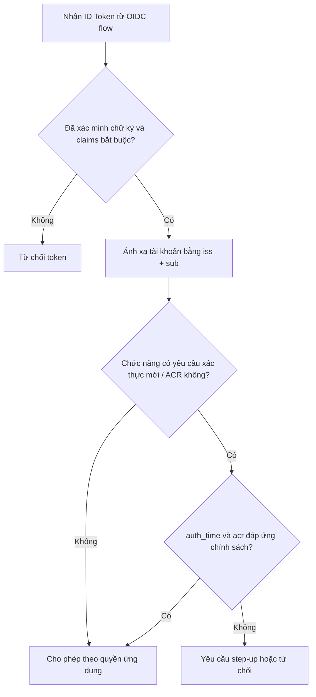

# 3.4. Claims `sub`, `iss`, `aud`, `exp`, `iat`, `auth_time`, `acr` và `amr`

## 1. Claims trong OIDC là gì và vì sao phải phân biệt?

**OpenID Connect (OIDC)** mở rộng OAuth 2.0 để ứng dụng client có thể xác thực người dùng thông qua một **OpenID Provider (OP)**. Khi đăng nhập bằng Authorization Code Flow, client đổi authorization code tại token endpoint và nhận **ID Token**. ID Token thường là JSON Web Token (JWT) được ký, chứa các *claims* — những cặp tên/giá trị nói về người phát hành token, người dùng, đối tượng nhận token, thời gian và bối cảnh xác thực.

Nhóm claims cần hiểu trong bài gồm tám trường:

- **Danh tính và phạm vi tin cậy:** `sub`, `iss`, `aud`.
- **Thời gian token và phiên xác thực:** `exp`, `iat`, `auth_time`.
- **Bối cảnh và phương thức xác thực:** `acr`, `amr`.

Đây là các claim của **ID Token** trong ngữ cảnh OIDC Client. Một access token dạng JWT cũng có thể có những tên claim tương tự, nhưng các trường đó phục vụ mô hình tin cậy của resource server và **không tự biến access token thành ID Token**. Client phải dùng ID Token đúng mục đích: xác minh kết quả đăng nhập của người dùng tại một OP đã cấu hình.

Ví dụ xuyên suốt:

- Spring Boot application: `https://app.example.com`
- OpenID Provider: `https://id.example.com`
- Client ID: `spring-web-client`
- Người dùng có định danh nội bộ tại OP: `pairwise-839e4a`

Các tên miền, định danh và giá trị token sau đây chỉ phục vụ minh họa.

## 2. Nhìn tổng thể một ID Token

Giả sử OP phát hành JWT có payload đã giải mã như sau:

```json
{
  "iss": "https://id.example.com",
  "sub": "pairwise-839e4a",
  "aud": "spring-web-client",
  "exp": 1800003600,
  "iat": 1800000000,
  "auth_time": 1799999700,
  "acr": "urn:example:assurance:level2",
  "amr": ["pwd", "otp"],
  "nonce": "random-nonce-for-this-login"
}
```

Payload trên chỉ là **nội dung minh họa sau giải mã**, không phải ID Token có thể dùng thực tế. JWT thường có dạng `header.payload.signature` ở dạng Base64URL; việc giải mã payload chỉ giúp đọc dữ liệu. **Giải mã không đồng nghĩa với xác minh chữ ký hoặc xác thực token.** Spring Security cần xác minh token trước khi ứng dụng sử dụng các claim để xác thực hay ra quyết định bảo mật.

| Claim | Kiểu giá trị trong OIDC | Bắt buộc trong ID Token? | Ý nghĩa chính |
|---|---|---|---|
| `iss` | Chuỗi URL của issuer | **Có** | OpenID Provider nào phát hành token. |
| `sub` | Chuỗi định danh chủ thể | **Có** | Người dùng nào được OP mô tả. |
| `aud` | Chuỗi hoặc mảng chuỗi | **Có** | ID Token được phát hành cho client nào. |
| `exp` | Số *NumericDate* | **Có** | Hạn cuối token còn được chấp nhận. |
| `iat` | Số *NumericDate* | **Có** | Thời điểm ID Token được phát hành. |
| `auth_time` | Số *NumericDate* | Tùy điều kiện | Thời điểm người dùng thật sự được OP xác thực. |
| `acr` | Chuỗi | Tùy chọn | Lớp/bối cảnh bảo đảm xác thực đã đạt. |
| `amr` | Mảng chuỗi | Tùy chọn | Các phương thức xác thực đã sử dụng. |

Về `auth_time`: đây là claim tùy chọn nói chung, nhưng **phải được trả về theo quy tắc OIDC** khi authorization request có tham số `max_age` hoặc khi client yêu cầu `auth_time` làm Essential Claim bằng `claims` request. Các claim `acr` và `amr` không mặc nhiên xuất hiện chỉ vì ứng dụng đã đăng nhập bằng OIDC.

Để dễ hiểu, hãy đặt ba câu hỏi khác nhau:

1. **Ai và do ai xác nhận?** → `iss` + `sub`.
2. **Token này dành cho ai và còn hiệu lực không?** → `aud` + `exp` + `iat`.
3. **Người dùng xác thực lúc nào, trong ngữ cảnh nào, bằng cách gì?** → `auth_time` + `acr` + `amr`.

## 3. `sub` — Subject: định danh người dùng tại issuer

### 3.1. Vai trò của `sub`

`sub` (subject) là định danh mà OP gán cho một End-User. Trong phạm vi một issuer, nó phải ổn định và không được tái gán cho người dùng khác theo cam kết của OIDC.

Ví dụ:

```json
{
  "iss": "https://id.example.com",
  "sub": "pairwise-839e4a"
}
```

Hai claim này trả lời: “Issuer `https://id.example.com` đã xác thực chủ thể `pairwise-839e4a`.”

**Cặp `(iss, sub)` mới là khóa định danh OIDC thích hợp để liên kết với tài khoản nội bộ.** Không nên chỉ lưu mỗi `sub` khi hệ thống cho phép đăng nhập từ nhiều OP, vì các issuer khác nhau có thể tạo cùng một chuỗi `sub` cho hai người hoàn toàn khác nhau.

Một bảng liên kết tài khoản có thể dùng:

```text
external_identity
----------------------------
provider_issuer  TEXT NOT NULL
subject          TEXT NOT NULL
local_user_id    UUID NOT NULL

UNIQUE (provider_issuer, subject)
```

Ví dụ ánh xạ:

| `provider_issuer` | `subject` | `local_user_id` |
|---|---|---|
| `https://id.example.com` | `pairwise-839e4a` | `u-1001` |
| `https://other-id.example.net` | `pairwise-839e4a` | `u-2099` |

Dù `subject` ở hai hàng giống hệt nhau, đây vẫn là hai danh tính ngoài khác nhau vì issuer khác nhau.

### 3.2. Không nhầm `sub` với email hoặc username

Email, số điện thoại và tên hiển thị có thể thay đổi, tái sử dụng, chưa được xác minh, hoặc không được cung cấp. Vì thế:

- Không dùng `email` thay cho `sub` để làm khóa tài khoản OIDC.
- Không giả định `sub` có định dạng email, số UUID hoặc mã người dùng có thể hiểu bằng mắt.
- Không suy ra vai trò, nhóm quyền, thông tin cá nhân hay mức độ tin cậy chỉ từ nội dung chuỗi `sub`.
- Không dùng `sub` từ một issuer lạ để ghép vào tài khoản đã liên kết với issuer khác.

### 3.3. Public subject và pairwise subject

OIDC hỗ trợ hai kiểu subject identifier phổ biến:

- **Public subject:** cùng một người dùng có thể nhận cùng giá trị `sub` giữa các client cùng OP, theo chính sách của OP.
- **Pairwise subject:** OP cấp các `sub` khác nhau cho cùng một người dùng theo *sector identifier*, giúp hạn chế việc nhiều client độc lập liên kết hành vi người dùng bằng cùng một mã.

Vì vậy **cùng một người đăng nhập qua hai client không nhất thiết có cùng `sub`**, nhất là khi OP dùng pairwise identifier. Muốn liên kết tài khoản giữa ứng dụng, phải dùng luồng và quyền được OP/kiến trúc hỗ trợ; không tự đối chiếu email hay đoán quy luật sinh `sub`.

## 4. `iss` — Issuer: xác định nhà phát hành đáng tin cậy

### 4.1. Ý nghĩa

`iss` là chuỗi định danh OpenID Provider phát hành ID Token. Trong triển khai OIDC thông thường, giá trị này là URL HTTPS như:

```json
{
  "iss": "https://id.example.com"
}
```

Đây là ranh giới tin cậy: client chỉ chấp nhận ID Token được phát hành bởi issuer đã được **cấu hình và tin cậy** cho client registration đang xử lý. Một token có chữ ký hợp lệ dưới khóa của *một issuer khác* vẫn không phải token được phép sử dụng cho client registration hiện tại.

Ví dụ:

```text
Issuer client chờ đợi:  https://id.example.com
iss trong ID Token:     https://attacker-id.example.net
Kết quả:                từ chối, dù payload có sub giống người dùng đang có
```

Không xác định issuer đáng tin cậy bằng cách đọc `iss` từ token chưa xác minh rồi tùy ý tải khóa theo URL trong đó. Đây là nền tảng để tránh **issuer confusion** và chấp nhận token do một OP ngoài danh sách tin cậy phát hành.

### 4.2. Quan hệ giữa issuer và OIDC Discovery

Một OpenID Provider có thể công bố metadata qua OIDC Discovery. Trong Spring Boot, cấu hình ví dụ:

```yaml
spring:
  security:
    oauth2:
      client:
        provider:
          company-idp:
            issuer-uri: https://id.example.com
```

Spring Security dùng issuer này để khám phá metadata/endpoint và thông tin phục vụ việc xác thực token theo các cấu hình, phiên bản và chính sách liên quan. Claim `iss` trong ID Token cần **khớp chính xác** issuer được kỳ vọng từ metadata/cấu hình. Không so sánh bằng cách “cùng domain là đủ”, bỏ bớt path hoặc tự nối URL rồi chấp nhận gần giống.

Ví dụ `https://id.example.com/tenant-a` và `https://id.example.com/tenant-b` có thể đại diện cho hai issuer riêng; chúng không tự động tương đương dù cùng host.

## 5. `aud` — Audience: ID Token được phát hành cho client nào?

### 5.1. Tại sao `aud` quan trọng?

`aud` (audience) nêu đối tượng nhận ID Token. Với OIDC ID Token, claim này **phải chứa `client_id` của Relying Party** đang xác thực.

Ví dụ một audience:

```json
{
  "aud": "spring-web-client"
}
```

Ví dụ nhiều audience:

```json
{
  "aud": ["spring-web-client", "another-registered-client"],
  "azp": "spring-web-client"
}
```

Chuẩn cho phép `aud` có kiểu JSON **string** hoặc **array of strings**. Khi có nhiều audience, client cần xử lý thêm claim **authorized party** `azp` theo quy tắc OIDC và xác minh client hiện tại là bên được phép, nếu `azp` hiện diện. Mẫu thứ hai chỉ minh họa cú pháp; việc OP cho phép ID Token có nhiều audience phụ thuộc chính sách.

Một token cho client A không thể được client B chấp nhận chỉ vì token có chữ ký hợp lệ:

```text
Client hiện tại: spring-web-client
aud trong token: mobile-client
Kết quả:        từ chối ID Token
```

### 5.2. Phân biệt `aud` của ID Token và access token

Hai loại token có thể cùng dùng tên `aud` nhưng đối tượng nhận khác nhau:

| Token | Bên cần kiểm tra `aud` | `aud` thường biểu thị |
|---|---|---|
| **ID Token** | OAuth 2.0/OIDC Client, tức Relying Party | Client ID được phép sử dụng kết quả xác thực. |
| **Access token dạng JWT** | Resource Server/API | API/tài nguyên được phép tiếp nhận token, theo cấu hình của hệ thống. |

Không gửi ID Token đến API thay cho access token. Nếu một API dùng `aud` của ID Token để xác thực một yêu cầu Bearer, thiết kế đó đã nhầm lẫn mục đích token và có nguy cơ **token substitution**.

## 6. `exp`, `iat`, `auth_time` — ba thời điểm cần phân biệt

Ba claim này đều có dạng **NumericDate**: số giây kể từ mốc Unix epoch `1970-01-01T00:00:00Z` (không phải milliseconds). Chúng mô tả **ba sự kiện khác nhau**, nên không được dùng thay thế cho nhau.

| Claim | Diễn giải | Câu hỏi trả lời |
|---|---|---|
| `auth_time` | Thời điểm OP thực sự xác thực người dùng | “Người dùng xác thực gần đây nhất lúc nào?” |
| `iat` | Thời điểm OP phát hành ID Token | “Token này được tạo lúc nào?” |
| `exp` | Mốc hết hiệu lực của ID Token | “Sau thời điểm nào token không còn được chấp nhận?” |

### 6.1. `exp` — Expiration Time

Ví dụ:

```json
{
  "exp": 1800003600
}
```

Client phải từ chối ID Token đã hết hạn. Về ý nghĩa, token chỉ còn hiệu lực nếu thời gian hiện tại chưa vượt quá mốc `exp`, với độ lệch đồng hồ nhỏ được phép theo chính sách kiểm tra token. Thời gian sống ID Token không nhất thiết bằng thời gian sống:

- Access token;
- Refresh token;
- Cookie phiên của ứng dụng;
- Phiên SSO tại OP.

**ID Token hết hạn không có nghĩa mọi phiên browser buộc phải lập tức bị xóa**, cũng như phiên ứng dụng còn tồn tại không có nghĩa ID Token cũ vẫn có thể xác thực lại cho một yêu cầu mới. Quy tắc session và token validation phải được thiết kế riêng.

### 6.2. `iat` — Issued At

Ví dụ:

```json
{
  "iat": 1800000000
}
```

`iat` ghi nhận thời điểm token được phát hành. Nó giúp nhận biết tuổi của token, và client có thể áp chính sách bổ sung về tuổi tối đa khi phù hợp. Nó **không chứng minh người dùng vừa nhập lại mật khẩu hoặc thực hiện MFA** tại thời điểm đó.

Giả sử người dùng đã có SSO session tại OP. Khi ứng dụng mới yêu cầu ID Token, OP có thể phát token có `iat` rất mới dù không có thao tác đăng nhập lại. Không dùng `iat` để kết luận rằng yêu cầu nhạy cảm đã có **fresh authentication**.

### 6.3. `auth_time` — Authentication Time

Ví dụ:

```json
{
  "auth_time": 1799999700
}
```

`auth_time` nêu thời điểm OP xác thực người dùng. Nó thường sớm hơn hoặc bằng `iat`; chẳng hạn người dùng đăng nhập vào OP trước, sau đó dùng phiên SSO sẵn có để nhận ID Token.

Trong payload minh họa ban đầu:

```text
1799999700  ── người dùng xác thực tại OP (auth_time)
1800000000  ── OP phát hành ID Token (iat)
1800003600  ── ID Token hết hạn (exp)
          | 5 phút |                 | 60 phút |
```

Độ chênh `iat - auth_time = 300` giây trong ví dụ là khoảng thời gian giữa sự kiện xác thực người dùng và lúc token mới được phát hành, **không phải** thời gian xử lý authorization code.

Một ví dụ thường gặp trong nghiệp vụ: người dùng đăng nhập từ sáng và đến chiều mới chuyển tiền. Dù ứng dụng vừa nhận ID Token mới có `iat` gần hiện tại, hệ thống vẫn cần kiểm tra `auth_time` để biết phiên đăng nhập có đủ mới cho tác vụ nhạy cảm hay không.

### 6.4. Khi nào bắt buộc cần `auth_time`?

Trong OIDC, client có thể gửi `max_age` để yêu cầu giới hạn thời gian từ lần người dùng chủ động được xác thực:

```http
GET /authorize?response_type=code
    &client_id=spring-web-client
    &scope=openid
    &redirect_uri=https%3A%2F%2Fapp.example.com%2Flogin%2Foauth2%2Fcode%2Fdemo
    &state=STATE_VALUE
    &nonce=NONCE_VALUE
    &max_age=300 HTTP/1.1
Host: id.example.com
```

Đây là biểu diễn xuống dòng để dễ đọc; URL gửi thực tế là một dòng. `max_age=300` yêu cầu lần xác thực chủ động của người dùng không cũ quá **300 giây** theo cách xử lý OIDC của OP. Khi yêu cầu có `max_age`, OP phải đưa `auth_time` vào ID Token để client kiểm tra. `max_age=0` yêu cầu người dùng được xác thực lại.

Ứng dụng phải kiểm tra giá trị trả về, thay vì giả định rằng OP đã đáp ứng chỉ vì nó nhận được ID Token mới. Minh họa điều kiện nghiệp vụ:

```text
auth_time có mặt?
    Không  -> không đủ bằng chứng xác thực mới
    Có     -> now - auth_time <= max_age + clock_skew?
                Có    -> đạt điều kiện thời gian
                Không -> cần xác thực lại / từ chối hành động nhạy cảm
```

Trong ví dụ, `clock_skew` là độ lệch đồng hồ nhỏ do hệ thống quy định, không phải cách để nới rộng tùy tiện yêu cầu bảo mật. Đồng hồ server, OP và resource server nên được đồng bộ.

### 6.5. Đổi số giây Unix sang thời gian trong Java

Với ứng dụng Java, đừng dùng `Instant.ofEpochMilli(...)` khi giá trị claim là NumericDate giây:

```java
import java.time.Instant;

long issuedAtSeconds = 1800000000L;

Instant issuedAt = Instant.ofEpochSecond(issuedAtSeconds);
// Đúng: OIDC NumericDate là số giây kể từ Unix epoch.
```

Nếu gọi `ofEpochMilli` thay cho `ofEpochSecond`, giá trị thời gian sẽ sai lớn, dẫn tới các quyết định sai về token expiry hoặc authentication freshness.

Trong Spring Security, ID Token accessor thường đã cung cấp các giá trị thời gian dưới dạng `Instant`, nên ưu tiên API này khi khả dụng thay vì tự diễn giải chuỗi JSON.

## 7. `acr` — Authentication Context Class Reference

### 7.1. `acr` nói lên điều gì?

`acr` là chuỗi định danh **lớp bối cảnh xác thực** mà OP khẳng định đã đạt trong lần xác thực người dùng. “Bối cảnh” có thể phản ánh một chính sách mức bảo đảm xác thực, yêu cầu kiểm soát hoặc bộ tiêu chí do tổ chức/OP định nghĩa.

Ví dụ:

```json
{
  "acr": "urn:example:assurance:level2"
}
```

Điểm quan trọng: OIDC **không mặc định** quy định rằng mọi giá trị `acr` trên thế giới đều có cùng ý nghĩa. Chuỗi `urn:example:assurance:level2` chỉ là ví dụ; để hiểu “level2” nghĩa là gì, client phải có thỏa thuận hoặc tài liệu chính thức với OP.

Không nên tự diễn giải:

- `acr = "2"` nghĩa là “đã MFA” ở mọi IdP;
- `acr` có số lớn hơn thì luôn an toàn hơn;
- Bất kỳ `acr` không rỗng đều đáp ứng yêu cầu tác vụ nhạy cảm.

### 7.2. Yêu cầu ACR trong authorization request

Client có thể đề nghị các giá trị `acr` qua `acr_values`:

```http
GET /authorize?response_type=code
    &client_id=spring-web-client
    &scope=openid
    &redirect_uri=https%3A%2F%2Fapp.example.com%2Flogin%2Foauth2%2Fcode%2Fdemo
    &state=STATE_VALUE
    &acr_values=urn%3Aexample%3Aassurance%3Alevel2 HTTP/1.1
Host: id.example.com
```

`acr_values` thể hiện **ưu tiên/yêu cầu mong muốn theo giao thức**. Việc OP có hỗ trợ, có đạt mức đó và có trả `acr` đúng mong đợi hay không là vấn đề phải xác nhận ở phản hồi. **Không xem việc đã gửi `acr_values` là bằng chứng bảo đảm xác thực.**

OIDC còn có cơ chế `claims` request, cho phép đánh dấu `acr` là *Essential Claim* và nêu các giá trị mong muốn, nếu OP hỗ trợ phần mở rộng này:

```json
{
  "id_token": {
    "acr": {
      "essential": true,
      "values": ["urn:example:assurance:level2"]
    }
  }
}
```

Đây là nội dung JSON của tham số `claims`, cần được mã hóa khi đưa vào authorization request hoặc truyền bằng cơ chế request object được hỗ trợ. Client vẫn phải **kiểm tra claim trong ID Token đã xác minh** và áp chính sách từ chối khi giá trị không đáp ứng yêu cầu. Chi tiết hỗ trợ `claims`, `acr_values` và step-up tùy provider.

## 8. `amr` — Authentication Methods References

### 8.1. `amr` mô tả cách OP xác thực người dùng

`amr` là **mảng chuỗi** chứa các tham chiếu phương thức xác thực đã dùng trong phiên xác thực của người dùng. Ví dụ:

```json
{
  "amr": ["pwd", "otp"]
}
```

Các mã thường gặp trong một số hệ thống gồm:

| Mã ví dụ | Ý nghĩa thường gặp |
|---|---|
| `pwd` | Xác thực bằng mật khẩu. |
| `otp` | Dùng mã mật khẩu một lần. |
| `mfa` | Nhãn thể hiện xác thực nhiều yếu tố theo quy ước mà OP sử dụng. |
| `hwk` | Sử dụng khóa mật mã dựa trên phần cứng. |
| `swk` | Sử dụng khóa mật mã dựa trên phần mềm. |
| `fpt` | Sử dụng vân tay, khi OP công bố mã đó. |

Danh sách trên minh họa các mã có thể gặp, **không phải cam kết mọi OP đều trả đúng các mã này**. Một OP có thể dùng mã theo registry hoặc giá trị do mình định nghĩa, có thể trả `amr` khác nhau cho những quy trình đăng nhập tương tự, hoặc không trả `amr` trong ID Token.

### 8.2. Không đánh đồng `amr` với `acr`

Ví dụ:

```json
{
  "acr": "urn:example:assurance:level2",
  "amr": ["pwd", "otp"]
}
```

Trong cùng một lần xác thực:

- `amr` trả lời: “OP cho biết đã dùng **những phương thức nào**?”
- `acr` trả lời: “OP cho biết phiên xác thực đáp ứng **lớp/chính sách bối cảnh nào**?”

Hai claim bổ sung thông tin cho nhau, nhưng không suy ra được claim này từ claim kia một cách tổng quát. Chẳng hạn nhìn thấy `["pwd", "otp"]` **chưa đủ** để tự khẳng định quy trình đáp ứng mức bảo đảm cụ thể về chống phishing, thiết bị bảo mật, thời gian xác thực hay yếu tố độc lập.

Một ứng dụng có thể kiểm tra `amr` nếu đã có hợp đồng ngữ nghĩa chặt chẽ với OP. Tuy nhiên, đối với chính sách yêu cầu mức bảo đảm xác thực, `acr` do OP định nghĩa và cam kết thường là dữ liệu thích hợp hơn; cần kết hợp `auth_time` nếu tác vụ yêu cầu xác thực mới.

### 8.3. Cả `acr` và `amr` đều có thể vắng mặt

Một ID Token hợp lệ có thể chỉ mang các claim bắt buộc và một số claim khác:

```json
{
  "iss": "https://id.example.com",
  "sub": "pairwise-839e4a",
  "aud": "spring-web-client",
  "exp": 1800003600,
  "iat": 1800000000
}
```

Đừng viết logic kiểu “nếu không có `amr` thì chắc chắn người dùng đăng nhập một yếu tố” hoặc “không có `acr` nghĩa là không đăng nhập thành công”. Việc thiếu claim tùy chọn **không tự làm ID Token vô hiệu** trong mọi trường hợp; nó có nghĩa ứng dụng chưa có bằng chứng cần thiết để ra quyết định phụ thuộc vào claim đó.

Nếu chức năng có yêu cầu bắt buộc về `acr` hoặc `auth_time`, ứng dụng phải chủ động yêu cầu theo cơ chế provider hỗ trợ, kiểm tra ID Token và **từ chối hoặc khởi tạo xác thực bổ sung** khi thông tin không đáp ứng.

## 9. Phân tích đầy đủ một ví dụ đăng nhập

Giả sử một ứng dụng xử lý thanh toán nhận ID Token có các claim sau:

```json
{
  "iss": "https://id.example.com",
  "sub": "customer-5821",
  "aud": "spring-web-client",
  "exp": 1800003600,
  "iat": 1800000000,
  "auth_time": 1799999700,
  "acr": "urn:example:assurance:level2",
  "amr": ["pwd", "otp"]
}
```

Để dùng token này, client phải trải qua các lớp kiểm tra:

1. **Nguồn phát hành:** `iss` có khớp issuer mà client đã cấu hình cho registration `spring-web-client` không?
2. **Chữ ký và tính toàn vẹn:** token có được xác minh qua thuật toán, khóa tin cậy và metadata phù hợp không? Chỉ parse JWT là chưa đủ.
3. **Đối tượng nhận:** `aud` có chứa đúng `client_id` không; có ràng buộc `azp` cần kiểm tra khi nhiều audience hay không?
4. **Hiệu lực thời gian:** `exp` còn hiệu lực không, `iat` có hợp lý theo chính sách; có xử lý clock skew đúng mức không?
5. **Liên kết phiên đăng nhập:** authorization response có khớp `state` với yêu cầu trước đó; `nonce` trong ID Token có khớp khi đã sử dụng nonce không?
6. **Định danh người dùng:** lấy khóa `(iss, sub)` để tra cứu tài khoản nội bộ đã được liên kết.
7. **Chính sách tác vụ:** nếu thao tác yêu cầu xác thực trong 5 phút gần nhất và ACR `level2`, phải kiểm tra `auth_time` và `acr` theo hợp đồng với OP; có `amr` chỉ giúp bổ sung giải thích.

**Kiểm tra giao thức và chính sách nghiệp vụ là hai tầng khác nhau.** Một ID Token có thể hoàn toàn hợp lệ để đăng nhập thông thường nhưng chưa đủ điều kiện cho thao tác nhạy cảm. Ví dụ, nó hết hạn sau 60 phút nhưng `auth_time` đã hơn 10 phút; với yêu cầu step-up trong 5 phút, ứng dụng phải yêu cầu xác thực mới hoặc từ chối giao dịch.

Sơ đồ quyết định:



Sơ đồ không bỏ qua việc kiểm tra quyền ứng dụng sau đăng nhập: dù token hợp lệ và ACR đạt yêu cầu, người dùng vẫn cần có quyền thực hiện hành động cụ thể.

## 10. Cách đọc claims trong Spring Security OIDC Client

### 10.1. Cấu hình tối thiểu cho đăng nhập OIDC

Ví dụ dùng Spring Boot với Spring Security cho một web application kiểu Servlet.

Gradle:

```groovy
dependencies {
    implementation 'org.springframework.boot:spring-boot-starter-web'
    implementation 'org.springframework.boot:spring-boot-starter-security'
    implementation 'org.springframework.boot:spring-boot-starter-oauth2-client'
}
```

`application.yml`:

```yaml
spring:
  security:
    oauth2:
      client:
        registration:
          demo:
            provider: demo-provider
            client-id: ${OIDC_CLIENT_ID}
            client-secret: ${OIDC_CLIENT_SECRET}
            authorization-grant-type: authorization_code
            redirect-uri: "{baseUrl}/login/oauth2/code/{registrationId}"
            scope:
              - openid
              - profile
        provider:
          demo-provider:
            issuer-uri: https://id.example.com
```

Với cấu hình này, `demo` là registration ID. Cần đăng ký trước client với OP và đặt chính xác redirect URI cho môi trường chạy. Mẫu sử dụng `client-secret` cho confidential web client; không đưa secret vào trình duyệt. Scope `openid` yêu cầu OIDC, còn `profile` là scope bổ sung tùy provider.

Một `SecurityFilterChain` cơ bản:

```java
import org.springframework.context.annotation.Bean;
import org.springframework.context.annotation.Configuration;
import org.springframework.security.config.Customizer;
import org.springframework.security.config.annotation.web.builders.HttpSecurity;
import org.springframework.security.web.SecurityFilterChain;

@Configuration
class SecurityConfig {

    @Bean
    SecurityFilterChain securityFilterChain(HttpSecurity http) throws Exception {
        http
            .authorizeHttpRequests(authorize -> authorize
                .requestMatchers("/", "/public/**").permitAll()
                .anyRequest().authenticated()
            )
            .oauth2Login(Customizer.withDefaults());
        return http.build();
    }
}
```

Spring Security thực hiện luồng redirect, code exchange và OIDC authentication qua các filter/provider tương ứng. Với OIDC login thành công, controller có thể nhận một `OidcUser`. Các API và tùy chỉnh cụ thể có thể khác theo phiên bản Spring Security, nhưng các claim OIDC giữ cùng ý nghĩa giao thức.

### 10.2. Truy xuất ID Token gốc đã được xác minh

Ví dụ endpoint chỉ trả ra một tập nhỏ thông tin để minh họa, không trả token nguyên văn:

```java
import java.time.Instant;
import java.util.LinkedHashMap;
import java.util.Map;

import org.springframework.security.core.annotation.AuthenticationPrincipal;
import org.springframework.security.oauth2.core.oidc.OidcIdToken;
import org.springframework.security.oauth2.core.oidc.user.OidcUser;
import org.springframework.web.bind.annotation.GetMapping;
import org.springframework.web.bind.annotation.RestController;

@RestController
class IdentityController {

    @GetMapping("/me/identity")
    Map<String, Object> identity(@AuthenticationPrincipal OidcUser user) {
        OidcIdToken idToken = user.getIdToken();

        Map<String, Object> result = new LinkedHashMap<>();
        result.put("issuer", idToken.getClaims().get("iss"));
        result.put("subject", user.getSubject());
        result.put("audience", idToken.getClaims().get("aud"));
        result.put("issuedAt", idToken.getIssuedAt());
        result.put("expiresAt", idToken.getExpiresAt());
        result.put("authenticatedAt", idToken.getAuthenticationTime());
        result.put("acr", idToken.getAuthenticationContextClass());
        result.put("amr", idToken.getAuthenticationMethods());

        return result;
    }
}
```

Điểm cần lưu ý:

- `user.getIdToken()` cung cấp ID Token gắn với xác thực OIDC; `getClaims()` cho phép đọc các claim trong token.
- `user.getSubject()` lấy subject của người dùng. Khi lưu liên kết danh tính lâu dài, phải kết hợp subject với issuer đã tin cậy.
- `getIssuedAt()` và `getExpiresAt()` trả về `Instant` để Java xử lý thời gian, thay vì tự chuyển NumericDate thủ công.
- `getAuthenticationTime()`, `getAuthenticationContextClass()`, `getAuthenticationMethods()` cho phép đọc `auth_time`, `acr`, `amr` nếu OP cung cấp; code gọi nên chấp nhận giá trị tùy chọn có thể vắng mặt.
- `LinkedHashMap` có thể chứa giá trị `null`, phù hợp với các claim tùy chọn; `Map.of(...)` của Java không cho phép value `null`.

Endpoint chỉ có ý nghĩa khi request được xác thực theo OIDC và principal thực sự là `OidcUser`. Không ép kiểu này cho luồng OAuth 2.0 không có `openid`.

Khi dùng thực tế, chỉ trả các trường ứng dụng thật sự cần. Đừng mở công khai endpoint xuất toàn bộ ID Token/JWT hoặc dump mọi claim vào log: một số claim có thể chứa thông tin cá nhân hoặc dữ liệu nhạy cảm.

### 10.3. Vì sao nên đọc `user.getIdToken()` thay vì mọi attributes?

Spring Security có thể tổng hợp thông tin người dùng từ ID Token, UserInfo Endpoint và các nguồn khác theo cấu hình. Khi câu hỏi cụ thể là **“OP đã phát hành `acr` hoặc `auth_time` nào trong ID Token này?”**, hãy đọc từ `user.getIdToken()` để giữ rõ nguồn dữ liệu.

`user.getAttributes()` hoặc `user.getClaims()` có thể cung cấp tập dữ liệu tiện dụng cho hiển thị hồ sơ nhưng không luôn thể hiện chính xác ranh giới nguồn ID Token và UserInfo trong mọi cấu hình. Chúng không thay thế bước xác minh ID Token.

Nếu gọi UserInfo Endpoint, `sub` từ UserInfo cũng phải được kiểm tra khớp `sub` của ID Token theo OIDC, không tự ghép thông tin từ chủ thể khác vào phiên hiện tại.

### 10.4. Ví dụ kiểm tra xác thực gần đây và ACR trước thao tác nhạy cảm

Giả sử chức năng chỉ cho phép người dùng đã được xác thực trong vòng 5 phút và đạt ACR được OP định nghĩa là `urn:example:assurance:level2`:

```java
import java.time.Duration;
import java.time.Instant;

import org.springframework.security.oauth2.core.oidc.OidcIdToken;
import org.springframework.security.oauth2.core.oidc.user.OidcUser;

final class AuthenticationAssurance {

    private static final String REQUIRED_ACR =
            "urn:example:assurance:level2";

    static boolean allowsSensitiveAction(OidcUser user, Instant now) {
        OidcIdToken idToken = user.getIdToken();

        Instant authTime = idToken.getAuthenticationTime();
        String acr = idToken.getAuthenticationContextClass();

        if (authTime == null || !REQUIRED_ACR.equals(acr)) {
            return false;
        }

        Duration age = Duration.between(authTime, now);

        // Mốc xác thực âm quá xa cũng cần từ chối.
        Duration allowedClockSkew = Duration.ofSeconds(60);

        return !age.isNegative()
                || (age.isNegative()
                    && age.abs().compareTo(allowedClockSkew) <= 0)
                ? age.compareTo(Duration.ofMinutes(5)) <= 0
                : false;
    }
}
```

Đoạn code thể hiện **kiểm tra chính sách bổ sung sau khi Spring Security đã xác thực ID Token**. Tham số `now` có thể lấy từ `Instant.now()` ở lớp service và dễ kiểm soát khi tích hợp. Mức ACR, thời hạn 5 phút và độ lệch đồng hồ 60 giây là chính sách minh họa; hệ thống thật phải định nghĩa chúng dựa trên yêu cầu nghiệp vụ và hợp đồng với OP.

Đoạn code không tự yêu cầu step-up. Khi trả `false`, ứng dụng phải từ chối thao tác hoặc mở lại OIDC flow với tham số phù hợp như `max_age=0` và/hoặc `acr_values`, sau đó kiểm tra ID Token mới. Nếu ứng dụng cần ngăn **đăng nhập ban đầu** khi ACR không đủ, phải tích hợp kiểm tra vào tiến trình xác thực/điều hướng đăng nhập, thay vì đợi đến controller.

Chỉ sử dụng `amr` như điều kiện kiểm tra khi hệ thống có định nghĩa rõ ràng và nhất quán về từng mã được OP phát hành. Ví dụ `amr` chứa `mfa` không thể mặc nhiên thay mọi chính sách ACR hoặc yêu cầu xác thực chống phishing.

## 11. Những quy tắc kiểm tra ID Token cần nhớ

OIDC Client phải xử lý ID Token trong một ngữ cảnh tin cậy đầy đủ, không kiểm tra từng claim một cách rời rạc.

### 11.1. Nhóm kiểm tra bắt buộc cho ID Token

Trong Authorization Code Flow thông thường, các kiểm tra thiết yếu gồm:

1. **Xác minh tính toàn vẹn và chữ ký/token protection:** sử dụng thuật toán được chấp nhận, khóa tin cậy tương ứng với OP và phương thức xử lý ID Token theo cấu hình.
2. **`iss`:** issuer phải đúng với issuer mà client đã đăng ký/tin cậy.
3. **`aud`:** phải chứa `client_id` của ứng dụng; xem thêm `azp` trong tình huống nhiều audience hoặc khi claim hiện diện.
4. **`exp`:** token chưa hết hạn, xét đến giới hạn clock skew nhỏ được phép.
5. **`iat`:** thời gian phát hành hợp lý theo mô hình tin cậy và chính sách về tuổi token của ứng dụng.
6. **`nonce`:** phải đối chiếu với nonce của authorization request khi client đã gửi nonce.
7. **`sub`:** sau khi ID Token hợp lệ, sử dụng cùng issuer để ánh xạ đúng danh tính nội bộ.

Tùy luồng, thuật toán ký, cách mã hóa ID Token và các trường khác như `azp`, `at_hash` hay `c_hash`, còn có điều kiện theo chuẩn OIDC. Ví dụ, `at_hash` không phải lúc nào cũng bắt buộc có trong ID Token của Authorization Code Flow thuần. Spring Security xử lý phần lớn việc xác thực ID Token cho luồng đăng nhập tiêu chuẩn; ứng dụng vẫn phải cấu hình đúng OP và tự thi hành các chính sách nghiệp vụ riêng.

### 11.2. Nhóm kiểm tra tùy chính sách nghiệp vụ

| Yêu cầu nghiệp vụ | Dữ liệu cần kiểm tra | Hành vi khi không đạt |
|---|---|---|
| Đăng nhập từ đúng tổ chức/OP | `iss` và cấu hình client | Từ chối ID Token từ issuer khác. |
| Liên kết đúng tài khoản nội bộ | `(iss, sub)` | Không tự ghép bằng email hoặc tên hiển thị. |
| Chỉ client hiện tại được dùng ID Token | `aud` và `azp` nếu có | Từ chối token cấp cho client khác. |
| Token còn hợp lệ | `exp` | Từ chối token hết hạn. |
| Token không quá cũ theo chính sách riêng | `iat` | Từ chối hoặc yêu cầu token mới tùy tình huống. |
| Người dùng vừa xác thực gần đây | `auth_time` và `max_age` mong muốn | Bắt đầu xác thực lại hoặc từ chối tác vụ. |
| Yêu cầu mức bảo đảm xác thực cụ thể | `acr` có ngữ nghĩa được OP cam kết | Yêu cầu step-up hoặc từ chối tác vụ. |
| Yêu cầu phương thức xác thực cụ thể theo hợp đồng | `amr` với ngữ nghĩa rõ ràng từ OP | Không suy diễn khi claim thiếu/không thống nhất. |

**Không biến việc kiểm tra `amr` hoặc `acr` thành cơ chế phân quyền tài nguyên duy nhất.** Người dùng có thể xác thực với ACR rất cao nhưng không có quyền truy cập hóa đơn của người khác. Xác thực danh tính, mức bảo đảm xác thực và phân quyền là ba quyết định liên quan nhưng khác nhau.

## 12. Những lỗi rất dễ gặp khi làm OIDC Client

### Lỗi 1: Dùng `sub` làm khóa toàn cục mà bỏ qua `iss`

Hai provider có thể cùng phát `sub = "12345"`. Nếu DB chỉ dùng `sub`, người dùng provider B có nguy cơ bị ghép nhầm tài khoản provider A.

**Cách xử lý:** dùng unique key hoặc phép ánh xạ trên cặp `(iss, sub)`.

### Lỗi 2: Chỉ kiểm tra chữ ký JWT, quên audience và issuer

Chữ ký hợp lệ chứng minh token được ký bởi khóa cụ thể; nó không tự chứng minh token dành cho **client hiện tại** hay do **OP đúng** cấp.

**Cách xử lý:** yêu cầu xác minh `iss`, `aud`, các ràng buộc liên quan và cấu hình khóa/thuật toán.

### Lỗi 3: Dùng `iat` để kết luận người dùng vừa xác thực lại

Một OP có thể cấp token mới dựa trên phiên SSO cũ. `iat` mới không nói lên thời điểm người dùng đã nhập mật khẩu hoặc hoàn thành MFA.

**Cách xử lý:** yêu cầu và kiểm tra `auth_time`, kết hợp `max_age` nếu chức năng cần fresh authentication.

### Lỗi 4: Nhầm NumericDate giây với milliseconds

JWT `exp` và `iat` dùng giây từ Unix epoch. Phép chuyển đổi sai đơn vị có thể biến token hợp lệ thành hết hạn hoặc ngược lại.

**Cách xử lý:** dùng API thời gian của framework hoặc `Instant.ofEpochSecond()`.

### Lỗi 5: Cho rằng `amr = ["pwd", "otp"]` luôn đáp ứng ACR cao

Một lần dùng mật khẩu và OTP không tự xác nhận việc xác thực tuân thủ mức bảo đảm theo chính sách nội bộ hoặc tiêu chuẩn chuyên ngành.

**Cách xử lý:** dùng định nghĩa ACR được OP cam kết và kiểm tra ACR thực tế, có xem xét thời điểm `auth_time`.

### Lỗi 6: Tin vào `acr_values` đã gửi mà không đọc ID Token trả về

Authorization Server có thể không hỗ trợ một giá trị ACR, áp chính sách khác hoặc trả kết quả không đáp ứng mức yêu cầu.

**Cách xử lý:** kiểm tra `acr` sau khi token đã được xác minh; chỉ cho phép thao tác nếu giá trị thực nhận đáp ứng chính sách.

### Lỗi 7: Dùng ID Token làm Bearer token gọi API

ID Token dành cho client, không mặc nhiên được API chấp nhận. Audience của ID Token cũng không đồng nghĩa với audience của access token.

**Cách xử lý:** gọi API bằng access token đúng scope/audience, để resource server kiểm tra quyền riêng.

### Lỗi 8: Tưởng token được decode là đã xác thực

Bất cứ ai có payload JWT đều có thể đọc nội dung claim bằng Base64URL. Không có chữ ký/token validation, các giá trị `sub`, `acr` và `amr` có thể bị giả mạo.

**Cách xử lý:** lấy claims từ thành phần xác thực OIDC của Spring Security sau khi hoàn thành xử lý đăng nhập, thay vì parse JWT tùy ý rồi tin dữ liệu.

### Lỗi 9: Không dự phòng claim tùy chọn bị thiếu

Không phải ID Token nào cũng có `acr`, `amr` hoặc `auth_time`. Nếu code mặc định những claim đó luôn có, ứng dụng dễ phát sinh lỗi hoặc vô tình bỏ qua yêu cầu bảo mật.

**Cách xử lý:** đọc null-safe; từ chối tác vụ đòi hỏi claim còn thiếu; yêu cầu OP cung cấp thông tin khi cần.

### Lỗi 10: Dùng tên claim giống nhau trong mọi token như nhau

Tên `iss`, `sub`, `aud` xuất hiện ở nhiều loại JWT. Nội dung có thể trông giống ID Token nhưng được cấp cho một API, client khác hoặc mục đích khác.

**Cách xử lý:** xác minh token theo loại và mục đích dự kiến, không dùng một bộ kiểm tra chung tùy ý cho ID Token và access token.

## 13. Tình huống vận dụng

### Tình huống A — Hai người dùng có cùng `sub` ở hai nhà cung cấp

Một tài khoản đăng nhập từ `https://id-a.example.com`, một tài khoản khác từ `https://id-b.example.com`. Cả hai token đều mang `sub = "742"`.

**Cách hiểu:** đây không phải bằng chứng cho thấy cùng một người. Khóa danh tính là `(iss, sub)`, nên hai cặp hoàn toàn khác nhau.

### Tình huống B — Token mới nhưng xác thực đã cũ

ID Token mới phát hành có `iat` cách đây một phút, `exp` còn 50 phút, nhưng `auth_time` cách đây 12 giờ.

**Cách hiểu:** token có thể vẫn hợp lệ để xác thực phiên OIDC thông thường. Nếu chuyển tiền yêu cầu xác thực trong 5 phút gần nhất, điều kiện chưa đạt; cần step-up và kiểm tra ID Token mới.

### Tình huống C — User đã nhập OTP nhưng ACR thấp

OP phát:

```json
{
  "acr": "urn:example:assurance:level1",
  "amr": ["pwd", "otp"]
}
```

**Cách hiểu:** client không được tự nâng thành level2 từ `amr`. Nếu tác vụ yêu cầu level2, phải so sánh claim `acr` với giá trị được OP định nghĩa và từ chối hoặc yêu cầu OP thực hiện bước xác thực phù hợp.

### Tình huống D — ID Token có `aud` của ứng dụng khác

Client hiện tại có ID `spring-web-client`, nhưng token có:

```json
{
  "aud": "another-client"
}
```

**Cách hiểu:** từ chối ID Token cho dù `iss` và `sub` giống với tài khoản đã biết và chữ ký hợp lệ.

### Tình huống E — Thiếu `auth_time`

Ứng dụng kiểm tra tác vụ cần xác thực gần đây, nhưng ID Token không có `auth_time`.

**Cách hiểu:** không thể chứng minh độ mới của xác thực bằng `iat`. Ứng dụng cần yêu cầu lại OIDC authentication với `max_age` hoặc cơ chế tương đương provider hỗ trợ, và từ chối tác vụ nếu vẫn không nhận được bằng chứng cần thiết.

## 14. Ghi nhớ nhóm claims theo mục đích

| Cần trả lời | Claim | Cách dùng đúng |
|---|---|---|
| Ai phát hành ID Token? | `iss` | Đối chiếu issuer đáng tin cậy đã cấu hình. |
| Người dùng là ai trong phạm vi OP? | `sub` | Liên kết tài khoản bằng cặp `(iss, sub)`. |
| Token cấp cho client nào? | `aud` | Xác minh chứa client ID, xét `azp` nếu liên quan. |
| ID Token còn hạn không? | `exp` | Từ chối token hết hạn. |
| ID Token được cấp lúc nào? | `iat` | Hiểu tuổi token, không dùng thay `auth_time`. |
| Người dùng được xác thực lúc nào? | `auth_time` | Đánh giá độ mới xác thực và yêu cầu `max_age`. |
| Mức/bối cảnh bảo đảm nào đã đạt? | `acr` | So với giá trị ACR được OP định nghĩa, có thỏa thuận. |
| OP nói đã dùng phương thức nào? | `amr` | Tham khảo danh sách phương thức theo quy ước provider. |

Khi làm **Spring Security OAuth 2.0 OIDC Client**, hãy đọc claims từ `OidcUser.getIdToken()` sau luồng OIDC thành công, để framework xử lý các kiểm tra giao thức cơ bản và ứng dụng tự kiểm tra các yêu cầu bảo đảm xác thực bổ sung. Trục nhận diện người dùng là **`iss + sub`**, trục tin cậy token là **`iss + aud + exp` cùng chữ ký**, còn trục độ mới/mức bảo đảm xác thực là **`auth_time + acr + amr` theo chính sách đã biết**.
