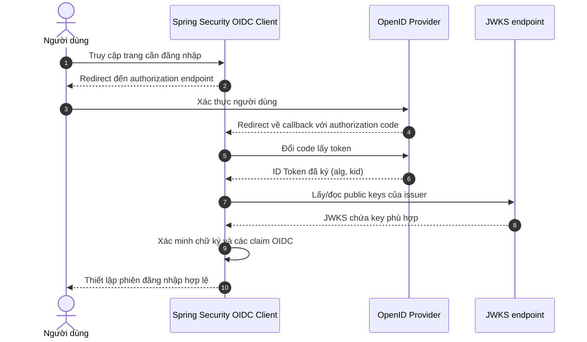

# 3.6. JWKS, chữ ký số và quá trình luân chuyển khóa

## 1. Vì sao OIDC cần JWKS và chữ ký số?

Khi người dùng đăng nhập bằng OpenID Connect (OIDC), ứng dụng (Relying Party/OIDC Client) nhận **ID Token** từ OpenID Provider (OP). Ứng dụng cần biết token này có thật sự do OP đáng tin cậy phát hành, nội dung có bị sửa đổi và token có dành cho chính ứng dụng hay không.

Một cách phổ biến là OP **ký số** ID Token bằng **private key**, còn ứng dụng xác thực chữ ký bằng **public key**. OP công bố các public key dưới dạng **JSON Web Key Set (JWKS)** tại một endpoint. Nhờ đó, ứng dụng có thể xác minh token mà không cần giữ private key và không phải nhận một public key cố định qua cấu hình thủ công.

Tuy nhiên, khóa ký có thể cần thay đổi theo định kỳ hoặc ngay khi xảy ra sự cố. Việc **luân chuyển khóa (key rotation)** ảnh hưởng trực tiếp đến thời điểm OP ký token bằng khóa mới, JWKS chứa những khóa nào và ứng dụng có nhận diện kịp khóa mới hay không.

Use case xuyên suốt:

- **OIDC Provider** tại `https://login.example.com/realms/company` ký ID Token cho người dùng đăng nhập.
- **Spring Security OIDC Client** tại `https://portal.example.com` nhận ID Token sau Authorization Code flow và xác thực chữ ký.
- OP đang dùng khóa `key-2026-01` và chuẩn bị chuyển sang `key-2026-02` mà không làm gián đoạn đăng nhập.

> **Điểm cốt lõi:** JWT/JWS mang **chữ ký**, JWKS công bố **public key để kiểm tra chữ ký**, còn key rotation là quy trình thay khóa có kiểm soát để token đang lưu hành tiếp tục được xác thực trong giai đoạn chuyển tiếp.

## 2. Phân biệt JWT, JWS, JWK, JWKS và `kid`

Các thuật ngữ này liên quan nhưng không đồng nghĩa:

| Thuật ngữ | Đầy đủ | Vai trò |
| --- | --- | --- |
| **JWT** | JSON Web Token | Định dạng token chứa các claim, thường được biểu diễn gọn dưới dạng các phần mã hóa Base64URL |
| **JWS** | JSON Web Signature | Cơ chế ký và xác minh dữ liệu, bao gồm JWT đã ký; bảo đảm tính toàn vẹn và nguồn gốc theo khóa đáng tin cậy |
| **JWK** | JSON Web Key | Cách biểu diễn một khóa mật mã bằng JSON |
| **JWKS** | JSON Web Key Set | Một JSON object có mảng `keys`, chứa một hoặc nhiều JWK |
| **`kid`** | Key ID | Định danh giúp trình xác thực chọn khóa phù hợp trong tập khóa |
| **`alg`** | Algorithm | Thuật toán ký/kiểm tra chữ ký, ví dụ `RS256` hoặc `ES256` |
| **`jwks_uri`** | JWKS endpoint URI | Địa chỉ OP công bố tập public key; thường lấy từ tài liệu OIDC Discovery |

Mối quan hệ:

```text
OIDC Provider
  ├─ Private key K1 ── ký số ──> ID Token (JWS/JWT)
  │                                └─ Header: kid = "key-2026-01"
  └─ JWKS endpoint
       └─ keys: [Public JWK của K1, Public JWK của K2, ...]
                                      │
                                      ▼
                            Spring Security OIDC Client
                            chọn JWK theo kid + alg
                            và xác minh chữ ký
```

**JWT không đồng nghĩa với JWT có chữ ký.** Một JWT có thể được ký bằng JWS hoặc mã hóa bằng JWE tùy ngữ cảnh. Khi nói về ID Token dạng JWT có chữ ký bất đối xứng, thường xét JWS ở dạng **Compact Serialization** gồm ba phần. JWS **không mã hóa** nội dung: ai có token cũng có thể giải mã Base64URL phần header và payload để đọc claim.

### 2.1. Cấu trúc ID Token đã ký

Một JWS compact có dạng:

```text
BASE64URL(Protected Header)
.
BASE64URL(Payload)
.
BASE64URL(Signature)
```

Header minh họa:

```json
{
  "alg": "RS256",
  "kid": "key-2026-01",
  "typ": "JWT"
}
```

Payload của ID Token minh họa:

```json
{
  "iss": "https://login.example.com/realms/company",
  "sub": "user-4821",
  "aud": "web-portal",
  "iat": 1794700000,
  "exp": 1794700600,
  "nonce": "nonce-da-luu-trong-phien-dang-nhap"
}
```

Các giá trị trên chỉ để mô tả cấu trúc, không phải ID Token thật. Tùy flow và yêu cầu của OIDC, token có thể có thêm `auth_time`, `azp`, `at_hash` và những claim khác. `typ` không phải trường bắt buộc với mọi ID Token.

Với `RS256`:

1. OP tạo header và payload, mã hóa Base64URL rồi nối bằng dấu chấm.
2. OP tạo chữ ký RSA/SHA-256 trên chuỗi `BASE64URL(header).BASE64URL(payload)` bằng **private key**.
3. OIDC Client đọc `kid` trong header để tìm public key tương ứng và dùng thuật toán được tin cậy để kiểm tra chữ ký.
4. Sau khi chữ ký hợp lệ, Client còn phải **xác thực các claim OIDC** như issuer, audience, thời hạn và nonce.

Nếu sửa một ký tự trong header/payload đã ký thì chữ ký cũ không còn hợp lệ. Ngược lại, một chữ ký hợp lệ **chưa đủ** để cho phép đăng nhập: token có thể đã hết hạn, thuộc issuer khác hoặc được phát hành cho ứng dụng khác.

### 2.2. Chữ ký bất đối xứng và đối xứng

| Kiểu ký | Ví dụ | Bên ký | Bên kiểm tra | Liên hệ JWKS |
| --- | --- | --- | --- | --- |
| Bất đối xứng RSA | `RS256`, `PS256` | Private key | Public key | Phổ biến với JWKS public |
| Bất đối xứng EC | `ES256` | Private key | Public key | Public JWK dùng `kty: EC` |
| EdDSA (nếu được hỗ trợ) | `EdDSA` | Private key | Public key | Phụ thuộc thư viện và OP |
| Đối xứng HMAC | `HS256` | Shared secret | Cùng shared secret | Không công bố bí mật dùng ký token trong JWKS public |

OIDC Provider thường phát hành ID Token bằng thuật toán **bất đối xứng** để nhiều client có thể xác minh mà không biết private key. Trong OIDC, client cũng có thể sử dụng thuật toán HMAC theo cấu hình và quy định tương ứng; khi ấy không có mô hình public JWKS giống RSA/EC.

**Không tin thuật toán chỉ vì header ghi `alg`.** Client phải kiểm tra thuật toán nằm trong danh sách được tin cậy cho issuer/client, từ chối `alg=none` khi không được cho phép và tránh nhầm lẫn giữa khóa đối xứng với bất đối xứng.

## 3. JWK và JWKS chứa dữ liệu gì?

### 3.1. Ví dụ tập public key

Phản hồi minh họa từ một JWKS endpoint:

```json
{
  "keys": [
    {
      "kty": "RSA",
      "use": "sig",
      "kid": "key-2026-01",
      "alg": "RS256",
      "n": "<modulus-base64url-cua-public-key-1>",
      "e": "AQAB"
    },
    {
      "kty": "RSA",
      "use": "sig",
      "kid": "key-2026-02",
      "alg": "RS256",
      "n": "<modulus-base64url-cua-public-key-2>",
      "e": "AQAB"
    }
  ]
}
```

Ví dụ cố ý dùng placeholder cho `n`; các chuỗi này **không phải JWK hợp lệ để chạy mã**. JWKS thật sẽ chứa phần `n` được mã hóa Base64URL và tương ứng chính xác với khóa thực.

Các thuộc tính thường gặp:

| Thuộc tính | Ý nghĩa |
| --- | --- |
| `keys` | Mảng các khóa trong JWKS; thường chứa cả khóa đang dùng và khóa phục vụ giai đoạn chuyển tiếp |
| `kty` | Kiểu khóa: `RSA`, `EC`, `OKP`... |
| `kid` | Định danh khóa dùng để chọn khóa khớp với header token |
| `use` | Mục đích sử dụng: `sig` cho chữ ký, `enc` cho mã hóa |
| `key_ops` | Các thao tác mật mã được phép, khi có khai báo |
| `alg` | Thuật toán dự kiến gắn với khóa; không thay thế chính sách thuật toán của client |
| `n` và `e` | Modulus và exponent của **RSA public key** |
| `crv`, `x`, `y` | Thông số public key khi dùng đường cong elliptic, theo kiểu khóa |
| `x5c`, `x5t` | Thông tin chứng chỉ X.509/chỉ dấu chứng chỉ tùy chọn trong một số cấu hình |

**JWKS public tuyệt đối không được chứa private key.** Với RSA, các tham số private như `d`, `p`, `q`, `dp`, `dq`, `qi` phải được giữ riêng; private key nên đặt trong KMS/HSM hoặc hệ thống bảo vệ bí mật tương đương.

### 3.2. Vai trò chính xác của `kid`

Giả sử OP công bố hai JWK có `kid` lần lượt là `key-2026-01` và `key-2026-02`. Khi ID Token có header:

```json
{ "alg": "RS256", "kid": "key-2026-02" }
```

Client tìm khóa có `kid=key-2026-02` và tương thích với thuật toán, kiểu khóa và mục đích sử dụng đã định. Sau đó client kiểm tra chữ ký.

Cần nhớ:

- `kid` là **gợi ý định tuyến tới khóa**, bản thân chuỗi `kid` không chứng minh token đáng tin cậy.
- `kid` không bắt buộc là duy nhất trên toàn Internet; nó phải được hiểu trong **JWKS thuộc issuer đáng tin cậy**.
- Khi xoay khóa, nên cấp `kid` mới cho khóa mới, giữ ánh xạ `kid → key material` nhất quán; tránh tái sử dụng cùng `kid` cho khóa khác trong thời gian cache và token cũ còn tồn tại.
- Nếu không tìm được `kid`, client có thể làm mới JWKS theo cơ chế an toàn rồi thử lại. Không chấp nhận token chỉ vì có `kid` hoặc vì tìm thấy một khóa bất kỳ.

### 3.3. Client biết JWKS endpoint từ đâu?

OIDC hỗ trợ **Discovery**: ứng dụng cấu hình issuer đáng tin cậy, truy cập tài liệu metadata tại URL `/.well-known/openid-configuration` tương ứng rồi lấy `jwks_uri`.

Ví dụ metadata rút gọn:

```json
{
  "issuer": "https://login.example.com/realms/company",
  "authorization_endpoint": "https://login.example.com/realms/company/protocol/openid-connect/auth",
  "token_endpoint": "https://login.example.com/realms/company/protocol/openid-connect/token",
  "jwks_uri": "https://login.example.com/realms/company/protocol/openid-connect/certs",
  "id_token_signing_alg_values_supported": ["RS256"]
}
```

Quy trình đáng tin cậy là: **cấu hình issuer → lấy metadata của issuer → kiểm tra issuer khớp cấu hình → lấy `jwks_uri` → tải JWKS qua HTTPS**.

Client không được để JWT header chưa xác thực tự quyết định một URL tải khóa tùy ý (ví dụ `jku` hoặc `x5u`). Nếu tin URL từ token do kẻ tấn công cung cấp, ứng dụng có thể xác thực theo khóa do chính kẻ tấn công dựng lên hoặc phát sinh yêu cầu mạng tới địa chỉ nguy hiểm.

## 4. Từ đăng nhập OIDC đến xác minh ID Token

Sơ đồ này dùng **Authorization Code flow** cho ứng dụng web với Spring Security:



Thực tế, JWKS thường đã được **cache** nên không nhất thiết có HTTP request tải JWKS ở mỗi lần đăng nhập.

### 4.1. Các kiểm tra bắt buộc khác ngoài chữ ký

| Kiểm tra | Mục đích |
| --- | --- |
| **Chữ ký JWS** | Xác nhận nội dung không bị sửa và được ký bởi khóa tin cậy |
| **`iss` (issuer)** | Token đến từ đúng OP đã cấu hình |
| **`aud` (audience)** | Token dành cho đúng `client_id` của ứng dụng |
| **`exp`, `iat`** | Token còn hiệu lực theo thời gian; có thể áp dụng clock skew hợp lý |
| **`nonce`** | Ràng buộc ID Token với yêu cầu xác thực ban đầu khi flow sử dụng nonce; giúp phòng chống replay và nhầm phiên |
| **`azp`** | Xác thực authorized party khi điều kiện OIDC yêu cầu, đặc biệt với nhiều audience |
| **`auth_time` / `max_age`** | Đảm bảo yêu cầu về thời điểm xác thực nếu ứng dụng đã yêu cầu xác thực gần đây |
| **Thuật toán và kiểu token** | Không nhầm ID Token với access token hoặc chấp nhận thuật toán chưa được cho phép |

Phần `state` và PKCE giúp bảo vệ **authorization flow**, trong khi chữ ký và claim validation bảo vệ **ID Token**. Các cơ chế hỗ trợ lẫn nhau và không thể thay thế nhau.

### 4.2. ID Token khác access token

- **ID Token** dùng để truyền thông tin xác thực người dùng đến **OIDC Client**. Audience chủ yếu là ứng dụng (client ID).
- **Access token** dùng để truy cập **Resource Server/API**. Audience và phạm vi quyền phụ thuộc thiết kế API và Authorization Server.

API không nên tiếp nhận một ID Token chỉ vì token có chữ ký hợp lệ. Tương tự, một OIDC Client không nên dùng access token thay ID Token để kết luận danh tính người dùng. Cả hai có thể cùng dùng JWS/JWKS, nhưng **đối tượng nhận, claim và quy tắc xác minh khác nhau**.

## 5. Quá trình luân chuyển khóa ký (signing key rotation)

Private key không nên dùng vô thời hạn. Rotation giúp giới hạn thời gian tồn tại của khóa, giảm rủi ro khi khóa bị lộ và hỗ trợ chính sách vận hành/bảo mật.

Cần tách hai hành động:

- **Phát hành token:** OP chọn **private key hiện hành** để ký token mới.
- **Xác minh token:** Client tìm **public key tương ứng** trong JWKS để kiểm tra token đang lưu hành.

Vì token cũ còn hiệu lực một thời gian, OP thường phải **công bố đồng thời public key cũ và mới**. JWKS chứa nhiều khóa không có nghĩa OP đang ký token mới bằng tất cả khóa đó; thông thường OP có một khóa ký hiện hành cho từng loại token/thuật toán.

### 5.1. Rotation có kế hoạch theo bốn giai đoạn

Giả sử:

- Khóa cũ là `K1`, `kid=key-2026-01`.
- Khóa mới là `K2`, `kid=key-2026-02`.
- ID Token có thời hạn tối đa 10 phút (giả định cho ví dụ).
- Client cache JWKS tối đa 5 phút (giả định).
- Hệ thống cho phép chênh lệch đồng hồ 1 phút (giả định).

| Giai đoạn | Khóa dùng để **ký token mới** | Public key có trong **JWKS** | Ý nghĩa |
| --- | --- | --- | --- |
| **T0: Bình thường** | `K1` | `K1` | Tất cả ID Token được ký bằng khóa cũ |
| **T1: Công bố trước** | `K1` | `K1`, `K2` | Client có cơ hội nhận public key mới trước khi cần |
| **T2: Chuyển khóa ký** | `K2` | `K1`, `K2` | Token mới mang `kid=key-2026-02`; token cũ ký bằng K1 vẫn hợp lệ |
| **T3: Kết thúc chuyển tiếp** | `K2` | `K2` | Chỉ gỡ K1 khi không còn token hợp lệ cần K1 và các điều kiện vận hành đã đáp ứng |

```text
Thời gian ─────────────────────────────────────────────────────────>

T0                   T1                    T2                    T3
│                    │                     │                     │
Ký: K1               Ký: K1                Ký: K2                Ký: K2
JWKS: [K1]           JWKS: [K1, K2]        JWKS: [K1, K2]        JWKS: [K2]
                     ▲                     ▲                     ▲
                     Công bố K2            Chuyển ký sang K2     Gỡ K1 an toàn
                     trước khi sử dụng     giữ K1 để verify      sau giai đoạn chờ
```

**Tại T1:** tạo K2 và công bố **public key** của K2 trong JWKS; private key K2 vẫn phải được bảo vệ. Có thể chờ tối thiểu một vòng cache JWKS trước khi ký token mới bằng K2, đặc biệt khi nhiều client không tự tải lại JWKS ngay khi gặp `kid` lạ.

**Tại T2:** OP bắt đầu ký ID Token bằng K2. Client có JWKS mới xác minh ngay. Client còn cache JWKS cũ có thể gặp lỗi `kid not found`; thư viện xác minh nên cho phép refresh JWKS phù hợp, giới hạn tần suất, rồi thử lại token với khóa mới.

**Tại T3:** chỉ gỡ K1 khi **token cuối cùng được ký bằng K1 không còn có thể được chấp nhận** theo thời hạn token, giới hạn clock skew và chính sách xác thực. Ví dụ nếu token K1 cuối cùng được cấp ngay trước T2, token sống tối đa 10 phút và clock skew 1 phút, cần ít nhất khoảng 11 phút sau T2 trước khi xem xét gỡ K1. Khoảng chờ thực tế còn phụ thuộc hệ thống, cache, quyền thu hồi, các loại token khác cùng sử dụng khóa và độ trễ triển khai.

Không thể suy ra lịch rotation an toàn chỉ từ thời gian cache JWKS. **Tuổi thọ token, thời gian phát hành cuối cùng bằng khóa cũ, clock skew và các loại token được ký** đều ảnh hưởng mốc xóa khóa cũ.

### 5.2. Vì sao nên công bố khóa mới trước khi dùng?

Giả sử client vừa lấy JWKS chứa duy nhất K1 và cache trong 5 phút. OP lập tức dùng K2 để ký token mới, nhưng client vẫn chỉ biết K1. Nếu thư viện không refresh khi gặp `kid=K2`, người dùng đăng nhập có thể bị từ chối dù token thực sự hợp lệ.

Công bố K2 sớm tạo điều kiện client cập nhật cache. Với client cho phép refresh khi gặp `kid` mới, thời gian chuyển tiếp có thể ngắn hơn; dù vậy việc chuyển đổi vẫn nên được lập kế hoạch dựa trên hành vi của tất cả client thực tế.

### 5.3. JWKS cache và refresh

Thư viện có thể cache JWKS dựa trên HTTP cache headers, chính sách nội bộ hoặc cấu hình ứng dụng. Những điều cần quan tâm:

- **TTL/cache lifetime:** cache dài giảm tải JWKS endpoint nhưng kéo dài thời gian client nhìn thấy tập khóa cũ.
- **`kid` không có trong cache:** nhiều thư viện có thể tải lại JWKS; không nên giả định mọi thư viện tự làm được điều đó.
- **Refresh có kiểm soát:** nếu không tìm thấy khóa, refresh một lần theo chính sách phù hợp và thử xác minh lại; cần rate limit/backoff để tránh attacker gửi hàng loạt `kid` ngẫu nhiên gây DoS lên JWKS endpoint.
- **Lỗi mạng:** nếu không thể xác minh chữ ký bằng khóa đáng tin cậy, phải **từ chối token**. Không bỏ qua signature validation để tránh gián đoạn.
- **Đồng bộ nhiều instance:** ứng dụng chạy phân tán có thể có cache JWKS khác thời điểm; theo dõi lỗi `unknown kid` theo instance khi rotation.
- **Cache của CDN/proxy:** kiểm tra cả cache trên đường truyền; công bố K2 trong JWKS gốc không đảm bảo mọi client đã nhìn thấy ngay.

JWKS là **public keys**, nên công bố chúng qua HTTPS không đồng nghĩa tiết lộ private key. Tuy nhiên, metadata/JWKS vẫn cần được lấy từ endpoint đáng tin cậy và phải có khả năng chống thay đổi trái phép trong quá trình truyền tải.

## 6. Rotation định kỳ và xử lý khóa bị lộ

Hai tình huống này có mục tiêu khác nhau:

| Nội dung | Rotation định kỳ | Rotation khẩn cấp khi private key nghi bị lộ |
| --- | --- | --- |
| Mục tiêu | Thay khóa có trật tự, giữ phiên đăng nhập hoạt động | Giảm khả năng kẻ tấn công tạo token giả |
| Công bố public key mới | Thường công bố trước | Có thể phải triển khai ngay |
| Giữ public key cũ | Giữ trong giai đoạn token cũ còn hiệu lực | Cân nhắc gỡ/không chấp nhận khóa cũ càng sớm càng tốt theo chính sách sự cố |
| Tác động tới token cũ | Tránh làm mất hiệu lực token hợp lệ sớm | Có thể chủ động làm token cũ không còn xác minh được |
| Hành động bổ sung | Theo dõi tỷ lệ lỗi, cache, thời gian chuyển tiếp | Điều tra sự cố, thu hồi/hủy khóa ký, đánh giá token giả, giảm TTL và thông báo hệ thống liên quan |

Trong **rotation khẩn cấp**, duy trì K1 chỉ để bảo đảm các token cũ hoạt động có thể làm kẻ tấn công tiếp tục ký token giả bằng private key K1. Vì vậy, ưu tiên cô lập và vô hiệu hóa khóa bị lộ; việc ngừng chấp nhận token K1 có thể buộc người dùng đăng nhập lại hoặc khiến một số API request thất bại. Đây là đánh đổi có chủ đích theo mức độ rủi ro sự cố.

Một quy trình vận hành hợp lý gồm: tạo key pair mới bằng KMS/HSM, cập nhật JWKS và khóa ký hiện hành, giám sát lỗi xác thực và `kid`, chỉ hủy key cũ khi thỏa chính sách rotation (hoặc xử lý ngay trong sự cố), và ghi lại thời điểm/các thay đổi. Các ứng dụng tiêu thụ JWKS phải được kiểm tra khả năng refresh trước khi triển khai lịch rotation thực tế.

## 7. Spring Security OIDC Client sử dụng JWKS như thế nào?

### 7.1. Phụ thuộc và cấu hình OIDC Discovery

Ví dụ Spring Boot 3.x / Spring Security 6.x, với ứng dụng web Servlet đăng nhập bằng OIDC.

Thêm dependency Maven:

```xml
<dependencies>
    <dependency>
        <groupId>org.springframework.boot</groupId>
        <artifactId>spring-boot-starter-web</artifactId>
    </dependency>
    <dependency>
        <groupId>org.springframework.boot</groupId>
        <artifactId>spring-boot-starter-security</artifactId>
    </dependency>
    <dependency>
        <groupId>org.springframework.boot</groupId>
        <artifactId>spring-boot-starter-oauth2-client</artifactId>
    </dependency>
</dependencies>
```

Cấu hình `application.yml`:

```yaml
spring:
  security:
    oauth2:
      client:
        registration:
          company-oidc:
            provider: company
            client-id: ${OIDC_CLIENT_ID}
            client-secret: ${OIDC_CLIENT_SECRET}
            authorization-grant-type: authorization_code
            redirect-uri: "{baseUrl}/login/oauth2/code/{registrationId}"
            scope:
              - openid
              - profile
        provider:
          company:
            issuer-uri: https://login.example.com/realms/company
```

Cấu hình `issuer-uri` cho phép Spring Security khám phá endpoint của OP từ metadata, trong đó có `jwks_uri`. Để tích hợp, OP phải cung cấp metadata hợp lệ và client registration phải được cấp đúng redirect URI, grant và scope.

`client-secret` là bí mật của **OIDC Client** dùng để xác thực client (theo cách đăng ký), **không phải private key mà OP sử dụng ký ID Token**.

### 7.2. Bảo vệ endpoint bằng OIDC login

```java
import org.springframework.context.annotation.Bean;
import org.springframework.context.annotation.Configuration;
import org.springframework.security.config.Customizer;
import org.springframework.security.config.annotation.web.builders.HttpSecurity;
import org.springframework.security.web.SecurityFilterChain;

@Configuration
public class WebSecurityConfiguration {

    @Bean
    SecurityFilterChain webSecurity(HttpSecurity http) throws Exception {
        http.authorizeHttpRequests(requests -> requests
                .requestMatchers("/", "/health").permitAll()
                .anyRequest().authenticated());

        http.oauth2Login(Customizer.withDefaults());

        return http.build();
    }
}
```

Khi người dùng đăng nhập, Spring Security OAuth2 Login nhận ID Token, sử dụng thông tin OP và bộ xử lý OIDC để **xác minh chữ ký và các claim theo yêu cầu** trước khi xác lập principal/phiên đăng nhập. Với ID Token ký bất đối xứng, cơ chế giải mã/xác minh có thể lấy khóa từ JWKS endpoint đã khám phá; ứng dụng không cần tự lấy `kid` rồi viết hàm RSA verify.

Một controller đọc thông tin principal sau khi đăng nhập:

```java
import java.util.Map;

import org.springframework.security.core.annotation.AuthenticationPrincipal;
import org.springframework.security.oauth2.core.oidc.user.OidcUser;
import org.springframework.web.bind.annotation.GetMapping;
import org.springframework.web.bind.annotation.RestController;

@RestController
public class ProfileController {

    @GetMapping("/me")
    public Map<String, String> me(@AuthenticationPrincipal OidcUser user) {
        return Map.of("subject", user.getSubject());
    }
}
```

`OidcUser` chỉ xuất hiện sau khi quá trình xác thực OIDC tương ứng thành công. Không cần trả raw ID Token ra API hay ghi nó vào log để chứng minh người dùng đã đăng nhập.

### 7.3. Khi ứng dụng là Resource Server

Nếu hệ thống có API nhận **JWT access token**, đây là nhiệm vụ của **Spring Security OAuth2 Resource Server**, không phải `oauth2Login`. Có thể cấu hình riêng:

```yaml
spring:
  security:
    oauth2:
      resourceserver:
        jwt:
          issuer-uri: https://login.example.com/realms/company
```

Với issuer hỗ trợ discovery/JWKS phù hợp, Spring Security Resource Server có thể xác minh chữ ký JWT bằng JWK Set và làm mới khóa dựa trên cơ chế decoder/cache. API vẫn phải kiểm tra audience và quyền (scope/role) của **access token**, theo hợp đồng token của API.

Ví dụ nếu muốn áp dụng rõ **audience validation** với JWT access token từ một JWKS URI đã biết, có thể cấu hình decoder theo kiểu sau:

```java
import org.springframework.context.annotation.Bean;
import org.springframework.context.annotation.Configuration;
import org.springframework.security.oauth2.core.DelegatingOAuth2TokenValidator;
import org.springframework.security.oauth2.core.OAuth2Error;
import org.springframework.security.oauth2.core.OAuth2TokenValidator;
import org.springframework.security.oauth2.core.OAuth2TokenValidatorResult;
import org.springframework.security.oauth2.jwt.Jwt;
import org.springframework.security.oauth2.jwt.JwtDecoder;
import org.springframework.security.oauth2.jwt.JwtValidators;
import org.springframework.security.oauth2.jwt.NimbusJwtDecoder;
import org.springframework.security.oauth2.jose.jws.SignatureAlgorithm;

@Configuration
public class ApiJwtConfiguration {

    private static final String ISSUER =
            "https://login.example.com/realms/company";
    private static final String JWKS_URI =
            "https://login.example.com/realms/company/protocol/openid-connect/certs";
    private static final String EXPECTED_AUDIENCE = "inventory-api";

    @Bean
    JwtDecoder jwtDecoder() {
        NimbusJwtDecoder decoder = NimbusJwtDecoder
                .withJwkSetUri(JWKS_URI)
                .jwsAlgorithm(SignatureAlgorithm.RS256)
                .build();

        OAuth2TokenValidator<Jwt> issuerAndTime =
                JwtValidators.createDefaultWithIssuer(ISSUER);

        OAuth2TokenValidator<Jwt> audience = token ->
                token.getAudience().contains(EXPECTED_AUDIENCE)
                        ? OAuth2TokenValidatorResult.success()
                        : OAuth2TokenValidatorResult.failure(
                                new OAuth2Error(
                                        "invalid_token",
                                        "Unexpected token audience",
                                        null));

        decoder.setJwtValidator(new DelegatingOAuth2TokenValidator<>(
                issuerAndTime, audience));
        return decoder;
    }
}
```

Các URL, thuật toán `RS256` và audience `inventory-api` trong ví dụ phải khớp với cấu hình thực tế của Authorization Server. Với việc tạo `JwtDecoder` thủ công, ứng dụng chịu trách nhiệm bảo đảm các validator cần thiết không bị bỏ sót. Trong ví dụ, `JwtValidators.createDefaultWithIssuer` bao gồm các validator mặc định và issuer, kết hợp thêm kiểm tra audience. Một `SecurityFilterChain` cho API vẫn cần bật `oauth2ResourceServer(...jwt...)` và phân quyền endpoint.

Khả năng refresh/caching JWKS của thư viện phụ thuộc phiên bản Spring Security/Nimbus và cấu hình cache đang sử dụng. Khi triển khai hệ thống có yêu cầu rotation nghiêm ngặt, nên xác nhận hành vi của chính phiên bản đang chạy.

## 8. Minh họa kiểm tra Discovery và JWKS

Có thể dùng `curl` và `jq` để xem metadata/JWKS trên môi trường **được phép truy cập**:

```bash
# Metadata của OIDC Provider (URL mang tính minh họa).
curl --fail --silent --show-error \
  "https://login.example.com/realms/company/.well-known/openid-configuration" \
  | jq '{issuer, jwks_uri, id_token_signing_alg_values_supported}'

# URL JWKS lấy từ metadata; ở đây là ví dụ theo cấu trúc Keycloak.
curl --fail --silent --show-error \
  "https://login.example.com/realms/company/protocol/openid-connect/certs" \
  | jq '{keys: [.keys[] | {kid, kty, use, alg}]}'
```

Chỉ đọc thông tin **public** cần thiết để xác minh issuer, JWKS URI và các `kid` hiện có. Không cần tải private key, không dùng secret và không in ID Token/access token của người dùng ra màn hình chia sẻ.

Khi theo dõi rotation, có thể ghi lại **danh sách `kid` và thời điểm** được công bố:

| Thời điểm | JWKS công bố | `kid` trên token mới | Nhận định |
| --- | --- | --- | --- |
| Trước rotation | `key-2026-01` | `key-2026-01` | Trạng thái bình thường |
| Công bố trước | `key-2026-01`, `key-2026-02` | `key-2026-01` | Khóa mới đã sẵn sàng xác minh |
| Chuyển ký | `key-2026-01`, `key-2026-02` | `key-2026-02` | Khóa mới đang phát hành token |
| Kết thúc | `key-2026-02` | `key-2026-02` | Khóa cũ đã hết thời gian cần xác minh |

Đây là dữ liệu **minh họa**, không phải kết quả chạy thực tế trên một OP cụ thể.

## 9. Các lỗi thường gặp liên quan JWKS và chữ ký

| Triệu chứng | Nguyên nhân có thể xảy ra | Cách xử lý |
| --- | --- | --- |
| `kid not found` / `Unable to resolve signing key` | OP vừa chuyển sang K2, client vẫn cache JWKS chỉ có K1 | Xác nhận JWKS mới đã chứa K2; xem chính sách refresh/cache của client |
| `Invalid signature` | Sai public key, token bị sửa, sai issuer/khóa hoặc thuật toán | Xác định đúng issuer, `kid`, thuật toán và key material; không bỏ qua signature validation |
| `Algorithm not allowed` | OP chuyển thuật toán hoặc client chỉ cho phép thuật toán khác | Kiểm tra metadata, client registration và allowlist; chỉ bật thuật toán đã được phê duyệt |
| `Issuer mismatch` | `iss` token không khớp issuer cấu hình | Đối chiếu issuer chính xác, bao gồm scheme, host, path và tenant/realm |
| `Audience validation failed` | `aud` không chứa client ID/API audience mong đợi | Dùng đúng client registration và loại token dành cho hệ thống |
| `Token expired` | `exp` đã qua hoặc đồng hồ máy sai | Kiểm tra thời gian hệ thống, tuổi thọ token và clock skew hợp lý |
| Lỗi đăng nhập ở một số instance | Cache JWKS khác nhau, phiên bản ứng dụng khác nhau, proxy/CDN chưa cập nhật | So sánh các `kid` được nhìn thấy theo instance, TTL/cache và cấu hình triển khai |
| Hết hạn token cũ sớm ngay sau rotation | OP gỡ public key cũ trước khi mọi token ký bằng K1 hết hiệu lực | Khôi phục public key K1 nếu khóa chưa bị lộ và phù hợp chính sách; điều chỉnh overlap |
| Không tải được JWKS | DNS/TLS/firewall/proxy/JWKS endpoint bị lỗi | Sửa kết nối tin cậy; không chuyển sang chế độ bỏ kiểm tra chữ ký |
| `nonce mismatch` hoặc claim không hợp lệ | Phiên đăng nhập bị lệch hoặc token không đúng yêu cầu xác thực | Kiểm tra flow, state, nonce và dữ liệu phiên mà không lộ token |

Khi điều tra, **xác định giai đoạn thất bại**: lấy metadata, lấy/cập nhật JWKS, chọn khóa theo `kid`, xác minh chữ ký hay kiểm tra claim. Mỗi giai đoạn có nguyên nhân khác nhau. Hãy chỉ log thông tin không nhạy cảm (issuer đã biết, `kid`, mã lỗi, correlation ID, thời gian), tuyệt đối tránh log raw token hoặc khóa bí mật.

## 10. Những nguyên tắc cần ghi nhớ

1. **JWKS công bố public key**, không phải private key. Private key của OP dùng để ký và phải được bảo vệ riêng.
2. **`kid` chỉ giúp chọn khóa**; nguồn tin cậy là issuer/JWKS được cấu hình và chữ ký được kiểm tra bằng thuật toán cho phép.
3. **Chữ ký hợp lệ chưa đủ để đăng nhập**: ID Token còn phải đạt kiểm tra issuer, audience, thời hạn và các claim OIDC liên quan, đặc biệt nonce khi được yêu cầu.
4. **Rotation an toàn có giai đoạn chồng lấn**: công bố khóa mới trước khi ký, tiếp tục công bố public key cũ cho đến khi token cũ hết hiệu lực.
5. **Cache JWKS quyết định mức độ trơn tru** khi OP chuyển khóa. Client cần chính sách refresh có kiểm soát và phải từ chối token không thể xác minh.
6. **Spring Security OIDC Client** sử dụng cơ chế OIDC/OAuth2 Client để xác minh ID Token; **Resource Server** dùng cơ chế JWT decoder cho access token của API. Không hoán đổi vai trò hai loại token.

Nắm được mối quan hệ giữa **private signing key → JWS trong ID Token → `kid` → public JWK trong JWKS → xác thực chữ ký và claims** giúp giải thích vì sao ứng dụng có thể tự động tin cậy token do OP phát hành, đồng thời vẫn hoạt động khi OP thay khóa ký theo kế hoạch.
