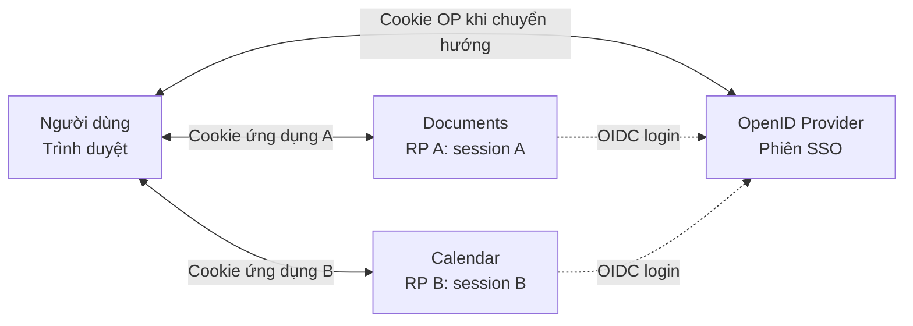
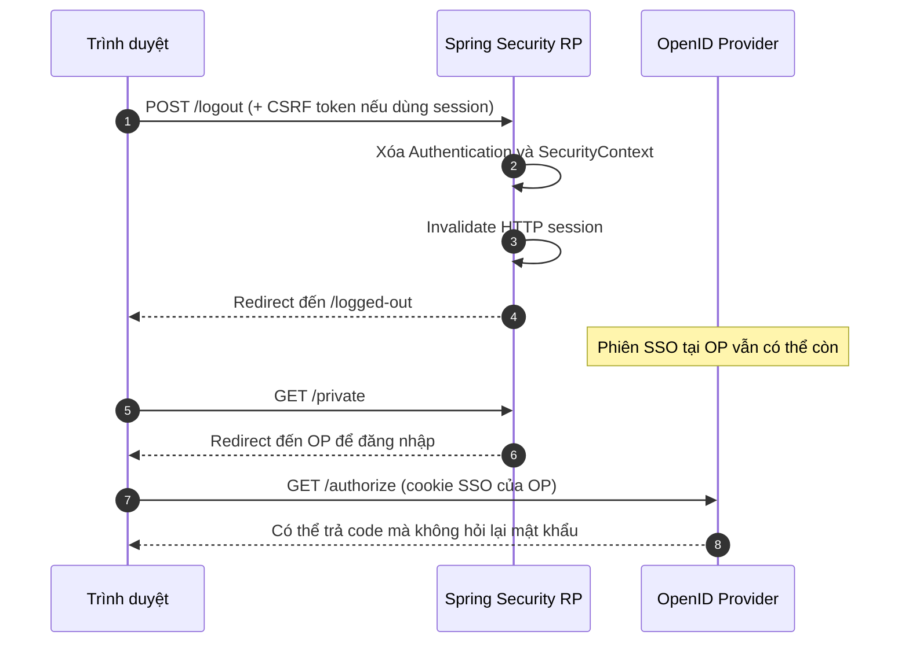
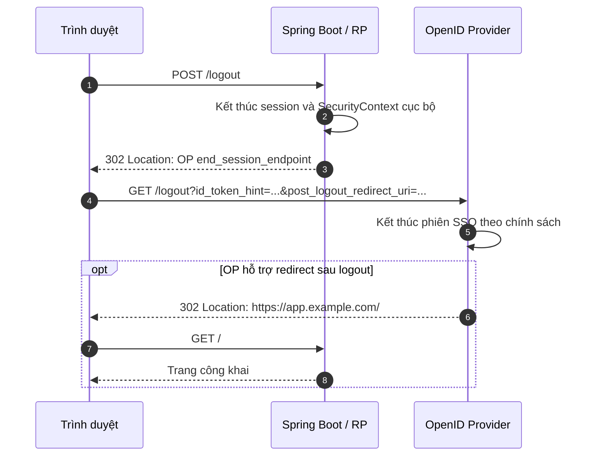

# 3.11. Khái niệm đăng xuất cục bộ và đăng xuất tại nhà cung cấp

Khi một ứng dụng Spring Security cho phép **đăng nhập bằng OpenID Connect (OIDC)**, người dùng thường có ít nhất hai trạng thái đăng nhập: **phiên của ứng dụng** và **phiên tại OpenID Provider (OP)**. Vì vậy, thao tác “Đăng xuất” không tự động có cùng ý nghĩa ở mọi nơi.

- **Đăng xuất cục bộ (local logout):** kết thúc phiên tại ứng dụng hiện tại, tức **Relying Party (RP)**.
- **Đăng xuất tại nhà cung cấp (provider logout / OP logout):** yêu cầu OpenID Provider kết thúc phiên đăng nhập SSO của người dùng tại OP.
- **Đăng xuất liên kết giữa nhiều ứng dụng (federated logout / single logout):** phối hợp thông báo để những RP khác cũng kết thúc phiên của chúng, nếu các hệ thống cùng hỗ trợ cơ chế phù hợp.

Điểm quan trọng: **OIDC xác thực người dùng thông qua một OP, nhưng không tự động biến mọi phiên thành một phiên duy nhất**. Cần xác định rõ ứng dụng muốn kết thúc phiên nào, ai đang giữ cookie hay token nào và hệ thống có hỗ trợ giao thức thông báo đăng xuất hay không.

## 1. Các thành phần và trạng thái tồn tại sau khi đăng nhập OIDC

Trong một hệ thống thông thường:

| Thành phần | Vai trò | Trạng thái có thể được duy trì |
|---|---|---|
| **Browser** | Trình duyệt của người dùng | Cookie của ứng dụng A, cookie của ứng dụng B, cookie của OP |
| **Relying Party (RP)** | Ứng dụng Spring Security dùng `oauth2Login()` | `SecurityContext`, HTTP session, authorized client/token |
| **OpenID Provider (OP)** | Hệ thống xác thực người dùng, phát hành ID token | Phiên SSO tại OP và các cơ chế xác thực liên quan |
| **Resource Server (API)** | API xác minh access token | Quyền truy cập theo access token; thường không có session web của RP |

Ví dụ, người dùng đăng nhập vào ứng dụng `https://documents.example.com` qua OP `https://login.example.com`:

1. Trình duyệt truy cập ứng dụng Spring Boot.
2. Spring chuyển hướng đến OP và hoàn tất OIDC Authorization Code Flow.
3. OP phát **ID token** chứng minh sự kiện xác thực và có thể phát **access token** để gọi API.
4. Spring Security tạo principal đăng nhập, lưu ngữ cảnh bảo mật vào session.
5. Trình duyệt giữ cookie phiên của `documents.example.com`, đồng thời có thể vẫn giữ cookie SSO của `login.example.com`.

Cookie của RP và OP thuộc các miền/nguồn gốc khác nhau. RP **không thể** đơn giản xóa cookie của OP thông qua phản hồi HTTP từ miền của mình.

### 1.1. Hai phiên độc lập tạo ra trải nghiệm SSO

Giả sử có hai ứng dụng, `Documents` và `Calendar`, dùng chung OP:



Nếu người dùng nhấn **Đăng xuất** ở `Documents`:

- Session của `Documents` có thể bị hủy.
- Session tại `Calendar` có thể vẫn tồn tại.
- Phiên SSO tại OP có thể vẫn tồn tại.
- Lần tiếp theo mở `Documents`, RP chuyển hướng sang OP và OP có thể xác thực lại người dùng **mà không hiển thị màn hình nhập mật khẩu**, nhờ phiên SSO còn hiệu lực.

Đây không hẳn là lỗi của Spring Security. Nó phản ánh đúng ranh giới giữa **session ứng dụng** và **session nhà cung cấp**.

## 2. Đăng xuất cục bộ là gì?

**Local logout** là hành động ứng dụng kết thúc trạng thái xác thực **ở chính RP**. Đối với một ứng dụng Spring MVC dùng session, quy trình thông thường là:

1. Nhận yêu cầu logout từ người dùng.
2. Kích hoạt logout filter/handlers của Spring Security.
3. Xóa `Authentication` khỏi `SecurityContext`.
4. Hủy HTTP session hiện hành, nếu có.
5. Làm mất hiệu lực hoặc xóa cookie phiên phía trình duyệt theo cơ chế được cấu hình.
6. Chuyển hướng đến trang công khai hoặc thông báo “Đã đăng xuất”.

Spring Security cung cấp sẵn cơ chế này thông qua `logout()` trong filter chain; ứng dụng không nên chỉ tạo một controller `GET /logout` rồi tự xóa vài thuộc tính session.

### 2.1. Local logout tác động và không tác động đến đâu?

| Đối tượng | Sau local logout ở RP A |
|---|---|
| `SecurityContext` hiện tại của RP A | Bị xóa theo cơ chế logout |
| HTTP session của RP A | Bị vô hiệu hóa nếu cấu hình logout theo mặc định/phù hợp |
| Cookie session của RP A | Không còn dùng được cho session đã vô hiệu hóa |
| Session SSO tại OP | **Không tự động bị kết thúc** |
| Session của RP B đăng nhập qua cùng OP | **Không tự động bị kết thúc** |
| Access token JWT đã phát | **Không tự động bị thu hồi** |
| Refresh token được OP phát | Không mặc định bị thu hồi chỉ do RP xóa session |
| Cookie và session ở thiết bị khác | Không mặc định bị thay đổi |

Ngay cả khi ứng dụng xóa cookie `JSESSIONID`, đó chỉ là cookie của RP (được đặt trong phạm vi domain/path tương ứng). Việc xóa cookie phía browser cũng **không thay thế việc hủy session trên server**.

Trong hệ thống có nhiều instance, cần cân nhắc session store dùng chung (ví dụ Spring Session với Redis) để lệnh logout có hiệu lực nhất quán dù request sau được gửi đến node khác.

### 2.2. Luồng local logout



Trong trường hợp này, **đăng xuất khỏi ứng dụng đã thành công** dù khi đăng nhập trở lại người dùng không phải nhập mật khẩu. Nếu sản phẩm yêu cầu người dùng phải xác thực lại, cần thêm chính sách tương ứng tại OP/RP, thay vì chỉ trông chờ vào thao tác local logout.

## 3. Đăng xuất tại OpenID Provider là gì?

**OP logout** kết thúc phiên xác thực của người dùng **tại nhà cung cấp định danh**. RP có thể điều hướng trình duyệt đến logout endpoint của OP; OIDC định nghĩa cơ chế **RP-Initiated Logout** cho tình huống này.

OP logout nhằm làm phiên SSO tại OP không còn được tái sử dụng trong lần tương tác tiếp theo. Khi người dùng quay lại một RP cần đăng nhập, OP có thể yêu cầu xác thực lại, trừ khi vẫn tồn tại một hình thức đăng nhập tự động khác hoặc phiên ở hệ thống định danh liên kết phía trên.

**Không nên đồng nhất** “đăng xuất khỏi OP” với “xóa tất cả phiên của mọi RP”. Các RP có session riêng và có thể không biết phiên OP đã chấm dứt. Việc đồng bộ trạng thái đó cần cơ chế thông báo đăng xuất đa ứng dụng, hoặc chính sách session phù hợp.

### 3.1. RP-Initiated Logout

**OpenID Connect RP-Initiated Logout 1.0** cho phép RP khởi tạo yêu cầu kết thúc phiên của người dùng tại OP thông qua **End Session Endpoint**.

Một trình tự thường gặp:

1. Người dùng nhấn **Đăng xuất** ở RP.
2. RP kết thúc session cục bộ.
3. RP chuyển hướng trình duyệt đến `end_session_endpoint` của OP, kèm các tham số phù hợp.
4. OP nhận diện phiên và xử lý logout; OP có thể yêu cầu người dùng xác nhận tùy chính sách.
5. Nếu OP hỗ trợ và cho phép, trình duyệt được chuyển về `post_logout_redirect_uri` đã đăng ký của RP.



Đó là **hai hành động liên tiếp**: local logout tại RP và OP logout tại nhà cung cấp. Chỉ redirect sang OP mà bỏ xử lý local session có thể để lại phiên đang hoạt động tại RP nếu người dùng không hoàn tất luồng từ phía OP.

### 3.2. Các tham số quan trọng

| Tham số | Mục đích | Ghi chú |
|---|---|---|
| `id_token_hint` | Gợi ý cho OP biết ID token trước đó của phiên đang đăng xuất | Được khuyến nghị theo RP-Initiated Logout; không nên tạo thủ công một ID token giả |
| `post_logout_redirect_uri` | Địa chỉ để OP có thể chuyển trình duyệt về sau logout | Phải được đăng ký/cho phép tại OP theo quy tắc của provider |
| `state` | Liên kết phản hồi redirect sau logout với yêu cầu RP đã khởi tạo | Tùy chọn theo giao thức; RP cần kiểm tra nếu tự dùng |
| `client_id` | Xác định client, nhất là khi không có `id_token_hint` và OP cần phân biệt client | Tùy chọn trong chuẩn; phụ thuộc chính sách OP |

Một URL minh họa:

```text
https://login.example.com/oidc/logout
  ?id_token_hint=<the-previously-issued-id-token>
  &post_logout_redirect_uri=https%3A%2F%2Fdocuments.example.com%2F
  &state=<random-request-state>
```

Phía RP phải tuân thủ quy tắc của OP. Không phải mọi OP đều hỗ trợ đủ tham số hoặc cùng hành vi redirect/confirmation. Tránh tự ghép `post_logout_redirect_uri` từ input tùy ý của người dùng vì có thể tạo **open redirect**.

**Lưu ý:** `id_token_hint` là ID token được OP phát cho **RP** trong quá trình đăng nhập, không phải access token và không phải chuỗi đại diện cho mật khẩu người dùng.

### 3.3. Khám phá End Session Endpoint

Khi OP hỗ trợ OIDC Discovery và công bố logout endpoint, metadata có thể chứa:

```json
{
  "issuer": "https://login.example.com",
  "authorization_endpoint": "https://login.example.com/oidc/authorize",
  "token_endpoint": "https://login.example.com/oidc/token",
  "jwks_uri": "https://login.example.com/oidc/jwks",
  "end_session_endpoint": "https://login.example.com/oidc/logout"
}
```

Thông tin này thường được truy cập thông qua discovery metadata của issuer, ví dụ:

```text
GET https://login.example.com/.well-known/openid-configuration
```

`end_session_endpoint` không nhất thiết xuất hiện ở mọi OP. Khi provider không hỗ trợ RP-Initiated Logout hoặc không công bố endpoint theo cách Spring Security sử dụng được, ứng dụng cần chọn hành vi fallback rõ ràng: vẫn kết thúc session cục bộ và đưa người dùng về trang logout, đồng thời tránh cam kết rằng phiên SSO ở OP đã bị kết thúc.

## 4. Local logout, OP logout và single logout không phải một việc

Ba thuật ngữ thường bị sử dụng như đồng nghĩa, nhưng phạm vi khác nhau:

| Cơ chế | Ai khởi xướng? | Ai nhận tín hiệu? | Mức ảnh hưởng |
|---|---|---|---|
| **Local logout** | Người dùng hoặc RP | Chính RP | Phiên tại ứng dụng hiện tại |
| **RP-Initiated Logout** | RP chuyển hướng sau logout | OP | Phiên SSO tại OP; các RP khác tùy tích hợp |
| **OP-Initiated / Front-Channel Logout** | OP | Các RP qua trình duyệt | Yêu cầu RP kết thúc phiên liên quan, phụ thuộc trình duyệt |
| **OP-Initiated / Back-Channel Logout** | OP | Backend của các RP | Thông báo server-to-server để RP kết thúc phiên liên quan |
| **Token revocation** | Client/chủ thể có quyền | Authorization Server | Thu hồi token được chỉ định theo semantics/chính sách của AS |

### 4.1. Front-Channel Logout

**OpenID Connect Front-Channel Logout 1.0** cho phép OP kích hoạt request đăng xuất đến các RP thông qua **user agent**, thường bằng iframe hoặc một cơ chế điều hướng trình duyệt. RP cần hỗ trợ endpoint nhận yêu cầu đăng xuất và xác định session tương ứng.

Ưu điểm: sử dụng trình duyệt để thông báo các RP có tham gia, không nhất thiết đòi hỏi kết nối trực tiếp từ OP đến tất cả backend.

Giới hạn:

- Trình duyệt có thể chặn third-party cookie hoặc tài nguyên trong iframe.
- Người dùng đóng tab hoặc điều hướng giữa chừng.
- Cookie/session không được gửi như OP/RP dự kiến do thiết lập `SameSite` và chính sách trình duyệt.
- Không phải tất cả RP đều đăng ký và thực thi cơ chế này.

Vì thế, OP logout **không bảo đảm** rằng mọi session RP đều được xóa chỉ nhờ front-channel.

### 4.2. Back-Channel Logout

**OpenID Connect Back-Channel Logout 1.0** cho phép OP gửi thông báo logout trực tiếp tới backend RP, **không phụ thuộc việc trình duyệt còn mở**.

OP gửi một **Logout Token** (JWT có semantics đặc biệt cho sự kiện logout) đến back-channel logout URI mà RP đăng ký. RP cần:

- Kiểm tra chữ ký, issuer, audience, thời gian và các yêu cầu giao thức liên quan.
- Xác minh đây là logout token hợp lệ, bao gồm `events` dành cho back-channel logout và không dùng như ID token đăng nhập.
- Xử lý chống replay với `jti`/cơ chế phù hợp.
- Xác định session liên quan bằng `sid` hoặc định danh chủ thể theo quy tắc của chuẩn/OP.
- Kết thúc session/đăng nhập cục bộ tương ứng trong session store.

Logout Token không phải access token để gọi API, cũng không có nghĩa RP nên xóa toàn bộ session của mọi người dùng. Cần thiết kế cách ánh xạ từ `sid` hoặc `sub` đã được xác minh đến **đúng phiên RP**.

Ví dụ ý nghĩa một payload Logout Token (minh họa, không có chữ ký):

```json
{
  "iss": "https://login.example.com",
  "aud": "documents-client",
  "iat": 1924996000,
  "jti": "logout-event-8df4c5",
  "sid": "op-session-92a3",
  "events": {
    "http://schemas.openid.net/event/backchannel-logout": {}
  }
}
```

Back-channel đáng tin cậy hơn front-channel trong những tình huống trình duyệt hạn chế cookie, nhưng vẫn phụ thuộc việc OP và RP đều hỗ trợ, sự kiện được gửi/nhận, endpoint sẵn sàng và session mapping chính xác. Việc hỗ trợ cụ thể trong Spring Security phụ thuộc phiên bản/framework và cần cấu hình riêng; **không được giả định `oauth2Login()` tự động bật back-channel logout**.

### 4.3. “Single logout” là mục tiêu tích hợp, không phải tác động mặc định

Tình huống: người dùng đăng nhập một lần tại OP và mở ba hệ thống A, B, C. Người dùng logout tại A và kỳ vọng các hệ thống còn lại cũng thoát.

Điều này chỉ có thể đạt được nếu:

1. A có thể khởi tạo logout tại OP theo chính sách.
2. OP kết thúc phiên SSO và phát thông báo đến RP phù hợp.
3. B và C đăng ký, nhận, xác minh và thực thi thông báo.
4. Các RP có cách xác định và hủy chính xác session chịu ảnh hưởng.
5. Xử lý được trường hợp ứng dụng offline hoặc thông báo bị trì hoãn/thất bại.

Nếu thiếu bất kỳ mắt xích nào, kết quả có thể là **OP đã logout nhưng B/C vẫn giữ session hợp lệ**. Do đó, sản phẩm nên mô tả phạm vi hành động chính xác, ví dụ “Đăng xuất khỏi ứng dụng này” hoặc “Đăng xuất khỏi tài khoản công ty”, thay vì cùng ghi “Logout” cho hai ý định khác nhau.

## 5. Spring Security: cấu hình local logout

### 5.1. Ứng dụng Spring MVC dùng OIDC Login

Ví dụ dùng Spring Boot với Servlet stack:

```groovy
dependencies {
    implementation 'org.springframework.boot:spring-boot-starter-security'
    implementation 'org.springframework.boot:spring-boot-starter-oauth2-client'
}
```

Cấu hình OIDC client (giá trị ví dụ):

```yaml
spring:
  security:
    oauth2:
      client:
        registration:
          company:
            provider: company
            client-id: ${OIDC_CLIENT_ID}
            client-secret: ${OIDC_CLIENT_SECRET}
            authorization-grant-type: authorization_code
            client-authentication-method: client_secret_basic
            redirect-uri: "{baseUrl}/login/oauth2/code/{registrationId}"
            scope:
              - openid
              - profile
        provider:
          company:
            issuer-uri: ${OIDC_ISSUER_URI}
```

Ở đây RP thực hiện đăng nhập OIDC, nhưng chưa cấu hình OP logout. Để chỉ thực hiện local logout:

```java
import org.springframework.context.annotation.Bean;
import org.springframework.context.annotation.Configuration;
import org.springframework.security.config.Customizer;
import org.springframework.security.config.annotation.web.builders.HttpSecurity;
import org.springframework.security.web.SecurityFilterChain;

@Configuration
public class SecurityConfig {

    @Bean
    SecurityFilterChain securityFilterChain(HttpSecurity http) throws Exception {
        http
            .authorizeHttpRequests(auth -> auth
                .requestMatchers("/", "/logged-out", "/error").permitAll()
                .anyRequest().authenticated())
            .oauth2Login(Customizer.withDefaults())
            .logout(logout -> logout
                .logoutUrl("/logout")
                .logoutSuccessUrl("/logged-out")
                .invalidateHttpSession(true)
                .clearAuthentication(true)
                .deleteCookies("JSESSIONID"));

        return http.build();
    }
}
```

Hành vi:

- `POST /logout` kích hoạt các logout handler của Spring Security.
- Session tại RP bị hủy; authentication/security context được xóa.
- Sau đó RP chuyển tới `/logged-out`.
- OP **không nhận một yêu cầu kết thúc phiên** chỉ vì cấu hình này.

`deleteCookies("JSESSIONID")` là thiết lập có thể hữu ích nếu ứng dụng sử dụng cookie với đúng tên/đường dẫn. Trong hệ thống thực tế, cookie có thể có tên hoặc path khác; hủy session server-side mới là điểm then chốt. Với ứng dụng có cơ chế session thay thế hoặc nhiều filter chain, cần cấu hình phù hợp nơi logout thực sự được xử lý.

### 5.2. Nút Logout an toàn trên giao diện

Với web application duy trì đăng nhập bằng cookie, để cơ chế CSRF của Spring Security hoạt động bình thường, dùng **POST** cho hành động logout.

Ví dụ Thymeleaf:

```html
<form th:action="@{/logout}" method="post">
    <input type="hidden"
           th:name="${_csrf.parameterName}"
           th:value="${_csrf.token}" />
    <button type="submit">Đăng xuất khỏi ứng dụng</button>
</form>
```

Mẫu này giả định token CSRF được cung cấp cho view theo cấu hình Spring Security. Không biến logout thành `GET /logout` chỉ để một thẻ link dễ viết hơn, và không tắt CSRF toàn ứng dụng vì muốn nút logout hoạt động.

Khi Spring Security chưa được đăng nhập, endpoint/logout entrypoint hoặc xử lý trang công khai cần được cấu hình sao cho phù hợp trải nghiệm ứng dụng; không đặt những trang này sau rule bắt buộc xác thực nếu muốn hiển thị sau logout.

## 6. Spring Security: đăng xuất cả RP và OP bằng RP-Initiated Logout

Spring Security cung cấp **`OidcClientInitiatedLogoutSuccessHandler`** để hỗ trợ chuyển hướng trình duyệt đến logout endpoint của OpenID Provider sau khi các xử lý local logout đã diễn ra.

### 6.1. Ví dụ cấu hình

```java
import org.springframework.context.annotation.Bean;
import org.springframework.context.annotation.Configuration;
import org.springframework.security.config.Customizer;
import org.springframework.security.config.annotation.web.builders.HttpSecurity;
import org.springframework.security.oauth2.client.oidc.web.logout.OidcClientInitiatedLogoutSuccessHandler;
import org.springframework.security.oauth2.client.registration.ClientRegistrationRepository;
import org.springframework.security.web.SecurityFilterChain;

@Configuration
public class SecurityConfig {

    @Bean
    SecurityFilterChain securityFilterChain(
            HttpSecurity http,
            ClientRegistrationRepository clientRegistrations) throws Exception {

        var oidcLogoutSuccessHandler =
            new OidcClientInitiatedLogoutSuccessHandler(clientRegistrations);

        // URL này cần được OP cho phép như post_logout_redirect_uri.
        oidcLogoutSuccessHandler.setPostLogoutRedirectUri("{baseUrl}/");

        http
            .authorizeHttpRequests(auth -> auth
                .requestMatchers("/", "/error").permitAll()
                .anyRequest().authenticated())
            .oauth2Login(Customizer.withDefaults())
            .logout(logout -> logout
                .logoutUrl("/logout")
                .invalidateHttpSession(true)
                .clearAuthentication(true)
                .deleteCookies("JSESSIONID")
                .logoutSuccessHandler(oidcLogoutSuccessHandler));

        return http.build();
    }
}
```

Ở đây:

1. **Logout filter** của Spring Security xử lý việc kết thúc session RP.
2. **`OidcClientInitiatedLogoutSuccessHandler`** dùng thông tin đăng nhập OIDC, cấu hình `ClientRegistrationRepository` và metadata OP để xác định nơi chuyển hướng.
3. Khi OP công bố `end_session_endpoint` và có ngữ cảnh OIDC phù hợp, handler xây dựng redirect tới OP, có thể đưa **`id_token_hint`** và **`post_logout_redirect_uri`** theo cấu hình.
4. OP xử lý phiên SSO và có thể đưa trình duyệt về `{baseUrl}/`.

`{baseUrl}` là base URL của ứng dụng theo ngữ cảnh request/forwarded headers được Spring hỗ trợ. Nếu chạy sau reverse proxy hoặc load balancer, cần cấu hình forwarded headers **chỉ từ proxy đáng tin cậy** để tránh URL bị suy ra sai hostname/scheme và gây lỗi redirect hoặc bị lạm dụng.

**Không cam kết remote logout khi thiếu điều kiện:** Nếu principal không phải OIDC login hợp lệ, registration không có logout metadata hoặc OP không cung cấp chức năng, không được suy diễn rằng handler đã thực sự kết thúc phiên tại OP. Có thể bổ sung trang trạng thái hoặc fallback phù hợp với trải nghiệm sản phẩm.

### 6.2. Điều kiện phía OpenID Provider

Tùy nhà cung cấp, quản trị viên OP cần:

- Đăng ký đúng client ID và phương thức đăng nhập OIDC.
- Bật tính năng RP-Initiated Logout.
- Cấu hình **post-logout redirect URI** cho phép, ví dụ `https://documents.example.com/`.
- Bảo đảm discovery metadata trả về `end_session_endpoint` mà ứng dụng dùng được.
- Chọn chính sách logout/confirmation và thông báo đến các RP khác (nếu muốn single logout).

Việc có `issuer-uri` và đăng nhập bằng `oauth2Login()` **không đủ** để OP logout hoạt động nếu OP không triển khai endpoint hay chưa đăng ký callback sau logout.

### 6.3. Giữ ID token đủ lâu để tạo logout request

RP-Initiated Logout thường sử dụng `id_token_hint`. Spring Security cần ngữ cảnh đăng nhập OIDC để lấy ID token đã phát trong phiên.

Vì vậy, khi tự xây dựng logout pipeline, không nên xóa sạch mọi dữ liệu OIDC hoặc thay principal bằng object khác **trước khi** logout success handler có cơ hội tạo request. Với cấu hình Spring Security chuẩn, các thành phần logout nhận được `Authentication` của yêu cầu để xử lý đúng thứ tự.

Nếu hệ thống lưu session phân tán, dùng cookie được mã hóa, hoặc tự tạo authentication adapter, cần bảo đảm handler vẫn nhận được **principal OIDC đúng client registration**. Tránh tự thay `Authentication` bằng principal chỉ còn email và mất ID token nếu vẫn cần provider logout.

### 6.4. Trải nghiệm giao diện nên nói rõ phạm vi

Trong ứng dụng doanh nghiệp, lựa chọn logout có thể tùy chính sách:

| Trường hợp sử dụng | Hành động phù hợp | Văn bản gợi ý |
|---|---|---|
| Người dùng chỉ muốn rời RP hiện tại | Local logout | “Đăng xuất khỏi ứng dụng” |
| Người dùng trên thiết bị dùng chung muốn kết thúc SSO | Local + RP-Initiated OP logout | “Đăng xuất khỏi tài khoản công ty” |
| Sản phẩm yêu cầu mọi ứng dụng liên quan kết thúc phiên | OP logout + front/back-channel và session invalidation ở RP | Chỉ hiển thị “Đăng xuất khỏi tất cả ứng dụng” khi hệ thống thực sự bảo đảm được |
| Người dùng muốn kết thúc phiên trên mọi thiết bị | Cơ chế quản lý/revoke session của OP theo tính năng sản phẩm | “Đăng xuất khỏi tất cả thiết bị” nếu được OP và các RP hỗ trợ thực tế |

Đặc biệt với thiết bị dùng chung, local logout **không bảo đảm người tiếp theo phải nhập mật khẩu** nếu phiên SSO còn hiệu lực. Ngược lại, OP logout có thể ảnh hưởng trải nghiệm các ứng dụng khác đang dùng cùng phiên định danh.

## 7. Đăng xuất không đồng nghĩa với thu hồi token

OAuth 2.0 và OIDC có nhiều loại token, mỗi loại có vòng đời khác nhau:

| Đối tượng | Local logout | RP-Initiated OP logout | Ghi chú |
|---|---|---|---|
| HTTP session tại RP | Thường bị hủy | Bị hủy khi RP thực hiện local logout trước redirect | Do RP kiểm soát |
| Cookie SSO tại OP | Không đổi | OP xử lý theo chính sách | Do OP kiểm soát |
| ID token đã phát | Không thể bị “xóa khỏi mọi nơi” bởi RP | Không mặc nhiên trở thành revoked | ID token phản ánh sự kiện xác thực |
| Access token | Không mặc định bị thu hồi | Không bảo đảm bị vô hiệu hóa | RS có thể chấp nhận đến khi hết hạn nếu không có cơ chế revoke/deny |
| Refresh token | Không mặc định bị thu hồi | Có thể bị OP thu hồi tùy nhà cung cấp/chính sách | Cần kiểm tra semantics OP |
| Phiên RP khác | Không đổi | Chỉ đổi nếu nhận và áp dụng logout notification | Có thể cần front/back-channel |
| Phiên trên thiết bị khác | Không đổi | Không bảo đảm bị xóa | “Log out all devices” cần khả năng riêng |

### 7.1. Token revocation là một cơ chế riêng

**RFC 7009** định nghĩa **OAuth 2.0 Token Revocation** để client có thể yêu cầu Authorization Server thu hồi một token khi AS hỗ trợ.

Ví dụ request minh họa (thông tin client authentication và token không phải dữ liệu thật):

```http
POST /oauth2/revoke HTTP/1.1
Host: login.example.com
Content-Type: application/x-www-form-urlencoded
Authorization: Basic <client-credentials>

token=<refresh-token>&token_type_hint=refresh_token
```

Lưu ý:

- Endpoint, phương thức client authentication và tác động thực tế tùy AS.
- Thu hồi refresh token có thể kéo theo ảnh hưởng lên token liên quan theo chính sách AS; không tự suy ra mọi access token JWT bị vô hiệu ngay.
- Nếu Resource Server chỉ kiểm tra chữ ký và `exp` của JWT một cách offline, token còn hạn có thể vẫn được chấp nhận nếu không có cơ chế kiểm tra thu hồi hoặc chính sách vô hiệu hóa riêng.
- Những hành động bảo mật mạnh như khóa tài khoản, rút quyền khẩn cấp hoặc logout mọi thiết bị thường đòi hỏi chính sách bổ sung ở OP, API và RP.

Ứng dụng phải phân biệt rõ: **xóa token cục bộ**, **gọi revoke token** và **kết thúc SSO session** là các thao tác khác nhau.

### 7.2. SPA và API stateless có logout khác web session

Trong SPA thuần (public client), ứng dụng thường sở hữu token ở môi trường browser. Local logout có thể dừng sử dụng token, xóa trạng thái frontend và dọn dẹp bộ nhớ/lưu trữ phù hợp; OP logout có thể thực hiện bằng chuyển hướng theo cơ chế provider hỗ trợ. SPA không thể dùng một client secret được giữ an toàn trong bundle.

Trong **Spring Resource Server stateless** chỉ nhận `Authorization: Bearer ...`:

- API không nhất thiết tạo HTTP session để có gì đó cần hủy khi logout.
- Xóa cookie/session ở RP không mặc nhiên làm bearer token đã phát mất hiệu lực tại API.
- API phải tự xác minh access token và quyền cho mỗi request theo thiết kế.
- Nếu cần vô hiệu hóa token sớm, cân nhắc revocation, opaque-token introspection, token thời hạn ngắn hoặc cơ chế session/denylist tùy hệ thống.

Đừng thêm một endpoint `POST /logout` vào API stateless rồi trả HTTP 200 và kết luận rằng token JWT của mọi client đã vô hiệu.

## 8. Các tình huống thực tế và hành vi mong đợi

### Tình huống A — Logout cục bộ nhưng đăng nhập lại không cần mật khẩu

Người dùng dùng Spring MVC RP, đã đăng nhập qua OP. Họ nhấn logout và được đưa về trang chủ. Sau đó truy cập `/profile`, trình duyệt lại được redirect qua OP và trở về RP mà không hỏi mật khẩu.

**Giải thích:** local session tại RP đã bị hủy, nhưng cookie phiên SSO của OP vẫn hợp lệ. Khi RP bắt đầu đăng nhập mới, OP sử dụng lại phiên đó.

**Hướng xử lý nếu sản phẩm yêu cầu kết thúc SSO:** tích hợp RP-Initiated Logout hoặc yêu cầu xác thực mới bằng các tham số OIDC và kiểm tra `auth_time` theo chính sách; không tự sửa logic Spring Security để coi phiên OP là phiên RP.

### Tình huống B — Logout ở ứng dụng A nhưng ứng dụng B vẫn dùng được

A và B là hai RP của cùng OP. A có `OidcClientInitiatedLogoutSuccessHandler`, nhưng B không hỗ trợ OP-initiated logout hoặc người dùng chưa chuyển trang ở B.

**Giải thích:** phiên tại OP có thể đã kết thúc nhưng session ứng dụng B vẫn còn. Nếu B không nhận và thực thi logout notification, request tiếp theo vào B có thể vẫn được coi là đã đăng nhập tại B.

**Hướng xử lý:** nếu mục tiêu là single logout, xác định khả năng Front-Channel/Back-Channel Logout của OP và từng RP; thiết kế mapping phiên và cơ chế vô hiệu hóa trên B.

### Tình huống C — Logout xong nhưng API vẫn nhận token cũ

Sau logout ở web RP, một access token JWT cũ vẫn còn hạn và Resource Server xác minh chữ ký thành công.

**Giải thích:** token đã được phát trước logout; local session hết hạn không tự sửa `exp` hoặc chữ ký token. RP-Initiated Logout cũng không cam kết thu hồi access token.

**Hướng xử lý:** chính sách hạn token, revocation/denylist/introspection hoặc kiểm tra quyền động ở API phải được thiết kế nếu cần khóa quyền tức thời.

### Tình huống D — OP logout thành công nhưng callback không về RP

RP chuyển hướng đến OP; OP hiển thị trang “You are signed out”, không redirect tới `https://documents.example.com/`.

**Nguyên nhân có thể:** OP không hỗ trợ post-logout redirect theo cấu hình này, URL chưa được đăng ký chính xác, giao thức tham số không tương thích, hoặc OP yêu cầu điều kiện khác.

**Hướng xử lý:** kiểm tra metadata `end_session_endpoint`, danh sách post-logout URI được OP cho phép và yêu cầu theo provider. Local session RP vẫn cần được hủy trước khi chuyển hướng.

### Tình huống E — Người dùng muốn logout một thiết bị, giữ nguyên thiết bị khác

Nếu đây là yêu cầu nghiệp vụ, **không nên mặc định** thực hiện chính sách logout tất cả thiết bị tại OP. Có thể chỉ cần local logout cho phiên RP trên thiết bị hiện tại, hoặc OP logout đúng phiên thiết bị nếu provider hỗ trợ.

“Logout trên mọi thiết bị” là yêu cầu rộng hơn, cần hệ thống session management của OP/RP có định danh phiên theo thiết bị và khả năng vô hiệu hóa tương ứng.

## 9. Những yếu tố bảo mật cần thiết trong thiết kế logout

### 9.1. Bảo vệ logout endpoint

Yêu cầu thay đổi trạng thái từ trình duyệt có session cookie nên dùng `POST` và CSRF protection phù hợp. Nếu cấu hình Spring Security mặc định với CSRF đang bật, logout bằng POST được khuyến nghị; người dùng không nên bị đăng xuất chỉ vì tải một ảnh hoặc nhấn liên kết bên ngoài.

Một ứng dụng sử dụng API stateless thuần bearer token có mô hình CSRF khác ứng dụng web session; cần xem xét từng security chain thay vì áp dụng cấu hình tắt CSRF đồng loạt.

### 9.2. Chống open redirect

`post_logout_redirect_uri` cần được đăng ký chặt chẽ tại OP và được xây dựng từ URL đáng tin cậy ở RP. Không cho phép người dùng truyền URL bất kỳ như:

```text
/logout?returnTo=https://untrusted.example/phishing
```

rồi đưa trực tiếp vào callback/logout redirect mà không xác minh allowlist. Với ứng dụng chạy sau proxy, xử lý header `Forwarded`/`X-Forwarded-*` chỉ từ nguồn tin cậy.

### 9.3. Không đưa token vào log

`id_token_hint` có thể xuất hiện trên URL chuyển hướng qua trình duyệt; endpoint và hệ thống log có thể ghi lại query string. Không in đầy đủ ID token/access token/refresh token trong application log, tracing hoặc analytics. Dùng HTTPS và kiểm soát retention của log truy cập.

Không truyền access token hoặc refresh token tùy ý qua query string chỉ để thực hiện logout.

### 9.4. Không nhầm “đã redirect đến OP” với “OP logout thành công”

Server của RP trả `302 Location: <end_session_endpoint>` mới chỉ chứng minh RP **đã yêu cầu trình duyệt đi tới OP**. Người dùng có thể đóng trình duyệt, mạng bị ngắt, OP từ chối yêu cầu hoặc không kết thúc phiên theo kỳ vọng.

Ứng dụng có thể kết luận local session đã bị hủy sau khi logout handlers hoàn thành; **không nên hiển thị cam kết rằng mọi phiên SSO đã bị vô hiệu** nếu không có tín hiệu/hợp đồng từ OP hoặc các RP khác.

### 9.5. Khi OP phát thông báo đăng xuất

Một back-channel logout endpoint nhận yêu cầu từ mạng phải kiểm tra Logout Token một cách nghiêm ngặt trước khi hủy session. Không tin một JSON chứa `sub` không ký, không hủy mọi session chỉ dựa trên email và không giả định sự kiện từ OP có thể được áp dụng cho toàn bộ user trên mọi tenant.

Nếu dùng `sid`, cần bảo đảm session mapping tương ứng với issuer, OP session và RP. Nếu dùng `sub` theo chuẩn/cấu hình, phải xác định chính xác phạm vi phiên bị hủy và chính sách đa thiết bị.

## 10. Quy tắc chọn cơ chế cho hệ thống Spring Security

Một cách tiếp cận thực tế là xác định trước **ý nghĩa nghiệp vụ của nút Logout**:

1. **Chỉ thoát ứng dụng hiện tại?** Dùng Spring Security local logout, hủy session RP và chuyển về trang công khai.
2. **Muốn kết thúc phiên SSO tại nhà cung cấp?** Bổ sung `OidcClientInitiatedLogoutSuccessHandler` và xác nhận OP hỗ trợ RP-Initiated Logout.
3. **Muốn mọi ứng dụng đăng nhập qua OP đều thoát?** Cần OP cùng các RP hỗ trợ thông báo logout, thường front-channel/back-channel; tích hợp session invalidation.
4. **Muốn vô hiệu hóa quyền API ngay lập tức?** Thiết kế revocation/introspection hoặc chính sách token của AS/RS độc lập với redirect logout.
5. **Muốn kết thúc tất cả phiên trên các thiết bị?** Cần chức năng quản lý phiên ở OP và các RP hỗ trợ, có phạm vi thiết bị/người dùng rõ ràng.

| Mục tiêu | Cần cấu hình tại Spring RP? | Cần OP hỗ trợ? | Cần Resource Server thay đổi? |
|---|---|---|---|
| Đăng xuất khỏi RP hiện tại | Có: `logout()`/session | Không | Thường không |
| Thoát SSO trên OP | Có: redirect bằng RP-Initiated Logout | Có: `end_session_endpoint` | Không mặc định |
| RP khác cùng thoát | Có: endpoint nhận front/back-channel và session mapping | Có: gửi thông báo | Không nhất thiết |
| Thu hồi token | Có thể: gọi revocation endpoint theo quyền client | Có: revocation/chính sách | Có thể cần introspection hoặc cơ chế vô hiệu hóa |
| Logout mọi thiết bị | Có: quản lý phiên liên quan | Có: quản lý phiên hoặc logout trên các thiết bị | Tùy thiết kế token |

Trong Spring Security, **`logout()` và `oauth2Login()` xử lý hai phần khác nhau của vòng đời đăng nhập**: một phần tạo principal/session sau xác thực OIDC, phần còn lại kết thúc trạng thái xác thực cục bộ. **`OidcClientInitiatedLogoutSuccessHandler`** kết nối bước kết thúc cục bộ ấy với hành vi logout phía OP khi OP hỗ trợ. Các cơ chế single logout và token revocation là những phần mở rộng riêng cần được lựa chọn theo mục tiêu hệ thống.

## 11. Tài liệu tham khảo

- [OpenID Connect RP-Initiated Logout 1.0](https://openid.net/specs/openid-connect-rpinitiated-1_0.html): endpoint đăng xuất OP và các tham số `id_token_hint`, `post_logout_redirect_uri`, `state`, `client_id`.
- [OpenID Connect Front-Channel Logout 1.0](https://openid.net/specs/openid-connect-frontchannel-1_0.html): thông báo logout qua trình duyệt.
- [OpenID Connect Back-Channel Logout 1.0](https://openid.net/specs/openid-connect-backchannel-1_0.html): Logout Token và thông báo server-to-server.
- [OpenID Connect Discovery 1.0](https://openid.net/specs/openid-connect-discovery-1_0.html): metadata của OpenID Provider.
- [RFC 7009 — OAuth 2.0 Token Revocation](https://www.rfc-editor.org/rfc/rfc7009): thu hồi access/refresh token khi Authorization Server hỗ trợ.
- [RFC 9700 — Best Current Practice for OAuth 2.0 Security](https://www.rfc-editor.org/rfc/rfc9700): hướng dẫn bảo mật OAuth/OIDC.
- [Spring Security — Handling Logouts](https://docs.spring.io/spring-security/reference/servlet/authentication/logout.html): cơ chế logout của ứng dụng web Spring.
- [Spring Security — OIDC Logout](https://docs.spring.io/spring-security/reference/servlet/oauth2/login/logout.html): tích hợp OIDC logout trong Servlet applications.
