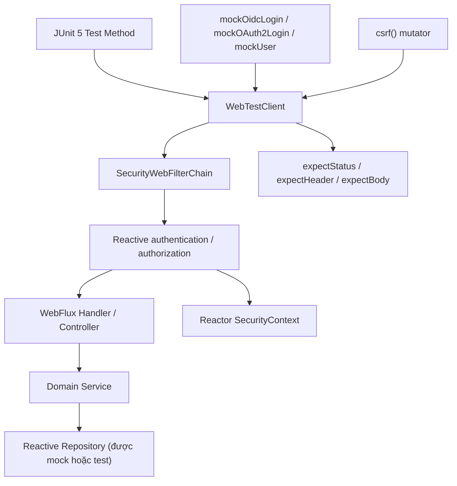

# 30.1. Thiết lập spring-security-test và WebTestClient

## 1. Bài toán: kiểm thử OAuth2/OIDC Client ở ứng dụng Spring WebFlux

Khi một ứng dụng **Spring Security OAuth 2.0/OIDC Client** được xây dựng trên **Spring WebFlux**, các controller thường trả về `Mono` hoặc `Flux`, hệ thống bảo mật xử lý yêu cầu bằng `SecurityWebFilterChain` và thông tin người dùng được duy trì qua **Reactor Context**.

Một controller đơn giản:

```java
@RestController
class IdentityController {

    @GetMapping("/api/me")
    Mono<MeResponse> me(
            @AuthenticationPrincipal OidcUser user) {

        return Mono.just(new MeResponse(
            user.getSubject(),
            user.getIdToken().getClaimAsString("iss")));
    }

    record MeResponse(String subject, String issuer) {}
}
```

Khi kiểm thử controller này, ta muốn xác minh rằng:

1. Request đi qua cấu hình bảo mật của WebFlux.
2. Request đã được xác thực có đúng `OidcUser`.
3. `@AuthenticationPrincipal` nhận được principal đó.
4. Controller trả JSON đúng contract.
5. Request chưa xác thực bị từ chối hoặc chuyển hướng theo `AuthenticationEntryPoint` đã cấu hình.
6. Phân quyền, CSRF và lỗi HTTP được xử lý theo đúng security chain.

Nhưng **không muốn** mỗi test bắt buộc phải khởi động một OpenID Provider (OP), trình duyệt, bước consent, authorization code, token exchange và JWT signature verification. Spring Security cung cấp thư viện **`spring-security-test`** và `WebTestClient` để kiểm tra những lớp phù hợp mà không phải mô phỏng toàn bộ giao thức.

Ví dụ trọng tâm:

```java
client.mutateWith(
        SecurityMockServerConfigurers.mockOidcLogin()
            .idToken(token -> token.claim(
                "sub", "customer-user-42")))
    .get()
    .uri("/api/me")
    .exchange()
    .expectStatus().isOk()
    .expectBody()
    .jsonPath("$.subject").isEqualTo("customer-user-42");
```

**Nguyên tắc:** test helper `mockOidcLogin()` tạo một **authentication context giả lập** đúng loại principal; nó **không chứng minh** OP thật đã cấp token hợp lệ, `iss`/`aud`/`nonce`/chữ ký đã được kiểm tra hoặc code đã được đổi thành token.

### 1.1. Mục tiêu học tập

Sau bài này bạn có thể:

1. Xác định dependencies cần có cho Spring WebFlux, Spring Security OAuth2 Client và reactive testing.
2. Tạo `SecurityWebFilterChain` cơ bản phục vụ ứng dụng/test.
3. Phân biệt `WebTestClient` và `MockMvc`, `SecurityWebFilterChain` và `SecurityFilterChain`.
4. Thiết lập WebTestClient từ `ApplicationContext` với `.apply(springSecurity())`.
5. Hiểu cách `@WebFluxTest`, `@SpringBootTest` và `@AutoConfigureWebTestClient` nạp context.
6. Dùng `mockUser()`, `@WithMockUser`, `mockOAuth2Login()` và `mockOidcLogin()` đúng trường hợp.
7. Sử dụng `mockOAuth2Client()` để kiểm tra authorized-client resolution.
8. Dùng `mockJwt()` và `mockOpaqueToken()` khi test API Resource Server.
9. Dùng `csrf()` cho POST/PUT/DELETE được CSRF bảo vệ.
10. Hiểu `ReactiveSecurityContextHolder` và tại sao không dựa vào ThreadLocal như Servlet.
11. Viết WebTestClient assertions cho response status, headers, JSON và lỗi.
12. Xử lý `@WebFluxTest` thiếu bean, security chain chưa được import và test principal sai loại.
13. Biết giới hạn của mock WebTestClient so với test HTTP thật qua server.
14. Lập ma trận test cho authentication, authorization, principal claims và CSRF.
15. Giữ fixture và logs không chứa token/client secret thật.

## 2. Đặt đúng các thành phần vào hệ sinh thái WebFlux

Một ứng dụng reactive có nhiều thành phần gần giống Servlet nhưng không hoán đổi được:

| Vai trò | Servlet | Spring WebFlux |
| --- | --- | --- |
| HTTP security configuration | `HttpSecurity` | `ServerHttpSecurity` |
| Chuỗi filter | `SecurityFilterChain` | `SecurityWebFilterChain` |
| Security context | Thường dùng `SecurityContextHolder` trên thread | Dùng `ReactiveSecurityContextHolder` trong Reactor Context |
| User HTTP request | `HttpServletRequest` | `ServerWebExchange` |
| Client registration lookup | `ClientRegistrationRepository` | `ReactiveClientRegistrationRepository` |
| Authorized-client manager | `OAuth2AuthorizedClientManager` | `ReactiveOAuth2AuthorizedClientManager` |
| Authorized-client repository | `OAuth2AuthorizedClientRepository` | `ServerOAuth2AuthorizedClientRepository` |
| Test HTTP client | `MockMvc` | `WebTestClient` |
| Login test helper | `oidcLogin()` / `oauth2Login()` | `mockOidcLogin()` / `mockOAuth2Login()` |
| Test JWT Bearer | `jwt()` | `mockJwt()` |
| Setup Security Test | `springSecurity()` cho MockMvc | `springSecurity()` cho WebTestClient nhưng **khác package** |

**Quan trọng:** cùng tên helper `springSecurity()` không có nghĩa dùng cùng class. Reactive import là:

```java
import static org.springframework.security.test.web.reactive.server
    .SecurityMockServerConfigurers.springSecurity;
```

Khi viết source Java thật, có thể đặt toàn bộ tên `import static ...springSecurity;` trên một dòng; phần ngắt dòng trong tài liệu chỉ nhằm dễ đọc.

### 2.1. Không nhầm hai loại client

- `WebTestClient`: HTTP **test client** của Spring Framework, cho phép gửi request vào controller/router và assert response.
- `WebClient`: HTTP **runtime client** của Spring WebFlux, dùng để gọi OP/token endpoint hoặc downstream APIs.

Một Spring Security OAuth2 Client app có thể dùng **cả hai**. Không vì thấy `WebTestClient` có từ “Client” mà nghĩ nó sẽ tự xử lý OAuth2 Authorization Code flow.

### 2.2. Mô hình lớp kiểm thử



Tùy lựa chọn test setup, WebTestClient có thể gọi ứng dụng **trong cùng process không qua socket HTTP**, hoặc gọi một **server thật** đang chạy. Đây là khác biệt quan trọng khi dùng test mutators.

## 3. Dependencies Gradle

Ví dụ cho ứng dụng Spring Boot WebFlux sử dụng OAuth2/OIDC Login:

```gradle
plugins {
    id 'java'
    id 'org.springframework.boot' version '<version-du-an>'
    id 'io.spring.dependency-management' version '<version-tuong-thich>'
}

dependencies {
    implementation 'org.springframework.boot:spring-boot-starter-webflux'
    implementation 'org.springframework.boot:spring-boot-starter-security'
    implementation 'org.springframework.boot:spring-boot-starter-oauth2-client'

    testImplementation 'org.springframework.boot:spring-boot-starter-test'
    testImplementation 'org.springframework.security:spring-security-test'
    testImplementation 'io.projectreactor:reactor-test'
}

tasks.named('test') {
    useJUnitPlatform()
}
```

`<version-du-an>` và `<version-tuong-thich>` là **placeholders**, không phải các version strings có thể build nguyên văn. Khi triển khai, sử dụng Spring Boot BOM/plugin versions của dự án; không gắn riêng một version Spring Security Test lệch khỏi version của Spring Security runtime.

**Lưu ý về phiên bản:** Spring Boot 4 tổ chức lại một số test starter/modules và packages so với Spring Boot 3. Với dự án Boot 4, hãy kiểm tra module test starter được khuyến nghị (ví dụ starter WebFlux test chuyên biệt) và package thực tế của `@WebFluxTest`, `@AutoConfigureWebTestClient`. Mã minh họa Java API tập trung vào Spring Security Test và Spring Framework, còn các import của Boot test annotations cần chọn theo BOM đang dùng.

### 3.1. Vai trò từng dependency

| Dependency | Công dụng |
| --- | --- |
| `spring-boot-starter-webflux` | Spring WebFlux, Reactor Netty và WebFlux infrastructure |
| `spring-boot-starter-security` | Core Spring Security và WebFlux security integration |
| `spring-boot-starter-oauth2-client` | OAuth2 Login, OIDC Client và authorized-client support |
| `spring-boot-starter-test` hoặc starter test modules theo Boot version | JUnit, assertions, Spring Test, mocking support |
| `spring-security-test` | Security test integrations và `SecurityMockServerConfigurers` |
| `reactor-test` | `StepVerifier`, `TestPublisher`, virtual time cho reactive services |
| `spring-boot-starter-oauth2-resource-server` | Chỉ cần khi ứng dụng còn nhận bearer token như API Resource Server |

### 3.2. Không cần OP thật cho mọi test

Với `mockOidcLogin()` hoặc `mockOAuth2Login()`:

- Không cần client secret production.
- Không cần browser đi qua OP.
- Không cần gọi Discovery Metadata thật.
- Không cần phát ID Token với chữ ký thật.
- Không cần Token Endpoint hoặc UserInfo Endpoint thật.
- Có thể test controller/HTTP authorization logic nhanh.

Ngược lại, khi kiểm tra **issuer/audience/signature/PKCE/redirect_uri/token exchange** thì những test helpers này là **không đủ**. Cần test OP, test token decoder và integration suite chuyên biệt.

## 4. Dependencies Maven tương đương

Nếu dự án dùng Maven:

```xml
<dependencies>
    <dependency>
        <groupId>org.springframework.boot</groupId>
        <artifactId>spring-boot-starter-webflux</artifactId>
    </dependency>
    <dependency>
        <groupId>org.springframework.boot</groupId>
        <artifactId>spring-boot-starter-security</artifactId>
    </dependency>
    <dependency>
        <groupId>org.springframework.boot</groupId>
        <artifactId>spring-boot-starter-oauth2-client</artifactId>
    </dependency>
    <dependency>
        <groupId>org.springframework.boot</groupId>
        <artifactId>spring-boot-starter-test</artifactId>
        <scope>test</scope>
    </dependency>
    <dependency>
        <groupId>org.springframework.security</groupId>
        <artifactId>spring-security-test</artifactId>
        <scope>test</scope>
    </dependency>
    <dependency>
        <groupId>io.projectreactor</groupId>
        <artifactId>reactor-test</artifactId>
        <scope>test</scope>
    </dependency>
</dependencies>
```

Các versions nên được quản lý đồng nhất qua Spring Boot parent/BOM. Với Boot 4, kiểm tra các modular test dependencies thích hợp theo tài liệu của version đó.

Không cần dùng cả Gradle lẫn Maven; hai ví dụ chỉ minh họa cách khai báo.

## 5. SecurityWebFilterChain cho ứng dụng WebFlux

Trước khi test, cần biết ứng dụng thật bảo vệ routes như thế nào.

```java
@Configuration
@EnableWebFluxSecurity
public class ReactiveSecurityConfiguration {

    @Bean
    SecurityWebFilterChain securityWebFilterChain(
            ServerHttpSecurity http) {

        return http
            .authorizeExchange(exchanges -> exchanges
                .pathMatchers("/", "/assets/**").permitAll()
                .pathMatchers("/api/admin/**")
                    .hasAuthority("SCOPE_admin")
                .anyExchange().authenticated())
            .oauth2Login(Customizer.withDefaults())
            .oauth2Client(Customizer.withDefaults())
            .build();
    }
}
```

Các imports thông thường:

```java
import org.springframework.context.annotation.Bean;
import org.springframework.context.annotation.Configuration;
import org.springframework.security.config.annotation.method.configuration.EnableReactiveMethodSecurity;
import org.springframework.security.config.annotation.web.reactive.EnableWebFluxSecurity;
import org.springframework.security.config.web.server.ServerHttpSecurity;
import org.springframework.security.web.server.SecurityWebFilterChain;
import org.springframework.security.config.Customizer;
```

`@EnableReactiveMethodSecurity` **không bắt buộc** cho `.authorizeExchange(...)`; chỉ thêm khi ứng dụng sử dụng annotations như `@PreAuthorize` trên reactive methods/services.

### 5.1. Lưu ý khi bật OAuth2 Login trong test

Khi `.oauth2Login(...)` được bật, security infrastructure thường cần một `ReactiveClientRegistrationRepository` với `ClientRegistration` hợp lệ. Nếu `@WebFluxTest` chỉ nạp controller mà không có repository, test context có thể không startup.

Một controller slice test **không kiểm tra login protocol** có thể sử dụng SecurityWebFilterChain test đơn giản với `httpBasic()` để kiểm tra injection/authentication. Các tests cần chứng minh cấu hình OIDC Login thật thì nên import production security config hoặc cung cấp test `ReactiveClientRegistrationRepository`.

Không bỏ luôn security filters rồi tuyên bố test đã kiểm tra access controls.

## 6. WebTestClient có những chế độ binding nào?

`WebTestClient` có nhiều cách dựng:

| Cách tạo | Đối tượng đích | Có socket/server thật không? | Dùng khi nào |
| --- | --- | --- | --- |
| `bindToController(...)` | Controllers chỉ định | Không | Test WebFlux controller đơn giản; security setup không tự đầy đủ |
| `bindToRouterFunction(...)` | Functional RouterFunction | Không | Test functional endpoints |
| `bindToApplicationContext(context)` | WebFlux ApplicationContext | Không | Security/controller integration với filters thật trong context |
| `bindToServer()` | HTTP server đang chạy | Có | Test network/cookies/proxy/browser-facing behavior |
| `@WebFluxTest` autowired client | MVC-less WebFlux slice | Không | Test controller nhanh với test security config |
| `@SpringBootTest(MOCK)` + `@AutoConfigureWebTestClient` | Full app context, mock exchange | Không | Test wiring nhiều beans mà không mở port |
| `@SpringBootTest(RANDOM_PORT)` + client | Embedded server thật | Có | HTTP integration trên random port |

Tên `@SpringBootTest(MOCK)` viết tắt cho `webEnvironment = SpringBootTest.WebEnvironment.MOCK`.

**Ranh giới quan trọng:** các `SecurityMockServerConfigurers` đặt mock authentication trong **mocked ServerWebExchange của in-process WebTestClient**. Không mặc định chúng hoạt động qua **HTTP network** đến một server thật ở `RANDOM_PORT`: test mutator không tự chuyển SecurityContext giả thành header/cookie hợp lệ để server bên kia xác thực.

### 6.1. Chọn setup theo mục tiêu

Nếu cần kiểm thử:

```text
@AuthenticationPrincipal OidcUser
Response JSON
URL authorization rules
CSRF
```

→ thường chọn **`@WebFluxTest` + WebTestClient bound to application context**.

Nếu cần:

```text
Production SecurityWebFilterChain
Multiple controllers/services
Reactive repositories
Oauth2Client registrations wiring
```

→ **`@SpringBootTest` + `@AutoConfigureWebTestClient`** và chọn mock exchange nếu không cần network.

Nếu cần:

```text
Real bearer authorization headers
Real browser redirect URL
Cookies/HTTP/TLS/proxy behavior
Authorization Code callback hoặc test OP
```

→ **server-bound integration/E2E** với server/test OP, không dựa vào `mockOidcLogin()` làm proof giao thức.

## 7. Thiết lập thủ công WebTestClient với `springSecurity()`

Đây là điểm nền tảng của bài học.

```java
import org.junit.jupiter.api.BeforeEach;
import org.springframework.beans.factory.annotation.Autowired;
import org.springframework.context.ApplicationContext;
import org.springframework.test.web.reactive.server.WebTestClient;

import static org.springframework.security.test.web.reactive.server
    .SecurityMockServerConfigurers.springSecurity;

class ReactiveSecurityTests {

    @Autowired
    ApplicationContext context;

    WebTestClient client;

    @BeforeEach
    void setUp() {
        client = WebTestClient
            .bindToApplicationContext(context)
            .apply(springSecurity())
            .configureClient()
            .build();
    }
}
```

Đây là **skeleton**; class test cần annotation cấp Spring context như `@SpringBootTest`, `@WebFluxTest` hoặc `@ContextConfiguration`, và context phải chứa `SecurityWebFilterChain` phù hợp.

Lệnh quan trọng:

```java
.apply(springSecurity())
```

tích hợp Spring Security Test support vào WebTestClient. Sau đó có thể sử dụng các mutators như:

```java
client.mutateWith(mockUser())
client.mutateWith(mockOidcLogin())
client.mutateWith(mockOAuth2Login())
client.mutateWith(mockJwt())
client.mutateWith(csrf())
```

### 7.1. `configureClient()` và `build()` ở đâu?

Chuỗi:

```java
WebTestClient.bindToApplicationContext(context)
    .apply(springSecurity())
    .configureClient()
    .build();
```

phản ánh builder workflow của Spring Framework. Sau `.apply(...)`, `.configureClient()` cho phép tùy chỉnh WebTestClient HTTP client options (response timeout, base URL, filters...) trước `.build()`.

Không thay bằng:

```java
WebTestClient.bindToServer()
    .apply(springSecurity());
```

vì server-bound builder không có cùng cơ chế giả lập `ServerWebExchange` của in-process WebFlux integration.

### 7.2. Tại sao phải dùng context?

`bindToApplicationContext(...)` đưa request qua WebFlux infrastructure và filters được nạp trong context, bao gồm `SecurityWebFilterChain` nếu đã cấu hình.

Nếu chỉ dùng:

```java
WebTestClient.bindToController(new IdentityController())
    .build();
```

thì controller có thể chạy mà không có security filter chain đúng, gây kết quả sai về anonymous/access controls.

Bạn có thể cấu hình `bindToController` với custom `WebFilter` và argument resolvers khi cần, nhưng nó không tự trở thành security integration test chỉ vì WebTestClient được dùng.

## 8. `@WebFluxTest`: controller slice tests nhanh

`@WebFluxTest` chỉ nạp phần WebFlux MVC-like infrastructure và controllers/advice/formatters có liên quan. Nó thường tự cấu hình `WebTestClient`, không start HTTP server.

Ví dụ controller:

```java
@RestController
class GreetingController {

    @GetMapping("/api/greeting")
    Mono<Map<String, String>> greeting(
            @AuthenticationPrincipal OidcUser user) {

        return Mono.just(Map.of(
            "message", "hello",
            "subject", user.getSubject()));
    }
}
```

### 8.1. Một test class minh họa độc lập

```java
@WebFluxTest(GreetingController.class)
@Import(GreetingControllerTest.TestSecurity.class)
class GreetingControllerTest {

    @Autowired
    ApplicationContext context;

    WebTestClient client;

    @BeforeEach
    void setUp() {
        client = WebTestClient
            .bindToApplicationContext(context)
            .apply(springSecurity())
            .configureClient()
            .build();
    }

    @TestConfiguration
    @EnableWebFluxSecurity
    static class TestSecurity {

        @Bean
        SecurityWebFilterChain chain(ServerHttpSecurity http) {
            return http
                .authorizeExchange(exchanges -> exchanges
                    .pathMatchers("/api/greeting")
                        .authenticated()
                    .anyExchange().permitAll())
                .httpBasic(Customizer.withDefaults())
                .build();
        }
    }

    @Test
    void authenticatedOidcUserCanReadGreeting() {
        client
            .mutateWith(mockOidcLogin()
                .idToken(token -> token
                    .claim("sub", "user-21")))
            .get()
            .uri("/api/greeting")
            .exchange()
            .expectStatus().isOk()
            .expectBody()
            .jsonPath("$.message").isEqualTo("hello")
            .jsonPath("$.subject").isEqualTo("user-21");
    }
}
```

Để compile, thêm các imports JUnit 5, Spring Boot test annotations, Spring WebFlux, Spring Security và static imports của `mockOidcLogin()`/`springSecurity()`. Các `@WebFluxTest` và `@TestConfiguration` package paths thay đổi theo Spring Boot version; chọn đúng BOM.

### 8.2. Vì sao test-only chain dùng `httpBasic()`?

Vì test này chỉ kiểm tra:

- Reactive SecurityContext có `OidcUser` đúng.
- `@AuthenticationPrincipal` hoạt động.
- Controller trả JSON.
- Unauthenticated requests bị security filter chặn.

Nó **không** kiểm tra Authorization Code Login. `httpBasic` có thể được dùng như một **test-only entry point** đơn giản trả `401` thay vì login redirect.

Nếu bạn muốn kiểm tra **production OAuth2 Login SecurityWebFilterChain**, không thay bằng test chain này; thay vào đó import cấu hình thật và cung cấp fake/test `ReactiveClientRegistrationRepository` phù hợp.

### 8.3. `@WebFluxTest` có tự import custom `SecurityWebFilterChain` không?

Không nên giả định. Spring Boot docs nêu `@WebFluxTest` có thể **không tự nhận diện** các custom `@Bean SecurityWebFilterChain` của ứng dụng; nên import rõ cấu hình với `@Import(...)` hoặc dùng `@SpringBootTest`.

Nếu thiếu production chain, test có thể:

- Chạy với default security config khác mong muốn.
- Không có method security.
- Không có OAuth2/OIDC client registration beans.
- Trả `401`/`403`/`302` khác production.
- Không áp dụng custom URL rules.

### 8.4. Mock collaborators bằng `@MockitoBean`

Nếu controller gọi service:

```java
@RestController
class ReportController {

    private final ReportService service;

    ReportController(ReportService service) {
        this.service = service;
    }

    @GetMapping("/api/reports/{id}")
    Mono<ReportDto> report(
            @PathVariable String id,
            @AuthenticationPrincipal OidcUser user) {

        return service.findForUser(
            id, user.getSubject());
    }
}
```

Trong MVC/WebFlux slice, có thể dùng:

```java
@MockitoBean
ReportService service;
```

và:

```java
when(service.findForUser("r-1", "alice"))
    .thenReturn(Mono.just(new ReportDto("r-1", "ok")));
```

`@MockitoBean` thuộc Spring Framework TestContext bean override support (Spring Framework 6.2+). Ở các Spring Boot phiên bản cũ hơn có thể dùng `@MockBean` theo API tương ứng.

Không mock cả `SecurityWebFilterChain` thành một object rỗng; security filter chain là đối tượng cần thực thi thật nếu đang test authorization.

## 9. `@SpringBootTest` và `@AutoConfigureWebTestClient`

Một setup rộng hơn:

```java
@SpringBootTest(
    webEnvironment = SpringBootTest.WebEnvironment.MOCK)
@AutoConfigureWebTestClient
class FullContextReactiveSecurityTest {

    @Autowired
    ApplicationContext context;

    WebTestClient client;

    @BeforeEach
    void setup() {
        client = WebTestClient
            .bindToApplicationContext(context)
            .apply(springSecurity())
            .configureClient()
            .build();
    }

    @Test
    void endpointRequiresAuthentication() {
        client.get()
            .uri("/api/secured")
            .exchange()
            .expectStatus().isUnauthorized();
    }
}
```

**Giả định:** security chain của test context dùng authentication entry point trả `401` cho `/api/secured`. Nếu app dùng OAuth2 Login cho browser, unauthenticated request có thể trả `302` đến login page thay vì `401`. Test cần assert **contract của app**, không dự đoán mặc định.

### 9.1. Full context tải thêm gì?

- Application configurations và beans.
- Production-style `SecurityWebFilterChain` nếu không override.
- Reactive service/repository beans.
- OAuth2/OIDC registration và authorized-client infrastructure.
- External clients/connection factories mà ứng dụng khởi tạo.

Nhược điểm là test có thể cần database/testcontainers, cấu hình OP hoặc fake server. Vì vậy không nên dùng full context cho mọi test mapping DTO đơn giản.

### 9.2. Test trên HTTP server thật

```java
@SpringBootTest(
    webEnvironment = SpringBootTest.WebEnvironment.RANDOM_PORT)
@AutoConfigureWebTestClient
class RealHttpSmokeTest {

    @Autowired
    WebTestClient client;

    @Test
    void publicHealthPageIsReachable() {
        client.get()
            .uri("/public/health")
            .exchange()
            .expectStatus().isOk();
    }
}
```

Với mode `RANDOM_PORT`, client gọi server thật. **Đừng kết hợp test mutator giả lập identity rồi cho rằng server thật đã nhận được OIDC login**. Muốn test endpoint protected qua real HTTP cần credential được server chấp nhận, hoặc test OP/JWT setup phù hợp.

### 9.3. Nếu cả Spring MVC và WebFlux đều trên classpath

Spring Boot thường ưu tiên Servlet MVC nếu có cả `spring-webmvc` và `spring-webflux`. Để test một ứng dụng reactive trong trường hợp đó, có thể đặt:

```java
@SpringBootTest(
    properties = "spring.main.web-application-type=reactive")
```

Điều này không có nghĩa mọi ứng dụng dùng `WebClient` là **reactive web server**. Một Servlet app dùng WebClient vẫn là Servlet; trong trường hợp đó, `MockMvc` thường phù hợp cho controller tests.

## 10. Dùng `mockUser()` và `@WithMockUser`

Với controller chỉ cần principal name hoặc generic roles, không cần OIDC attributes:

```java
@RestController
class MessageController {

    @GetMapping("/api/message")
    Mono<String> message(Principal principal) {
        return Mono.just("Hello " + principal.getName());
    }
}
```

Test:

```java
@Test
void mockUserProvidesPrincipalName() {
    client.mutateWith(mockUser("bob"))
        .get()
        .uri("/api/message")
        .exchange()
        .expectStatus().isOk()
        .expectBody(String.class)
        .isEqualTo("Hello bob");
}
```

`mockUser()` thiết lập một Authentication với principal dạng `UserDetails` tổng hợp. Có thể tùy chỉnh:

```java
client.mutateWith(
        mockUser("bob").roles("ADMIN"))
    .get().uri("/api/admin")
    .exchange()
    .expectStatus().isOk();
```

Kết quả `200` chỉ hợp lệ nếu endpoint, service và security chain cho phép role đó.

### 10.1. Annotation `@WithMockUser`

Spring Security Test cũng hỗ trợ:

```java
@Test
@WithMockUser(username = "bob", roles = "ADMIN")
void mockAdminCanReadEndpoint() {
    client.get()
        .uri("/api/admin")
        .exchange()
        .expectStatus().isOk();
}
```

**Điều kiện:** test class được tích hợp Spring TestContext/Spring Security Test, WebTestClient Security support được setup và security chain phù hợp.

### 10.2. Khi nào `@WithMockUser` không đủ?

Một controller yêu cầu:

```java
@AuthenticationPrincipal OidcUser user
```

thì `@WithMockUser` **không tự tạo OidcUser**. Spring MVC/WebFlux argument resolver có thể trả `null` cho principal sai loại, hoặc ném lỗi nếu `errorOnInvalidType=true`.

Với OIDC Login hãy chọn **`mockOidcLogin()`**. Với generic `OAuth2User` hãy chọn **`mockOAuth2Login()`**.

## 11. Dùng `mockOidcLogin()` cho OIDC principal

Reactive test helper:

```java
import static org.springframework.security.test.web.reactive.server
    .SecurityMockServerConfigurers.mockOidcLogin;
```

Test mặc định:

```java
client.mutateWith(mockOidcLogin())
    .get()
    .uri("/api/me")
    .exchange()
    .expectStatus().isOk();
```

Spring Security tạo `OidcUser` đơn giản chứa ID Token, UserInfo và authorities tổng hợp. Principal mặc định có `sub` mẫu; vì thế khi kiểm thử business logic hãy **đặt rõ các claims mà controller thực sự dùng**.

### 11.1. Custom ID Token claims

```java
@Test
void readsSubjectAndIssuerFromOidcUser() {
    client
        .mutateWith(mockOidcLogin()
            .idToken(token -> token
                .claim("sub", "acme-user-9")
                .claim("iss",
                    "https://idp.example.test/realms/acme")
                .claim("aud", List.of("portal-web"))
                .claim("email", "user9@example.test")))
        .get()
        .uri("/api/me")
        .exchange()
        .expectStatus().isOk()
        .expectBody()
        .jsonPath("$.subject").isEqualTo("acme-user-9")
        .jsonPath("$.issuer").isEqualTo(
            "https://idp.example.test/realms/acme");
}
```

Các giá trị domain/claims là **dữ liệu tổng hợp**. Không cần dùng ID Token production để test controller.

### 11.2. Custom authorities

```java
client
    .mutateWith(mockOidcLogin()
        .authorities(
            new SimpleGrantedAuthority(
                "SCOPE_reports.read")))
    .get()
    .uri("/api/reports")
    .exchange()
    .expectStatus().isOk();
```

Test này giả định security rule chấp nhận authority đó. **Không tự suy ra** `scope=reports.read` trên OP sẽ luôn được map thành `SCOPE_reports.read` trong OIDC Login; đó là behavior phải kiểm tra trong user authorities mapper/client integration tương ứng.

### 11.3. Custom `OidcUser` hoàn chỉnh

Khi controller dùng `getName()`, `UserInfo`, custom claims mapping hoặc authorities phức tạp:

```java
OidcIdToken idToken =
    OidcIdToken.withTokenValue("FAKE_ID_TOKEN")
        .claim("iss", "https://idp.example.test")
        .claim("sub", "subject-7")
        .claim("preferred_username", "alice")
        .build();

OidcUser oidcUser = new DefaultOidcUser(
    List.of(new SimpleGrantedAuthority("ROLE_USER")),
    idToken,
    "preferred_username");

client
    .mutateWith(mockOidcLogin()
        .oidcUser(oidcUser))
    .get()
    .uri("/api/me")
    .exchange()
    .expectStatus().isOk();
```

Ở đây `getName()` có thể dùng `preferred_username` thay vì `sub`; còn `getSubject()` vẫn là `sub`.

`FAKE_ID_TOKEN` không phải JWT đã được ký. Test helper cố ý bỏ qua giao thức thực để kiểm tra controller.

### 11.4. UserInfo claims

Có thể dùng `mockOidcLogin().userInfo(...)` theo builder/consumer API của Spring Security Test version để thêm `email`, `locale`, `picture` hay các custom attributes vào UserInfo. Không giả định mọi claim đều xuất hiện trong ID Token.

Test cả tình huống **thiếu email hoặc UserInfo** nếu nghiệp vụ có thể gặp. Không dùng email mặc định như khóa định danh duy nhất; OIDC identity an toàn thường bắt nguồn từ `(issuer, subject)`.

### 11.5. Reactive context và @AuthenticationPrincipal

`mockOidcLogin()` thiết lập `OAuth2AuthenticationToken` với principal là `OidcUser` trong security context của **ServerWebExchange** test. Spring Security làm principal khả dụng cho `@AuthenticationPrincipal`.

Không cần tự gọi:

```java
SecurityContextHolder.setContext(...)
```

trong WebFlux controller test. Reactive security sử dụng Reactor Context và có lifecycle khác ThreadLocal của Servlet.

## 12. Dùng `mockOAuth2Login()` cho OAuth2User không OIDC

Với OAuth2 Login của provider không cung cấp ID Token, controller có thể nhận:

```java
@RestController
class OAuthProfileController {

    @GetMapping("/api/provider-name")
    Mono<String> name(
            @AuthenticationPrincipal OAuth2User user) {

        return Mono.just(user.getName());
    }
}
```

Test:

```java
client
    .mutateWith(mockOAuth2Login()
        .attributes(attributes -> {
            attributes.put("sub", "provider-user-17");
            attributes.put("name", "Alice");
        }))
    .get()
    .uri("/api/provider-name")
    .exchange()
    .expectStatus().isOk();
```

**Cần hiểu name attribute key:** `OAuth2User.getName()` phụ thuộc `DefaultOAuth2User`/provider mapping, không nhất thiết là `name`, `email` hay `sub`. Nếu test cần assert chính xác `getName()`, hãy chọn fixture/client registration/custom `OAuth2User` với name attribute giống production.

### 12.1. Khác biệt OIDC và OAuth2 User

| Điều cần test | Helper phù hợp |
| --- | --- |
| Controller cần `OidcUser.getIdToken()` | `mockOidcLogin()` |
| Controller đọc OIDC `sub`, `iss`, `email` | `mockOidcLogin().idToken(...)` hoặc `.oidcUser(...)` |
| Controller cần `OAuth2User.getAttributes()` | `mockOAuth2Login()` |
| Controller chỉ cần generic username | `mockUser()` |
| Controller cần bearer `Jwt` principal | `mockJwt()` |
| Controller cần opaque bearer authentication | `mockOpaqueToken()` |

`OidcUser` là subtype của `OAuth2User`, nhưng không nên thay OIDC fixture bằng non-OIDC `OAuth2User` rồi suy ra ID Token có sẵn.

## 13. `mockOAuth2Client()` và `@RegisteredOAuth2AuthorizedClient`

Một số endpoints cần sử dụng OAuth2 **access token** đã được lưu:

```java
@RestController
class TokenMetadataController {

    @GetMapping("/api/client/scopes")
    Mono<Set<String>> scopes(
        @RegisteredOAuth2AuthorizedClient("reports")
        OAuth2AuthorizedClient authorizedClient) {

        return Mono.just(
            authorizedClient.getAccessToken().getScopes());
    }
}
```

Ở đây:

- `@AuthenticationPrincipal` trả identity.
- `@RegisteredOAuth2AuthorizedClient` resolve authorized client theo registration/principal/repository.
- `OAuth2AuthorizedClient.getAccessToken()` là access token để gọi API, **không phải ID Token**.

Có thể test:

```java
client
    .mutateWith(mockOidcLogin())
    .mutateWith(
        mockOAuth2Client("reports")
            .accessToken(token -> token
                .scopes("reports.read")))
    .get()
    .uri("/api/client/scopes")
    .exchange()
    .expectStatus().isOk()
    .expectBody()
    .jsonPath("$").isArray();
```

`mockOAuth2Client("reports")` tạo authorized client tổng hợp trong **mock ServerOAuth2AuthorizedClientRepository**. Nó không thực hiện `client_credentials`, Authorization Code hay refresh-token grant thật.

**Lưu ý API:** cấu hình `accessToken(...).scopes(...)` phải khớp API của Spring Security Test version. Khi không cần tùy chỉnh scope, chỉ dùng `.mutateWith(mockOAuth2Client("reports"))` và assert contract đơn giản.

### 13.1. Tránh sai lầm “mọi OAuth2 client đều có user”

Một `client_credentials` registration thường đại diện workload/service, không có end-user browser `OidcUser`. Khi test backend manager:

- Chọn đúng grant type.
- Chọn principal name ổn định cho service.
- Test token cache/lifecycle riêng.
- Đừng dùng `mockOidcLogin()` làm bằng chứng machine-to-machine grant đã hoạt động.

### 13.2. Outbound WebClient chưa được test bằng mockOAuth2Client

Controller có authorized-client fake không chứng minh backend **đã gửi đúng access token tới đúng API**.

Với outbound WebClient, nên kiểm tra bằng fake downstream HTTP server hoặc test ExchangeFunction, assert:

- Authorization header có **access token**, không phải ID Token.
- URL là approved API host.
- Tenant/registration/resource audience đúng policy.
- Token không bị gửi đến arbitrary URI.
- Retry/refresh/error handling đúng.
- Không log token.

## 14. `mockJwt()` và `mockOpaqueToken()` cho Resource Server

Một ứng dụng có thể vừa hỗ trợ OIDC Login cho browser, vừa nhận bearer access token cho APIs:

```java
@GetMapping("/api/token-subject")
Mono<String> subject(
        @AuthenticationPrincipal Jwt jwt) {

    return Mono.just(jwt.getSubject());
}
```

Test:

```java
client
    .mutateWith(mockJwt()
        .jwt(jwt -> jwt
            .claim("sub", "api-user-3")
            .claim("aud", List.of("reports-api"))
            .claim("scope", "reports.read"))
        .authorities(
            new SimpleGrantedAuthority(
                "SCOPE_reports.read")))
    .get()
    .uri("/api/token-subject")
    .exchange()
    .expectStatus().isOk()
    .expectBody(String.class)
    .isEqualTo("api-user-3");
```

`mockJwt()` thiết lập JWT-based authentication cho **mock request**, không gửi JWT đã ký qua network và không tự xác minh chữ ký hoặc issuer/audience/time của JWT.

Với opaque token:

```java
client
    .mutateWith(mockOpaqueToken()
        .attributes(attributes ->
            attributes.put("sub", "opaque-user-4")))
    .get()
    .uri("/api/opaque-subject")
    .exchange();
```

Controller phải thực sự xử lý `BearerTokenAuthentication`/appropriate principal. Không nhầm `OidcUser` với `Jwt` hoặc opaque principal chỉ vì cả ba có `sub`.

### 14.1. JWT controller tests khác JWT decoder integration tests

Nếu bạn muốn chứng minh API từ chối:

```text
wrong signature
wrong issuer
wrong audience
expired token
invalid token type
```

thì **không** dùng `mockJwt()` để claim validation, vì helper bypasses real decoder.

Cần integration test `ReactiveJwtDecoder` với signed test JWT/JWKS hoặc test security infrastructure thực, và assert `401 invalid_token`/authorization failure theo API policy.

## 15. Dùng `mockAuthentication()` khi principal đặc biệt

Không phải lúc nào principal cũng là `OidcUser`. Một ứng dụng có thể tạo principal domain:

```java
record PortalPrincipal(
    String issuer,
    String subject,
    String tenantId) {}
```

Nếu muốn test security chain/controller với một `Authentication` tuỳ chỉnh:

```java
PortalPrincipal principal = new PortalPrincipal(
    "https://idp.example.test",
    "subject-1",
    "acme");

Authentication authentication =
    new UsernamePasswordAuthenticationToken(
        principal,
        "N/A",
        List.of(
            new SimpleGrantedAuthority("ROLE_USER")));

client
    .mutateWith(mockAuthentication(authentication))
    .get()
    .uri("/api/domain-me")
    .exchange()
    .expectStatus().isOk();
```

Đây là fixture; kiểu `UsernamePasswordAuthenticationToken` trong test không có nghĩa production phải dùng username/password login. Nếu custom `Authentication` class có semantics đặc biệt, nên dựng đúng class đó.

Dùng `mockAuthentication(...)` giúp test code đang mong một `Authentication.getPrincipal()` không thuộc các kiểu helper chuẩn.

## 16. Cấu hình CSRF cho WebTestClient

CSRF protection thường liên quan đến request **thay đổi trạng thái** dựa trên browser cookies/session:

- `POST`
- `PUT`
- `PATCH`
- `DELETE`

Nếu app dùng WebFlux OAuth2 Login và session cookie, CSRF thường nên được giữ theo policy.

Spring Security Test cung cấp reactive mutator:

```java
import static org.springframework.security.test.web.reactive.server
    .SecurityMockServerConfigurers.csrf;
```

### 16.1. POST hợp lệ với CSRF

Giả sử controller:

```java
@PostMapping("/api/preferences")
Mono<ResponseEntity<Void>> save(
        @AuthenticationPrincipal OidcUser user,
        @RequestBody Preferences preferences) {

    return service.save(user.getSubject(), preferences)
        .thenReturn(ResponseEntity.noContent().build());
}
```

Test:

```java
client
    .mutateWith(mockOidcLogin()
        .idToken(t -> t.claim("sub", "user-42")))
    .mutateWith(csrf())
    .post()
    .uri("/api/preferences")
    .contentType(MediaType.APPLICATION_JSON)
    .bodyValue(Map.of("theme", "dark"))
    .exchange()
    .expectStatus().isNoContent();
```

Các service dependencies phải được cung cấp/mocked để trả `Mono.empty()` hoặc kết quả phù hợp.

### 16.2. Không có CSRF token

```java
client
    .mutateWith(mockOidcLogin())
    .post()
    .uri("/api/preferences")
    .bodyValue(Map.of("theme", "dark"))
    .exchange()
    .expectStatus().isForbidden();
```

Kỳ vọng `403` ở đây **chỉ đúng** khi CSRF protection được bật trong security chain, route không nằm trong danh sách CSRF ignore và request đúng dạng state-changing mà policy yêu cầu token.

### 16.3. Phân biệt CSRF với OIDC `state`

| Cơ chế | Dùng khi nào? | Mục tiêu |
| --- | --- | --- |
| CSRF token | POST/PUT/DELETE trong browser session app | Ngăn cross-site state-changing requests |
| OAuth2 `state` | Authorization request/callback | Correlate login response với request |
| PKCE | Authorization Code flow | Bảo vệ code exchange |
| OIDC `nonce` | OIDC authorization/ID Token | Liên kết authentication request và ID Token |
| Logout state | RP-Initiated Logout callback tùy chọn | Correlate logout request và redirect |

Thêm `.mutateWith(csrf())` vào controller POST test **không kiểm tra OAuth2 login state/nonce/PKCE**.

## 17. WebTestClient assertions: status, header, JSON và body

`WebTestClient` có DSL phù hợp với reactive HTTP tests.

### 17.1. Status code

```java
client.get().uri("/public/ping")
    .exchange()
    .expectStatus().isOk();
```

```java
client.get().uri("/api/private")
    .exchange()
    .expectStatus().isUnauthorized();
```

```java
client.mutateWith(mockUser("alice"))
    .get().uri("/api/admin")
    .exchange()
    .expectStatus().isForbidden();
```

**Đừng cứng nhắc** rằng unauthenticated luôn `401`: nếu security chain bật `oauth2Login`, browser request có thể redirect `302` đến login page.

### 17.2. Header, content type, body

```java
client.mutateWith(mockOidcLogin())
    .get()
    .uri("/api/me")
    .accept(MediaType.APPLICATION_JSON)
    .exchange()
    .expectStatus().isOk()
    .expectHeader()
        .contentTypeCompatibleWith(MediaType.APPLICATION_JSON)
    .expectBody()
        .jsonPath("$.subject").isEqualTo("user");
```

Khi cần kiểm tra redirect:

```java
client.get()
    .uri("/api/private")
    .exchange()
    .expectStatus().is3xxRedirection()
    .expectHeader().exists("Location");
```

Nếu cần kiểm tra URI, parse `Location` và đối chiếu **scheme, host, path, registration ID và decoded `redirect_uri`**; không lưu full URL chứa `state`, code, token vào logs.

### 17.3. Response có nhiều phần tử

Với controller trả `Flux<ReportDto>` thông qua JSON array:

```java
client.mutateWith(mockOidcLogin())
    .get().uri("/api/reports")
    .exchange()
    .expectStatus().isOk()
    .expectBody()
    .jsonPath("$[0].id").isEqualTo("r-1")
    .jsonPath("$[1].id").isEqualTo("r-2");
```

Test data/service fixture phải phát ra đúng thứ tự nếu API contract bảo đảm thứ tự. Không assert order khi stream có concurrency mà business requirement không quy định ordering.

### 17.4. SSE/streaming

Đối với `Flux` vô hạn hoặc Server-Sent Events, đừng dùng `expectBody()` kiểu đợi toàn bộ response nếu stream không hoàn tất. Có thể dùng:

```java
client.get().uri("/api/events")
    .exchange()
    .expectStatus().isOk()
    .returnResult(String.class)
    .getResponseBody();
```

Sau đó sử dụng `StepVerifier` với điều kiện cancel/timeout hoặc `take(n)` phù hợp. `StepVerifier` là công cụ Reactor; không nhầm với HTTP status assertions của WebTestClient.

## 18. `StepVerifier` và WebTestClient khác nhau

| Công cụ | Đối tượng kiểm thử | Điểm mạnh |
| --- | --- | --- |
| `StepVerifier` | `Publisher` (`Mono`/`Flux`) | Assert emissions, completion, error, cancellation, virtual time |
| `WebTestClient` | HTTP request/response reactive | Test routing, filters, headers, status, JSON, SecurityContext |
| `MockWebServer`/WireMock | HTTP interactions outbound | Test WebClient gọi API/OP, headers/body/retries |
| Testcontainers/OP sandbox | Infrastructure thực tế | Test integration của DB/IdP/API theo scope |
| Browser E2E | End-user flow | Cookies, redirects, SSO UX, proxy |

Ví dụ service unit test với StepVerifier:

```java
@Test
void reportServiceEmitsOneRecord() {
    Mono<ReportDto> result =
        reportService.findForUser("r-1", "user-42");

    StepVerifier.create(result)
        .assertNext(report ->
            assertEquals("r-1", report.id()))
        .verifyComplete();
}
```

Ví dụ HTTP contract cho cùng business behavior:

```java
client.mutateWith(mockOidcLogin()
        .idToken(t -> t.claim("sub", "user-42")))
    .get().uri("/api/reports/r-1")
    .exchange()
    .expectStatus().isOk()
    .expectBody()
    .jsonPath("$.id").isEqualTo("r-1");
```

Một `WebTestClient` test **có thể** trigger Reactor processing, nhưng nó không thay thế những cases cần kiểm tra backpressure, retry timing, cancellation hoặc Reactor Context propagation sâu trong service.

## 19. Reactor Context thay cho ThreadLocal

Trong Servlet, nhiều code lấy user qua:

```java
SecurityContextHolder.getContext()
    .getAuthentication();
```

Nhưng ở WebFlux:

- Một request có thể chuyển qua nhiều threads.
- Reactor chain không ràng buộc identity theo một thread cố định.
- Spring Security duy trì reactive SecurityContext qua **Reactor Context**.
- Nên ưu tiên inject principal/authentication vào controller hoặc dùng `ReactiveSecurityContextHolder` trong reactive operators.

Ví dụ service:

```java
Mono<String> currentSubject() {
    return ReactiveSecurityContextHolder
        .getContext()
        .map(SecurityContext::getAuthentication)
        .map(Authentication::getPrincipal)
        .cast(OidcUser.class)
        .map(OidcUser::getSubject);
}
```

Đây là ví dụ khi service thật sự cần đọc SecurityContext. Trong domain design, thường tốt hơn truyền **subject/issuer đã xác minh** thành method parameters thay vì service tầng sâu âm thầm đọc global context.

### 19.1. Một test cho reactive context

```java
@Test
void securityContextIsAvailableInReactiveController() {
    client
        .mutateWith(mockOidcLogin()
            .idToken(t -> t.claim("sub", "reactive-user")))
        .get()
        .uri("/api/context-subject")
        .exchange()
        .expectStatus().isOk()
        .expectBody(String.class)
        .isEqualTo("reactive-user");
}
```

Controller test tương ứng:

```java
@GetMapping("/api/context-subject")
Mono<String> contextSubject() {
    return ReactiveSecurityContextHolder.getContext()
        .map(SecurityContext::getAuthentication)
        .map(Authentication::getPrincipal)
        .cast(OidcUser.class)
        .map(OidcUser::getSubject);
}
```

Nếu test không được gắn `springSecurity()` đúng, hoặc dùng mock authentication sai loại, Publisher có thể hoàn tất rỗng/lỗi cast thay vì phát subject.

### 19.2. Không `.block()` trong WebFlux handler

Sai trong ứng dụng:

```java
String subject = currentSubject().block();
```

trong WebFlux event-loop handler. Nó có nguy cơ chặn event loop và phá mô hình reactive context.

Đúng hơn:

```java
@GetMapping("/api/context-subject")
Mono<String> contextSubject() {
    return currentSubject();
}
```

Trong **test** thư viện WebTestClient/StepVerifier có cơ chế đồng bộ chờ assertions, nhưng đây không phải lý do đưa `.block()` vào production handlers/services.

## 20. Kiểm thử authentication và authorization tách biệt

Authenticated không đồng nghĩa authorized.

Giả sử security rules:

```java
return http
    .authorizeExchange(exchanges -> exchanges
        .pathMatchers("/api/reports/admin/**")
            .hasAuthority("SCOPE_reports.admin")
        .pathMatchers("/api/reports/**")
            .hasAuthority("SCOPE_reports.read")
        .anyExchange().authenticated())
    .build();
```

Test read authority:

```java
client.mutateWith(
        mockOidcLogin().authorities(
            new SimpleGrantedAuthority("SCOPE_reports.read")))
    .get().uri("/api/reports/r-1")
    .exchange()
    .expectStatus().isOk();
```

Test missing admin authority:

```java
client.mutateWith(
        mockOidcLogin().authorities(
            new SimpleGrantedAuthority("SCOPE_reports.read")))
    .get().uri("/api/reports/admin/r-1")
    .exchange()
    .expectStatus().isForbidden();
```

Test admin authority:

```java
client.mutateWith(
        mockOidcLogin().authorities(
            new SimpleGrantedAuthority("SCOPE_reports.admin")))
    .get().uri("/api/reports/admin/r-1")
    .exchange()
    .expectStatus().isOk();
```

Những assertions chỉ đúng khi routes/controllers có trong test context và security rules đang kiểm tra được thực sự nạp.

### 20.1. Method security là một lớp khác

`@PreAuthorize` trên reactive service/method cần bật:

```java
@EnableReactiveMethodSecurity
```

và test phải nạp proxy/configuration cần thiết. Một `@WebFluxTest` không import method security có thể **không kiểm tra** annotation này.

Tách các lớp:

1. HTTP request authentication.
2. URL path authorization qua `authorizeExchange`.
3. Reactive method authorization qua `@PreAuthorize`/method interceptors.
4. Domain authorization theo tenant/owner/entitlements.
5. Downstream Resource Server authorization.

Không chỉ test `.authenticated()` rồi suy ra membership tenant đã được kiểm tra.

## 21. Multi-tenant/OIDC claims: kiểm tra issuer và subject

Trong multi-tenant SaaS:

```text
Tenant A:
  issuer = https://sso.example.test/realms/acme
  sub    = user-17

Tenant B:
  issuer = https://sso.example.test/realms/beta
  sub    = user-17
```

Hai `sub` giống nhau **không bảo đảm là cùng người dùng**. Identity key nên chứa `(issuer, subject)` hoặc tương đương.

Test controller:

```java
client.mutateWith(mockOidcLogin()
        .idToken(t -> t
            .claim("iss",
                "https://sso.example.test/realms/acme")
            .claim("sub", "user-17")))
    .get()
    .uri("/api/tenants/acme/profile")
    .exchange()
    .expectStatus().isOk();
```

Nhưng khi user truy cập tenant Beta, cần domain membership check, không chỉ đọc `sub`.

### 21.1. Mock service đúng phạm vi

Trong `@WebFluxTest`, có thể mock:

```java
@MockitoBean
TenantAuthorization tenantAuthorization;
```

Và:

```java
when(tenantAuthorization.canRead(
        "acme",
        "https://sso.example.test/realms/acme",
        "user-17"))
    .thenReturn(Mono.just(true));
```

Đây là kiểm thử controller **gọi đúng service và xử lý phản hồi**. Nó không chứng minh policy của `TenantAuthorization` là an toàn; service cần test riêng.

### 21.2. Không coi `mockOidcLogin` là issuer verification

Test helper đặt claims theo yêu cầu; nó không xác minh rằng OP thật ký ID Token hay issuer đã được trusted ClientRegistration approved.

Để kiểm thử OIDC token validation, dùng integration test với test OP/JWKS hoặc JWT validators đúng production; không tạo fake `OidcUser` rồi kết luận “issuer spoofing bị chặn”.

## 22. Những nguồn gây test flakiness

Một số test chạy lẻ thì pass nhưng chạy cùng suite lại fail:

- Dùng WebTestClient biến mutable chung giữa tests và mutate config không cô lập.
- Có `@WithMockUser` trên class đồng thời `.mutateWith(mockOidcLogin())` theo request.
- Test dùng in-memory reactive repository có shared state không cleanup.
- Session/WebSession cookie được tái sử dụng ngoài dự kiến.
- Mocks có stubbing/interactions không reset.
- Server test chạy qua random port nhưng test mutator chỉ có tác dụng mock exchange.
- `@SpringBootTest` nạp IdP discovery thật và phụ thuộc mạng.
- Test fixture dùng token expiry theo thời gian thực mà không kiểm soát clock.
- Data order của `Flux` không deterministic nhưng assertions cố định thứ tự.
- `@WebFluxTest` thiếu import security chain nên behavior khác full context.
- Reactive publisher chưa được subscribe hoặc test kết thúc trước khi verify.

### 22.1. Cách làm fixtures độc lập

Mỗi test nên dùng:

```java
WebTestClient requestClient =
    baseClient.mutateWith(
        mockOidcLogin().idToken(t -> t
            .claim("sub", "user-for-this-test")));
```

rồi dùng `requestClient` trong method, thay vì ghi đè một static `WebTestClient` chứa authentication toàn cục.

Tương tự, tạo JWT/claims/tenant IDs tổng hợp riêng cho tests, tránh dùng real tokens hoặc customer data.

### 22.2. Timeouts và streaming

Với reactive streams hoặc network integration, dùng timeouts có giới hạn, không gọi `.verify()` vô thời hạn với Publisher không hoàn tất. `StepVerifier` hỗ trợ `verify(Duration)`/virtual time phù hợp.

Không dùng `Thread.sleep(...)` tùy tiện để “đợi Reactor chạy”; nó làm tests chậm, flaky và không chứng minh ordering.

## 23. Một project test tổ chức theo tầng

Ví dụ:

```text
src/main/java/
  example/portal/
    PortalApplication.java
    security/ReactiveSecurityConfiguration.java
    web/IdentityController.java
    web/ReportController.java
    service/ReportService.java

src/test/java/
  example/portal/
    web/IdentityControllerWebFluxTest.java
    web/ReportControllerAuthorizationTest.java
    security/ReactiveSecurityFilterChainTest.java
    security/OidcLoginFlowIntegrationTest.java
    client/ReportsWebClientTest.java
    resource/JwtAudienceValidationTest.java

src/test/resources/
  application-test.yml
```

| Test | Test tool | Phạm vi chính |
| --- | --- | --- |
| Identity controller | `@WebFluxTest` + WebTestClient | Principal injection/JSON |
| Report controller | WebTestClient + mocked service | HTTP authz/domain service interaction |
| Security chain | `@SpringBootTest` mock exchange | Production WebFlux filter chains |
| OIDC Login flow | Test OP + real HTTP/JWT | Authorization Code, state, PKCE, issuer/audience |
| Outbound OAuth2 WebClient | MockWebServer/WireMock | Bearer header, target API, token handling |
| JWT Resource Server | Test JwtDecoder/JWKS | Signature, issuer, audience, expiry |
| Reactive service | StepVerifier | Publisher/error/cancellation/retry |

Không cần biến một test thành full E2E chỉ để assert một JSON field. Ngược lại, đừng dùng WebFlux slice có fake principal để tuyên bố OAuth2 protocol integration đã an toàn.

## 24. Ma trận kiểm thử ban đầu

| ID | Trường hợp | Công cụ/setup | Kết quả mong đợi |
| --- | --- | --- | --- |
| T01 | GET public endpoint | WebTestClient | `200` |
| T02 | GET protected anonymous | WebTestClient + real security chain | `401`/`302` theo entry point |
| T03 | Generic authenticated user | `mockUser()` | Authenticated request |
| T04 | User role ADMIN | `mockUser().roles("ADMIN")` | Route authorized theo policy |
| T05 | User thiếu role | `mockUser().roles("USER")` | `403` |
| T06 | Method annotation username | `@WithMockUser` | Principal generic đúng |
| T07 | OIDC principal | `mockOidcLogin()` | Inject `OidcUser` |
| T08 | OIDC custom sub | `mockOidcLogin().idToken(...)` | JSON subject đúng |
| T09 | OIDC issuer/tenant claim | `mockOidcLogin().idToken(...)` | Mapper/DTO nhận đúng claim |
| T10 | OIDC thiếu optional email | Custom OIDC user/ID Token fixture | Nullable contract đúng |
| T11 | OIDC custom authority | `.authorities(...)` | Scope/role policy đúng |
| T12 | OAuth2 User không OIDC | `mockOAuth2Login()` | Inject `OAuth2User` |
| T13 | Wrong principal type | `mockUser()` cho `OidcUser` param | Không silently nhận OIDC user giả |
| T14 | Authorized client registration | `mockOAuth2Client("reports")` | Resolver nhận đúng authorized client |
| T15 | Controller JWT principal | `mockJwt()` | Inject `Jwt` |
| T16 | Controller opaque token | `mockOpaqueToken()` | Inject opaque principal/authentication |
| T17 | POST authenticated + CSRF | `mockOidcLogin()` + `csrf()` | 2xx theo handler |
| T18 | POST authenticated, missing CSRF | Không dùng `csrf()` | `403` nếu CSRF enabled |
| T19 | Reactive SecurityContext | OIDC mock + controller reads Reactor Context | Đọc đúng subject |
| T20 | WebFlux slice thiếu collaborator | `@WebFluxTest` | Context failure cho tới khi mock/import đúng |
| T21 | Security chain từ production | Full-context test | Actual URL rules |
| T22 | Reactive method security | Import `@EnableReactiveMethodSecurity` | Annotation authorization hoạt động |
| T23 | Wrong tenant membership | Mock service denial + separate service test | Không lộ dữ liệu khác tenant |
| T24 | Real HTTP server | `RANDOM_PORT` + real credential | Không dựa vào mock exchange |
| T25 | Wrong ID Token signature | OIDC integration/real validator | Authentication bị từ chối |
| T26 | Wrong API JWT audience | JWT decoder integration | API từ chối |
| T27 | Token refresh behavior | Reactive authorized-client manager test | Refresh/expiry đúng |
| T28 | Real OP callback wrong state | Test OP + authorization request store | Callback bị từ chối |
| T29 | Multi-pod/state cookie behavior | Integration/E2E | Session/correlation không bị mất |
| T30 | Security logging | Test observability sanitization | Không có token/secret trong logs |

Chọn các ca phù hợp với **hợp đồng của từng endpoint**, không chỉ cố đạt nhiều test methods.

## 25. Troubleshooting: WebTestClient không hoạt động như kỳ vọng

### 25.1. `NoSuchBeanDefinitionException: ReactiveClientRegistrationRepository`

Nguyên nhân thường gặp: test bật `.oauth2Login()` nhưng context không có OAuth2 client registration phù hợp, hoặc `@WebFluxTest` không load cấu hình registration của ứng dụng.

Cách xử lý:

- Nếu chỉ test controller principal: dùng test security chain tối giản, tạo mock OIDC principal.
- Nếu test production OAuth2Login configuration: import configuration cần thiết và cung cấp approved test `ReactiveClientRegistrationRepository`.
- Không dùng issuer/secret production trong tests.
- Không bỏ security filters để “giải quyết” missing bean.

### 25.2. `mockOidcLogin()` nhưng controller vẫn nhận null

Kiểm tra:

1. Có `.apply(springSecurity())` khi tự tạo WebTestClient không?
2. Test có thật sự là **WebFlux** không, hay Spring MVC chiếm precedence?
3. Controller parameter có `@AuthenticationPrincipal OidcUser` không?
4. Test có dùng helper reactive từ `SecurityMockServerConfigurers` không?
5. Có một test annotation khác ghi đè authentication không?
6. Controller/API có custom `Authentication`/principal converter không?
7. Test chạy in-process hay gọi server thật qua HTTP?
8. SecurityWebFilterChain có được nạp không?

Không sửa bằng cách gọi `SecurityContextHolder.setContext(...)` trong reactive handler.

### 25.3. `@WebFluxTest` trả 401/403 không như production

Có thể production `SecurityWebFilterChain` không nằm trong slice, hoặc test chain dùng `httpBasic()` nên anonymous thành 401 thay vì 302 OIDC login.

Cách xử lý: xác định **mục tiêu test**:

- Controller-only: assert theo test chain, và có tests khác cho production chain.
- Security configuration: import chain thật hoặc full context; assert đúng entry point.

### 25.4. CSRF POST bị 403

Nếu authenticated OIDC mock có mặt mà POST vẫn 403, hãy kiểm tra CSRF:

```java
client.mutateWith(mockOidcLogin())
    .mutateWith(csrf())
    .post()...
```

Không tắt CSRF toàn app để test pass. Cần phân biệt POST business endpoint với OIDC login callback, mỗi endpoint có protocol/security policy riêng.

### 25.5. Test JWT audience pass với `mockJwt()` dù production fail

`mockJwt()` không verify JWT token signature/issuer/audience qua decoder thật. Nếu muốn test audience validation, dùng decoder/validators thật trong một test khác.

### 25.6. `.mutateWith(mockOidcLogin())` không có tác dụng qua RANDOM_PORT

Test dùng server-bound client. Mock configurator không thể đưa Java `SecurityContext` trực tiếp qua HTTP đến server thật. Cần request thật với credential/cookie hoặc test IdP/JWT setup.

### 25.7. Controller trả body rỗng

Nếu controller trả `Mono.empty()`, WebTestClient có thể thấy 200 không có body khi code chưa chỉ định `404`/business response. Kiểm tra reactive chain, mock service return value và expected HTTP contract.

Đừng dùng `Mono.just(null)`: Reactor không cho null emission; dùng `Mono.empty()` hoặc trả lỗi/DTO explicit.

### 25.8. Controller test pass nhưng `@PreAuthorize` không được enforce

Method security có thể chưa bật hoặc proxy không nạp trong slice. Cần `@EnableReactiveMethodSecurity` và test context chứa service/controller proxy phù hợp.

### 25.9. `WebTestClient` bị deadlock/timeouts

Có thể code production gọi `.block()` trong event loop, dùng blocking JDBC client mà không chuyển scheduler, Publisher chờ vô hạn hoặc timeout không cấu hình.

Kiểm tra Reactor chain, `StepVerifier`, logs và fake external services thay vì tăng mọi timeout vô hạn.

### 25.10. Multiple SecurityWebFilterChains

Nếu app có chain riêng cho `/api/**` và browser `/web/**`, test phải gửi đúng path và bảo đảm matcher/order giống production. Mocked OIDC principal không ép request đi qua một chain khác đã chọn sai.

## 26. Các anti-pattern cần tránh

### 26.1. Mang MockMvc helper sang WebFlux

Sai:

```java
webTestClient.mutateWith(oidcLogin());
```

`oidcLogin()` là Servlet MockMvc request postprocessor, không phải WebTestClient reactive configurer.

Đúng:

```java
webTestClient.mutateWith(mockOidcLogin());
```

### 26.2. Không apply Spring Security vào WebTestClient thủ công

Nếu bạn dùng `bindToApplicationContext(context)` mà quên `.apply(springSecurity())`, các test mutators/security context có thể không hoạt động như mong muốn.

### 26.3. Dùng `@WithMockUser` cho controller cần `OidcUser`

Dễ sai principal Java type, thiếu ID Token và claims. Chọn đúng `mockOidcLogin()`.

### 26.4. Dùng `mockOidcLogin()` làm chứng cứ OP đã xác thực

Helper không có authorization code, TLS, JWKS, token exchange hay signature verification thật.

### 26.5. Bật OAuth2 Login trong slice nhưng thiếu ClientRegistrationRepository

Phải cung cấp test repository hoặc dùng đúng scope controller test với chain đơn giản.

### 26.6. Tắt WebFlux security filters để có 200

Khi không chạy security filters, tests không chứng minh URL permissions, CSRF hay principal injection.

### 26.7. Đưa `.block()` vào controller để test dễ assert

WebFlux endpoint nên trả Publisher; test sử dụng WebTestClient/StepVerifier để chờ và assert.

### 26.8. Tạo một WebTestClient authenticated làm shared static field

Có nguy cơ identity leak giữa tests. `mutateWith` nên được dùng theo request/test riêng.

### 26.9. Dùng `mockJwt()` cho OIDC Login

Resource Server JWT authentication không giống browser OIDC Login `OidcUser`.

### 26.10. Dùng `mockOAuth2Client()` để test refresh token grant thực

Helper cung cấp authorized-client fixture, không chạy Token Endpoint/lifecycle.

### 26.11. Mock toàn bộ authorization service rồi kết luận tenant isolation đã an toàn

Controller test chỉ chứng minh wiring và calls; policy/entitlement service cần test riêng.

### 26.12. Bỏ CSRF test vì mọi requests đã authenticated

Authentication và CSRF ngăn các rủi ro khác nhau trong browser-session app.

### 26.13. Cố gắn SecurityContext mock vào server thật qua mutator

`mutateWith` cho mock exchange không phải một OAuth2 authorization grant hay JWT bearer over network.

### 26.14. Bỏ qua default `ClientRegistration` trong mock OIDC test

Nếu controller yêu cầu registration ID/authorized-client store, fixture cần ràng buộc đúng. Không coi principal có `sub` là đã chọn đúng issuer/client registration.

### 26.15. Log `OidcUser`, bearer token hoặc full redirect URL trong tests

Có thể lộ token/PII. Dùng fake data và log sanitized metrics.

## 27. Bài tập thực hành

### Bài tập 1 — WebFlux controller cơ bản

Tạo endpoint:

```text
GET /api/me
```

chỉ trả:

```json
{
  "subject": "user-42",
  "issuer": "https://idp.example.test/realms/acme"
}
```

Yêu cầu:

- `@WebFluxTest` load controller.
- Import test `SecurityWebFilterChain`.
- Dựng WebTestClient bound to ApplicationContext + `.apply(springSecurity())`.
- Dùng `mockOidcLogin()` custom `sub` và `iss`.
- Assert HTTP 200 và đúng JSON.
- Không trả raw ID Token.

### Bài tập 2 — Protected endpoint và anonymous request

Tạo:

```text
GET /api/protected
```

Chọn `httpBasic()` test entry point. Viết test:

```text
anonymous -> 401
mockUser -> 200
```

Sau đó chuyển security config sang OIDC Login và quan sát anonymous request có thể redirect khác. Giải thích vì sao expected status thay đổi.

### Bài tập 3 — Authority matrix

Tạo:

```text
GET /api/reports
GET /api/reports/admin
```

Quy tắc:

```text
/api/reports           -> SCOPE_reports.read
/api/reports/admin     -> SCOPE_reports.admin
```

Dùng `mockOidcLogin().authorities(...)` kiểm tra 200/403 đúng policy.

### Bài tập 4 — CSRF

Tạo:

```text
POST /api/preferences
```

Viết hai tests:

```text
OIDC user + csrf() -> 204
OIDC user without csrf() -> 403
```

Giữ service mock non-blocking (`Mono.empty()`/`Mono.just(...)`).

### Bài tập 5 — OAuth2 User không OIDC

Tạo controller:

```java
@GetMapping("/api/oauth2-name")
Mono<String> name(
        @AuthenticationPrincipal OAuth2User user) {
    return Mono.just(user.getName());
}
```

Test bằng `mockOAuth2Login()` với fixture có name attribute hợp lệ. Thử thay bằng `mockUser()`/`mockOidcLogin()` và giải thích khác biệt Java types.

### Bài tập 6 — JWT Resource Server

Tạo endpoint:

```text
GET /api/jwt-subject
```

nhận `@AuthenticationPrincipal Jwt`.

- Test controller với `mockJwt()`.
- Viết riêng test decoder/integration để kiểm tra JWT sai `aud`/`iss` bị từ chối.
- Giải thích vì sao `mockJwt()` test không đủ cho validator.

### Bài tập 7 — Multi-tenant

Dùng `mockOidcLogin()` tạo hai principals:

```text
Acme issuer + sub=user-1
Beta issuer + sub=user-1
```

Controller gọi `TenantAuthorization` với `(tenantId, issuer, subject)`. Assert:

- Acme user vào Acme: allow.
- Acme user vào Beta không có membership: deny.
- Chỉ trùng `sub` không có nghĩa cùng identity.

### Bài tập 8 — Thay test slice bằng HTTP integration

Chạy ứng dụng ở random port với test identity provider. Không sử dụng `mockOidcLogin()` như credential gửi qua network. Kiểm tra cookie/session, redirect, callback, token validation thật và authorized-client lifecycle ở đúng mức integration.

## 28. Câu hỏi ôn tập

**1. `spring-security-test` là gì?**

Thư viện cung cấp các test helpers/annotations/configurers để tạo authentication context và kiểm thử Spring Security mà không cần chạy toàn bộ protocol với provider thật.

**2. `WebTestClient` dùng để làm gì?**

Gửi request test tới WebFlux handler/app/server và assert HTTP response, status, headers, body.

**3. Test WebFlux controller nên dùng MockMvc hay WebTestClient?**

Thông thường dùng `WebTestClient`. MockMvc dành cho Servlet MVC.

**4. Muốn gắn Spring Security support vào WebTestClient tự tạo thì gọi gì?**

`.apply(SecurityMockServerConfigurers.springSecurity())` trên builder bound to application context.

**5. `bindToApplicationContext` có start HTTP server không?**

Không. Nó dùng mock exchange trong cùng process.

**6. `bindToServer` có chấp nhận `mockOidcLogin()` làm login thật không?**

Không tự động. Mutator tạo context cho mock exchange; HTTP server thật cần credential được server xác thực.

**7. `@WebFluxTest` dùng để làm gì?**

Nạp WebFlux controller slice và auto-configure WebTestClient để test nhanh.

**8. `@WebFluxTest` có tự import custom `SecurityWebFilterChain` của app không?**

Không nên giả định; thường cần `@Import` hoặc dùng `@SpringBootTest` khi muốn chain thật.

**9. `@AutoConfigureWebTestClient` dùng trong trường hợp nào?**

Auto-configure WebTestClient trong Spring Boot test context thích hợp, nhất là full-context WebFlux tests.

**10. Vì sao `@WebFluxTest` có thể lỗi thiếu ReactiveClientRegistrationRepository?**

Slice không nạp đầy đủ OAuth2 Login infrastructure/config, trong khi chain có bật `.oauth2Login()`.

**11. `mockUser()` tạo principal kiểu gì?**

Một generic authenticated user fixture cho tests, không mặc định có OIDC ID Token.

**12. Khi nào dùng `mockOidcLogin()`?**

Khi controller/handler cần `OidcUser` và OIDC claims trong in-process reactive test.

**13. Khi nào dùng `mockOAuth2Login()`?**

Khi controller cần `OAuth2User` không nhất thiết có OIDC ID Token.

**14. `@WithMockUser` có đủ cho `@AuthenticationPrincipal OidcUser` không?**

Không. Principal kiểu `UserDetails` không tự trở thành OIDC principal.

**15. `mockOidcLogin()` có kiểm tra ID Token signature không?**

Không. Nó tạo OIDC authentication fixture.

**16. `mockOidcLogin().idToken(...)` dùng để làm gì?**

Thay đổi OIDC ID Token test claims, ví dụ `sub`, `iss`, `email`.

**17. Vì sao không dùng email làm identity key trong mọi tests?**

Email có thể thiếu, đổi hoặc không globally unique; `(issuer, sub)` phù hợp hơn cho OIDC identity.

**18. `mockOAuth2Client()` có tự gọi Token Endpoint không?**

Không. Nó tạo authorized-client fixture trong mock repository.

**19. `@RegisteredOAuth2AuthorizedClient` khác `@AuthenticationPrincipal` thế nào?**

Một bên lấy authorized-client chứa tokens; một bên lấy user principal từ authentication.

**20. Khi nào dùng `mockJwt()`?**

Khi controller hoặc authorization rule cần JWT Resource Server authentication trong mock exchange.

**21. `mockJwt()` có kiểm chứng access token audience thật không?**

Không. Cần JWT decoder/integration test riêng.

**22. WebFlux dùng `SecurityContextHolder` kiểu Servlet hay Reactor Context?**

Chủ yếu dùng `ReactiveSecurityContextHolder`/Reactor Context.

**23. Vì sao không `.block()` trong WebFlux handler?**

Có thể chặn event loop, gây deadlock/timeouts và phá reactive execution model.

**24. Khi POST bị 403 dù đã `mockOidcLogin()`, nên kiểm tra gì?**

CSRF protection và `.mutateWith(csrf())`, sau đó kiểm tra URL authorization rules.

**25. CSRF token có thay OAuth2 `state` không?**

Không. CSRF bảo vệ state-changing browser requests; OAuth2 state correlates authorization request/response.

**26. Vì sao anonymous request có thể trả 302 thay vì 401?**

`oauth2Login()` authentication entry point có thể redirect browser đến login page/OP.

**27. Vì sao test method security có thể pass sai khi chỉ dùng `@WebFluxTest`?**

Method security config/proxy có thể không được nạp; cần bật `@EnableReactiveMethodSecurity` và test theo đúng layer.

**28. StepVerifier dùng khi nào?**

Khi cần kiểm tra emissions/errors/cancellation/timing của Publisher, không chỉ HTTP response.

**29. Tại sao không nên dùng shared WebTestClient đã authenticated cho mọi tests?**

Có thể gây rò identity giữa tests và làm fixtures không rõ ràng.

**30. Khi nào cần test OP sandbox thay vì `mockOidcLogin()`?**

Khi muốn kiểm chứng Authorization Code, redirect URI, state, PKCE, ID Token signature/issuer/audience/nonce hoặc refresh/logout lifecycle.

## 29. Checklist khởi tạo test WebFlux + Spring Security

- [ ] Dự án là WebFlux server, không phải Servlet MVC dùng WebClient.
- [ ] Có `spring-security-test` trong test dependencies.
- [ ] Dependency versions được quản lý đồng nhất qua Spring Boot BOM.
- [ ] `@WebFluxTest` hoặc `@SpringBootTest` được chọn đúng phạm vi.
- [ ] `WebTestClient` được bound vào đúng context nếu dùng mock exchange.
- [ ] Custom builder có `.apply(springSecurity())`.
- [ ] `SecurityWebFilterChain` mong đợi thực sự được nạp.
- [ ] Nếu bật OAuth2 Login, có registration/test repository cần thiết.
- [ ] Chọn đúng helper: `mockUser`, `mockOAuth2Login`, `mockOidcLogin`, `mockJwt`, `mockOAuth2Client`.
- [ ] Controller principal type khớp fixture.
- [ ] Test request anonymous và authenticated riêng.
- [ ] Test authorities/authorization, không chỉ authentication.
- [ ] POST/PUT/DELETE có CSRF test nếu CSRF enabled.
- [ ] Test fixtures dùng claims/token giả, không có customer PII/real secrets.
- [ ] Không gọi `.block()` trong production handlers.
- [ ] Nếu test `@PreAuthorize`, method security được bật.
- [ ] Nếu test Resource Server JWT validation, có decoder integration tests riêng.
- [ ] Nếu test OIDC protocol, dùng test OP/JWKS/real HTTP interaction.
- [ ] Không giả định mock mutators hoạt động qua RANDOM_PORT.
- [ ] Log/metrics không chứa ID/access/refresh token hoặc authorization code.
- [ ] Test runs độc lập, không phụ thuộc shared mutable Authentication state.

## 30. Tài liệu tham khảo

- [Spring Security Reference — Testing, Reactive](https://docs.spring.io/spring-security/reference/reactive/test/index.html)
- [Spring Security Reference — WebTestClient Security Setup](https://docs.spring.io/spring-security/reference/reactive/test/web/setup.html)
- [Spring Security Reference — Testing Authentication, Reactive](https://docs.spring.io/spring-security/reference/reactive/test/web/authentication.html)
- [Spring Security Reference — Testing OAuth2/OIDC/JWT, Reactive](https://docs.spring.io/spring-security/reference/reactive/test/web/oauth2.html)
- [Spring Security Reference — Testing CSRF, Reactive](https://docs.spring.io/spring-security/reference/reactive/test/web/csrf.html)
- [Spring Security Reference — WebFlux Security](https://docs.spring.io/spring-security/reference/reactive/configuration/webflux.html)
- [Spring Security Reference — OAuth2 Login, Reactive](https://docs.spring.io/spring-security/reference/reactive/oauth2/login/index.html)
- [Spring Security Reference — OAuth2 Client, Reactive](https://docs.spring.io/spring-security/reference/reactive/oauth2/client/index.html)
- [Spring Security API — SecurityMockServerConfigurers](https://docs.spring.io/spring-security/reference/api/java/org/springframework/security/test/web/reactive/server/SecurityMockServerConfigurers.html)
- [Spring Framework Reference — WebTestClient](https://docs.spring.io/spring-framework/reference/testing/webtestclient.html)
- [Spring Boot Reference — Testing Spring Boot Applications](https://docs.spring.io/spring-boot/reference/testing/spring-boot-applications.html)
- [Project Reactor Reference — Testing with StepVerifier](https://projectreactor.io/docs/core/release/reference/testing.html)
- [OpenID Connect Core 1.0](https://openid.net/specs/openid-connect-core-1_0.html)
- [RFC 9700 — OAuth 2.0 Security Best Current Practice](https://www.rfc-editor.org/rfc/rfc9700)

**Ghi nhớ:** Với Spring Security **Reactive**, hãy dùng **`spring-security-test` + `WebTestClient`** và gắn Security Test support bằng `.apply(springSecurity())` khi tự bind `ApplicationContext`. Chọn đúng mutator theo principal/controller: `mockUser()` cho generic user, `mockOidcLogin()` cho `OidcUser`, `mockOAuth2Login()` cho `OAuth2User`, `mockOAuth2Client()` cho authorized client, `mockJwt()`/`mockOpaqueToken()` cho Resource Server và `csrf()` cho state-changing requests khi cần. `@WebFluxTest` giúp test controller nhanh nhưng cần import đúng security config; `@SpringBootTest` phù hợp cho wiring rộng hơn. Các mock này **không thay thế kiểm thử giao thức OAuth2/OIDC, token signature/issuer/audience, authorized-client refresh hay real HTTP/browser flows**.
