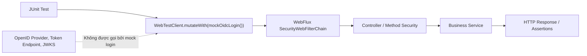

# 30.3. mockOidcLogin() với ID Token, UserInfo và authorities

## 1. Vì sao cần `mockOidcLogin()` khi kiểm thử Spring Security Reactive?

Trong một ứng dụng **Spring Security OAuth 2.0 / OpenID Connect (OIDC) Client** sử dụng **Spring WebFlux**, controller và service thường đọc thông tin của người dùng đã đăng nhập qua `Authentication`, `@AuthenticationPrincipal OidcUser` hoặc Reactive Security Context.

Ví dụ một endpoint `/api/me` cần trả tên, email và phòng ban của nhân viên. Một endpoint khác chỉ cho phép người dùng có authority `ROLE_MANAGER`. Khi kiểm thử hai endpoint này, mục tiêu thường **không phải** mở trình duyệt, truy cập OpenID Provider, thực hiện Authorization Code Flow, gọi Token Endpoint, tải JWKS rồi xác minh chữ ký ID Token cho mỗi test.

Spring Security Test cung cấp **`mockOidcLogin()`** để giả lập một phiên đăng nhập OIDC đã được xác thực **trong ngữ cảnh của WebTestClient**. Test có thể chỉ định:

- Nội dung **ID Token**: `sub`, `iss`, `aud`, `email`, `name`, tenant claims...
- Nội dung **UserInfo**: thông tin profile bổ sung như `preferred_username`, `department`, `locale`...
- **Granted authorities**: `ROLE_MANAGER`, `ROLE_ADMIN`, `SCOPE_employee.read` hoặc quyền nghiệp vụ do ứng dụng quy định.
- Một **`OidcUser`** tùy chỉnh khi cần mô phỏng principal phức tạp.
- **ClientRegistration** liên quan tới mocked login khi cần kiểm tra registration binding.

Ví dụ một test ngắn:

```java
client.mutateWith(mockOidcLogin()
                .idToken(token -> token
                        .claim("sub", "employee-4821")
                        .claim("email", "employee@example.test"))
                .userInfoToken(info -> info
                        .claim("department", "Engineering"))
                .authorities(
                        new SimpleGrantedAuthority("ROLE_MANAGER")))
        .get()
        .uri("/api/me")
        .exchange()
        .expectStatus().isOk();
```

Ở đây, `mockOidcLogin()` **không kết nối một OP thật và không chứng minh ID Token đã được ký hợp lệ**. Nó đặt một Authentication giả lập, đã xác thực, vào môi trường kiểm thử để bạn kiểm tra **logic sau login**: principal mapping, authorization rules, cách controller đọc claims và phản hồi của API.

> **Quy tắc trung tâm:** Dùng `mockOidcLogin()` để kiểm thử **ứng dụng khi đã có OIDC Authentication hợp lệ theo giả định của test**. Muốn kiểm thử Authorization Code, `state`/`nonce`, Token Endpoint, JWKS, JWS signature hay OIDC ID Token validation thật, hãy dùng integration test với mock/real test OpenID Provider và security filters tương ứng.

Bài thuộc chương **30. Kiểm thử Reactive** trong module **Spring Security OAuth 2.0 OIDC Client**. Nội dung tập trung vào Java 17+, Spring Boot 3.x, Spring Security 6.x và **WebFlux + WebTestClient**. Một số overload/behavior trong các phiên bản Spring Security có thể khác nhau; những đoạn code độc lập được trình bày với ranh giới rõ để thích nghi theo BOM thực tế.

### Mục tiêu sau bài

Sau khi học, bạn có thể:

1. Giải thích vị trí của `mockOidcLogin()` trong Spring Security Test Reactive.
2. Tạo `WebTestClient` có `springSecurity()` và dùng `mutateWith(mockOidcLogin())` đúng cách.
3. Tùy chỉnh ID Token claims với `idToken(...)` mà không tự tạo JWT/JWKS thật.
4. Tùy chỉnh UserInfo bằng `userInfoToken(...)` và phân biệt claims của ID Token với claims của UserInfo.
5. Dùng `authorities(...)` để kiểm thử `hasRole`, `hasAuthority` và phản hồi 200/403.
6. Đọc `OidcUser` bằng `@AuthenticationPrincipal` trong WebFlux controller.
7. Truyền `OidcUser` custom khi cần kiểm tra `DefaultOidcUser`/name attribute.
8. Phân biệt `mockOidcLogin()`, `mockOAuth2Login()`, `mockJwt()` và `@WithMockUser`.
9. Thiết kế positive/negative tests, tránh state leakage và false positives.
10. Biết rõ ranh giới giữa mocked login, authorized-client token store, tenant authorization và giao thức OIDC thực.

---

## 2. Bốn đối tượng khác nhau trong một phiên OIDC Login

Khi người dùng đăng nhập OIDC, cần phân biệt các thành phần sau.

| Thành phần | Ý nghĩa | Dùng trong test để làm gì? |
| --- | --- | --- |
| **`OidcIdToken`** | ID Token với claims về sự kiện xác thực, do OP phát hành trong flow thật | Giả lập `sub`, `iss`, `aud`, `name`, `email` và claims riêng |
| **`OidcUserInfo`** | Claims trả về từ UserInfo Endpoint của OP trong flow thật | Giả lập profile/department/locale mà ứng dụng sử dụng |
| **`OidcUser`** | Principal đã được Spring Security OIDC Login xây dựng sau xác minh | Đọc profile, ID Token, UserInfo trong controller/service |
| **`GrantedAuthority`** | Quyền gắn với Authentication/principal trong Spring Security | Kiểm thử `hasRole`, `hasAuthority`, `@PreAuthorize` |

Một phiên OIDC login thông thường trong Spring Security OAuth2 Client còn có `ClientRegistration` và `OAuth2AuthorizedClient`; nhưng chúng không đồng nghĩa với bốn đối tượng trên.

### 2.1. ID Token không phải Access Token

- **ID Token** nói về authentication của user đối với OIDC client.
- **Access Token** được dùng để gọi Resource Server theo scopes/audience.
- **Refresh Token** được dùng để xin token mới theo chính sách OP.

Nếu controller chỉ đọc `OidcUser.getIdToken()`, bạn không cần access token thật để kiểm thử controller. Nếu service gọi downstream API bằng bearer token lấy từ `OAuth2AuthorizedClient`, `mockOidcLogin()` **không tự chứng minh** token exchange hoặc authorized-client persistence đã đúng.

### 2.2. UserInfo không phải phương thức “nâng quyền” tự động

Một claim giả lập:

```json
{
  "sub": "employee-4821",
  "department": "Engineering",
  "locale": "vi-VN"
}
```

có thể được controller đọc để hiển thị hồ sơ. Nhưng `department=Engineering` **không tự tạo `ROLE_MANAGER`**. Nếu sản phẩm ánh xạ claim sang authority, hãy kiểm thử **mapper đó** ở đơn vị riêng và kiểm thử authorization với danh sách authorities đã xác định.

### 2.3. Authority không giống claim

| Chuỗi | Loại | Ý nghĩa với Spring Security |
| --- | --- | --- |
| `email=employee@example.test` | Claim | Dữ liệu hồ sơ, không tự cấp quyền |
| `roles=["manager"]` | Claim custom | Chỉ có ý nghĩa khi application mapper xử lý |
| `ROLE_MANAGER` | GrantedAuthority | Được `hasRole("MANAGER")` đối chiếu theo role prefix mặc định |
| `SCOPE_employee.read` | GrantedAuthority | Có thể được `hasAuthority("SCOPE_employee.read")` đối chiếu |
| `employee:approve` | GrantedAuthority custom | Có thể được `hasAuthority("employee:approve")` đối chiếu |
| `OidcUserAuthority` | Authority OIDC chứa ID Token/UserInfo | Không tự đồng nghĩa với `ROLE_ADMIN` |

**Không giả định** rằng sửa một claim `roles` bằng `idToken(...)` sẽ làm `hasRole(...)` thành công trong test. Test mutator chủ yếu giả lập principal/Authentication; hệ thống ánh xạ quyền của ứng dụng phải được kiểm thử riêng.

---

## 3. `mockOidcLogin()` thuộc bộ công cụ nào?

### 3.1. Dependency cần thiết

Gradle Kotlin DSL:

```kotlin
dependencies {
    implementation("org.springframework.boot:spring-boot-starter-webflux")
    implementation("org.springframework.boot:spring-boot-starter-security")
    implementation("org.springframework.boot:spring-boot-starter-oauth2-client")

    testImplementation("org.springframework.boot:spring-boot-starter-test")
    testImplementation("org.springframework.security:spring-security-test")
}
```

Maven:

```xml
<dependencies>
    <dependency>
        <groupId>org.springframework.boot</groupId>
        <artifactId>spring-boot-starter-webflux</artifactId>
    </dependency>
    <dependency>
        <groupId>org.springframework.boot</groupId>
        <artifactId>spring-boot-starter-security</artifactId>
    </dependency>
    <dependency>
        <groupId>org.springframework.boot</groupId>
        <artifactId>spring-boot-starter-oauth2-client</artifactId>
    </dependency>

    <dependency>
        <groupId>org.springframework.boot</groupId>
        <artifactId>spring-boot-starter-test</artifactId>
        <scope>test</scope>
    </dependency>
    <dependency>
        <groupId>org.springframework.security</groupId>
        <artifactId>spring-security-test</artifactId>
        <scope>test</scope>
    </dependency>
</dependencies>
```

`spring-security-test` cung cấp security testing utilities; WebFlux/WebTestClient cần Reactive Web server stack tương ứng. Dùng Spring Boot BOM/dependency management để giữ test library cùng phiên bản với Spring Security runtime.

### 3.2. Static import quan trọng

Trong **WebFlux + WebTestClient**, import:

```java
import static org.springframework.security.test.web.reactive.server
        .SecurityMockServerConfigurers.mockOidcLogin;

import static org.springframework.security.test.web.reactive.server
        .SecurityMockServerConfigurers.springSecurity;
```

Hai imports được ngắt dòng cho dễ đọc; trong Java, có thể viết trên một dòng:

```java
import static org.springframework.security.test.web.reactive.server.SecurityMockServerConfigurers.mockOidcLogin;
import static org.springframework.security.test.web.reactive.server.SecurityMockServerConfigurers.springSecurity;
```

**Không nhầm** với Servlet MockMvc:

```java
// Servlet/MockMvc — KHÔNG phải WebTestClient mutator:
import static org.springframework.security.test.web.servlet.request.SecurityMockMvcRequestPostProcessors.oidcLogin;
```

Hai API này có cùng mục tiêu mô phỏng OIDC login nhưng được thiết kế cho hai test stacks khác nhau.

### 3.3. Tên class chính

| API | Stack | Vai trò |
| --- | --- | --- |
| `SecurityMockServerConfigurers.mockOidcLogin()` | Reactive WebFlux | Tạo test mutator cho OIDC Authentication |
| `SecurityMockServerConfigurers.springSecurity()` | Reactive WebFlux | Áp Spring Security test integration vào WebTestClient |
| `WebTestClient.mutateWith(...)` | WebFlux testing | Tạo client có cấu hình test bổ sung |
| `SecurityMockMvcRequestPostProcessors.oidcLogin()` | Servlet MockMvc | Request post-processor cho OIDC login |
| `SecurityMockServerConfigurers.mockOAuth2Login()` | Reactive | OAuth2 Login user không nhất thiết là OIDC |
| `SecurityMockServerConfigurers.mockJwt()` | Reactive Resource Server | Giả lập inbound Bearer JWT Authentication |
| `@WithMockUser` | Method/security tests | Principal loại username/password, không tự có OIDC claims |

### 3.4. Test boundary: cái gì bị mô phỏng?



Mutator cung cấp security principal/authorities cho **request kiểm thử**. Nó không kích hoạt toàn bộ browser login redirect và không dùng private signing key của OP.

Do đó, `expectStatus().isOk()` với `mockOidcLogin()` chứng minh endpoint hoạt động khi có **Authentication giả lập** theo test; nó **không chứng minh** ứng dụng production sẽ chấp nhận một ID Token chưa ký.

---

## 4. Tạo môi trường WebFlux để minh họa

### 4.1. SecurityWebFilterChain của ứng dụng

Ví dụ một WebFlux app có các endpoints:

- `GET /api/me`: cần user đã đăng nhập.
- `GET /api/managers`: yêu cầu `ROLE_MANAGER`.
- `GET /api/reports`: yêu cầu `SCOPE_employee.read`.
- `GET /public/ping`: public.

```java
package com.example.employee.security;

import org.springframework.context.annotation.Bean;
import org.springframework.context.annotation.Configuration;
import org.springframework.http.HttpStatus;
import org.springframework.security.config.Customizer;
import org.springframework.security.config.annotation.web.reactive.EnableWebFluxSecurity;
import org.springframework.security.config.web.server.ServerHttpSecurity;
import org.springframework.security.web.server.SecurityWebFilterChain;
import org.springframework.security.web.server.authentication.HttpStatusServerEntryPoint;

@Configuration
@EnableWebFluxSecurity
public class WebSecurityConfig {

    @Bean
    SecurityWebFilterChain securityWebFilterChain(ServerHttpSecurity http) {
        return http
                .authorizeExchange(exchanges -> exchanges
                        .pathMatchers("/public/**").permitAll()
                        .pathMatchers("/api/managers").hasRole("MANAGER")
                        .pathMatchers("/api/reports")
                            .hasAuthority("SCOPE_employee.read")
                        .pathMatchers("/api/**").authenticated()
                        .anyExchange().permitAll())
                .exceptionHandling(errors -> errors
                        .authenticationEntryPoint(
                                new HttpStatusServerEntryPoint(
                                        HttpStatus.UNAUTHORIZED)))
                .oauth2Login(Customizer.withDefaults())
                .build();
    }
}
```

**Chú ý:** `oauth2Login()` cần `ReactiveClientRegistrationRepository` hợp lệ trong application context, hoặc cấu hình Spring Boot OAuth2 client registrations tương ứng. Phần 4.2 cung cấp một registration synthetic trong môi trường test để context có thể khởi tạo **mà không liên hệ OP thật**.

`HttpStatusServerEntryPoint(UNAUTHORIZED)` được cấu hình để các test anonymous API có thể kỳ vọng HTTP 401 thay vì bị redirect tới trang đăng nhập. Đây là một chính sách rõ ràng cho ví dụ; trong ứng dụng web browser thực, entry point có thể redirect 302 và test phải phản ánh cấu hình thật.

### 4.2. ClientRegistration test không gọi mạng

```java
package com.example.employee.security;

import org.springframework.boot.test.context.TestConfiguration;
import org.springframework.context.annotation.Bean;
import org.springframework.security.oauth2.client.registration.ClientRegistration;
import org.springframework.security.oauth2.client.registration.InMemoryReactiveClientRegistrationRepository;
import org.springframework.security.oauth2.client.registration.ReactiveClientRegistrationRepository;
import org.springframework.security.oauth2.core.AuthorizationGrantType;
import org.springframework.security.oauth2.core.ClientAuthenticationMethod;

@TestConfiguration
public class TestOidcRegistrations {

    @Bean
    ReactiveClientRegistrationRepository testClientRegistrations() {
        ClientRegistration corporate =
                ClientRegistration.withRegistrationId("corporate-oidc")
                        .clientId("employee-portal-test")
                        .clientSecret("synthetic-test-secret")
                        .clientAuthenticationMethod(
                                ClientAuthenticationMethod.CLIENT_SECRET_BASIC)
                        .authorizationGrantType(
                                AuthorizationGrantType.AUTHORIZATION_CODE)
                        .redirectUri(
                                "{baseUrl}/login/oauth2/code/{registrationId}")
                        .authorizationUri(
                                "https://issuer.example.test/oauth2/authorize")
                        .tokenUri("https://issuer.example.test/oauth2/token")
                        .jwkSetUri(
                                "https://issuer.example.test/.well-known/jwks.json")
                        .issuerUri("https://issuer.example.test")
                        .userInfoUri("https://issuer.example.test/userinfo")
                        .userNameAttributeName("sub")
                        .scope("openid", "profile", "email")
                        .build();

        return new InMemoryReactiveClientRegistrationRepository(corporate);
    }
}
```

Ở đây ta cố tình **cấu hình tường minh** các endpoints thay vì dùng `issuer-uri` để trigger discovery trong lúc startup. Các `example.test` URLs là test fixtures, không phải OP thật.

Nếu ứng dụng đã có `ReactiveClientRegistrationRepository` trong test context, **không đăng ký thêm bean trùng kiểu** mà không có chủ đích. Có thể dùng `@MockBean`/`@MockitoBean` hoặc test profile tùy Spring Boot version, nhưng nên giữ cấu hình thống nhất để test tập trung vào logic cần kiểm thử.

### 4.3. Controller đọc ID Token và UserInfo

```java
package com.example.employee.web;

import java.util.LinkedHashMap;
import java.util.Map;

import org.springframework.security.core.annotation.AuthenticationPrincipal;
import org.springframework.security.oauth2.core.oidc.user.OidcUser;
import org.springframework.web.bind.annotation.GetMapping;
import org.springframework.web.bind.annotation.RestController;

import reactor.core.publisher.Mono;

@RestController
public class EmployeeProfileController {

    @GetMapping("/public/ping")
    public Mono<String> ping() {
        return Mono.just("pong");
    }

    @GetMapping("/api/me")
    public Mono<Map<String, String>> me(
            @AuthenticationPrincipal OidcUser oidcUser) {

        Map<String, String> response = new LinkedHashMap<>();

        response.put("subject",
                oidcUser.getIdToken().getSubject());

        response.put("issuer",
                oidcUser.getIdToken().getClaimAsString("iss"));

        response.put("name",
                oidcUser.getIdToken().getClaimAsString("name"));

        if (oidcUser.getUserInfo() != null) {
            response.put("department",
                    oidcUser.getUserInfo().getClaimAsString("department"));
            response.put("locale",
                    oidcUser.getUserInfo().getClaimAsString("locale"));
        }

        return Mono.just(response);
    }

    @GetMapping("/api/managers")
    public Mono<String> managers() {
        return Mono.just("manager-visible");
    }

    @GetMapping("/api/reports")
    public Mono<String> reports() {
        return Mono.just("report-visible");
    }
}
```

Phần `@AuthenticationPrincipal OidcUser` là nơi test `mockOidcLogin()` phát huy tác dụng. Endpoint không cần tự parse JWT hoặc tải UserInfo: Spring Security đã cung cấp `OidcUser` đã được giả lập cho request test.

Trong production, Controller phải nhận `OidcUser` **đã qua OIDC authentication pipeline**, không tạo user từ JSON JWT tự decode.

---

## 5. Tạo WebTestClient có tích hợp Spring Security

### 5.1. Sử dụng `springSecurity()` với application context

Một pattern phổ biến:

```java
import org.junit.jupiter.api.BeforeEach;
import org.springframework.beans.factory.annotation.Autowired;
import org.springframework.context.ApplicationContext;
import org.springframework.test.web.reactive.server.WebTestClient;

import static org.springframework.security.test.web.reactive.server.SecurityMockServerConfigurers.springSecurity;

class EmployeeSecurityTest {

    @Autowired
    ApplicationContext applicationContext;

    WebTestClient client;

    @BeforeEach
    void setUp() {
        client = WebTestClient
                .bindToApplicationContext(applicationContext)
                .apply(springSecurity())
                .configureClient()
                .build();
    }
}
```

Đây là fragment của lớp test đã có Spring Test/JUnit extension hoặc `@SpringBootTest`/`@Import` thích hợp. Không tự chạy được nếu thiếu annotation khởi tạo test context.

**`apply(springSecurity())` rất quan trọng**: nó lắp Spring Security test integration với WebTestClient. Nếu bạn chỉ bind controller không gắn đúng SecurityWebFilterChain hoặc dùng client không áp `springSecurity()`, mutator có thể không có hiệu lực như kỳ vọng.

### 5.2. Một test class độc lập với Spring Boot

```java
package com.example.employee.web;

import com.example.employee.security.TestOidcRegistrations;
import com.example.employee.security.WebSecurityConfig;

import org.junit.jupiter.api.BeforeEach;
import org.junit.jupiter.api.Test;
import org.springframework.beans.factory.annotation.Autowired;
import org.springframework.boot.test.context.SpringBootTest;
import org.springframework.context.ApplicationContext;
import org.springframework.context.annotation.Import;
import org.springframework.test.web.reactive.server.WebTestClient;

import static org.springframework.security.test.web.reactive.server.SecurityMockServerConfigurers.mockOidcLogin;
import static org.springframework.security.test.web.reactive.server.SecurityMockServerConfigurers.springSecurity;

@SpringBootTest(webEnvironment = SpringBootTest.WebEnvironment.MOCK)
@Import(TestOidcRegistrations.class)
class EmployeeProfileSecurityTest {

    @Autowired
    ApplicationContext context;

    WebTestClient client;

    @BeforeEach
    void setUp() {
        client = WebTestClient
                .bindToApplicationContext(context)
                .apply(springSecurity())
                .configureClient()
                .build();
    }

    @Test
    void mockedOidcLoginCanReadIdTokenSubject() {
        client.mutateWith(mockOidcLogin()
                        .idToken(idToken -> idToken
                                .claim("sub", "employee-4821")))
                .get()
                .uri("/api/me")
                .exchange()
                .expectStatus().isOk()
                .expectBody()
                .jsonPath("$.subject")
                    .isEqualTo("employee-4821");
    }
}
```

Test trên giả định application context có controller `EmployeeProfileController` và `WebSecurityConfig` trong component scanning. Nếu test không có class `@SpringBootApplication` để bootstrap, cần `@ContextConfiguration` hoặc test configuration tương ứng.

Điều đáng chú ý:

- Mỗi `mutateWith(mockOidcLogin())` tạo client có security test state cho request kiểm thử.
- `idToken(...)` thay claim `sub` trong mock ID Token.
- Controller nhận một `OidcUser` có ID Token được giả lập.
- Test không sử dụng HTTP server thật vì `bindToApplicationContext`; filter/security behavior vẫn được kiểm thử trong in-memory WebFlux stack.
- Không có JWS signature, JWKS HTTP hoặc Token Endpoint nào được gọi bởi mutator.

### 5.3. Vì sao không dùng `with(oidcLogin())` ở WebTestClient?

Đây là ví dụ **Servlet MockMvc**:

```java
mockMvc.perform(get("/api/me")
        .with(oidcLogin()))
        .andExpect(status().isOk());
```

Với WebFlux, cú pháp đúng là:

```java
webTestClient
        .mutateWith(mockOidcLogin())
        .get()
        .uri("/api/me")
        .exchange();
```

Không trộn các API test infrastructure; chúng có filters, context và request abstractions khác nhau.

---

## 6. Tùy chỉnh ID Token bằng `idToken(...)`

### 6.1. Mục tiêu: kiểm thử logic đọc claims

Spring Security Test cho phép:

```java
mockOidcLogin()
        .idToken(idToken -> idToken
                .claim("sub", "employee-4821")
                .claim("iss", "https://issuer.example.test")
                .claim("aud", java.util.List.of("employee-portal-test"))
                .claim("name", "Lan Nguyen")
                .claim("email", "lan@example.test"));
```

Trong đoạn trên, `idToken` là **builder consumer** được test mutator sử dụng để tạo `OidcIdToken` giả. Các giá trị giả này giúp controller nhận đúng `OidcUser.getIdToken()`.

**Đây không phải đoạn code tạo JWT có chữ ký.** Mutator không chạy trình tự thực tế: JWS signing, JWKS retrieval, issuer verification, nonce validation hoặc redirect của Authorization Code Flow.

### 6.2. Test nhiều claims trong một request

Giả sử controller `/api/me` ở mục 4.3. Test:

```java
@Test
void meReadsSubjectIssuerAndNameFromMockIdToken() {
    client.mutateWith(mockOidcLogin()
                    .idToken(token -> token
                            .claim("sub", "employee-4821")
                            .claim("iss", "https://issuer.example.test")
                            .claim("aud", java.util.List.of("employee-portal-test"))
                            .claim("name", "Lan Nguyen")
                            .claim("email", "lan@example.test")))
            .get()
            .uri("/api/me")
            .exchange()
            .expectStatus().isOk()
            .expectBody()
            .jsonPath("$.subject").isEqualTo("employee-4821")
            .jsonPath("$.issuer")
                .isEqualTo("https://issuer.example.test")
            .jsonPath("$.name").isEqualTo("Lan Nguyen");
}
```

Khi test này pass, bạn biết:

- Reactive WebTestClient truyền mock OIDC Authentication đến controller.
- `@AuthenticationPrincipal OidcUser` có thể truy cập ID Token.
- Controller đưa các claims đó vào response đúng cách.
- SecurityWebFilterChain cho phép Authentication đã xác thực đi tới endpoint.

Bạn **chưa chứng minh** OP phát hành claims thật như vậy, claims được signature verified hoặc ID Token được cấp cho đúng client.

### 6.3. Claims chỉ nên giả lập với kiểu dữ liệu tương ứng

| Claim | Kiểu hay gặp | Lưu ý |
| --- | --- | --- |
| `sub` | String | Identity trong issuer, không tự unique giữa các issuers |
| `iss` | String URL | Expected issuer trong OIDC protocol |
| `aud` | String hoặc array Strings trong JSON | Phải chứa OAuth client ID trong validation thật |
| `exp` | Number/Instant trong decoder abstraction | Thời hạn token, không tự được mock mutator xác minh |
| `iat` | Number/Instant | Thời điểm cấp |
| `nonce` | String | Liên kết authorization request trong flow thật |
| `email` | String | Có thể đến ID Token hoặc UserInfo |
| `email_verified` | Boolean | Không nên giả bằng String `"true"` nếu code kỳ vọng boolean |
| `roles` | Array/Set tùy OP contract | Chưa phải GrantedAuthority nếu không mapping |
| `tenant_id` | String (custom) | Phải có tenant authorization policy ngoài claim |

Nếu controller làm:

```java
boolean verified = Boolean.TRUE.equals(
        oidcUser.getIdToken().getClaimAsBoolean("email_verified"));
```

thì test nên dùng:

```java
.idToken(token -> token
        .claim("email_verified", true))
```

chứ không dùng string `"true"` để che lỗi type conversion.

### 6.4. `sub` từ ID Token và name của OidcUser

Trong OIDC, `sub` là subject do issuer cấp. `OidcUser.getName()` có thể được xây dựng theo `nameAttributeKey` đã cấu hình (thường liên quan `sub`), nên **đừng đánh đồng tùy ý `getName()` với email hoặc `preferred_username`**.

Nếu ứng dụng dùng subject làm identity key:

```java
String subject = oidcUser.getIdToken().getSubject();
```

Nếu ứng dụng đã có một mapping verified `(iss, sub)` sang internal user ID, hãy test mapper/authorization của ứng dụng riêng; `mockOidcLogin` chỉ tạo principal theo dữ liệu test cung cấp.

### 6.5. Có thể mock ID Token expired hoặc sai issuer không?

Bạn có thể tạo **claims giả** với thời điểm/issuer bất kỳ:

```java
mockOidcLogin().idToken(token -> token
        .claim("iss", "https://wrong-issuer.example.test")
        .claim("sub", "employee-4821"));
```

Nhưng điều quan trọng là: **test mutator không xác minh issuer hoặc chữ ký** trước khi đặt Authentication vào request. Vì vậy, nếu test kỳ vọng Spring Security OIDC Login tự từ chối login chỉ do `iss` ở mock khác, đó là **test sai tầng**.

Chỉ dùng case sai issuer ở `mockOidcLogin` khi mục đích là **kiểm tra một guard nghiệp vụ tùy chỉnh** đọc expected issuer từ Authentication đã có. Muốn kiểm tra OIDC protocol validation, phải chạy flow với mock OP/Token Endpoint/JWKS hoặc test decoder/provider thật.

### 6.6. Không sửa role bằng ID Token claim rồi kỳ vọng được phân quyền

Ví dụ:

```java
mockOidcLogin()
        .idToken(token -> token
                .claim("roles", java.util.List.of("MANAGER")));
```

đoạn này **chưa có ý nghĩa** `hasRole("MANAGER")` nếu app chưa chuyển claim `roles` thành authority. Đó chính là lý do `authorities(...)` có ý nghĩa riêng ở phần 8.

---

## 7. Tùy chỉnh UserInfo bằng `userInfoToken(...)`

### 7.1. UserInfo trong OIDC thật là gì?

Trong OIDC, **UserInfo Endpoint** là một endpoint của OP cho phép RP lấy thêm claims về end user bằng một access token phù hợp. Khi có UserInfo trong Spring Security OIDC Login, các claims có thể được biểu diễn bằng `OidcUserInfo` và gắn với `OidcUser`.

Ví dụ dữ liệu UserInfo:

```json
{
  "sub": "employee-4821",
  "preferred_username": "lan",
  "department": "Engineering",
  "locale": "vi-VN",
  "picture": "https://images.example.test/avatar/4821.png"
}
```

Trong protocol thật, `sub` từ UserInfo phải khớp `sub` của ID Token theo quy tắc OIDC. Các claims UserInfo cũng có thể không được trả do scopes, consent hoặc chính sách OP.

### 7.2. Dùng `userInfoToken(...)` trong reactive test

```java
@Test
void meReadsProfileFromMockUserInfo() {
    client.mutateWith(mockOidcLogin()
                    .idToken(idToken -> idToken
                            .claim("sub", "employee-4821")
                            .claim("name", "Lan Nguyen"))
                    .userInfoToken(info -> info
                            .claim("sub", "employee-4821")
                            .claim("department", "Engineering")
                            .claim("locale", "vi-VN")
                            .claim("preferred_username", "lan")))
            .get()
            .uri("/api/me")
            .exchange()
            .expectStatus().isOk()
            .expectBody()
            .jsonPath("$.subject").isEqualTo("employee-4821")
            .jsonPath("$.department").isEqualTo("Engineering")
            .jsonPath("$.locale").isEqualTo("vi-VN");
}
```

Ở đây:

- `idToken(...)` xác định claims ID Token.
- `userInfoToken(...)` xác định claims UserInfo.
- Controller lấy `getUserInfo().getClaimAsString("department")`.
- Không có UserInfo HTTP GET thực sự.

### 7.3. Vì sao nên kiểm tra ID Token và UserInfo riêng?

Một claim có thể xuất hiện ở cả hai nguồn. Nếu controller chỉ gọi:

```java
oidcUser.getClaimAsString("name")
```

thì test có thể không phát hiện bạn đang đọc nhầm nguồn khi dữ liệu trùng nhau. Để kiểm tra rõ ràng:

```java
String nameFromIdToken =
        oidcUser.getIdToken().getClaimAsString("name");

String departmentFromUserInfo =
        oidcUser.getUserInfo() == null
                ? null
                : oidcUser.getUserInfo()
                          .getClaimAsString("department");
```

Ở production, cách sử dụng `OidcUser.getClaims()`/`getClaimAsString(...)` có thể liên quan quá trình merge ID Token và UserInfo theo implementation. **Không giả định một claim luôn ưu tiên ID Token hoặc UserInfo nếu application có chính sách rõ về nguồn tin cậy.**

### 7.4. UserInfo có thể không tồn tại

Không phải mọi OIDC Login đều trả UserInfo. Application cần quyết định:

- Nếu không có UserInfo, có chấp nhận profile tối thiểu từ ID Token không?
- `department` thiếu có khiến ứng dụng từ chối một nghiệp vụ nhạy cảm không?
- Nếu UserInfo HTTP call lỗi, login flow thất bại hay fallback theo OP/framework policy?
- Có được dùng default department không, và default đó có vô tình cấp quyền?

Ví dụ controller ở mục 4 kiểm tra `userInfo != null`, nên trong test có thể kiểm tra response không có `department` hoặc nhận giá trị null tùy JSON serialization của controller. Không để `NullPointerException` trở thành lỗi production không dự đoán.

### 7.5. Mock UserInfo không test UserInfo Endpoint thật

Nếu test pass với:

```java
.userInfoToken(info -> info
        .claim("department", "Engineering"))
```

thì bạn **không biết**:

- AS có cấp access token cho UserInfo hay không.
- UserInfo Endpoint có reachable không.
- `OidcUserService`/`ReactiveOidcUserService` có gọi đúng HTTP endpoint không.
- Response HTTP có `sub` trùng ID Token không.
- Server có trả `department` khi chỉ xin `openid profile` không.
- Claims mapper/security controls của OP có cấu hình đúng không.

Những điều đó cần một test khác có fake OP hoặc integration environment.

### 7.6. Đừng dùng UserInfo custom claim để thay thế policy

Ví dụ `department=Finance` hay `tenant=north` có thể là dữ liệu profile. Nếu nghiệp vụ cần quyền approve invoices, phải kiểm tra nguồn claim/issuer, mapping authority và account authorization thật.

Đặc biệt trong test, `mockOidcLogin()` cho phép gán bất cứ claim nào mà không xác minh nguồn; điều này giúp test edge cases nhưng **không tạo bảo đảm bảo mật cho production**.

---

## 8. `authorities(...)`: kiểm thử role và permission chính xác

### 8.1. Authority là gì?

Trong Spring Security, `GrantedAuthority` có phương thức `getAuthority()` trả về một chuỗi.

Ví dụ:

```java
new SimpleGrantedAuthority("ROLE_MANAGER");
new SimpleGrantedAuthority("SCOPE_employee.read");
new SimpleGrantedAuthority("employee:approve");
```

Hai biểu thức authorization thông dụng:

```java
hasRole("MANAGER")
hasAuthority("SCOPE_employee.read")
```

Mặc định `hasRole("MANAGER")` tương ứng authority `ROLE_MANAGER`. `hasAuthority(...)` so khớp đúng chuỗi được cung cấp.

### 8.2. Test người có role MANAGER được vào endpoint

```java
import org.springframework.security.core.authority.SimpleGrantedAuthority;

@Test
void managerRoleCanAccessManagersEndpoint() {
    client.mutateWith(mockOidcLogin()
                    .authorities(
                            new SimpleGrantedAuthority("ROLE_MANAGER")))
            .get()
            .uri("/api/managers")
            .exchange()
            .expectStatus().isOk()
            .expectBody(String.class)
            .isEqualTo("manager-visible");
}
```

Security rule ở mục 4:

```java
.pathMatchers("/api/managers").hasRole("MANAGER")
```

Test chứng minh rule nhận authority `ROLE_MANAGER`, không cần OP hoặc signing key thật.

### 8.3. Test người không có role bị 403

```java
@Test
void userWithoutManagerRoleIsForbidden() {
    client.mutateWith(mockOidcLogin()
                    .authorities(
                            new SimpleGrantedAuthority("ROLE_VIEWER")))
            .get()
            .uri("/api/managers")
            .exchange()
            .expectStatus().isForbidden();
}
```

Đây là một **negative test quan trọng**. Nếu chỉ test manager được 200 mà không test viewer bị 403, rule có thể bị cấu hình `permitAll()` nhưng test happy path vẫn pass.

### 8.4. Test authority dạng scope

```java
@Test
void readerScopeCanAccessReports() {
    client.mutateWith(mockOidcLogin()
                    .authorities(
                            new SimpleGrantedAuthority(
                                    "SCOPE_employee.read")))
            .get()
            .uri("/api/reports")
            .exchange()
            .expectStatus().isOk()
            .expectBody(String.class)
            .isEqualTo("report-visible");
}

@Test
void wrongScopeCannotAccessReports() {
    client.mutateWith(mockOidcLogin()
                    .authorities(
                            new SimpleGrantedAuthority(
                                    "SCOPE_employee.write")))
            .get()
            .uri("/api/reports")
            .exchange()
            .expectStatus().isForbidden();
}
```

**Lưu ý:** `SCOPE_employee.read` là một **chuỗi GrantedAuthority trong mock**. Nó không chứng minh application đã được OP cấp scope thật hoặc Access Token được Resource Server chấp nhận. Đó là vấn đề của token/grant/integration tests.

### 8.5. Gán nhiều authorities

```java
mockOidcLogin().authorities(
        new SimpleGrantedAuthority("ROLE_MANAGER"),
        new SimpleGrantedAuthority("SCOPE_employee.read"),
        new SimpleGrantedAuthority("employee:approve"));
```

Khi một endpoint cần cả role và permission, test nên có ít nhất:

- Đủ tất cả quyền → 200.
- Có role nhưng thiếu permission → 403.
- Có permission nhưng thiếu role → 403.
- Không có quyền → 403.
- Anonymous → 401/redirect tùy entry point.

### 8.6. Một claim roles không tự biến thành `ROLE_*`

Ví dụ:

```java
mockOidcLogin()
        .idToken(token -> token
                .claim("roles", java.util.List.of("MANAGER")))
        .authorities(new SimpleGrantedAuthority("ROLE_VIEWER"));
```

Với SecurityWebFilterChain dùng `hasRole("MANAGER")`, test **nên bị 403** vì Authentication chỉ có `ROLE_VIEWER` theo cách mock được thiết lập.

Nếu ứng dụng thực sử dụng một custom `GrantedAuthoritiesMapper` chuyển ID Token/UserInfo claims thành `ROLE_MANAGER`, thì test mutator **không nên được coi là bằng chứng mapper đã chạy**. Tách:

1. Unit test mapper với claims synthetic.
2. WebTestClient test authorization với authorities đã map.
3. Integration test OIDC Login khi cần xác nhận mapper được wired vào login pipeline.

### 8.7. `OidcUserAuthority` và scopes

Một OIDC principal thật thường có authorities từ OIDC login mapping, có thể bao gồm `OidcUserAuthority` và scope-based authorities tùy framework/configuration. Nhưng khi bạn gọi `authorities(...)` trong mutator, hãy nghĩ rằng test đang **chỉ định quyền muốn mô phỏng**, không dựa vào mọi default authority của phiên đăng nhập production.

Không dùng một assumption như:

```text
ID Token claim scope=employee.read
    -> mockOidcLogin automatically grants SCOPE_employee.read
```

nếu application chưa kiểm tra rõ quá trình mapping. Đặt explicit authorities để test nói đúng ý định.

### 8.8. Role prefix

Mặc định trong nhiều cấu hình:

```text
hasRole("MANAGER")  -> expects ROLE_MANAGER
hasAuthority("ROLE_MANAGER") -> expects exact ROLE_MANAGER
hasAuthority("MANAGER") -> expects exact MANAGER
```

Nếu dự án tùy biến role prefix, cần điều chỉnh kỳ vọng theo cấu hình thật. Không “sửa test” bằng cách cho mọi user `ROLE_ADMIN` khi code đang check permission cụ thể.

---

## 9. Kết hợp ID Token, UserInfo và authorities trong một test

Một test điển hình:

```java
@Test
void managerWithEngineeringProfileCanReadHerProfile() {
    client.mutateWith(mockOidcLogin()
                    .idToken(token -> token
                            .claim("sub", "employee-4821")
                            .claim("iss", "https://issuer.example.test")
                            .claim("name", "Lan Nguyen")
                            .claim("email", "lan@example.test"))
                    .userInfoToken(info -> info
                            .claim("sub", "employee-4821")
                            .claim("department", "Engineering")
                            .claim("locale", "vi-VN"))
                    .authorities(
                            new SimpleGrantedAuthority("ROLE_MANAGER"),
                            new SimpleGrantedAuthority(
                                    "SCOPE_employee.read")))
            .get()
            .uri("/api/me")
            .exchange()
            .expectStatus().isOk()
            .expectBody()
            .jsonPath("$.subject").isEqualTo("employee-4821")
            .jsonPath("$.issuer")
                .isEqualTo("https://issuer.example.test")
            .jsonPath("$.name").isEqualTo("Lan Nguyen")
            .jsonPath("$.department").isEqualTo("Engineering")
            .jsonPath("$.locale").isEqualTo("vi-VN");
}
```

Trong cùng một test, có thể kiểm tra quyền:

```java
@Test
void sameMockedAuthoritiesPermitBothManagerAndReportsEndpoints() {
    var oidcManager = mockOidcLogin()
            .idToken(token -> token.claim("sub", "employee-4821"))
            .authorities(
                    new SimpleGrantedAuthority("ROLE_MANAGER"),
                    new SimpleGrantedAuthority(
                            "SCOPE_employee.read"));

    WebTestClient authenticatedClient =
            client.mutateWith(oidcManager);

    authenticatedClient.get()
            .uri("/api/managers")
            .exchange()
            .expectStatus().isOk();

    authenticatedClient.get()
            .uri("/api/reports")
            .exchange()
            .expectStatus().isOk();
}
```

Trong bài toán thực, cũng nên tạo **mỗi test một mock identity rõ ràng** để tránh một test “bị rò quyền” sang test khác do reuse client đã mutate. Không dùng một shared mutable static WebTestClient có Authentication thay đổi trên toàn bộ test suite.

---

## 10. Thêm negative tests cho anonymous và sai authority

### 10.1. Anonymous không được xem profile

Với `SecurityWebFilterChain` ở mục 4 cấu hình entry point trả 401:

```java
@Test
void anonymousCannotReadProfile() {
    client.get()
            .uri("/api/me")
            .exchange()
            .expectStatus().isUnauthorized();
}
```

Nếu ứng dụng thực có OIDC redirect-to-login entry point, status có thể là **302**. Khi đó test phải kiểm tra redirect đúng, không ép ứng dụng thay security config chỉ để test 401.

### 10.2. User đã login nhưng thiếu quyền → 403

```java
@Test
void authenticatedViewerCannotReadManagerData() {
    client.mutateWith(mockOidcLogin()
                    .authorities(
                            new SimpleGrantedAuthority("ROLE_VIEWER")))
            .get()
            .uri("/api/managers")
            .exchange()
            .expectStatus().isForbidden();
}
```

**401 vs 403:**

- 401 thường là chưa có authentication hợp lệ theo policy HTTP API.
- 403 là đã xác thực nhưng không đủ quyền.
- Browser OAuth2 Login có thể dùng 302 redirect thay vì 401.
- Một ứng dụng có custom entry point/access-denied handler có thể xử lý khác; test cần phản ánh contract thực.

### 10.3. Không dựa vào mock default authorities ở negative test

Nếu muốn test thiếu `ROLE_MANAGER`, hãy đưa explicit authorities không chứa role đó:

```java
.authorities(new SimpleGrantedAuthority("ROLE_VIEWER"))
```

Không viết:

```java
.mutateWith(mockOidcLogin())
```

rồi giả định mặc định chắc chắn không có authority nào. Default mock principal/authorities có thể khác theo phiên bản hoặc mutator configuration.

### 10.4. Nếu endpoint có cả Authentication và business authorization

Giả sử route `/api/employees/{id}` chỉ được xem khi user xem **chính mình** hoặc có quyền `employee:read:any`. Khi test, cần:

- User `sub=employee-4821` đọc `employee-4821` → 200.
- User `sub=employee-4821` đọc `employee-9274` → 403.
- User có authority `employee:read:any` đọc người khác → 200 theo policy.
- User thiếu registration/tenant membership hợp lệ → 403.
- Anonymous → 401/redirect.

`mockOidcLogin()` giúp cấp một identity cho các case đó, nhưng **business service vẫn phải kiểm tra quyền trên object**; không chỉ dựa vào `hasRole` ở security filter.

---

## 11. Dùng một `OidcUser` tùy chỉnh khi cần mô phỏng principal phức tạp

### 11.1. Khi nào `idToken(...)` và `userInfoToken(...)` chưa đủ?

Trong phần lớn controller tests, những mutator methods có sẵn là đủ. Nhưng bạn có thể muốn mô phỏng:

- Một `OidcUser` có `nameAttributeKey` khác `sub`.
- Một principal có authorities được tính trước bởi mapper.
- Một object `DefaultOidcUser` với ID Token và UserInfo đã chuẩn bị.
- Một custom `OidcUser` implementation do ứng dụng sử dụng.
- Một case đặc biệt của claim mapping mà các builders mặc định không mô phỏng theo mong muốn.

Khi đó dùng `mockOidcLogin().oidcUser(customUser)`.

### 11.2. Tạo `OidcIdToken` và `OidcUserInfo` bằng dữ liệu synthetic

```java
import java.time.Instant;
import java.util.List;
import java.util.Map;

import org.springframework.security.core.GrantedAuthority;
import org.springframework.security.core.authority.SimpleGrantedAuthority;
import org.springframework.security.oauth2.core.oidc.OidcIdToken;
import org.springframework.security.oauth2.core.oidc.OidcUserInfo;
import org.springframework.security.oauth2.core.oidc.user.DefaultOidcUser;
import org.springframework.security.oauth2.core.oidc.user.OidcUser;

Instant issued = Instant.now();
Instant expires = issued.plusSeconds(600);

OidcIdToken idToken = new OidcIdToken(
        "synthetic-test-id-token",
        issued,
        expires,
        Map.of(
                "iss", "https://issuer.example.test",
                "sub", "employee-4821",
                "aud", List.of("employee-portal-test"),
                "name", "Lan Nguyen"));

OidcUserInfo userInfo = new OidcUserInfo(Map.of(
        "sub", "employee-4821",
        "preferred_username", "lan",
        "department", "Engineering"));

List<GrantedAuthority> authorities = List.of(
        new SimpleGrantedAuthority("ROLE_MANAGER"),
        new SimpleGrantedAuthority("SCOPE_employee.read"));

OidcUser customUser = new DefaultOidcUser(
        authorities,
        idToken,
        userInfo,
        "preferred_username");
```

Đây là các objects giả lập **chỉ dành cho test**. Chuỗi `synthetic-test-id-token` không phải JWS thật và không được gửi tới OP/Resource Server.

Trong `DefaultOidcUser`:

- `getIdToken()` trả `idToken` đã truyền.
- `getUserInfo()` trả `userInfo` đã truyền.
- `getAuthorities()` chứa authorities test xác định.
- `getName()` được điều khiển bằng name attribute key khi constructor tương ứng được dùng.
- `getIdToken().getSubject()` vẫn là subject OIDC; không tự thay bằng username hiển thị.

### 11.3. Truyền custom user vào WebTestClient

```java
client.mutateWith(mockOidcLogin().oidcUser(customUser))
        .get()
        .uri("/api/me")
        .exchange()
        .expectStatus().isOk()
        .expectBody()
        .jsonPath("$.subject").isEqualTo("employee-4821")
        .jsonPath("$.department").isEqualTo("Engineering");
```

Nếu test cần kiểm tra `Authentication.getName()` thay vì `OidcIdToken.getSubject()`, xây endpoint/test riêng để quan sát name attribute theo đúng contract của ứng dụng; controller mẫu ở mục 4 chủ ý đọc `sub` trực tiếp.

### 11.4. Tránh dùng custom user để che lỗi mapper

Nếu ứng dụng có `GrantedAuthoritiesMapper` chuyển `OidcUserAuthority` thành `ROLE_MANAGER`, nhưng test tạo sẵn:

```java
new DefaultOidcUser(
        List.of(new SimpleGrantedAuthority("ROLE_MANAGER")),
        idToken,
        userInfo);
```

thì test endpoint chỉ xác nhận **role đã được cung cấp dẫn tới hành vi mong đợi**. Nó chưa xác nhận mapper tạo đúng role từ OP claims.

Nên có test riêng cho mapper và, khi cần, integration test chạy authentication provider thật. Không gọi `mockOidcLogin` là test OIDC login hoàn chỉnh.

---

## 12. Tùy chỉnh `ClientRegistration` trong mocked login

### 12.1. Tại sao registration ID lại quan trọng?

Một ứng dụng nhiều OP/tenants có thể đăng ký:

```text
north-oidc  -> https://login.north.example.test
south-oidc  -> https://login.south.example.test
```

`OAuth2AuthenticationToken` gắn với một authorized-client registration ID, còn `OidcUser` chứa claims ID Token/UserInfo. Nếu controller hoặc service kiểm tra **đúng registration** mà user đã đăng nhập, test phải mô phỏng registration phù hợp.

Không dùng một mocked user của North nhưng để registration ID mặc định rồi kết luận tenant authorization đã được kiểm thử.

### 12.2. Chỉ định registration rõ ràng

Giả sử test đã tạo một `ClientRegistration` hợp lệ:

```java
ClientRegistration corporate = ClientRegistration
        .withRegistrationId("corporate-oidc")
        .clientId("employee-portal-test")
        .clientSecret("synthetic-test-secret")
        .authorizationGrantType(AuthorizationGrantType.AUTHORIZATION_CODE)
        .redirectUri("{baseUrl}/login/oauth2/code/{registrationId}")
        .authorizationUri("https://issuer.example.test/oauth2/authorize")
        .tokenUri("https://issuer.example.test/oauth2/token")
        .jwkSetUri("https://issuer.example.test/jwks")
        .issuerUri("https://issuer.example.test")
        .scope("openid")
        .build();

client.mutateWith(mockOidcLogin()
                .clientRegistration(corporate)
                .idToken(token -> token
                        .claim("sub", "employee-4821")
                        .claim("iss", "https://issuer.example.test")))
        .get()
        .uri("/api/me")
        .exchange()
        .expectStatus().isOk();
```

Cần imports `ClientRegistration` và `AuthorizationGrantType`. Với ứng dụng có config tường minh, có thể dùng ClientRegistration đã định nghĩa ở `TestOidcRegistrations` để không duplicate.

**Giới hạn:** Custom `clientRegistration(...)` trong test **không kiểm chứng** client đã thực sự được OP cấp quyền, redirect URI hợp lệ tại OP hoặc ID Token audience được decoder kiểm tra. Nó giả lập registration context cho controller và security rules.

### 12.3. Kiểm tra tenant hoặc registration trong service đúng tầng

Ví dụ application guard:

```java
public void requireRegistration(
        String expectedRegistrationId,
        Authentication authentication) {

    if (!(authentication instanceof OAuth2AuthenticationToken oauth2)) {
        throw new AccessDeniedException("OIDC login required");
    }

    if (!expectedRegistrationId.equals(
            oauth2.getAuthorizedClientRegistrationId())) {
        throw new AccessDeniedException("Wrong client registration");
    }
}
```

Một số tests nên chạy với:

- Corporate registration → được phép ở corporate route.
- North registration → không được phép ở South route.
- Authentication thiếu/khác kiểu → bị từ chối.
- ID Token `iss` không khớp expected issuer → guard riêng từ chối nếu app có thêm policy.
- Claims đúng nhưng user không có membership → từ chối.

**Đừng chỉ lấy `iss` từ payload chưa xác minh để quyết định tin client nào.** Trong production, `OidcUser` phải được tạo bởi OIDC Login sau protocol validation, còn test mutator đang bỏ qua phần đó.

### 12.4. Nhiều issuer có thể dùng cùng `sub`

Ví dụ:

```text
North:
  iss = https://login.north.example.test
  sub = 12345

South:
  iss = https://login.south.example.test
  sub = 12345
```

Dù `sub` giống nhau, đây có thể là hai identities khác nhau. Test authorization/tenant isolation không nên chỉ so `sub` mà bỏ issuer/registration/tenant membership.

---

## 13. Kiểm thử Reactive Method Security bằng mocked OIDC Authentication

### 13.1. `SecurityWebFilterChain` và `@PreAuthorize` bảo vệ các tầng khác nhau

SecurityWebFilterChain kiểm tra đường dẫn HTTP:

```java
.pathMatchers("/api/managers").hasRole("MANAGER")
```

Method Security có thể kiểm tra ngay tại service:

```java
@PreAuthorize("hasAuthority('employee:approve')")
public Mono<String> approve(String requestId) {
    return Mono.just("approved:" + requestId);
}
```

Trong WebFlux reactive method security, method được bảo vệ thường trả Reactor `Mono`/`Flux` hoặc kiểu Publisher phù hợp; security evaluation diễn ra trong reactive context. Nếu test bỏ qua method security proxy/configuration, nó có thể pass dù permission check không chạy.

### 13.2. Bật Reactive Method Security

```java
import org.springframework.context.annotation.Configuration;
import org.springframework.security.config.annotation.method.configuration.EnableReactiveMethodSecurity;

@Configuration
@EnableReactiveMethodSecurity
public class MethodSecurityConfig {
}
```

Service:

```java
import org.springframework.security.access.prepost.PreAuthorize;
import org.springframework.stereotype.Service;

import reactor.core.publisher.Mono;

@Service
public class ApprovalService {

    @PreAuthorize("hasAuthority('employee:approve')")
    public Mono<String> approve(String id) {
        return Mono.just("approved:" + id);
    }
}
```

Controller:

```java
@GetMapping("/api/approvals/{id}")
public Mono<String> approve(@PathVariable String id) {
    return approvalService.approve(id);
}
```

Ở đây `approvalService` là dependency được inject vào controller qua constructor; đoạn controller là **fragment**, không phải class đầy đủ.

Để test gọi được endpoint, bổ sung path này vào filter rule `.pathMatchers("/api/**").authenticated()` và có service/controller trong Spring application context.

### 13.3. Test đủ permission

```java
@Test
void approverCanApprove() {
    client.mutateWith(mockOidcLogin()
                    .authorities(
                            new SimpleGrantedAuthority(
                                    "employee:approve")))
            .get()
            .uri("/api/approvals/42")
            .exchange()
            .expectStatus().isOk()
            .expectBody(String.class)
            .isEqualTo("approved:42");
}
```

### 13.4. Test thiếu permission

```java
@Test
void readerCannotApprove() {
    client.mutateWith(mockOidcLogin()
                    .authorities(
                            new SimpleGrantedAuthority(
                                    "SCOPE_employee.read")))
            .get()
            .uri("/api/approvals/42")
            .exchange()
            .expectStatus().isForbidden();
}
```

Test này chỉ đáng tin nếu:

- `@EnableReactiveMethodSecurity` thực sự có mặt trong context.
- ApprovalService là bean Spring được proxy/intercept theo cơ chế framework.
- Controller gọi **bean được inject**, không gọi một instance `new ApprovalService()` tự tạo.
- SecurityWebFilterChain cũng chạy.
- Không có rule `permitAll()`/test config vô tình bỏ security annotations.
- Reactive Publisher được subscribe bởi WebFlux/WebTestClient.

### 13.5. Tại sao Reactor Context quan trọng?

Ở WebFlux, SecurityContext thường được truyền qua **Reactor Context**, không phải một ThreadLocal đơn giản có thể đọc từ bất kỳ background thread.

`mockOidcLogin()` cho WebTestClient cung cấp Authentication trong security context của request test. Nhưng nếu ứng dụng tự gọi `subscribe()` rồi chạy background work, hoặc tự tạo thread không mang Reactor Context phù hợp, method security/caller identity có thể không xuất hiện đúng nơi.

Không “sửa” test bằng một global static Authentication. Thay vào đó hãy compose Publishers, sử dụng context propagation được framework hỗ trợ và thiết kế background service identity tường minh.

---

## 14. Test `@AuthenticationPrincipal` và các cách đọc OIDC user

### 14.1. Controller đọc trực tiếp `OidcUser`

```java
@GetMapping("/api/subject")
public Mono<String> subject(
        @AuthenticationPrincipal OidcUser user) {

    return Mono.just(user.getIdToken().getSubject());
}
```

Test:

```java
client.mutateWith(mockOidcLogin()
                .idToken(t -> t.claim("sub", "employee-4821")))
        .get()
        .uri("/api/subject")
        .exchange()
        .expectStatus().isOk()
        .expectBody(String.class)
        .isEqualTo("employee-4821");
```

### 14.2. Có thể đọc Authentication hoặc Principal trong handler

Trong WebFlux, controller có thể nhận `Principal`/`Authentication` theo các resolvers phù hợp hoặc đọc từ `ReactiveSecurityContextHolder` ở business layer khi thực sự cần.

Ví dụ service reactive đọc Authentication:

```java
import org.springframework.security.core.Authentication;
import org.springframework.security.core.context.ReactiveSecurityContextHolder;

import reactor.core.publisher.Mono;

public Mono<String> currentPrincipalName() {
    return ReactiveSecurityContextHolder.getContext()
            .map(context -> context.getAuthentication())
            .map(Authentication::getName);
}
```

Nếu ứng dụng dùng `OidcUser.getName()` dựa trên custom name attribute key, kiểm thử cần kiểm tra tên đúng với cấu hình. Không mặc định `getName()` và `getIdToken().getSubject()` luôn giống nhau.

### 14.3. Tránh cast `Authentication` chưa kiểm tra

Phản mẫu:

```java
// PHẢN MẪU: không phải mọi Authentication là OAuth2AuthenticationToken.
OAuth2AuthenticationToken oauth2 =
        (OAuth2AuthenticationToken) authentication;
```

Một endpoint có thể nhận anonymous, JWT Resource Server, mock user hoặc custom authentication. Nếu nghiệp vụ yêu cầu OIDC Login, kiểm tra kiểu Authentication và principal rõ ràng hoặc cấu hình matcher/policy phù hợp.

### 14.4. Dùng claim name từ đúng nguồn

Ví dụ:

```java
String verifiedSubject = oidcUser.getIdToken().getSubject();
String preferredUsername = oidcUser.getUserInfo() == null
        ? null
        : oidcUser.getUserInfo()
                  .getClaimAsString("preferred_username");
```

Nếu dữ liệu profile được lấy từ UserInfo, đừng tự giả định nó đã có trong ID Token. Test nên mô phỏng **cả trường hợp có và không có UserInfo**.

---

## 15. `mockOidcLogin()` KHÔNG bảo đảm token store hay token exchange

### 15.1. Authenticated principal khác authorized client

Các đối tượng:

```text
OIDC Authentication:
  OAuth2AuthenticationToken / OidcUser / authorities
        |
        |  user đã được giả lập là authenticated
        v
Business endpoint

OAuth2AuthorizedClient:
  ClientRegistration
  Access Token
  Refresh Token optional
        |
        |  được quản lý bởi authorized-client repository/service
        v
Outbound OAuth2 Client
```

`mockOidcLogin()` phục vụ việc **giả lập Authentication**. Nó không phải là một end-to-end phép thử:

- Authorization Code redirect và callback.
- Token Endpoint response.
- Refresh Token lifecycle.
- `OAuth2AuthorizedClientService` / repository persistence.
- JWKS/ID Token signature verification.
- Outbound access token audience và Resource Server validation.

Một số test mutators/versions có thể tạo thêm OAuth2 test context/authorized client synthetic theo implementation. Nhưng **đừng dựa vào việc login mock tự lưu token hợp lệ ở đúng production store**; nếu test nghiệp vụ cần một authorized client, hãy dựng/mock repository hoặc manager rõ ràng và kiểm tra đúng contract.

### 15.2. Ví dụ controller cần gọi downstream API

Giả sử `EmployeeApiClient` sử dụng:

```java
ReactiveOAuth2AuthorizedClientManager manager;
WebClient apiClient;
```

để lấy access token rồi gọi API. Nếu test chỉ:

```java
client.mutateWith(mockOidcLogin())
        .get()
        .uri("/api/employee-data")
        .exchange()
        .expectStatus().isOk();
```

nhưng không setup authorized-client manager hoặc HTTP server stub, test có thể fail do thiếu token/registration/API dependency. Ngược lại, nếu service bị mock luôn trả dữ liệu, test có thể pass mà **không kiểm chứng OAuth2 token routing**.

Tách mục tiêu:

| Test | Công cụ |
| --- | --- |
| Controller nhận OIDC user | `mockOidcLogin()` |
| Controller được/không được vào route | `mockOidcLogin().authorities(...)` |
| Claim → authority mapper | Unit test mapper với `OidcUserAuthority`/claims |
| Authorized client load/save/refresh | Mock/fake `ReactiveOAuth2AuthorizedClientService` hoặc manager integration |
| WebClient gắn Bearer token tới API đúng host | Mock WebClient/server + explicit authorized client |
| Token Endpoint/refresh grant | Fake OP/Token Endpoint |
| ID Token signature/issuer/aud/nonce | OIDC provider/decoder integration test |
| Resource Server inbound JWT validation | `mockJwt()` cho authorization unit tests; full JWT verifier test riêng |

### 15.3. Tránh dùng ID Token làm Bearer token cho API

Dù `OidcUser.getIdToken().getTokenValue()` có thể tồn tại trong test, không dùng nó làm default access token cho Resource Server. Trong OAuth2/OIDC:

- ID Token dành cho OIDC RP.
- Access Token dành cho API/audience được ủy quyền.
- UserInfo Endpoint có cách sử dụng access token riêng.

Test có thể tạo synthetic ID Token string, nhưng **đừng gắn nó làm `Authorization: Bearer` cho API** chỉ để downstream call thành công.

### 15.4. Tránh shared singleton lưu “last logged in user”

Nếu một service để:

```java
// PHẢN MẪU.
private OidcUser currentUser;
```

rồi cập nhật qua mỗi request, trong WebFlux concurrent requests users có thể đọc nhầm identity và token. Test một request với `mockOidcLogin()` có thể không phát hiện; cần tests nhiều users/tenants và thiết kế identity đọc từ Reactor Context/request đúng cách.

---

## 16. Phân biệt `mockOidcLogin()` với các phương pháp test security khác

| Công cụ | Khi nào dùng | Principal/token thường mô phỏng |
| --- | --- | --- |
| **`mockOidcLogin()`** | WebFlux ứng dụng đóng vai OIDC Client, user đã login | `OidcUser` + OIDC claims + authorities |
| **`mockOAuth2Login()`** | WebFlux OAuth2 Login nhưng principal không nhất thiết là OIDC | `OAuth2User` + OAuth2 attributes/authorities |
| **`mockJwt()`** | WebFlux Resource Server nhận JWT access token Bearer | `JwtAuthenticationToken`/JWT claims + authorities |
| **`mockOpaqueToken()`** | WebFlux Resource Server introspection opaque token | Token principal + attributes/authorities |
| **`mockUser()`** | WebFlux đơn giản với username/password Authentication | Mock UserDetails/Authentication |
| **`@WithMockUser`** | Method security / compatible test contexts | Username/password style principal |
| **`oidcLogin()`** | Servlet MockMvc OIDC Login tests | Servlet request post-processor |

### 16.1. OIDC Client khác Resource Server

Nếu endpoint của ứng dụng nhận:

```http
Authorization: Bearer <JWT-access-token>
```

và dùng `oauth2ResourceServer().jwt()` để xác thực inbound token, test thường dùng `mockJwt()`, **không phải `mockOidcLogin()`**.

Nếu ứng dụng là web RP, sử dụng browser session và `oauth2Login()` để tạo OIDC Authentication, `mockOidcLogin()` phù hợp hơn.

Một hệ thống có thể đóng cả hai vai trò trên các SecurityWebFilterChains khác nhau. Hãy match test mutator với **vai trò của endpoint** đang kiểm thử.

### 16.2. Tại sao `@WithMockUser` chưa đủ?

`@WithMockUser` có thể cho Authentication đã xác thực và role:

```java
@WithMockUser(roles = "USER")
```

Nhưng principal không phải `OidcUser` theo mặc định. Controller như:

```java
@GetMapping("/api/me")
Mono<String> me(@AuthenticationPrincipal OidcUser user) {
    return Mono.just(user.getIdToken().getSubject());
}
```

không thể giả định có OIDC claims chỉ từ `@WithMockUser`. Chọn `mockOidcLogin()` khi code cần ID Token/UserInfo.

### 16.3. `mockJwt()` và issuer validation

`mockJwt()` cũng giả lập JWT Authentication mà không cần verify JWS/JWKS ở request test. Nếu mục tiêu là **kiểm tra JwtDecoder** thật, cần test decoder/inbound Bearer validation với keys/token signing synthetic. Tương tự, `mockOidcLogin()` không test OIDC signature validation.

### 16.4. Khi ứng dụng vừa có OIDC user login vừa có outbound OAuth client

Một endpoint có thể:

1. Nhận OIDC Authentication từ browser session.
2. Kiểm tra user permissions.
3. Load `OAuth2AuthorizedClient`.
4. Dùng access token gọi downstream API.

Khi đó có thể có **hai nhóm test**:

- WebTestClient + `mockOidcLogin()` kiểm tra authentication/authorization của endpoint.
- Service/integration tests với fake OAuth authorized client manager, API stub và token grant logic kiểm tra outbound flow.

Việc phân ranh rõ giúp test không “pass giả” vì một mock che toàn bộ token lifecycle.

---

## 17. Chọn `@WebFluxTest`, `@SpringBootTest` hay test thuần service?

### 17.1. WebFlux slice test

`@WebFluxTest` phù hợp khi chỉ cần MVC-style slice cho WebFlux controller, routing, serialization và một số web infrastructure. Nhưng **nó không tự bảo đảm toàn bộ production SecurityWebFilterChain và OIDC beans đang được nạp**.

Ví dụ:

```java
@WebFluxTest(controllers = EmployeeProfileController.class)
@Import({WebSecurityConfig.class, TestOidcRegistrations.class})
class EmployeeProfileWebFluxSliceTest {

    @Autowired
    ApplicationContext context;

    WebTestClient client;

    @BeforeEach
    void init() {
        client = WebTestClient.bindToApplicationContext(context)
                .apply(springSecurity())
                .configureClient()
                .build();
    }

    @Test
    void profileCanReadMockIdToken() {
        client.mutateWith(mockOidcLogin()
                        .idToken(token -> token
                                .claim("sub", "employee-4821")))
                .get().uri("/api/me")
                .exchange()
                .expectStatus().isOk()
                .expectBody()
                .jsonPath("$.subject").isEqualTo("employee-4821");
    }
}
```

Cần imports của `@WebFluxTest`, `@Import`, JUnit và WebTestClient. **Không đăng ký TestOidcRegistrations hai lần** khi test profile đã tự tạo repository.

Nếu controller có service dependencies, dùng test mocks hoặc import đúng service để slice test khởi tạo được. Nhưng nếu mock cả authorization service và bypass SecurityWebFilterChain, test 200 có thể không cho biết security thực hoạt động.

### 17.2. `@SpringBootTest`

Phù hợp khi muốn kiểm tra:

- Toàn bộ SecurityWebFilterChain của app.
- Các custom authorization rules và registered beans.
- Reactive Method Security proxies.
- Controller + service + application configuration interactions.

Điều kiện: test context có cấu hình OAuth2 client không gọi OP thật ngoài dự kiến. Nếu startup cần OIDC discovery/remote dependencies, hãy dùng test profile/fake registration hoặc mock OP được quản trị.

### 17.3. Test thuần service

Nếu chỉ cần kiểm tra một mapper:

```java
Set<GrantedAuthority> mapAuthorities(
        OidcUserInfo userInfo);
```

thì JUnit unit test với `new OidcUserInfo(Map.of(...))` có thể đủ. Không cần khởi động WebFlux server, OAuth2 Login config hay dùng WebTestClient.

### 17.4. Ba cách test không thay thế nhau

| Mục đích | Cấp test phù hợp |
| --- | --- |
| JSON response từ claim | WebFlux controller slice + `mockOidcLogin` |
| HTTP authorization rules | WebTestClient với SecurityWebFilterChain thật |
| Reactive method security | `@SpringBootTest` hoặc context nạp method security proxies |
| Claim-to-authority mapper | Unit test mapper |
| OIDC Login callbacks/JWKS | Full integration với mock OP |
| Authorized client refresh | Manager/service test với fake token endpoint |
| Resource Server access token validation | JWT/decoder integration test |

Không cần mọi bài test đều end-to-end, nhưng **không báo cáo một mock-only test như bằng chứng token protocol đã được xác thực**.

---

## 18. Test isolation: một request dùng identity nào?

### 18.1. Mỗi test nên chỉ rõ identity

Ví dụ hai users:

```java
@Test
void northAndSouthUsersHaveIndependentSubjects() {
    WebTestClient northClient =
            client.mutateWith(mockOidcLogin()
                    .idToken(t -> t.claim("sub", "north-123")));

    WebTestClient southClient =
            client.mutateWith(mockOidcLogin()
                    .idToken(t -> t.claim("sub", "south-987")));

    northClient.get().uri("/api/me").exchange()
            .expectStatus().isOk()
            .expectBody()
            .jsonPath("$.subject").isEqualTo("north-123");

    southClient.get().uri("/api/me").exchange()
            .expectStatus().isOk()
            .expectBody()
            .jsonPath("$.subject").isEqualTo("south-987");
}
```

Trong test này, `mutateWith` tạo mỗi client có một security test context riêng. Đây là cơ chế cô lập test identity của client; **không thay thế** thiết kế multi-tenant token store/session của ứng dụng thật.

### 18.2. Không chia sẻ Authentication static giữa tests

Phản mẫu:

```java
// PHẢN MẪU: mutable global identity.
static OidcUser currentTestUser;
```

Khi test chạy song song, global mutable identity có thể làm test pass/fail không ổn định. Mỗi test nên xây mock principal rõ, hạn chế state dùng chung hoặc reset fixtures đúng lifecycle.

### 18.3. `mutateWith` không tạo login session thật

Một request dùng `mockOidcLogin` không có nghĩa:

- Browser đã nhận Set-Cookie/JSESSIONID hợp lệ.
- OP đã tạo SSO session.
- Authorization Code callback đã hoàn tất.
- Logout sẽ revoke token.
- Request tiếp theo từ một client mới sẽ giữ identity như browser session.

Nếu mục tiêu là kiểm tra session persistence, login redirect hoặc logout, hãy dùng integration test tương ứng thay vì chỉ mô phỏng Authentication cho mọi request.

### 18.4. Không dùng credentials thật trong test

Nên sử dụng:

```text
sub=employee-4821
email=employee@example.test
issuer=https://issuer.example.test
client_id=employee-portal-test
id_token=synthetic-id-token
```

Không copy ID Token, access token, refresh token, client secret hoặc dữ liệu cá nhân của user thật vào fixtures. Đặc biệt, test failure logs có thể giữ lâu trong CI artifacts.

---

## 19. Test các claims không có, null, sai kiểu và khác nguồn

### 19.1. Trường hợp `department` không có

Controller ở mục 4 chỉ trả `department` nếu có UserInfo và claim tương ứng. Nếu UserInfo tồn tại nhưng thiếu department, `Map` có thể chứa giá trị null và JSON serialization phụ thuộc Jackson configuration.

Test cần xác định contract sản phẩm rõ:

- Bỏ field khỏi response.
- Trả null.
- Trả chuỗi `"unknown"`.
- Từ chối operation nếu department bắt buộc để authorization.

**Không áp default `department=Finance` hoặc `role=ADMIN` khi claim thiếu.** Fallback values chỉ dành cho display nếu có ý nghĩa, không được nâng quyền.

### 19.2. Claim sai kiểu

Giả sử ứng dụng muốn một danh sách string roles:

```json
{
  "roles": ["MANAGER", "AUDITOR"]
}
```

Một response sai kiểu:

```json
{
  "roles": "MANAGER"
}
```

Nên có unit tests cho parser/mapping:

- Array strings hợp lệ.
- Empty array.
- Missing claim.
- Null/number/object thay array.
- Giá trị role chưa được phép.
- Phân biệt chữ hoa/chữ thường theo policy.
- Duplicate values.

Nếu test chỉ gắn `ROLE_MANAGER` bằng `authorities(...)`, parser roles không chạy và không thể phát hiện bug kiểu dữ liệu.

### 19.3. UserInfo `sub` khác ID Token `sub`

Trong OIDC protocol, RP phải bảo đảm UserInfo `sub` khớp subject ID Token theo spec. Khi bạn viết:

```java
mockOidcLogin()
        .idToken(token -> token
                .claim("sub", "employee-4821"))
        .userInfoToken(info -> info
                .claim("sub", "employee-9274"));
```

test mutator có thể vẫn đưa một principal synthetic vào request. **Không coi việc đó là bằng chứng Spring Security production sẽ chấp nhận UserInfo mismatch**.

Để kiểm thử protocol behavior, cần fake OP trả UserInfo sai subject qua UserInfo Endpoint trong flow thực và kiểm tra OIDC client từ chối/handling theo spec.

### 19.4. Claim trong ID Token và UserInfo xung đột

Ví dụ:

```text
ID Token:
  name = "Lan Nguyen"

UserInfo:
  name = "Another Name"
```

Nếu ứng dụng có quy tắc về nguồn profile tin cậy, test nên gọi trực tiếp nguồn tương ứng hoặc mapper riêng. Đừng dựa vào thứ tự merge claims một cách tình cờ và dùng giá trị “từ nguồn nào cũng được” cho quyết định bảo mật.

### 19.5. Claims nhạy cảm và multi-tenant

Nếu test ứng dụng đa tenant:

```java
.idToken(t -> t
        .claim("iss", "https://north.example.test/oidc")
        .claim("sub", "12345")
        .claim("tenant_id", "north"))
```

thì nên có case đối nghịch:

```java
.idToken(t -> t
        .claim("iss", "https://south.example.test/oidc")
        .claim("sub", "12345")
        .claim("tenant_id", "south"))
```

**Cùng `sub` không chứng minh cùng user giữa hai issuers.** Application identity mapping nên dùng verified issuer+subject và membership; mocked tokens chỉ giúp test policy ứng dụng trên dữ liệu giả.

---

## 20. Ma trận tình huống kiểm thử `mockOidcLogin()`

Các trường hợp dưới đây mô tả **kỳ vọng theo thiết kế**, không phải kết quả kiểm thử đã được chạy.

| Case | Mocked ID Token / UserInfo | Authorities | Request | Kỳ vọng |
| --- | --- | --- | --- | --- |
| A. Profile cơ bản | `sub=employee-4821` | User quyền cơ bản | `GET /api/me` | 200; JSON subject đúng |
| B. UserInfo department | `department=Engineering` | Đã xác thực | `GET /api/me` | 200; department đúng |
| C. UserInfo absent | Không có UserInfo theo fixture | Đã xác thực | Profile endpoint | Không NPE; đúng fallback contract |
| D. Manager | Bất kỳ ID Token synthetic | `ROLE_MANAGER` | `GET /api/managers` | 200 |
| E. Viewer | Bất kỳ ID Token synthetic | `ROLE_VIEWER` | `GET /api/managers` | 403 |
| F. Reports scope | ID Token synthetic | `SCOPE_employee.read` | `GET /api/reports` | 200 |
| G. Wrong scope | ID Token synthetic | `SCOPE_employee.write` | `GET /api/reports` | 403 |
| H. Anonymous | Không inject mock Authentication | Không | `GET /api/me` | 401 hoặc redirect tùy config |
| I. Role claim nhưng thiếu authority | `roles=["MANAGER"]` | `ROLE_VIEWER` | `GET /api/managers` | 403; mapper không được tự suy |
| J. Method approve | ID Token synthetic | `employee:approve` | Approve endpoint | 200 |
| K. Method approve forbidden | ID Token synthetic | `SCOPE_employee.read` | Approve endpoint | 403 |
| L. Wrong registration | North user + South registration | Có roles | Tenant-protected endpoint | Business guard từ chối |
| M. Same sub/different issuer | Two synthetic OIDC users | Tùy | Tenant identity mapping | Không trộn identities |
| N. Missing required claim | Missing `department`/`tenant_id` | Tùy | Business operation | Xử lý fail-safe theo policy |
| O. Invalid data type | `email_verified="yes"` thay boolean | Tùy | Claim mapper | Không nâng quyền |
| P. Custom OidcUser | Custom nameAttributeKey | Tùy | Endpoint đọc principal name | Giá trị đúng theo custom user |
| Q. Resource Server endpoint | OIDC login mock không phù hợp | — | Inbound Bearer JWT route | Dùng `mockJwt()` hoặc integration JWT |
| R. Real invalid JWS | `mockOidcLogin` không chạy signature verify | Tùy | OIDC callback | Phải test qua fake OP/decoder thật |
| S. UserInfo subject mismatch | ID Token sub khác UserInfo sub | Tùy | OIDC login protocol | Test thật với fake OP |
| T. Token refresh | Mock OIDC principal | Tùy | Outbound OAuth2 Client | Fake manager/Token Endpoint, không chỉ mock login |

### 20.1. Vì sao cần case âm tính?

Nếu tất cả test đều:

```java
.mutateWith(mockOidcLogin()
        .authorities(new SimpleGrantedAuthority("ROLE_ADMIN")))
```

rồi chỉ kỳ vọng HTTP 200, có thể bạn đang vô tình biến toàn bộ test suite thành **một user siêu quyền**, bỏ sót 403 logic và tenant isolation.

Test security phải cố tình đưa thiếu quyền, sai registration, sai tenant và anonymous để xác nhận ứng dụng **từ chối** đúng tình huống.

---

## 21. Troubleshooting: khi `mockOidcLogin()` “không hoạt động”

| Triệu chứng | Nguyên nhân có thể | Hướng xử lý |
| --- | --- | --- |
| Không tìm được `mockOidcLogin()` | Thiếu `spring-security-test`, sai import hoặc version | Thêm dependency test, import reactive configurer |
| Không tìm thấy `springSecurity()` | Sai package/import | Dùng `SecurityMockServerConfigurers.springSecurity` |
| Test dùng `oidcLogin()` nhưng WebTestClient không nhận | Dùng Servlet MockMvc API | Đổi sang `mutateWith(mockOidcLogin())` |
| Test nhận 401 dù đã mock | Security test integration/filter chain chưa được áp dụng | `apply(springSecurity())` và bind đúng context |
| Test nhận 302 thay vì 401 | OAuth2 Login redirect entry point | Xác định expected status theo SecurityWebFilterChain |
| Test 200 dù thiếu role | Security chain không chạy hoặc route matcher `permitAll` | Dùng negative test và nạp chain thật |
| Test bị 403 dù có claim `roles=["MANAGER"]` | Claims không tự thành authority | Dùng explicit `authorities` và test mapper |
| Test bị 403 với `MANAGER` | `hasRole` cần `ROLE_MANAGER` theo default prefix | Sửa authority hoặc policy nhất quán |
| Test bị 403 với `SCOPE_employee.read` | Thiếu/khác exact authority string | Kiểm tra `hasAuthority` và mock |
| `@AuthenticationPrincipal OidcUser` là null | Authentication khác loại hoặc test context sai | Dùng `mockOidcLogin` và security integration |
| `ClassCastException` khi đọc principal | Test dùng `@WithMockUser`/`mockJwt` | Chọn mock đúng auth type |
| `getUserInfo()` null | Fixture không có UserInfo | Thêm `userInfoToken` hoặc null-safe handler |
| JSON thiếu claim | Claim đặt sai nguồn hoặc tên key | Phân biệt `idToken` và `userInfoToken` |
| JSON value sai kiểu | Claim synthetic dùng String thay boolean/list | Dùng kiểu dữ liệu đúng |
| Test login context startup lỗi | `oauth2Login` thiếu ReactiveClientRegistrationRepository | Cấu hình test registration synthetic |
| Test startup cố truy cập discovery URL | `issuer-uri` có remote discovery | Test provider endpoints explicit hoặc fake OP |
| Có hai `ReactiveClientRegistrationRepository` beans | Test bean đụng production bean | Chọn test profile/conditional bean rõ |
| Method security annotation không có tác dụng | Thiếu `@EnableReactiveMethodSecurity` hoặc bypass proxy | Nạp config, gọi Spring-injected bean |
| Reactor context mất trong service | Tự subscribe/thread hoặc code async không compose | Truyền context đúng, không dùng global Authentication |
| Test authorization pass nhưng login production fail JWKS | Mock bỏ qua signature/JWKS | Viết OIDC integration test |
| UserInfo production khác fake | OP scope/consent/claim mapper khác | Fake OP/UserInfo HTTP integration |
| Mocked registration khác expected | Chưa dùng `clientRegistration(...)` đúng | Set registration test tương ứng |
| Token API downstream không có | Mock login không cấp token hợp lệ cho manager/store | Setup authorized client/HTTP stub riêng |
| 401 từ Resource Server | Inbound Bearer JWT khác OIDC session | `mockJwt()` hoặc full decoder test |
| Tests ảnh hưởng nhau | Shared mutable client/principal/security state | Tạo client mỗi test, tránh static state |
| Test chạy song song không ổn định | Application singleton giữ `OidcUser` hoặc credentials | Loại mutable global state, isolate fixtures |
| Mock OIDC user thiếu name attribute | Custom `DefaultOidcUser` dùng wrong key | Chọn nameAttributeKey có claim phù hợp |
| 200 từ một endpoint sensitive | Route config không bảo vệ hoặc mock có quyền quá rộng | Negative tests, method security, path order |

### 21.1. Cây chẩn đoán

```text
WebTestClient test đang fail
       |
       v
Đang test WebFlux hay Servlet?
       |
       +-- Servlet -> MockMvc .with(oidcLogin())
       |
       v
Đã có spring-security-test và đúng reactive import?
       |
       +-- Không -> dependency/import
       |
       v
WebTestClient bind đúng application context
và apply(springSecurity())?
       |
       +-- Không -> test infrastructure
       |
       v
SecurityWebFilterChain có loaded?
       |
       +-- Không -> @Import, @WebFluxTest slice, config
       |
       v
mockOidcLogin() có mutate client cho request?
       |
       +-- Không -> .mutateWith(...)
       |
       v
Controller mong OidcUser hay JWT/username principal?
       |
       +-- JWT Resource Server -> mockJwt()
       +-- OAuth2User non-OIDC -> mockOAuth2Login()
       |
       v
ID Token/UserInfo claims đã được đặt đúng nguồn?
       |
       +-- Không -> idToken / userInfoToken
       |
       v
Endpoint có hasRole/hasAuthority/PreAuthorize?
       |
       +-- Có -> explicit authorities,
       |          verify role prefix / method security
       |
       v
Test có kỳ vọng JWS/JWKS/Token Endpoint?
       |
       +-- Có -> sai test level; dùng fake OP/integration
       |
       v
Check response contract và business authorization
```

---

## 22. Checklist thiết kế test không tạo cảm giác an toàn giả

Khi thêm một test dùng `mockOidcLogin()`, hãy xác định ba điều:

**(1) Test đang giả định điều gì đã xảy ra?**

- User đã được xác thực bằng OIDC.
- ID Token/UserInfo đã được gán claims synthetic.
- Authorities đã được xác định rõ.
- Request test chạy qua SecurityWebFilterChain theo cấu hình.

**(2) Test thực sự kiểm tra điều gì?**

- Controller/service đọc đúng principal.
- Security rules chặn hoặc cho phép đúng authorities.
- Business policy xử lý claims đúng nguồn.
- Response status/JSON đúng.
- Reactor Context truyền Authentication trong request.

**(3) Điều gì vẫn chưa được kiểm tra?**

- Authorization Code, PKCE, state/nonce.
- OP discovery/Token Endpoint.
- ID Token JWS signature/JWKS/issuer/audience validation thật.
- UserInfo HTTP exchange và `sub` match thật.
- Claims-to-authorities mapping trong authentication provider thật nếu test cung cấp sẵn authorities.
- Authorized client persistence/refresh/revocation.
- Resource Server access token validation.
- Multi-session logout, session persistence, cross-tenant token cache isolation.

Một test quan trọng có thể **đúng mà vẫn không đủ**. Đó không phải lý do bỏ `mockOidcLogin()`, mà là lý do đặt nó **ở đúng tầng trong test pyramid**.

---

## 23. Câu hỏi thường gặp

### 23.1. `mockOidcLogin()` có thực hiện đăng nhập OIDC thật không?

**Không.** Nó giả lập Authentication trong WebTestClient. Không có browser redirect, authorization code, Token Endpoint, JWS signature verification, JWKS fetch hay UserInfo HTTP call thực tế do mutator này.

### 23.2. Import `mockOidcLogin()` từ package nào?

Với WebFlux:

```java
import static org.springframework.security.test.web.reactive.server.SecurityMockServerConfigurers.mockOidcLogin;
```

Không dùng Servlet `SecurityMockMvcRequestPostProcessors.oidcLogin` cho WebTestClient.

### 23.3. Tại sao cần `springSecurity()` khi dùng WebTestClient?

Nó gắn Spring Security test infrastructure với WebTestClient đang bind vào application context. Nếu thiếu, security mutators/filters có thể không hoạt động theo dự kiến. Cũng cần nạp đúng `SecurityWebFilterChain`.

### 23.4. Có thể dùng `mockOidcLogin()` với `@WebFluxTest` không?

Có, nhưng test slice cần có đủ security/configuration beans, ví dụ import SecurityWebFilterChain và synthetic ClientRegistration nếu `oauth2Login` yêu cầu. Không giả định slice test tự nạp toàn bộ bảo mật production.

### 23.5. `idToken(...)` có ký JWT giả bằng private key không?

Không. Nó thiết lập claims trên mock `OidcIdToken`. Muốn kiểm thử JWS signature, phải dùng cryptographic decoder/integration test với test keys hoặc fake OP.

### 23.6. `userInfoToken(...)` có gọi UserInfo Endpoint thật không?

Không. Nó tạo dữ liệu UserInfo synthetic để kiểm thử code đọc `OidcUserInfo`. Kiểm tra UserInfo HTTP exchange và `sub` match thật cần một test khác.

### 23.7. Nếu không đặt `idToken(...)` thì sao?

Mutator có thể tạo một mock ID Token với dữ liệu mặc định tùy phiên bản. Test cần một subject/issuer/name cụ thể nên đặt claims **tường minh**, tránh phụ thuộc giá trị mặc định.

### 23.8. Nếu không đặt `userInfoToken(...)` thì `OidcUser.getUserInfo()` có null không?

Behavior phụ thuộc cách mutator/custom user được xây và phiên bản. Khi code cần UserInfo, hãy gán rõ `userInfoToken(...)` hoặc custom `OidcUser` và có test cho trường hợp UserInfo absent. Không dựa vào default không được xác nhận.

### 23.9. `authorities(...)` nhận role hay scope?

Nó nhận **`GrantedAuthority`** objects. Bạn có thể truyền `ROLE_MANAGER`, `SCOPE_employee.read` hoặc permission string custom. Cách đối chiếu phụ thuộc `hasRole/hasAuthority` và application policy.

### 23.10. Đặt `roles=["MANAGER"]` trong ID Token có đủ để `hasRole("MANAGER")` pass?

**Không tự động.** Phải có claim-to-authority mapper trong app; test mutator không được xem như quá trình mapper thực đã chạy. Để kiểm thử route, gán `ROLE_MANAGER` qua `authorities(...)`; kiểm thử mapper riêng.

### 23.11. `hasRole("MANAGER")` mong đợi authority gì?

Với default role prefix của Spring Security, nó mong đợi `ROLE_MANAGER`. `hasAuthority("MANAGER")` lại kiểm tra exact string `MANAGER`. Cấu hình custom role prefix có thể thay đổi behavior.

### 23.12. Vì sao user đã mock login nhưng vẫn bị 403?

Có thể thiếu authority cần thiết, sai role prefix, method security check, tenant policy hoặc additional business authorization. Đó thường là tín hiệu tích cực: Authentication tồn tại nhưng **không có quyền mong đợi**.

### 23.13. Vì sao anonymous test nhận 302 thay vì 401?

Ứng dụng có thể dùng OIDC redirect entry point cho browser. Trong bài, chain minh họa cấu hình HTTP 401 tường minh. Test phải phản ánh behavior của ứng dụng thực, không giả định mọi unauthenticated HTTP request đều trả 401.

### 23.14. Khi nào dùng `mockOAuth2Login()` thay `mockOidcLogin()`?

Khi code xử lý một `OAuth2User` OAuth2 Login nhưng **không cần OIDC ID Token/UserInfo**. Với `@AuthenticationPrincipal OidcUser`, `mockOidcLogin()` phù hợp hơn.

### 23.15. Khi nào dùng `mockJwt()` thay `mockOidcLogin()`?

Khi endpoint đóng vai **OAuth2 Resource Server**, nhận inbound Bearer JWT Access Token. `mockOidcLogin()` mô phỏng OIDC web login principal, không phải JWT Resource Server Authentication.

### 23.16. `@WithMockUser` có thay thế `mockOidcLogin()` không?

Không khi code yêu cầu `OidcUser`, `OidcIdToken` hoặc `OidcUserInfo`. `@WithMockUser` thường cung cấp username/password-style Authentication với roles nhưng không có OIDC claims.

### 23.17. Có thể dùng `mockOidcLogin().oidcUser(...)` không?

Có. Đây là cách cung cấp một `OidcUser` custom như `DefaultOidcUser` đã dựng từ ID Token, UserInfo và authorities giả. Cần đảm bảo name attribute key và claims nhất quán với giả định test.

### 23.18. `OidcUser.getName()` và ID Token `sub` có luôn giống nhau không?

Không nên mặc định, nhất là khi custom `nameAttributeKey`. Nếu nghiệp vụ cần subject OIDC, đọc `user.getIdToken().getSubject()`; nếu cần application principal key, kiểm tra mapping riêng.

### 23.19. Một test có thể vừa mock ID Token vừa mock UserInfo không?

Có. Ghép `.idToken(...)` và `.userInfoToken(...)` trước `.authorities(...)` khi cần. Để tránh mâu thuẫn, dùng cùng `sub` cho hai nguồn theo OIDC semantics, trừ khi bạn cố tình test một guard riêng.

### 23.20. Tại sao `sub` trong UserInfo phải khớp ID Token trong protocol thật?

OIDC yêu cầu ứng dụng không liên kết claims UserInfo với một end user khác người được ID Token xác nhận. Nhưng `mockOidcLogin` không phải UserInfo protocol validator; mismatch mock chỉ là dữ liệu giả dùng cho app logic tests.

### 23.21. `ClientRegistration` trong `mockOidcLogin` có tác dụng gì?

Nó giúp mô phỏng registration context cho Authentication/OAuth client logic, nhất là nhiều issuers/tenants. Nó **không tự kiểm chứng** OP đã cấp client ID hay ID Token đúng issuer/audience.

### 23.22. `mockOidcLogin()` có tự lưu refresh token vào `ReactiveOAuth2AuthorizedClientService` không?

Không được coi mutator này là phép thử persistence/refresh. Dù một version có hỗ trợ synthetic OAuth2 authorized client context, test cần quản lý/mocking manager và repository/service tường minh để kiểm tra lưu/refresh token thật.

### 23.23. Có thể dùng `mockOidcLogin()` để test logout không?

Có thể dùng làm **authenticated starting state** cho một số tests logout handler/route. Nhưng không tự có OP SSO session, ID Token signed thật hay RFC7009 revocation. Muốn test logout end-to-end phải mô phỏng các bước bên ngoài và token store.

### 23.24. `mockOidcLogin()` có test được ID Token sai chữ ký, JWKS unavailable không?

Không. Một mock ID Token có claim xấu vẫn có thể được inject như Authentication, vì security test mutator đã bỏ qua decoder. Dùng fake OP/JOSE decoder test cho cryptographic/claims validation.

### 23.25. Test có cần mạng hoặc OP thật không?

Không đối với `mockOidcLogin()` nếu test context được cấu hình để không tự discovery ở startup. Với `issuer-uri` auto-discovery hoặc những beans khác, context vẫn có thể liên hệ network — dùng test registration explicit/fake OP để cô lập.

### 23.26. Có nên dùng email làm identity key trong test?

Không nên vì email có thể thay đổi/trùng giữa issuers. Với identity-sensitive rules, dùng verified `(issuer, subject)` hoặc internal account mapping rõ. Test nên có cases cùng email nhưng khác issuer/sub.

### 23.27. Vì sao security test pass nhưng production user vẫn không login được?

Mock test chưa chạy Authorization Code, redirect URI, client secret, JWKS, `iss/aud/nonce` validation, UserInfo availability hoặc OP configuration. Cần integration/OIDC interoperability test, không suy từ mock test rằng full login hợp lệ.

### 23.28. Có thể viết test chạy song song nhiều identities không?

Có, nhưng tránh shared mutable `OidcUser`/Authentication hay một singleton lưu user cuối cùng. Xây test client/mutator độc lập, kiểm tra request context isolation và business token/cache segmentation theo thiết kế.

### 23.29. Có nên log toàn bộ mock ID Token để debug?

Không cần. Dù synthetic token không phải credential production, nên giữ thói quen **không log full tokens**. Điều đó giảm khả năng test/debug code bị copy sang production với raw token logging.

### 23.30. Test cần cả role và scope thì sao?

Truyền nhiều `SimpleGrantedAuthority`:

```java
mockOidcLogin().authorities(
        new SimpleGrantedAuthority("ROLE_MANAGER"),
        new SimpleGrantedAuthority("SCOPE_employee.read"));
```

Nếu authorization dùng conjunction, hãy thêm test thiếu một trong hai authorities để chứng minh quy tắc thực sự được thực thi.

---

## 24. Tổng kết

Trong **Spring Security WebFlux**, `mockOidcLogin()` là một công cụ có chủ đích để giả lập **OIDC Authentication đã thành công** cho request thực thi bởi `WebTestClient`. Nó đặc biệt hữu ích khi kiểm thử controller, WebFlux filters, route authorization và Reactive Method Security mà không cần chạy OpenID Provider ở mọi test.

Các ý chính:

1. **Đúng stack:** `SecurityMockServerConfigurers.mockOidcLogin()` kết hợp `WebTestClient.mutateWith(...)` và thường `springSecurity()` khi bind application context.
2. **ID Token:** dùng `.idToken(token -> token.claim(...))` để định nghĩa subject, issuer, name/email hoặc claims custom.
3. **UserInfo:** dùng `.userInfoToken(info -> info.claim(...))` để mô phỏng profile/department/locale; không cần UserInfo HTTP request thật.
4. **Authorities:** dùng `.authorities(new SimpleGrantedAuthority(...))` để kiểm thử `ROLE_*`, `SCOPE_*` hoặc permissions custom.
5. **Principal:** `@AuthenticationPrincipal OidcUser` có thể truy cập ID Token/UserInfo trong controller như production code.
6. **Custom user:** `.oidcUser(...)` giúp mô phỏng `DefaultOidcUser` với name attribute và authorities đặc thù.
7. **Registration:** `.clientRegistration(...)` giúp test registration-aware policies, nhất là multi-tenant.
8. **Negative tests:** phải có anonymous, missing role/scope, wrong tenant/registration và claim type problems.
9. **Reactive context:** không dùng ThreadLocal/static user hoặc `subscribe()` tách rời làm mất Authentication.
10. **Giới hạn:** mutator **không xác minh ID Token signature/JWKS, không chạy Token Endpoint, không bảo đảm authorized-client storage/refresh và không test Resource Server validation**.

### Mẫu code ghi nhớ

```java
import static org.springframework.security.test.web.reactive.server.SecurityMockServerConfigurers.mockOidcLogin;
import static org.springframework.security.test.web.reactive.server.SecurityMockServerConfigurers.springSecurity;

// WebTestClient đã bind với ApplicationContext và apply(springSecurity()).
client.mutateWith(
        mockOidcLogin()
                .idToken(token -> token
                        .claim("sub", "employee-4821")
                        .claim("iss", "https://issuer.example.test")
                        .claim("name", "Lan Nguyen"))
                .userInfoToken(info -> info
                        .claim("sub", "employee-4821")
                        .claim("department", "Engineering"))
                .authorities(
                        new SimpleGrantedAuthority("ROLE_MANAGER"),
                        new SimpleGrantedAuthority(
                                "SCOPE_employee.read")))
        .get()
        .uri("/api/me")
        .exchange()
        .expectStatus().isOk()
        .expectBody()
        .jsonPath("$.subject").isEqualTo("employee-4821")
        .jsonPath("$.department").isEqualTo("Engineering");
```

**Kết luận:** `mockOidcLogin()` làm cho test **nhanh và tập trung vào behavior sau đăng nhập**. Sử dụng nó đúng cách nghĩa là kiểm tra claims/authorities rõ ràng, bổ sung negative tests, đồng thời **không nhầm dữ liệu mocked với một ID Token đã được xác minh bởi OIDC protocol thật**.

### Tài liệu tham khảo

- [Spring Security — Testing OAuth2 Reactive](https://docs.spring.io/spring-security/reference/reactive/test/web/oauth2.html)
- [Spring Security — WebFlux Testing](https://docs.spring.io/spring-security/reference/reactive/test/web/index.html)
- [Spring Security — Reactive OAuth2 Login](https://docs.spring.io/spring-security/reference/reactive/oauth2/login/index.html)
- [Spring Security — Reactive OAuth2 Client](https://docs.spring.io/spring-security/reference/reactive/oauth2/client/index.html)
- [Spring Security — Reactive Method Security](https://docs.spring.io/spring-security/reference/reactive/authorization/method.html)
- [Spring Security — Servlet Testing OAuth2 (for comparison)](https://docs.spring.io/spring-security/reference/servlet/test/mockmvc/oauth2.html)
- [Spring Security API — SecurityMockServerConfigurers](https://docs.spring.io/spring-security/reference/api/java/org/springframework/security/test/web/reactive/server/SecurityMockServerConfigurers.html)
- [Spring Security API — OidcUser](https://docs.spring.io/spring-security/reference/api/java/org/springframework/security/oauth2/core/oidc/user/OidcUser.html)
- [Spring Security API — DefaultOidcUser](https://docs.spring.io/spring-security/reference/api/java/org/springframework/security/oauth2/core/oidc/user/DefaultOidcUser.html)
- [Spring Security API — OidcIdToken](https://docs.spring.io/spring-security/reference/api/java/org/springframework/security/oauth2/core/oidc/OidcIdToken.html)
- [Spring Security API — OidcUserInfo](https://docs.spring.io/spring-security/reference/api/java/org/springframework/security/oauth2/core/oidc/OidcUserInfo.html)
- [Spring Security API — ClientRegistration](https://docs.spring.io/spring-security/reference/api/java/org/springframework/security/oauth2/client/registration/ClientRegistration.html)
- [Spring Framework — Testing WebFlux with WebTestClient](https://docs.spring.io/spring-framework/reference/testing/webtestclient.html)
- [Spring Boot — Testing](https://docs.spring.io/spring-boot/reference/testing/index.html)
- [Project Reactor — Reactor Core Reference](https://projectreactor.io/docs/core/release/reference/)
- [OpenID Connect Core 1.0 — ID Token and UserInfo](https://openid.net/specs/openid-connect-core-1_0.html)
- [OAuth 2.0 Security Best Current Practice — RFC 9700](https://www.rfc-editor.org/rfc/rfc9700)
