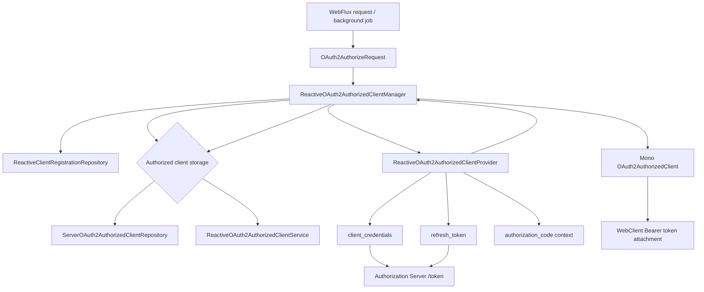
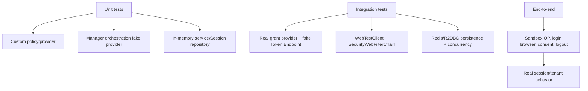

# 30.7. Kiểm thử manager, provider và kho authorized client Reactive

Khi một ứng dụng **Spring Security OAuth 2.0 / OpenID Connect (OIDC) Client** chạy trên **Spring WebFlux**, nó thường cần gọi API thay mặt người dùng hoặc bằng danh tính ứng dụng. Để gửi access token, ứng dụng có thể dùng `ReactiveOAuth2AuthorizedClientManager`. Manager phối hợp một hoặc nhiều `ReactiveOAuth2AuthorizedClientProvider` với nơi lưu `OAuth2AuthorizedClient`, từ đó quyết định có dùng lại token, xin token mới, làm mới token hay báo lỗi.

Một test chỉ assert endpoint trả HTTP 200 chưa chắc xác nhận luồng OAuth2 Client đúng. Access token có thể đã nằm trong cache; `WebClient` có thể chưa hề gọi Token Endpoint; một refresh token cũ có thể bị ghi đè; hoặc một authorized client của người dùng A có thể bị vô tình truy xuất dưới tài khoản B. **Kiểm thử manager, provider và kho authorized client Reactive** phải phân biệt những trách nhiệm đó, rồi xác minh cả positive và negative cases.

Bài này thuộc **30. Kiểm thử Reactive**, sử dụng **Spring Boot 3.x, Spring Security 6.x, Reactor, JUnit 5, Mockito, StepVerifier và WebTestClient**. Các mã nguồn minh họa dùng token/endpoint giả và cố ý không gọi Authorization Server production. Spring Security thay đổi một số API qua các phiên bản, vì vậy khi tích hợp vào dự án cần dùng tên class và signatures phù hợp với dependency đã khóa.

> **Nguyên tắc:** Kiểm thử manager/provider/store có thể chứng minh **cách ứng dụng chọn grant, lưu authorized client và xử lý lỗi**. Nó **không mặc nhiên** chứng minh browser Authorization Code Flow, chữ ký ID Token, PKCE, nonce, issuer validation, OP cookie hoặc authorization của downstream Resource Server.

## 1. Mục tiêu học tập

Sau bài, bạn có thể:

1. Phân biệt `ReactiveOAuth2AuthorizedClientManager`, `ReactiveOAuth2AuthorizedClientProvider`, `ReactiveOAuth2AuthorizedClientService` và `ServerOAuth2AuthorizedClientRepository`.
2. Chọn đúng manager cho **WebFlux request** hoặc **background job không có ServerWebExchange**.
3. Tạo một `ClientRegistration` và `OAuth2AuthorizedClient` fixture hoàn toàn giả.
4. Dùng `StepVerifier` kiểm tra một `Mono<OAuth2AuthorizedClient>` hoặc `Mono<Void>`.
5. Dùng provider fake/Mockito để tách manager orchestration khỏi Token Endpoint HTTP.
6. Test `Mono.empty()`, token còn hạn, token hết hạn, refresh thành công, không hỗ trợ grant và lỗi AS.
7. Xác nhận authorized client được lưu, tải, xóa theo **registration ID và principal name**.
8. Kiểm tra session repository và service-backed repository theo đúng ranh giới dữ liệu.
9. Kiểm tra success/failure handlers, đặc biệt chính sách xử lý `invalid_grant`.
10. Test WebFlux controller/`WebClient` integration mà không trộn với Servlet APIs.
11. Phát hiện race do concurrent refresh-token rotation hoặc nhiều instances.
12. Xây bộ test có giới hạn rõ ràng giữa **unit**, **integration với AS giả** và **browser E2E**.

## 2. Bản đồ các thành phần Reactive OAuth2 Client



Đây là sơ đồ **trách nhiệm logic**, không phải cam kết mỗi lệnh `authorize(...)` đều gọi đủ tất cả thành phần. Ví dụ, nếu token vẫn còn dùng được, provider có thể trả `Mono.empty()` và manager sử dụng authorized client đã lưu; nếu chưa có client, manager có thể phải tra registration và yêu cầu provider cấp token.

### 2.1. So sánh các interface

| Thành phần | Chức năng | Giá trị trả về quan trọng |
| --- | --- | --- |
| `ReactiveOAuth2AuthorizedClientManager` | Điều phối yêu cầu authorize/reauthorize | `Mono<OAuth2AuthorizedClient>` |
| `ReactiveOAuth2AuthorizedClientProvider` | Biết một hoặc một số grant và quyết định có authorize hay không | `Mono<OAuth2AuthorizedClient>`; có thể rỗng |
| `ReactiveClientRegistrationRepository` | Tra metadata client theo registration ID | `Mono<ClientRegistration>` |
| `ReactiveOAuth2AuthorizedClientService` | Lưu/tải/xóa authorized client theo registration + principal | `Mono<OAuth2AuthorizedClient>`, `Mono<Void>` |
| `ServerOAuth2AuthorizedClientRepository` | Lưu/tải/xóa authorized client trong ngữ cảnh request và `ServerWebExchange` | Các `Mono` reactive |
| `OAuth2AuthorizedClient` | Client registration + principal + access token + optional refresh token | Object dữ liệu |
| `OAuth2AuthorizeRequest` | Yêu cầu manager authorize một registration cho principal cụ thể | Object đầu vào |
| `OAuth2AuthorizationContext` | Ngữ cảnh provider: registration, principal, authorized client, attributes | Object đầu vào provider |
| `ReactiveOAuth2AuthorizationSuccessHandler` | Xử lý khi authorizing thành công, thường lưu authorized client | `Mono<Void>` |
| `ReactiveOAuth2AuthorizationFailureHandler` | Xử lý lỗi authorization, ví dụ dọn client không còn hợp lệ | `Mono<Void>` |

Không có một khối “cache token” duy nhất. Cách lưu dữ liệu khác nhau giữa request có session, authenticated principal và system job.

### 2.2. Servlet và Reactive không hoán đổi API

| Servlet | Reactive/WebFlux |
| --- | --- |
| `OAuth2AuthorizedClientManager` | **`ReactiveOAuth2AuthorizedClientManager`** |
| `OAuth2AuthorizedClientProvider` | **`ReactiveOAuth2AuthorizedClientProvider`** |
| `ClientRegistrationRepository` | **`ReactiveClientRegistrationRepository`** |
| `OAuth2AuthorizedClientService` | **`ReactiveOAuth2AuthorizedClientService`** |
| `OAuth2AuthorizedClientRepository` | **`ServerOAuth2AuthorizedClientRepository`** |
| `HttpServletRequest` | **`ServerWebExchange`** |
| `MockMvc` | **`WebTestClient`** |
| `CompletableFuture` hoặc synchronous return | **`Mono`/`Flux`** |

Bài này tập trung **Reactive**. Một test dùng `MockMvc` hoặc `HttpServletRequest` không phải test đúng stack, dù application tình cờ có dependency cả Spring MVC và WebFlux.

## 3. Hai loại manager phải phân biệt ngay từ đầu

Spring Security cung cấp hai triển khai phổ biến:

### 3.1. `DefaultReactiveOAuth2AuthorizedClientManager`

Dành cho authorization **trong ngữ cảnh WebFlux request**. Nó nhận:

```java
DefaultReactiveOAuth2AuthorizedClientManager(
    ReactiveClientRegistrationRepository registrations,
    ServerOAuth2AuthorizedClientRepository repository)
```

Với loại này, manager có thể dùng `ServerWebExchange` để tải/lưu authorized client qua repository gắn với request hoặc WebSession.

Dùng khi:

- Request browser đã đăng nhập và gọi API downstream.
- Controller/filter có `ServerWebExchange` hợp lệ.
- Muốn lưu authorized client theo session hoặc policy repository của request.

### 3.2. `AuthorizedClientServiceReactiveOAuth2AuthorizedClientManager`

Dành cho **ngữ cảnh ngoài `ServerWebExchange`**, ví dụ `@Scheduled`, worker, queue consumer hoặc một service client chỉ dùng `client_credentials`.

```java
AuthorizedClientServiceReactiveOAuth2AuthorizedClientManager(
    ReactiveClientRegistrationRepository registrations,
    ReactiveOAuth2AuthorizedClientService service)
```

Không cần HTTP session để save/load authorized client.

Dùng khi:

- Job chạy theo lịch.
- Worker nhận message.
- Client credentials đại diện cho ứng dụng.
- Không có browser cookie hay `ServerWebExchange`.
- Authorized client phải tồn tại độc lập với một request.

### 3.3. Ma trận quyết định

| Ngữ cảnh | Manager gợi ý | Store gợi ý | Principal |
| --- | --- | --- | --- |
| Browser request của Alice | `DefaultReactiveOAuth2AuthorizedClientManager` | `ServerOAuth2AuthorizedClientRepository` | Authentication của Alice |
| Web request với `WebSession` | Default reactive manager | `WebSessionServerOAuth2AuthorizedClientRepository` theo policy | Session/principal liên quan |
| Web request của authenticated user nhưng service-backed tokens | Default reactive manager | Repository thích hợp, có thể dựa trên service | User identity |
| Background `client_credentials` | `AuthorizedClientServiceReactiveOAuth2AuthorizedClientManager` | `ReactiveOAuth2AuthorizedClientService` | Stable application principal |
| Background job thật sự thay mặt Alice | Service manager + durable user delegation context | Persistent service, revocation policy | Identity của Alice, không giả làm system token |
| Test đơn vị provider | Không bắt buộc manager | Không cần store | `OAuth2AuthorizationContext` fixture |

Một sai lầm trong test là dùng service manager cho mọi trường hợp rồi kết luận **session repository** cũng hoạt động. Bạn chỉ đã kiểm tra service store, không kiểm tra request repository.

## 4. Vòng đời authorize: manager làm gì?

Một lời gọi:

```java
OAuth2AuthorizeRequest request =
        OAuth2AuthorizeRequest
                .withClientRegistrationId("worker")
                .principal("notification-worker")
                .build();

Mono<OAuth2AuthorizedClient> result =
        manager.authorize(request);
```

có thể dẫn tới các tình huống:

1. Manager tìm authorized client đã lưu cho registration/principal.
2. Nếu chưa có, nó tra `ClientRegistration`.
3. Nó tạo `OAuth2AuthorizationContext`.
4. Nó gọi một `ReactiveOAuth2AuthorizedClientProvider` phù hợp.
5. Provider có thể cấp token mới, refresh token hoặc không làm gì.
6. Khi provider tạo authorized client mới, success handler của manager có thể lưu vào store.
7. Khi gặp một số lỗi nhất định, failure handler có thể dọn record không dùng được.
8. Manager trả `Mono<OAuth2AuthorizedClient>`, không phải token string trần.

**Lưu ý:** Thứ tự chi tiết, cách provider trả empty, mapping attributes và failure-handler behavior phụ thuộc manager/configuration. Test cần khẳng định **hợp đồng mà ứng dụng đang dựa vào**, không cố gắng sao chép toàn bộ internal implementation.

### 4.1. `Mono.empty()` có nghĩa gì?

Theo contract provider, `Mono.empty()` thường báo rằng provider:

- Không hỗ trợ grant/configuration trong context, **hoặc**
- Không cần authorize/reauthorize, ví dụ authorized client còn phù hợp.

Không tự hiểu `Mono.empty()` là Token Endpoint trả “access token rỗng”, cũng không lập tức xóa client khi một provider trả empty. Manager có thể dùng authorized client hiện có.

### 4.2. `Mono.error(...)` khác `Mono.empty()`

`Mono.error(...)` biểu thị failure, ví dụ Token Endpoint trả `invalid_client`/`invalid_grant` hoặc network exception.

`Mono.empty()` **không phải lỗi**, vì thế test phải kiểm tra hai trường hợp khác nhau. Nếu code service tự gọi `.switchIfEmpty(Mono.error(...))`, đó là **chính sách ứng dụng**, không phải quy tắc chung của mọi manager.

## 5. Dependencies cho unit và integration tests

### 5.1. Maven

```xml
<dependencies>
    <dependency>
        <groupId>org.springframework.boot</groupId>
        <artifactId>spring-boot-starter-webflux</artifactId>
    </dependency>
    <dependency>
        <groupId>org.springframework.boot</groupId>
        <artifactId>spring-boot-starter-security</artifactId>
    </dependency>
    <dependency>
        <groupId>org.springframework.boot</groupId>
        <artifactId>spring-boot-starter-oauth2-client</artifactId>
    </dependency>

    <dependency>
        <groupId>org.springframework.boot</groupId>
        <artifactId>spring-boot-starter-test</artifactId>
        <scope>test</scope>
    </dependency>
    <dependency>
        <groupId>org.springframework.security</groupId>
        <artifactId>spring-security-test</artifactId>
        <scope>test</scope>
    </dependency>
    <dependency>
        <groupId>io.projectreactor</groupId>
        <artifactId>reactor-test</artifactId>
        <scope>test</scope>
    </dependency>
</dependencies>
```

Spring Boot dependency management nên giữ các phiên bản Spring Security, Reactor, JUnit và Mockito tương thích. Không dùng JUnit/Reactive stack khác major version một cách tùy ý.

### 5.2. Gradle

```groovy
dependencies {
    implementation 'org.springframework.boot:spring-boot-starter-webflux'
    implementation 'org.springframework.boot:spring-boot-starter-security'
    implementation 'org.springframework.boot:spring-boot-starter-oauth2-client'

    testImplementation 'org.springframework.boot:spring-boot-starter-test'
    testImplementation 'org.springframework.security:spring-security-test'
    testImplementation 'io.projectreactor:reactor-test'
}

tasks.named('test') {
    useJUnitPlatform()
}
```

Không cần mở Authorization Server thực chỉ để test logic lưu/tải token. Dùng fixtures và test doubles trước; sử dụng HTTP fake AS ở tầng integration khi muốn kiểm tra Token Endpoint thật.

### 5.3. `StepVerifier` là gì?

`StepVerifier` từ `reactor-test` subscribe một `Publisher` và xác nhận thứ tự signals:

```java
import reactor.core.publisher.Mono;
import reactor.test.StepVerifier;

StepVerifier.create(Mono.just("ok"))
        .expectNext("ok")
        .verifyComplete();

StepVerifier.create(Mono.empty())
        .verifyComplete();

StepVerifier.create(
        Mono.error(new IllegalStateException("offline")))
        .expectError(IllegalStateException.class)
        .verify();
```

Trong test manager/repository, **đừng quên subscribe**. Chỉ gọi `manager.authorize(request)` mà không `StepVerifier`, `block()` trong test hoặc một subscriber khác có thể khiến nhiều reactive operations chưa thực sự chạy. `StepVerifier` thường là lựa chọn rõ ràng nhất cho unit tests.

## 6. Tạo `ClientRegistration` giả mà không gọi mạng

Trước hết cần fixture cho một application client dùng `client_credentials`.

```java
import org.springframework.security.oauth2.client.registration
        .ClientRegistration;
import org.springframework.security.oauth2.core.AuthorizationGrantType;
import org.springframework.security.oauth2.core.ClientAuthenticationMethod;

public final class OAuth2ClientFixtures {

    private OAuth2ClientFixtures() {}

    public static ClientRegistration worker() {
        return ClientRegistration
                .withRegistrationId("worker")
                .clientId("worker-test-client")
                .clientSecret("dummy-secret-only-for-tests")
                .clientAuthenticationMethod(
                        ClientAuthenticationMethod.CLIENT_SECRET_BASIC)
                .authorizationGrantType(
                        AuthorizationGrantType.CLIENT_CREDENTIALS)
                .tokenUri("https://auth.example.test/oauth2/token")
                .scope("notification.send")
                .clientName("Worker Test")
                .build();
    }
}
```

`https://auth.example.test/oauth2/token` chỉ là URL fixture. `ClientRegistration` không tự gửi HTTP request chỉ vì được xây. Request thật chỉ có khi code gọi token response client/provider tương ứng.

### 6.1. Vì sao không dùng `issuer-uri` trong fixture đơn giản?

Một API tạo client registration từ issuer discovery có thể tải metadata ở runtime. Trong test manager thuần, chúng ta chỉ cần `ClientRegistration` đã hoàn thiện, nên cung cấp `tokenUri` giả trực tiếp để test không phụ thuộc mạng.

Khi muốn kiểm tra OIDC Discovery/issuer pinning, hãy tạo **test riêng với OP server giả**.

### 6.2. Fixture cho Authorization Code + refresh token

```java
public static ClientRegistration browserUser() {
    return ClientRegistration
            .withRegistrationId("calendar-user")
            .clientId("calendar-test-client")
            .clientSecret("dummy-calendar-test-secret")
            .clientAuthenticationMethod(
                    ClientAuthenticationMethod.CLIENT_SECRET_BASIC)
            .authorizationGrantType(
                    AuthorizationGrantType.AUTHORIZATION_CODE)
            .authorizationUri(
                    "https://auth.example.test/oauth2/authorize")
            .tokenUri("https://auth.example.test/oauth2/token")
            .redirectUri(
                    "{baseUrl}/login/oauth2/code/{registrationId}")
            .scope("calendar.read")
            .clientName("Calendar Test")
            .build();
}
```

Ví dụ này **không cấu hình OIDC `openid`** để tập trung vào manager/token lifecycle. Nếu muốn kiểm tra ID Token/nonce/claims, hãy dùng OIDC Login integration test và đúng OIDC fixture khác.

## 7. Tạo `OAuth2AuthorizedClient` giả

`OAuth2AuthorizedClient` giữ một `ClientRegistration`, principal name, access token và optional refresh token.

```java
import java.time.Instant;
import java.util.Set;

import org.springframework.security.oauth2.client.OAuth2AuthorizedClient;
import org.springframework.security.oauth2.client.registration
        .ClientRegistration;
import org.springframework.security.oauth2.core.OAuth2AccessToken;
import org.springframework.security.oauth2.core.OAuth2RefreshToken;

public final class AuthorizedClientFixtures {

    private AuthorizedClientFixtures() {}

    public static OAuth2AuthorizedClient accessOnly(
            ClientRegistration registration,
            String principalName) {

        Instant issued = Instant.now().minusSeconds(5);
        Instant expiry = Instant.now().plusSeconds(300);

        OAuth2AccessToken access = new OAuth2AccessToken(
                OAuth2AccessToken.TokenType.BEARER,
                "test-access-token-not-production",
                issued,
                expiry,
                Set.of("notification.send"));

        return new OAuth2AuthorizedClient(
                registration,
                principalName,
                access);
    }

    public static OAuth2AuthorizedClient withRefreshToken(
            ClientRegistration registration,
            String principalName) {

        Instant issued = Instant.now().minusSeconds(30);
        Instant expiry = Instant.now().plusSeconds(300);

        OAuth2AccessToken access = new OAuth2AccessToken(
                OAuth2AccessToken.TokenType.BEARER,
                "test-user-access-token",
                issued,
                expiry,
                Set.of("calendar.read"));

        OAuth2RefreshToken refresh = new OAuth2RefreshToken(
                "test-refresh-token-not-production",
                issued);

        return new OAuth2AuthorizedClient(
                registration,
                principalName,
                access,
                refresh);
    }
}
```

Một fixture này **không cần có JWT chữ ký hợp lệ**. Spring manager/service thường quản lý object và token lifetime; nó không thay Resource Server để giải mã access token.

### 7.1. Bảo vệ dữ liệu test

- Chỉ dùng dummy token/secret.
- Không ghi `getAccessToken().getTokenValue()` vào CI logs.
- Không chụp HTTP request chứa token mà không redact.
- Không dùng client secret thực trong `src/test/resources`.
- Không dùng `https://id.company.example` production làm Token Endpoint trong test unit.
- Không dùng token fixture để gửi ra API thật.

## 8. Test tầng 1: `ReactiveOAuth2AuthorizedClientService`

Một kho service-backed thường truy xuất authorized client bằng **registration ID + principal name**. Implementation in-memory có sẵn:

```java
InMemoryReactiveOAuth2AuthorizedClientService
```

Để test service, không cần manager hoặc HTTP server.

### 8.1. Lưu, tải và xóa

```java
import static org.assertj.core.api.Assertions.assertThat;

import org.junit.jupiter.api.Test;
import org.springframework.security.authentication
        .TestingAuthenticationToken;
import org.springframework.security.oauth2.client.OAuth2AuthorizedClient;
import org.springframework.security.oauth2.client
        .InMemoryReactiveOAuth2AuthorizedClientService;
import org.springframework.security.oauth2.client.registration
        .InMemoryReactiveClientRegistrationRepository;
import reactor.test.StepVerifier;

class ReactiveAuthorizedClientServiceTest {

    @Test
    void saveLoadAndRemoveAuthorizedClient() {

        var registration = OAuth2ClientFixtures.worker();
        var registrations =
                new InMemoryReactiveClientRegistrationRepository(
                        registration);
        var service =
                new InMemoryReactiveOAuth2AuthorizedClientService(
                        registrations);

        var principal = new TestingAuthenticationToken(
                "notification-worker",
                "ignored",
                "ROLE_SYSTEM");

        OAuth2AuthorizedClient expected =
                AuthorizedClientFixtures.accessOnly(
                        registration, principal.getName());

        StepVerifier.create(
                service.saveAuthorizedClient(expected, principal))
                .verifyComplete();

        StepVerifier.create(
                service.loadAuthorizedClient(
                        "worker", principal.getName()))
                .assertNext(actual -> {
                    assertThat(actual.getClientRegistration()
                            .getRegistrationId()).isEqualTo("worker");
                    assertThat(actual.getPrincipalName())
                            .isEqualTo("notification-worker");
                    assertThat(actual.getAccessToken())
                            .isNotNull();
                })
                .verifyComplete();

        StepVerifier.create(
                service.removeAuthorizedClient(
                        "worker", principal.getName()))
                .verifyComplete();

        StepVerifier.create(
                service.loadAuthorizedClient(
                        "worker", principal.getName()))
                .verifyComplete();
    }
}
```

**Điểm cần hiểu:** `saveAuthorizedClient` và `removeAuthorizedClient` trả `Mono<Void>`, nên test `verifyComplete()` thay vì mong có một item. `loadAuthorizedClient` trả authorized client hoặc complete rỗng nếu không tìm thấy.

### 8.2. Test service key phải tách principal

Hai users cùng dùng registration `calendar-user` không được lấy refresh token của nhau:

```java
@Test
void sameRegistrationMustNotShareAuthorizedClientAcrossUsers() {

    var registration = OAuth2ClientFixtures.browserUser();
    var registrations =
            new InMemoryReactiveClientRegistrationRepository(registration);
    var service =
            new InMemoryReactiveOAuth2AuthorizedClientService(
                    registrations);

    var alice = new TestingAuthenticationToken(
            "alice", "ignored", "ROLE_USER");
    var bob = new TestingAuthenticationToken(
            "bob", "ignored", "ROLE_USER");

    var client = AuthorizedClientFixtures.withRefreshToken(
            registration, alice.getName());

    StepVerifier.create(
            service.saveAuthorizedClient(client, alice))
            .verifyComplete();

    StepVerifier.create(
            service.loadAuthorizedClient(
                    "calendar-user", bob.getName()))
            .verifyComplete();

    StepVerifier.create(
            service.loadAuthorizedClient(
                    "calendar-user", alice.getName()))
            .assertNext(found ->
                    assertThat(found.getPrincipalName())
                            .isEqualTo("alice"))
            .verifyComplete();
}
```

Test này chứng minh **cách in-memory service phân vùng dữ liệu** ở mức object. Nó không thay thế test database/Redis repository custom, backup, encryption hoặc multi-tenant authorization. Nếu service custom dùng `tenantId`, cần test cả tenant dimension.

### 8.3. Không suy ra an toàn chỉ từ principal name

Trong một hệ thống multi-tenant, chuỗi `alice` có thể tồn tại ở nhiều tổ chức. Nếu kho custom key chỉ bằng `principalName = alice` nhưng không có namespace tenant/issuer được chuẩn hóa, nguy cơ va chạm vẫn tồn tại.

Nên thiết kế principal key ổn định, ví dụ **internal user ID đã ánh xạ từ validated `(issuer, subject)`**, và ràng buộc registration/tenant theo business policy. Không dùng email người dùng tự khai làm khóa trust.

## 9. Test tầng 2: fake `ReactiveOAuth2AuthorizedClientProvider`

Muốn test manager lưu thành công mà **không gọi Token Endpoint**, hãy cung cấp fake provider trả authorized client fixture.

### 9.1. Provider fake trả token từ đúng registration/principal

```java
import org.springframework.security.oauth2.client.OAuth2AuthorizedClient;
import org.springframework.security.oauth2.client
        .ReactiveOAuth2AuthorizedClientProvider;
import org.springframework.security.oauth2.core.AuthorizationGrantType;

import reactor.core.publisher.Mono;

ReactiveOAuth2AuthorizedClientProvider fakeProvider = context -> {
    if (!AuthorizationGrantType.CLIENT_CREDENTIALS.equals(
            context.getClientRegistration().getAuthorizationGrantType())) {
        return Mono.empty();
    }

    OAuth2AuthorizedClient created =
            AuthorizedClientFixtures.accessOnly(
                    context.getClientRegistration(),
                    context.getPrincipal().getName());

    return Mono.just(created);
};
```

Đây là một implementation của **`ReactiveOAuth2AuthorizedClientProvider`**, không phải production provider. Nó không kiểm tra Token Endpoint, không refresh token và cố ý sử dụng test-only value.

### 9.2. Test manager và hành vi save thành công

```java
import static org.assertj.core.api.Assertions.assertThat;

import org.junit.jupiter.api.Test;
import org.springframework.security.oauth2.client
        .AuthorizedClientServiceReactiveOAuth2AuthorizedClientManager;
import org.springframework.security.oauth2.client
        .InMemoryReactiveOAuth2AuthorizedClientService;
import org.springframework.security.oauth2.client
        .OAuth2AuthorizeRequest;
import org.springframework.security.oauth2.client
        .ReactiveOAuth2AuthorizedClientProvider;
import org.springframework.security.oauth2.client.registration
        .InMemoryReactiveClientRegistrationRepository;
import org.springframework.security.oauth2.core.AuthorizationGrantType;

import reactor.core.publisher.Mono;
import reactor.test.StepVerifier;

class ReactiveManagerTest {

    @Test
    void successfulAuthorizationIsPersistedByServiceManager() {

        var registration = OAuth2ClientFixtures.worker();
        var registrations =
                new InMemoryReactiveClientRegistrationRepository(
                        registration);
        var service =
                new InMemoryReactiveOAuth2AuthorizedClientService(
                        registrations);

        var manager =
                new AuthorizedClientServiceReactiveOAuth2AuthorizedClientManager(
                        registrations, service);

        ReactiveOAuth2AuthorizedClientProvider fakeProvider = context -> {
            if (!AuthorizationGrantType.CLIENT_CREDENTIALS.equals(
                    context.getClientRegistration()
                            .getAuthorizationGrantType())) {
                return Mono.empty();
            }
            return Mono.just(
                    AuthorizedClientFixtures.accessOnly(
                            context.getClientRegistration(),
                            context.getPrincipal().getName()));
        };

        manager.setAuthorizedClientProvider(fakeProvider);

        OAuth2AuthorizeRequest request =
                OAuth2AuthorizeRequest
                        .withClientRegistrationId("worker")
                        .principal("notification-worker")
                        .build();

        StepVerifier.create(manager.authorize(request))
                .assertNext(client -> {
                    assertThat(client.getPrincipalName())
                            .isEqualTo("notification-worker");
                    assertThat(client.getClientRegistration()
                            .getRegistrationId()).isEqualTo("worker");
                })
                .verifyComplete();

        StepVerifier.create(
                service.loadAuthorizedClient(
                        "worker", "notification-worker"))
                .assertNext(saved ->
                        assertThat(saved.getAccessToken())
                                .isNotNull())
                .verifyComplete();
    }
}
```

Điểm test thực sự bao phủ:

- Manager dùng registration `worker`.
- Principal name là `notification-worker`.
- Provider được gọi để tạo authorized client.
- Manager mặc định lưu client thành công vào service.
- Dữ liệu có thể được load lại bằng đúng khóa.

Điểm **không** được bao phủ:

- AS có chấp nhận client secret không.
- Token endpoint trả scope nào.
- `client_credentials` production provider có đúng cấu hình không.
- JWT của token có chữ ký hoặc audience hợp lệ không.
- WebClient đã gắn Bearer token đúng chưa.

### 9.3. Nếu provider trả `Mono.empty()`?

Có thể viết riêng provider unit test với `OAuth2AuthorizationContext` hoặc mock provider qua Mockito. Khi provider trả empty, cần xác định manager có existing client không.

Một test không có client hiện hữu có thể ghi nhận manager không nhận được authorized client mới, nhưng **đừng kết luận đó là HTTP 204/401**: `Mono.empty()` là reactive signal nội bộ.

## 10. Test provider độc lập với manager

Provider nhận `OAuth2AuthorizationContext`. Khi test provider riêng, không nhất thiết tạo repository hay manager.

### 10.1. Dựng authorization context

```java
import org.springframework.security.authentication
        .TestingAuthenticationToken;
import org.springframework.security.oauth2.client
        .OAuth2AuthorizationContext;

var registration = OAuth2ClientFixtures.worker();
var principal = new TestingAuthenticationToken(
        "worker", "ignored", "ROLE_SYSTEM");

OAuth2AuthorizationContext context =
        OAuth2AuthorizationContext
                .withClientRegistration(registration)
                .principal(principal)
                .build();
```

Đối tượng này chứa metadata và principal mà provider cần. Nếu test **refresh provider**, có thể tạo context bằng `withAuthorizedClient(existingClient)` để mô phỏng client đã có access/refresh token.

### 10.2. Provider không hỗ trợ grant phải trả empty

```java
@Test
void fakeProviderDoesNotHandleAuthorizationCode() {
    var authCodeRegistration = OAuth2ClientFixtures.browserUser();
    var principal = new TestingAuthenticationToken(
            "alice", "ignored", "ROLE_USER");

    var context =
            OAuth2AuthorizationContext
                    .withClientRegistration(authCodeRegistration)
                    .principal(principal)
                    .build();

    ReactiveOAuth2AuthorizedClientProvider credentialsOnly =
            c -> AuthorizationGrantType.CLIENT_CREDENTIALS
                            .equals(c.getClientRegistration()
                                    .getAuthorizationGrantType())
                    ? Mono.just(
                            AuthorizedClientFixtures.accessOnly(
                                    c.getClientRegistration(),
                                    c.getPrincipal().getName()))
                    : Mono.empty();

    StepVerifier.create(credentialsOnly.authorize(context))
            .verifyComplete();
}
```

Đây là test **contract của fake provider được xây trong test**. Nó minh họa cách xác minh unsupported grant behavior; không phải bài test của Spring's built-in provider. Khi dùng provider production, hãy test với token response client fake để xác minh logic thực.

### 10.3. Kiểm tra callback không được gọi khi provider empty

Nếu app có một custom provider với side effects, hãy verify rằng nó không ghi token hoặc gọi AS trong nhánh `Mono.empty()`. Có thể dùng `AtomicInteger`/Mockito `verifyNoInteractions(...)` với collaborator fake, nhưng cần **subscribe publisher bằng StepVerifier** để đếm đúng.

## 11. Mockito và interaction tests

Một test có thể mock `ReactiveOAuth2AuthorizedClientProvider` thay vì tự viết fake:

```java
import static org.mockito.ArgumentMatchers.any;
import static org.mockito.Mockito.verify;
import static org.mockito.Mockito.when;

import org.junit.jupiter.api.Test;
import org.mockito.Mockito;
import org.springframework.security.oauth2.client
        .OAuth2AuthorizationContext;
import org.springframework.security.oauth2.client
        .ReactiveOAuth2AuthorizedClientProvider;

import reactor.core.publisher.Mono;
import reactor.test.StepVerifier;

@Test
void providerIsInvokedWithAuthorizationContext() {
    var provider = Mockito.mock(
            ReactiveOAuth2AuthorizedClientProvider.class);

    var registration = OAuth2ClientFixtures.worker();
    var context = OAuth2AuthorizationContext
            .withClientRegistration(registration)
            .principal(new TestingAuthenticationToken(
                    "worker", "ignored", "ROLE_SYSTEM"))
            .build();

    when(provider.authorize(any(OAuth2AuthorizationContext.class)))
            .thenReturn(Mono.just(
                    AuthorizedClientFixtures.accessOnly(
                            registration, "worker")));

    StepVerifier.create(provider.authorize(context))
            .assertNext(client ->
                    assertThat(client.getPrincipalName())
                            .isEqualTo("worker"))
            .verifyComplete();

    verify(provider).authorize(
            any(OAuth2AuthorizationContext.class));
}
```

Đây là kỹ thuật Mockito cơ bản. Với manager integration, tạo manager thật nhưng inject mock provider là **cách mạnh hơn** để xác nhận manager gọi provider đúng lúc; tránh chỉ gọi mock rồi verify mock đã được gọi, vì test đó không bao phủ logic Spring.

### 11.1. Khi nào dùng Mockito?

| Điều cần kiểm tra | Nên dùng |
| --- | --- |
| Logic custom provider | Provider thật + fake HTTP collaborator |
| Manager orchestration | Manager thật + fake/mock provider/service |
| Repository semantics | Repository thật + exchange/session fixtures |
| Bắt số lần Token Endpoint call | Fake server hoặc HTTP mock |
| Ủy quyền tới đúng provider | Mockito argument capture hoặc fake |
| End-to-end browser OAuth2 Login | OP test double/browser integration |
| Session/multi-instance persistence | Integration với storage thật |

**Mock ít nhưng đúng chỗ**. Một test mock cả manager, provider và service rồi chỉ assert data hardcoded có thể trở thành test của Mockito, không còn là test hành vi ứng dụng.

## 12. Cấu hình provider chain thực tế

Spring Security có builder:

```java
ReactiveOAuth2AuthorizedClientProvider provider =
        ReactiveOAuth2AuthorizedClientProviderBuilder.builder()
                .authorizationCode()
                .refreshToken()
                .clientCredentials()
                .build();
```

Các grant có vai trò khác nhau:

| Provider | Khi nào hữu ích? | Lưu ý kiểm thử |
| --- | --- | --- |
| `authorizationCode()` | Context đã có authorized client từ browser login | Browser redirect/callback vẫn do OAuth2 Login filters đảm nhiệm |
| `refreshToken()` | Existing authorized client có RT và cần refresh | Kiểm tra token expiry/clock skew, RT rotation, `invalid_grant` |
| `clientCredentials()` | Application client cần token service identity | Kiểm tra client authentication, scope, expiry, retry policy |
| Custom provider | Grant/profile được AS hỗ trợ và app tự tích hợp | Tách unit contract + fake AS integration |

**Không nhầm:** Đặt `.authorizationCode()` trong manager không tự khiến manager có thể login browser từ một background job. Authorization Code Flow vẫn cần user agent, `state`, redirect URI, consent/OP authentication và callback được xử lý đúng.

### 12.1. Bean ví dụ cho background client

```java
import org.springframework.context.annotation.Bean;
import org.springframework.context.annotation.Configuration;
import org.springframework.security.oauth2.client
        .AuthorizedClientServiceReactiveOAuth2AuthorizedClientManager;
import org.springframework.security.oauth2.client
        .ReactiveOAuth2AuthorizedClientManager;
import org.springframework.security.oauth2.client
        .ReactiveOAuth2AuthorizedClientProvider;
import org.springframework.security.oauth2.client
        .ReactiveOAuth2AuthorizedClientProviderBuilder;
import org.springframework.security.oauth2.client
        .ReactiveOAuth2AuthorizedClientService;
import org.springframework.security.oauth2.client.registration
        .ReactiveClientRegistrationRepository;

@Configuration
class BackgroundOAuth2ManagerConfig {

    @Bean("backgroundAuthorizedClientManager")
    ReactiveOAuth2AuthorizedClientManager backgroundManager(
            ReactiveClientRegistrationRepository registrations,
            ReactiveOAuth2AuthorizedClientService service) {

        ReactiveOAuth2AuthorizedClientProvider provider =
                ReactiveOAuth2AuthorizedClientProviderBuilder.builder()
                        .clientCredentials()
                        .build();

        var manager =
                new AuthorizedClientServiceReactiveOAuth2AuthorizedClientManager(
                        registrations, service);
        manager.setAuthorizedClientProvider(provider);

        return manager;
    }
}
```

Một background job có thể gọi:

```java
OAuth2AuthorizeRequest request =
        OAuth2AuthorizeRequest
                .withClientRegistrationId("worker")
                .principal("notification-worker")
                .build();

return backgroundManager.authorize(request)
        .switchIfEmpty(Mono.error(
                new IllegalStateException(
                        "No authorized client available")))
        .map(client -> client.getAccessToken().getTokenValue());
```

Đoạn trên chỉ là ví dụ ứng dụng. **Không trả token ra controller/browser**; token value nên chỉ dùng nội bộ để gọi đúng Resource Server, giữ token khỏi logs/metrics. Nếu caller dùng WebClient filter integration, ưu tiên để nó gắn Bearer token thay vì tự nối header tùy tiện.

### 12.2. Bean ví dụ cho WebFlux request

```java
@Bean("requestAuthorizedClientManager")
ReactiveOAuth2AuthorizedClientManager requestManager(
        ReactiveClientRegistrationRepository registrations,
        ServerOAuth2AuthorizedClientRepository repository) {

    ReactiveOAuth2AuthorizedClientProvider provider =
            ReactiveOAuth2AuthorizedClientProviderBuilder.builder()
                    .authorizationCode()
                    .refreshToken()
                    .clientCredentials()
                    .build();

    var manager =
            new DefaultReactiveOAuth2AuthorizedClientManager(
                    registrations, repository);

    manager.setAuthorizedClientProvider(provider);
    return manager;
}
```

Cấu hình này dùng manager **khác** với background example. Tên bean qualifier giúp tránh inject nhầm manager trong ứng dụng vừa có browser requests vừa có scheduled jobs.

## 13. Kiểm thử `DefaultReactiveOAuth2AuthorizedClientManager` cần `ServerWebExchange`

Manager dành cho request cần thông tin exchange/session phù hợp để repository có thể load/save.

### 13.1. Lấy exchange trong WebFlux test

```java
import org.springframework.mock.http.server.reactive
        .MockServerHttpRequest;
import org.springframework.mock.web.server.MockServerWebExchange;

MockServerWebExchange exchange =
        MockServerWebExchange.from(
                MockServerHttpRequest.get("/api/me").build());
```

Có thể tạo `Authentication` test riêng. Khi gọi manager trực tiếp, cung cấp exchange trong authorization request theo contract của version đang dùng, ví dụ:

```java
OAuth2AuthorizeRequest request =
        OAuth2AuthorizeRequest
                .withClientRegistrationId("calendar-user")
                .principal(authentication)
                .attribute(ServerWebExchange.class.getName(), exchange)
                .build();
```

Cần import `org.springframework.web.server.ServerWebExchange`. Trong một số integrations, Spring Security/WebClient tự đưa exchange vào context; test gọi manager trực tiếp phải tái hiện đủ attributes mà manager/repository cần.

### 13.2. Vì sao test không có exchange có thể sai?

Nếu bạn khởi tạo `DefaultReactiveOAuth2AuthorizedClientManager` với session repository rồi gọi `authorize(...)` từ một scheduled job **không có WebFlux exchange**, việc load/save có thể không hoạt động như mong muốn.

Đừng sửa bằng cách tạo một `MockServerWebExchange` giả trong production background worker. Đúng kiến trúc là chọn `AuthorizedClientServiceReactiveOAuth2AuthorizedClientManager` cho jobs ngoài request.

### 13.3. Những gì cần assert

- Manager tìm đúng registration ID.
- Repository tải client từ **đúng exchange/session**.
- Authorized client được lưu trong exchange tương ứng khi authorize thành công.
- Không lẫn WebSession của browser khác.
- Khi logout/session invalidate, token session-scoped không còn được dùng theo policy.
- Khi principal authenticated, repository composite có thể chọn service-backed path tùy cấu hình.

Không suy từ việc service manager test pass rằng request manager cũng đúng: hai storage boundaries khác nhau.

## 14. Test tầng 3: `WebSessionServerOAuth2AuthorizedClientRepository`

Một repository phổ biến cho WebFlux:

```java
org.springframework.security.oauth2.client.web.server
        .WebSessionServerOAuth2AuthorizedClientRepository
```

Nó liên kết authorized clients với **WebSession**, không phải với một database global theo `principalName`.

### 14.1. Kiểm thử save/load/remove trong cùng exchange

```java
import static org.assertj.core.api.Assertions.assertThat;

import org.junit.jupiter.api.Test;
import org.springframework.mock.http.server.reactive
        .MockServerHttpRequest;
import org.springframework.mock.web.server.MockServerWebExchange;
import org.springframework.security.authentication
        .TestingAuthenticationToken;
import org.springframework.security.oauth2.client.web.server
        .WebSessionServerOAuth2AuthorizedClientRepository;

import reactor.test.StepVerifier;

class WebSessionAuthorizedClientRepositoryTest {

    @Test
    void authorizedClientIsScopedToWebSession() {

        var registration = OAuth2ClientFixtures.browserUser();
        var repository =
                new WebSessionServerOAuth2AuthorizedClientRepository();

        var alice = new TestingAuthenticationToken(
                "alice", "ignored", "ROLE_USER");

        var firstExchange = MockServerWebExchange.from(
                MockServerHttpRequest.get("/").build());

        var secondExchange = MockServerWebExchange.from(
                MockServerHttpRequest.get("/").build());

        var client = AuthorizedClientFixtures.withRefreshToken(
                registration, "alice");

        StepVerifier.create(
                repository.saveAuthorizedClient(
                        client, alice, firstExchange))
                .verifyComplete();

        StepVerifier.create(
                repository.loadAuthorizedClient(
                        "calendar-user", alice, firstExchange))
                .assertNext(saved ->
                        assertThat(saved.getPrincipalName())
                                .isEqualTo("alice"))
                .verifyComplete();

        StepVerifier.create(
                repository.loadAuthorizedClient(
                        "calendar-user", alice, secondExchange))
                .verifyComplete();

        StepVerifier.create(
                repository.removeAuthorizedClient(
                        "calendar-user", alice, firstExchange))
                .verifyComplete();

        StepVerifier.create(
                repository.loadAuthorizedClient(
                        "calendar-user", alice, firstExchange))
                .verifyComplete();
    }
}
```

Đây là **test WebSession isolation**: hai `MockServerWebExchange` độc lập có thể sở hữu WebSessions khác nhau. Nó không phải test token refresh, không gọi AS, không dùng browser cookies thật.

### 14.2. Cảnh báo khi đổi tài khoản trong cùng WebSession

`WebSessionServerOAuth2AuthorizedClientRepository` tổ chức dữ liệu **theo phiên**. Đừng mặc định nó luôn thực hiện cùng kiểu partitioning `(registrationId, principalName)` như `ReactiveOAuth2AuthorizedClientService`.

Nếu một WebSession bị tái sử dụng khi Alice logout rồi Bob login, cần kiểm thử **invalidate/clear session authorized clients** theo cấu hình thực tế. Không chỉ nhìn `principalName` trong test rồi kết luận Bob không thể thấy token Alice.

Khi account switching là yêu cầu sản phẩm, hãy kiểm tra:

- Logout handlers có invalidate WebSession không?
- Authorized clients có bị xóa trong session không?
- Không giữ custom session attributes của Alice cho Bob?
- Login callback tạo security context mới như policy?
- Có storage service-backed cần cleanup/revocation riêng không?

## 15. `AuthenticatedPrincipalServerOAuth2AuthorizedClientRepository`

Spring Security có repository có thể dùng **ReactiveOAuth2AuthorizedClientService** cho authenticated principal và một session repository cho trường hợp anonymous.

```java
new AuthenticatedPrincipalServerOAuth2AuthorizedClientRepository(
        reactiveAuthorizedClientService);
```

**Không giả định mọi configuration dùng repository này.** Cách Boot/Spring tạo beans và default repository có thể thay đổi theo việc ứng dụng tự cấu hình. Khi test, hãy xác nhận repository thực sự được inject vào request manager.

### 15.1. Những nhánh cần kiểm thử

| Principal | Dự kiến storage theo cấu hình composite | Test bắt buộc |
| --- | --- | --- |
| Authenticated Alice | Service-backed theo principal | Alice load lại client đã lưu |
| Authenticated Bob | Service-backed theo Bob | Không đọc token Alice |
| Anonymous | WebSession fallback | Không vô tình lưu token người dùng vào principal chung |
| Account switching | Session/state bị thay đổi | Không tái sử dụng client từ phiên trước |
| Logout | Session/service cleanup theo policy | Không còn authorized client được phép dùng |
| Tenant suspended | Token store có bản ghi cũ | Authorization policy vẫn chặn access |

Các nhánh này yêu cầu test với **repository thật** hoặc spies được đặt ở đúng tầng, không chỉ mock interface rồi đặt kỳ vọng.

## 16. Test refresh token: một flow khác `client_credentials`

Với user-delegated OAuth2 flow, `OAuth2AuthorizedClient` có thể có `OAuth2RefreshToken`. Khi access token hết hạn/gần hết hạn, refresh provider có thể gọi Token Endpoint.

### 16.1. Timeline minh họa

```text
T0: Browser user Alice có access token AT1 và refresh token RT1
T1: AT1 gần hết hạn theo clock-skew policy
T2: Manager gọi provider phù hợp
T3: POST /token grant_type=refresh_token, RT1, client auth
T4: AS trả AT2 và (có thể) RT2
T5: Manager lưu authorized client mới cho Alice
T6: Các lần dùng sau không tái sử dụng RT1 nếu đã rotate
```

### 16.2. Những điều phải kiểm thử riêng

- Nếu AT còn hạn, không refresh không cần thiết.
- Nếu AT sắp hết hạn, provider refresh theo **clock skew** đã cấu hình.
- Nếu không có RT, provider không tự “phát sinh” refresh token.
- Nếu RT được rotate, store lưu RT2 thay RT1.
- Nếu AS trả `invalid_grant`, manager failure handler phản ứng theo policy.
- Nếu AS timeout, không retry POST Token Endpoint vô hạn.
- Nếu client secret sai, lỗi `invalid_client` **khác** `invalid_grant`.
- Nếu có hai concurrent refreshes, tránh ghi đè RT mới bằng client cũ.

### 16.3. Fixture token hết hạn

```java
import java.time.Instant;
import java.util.Set;

OAuth2AccessToken expiredAccessToken =
        new OAuth2AccessToken(
                OAuth2AccessToken.TokenType.BEARER,
                "expired-test-token",
                Instant.now().minusSeconds(600),
                Instant.now().minusSeconds(60),
                Set.of("calendar.read"));

OAuth2RefreshToken refreshToken =
        new OAuth2RefreshToken(
                "refresh-test-1",
                Instant.now().minusSeconds(900));

OAuth2AuthorizedClient oldClient =
        new OAuth2AuthorizedClient(
                OAuth2ClientFixtures.browserUser(),
                "alice",
                expiredAccessToken,
                refreshToken);
```

Đây là dữ liệu giả. Bản thân việc tạo `oldClient` **không gọi refresh provider**. Để kiểm thử provider production, cần cấu hình một **fake Token Endpoint** và đưa client vào authorization context/manager, rồi verify `RT2` được lưu đúng.

### 16.4. Nên dùng fake HTTP server cho test refresh provider thật

Ví dụ contract test:

```text
Given:
  ClientRegistration: calendar-user
  Stored client: AT1 expired, RT1
  Fake Token Endpoint expects:
    grant_type = refresh_token
    refresh_token = RT1
    client authentication đúng cấu hình

Fake AS response:
  access_token = AT2
  token_type   = Bearer
  expires_in   = 300
  refresh_token = RT2
  scope        = calendar.read

Then:
  Provider/manager emits authorized client AT2/RT2
  Store holds AT2/RT2 for Alice
  No RT1 reuse after rotation per concurrency policy
```

Đây là **mô tả contract test**, không phải một unit test có thể chạy khi chưa triển khai HTTP server giả. Dùng WireMock, MockWebServer hoặc fake `ExchangeFunction`/`WebClient` phù hợp Token Response Client của Spring Security version bạn dùng.

## 17. Test `client_credentials` provider thật với fake Token Endpoint

Một provider thật có thể làm mới access token qua `client_credentials` mà không có user browser.

### 17.1. Những request cần xác nhận

```http
POST /oauth2/token HTTP/1.1
Host: auth.example.test
Content-Type: application/x-www-form-urlencoded
Authorization: Basic <redacted-test-client-credentials>

grant_type=client_credentials&scope=notification.send
```

Response fake:

```json
{
  "access_token": "fake-worker-token-2",
  "token_type": "Bearer",
  "expires_in": 300,
  "scope": "notification.send"
}
```

Không giả định Authorization Server luôn trả refresh token cho client credentials; thường **không**. Test cần chấp nhận authorized client không có refresh token trong flow này.

### 17.2. Những assertions có ý nghĩa

- Token Endpoint được gọi đúng **một lần** khi cần xin token mới.
- Không gọi lại khi AT hiện có vẫn dùng được theo policy.
- Request gửi đúng `client_id`/authentication method.
- Không gửi client secret dưới query string.
- Scope chỉ từ registration đã cho phép.
- Response token được lưu dưới đúng stable application principal.
- Token khác tenant/registration không bị dùng chung.
- Trả lỗi có kiểm soát khi `invalid_client`, 429 hoặc 5xx.

Một test chỉ assert `manager.authorize(...)` trả `Mono.just(...)` với fake provider **không** chứng minh HTTP Token Endpoint contract. Dùng hai tầng test khác nhau.

## 18. Kiểm thử success/failure handlers

Authorized-client managers có hooks để xử lý thành công/thất bại. Tùy manager và config, success handler có thể **persist** authorized client, còn failure handler có thể **remove** client khi một số lỗi cho thấy quyền đã hết hiệu lực.

### 18.1. Success handler

Mục tiêu test:

```text
Given:
  Provider returns newly authorized client AT2/RT2
When:
  Manager authorize completes successfully
Then:
  Appropriate store.saveAuthorizedClient(...) is invoked
  Registration/principal binding is preserved
  Store contains new generation
```

Đây là lý do test manager ở mục 9 **kiểm tra cả kết quả và load lại từ service**. Nếu chỉ assert token trả về mà không xác nhận persistence, bạn có thể bỏ sót lỗi lần gọi sau lại dùng token cũ.

### 18.2. Failure handler và `invalid_grant`

`invalid_grant` có thể xảy ra khi refresh token bị revoke/hết hạn/đã dùng hoặc authorization code không hợp lệ. Spring Security managers có default behaviors liên quan việc loại bỏ authorized client trong một số trường hợp, đặc biệt `invalid_grant`; chính xác cách wiring phụ thuộc manager/phiên bản.

Một contract test quan trọng:

```text
Given:
  Stored AuthorizedClient(registration=calendar-user,
                         principal=alice, RT1)
And:
  Refresh provider emits OAuth2AuthorizationException(invalid_grant)

When:
  Manager.authorize(request for alice)

Then:
  Error surfaces according to contract
And:
  Failure handler performs configured cleanup of invalid client
And:
  Bob's authorized client remains intact
And:
  No fallback to another user's token
```

**Không xóa mọi authorized clients chỉ vì có một lỗi HTTP 500**. Khi một AS tạm unavailable, refresh token có thể vẫn hợp lệ. Chính sách cleanup phải dựa trên error semantics và provider contract, không phải xóa vô điều kiện.

### 18.3. Phân biệt error types

| Lỗi | Thường liên quan | Kiểm tra |
| --- | --- | --- |
| `invalid_grant` | RT/code/grant invalid, expired/reused | Cleanup theo policy, reauthorization nếu cần |
| `invalid_client` | Client secret/mTLS/assertion/registration | Alert cấu hình; không tự xóa mọi user token |
| `invalid_scope` | Scope không được phép | Không retry cùng scope vô hạn |
| HTTP 429 | AS rate limit | Backoff có giới hạn, không tạo storm |
| HTTP 5xx | AS outage | Không giả định token bị revoke |
| Timeout | Không biết request đã xử lý chưa | Tránh replay/RT race, bounded retries |
| Network TLS error | Trust/endpoint configuration | Không tắt TLS validation |
| `Mono.empty()` | Provider không cần/không thể authorize | Xử lý empty theo ngữ cảnh, không coi là grant failure |

### 18.4. Test không nên swallow error

Sai:

```java
manager.authorize(request)
        .onErrorResume(ex -> Mono.empty());
```

nếu caller sau đó coi empty là “người dùng không đăng nhập” và tự động dùng một registration/system token khác.

Đúng hơn là phân loại lỗi và đưa ra **application-level error handling rõ ràng**, có redaction; không chuyển user-delegated token sang client-credentials token mà không có chính sách nghiệp vụ cho phép.

## 19. `Mono.empty()`, token còn hạn và reauthorization

Một provider có thể không phát token mới khi client hiện có còn hạn. Test phải xác nhận **không gọi Token Endpoint không cần thiết**.

### 19.1. Contract mẫu

```text
Given:
  AuthorizedClient AT1 expires in 10 minutes
  Clock skew = 60 seconds
When:
  Manager.authorize(...)
Then:
  Client AT1 is reused
  No refresh_token/token HTTP call
  Store is not overwritten without reason
```

Khi AT1 gần hết hạn:

```text
Given:
  AT1 expires in 20 seconds
  Clock skew = 60 seconds
When:
  Manager.authorize(...)
Then:
  Provider may perform refresh/reacquire according to grant and policy
```

Đây là **kỳ vọng theo provider có cấu hình clock skew**, không phải mọi provider đều dùng đúng con số 60 giây. Trong test phải truyền provider/config thực tế hoặc một fake clock.

### 19.2. Đừng dùng `Thread.sleep` cho token expiry

Một test đợi 5 phút để token hết hạn sẽ chậm và dễ flaky. Nên:

- Tạo tokens có `expiresAt` đã qua hoặc sắp hết hạn.
- Dùng một `Clock` injected trong **custom provider/service** nếu bạn tự triển khai.
- Với library provider, cấu hình clock skew theo API version.
- Dùng fake AS và deterministic response.
- Không giả định `StepVerifier.withVirtualTime` tự điều khiển `Instant.now()` của mọi Spring Security provider.

Virtual time điều khiển các Reactor schedulers phù hợp; nó **không tự thay đổi system wall-clock time** nếu code gọi `Instant.now()` trực tiếp.

## 20. Đúng principal cho background job

`client_credentials` đại diện **ứng dụng**, không đại diện user đã consent. Một job có thể dùng principal ổn định:

```java
OAuth2AuthorizeRequest request =
        OAuth2AuthorizeRequest
                .withClientRegistrationId("worker")
                .principal("notification-worker")
                .build();
```

Các yêu cầu quan trọng:

- Principal nên ổn định qua những lần job thực thi.
- Cùng một registration/principal có thể dùng lại authorized client nếu policy cho phép.
- Không dùng email một user ngẫu nhiên làm principal của application token.
- Không dùng một principal chung cho các **tenant trust boundaries** cần token khác nhau.
- Có partitioning theo registration/tenant khi cần.
- Job phải kiểm tra tenant state và configuration revision khi dùng token.

### 20.1. Test principal ổn định

```text
Run 1:
  registrationId=worker
  principal=notification-worker
  -> issue token AT1, save

Run 2:
  same registrationId + principal
  AT1 still valid
  -> reuse according to provider policy

Run 3:
  principal=unexpected-worker-name
  -> separate authorized client key, may fetch new token
```

Test này quan trọng để phát hiện bug job tạo principal bằng random UUID mỗi lần, dẫn đến không bao giờ reuse token và gây tải AS.

### 20.2. Job “thay mặt user” không phải `client_credentials`

Nếu background job cần truy cập Calendar của Alice, token cần **user delegation** theo Authorization Code/Refresh Token, consent và policy phù hợp. Không dùng token client credentials của hệ thống rồi tự thêm header `X-User-Id: alice` để giả làm quyền của Alice.

Trong tests, hãy xác nhận client cho Alice/Bob được lưu tách biệt và service không gửi token Alice khi job xử lý Bob.

## 21. Race condition khi refresh token rotation

Một lỗi nghiêm trọng trong hệ thống nhiều instances:

```mermaid
sequenceDiagram
    participant A as Node A
    participant B as Node B
    participant DB as AuthorizedClientStore
    participant AS as AuthorizationServer
    A->>DB: load RT1 for Alice
    B->>DB: load RT1 for Alice
    A->>AS: refresh RT1
    AS-->>A: AT2 + RT2
    B->>AS: refresh RT1
    AS-->>B: invalid_grant / replay detection
    A->>DB: save AT2 + RT2
    Note over A,B: Không phải chỉ là lỗi WebFlux; là concurrency/token lifecycle
```

### 21.1. Test gì?

- Hai requests đồng thời cùng cần refresh.
- Số lần gọi Token Endpoint có giới hạn theo principal+registration.
- Lần refresh thắng lưu RT2.
- Lần thất bại không xóa đè RT2 mới nếu cleanup dựa trên stale RT1.
- Không có ghi đè từ authorized client generation cũ.
- Khi OP phát hiện RT reuse và revoke token family, ứng dụng xử lý reauthorization đúng policy.
- Không chuyển token của Alice sang Bob.
- Hai instances không dựa vào Java `synchronized` cục bộ để giả định lock toàn cluster.

### 21.2. Hướng thiết kế khi gặp race

Có thể cân nhắc:

- **Single-flight** theo `(registration, principal, tenant)` trong process.
- Distributed lock/lease có fencing token khi cần.
- Compare-and-swap/version trên persistent authorized client store.
- Re-read record trước và sau refresh; tránh stale overwrites.
- Error handling phân biệt `invalid_grant` và transient HTTP failure.
- Idempotency/retry policy đúng với AS contract.

**Spring Security manager không tự bảo đảm exactly-once refresh trong mọi topology nhiều nodes.** Hãy test storage strategy thực tế; không gán bảo đảm distributed concurrency chỉ vì type trả `Mono`.

## 22. `ServerOAuth2AuthorizedClientExchangeFilterFunction` và WebClient

Đường sử dụng phổ biến là để WebClient gắn Bearer token vào outgoing request:

```java
ServerOAuth2AuthorizedClientExchangeFilterFunction oauth =
        new ServerOAuth2AuthorizedClientExchangeFilterFunction(
                requestAuthorizedClientManager);

WebClient webClient = WebClient.builder()
        .filter(oauth)
        .build();
```

Đây là **integration filter**. Nó có thể dùng attributes/request context để chọn registration/authorized client; phải cấu hình chính xác manager cho WebFlux request hoặc background job.

### 22.1. Test với fake downstream API

Một integration test cần xác nhận:

1. WebClient chọn đúng registration.
2. Manager được gọi theo configured policy.
3. Access token đi tới **đúng resource host**.
4. Authorization header dùng `Bearer` đúng dạng.
5. Không tự phát tán token sang host do user input chọn.
6. Resource Server 401/403 được xử lý theo policy.
7. Khi gặp `invalid_token`, authorized client removal/retry không gây loop.

Có thể tạo fake `ExchangeFunction` hoặc một HTTP test server chỉ nhận `Authorization: Bearer fake-token`. Không cần gọi API production.

### 22.2. Không cho `WebClient` tự gắn token vào mọi request vô điều kiện

Nếu app có WebClient gọi nhiều hosts, việc cấu hình default authorized client/registration bừa bãi có thể rò token sang một destination ngoài ý định.

Test nên gồm **untrusted destination negative case**: request tới host không trong allowlist phải bị chặn hoặc không mang Bearer credential, theo kiến trúc của app.

### 22.3. Vì sao test filter khác test manager?

- Manager test: có authorized client đúng theo registration/principal không?
- Exchange filter test: access token có được đính vào đúng outgoing request không?
- Downstream contract test: Resource Server có chấp nhận token/scope/audience không?

Một manager trả client đúng **chưa chứng minh WebClient filter được wiring đúng**.

## 23. WebTestClient và mock OAuth2 login

Trong một controller WebFlux, có thể mô phỏng user đã login qua OAuth2 để test behavior sau login:

```java
import static org.springframework.security.test.web.reactive.server
        .SecurityMockServerConfigurers.mockOAuth2Login;

webTestClient
        .mutateWith(mockOAuth2Login())
        .get()
        .uri("/api/me")
        .exchange()
        .expectStatus()
        .isOk();
```

Helper này tạo **mock Authentication** cho WebFlux test. Nó không tự kiểm tra Token Endpoint, manager, provider hoặc persistence trong một external database.

### 23.1. Đừng nhầm test layers

| Test helper | Mục tiêu | Không chứng minh |
| --- | --- | --- |
| `mockOAuth2Login()` | Controller sau khi OAuth2 login | Authorization Code/Token Endpoint |
| `mockOidcLogin()` | Controller cần OIDC principal/ID Token giả | Signature/issuer/nonce thực |
| `mockOAuth2Client()` | Client/authorized client fixture ở Reactive web test | Token issuance thực |
| `StepVerifier` + manager thật | Manager orchestration/persistence | Browser/OP login |
| `StepVerifier` + provider thật + fake Token Endpoint | Grant/token response contract | Downstream API authorization |
| `WebTestClient` + WebClient fake | Security/web integration | AS/OP production availability |
| Browser E2E + sandbox OP | SSO/cookies/redirects/consent | Mọi failure mode production |

Với manager/provider/store, **StepVerifier và fake collaborators** thường là tầng đầu tiên. WebTestClient bổ sung HTTP security context; nó không thay mọi tests của authorization provider.

### 23.2. Kiểm tra route không được bypass

Nếu app có endpoint:

```java
@GetMapping("/api/jobs/status")
Mono<String> status() {
    return Mono.just("ok");
}
```

và security chain yêu cầu Authentication, test:

```java
webTestClient
        .get().uri("/api/jobs/status")
        .exchange()
        .expectStatus()
        .isUnauthorized();
```

**Chỉ đúng nếu entry point đã cấu hình trả 401 cho API.** Với OAuth2 browser login, unauthenticated request có thể redirect 302 đến login. Test dựa trên security configuration thực, không giả định mọi WebFlux API phải trả 401.

## 24. Kiểm thử repository custom với R2DBC/Redis

In-memory service phù hợp unit tests, nhưng production có thể cần persistence qua nhiều replicas. Khi đó cần integration test đúng store:

- **R2DBC:** transactions, optimistic locking, unique keys và retention.
- **Redis:** key namespaces, TTL, serialization, encryption/ACL và invalidation.
- **Database custom:** compound key `registrationId + principal + tenant` và version.
- **WebSession distributed:** session invalidation, cookie/session ID, multi-node.
- **Vault/secret storage:** client secrets nằm ngoài authorized client store; không lưu chung bừa bãi.

### 24.1. Ma trận persistence

| Test | In-memory | DB/Redis integration |
| --- | --- | --- |
| save/load/remove | Có | Có |
| principal partitioning | Có | Có |
| token survives application restart | Không | Nên kiểm thử khi policy yêu cầu |
| simultaneous refresh CAS | Khó đại diện cluster | Bắt buộc nếu kiến trúc nhiều nodes |
| encryption at rest | Không phản ánh production | Có |
| TTL/retention | Giới hạn | Có |
| malformed/corrupt record | Có thể tự fake | Có |
| schema migration | Không | Có |
| multi-instance session sharing | Không | Có |
| revocation cleanup | Có thể mock | Có |

### 24.2. Không lưu credential plaintext trong broad-access cache

Authorized client có thể chứa **refresh token** dùng lâu dài. Nếu dùng Redis hoặc database, cần:

- TLS in transit.
- ACL/IAM cho service account.
- Encryption at rest và backup policy.
- Không đặt token vào cache key/metric labels.
- TTL, removal và retention theo chính sách.
- Không serialize raw `OAuth2AuthorizedClient` ra HTTP response/log.
- Phân vùng theo đúng user/tenant/registration.
- Key/version management khi client secret hoặc schema rotate.

Các yêu cầu này thuộc cả security design lẫn integration test của storage.

## 25. Kiểm thử token expiration và clock skew

OAuth2 access token có `issuedAt` và `expiresAt`. Providers có thể sử dụng clock skew để tránh dùng token gần hết hạn.

### 25.1. Các biên quan trọng

```text
T_now --------------------------- T_expires
   |                               |
   +-- token usable?               +-- expired

Nếu clockSkew = 60s:
    provider có thể coi token cần refresh
    từ T_expires - 60s trở đi
```

Các test boundaries:

| Test | Expiry so với now | Kỳ vọng theo policy |
| --- | --- | --- |
| Fresh | +15 phút | Reuse |
| Near expiry | +20 giây, skew 60 giây | Reauthorize/refresh |
| Exactly expiry | now | Không dùng như token còn hạn |
| Expired | -1 phút | Refresh/reacquire nếu grant cho phép |
| No refresh token | Expired user token | Không tự tạo RT; reauthorization behavior |
| Clock moved backwards | Invalid times | Fail hoặc xử lý theo explicit policy |
| OP trả negative `expires_in` | Malformed token response | Reject/handle error |

### 25.2. Tránh flaky tests

Không dùng sleeps để chờ clock wall-time. Dùng timestamps có khoảng cách đủ lớn hoặc controlled clock trong code tùy biến.

Nếu test refresh provider của framework, nên sử dụng fake token response client và time window rõ ràng; không giả định `StepVerifier.withVirtualTime` thay đổi `Instant.now()` toàn JVM.

## 26. Error propagation và cancellation trong Reactor

`Mono` là lazy publisher. Điều đó tạo các tình huống test khác với blocking code.

### 26.1. Error signals

```java
Mono<OAuth2AuthorizedClient> result =
        manager.authorize(request);

StepVerifier.create(result)
        .expectError()
        .verify();
```

Test tốt hơn nên xác minh **loại lỗi và OAuth2 error code** bằng `expectErrorSatisfies(...)`, thay vì chỉ `expectError()` nếu code nghiệp vụ có nhiều nhánh.

### 26.2. Không tự `subscribe()` trong manager adapter

Sai:

```java
manager.authorize(request)
        .subscribe(client -> saveSomewhere(client));
return Mono.empty();
```

Đây là side effect **ngoài request reactive chain**. Test có thể pass ngẫu nhiên, save chưa xong hoặc error bị mất.

Đúng:

```java
return manager.authorize(request)
        .flatMap(client ->
                saveSomewhere(client).thenReturn(client));
```

Trong code này, `saveSomewhere` là helper của ứng dụng trả `Mono<Void>`. Cách compose đảm bảo StepVerifier theo dõi completion/error của cả authorization và save.

### 26.3. Không `block()` trong WebFlux request

Một unit test có thể gọi `block()` để inspect kết quả trong môi trường được kiểm soát, nhưng application WebFlux không nên gọi `block()` trên Reactor event-loop. Test dùng `StepVerifier` khuyến khích giữ code đúng reactive semantics.

### 26.4. Cancellation tests

Nếu HTTP client cancel publisher trước khi Token Endpoint response về, cần biết:

- Token issuance đã diễn ra ở AS chưa?
- Success handler đã save token chưa?
- Có connection/resource leak không?
- Retry có gây duplicate request không?
- Refresh token RT1 đã bị rotate chưa?

Test bằng `StepVerifier`/fake HTTP server có thể mô phỏng delayed responses/cancel, nhưng outcome ở remote AS vẫn phụ thuộc protocol/transport. Không suy rằng cancel trong Reactor chắc chắn rollback một token request AS đã xử lý.

## 27. Security boundaries khi test authorized clients

### 27.1. Principal identity

Không dùng một principal name chung như `"user"` cho mọi user trong production service-backed store. Nếu test fixtures đều có `"user"`, bạn có thể bỏ sót isolation bug.

Dùng:

```text
registration=calendar-user, principal=internal-user-101
registration=calendar-user, principal=internal-user-202
```

và assert không đọc chéo.

### 27.2. Tenant identity

Nếu hai tenants cùng provider registration hoặc dùng một shared issuer, business authorization vẫn phải kiểm tra tenant membership. Không chỉ dựa vào principal email:

```text
tenant=alpha, subject=123 -> internal account A
tenant=beta, subject=123  -> may not be same account
```

Trusted external identity thường được ràng buộc bằng **issuer + subject**, sau đó map sang internal user/tenant. Token store và policy phải tránh collision.

### 27.3. Grant identity

Token từ `client_credentials` thuộc ứng dụng, không phải quyền delegated của user. Không dùng service token làm token của Alice chỉ vì test đặt principal `alice` trong `OAuth2AuthorizeRequest`.

### 27.4. Resource destination

Ngay cả token hợp lệ cũng chỉ nên gửi tới API host/audience phù hợp. Test outbound WebClient hoặc service gateway nên chặn **untrusted URL/SSRF**, không gắn Bearer token theo arbitrary URL do user chọn.

### 27.5. Secrets và logs

Không ghi:

- Raw access/refresh/ID tokens.
- Client secrets/private keys.
- `Authorization` header.
- Authorization code/PKCE verifier/nonce.
- WebSession cookie.
- Token Endpoint request/response body trong test reports.
- User email/subject nhạy cảm vào metrics labels.

Dùng fake token fixtures và redaction. Kiểm tra production logger/APM không tự serialize `OAuth2AuthorizedClient`.

## 28. Những lỗi test phổ biến

| Triệu chứng | Nguyên nhân có thể | Hướng giải quyết |
| --- | --- | --- |
| `StepVerifier` không thấy kết quả | Publisher chưa subscribe hoặc fake trả empty | Dùng `StepVerifier.create(...)` và kiểm tra provider |
| Manager trả empty | Không có authorized client, provider không hỗ trợ grant | Kiểm tra grant/provider chain và registration |
| `No ClientRegistration` | Registration ID sai/không có repository | Dùng `InMemoryReactiveClientRegistrationRepository` fixture |
| `DefaultReactiveOAuth2AuthorizedClientManager` không save | Thiếu `ServerWebExchange` hoặc repository không tương thích | Dùng exchange đúng hoặc chọn service manager |
| Job ném lỗi liên quan session | Dùng request manager ngoài WebFlux request | Dùng `AuthorizedClientServiceReactiveOAuth2AuthorizedClientManager` |
| Store save pass nhưng load empty | Sai principalName/registrationId | Assert compound key và session context |
| Alice lấy được token Bob | Token store custom sai partition | Test isolation và sửa key/trust mapping |
| Refresh không được gọi | AT còn hạn hoặc no RT/provider chưa được cấu hình | Dùng expired fixture/đúng provider |
| Refresh bị gọi liên tục | Token clock skew/expiry hoặc principal random mỗi lần | Kiểm tra expiresAt/provider/store |
| HTTP API trả 200 dù secret sai | Đang reuse access token đã cache | Probe Token Endpoint acquisition |
| `invalid_grant` | RT hết hạn/reused/invalid | Test RT rotation/concurrency, không mặc định secret lỗi |
| `invalid_client` | AS không chấp nhận client authentication | Kiểm tra secret/key/mTLS/registration |
| Test WebClient không có Bearer header | Filter chưa gắn/không có authorized client | Kiểm tra attributes/manager wiring |
| Test controller thiếu Authentication | Chưa gắn `mockOAuth2Login()` hoặc security chain | `WebTestClient` + reactive helpers |
| Test “login” pass nhưng OP lỗi | Mock login bypass protocol | Viết AS/OP integration test |
| Exception bị mất | Code tự `subscribe()` hoặc `onErrorResume(empty)` | Compose error trong reactive chain |
| Test quá chậm/flaky | `Thread.sleep`/OP production/network | Fake endpoints và deterministic fixtures |
| Nhiều test lẫn dữ liệu | Shared mutable in-memory store/session | New fixtures per test, isolated DB/key |
| WebFlux event-loop bị nghẽn | Blocking token client/secret manager | Reactive HTTP, bounded offloading khi cần |
| Cleanup xóa RT2 mới | Failure handler xử lý stale RT1 sau concurrent refresh | Version/CAS/conditional remove |

### 28.1. Quy trình tìm lỗi

1. Xác nhận ứng dụng dùng **WebFlux** và đúng reactive interfaces.
2. Xác nhận manager được chọn theo WebFlux request hay background job.
3. Xác nhận `registrationId` và `ClientRegistration`.
4. Xác nhận principal name/tenant context.
5. Kiểm tra store đã lưu authorized client chưa, theo key nào.
6. Kiểm tra token expiry và refresh token presence.
7. Kiểm tra provider chain và `Mono.empty()`/`Mono.error()`.
8. Kiểm tra liệu Token Endpoint có thực sự được gọi.
9. Kiểm tra success/failure handler và persistence.
10. Nếu concurrency, kiểm tra RT generation/conditional writes.
11. Nếu dùng WebClient, kiểm tra token attachment và destination allowlist.
12. Phân biệt unit manager test với protocol integration test.

## 29. Bộ test nên bao phủ những gì?

| Mã | Đối tượng | Kịch bản | Kỳ vọng |
| --- | --- | --- | --- |
| T01 | Provider | Grant không được hỗ trợ | `Mono.empty()` |
| T02 | Provider | Client credentials lần đầu | Token được cấp trong fake AS contract |
| T03 | Provider | AT còn hạn | Không gọi Token Endpoint |
| T04 | Provider | AT gần hết hạn | Reacquire/refresh đúng policy |
| T05 | Provider | User RT hợp lệ | AT2 và optional RT2 |
| T06 | Provider | Không có RT | Không giả tạo refresh |
| T07 | Provider | AS `invalid_client` | Error, không fallback client khác |
| T08 | Provider | AS `invalid_grant` | Error phù hợp, cleanup theo policy |
| T09 | Provider | Timeout/429/5xx | Bounded retries, không storm |
| T10 | Manager | Provider tạo authorized client mới | Trả client và save đúng store |
| T11 | Manager | Provider empty + existing client | Không tạo token mới không cần thiết |
| T12 | Manager | Registration ID lạ | Không authorize tùy tiện |
| T13 | Manager | User request manager thiếu exchange | Không giả định có session |
| T14 | Manager | Background service manager | Hoạt động không cần WebSession |
| T15 | Service | save/load/remove | Persist/clear đúng |
| T16 | Service | Same registration, users khác | Không đọc chéo |
| T17 | WebSession repository | Two distinct sessions | Không chia sẻ dữ liệu |
| T18 | WebSession repository | Logout/account switch | Không giữ token user trước |
| T19 | Custom store | Token generation update | Không stale overwrite |
| T20 | Custom store | Concurrent RT refresh | CAS/single-flight theo policy |
| T21 | Multi-tenant | Same subject across issuers | Không trộn token |
| T22 | WebClient | Correct registration/token | Bearer attached đúng downstream |
| T23 | WebClient | User-controlled host | Không leak token |
| T24 | Reactive chain | Error propagation | Không swallow/call `subscribe()` |
| T25 | Reactive chain | Cancellation | Không làm leaked resources |
| T26 | WebTestClient | Mock OAuth2 login | Controller thấy principal đúng |
| T27 | OIDC | Mock OIDC login | Không coi token fake đã verify |
| T28 | Protocol | Authorization Code callback/state | Có OP test double riêng |
| T29 | Security | Logs/traces | Không có token/secret |
| T30 | Distributed | Mixed revisions/instances | Authorized client isolation được giữ |

Một suite tốt không phải test mọi dòng code Spring Security. Nó phải test **từng trách nhiệm do ứng dụng cấu hình hoặc phụ thuộc**.

## 30. Phân chia các tầng test hợp lý



### 30.1. Unit tests — nhanh, không gọi mạng

- Fake `ClientRegistration`.
- Fake `OAuth2AuthorizedClient`.
- Fake provider trả `Mono.just`/`Mono.empty`/`Mono.error`.
- Manager thật.
- In-memory authorized client service.
- StepVerifier và Mockito.
- Assert correct principal/registration/persistence.

### 30.2. Contract tests — fake Authorization Server

- Token Endpoint HTTP body/authentication.
- `client_credentials` token issuance.
- `refresh_token`/RT rotation.
- `invalid_client`, `invalid_grant`, 429/5xx.
- Clock skew/expiry policy.
- No secret leakage.

### 30.3. WebFlux integration tests

- `SecurityWebFilterChain`.
- `mockOAuth2Login()`/`mockOidcLogin()` for controllers.
- Request manager + exchange/repository.
- Outbound WebClient filter.
- CSRF và authorization policies.
- Session/account switching.

### 30.4. Persistence/distributed tests

- Redis/R2DBC schema/TTL.
- Multi-instance refresh concurrency.
- Atomic replacement/CAS/fencing.
- Tenant deletion/logout cleanup.
- Stale failure handler not deleting a newer token.

### 30.5. Browser/OP E2E

- Authorization Code redirect + `state` + PKCE.
- OIDC `nonce` và ID Token validation.
- Provider SSO cookie, consent, MFA, logout.
- Reverse proxy, SameSite và callback behavior.
- Production-like client registration, không dùng secrets thật trong automation.

## 31. Anti-pattern cần tránh

### 31.1. Dùng `MockMvc` để kết luận WebFlux manager đúng

`MockMvc` là Servlet. Với Reactive dùng `StepVerifier`/`WebTestClient` và đúng repositories.

### 31.2. Dùng request manager trong scheduled job

`DefaultReactiveOAuth2AuthorizedClientManager` phụ thuộc WebFlux request context. Với job nên dùng service manager.

### 31.3. Test chỉ gọi `authorize(...)` nhưng không subscribe

Reactive pipeline lazy; không có subscription thì không chắc provider/save đã chạy.

### 31.4. Mock mọi thành phần rồi assert token hardcoded

Không test được manager, persistence hay provider thật. Giữ ít nhất một layer **thật** đúng với mục tiêu test.

### 31.5. Dùng `Mono.empty()` làm lỗi Token Endpoint

Empty có thể chỉ là “provider không reauthorize”. Distinguish empty vs error.

### 31.6. Không kiểm tra principal partitioning

Dễ để một authorized client của user/tenant khác bị tái sử dụng. Test store keys và authorization.

### 31.7. Cho rằng in-memory service test chứng minh Redis/DB an toàn

Multi-instance, CAS, encryption/retention và schema migrations phải test với storage thật.

### 31.8. Coi 200 downstream là proof token acquisition

Token có thể lấy từ cache. Contract test phải ép xin token mới với AS fake.

### 31.9. Coi OAuth2 Login helper là OIDC cryptographic validation

`mockOAuth2Login()` không kiểm tra chữ ký/issuer/audience/nonce. Viết protocol tests riêng.

### 31.10. Dùng `Thread.sleep` để test token expiry

Flaky, chậm. Dùng thời gian giả và controlled clock khi có thể.

### 31.11. Gọi `block()` hoặc `subscribe()` trong WebFlux production flow

Dễ nghẽn event-loop và mất error propagation. Compose publisher rồi test bằng StepVerifier.

### 31.12. Xóa token hiện hành khi một refresh lỗi stale

Một concurrent refresh khác có thể đã lưu RT2. Dùng version/CAS và cleanup đúng generation.

### 31.13. Retry mọi Token Endpoint lỗi vô hạn

`invalid_grant`/`invalid_client` không giống network timeout. Retry có thể tạo RT reuse hoặc AS rate-limit storm.

### 31.14. Gửi token giả/real token ra log

`OAuth2AuthorizedClient` chứa credentials. Không serialize toàn object; test logs nên redact.

### 31.15. Dùng `client_credentials` làm user delegated token

Service identity khác user consent. Tests phải phản ánh grant và principal đúng.

## 32. Bài tập thực hành

**Bài 1 — Chọn manager.** Một `@Scheduled` job dùng `client_credentials` nhưng không có `ServerWebExchange`. Dùng manager nào?

> `AuthorizedClientServiceReactiveOAuth2AuthorizedClientManager` với `ReactiveOAuth2AuthorizedClientService`.

**Bài 2 — Test Reactive.** Manager trả `Mono<OAuth2AuthorizedClient>`. Nên dùng công cụ nào?

> `StepVerifier` để subscribe và assert next/error/completion. Không chỉ gọi method rồi kết thúc test.

**Bài 3 — Không có grant phù hợp.** Provider nhận authorization context mà nó không hỗ trợ. Nên phát gì?

> Thông thường `Mono.empty()`. Không bịa token mới hoặc throw lỗi nếu contract xác định “not applicable”.

**Bài 4 — Token còn hạn.** Manager đã có AT1 còn hạn và provider không cần reauthorize. Có nên gọi Token Endpoint mới không?

> Không theo reuse policy thông thường. Test fake server phải xác minh không có unnecessary HTTP calls.

**Bài 5 — Test service.** `saveAuthorizedClient(...)` trả `Mono<Void>`. Assert gì?

> `StepVerifier.create(...).verifyComplete()`, sau đó `loadAuthorizedClient(...)` để xác nhận nội dung đã lưu.

**Bài 6 — Bob đọc Alice.** Cả hai dùng registration `calendar-user`. Store chỉ key bằng registration và load token Alice cho Bob.

> Lỗi isolation. Cần key theo authorized principal/context và test negative cross-user.

**Bài 7 — WebSession.** Hai browser sessions dùng same registration. Session B có được đọc token của A không?

> Không. Test bằng hai `MockServerWebExchange`/WebSessions độc lập và xác minh repository không chia sẻ.

**Bài 8 — Account switching.** Alice logout, Bob login cùng WebSession; token Alice vẫn nằm trong WebSession.

> Cần session invalidation/authorized client cleanup theo policy. Đừng giả định principal-name partition của service-backed store tự áp dụng cho session store.

**Bài 9 — Client credentials principal.** Worker tạo principal bằng UUID mới mỗi lần chạy.

> Cache token không được reuse vì principal name thay đổi. Dùng stable application principal và namespace phù hợp.

**Bài 10 — Unauthorized job.** Job cần dữ liệu Calendar của Alice nhưng dùng system `client_credentials` token.

> Không phải user delegation. Cần đúng user-authorized client/refresh token hoặc token exchange theo AS contract.

**Bài 11 — Token gần hết hạn.** Expiry còn 20 giây, provider clock skew 60 giây.

> Provider có thể quyết định refresh sớm. Test cần dùng actual policy/clock, không chỉ so expiration với now.

**Bài 12 — Refresh-token race.** Hai nodes cùng dùng RT1, một nhận RT2, một nhận `invalid_grant`.

> Test CAS/single-flight và tránh stale failure handler xóa RT2 mới.

**Bài 13 — `invalid_client`.** Token Endpoint từ chối client secret. Có nên xóa mọi authorized clients của toàn tenant không?

> Không tự động. Đây là lỗi client authentication/configuration; xử lý theo policy, tránh mass cleanup không có căn cứ.

**Bài 14 — `invalid_grant`.** RT1 bị revoke. Manager vẫn lưu RT1 vô thời hạn.

> Có thể cần failure handler remove invalid authorized client và yêu cầu reauthorization; test đúng cleanup per principal/registration.

**Bài 15 — Async test.** Code gọi `subscribe()` rồi trả `Mono.empty()`, test không chờ save hoàn tất.

> Sai reactive composition. Dùng `flatMap(...).thenReturn(...)` và StepVerifier xác nhận completion.

**Bài 16 — WebClient.** Manager trả AT1 đúng nhưng request outbound thiếu Bearer header.

> Test `ServerOAuth2AuthorizedClientExchangeFilterFunction` wiring/attributes, không chỉ test manager.

**Bài 17 — Token leakage.** Downstream URL do user tự nhập, WebClient mặc định gắn Bearer token.

> Rủi ro credential leakage/SSRF. Cần host/audience allowlist và test negative.

**Bài 18 — Mock login.** `mockOAuth2Login()` giúp controller trả 200. Đã test Token Endpoint chưa?

> Chưa. Nó mô phỏng authentication hậu login. Cần provider thật với AS test double.

**Bài 19 — OIDC signature.** `mockOidcLogin()` test pass; có chứng minh ID Token thực được verify không?

> Không. Phải test OIDC protocol/decoder với keys và issuer/audience/nonce chính xác.

**Bài 20 — In-memory vs Redis.** Unit test in-memory service pass, nhưng Redis schema thiếu tenant column.

> Unit test không bao phủ persistence isolation thực; cần integration test Redis/DB với compound key.

**Bài 21 — Empty vs error.** Một provider trả empty vì chưa cần refresh, service xem như `invalid_grant`.

> Sai ngữ nghĩa. Phân biệt empty (not applicable/no reauthorization) và error.

**Bài 22 — Scope.** `client_credentials` test tự đặt token có scope `admin` dù registration chỉ yêu cầu `notification.send`.

> Fake fixture chỉ là dữ liệu, không chứng minh AS cấp scope admin. Test actual HTTP request/response và business scope policy riêng.

**Bài 23 — Multiple registrations.** Cùng principal dùng `worker` và `calendar-user`. Token store trộn hai clients.

> Key phải bao gồm registration; client credentials và delegated tokens không được dùng chung bừa bãi.

**Bài 24 — Cancellation.** Publisher bị cancel sau POST/token. Có chắc AS không cấp token không?

> Không. Reactive cancellation không tự rollback remote AS side effect. Test idempotency/retry/reconciliation policy.

**Bài 25 — Multi-instance.** Java `synchronized` ngăn refresh RT1 race trên node A. Node B có được ngăn không?

> Không. Cần distributed coordination hoặc conditional persistence/CAS nếu sharing token storage.

## 33. Checklist triển khai test theo trách nhiệm

- [ ] Phân biệt rõ request manager và service-backed background manager.
- [ ] Dùng `ReactiveClientRegistrationRepository` và đúng Reactive interfaces.
- [ ] `ClientRegistration` fixture có registration ID/client ID/grant/URI hợp lệ.
- [ ] Dữ liệu token fixture không phải credential production.
- [ ] StepVerifier subscribe mọi Mono cần kiểm chứng.
- [ ] Provider test bao gồm `Mono.just`, `Mono.empty` và `Mono.error`.
- [ ] Manager test xác minh **persistence**, không chỉ token returned.
- [ ] Test thành công kiểm tra registration và principal name.
- [ ] Service store kiểm tra save/load/remove và cross-principal isolation.
- [ ] WebSession repository test bằng các exchanges/sessions độc lập.
- [ ] Account switching/logout có cleanup chính xác.
- [ ] Token reuse/refresh test dựa trên expiry và clock skew.
- [ ] Fake Token Endpoint được dùng khi test provider grant thực.
- [ ] `invalid_client` và `invalid_grant` có error policies riêng.
- [ ] Concurrent RT rotation không để stale failure cleanup xóa RT mới.
- [ ] Background job dùng stable application principal.
- [ ] User delegation không bị thay bằng service token.
- [ ] Outbound WebClient chỉ gắn Bearer token tới host cho phép.
- [ ] WebTestClient/mocked login chỉ bao phủ controller/filter scope.
- [ ] Không coi mock test là OIDC signature/PKCE/nonce verification.
- [ ] Redis/R2DBC/cluster có integration tests nếu production sử dụng.
- [ ] Không có access/refresh token/client secret trong log/metrics.
- [ ] Test có negative cases cho anonymous, wrong tenant, unknown registration và provider failure.

## 34. Tổng kết

```text
                  REACTIVE OAUTH2 CLIENT TESTING
                             |
          +------------------+-------------------+
          |                  |                   |
          v                  v                   v
    Provider tests       Manager tests        Store tests
          |                  |                   |
   Grant decision      OAuth2AuthorizeRequest   Save/load/remove
   Empty / error       ClientRegistration        Principal/registration
   AT expiry/refresh   Success/failure hooks     Session isolation
          |                  |                   |
          +------------------+-------------------+
                             |
                             v
               StepVerifier + fake collaborators
                             |
               +-------------+--------------+
               |                            |
               v                            v
         WebTestClient                Fake Token Endpoint
         Reactive filters             Real provider/token client
         MockOAuth2Login              client_credentials/refresh
               |                            |
               +-------------+--------------+
                             |
                             v
                 Persistence / WebClient tests
                 Multi-instance concurrency
                 Token/tenant isolation
                             |
                             v
                 OP/browser E2E as needed
                 state, PKCE, nonce, ID Token,
                 cookies, SSO, logout

Critical separation:
  - DefaultReactiveOAuth2AuthorizedClientManager -> ServerWebExchange
  - AuthorizedClientServiceReactiveOAuth2AuthorizedClientManager -> jobs
  - ReactiveOAuth2AuthorizedClientProvider -> grant/refresh decision
  - ReactiveOAuth2AuthorizedClientService -> user/application token storage
  - ServerOAuth2AuthorizedClientRepository -> request/session storage
```

**Mười điểm cần nhớ:**

1. **Manager điều phối**, **provider quyết định authorization theo grant**, và **service/repository lưu authorized client**. Test từng trách nhiệm riêng.
2. **`DefaultReactiveOAuth2AuthorizedClientManager`** dành cho WebFlux request; **`AuthorizedClientServiceReactiveOAuth2AuthorizedClientManager`** phù hợp background jobs.
3. **`StepVerifier` subscribe và xác minh các `Mono`**: `just`, `empty`, `error` và `Void` completion.
4. **Provider fake + manager thật + store thật** là tổ hợp hiệu quả để test orchestration và persistence mà không gọi AS.
5. **`InMemoryReactiveOAuth2AuthorizedClientService`** tách theo registration/principal; session repository tách theo WebSession — không suy ra hành vi của tầng này từ tầng kia.
6. **Test token expiry/refresh**, `invalid_grant`/`invalid_client` và refresh-token rotation; không chỉ test happy path.
7. **Concurrent refresh nhiều nodes** cần version/CAS/coordination phù hợp; Reactor `Mono` không tự đảm bảo distributed exactly-once.
8. **`mockOAuth2Login()`/`mockOidcLogin()` chỉ mô phỏng login đã thành công**, không xác minh OIDC protocol, token exchange hoặc JWT signature.
9. **Outbound WebClient cần test nơi token được gắn và host đích**, không mặc định mọi Bearer token được gửi an toàn.
10. **Không dùng credentials thật trong fixtures/logs**, và phải kiểm thử principal/tenant/registration isolation trước khi dựa vào authorized client store ở production.

### Tài liệu tham khảo

- [Spring Security Reference — Reactive OAuth2 Client](https://docs.spring.io/spring-security/reference/reactive/oauth2/client/index.html).
- [Spring Security Reference — Reactive OAuth2 Login](https://docs.spring.io/spring-security/reference/reactive/oauth2/login/index.html).
- [Spring Security Reference — Testing Reactive OAuth2](https://docs.spring.io/spring-security/reference/reactive/test/web/oauth2.html).
- [Spring Security Reference — WebTestClient Security Testing](https://docs.spring.io/spring-security/reference/reactive/test/web/index.html).
- [Spring Security API — ReactiveOAuth2AuthorizedClientManager](https://docs.spring.io/spring-security/reference/api/java/org/springframework/security/oauth2/client/ReactiveOAuth2AuthorizedClientManager.html).
- [Spring Security API — DefaultReactiveOAuth2AuthorizedClientManager](https://docs.spring.io/spring-security/reference/api/java/org/springframework/security/oauth2/client/web/DefaultReactiveOAuth2AuthorizedClientManager.html).
- [Spring Security API — AuthorizedClientServiceReactiveOAuth2AuthorizedClientManager](https://docs.spring.io/spring-security/reference/api/java/org/springframework/security/oauth2/client/AuthorizedClientServiceReactiveOAuth2AuthorizedClientManager.html).
- [Spring Security API — ReactiveOAuth2AuthorizedClientProvider](https://docs.spring.io/spring-security/reference/api/java/org/springframework/security/oauth2/client/ReactiveOAuth2AuthorizedClientProvider.html).
- [Spring Security API — ReactiveOAuth2AuthorizedClientProviderBuilder](https://docs.spring.io/spring-security/reference/api/java/org/springframework/security/oauth2/client/ReactiveOAuth2AuthorizedClientProviderBuilder.html).
- [Spring Security API — InMemoryReactiveOAuth2AuthorizedClientService](https://docs.spring.io/spring-security/reference/api/java/org/springframework/security/oauth2/client/InMemoryReactiveOAuth2AuthorizedClientService.html).
- [Spring Security API — WebSessionServerOAuth2AuthorizedClientRepository](https://docs.spring.io/spring-security/reference/api/java/org/springframework/security/oauth2/client/web/server/WebSessionServerOAuth2AuthorizedClientRepository.html).
- [Spring Security API — AuthenticatedPrincipalServerOAuth2AuthorizedClientRepository](https://docs.spring.io/spring-security/reference/api/java/org/springframework/security/oauth2/client/web/server/AuthenticatedPrincipalServerOAuth2AuthorizedClientRepository.html).
- [Spring Security API — ServerOAuth2AuthorizedClientExchangeFilterFunction](https://docs.spring.io/spring-security/reference/api/java/org/springframework/security/oauth2/client/web/reactive/function/client/ServerOAuth2AuthorizedClientExchangeFilterFunction.html).
- [Project Reactor Reference — Testing](https://projectreactor.io/docs/core/release/reference/testing.html).
- [Reactor Test — StepVerifier](https://projectreactor.io/docs/test/release/api/reactor/test/StepVerifier.html).
- [Spring Framework Reference — Testing WebFlux](https://docs.spring.io/spring-framework/reference/testing/webtestclient.html).
- [RFC 6749 — The OAuth 2.0 Authorization Framework](https://www.rfc-editor.org/rfc/rfc6749).
- [RFC 9700 — OAuth 2.0 Security Best Current Practice](https://www.rfc-editor.org/rfc/rfc9700).
- [OpenID Connect Core 1.0](https://openid.net/specs/openid-connect-core-1_0.html).
