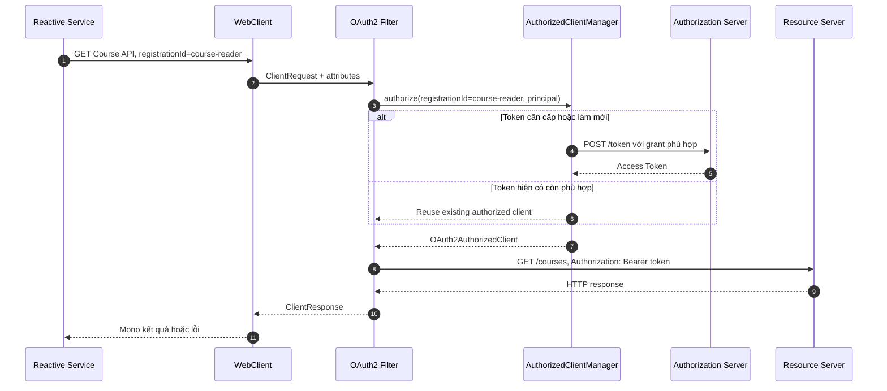

# 30.8. Kiểm thử WebClient filter và việc chọn registration

## Mục tiêu bài học

Trong một ứng dụng **Spring Security OAuth 2.0/OIDC Client chạy trên WebFlux**, `WebClient` thường gọi Resource Server thay mặt người dùng hoặc gọi API bằng **Client Credentials Grant**. Nếu chọn nhầm OAuth2 `ClientRegistration`, ứng dụng có thể gửi sai Access Token, nhận `401/403`, làm lẫn quyền giữa các tenant, hoặc nghiêm trọng hơn là gửi token đến một API không đáng tin cậy.

Sau bài học này, bạn có thể:

- Hiểu **`ServerOAuth2AuthorizedClientExchangeFilterFunction`** làm gì trong pipeline `WebClient` và ranh giới giữa filter, `ReactiveOAuth2AuthorizedClientManager`, provider, repository và Token Endpoint.
- Phân biệt **`registrationId`**, `clientId`, issuer, token audience, current `Authentication` và một **`OAuth2AuthorizedClient`** đã được cấp token.
- Chọn registration minh bạch bằng `.attributes(ServerOAuth2AuthorizedClientExchangeFilterFunction.clientRegistrationId(...))` khi request cần một OAuth2 client cụ thể.
- Hiểu ưu tiên của explicit authorized client, explicit registration, cấu hình default registration và tùy chọn dùng authorized client của current OAuth2 Authentication.
- Viết **unit test filter không cần gọi mạng** bằng `ExchangeFunction` giả, Mockito, Reactor `StepVerifier` và kiểm tra `Authorization` header.
- Kiểm thử **manager nhận đúng registration ID**, không chỉ assert rằng HTTP call trả 200.
- Kiểm tra cả nhánh **có token, không có token, token hết hạn, manager lỗi, API trả 401/403 và sai registration**.
- Phân biệt test ở tầng filter với **integration test Token Endpoint** bằng mock HTTP server và test ở tầng `WebTestClient`.
- Chọn manager đúng cho **request có `ServerWebExchange`** so với **scheduled/background job** không có browser session.
- Xử lý Reactor Context, `ReactiveSecurityContextHolder`, concurrency, multi-tenant token isolation và tránh dùng `.block()` trong WebFlux.
- Tránh rò Access Token do default authorized client quá rộng, URL động, redirects, HTTP logging hoặc filter được tái sử dụng cho nhiều domains.
- Xây ma trận test và quy trình chẩn đoán để kiểm chứng OAuth2 Client thật sự hoạt động đúng về **bảo mật, quyền và vòng đời token**.

---

## 1. Tình huống: hai API, hai ClientRegistrations

Giả sử **Learning Portal** dùng Spring Boot WebFlux:

```text
Browser
   |
   v
Learning Portal (Reactive OAuth2 Client)
   |
   +----> Course API
   |        cần Access Token cho course-api
   |        scope: courses.read
   |
   +----> Reporting API
            cần Access Token cho reporting-api
            scope: reports.write
```

Ứng dụng có hai registrations:

```text
registrationId = course-reader
    clientId    = learning-course-client
    token target / audience = course-api
    allowed scope = courses.read

registrationId = report-publisher
    clientId    = learning-report-client
    token target / audience = reporting-api
    allowed scope = reports.write
```

Từ server, hai requests được gửi bằng cùng framework:

```java
webClient.get()
    .uri("https://course.example.org/api/courses")
    .retrieve()
    .bodyToMono(String.class);
```

```java
webClient.post()
    .uri("https://reporting.example.org/api/reports")
    .retrieve()
    .bodyToMono(String.class);
```

Nếu dùng OAuth2 filter nhưng **không chọn registration rõ ràng**, behavior có thể phụ thuộc current Authentication hoặc default được cấu hình. Một request tới Reporting API có thể vô tình nhận token của Course API.

Triệu chứng:

```text
Course API       -> 200
Reporting API    -> 401 invalid_token
```

Hoặc tệ hơn, API có cấu hình xác minh audience yếu và nhận token không đúng purpose.

**Bài toán kiểm thử phải chứng minh được hai điều riêng biệt:**

1. `WebClient` gửi đúng `Authorization: Bearer ...` cho **API đích hợp lệ**.
2. OAuth2 filter đã yêu cầu **đúng `ClientRegistration`**, không chỉ thêm một token bất kỳ.

> **Nguyên tắc:** Một test chỉ assert `HTTP 200` không chứng minh việc chọn OAuth2 registration đúng. Hãy quan sát cả **`OAuth2AuthorizeRequest.getClientRegistrationId()`** và **outbound `Authorization` header**, cộng thêm validation tại Resource Server trong integration test.

## 2. Bức tranh thành phần Reactive OAuth2 Client

Các class quan trọng:

| Thành phần | Nhiệm vụ |
| --- | --- |
| `WebClient` | Gửi HTTP request không blocking |
| `ExchangeFilterFunction` | Can thiệp outbound request/response |
| `ServerOAuth2AuthorizedClientExchangeFilterFunction` | Chọn/authorize OAuth2 client và thêm Bearer token |
| `ReactiveOAuth2AuthorizedClientManager` | Tìm hoặc cấp/cấp lại authorized client |
| `ReactiveOAuth2AuthorizedClientProvider` | Xử lý grant như `authorization_code`, `refresh_token`, `client_credentials` |
| `ReactiveClientRegistrationRepository` | Tra cấu hình OAuth2 clients bằng `registrationId` |
| `ServerOAuth2AuthorizedClientRepository` | Lưu/tải authorized client theo `ServerWebExchange` trong server request |
| `ReactiveOAuth2AuthorizedClientService` | Lưu authorized clients kiểu service không cần ServerWebExchange |
| `OAuth2AuthorizedClient` | Registration + principalName + Access Token + optional Refresh Token |
| `ReactiveSecurityContextHolder` | Cung cấp SecurityContext/Authentication qua Reactor Context |
| `WebTestClient` | Kiểm thử reactive inbound endpoints |
| `StepVerifier` | Assert `Mono`/`Flux` và lỗi asynchronous |

### 2.1. Luồng request



Trong thực tế filter có thể cần `ServerWebExchange`, `Authentication` và repository tùy constructor/manager. Đây là **bức tranh logic**, không có nghĩa filter luôn gọi `/token` ở mỗi request.

### 2.2. Phân biệt ba danh tính

```text
registrationId = course-reader
clientId       = learning-course-client
principalName  = report-worker-prod
```

- `registrationId` là khóa nội bộ của Spring Security.
- `clientId` là định danh OAuth Client do Authorization Server cấp.
- `principalName` là khóa liên quan authorized-client persistence; trong M2M nó thường là một tên service ổn định, không phải End-User.

Không mặc định cả ba giá trị bằng nhau.

## 3. `ServerOAuth2AuthorizedClientExchangeFilterFunction` là gì?

Trong Spring Security Reactive, filter:

```java
ServerOAuth2AuthorizedClientExchangeFilterFunction
```

có thể được thêm vào `WebClient.Builder`:

```java
WebClient client = WebClient.builder()
    .filter(oauth2Filter)
    .build();
```

Nhiệm vụ chính:

1. Tìm thông tin `OAuth2AuthorizedClient` hoặc registration được request yêu cầu.
2. Nhờ manager lấy hoặc cấp authorized client khi cần.
3. Gắn Bearer Access Token vào outbound HTTP request.
4. Cho phép xử lý authorization failure theo cấu hình.
5. Trả response theo reactive chain, không biến `WebClient` thành Servlet client.

### 3.1. Hai dạng constructor cần phân biệt

Một dạng nhận manager:

```java
new ServerOAuth2AuthorizedClientExchangeFilterFunction(
    reactiveAuthorizedClientManager
);
```

Dạng khác nhận repositories:

```java
new ServerOAuth2AuthorizedClientExchangeFilterFunction(
    clientRegistrationRepository,
    authorizedClientRepository
);
```

Khác biệt quan trọng: khi tự truyền manager, **authorization failure handler không phải lúc nào cũng được cài mặc định giống constructor repository**. Nếu ứng dụng cần loại authorized client khi API báo token không hợp lệ, phải kiểm tra/tự cấu hình `setAuthorizationFailureHandler(...)` đúng contract.

Không dùng package Servlet:

```java
ServletOAuth2AuthorizedClientExchangeFilterFunction
```

trong một dự án thuần WebFlux.

### 3.2. Filter không phải Resource Server validator

Filter **gửi token**, không chứng minh Resource Server nhận token đúng issuer/audience/scope. Resource Server vẫn phải kiểm tra token và phân quyền.

### 3.3. Filter không phải identity provider

Filter không tự chọn user cần mạo danh. Một `ClientCredentials` token đại diện client/workload, không phải token của sinh viên khi chưa có delegated authorization.

## 4. Các cách chọn authorized client

Các cách thường gặp:

```java
.attributes(
    ServerOAuth2AuthorizedClientExchangeFilterFunction
        .clientRegistrationId("course-reader")
)
```

Hoặc truyền một authorized client đã có:

```java
.attributes(
    ServerOAuth2AuthorizedClientExchangeFilterFunction
        .oauth2AuthorizedClient(authorizedClient)
)
```

Hoặc cấu hình default:

```java
oauth2Filter.setDefaultClientRegistrationId(
    "course-reader"
);
```

Ngoài ra:

```java
oauth2Filter.setDefaultOAuth2AuthorizedClient(true);
```

cho phép filter dùng authorized client liên quan current OAuth2 Authentication trong những tình huống được hỗ trợ.

### 4.1. Chọn registration rõ ràng là lựa chọn dễ kiểm thử

Với WebClient phục vụ một API cụ thể:

```java
webClient.get()
    .uri("/api/courses")
    .attributes(
        ServerOAuth2AuthorizedClientExchangeFilterFunction
            .clientRegistrationId("course-reader")
    )
    .retrieve()
    .bodyToMono(CourseResponse.class);
```

Request này diễn đạt rõ intent: dùng registration `course-reader`.

### 4.2. Explicit authorized client là trường hợp khác

Một `OAuth2AuthorizedClient` đã chứa Access Token và registration:

```java
webClient.get()
    .uri("/api/courses")
    .attributes(
        ServerOAuth2AuthorizedClientExchangeFilterFunction
            .oauth2AuthorizedClient(authorizedClient)
    )
    .retrieve()
    .bodyToMono(String.class);
```

Cách này hữu ích khi business service **đã authorize** trước theo đúng user/grant. Nhưng phải bảo đảm authorized client thuộc đúng principal, registration và resource; không nhận object/token từ HTTP input không tin cậy.

### 4.3. Default registration có thể tiện nhưng tăng rủi ro

```java
oauth2Filter.setDefaultClientRegistrationId(
    "course-reader"
);
```

Khi WebClient dùng chung cho nhiều APIs, một request quên `.attributes(...)` có thể tự gửi token `course-reader` đến endpoint không phù hợp.

### 4.4. `setDefaultOAuth2AuthorizedClient(true)` cần đặc biệt cẩn thận

Nếu bật:

```java
oauth2Filter.setDefaultOAuth2AuthorizedClient(true);
```

filter có thể sử dụng authorized client của **người dùng OAuth2 hiện tại** trong Reactor SecurityContext. Nếu cùng `WebClient` được dùng cho các URLs khác nhau, user token có thể đi tới Resource Server không mong muốn.

Chỉ bật khi toàn bộ outbound destinations đều đã được kiểm soát và chính sách quyền phù hợp. Trong nhiều hệ thống, **explicit per-request selection** hoặc **WebClient riêng cho từng API** dễ kiểm soát hơn.

### 4.5. Thứ tự ưu tiên phải được test theo version và cấu hình

Khi có explicit authorized client, explicit registration ID, default registration ID và default current-user client, filter có logic chọn tương ứng với Spring Security version.

Đừng dựa vào giả định mơ hồ như “default luôn thắng” hoặc “current user luôn thắng”. Viết test cho **cấu hình thật** và assert authorized client/registration mà manager đã xử lý.

## 5. Ví dụ Spring Boot WebFlux có hai registrations

```yaml
spring:
  security:
    oauth2:
      client:
        registration:
          course-reader:
            provider: campus
            client-id: ${COURSE_READER_CLIENT_ID}
            client-secret: ${COURSE_READER_CLIENT_SECRET}
            client-authentication-method: client_secret_basic
            authorization-grant-type: client_credentials
            scope:
              - courses.read

          report-publisher:
            provider: campus
            client-id: ${REPORT_PUBLISHER_CLIENT_ID}
            client-secret: ${REPORT_PUBLISHER_CLIENT_SECRET}
            client-authentication-method: client_secret_basic
            authorization-grant-type: client_credentials
            scope:
              - reports.write

        provider:
          campus:
            token-uri: https://idp.example.org/oauth2/token
```

Đây là cấu hình ví dụ cho Client Credentials Grant, không phải OIDC Login; M2M không cần `openid` hay browser redirect.

### 5.1. Registration ID và token audience khác nhau

```text
registrationId = course-reader
scope          = courses.read
```

không tự bảo đảm Access Token có:

```text
aud = course-api
```

Audience được Authorization Server quyết định theo client/API policy hoặc resource indicator/provider-specific token request. **Tầng test filter không chứng minh audience của token thật.**

### 5.2. Không dùng cùng client secret cho mọi registration

Một credential dành cho `report-publisher` nên có scopes/resources tối thiểu, không tự dùng được cho Admin API. Cũng nên tách secret của dev, staging và production.

## 6. Manager cho background job không có ServerWebExchange

Nếu đây là scheduled job, không có inbound browser request. Một lựa chọn phù hợp:

```java
AuthorizedClientServiceReactiveOAuth2AuthorizedClientManager
```

với `ReactiveOAuth2AuthorizedClientService`.

Ví dụ:

```java
@Configuration
class OutboundOAuth2Configuration {

    @Bean
    ReactiveOAuth2AuthorizedClientManager
    serviceAuthorizedClientManager(
            ReactiveClientRegistrationRepository registrations,
            ReactiveOAuth2AuthorizedClientService service) {

        ReactiveOAuth2AuthorizedClientProvider provider =
            ReactiveOAuth2AuthorizedClientProviderBuilder.builder()
                .clientCredentials()
                .build();

        AuthorizedClientServiceReactiveOAuth2AuthorizedClientManager
            manager =
                new AuthorizedClientServiceReactiveOAuth2AuthorizedClientManager(
                    registrations,
                    service
                );

        manager.setAuthorizedClientProvider(provider);
        return manager;
    }

    @Bean
    WebClient courseWebClient(
            ReactiveOAuth2AuthorizedClientManager manager) {

        ServerOAuth2AuthorizedClientExchangeFilterFunction oauth2 =
            new ServerOAuth2AuthorizedClientExchangeFilterFunction(
                manager
            );

        return WebClient.builder()
            .baseUrl("https://course.example.org")
            .filter(oauth2)
            .build();
    }
}
```

Bean `ReactiveClientRegistrationRepository` và `ReactiveOAuth2AuthorizedClientService` cần tồn tại trong context, do Boot auto-configuration hoặc project cung cấp.

### 6.1. Vì sao không dùng `DefaultReactiveOAuth2AuthorizedClientManager` tùy tiện?

`DefaultReactiveOAuth2AuthorizedClientManager` thường phục vụ authorization trong **ngữ cảnh ServerWebExchange**, dùng `ServerOAuth2AuthorizedClientRepository` và session/request context.

Scheduled job không có request đó. Nếu test dùng Mock ServerWebExchange rồi production job chạy ngoài web request, test có thể pass nhưng runtime lại lỗi/mất authorized client.

### 6.2. Principal cho client credentials

Khi dùng service authorized client manager, principal có thể được đặt bằng service identity ổn định:

```java
OAuth2AuthorizeRequest request =
    OAuth2AuthorizeRequest
        .withClientRegistrationId("course-reader")
        .principal("course-sync-job")
        .build();
```

`principal` ở đây là key persistence và context cấp token, **không phải End-User có OIDC session**.

### 6.3. Filter vẫn cần context phù hợp

Khi dùng `ServerOAuth2AuthorizedClientExchangeFilterFunction`, caller cần chọn registration và cung cấp Authentication/ServerWebExchange theo contract của manager/filter; test với reactive security context hoặc explicit manager authorization để tránh behavior ngầm.

Với scheduled jobs phức tạp, một hướng dễ kiểm thử là **authorize rõ ràng** bằng service manager rồi gắn `oauth2AuthorizedClient` vào request, thay vì dựa vào user context không tồn tại.

## 7. Dùng WebClient riêng cho từng Resource Server

Một thiết kế giảm nguy cơ lộ token:

```text
courseWebClient
    baseUrl = https://course.example.org
    intended registration = course-reader

reportingWebClient
    baseUrl = https://reporting.example.org
    intended registration = report-publisher
```

Ví dụ factory:

```java
@Bean
WebClient reportingWebClient(
        ReactiveOAuth2AuthorizedClientManager manager) {

    ServerOAuth2AuthorizedClientExchangeFilterFunction oauth2 =
        new ServerOAuth2AuthorizedClientExchangeFilterFunction(
            manager
        );

    oauth2.setDefaultClientRegistrationId(
        "report-publisher"
    );

    return WebClient.builder()
        .baseUrl("https://reporting.example.org")
        .filter(oauth2)
        .build();
}
```

Cấu hình default chỉ hợp lý nếu WebClient **không được dùng để gọi arbitrary URL**; HTTP redirects sang host khác cũng cần kiểm soát.

### 7.1. Per-request explicit registration

Một lựa chọn tránh defaults:

```java
Mono<CourseDto[]> loadCourses(WebClient courseWebClient) {
    return courseWebClient.get()
        .uri("/api/courses")
        .attributes(
            ServerOAuth2AuthorizedClientExchangeFilterFunction
                .clientRegistrationId("course-reader")
        )
        .retrieve()
        .bodyToMono(CourseDto[].class);
}
```

Đây là method cần test rằng manager được gọi với `course-reader` và outbound request có Bearer token phù hợp.

## 8. Chiến lược kiểm thử theo bốn lớp

| Tầng | Công cụ | Mục tiêu | Chưa chứng minh |
| --- | --- | --- | --- |
| **Filter unit test** | `ExchangeFunction` giả, Mockito, `StepVerifier` | Chọn registration, gắn Bearer header, error propagation | Token Endpoint thật, signature/audience |
| **Token manager integration** | Fake Token Endpoint, `MockWebServer`/WireMock | Client Credentials request/response, scopes, cache/expiry | Browser OIDC Login, RS policy |
| **Reactive inbound test** | `WebTestClient`, `spring-security-test` | Controller → service → WebClient, SecurityContext/Reactor Context | OP/browser redirect E2E nếu mock login |
| **End-to-end** | Test AS + test RS + browser khi có OIDC | Hoàn chỉnh token issuance, HTTP transport và audience/authorization | Sản xuất luôn có policy giống test nếu config khác |

Một test tốt **phân ranh giới rõ**. Unit test WebClient filter không phải kiểm thử giải mã JWT. Mock `oidcLogin()` cũng không chứng minh OAuth2 Authorization Code/PKCE/token validation thật sự diễn ra.

## 9. Công cụ test reactive

Các thư viện điển hình cho JUnit 5:

```groovy
dependencies {
    implementation 'org.springframework.boot:spring-boot-starter-webflux'
    implementation 'org.springframework.boot:spring-boot-starter-oauth2-client'

    testImplementation 'org.springframework.boot:spring-boot-starter-test'
    testImplementation 'org.springframework.security:spring-security-test'
    testImplementation 'io.projectreactor:reactor-test'
}
```

Nếu dùng HTTP mock server:

```groovy
testImplementation 'com.squareup.okhttp3:mockwebserver'
```

`MockWebServer` hoặc WireMock là lựa chọn phụ thuộc vào stack/version dự án. Dependency names/versions ở ví dụ cần đối chiếu Spring Boot BOM và Spring Security bản đang dùng.

### 9.1. Tại sao dùng StepVerifier?

`WebClient` trả `Mono<T>` hoặc `Flux<T>`. `StepVerifier` cho phép subscribe và assert:

```text
expectNext
expectComplete
expectError
verify
```

Không phải gọi `.block()` trong service reactive để viết test.

### 9.2. Không test bằng “khởi tạo Mono rồi bỏ đó”

Một Publisher lazy:

```java
Mono<String> response = webClient.get()
    .uri("/api/courses")
    .retrieve()
    .bodyToMono(String.class);
```

thường chưa gửi HTTP request. Test phải subscribe bằng `StepVerifier.create(response)...verifyComplete()` hoặc công cụ tương đương.

## 10. Dựng ClientRegistration fixture cho test

Một registration thuộc Client Credentials:

```java
private static ClientRegistration registration(
        String registrationId,
        String clientId,
        String scope) {

    return ClientRegistration
        .withRegistrationId(registrationId)
        .clientId(clientId)
        .clientSecret("test-secret-not-production")
        .clientAuthenticationMethod(
            ClientAuthenticationMethod.CLIENT_SECRET_BASIC
        )
        .authorizationGrantType(
            AuthorizationGrantType.CLIENT_CREDENTIALS
        )
        .tokenUri(
            "https://idp.test.example/oauth2/token"
        )
        .scope(scope)
        .build();
}
```

Fixture dùng:

```java
ClientRegistration course = registration(
    "course-reader",
    "course-client-test",
    "courses.read"
);

ClientRegistration reporting = registration(
    "report-publisher",
    "report-client-test",
    "reports.write"
);
```

Ở unit test, `ClientRegistration` không cần truy cập OP discovery. Dùng `withRegistrationId(...)` giúp test không phụ thuộc mạng hoặc cấu hình OAuth2 vendor thật.

### 10.1. Registration không phải token

Fixture trên mới chứa client config, chưa có Access Token. Để test filter header, cần tạo `OAuth2AuthorizedClient` giả hoặc mock manager cấp authorized client.

## 11. Dựng OAuth2AuthorizedClient fixture

```java
private static OAuth2AuthorizedClient authorizedClient(
        ClientRegistration registration,
        String principalName,
        String tokenValue,
        String scope) {

    Instant now = Instant.now();

    OAuth2AccessToken accessToken = new OAuth2AccessToken(
        OAuth2AccessToken.TokenType.BEARER,
        tokenValue,
        now.minusSeconds(10),
        now.plusSeconds(300),
        Set.of(scope)
    );

    return new OAuth2AuthorizedClient(
        registration,
        principalName,
        accessToken
    );
}
```

Sử dụng:

```java
OAuth2AuthorizedClient courseClient = authorizedClient(
    courseRegistration,
    "course-sync-job",
    "test-course-token",
    "courses.read"
);

OAuth2AuthorizedClient reportClient = authorizedClient(
    reportRegistration,
    "report-sync-job",
    "test-report-token",
    "reports.write"
);
```

Token strings trên là **giá trị giả dành cho unit test**. Không dùng production credentials hoặc token lấy từ tài khoản thật làm fixtures.

### 11.1. Điều unit test giả định

Manager mock trả authorized client chứa Bearer token hợp lệ theo fixture. Filter có nhiệm vụ đính token vào HTTP request. Unit test **không xác minh** chữ ký/issuer/audience của Access Token.

## 12. Dựng `ExchangeFunction` giả để bắt outbound request

Một cách kiểm thử filter không cần HTTP server là thay terminal `ExchangeFunction`.

```java
AtomicReference<ClientRequest> sent =
    new AtomicReference<>();

ExchangeFunction fakeExchange = request -> {
    sent.set(request);

    return Mono.just(
        ClientResponse
            .create(HttpStatus.OK)
            .body("ok")
            .build()
    );
};
```

Khi `WebClient` thực hiện request, fake exchange nhận **`ClientRequest` sau khi filter đã xử lý** và trả `ClientResponse` giả.

### 12.1. Những gì có thể assert?

```text
request.url()
request.method()
request.headers().getFirst(HttpHeaders.AUTHORIZATION)
request.attributes()
```

Đây là điểm kiểm thử lý tưởng để biết Bearer header cuối cùng có được gắn hay không.

### 12.2. Không cần chạy HTTP server thật

Filter unit test:

```text
WebClient -> OAuth2 filter -> fake ExchangeFunction
```

không mở network connection, không gọi OP hoặc API thật.

### 12.3. Fake exchange cũng không thay thế manager

Nếu mock manager trả token bất kỳ, test không biết authorization grant/token request thực tế có đúng scope không. Cần test integration riêng.

## 13. Unit test hoàn chỉnh: chọn registration và gửi Bearer token

Ví dụ JUnit 5, Mockito và Reactor Test (imports lược bớt để tập trung hành vi):

```java
class WebClientOAuth2SelectionTest {

    private ReactiveOAuth2AuthorizedClientManager manager;

    private AtomicReference<ClientRequest> sent;

    private WebClient webClient;

    @BeforeEach
    void setUp() {
        manager = mock(
            ReactiveOAuth2AuthorizedClientManager.class
        );

        sent = new AtomicReference<>();

        ClientRegistration course = registration(
            "course-reader",
            "course-client-test",
            "courses.read"
        );

        ClientRegistration reporting = registration(
            "report-publisher",
            "report-client-test",
            "reports.write"
        );

        OAuth2AuthorizedClient courseClient = authorizedClient(
            course,
            "course-sync-job",
            "test-course-token",
            "courses.read"
        );

        OAuth2AuthorizedClient reportClient = authorizedClient(
            reporting,
            "report-sync-job",
            "test-report-token",
            "reports.write"
        );

        when(manager.authorize(
            any(OAuth2AuthorizeRequest.class)
        )).thenAnswer(invocation -> {

            OAuth2AuthorizeRequest request =
                invocation.getArgument(0);

            return switch (request.getClientRegistrationId()) {
                case "course-reader" -> Mono.just(courseClient);
                case "report-publisher" -> Mono.just(reportClient);
                default -> Mono.empty();
            };
        });

        ExchangeFunction exchange = request -> {
            sent.set(request);

            return Mono.just(
                ClientResponse.create(HttpStatus.OK)
                    .body("ok")
                    .build()
            );
        };

        ServerOAuth2AuthorizedClientExchangeFilterFunction oauth2 =
            new ServerOAuth2AuthorizedClientExchangeFilterFunction(
                manager
            );

        webClient = WebClient.builder()
            .filter(oauth2)
            .exchangeFunction(exchange)
            .build();
    }

    @Test
    void selectsCourseRegistrationAndAddsCourseToken() {
        Mono<String> response = webClient.get()
            .uri("https://course.test.example/api/courses")
            .attributes(
                ServerOAuth2AuthorizedClientExchangeFilterFunction
                    .clientRegistrationId("course-reader")
            )
            .retrieve()
            .bodyToMono(String.class)
            .contextWrite(
                ReactiveSecurityContextHolder.withAuthentication(
                    new TestingAuthenticationToken(
                        "course-sync-job",
                        "n/a",
                        "ROLE_SYSTEM"
                    )
                )
            );

        StepVerifier.create(response)
            .expectNext("ok")
            .verifyComplete();

        ArgumentCaptor<OAuth2AuthorizeRequest> captor =
            ArgumentCaptor.forClass(
                OAuth2AuthorizeRequest.class
            );

        verify(manager).authorize(captor.capture());

        assertThat(
            captor.getValue().getClientRegistrationId()
        ).isEqualTo("course-reader");

        assertThat(
            sent.get().headers().getFirst(
                HttpHeaders.AUTHORIZATION
            )
        ).isEqualTo("Bearer test-course-token");
    }
}
```

Các helper `registration(...)` và `authorizedClient(...)` là fixtures đã định nghĩa ở các mục trước. Cần bổ sung imports JUnit, AssertJ, Mockito, Reactor, Spring HTTP, WebClient, Spring Security OAuth2/Reactive và Java types.

### 13.1. Điều test chứng minh

- Request `.attributes(clientRegistrationId("course-reader"))` thực sự dẫn đến manager authorization với ID tương ứng.
- Filter gắn đúng Access Token của authorized client được trả về.
- Result được xử lý dưới dạng `Mono`, không cần `.block()` trong service.
- Fake exchange không gọi mạng.

### 13.2. Điều test chưa chứng minh

- Authorization Server đã cấp token thật.
- Token được ký đúng.
- Access Token có `aud=course-api`.
- Resource Server thực sự chấp nhận token.
- `client_secret` hoặc `private_key_jwt` được gửi đúng.
- Token refresh/caching hoạt động theo thời gian thật.

Những điểm này phải được kiểm tra ở các tầng tiếp theo.

### 13.3. Vì sao thêm ReactiveSecurityContextHolder?

Filter/manager trong môi trường server có thể cần Authentication từ Reactor SecurityContext. Test đặt một principal kỹ thuật để behavior có ngữ cảnh xác định. Điều này **không** biến Client Credentials Grant thành user-delegated OAuth2.

Trong production scheduled job, nên cấu hình service manager với principal/service policy rõ ràng hoặc authorize tường minh, không ngầm kỳ vọng một browser user context.

## 14. Test chọn registration thứ hai

Test độc lập:

```java
@Test
void selectsReportRegistrationAndAddsReportToken() {
    Mono<String> response = webClient.post()
        .uri("https://report.test.example/api/reports")
        .attributes(
            ServerOAuth2AuthorizedClientExchangeFilterFunction
                .clientRegistrationId("report-publisher")
        )
        .retrieve()
        .bodyToMono(String.class)
        .contextWrite(
            ReactiveSecurityContextHolder.withAuthentication(
                new TestingAuthenticationToken(
                    "report-sync-job",
                    "n/a",
                    "ROLE_SYSTEM"
                )
            )
        );

    StepVerifier.create(response)
        .expectNext("ok")
        .verifyComplete();

    ArgumentCaptor<OAuth2AuthorizeRequest> captor =
        ArgumentCaptor.forClass(OAuth2AuthorizeRequest.class);

    verify(manager).authorize(captor.capture());

    assertThat(
        captor.getValue().getClientRegistrationId()
    ).isEqualTo("report-publisher");

    assertThat(
        sent.get().headers().getFirst(
            HttpHeaders.AUTHORIZATION
        )
    ).isEqualTo("Bearer test-report-token");
}
```

Nếu cả hai tests dùng chung một `WebClient` instance, việc chọn registration qua **per-request attributes** vẫn phải dẫn đến hai tokens khác nhau.

### 14.1. Không chỉ kiểm tra token string

Nếu test luôn mock manager trả `"token-abc"` cho mọi registration, assert Bearer header có thể pass dù chọn sai registration. Dùng **token fixtures khác nhau** để lỗi selection trở nên quan sát được.

### 14.2. Không dùng một AtomicReference trong test chạy song song

Đoạn fixture dùng một `AtomicReference` cho mỗi test instance tuần tự. Nếu chạy concurrent tests trên cùng WebClient/fixture dùng chung, một request có thể ghi đè request khác.

Với concurrency test nên:

- Capture danh sách thread-safe.
- Gắn request test ID không nhạy cảm.
- Assert từng request theo URI/registration.
- Tránh static mutable state.

## 15. Test manager nhận đúng `registrationId`

Điều trọng tâm có thể được test tách riêng:

```java
ArgumentCaptor<OAuth2AuthorizeRequest> captor =
    ArgumentCaptor.forClass(
        OAuth2AuthorizeRequest.class
    );

verify(manager).authorize(captor.capture());

assertThat(
    captor.getValue().getClientRegistrationId()
).isEqualTo("course-reader");
```

Lý do: `Authorization` header kiểm tra **đầu ra**, còn `OAuth2AuthorizeRequest` kiểm tra **quyết định chọn registration**.

### 15.1. Assert các thành phần khác

Khi cần:

```java
Authentication principal =
    captor.getValue().getPrincipal();

assertThat(principal).isNotNull();
```

Có thể assert principal name/context theo contract của app. Không suy `principal.getName()` là OAuth2 `clientId` nếu job dùng service key khác.

### 15.2. Request attribute không thay đổi ClientRegistrationRepository

`.attributes(clientRegistrationId(...))` chọn khóa registration. Nó **không tạo** `ClientRegistration` mới hoặc tự sửa scopes/token URI của registration được quản lý.

Nếu ID không tồn tại, manager/provider/repository cần xử lý lỗi hoặc không trả authorized client theo implementation; test fail closed.

## 16. Test request không chỉ định registration

Có hai chính sách hợp lệ, tùy ứng dụng:

**Chính sách A — Explicit selection bắt buộc:**

```text
Không có clientRegistrationId
Không có explicit authorized client
Không có default configuration
    -> Không đính Access Token
```

**Chính sách B — WebClient dành riêng cho một API:**

```text
Không có explicit registration
Có default registration course-reader
    -> Tự chọn course-reader
```

Cần viết test cho chính sách bạn chọn, thay vì tin ngầm vào framework.

### 16.1. Khi không có default

```java
Mono<String> response = webClient.get()
    .uri("https://public.test.example/health")
    .retrieve()
    .bodyToMono(String.class);

StepVerifier.create(response)
    .expectNext("ok")
    .verifyComplete();

assertThat(
    sent.get().headers().containsKey(
        HttpHeaders.AUTHORIZATION
    )
).isFalse();
```

Mẫu trên giả định filter được tạo không default và không có explicit OAuth2 authorized client/current OAuth2 client được chọn. Nếu environment có default-user behavior, phải test theo configuration thực tế.

### 16.2. Nếu request thiếu registration phải lỗi nghiệp vụ

Đối với một WebClient chuyên dùng để gọi API bảo mật, bạn có thể muốn **fail fast** khi quên ID, thay vì gửi request anonymous rồi nhận 401.

Ví dụ tạo wrapper service:

```java
Mono<String> fetchWithRegistration(
        String registrationId) {

    if (!ALLOWED_REGISTRATIONS.contains(registrationId)) {
        return Mono.error(
            new IllegalArgumentException(
                "Registration is not allowed"
            )
        );
    }

    return webClient.get()
        .uri("/api/reports")
        .attributes(
            ServerOAuth2AuthorizedClientExchangeFilterFunction
                .clientRegistrationId(registrationId)
        )
        .retrieve()
        .bodyToMono(String.class);
}
```

Không lấy `registrationId` trực tiếp từ arbitrary user input mà không kiểm tra allowlist nghiệp vụ.

## 17. Kiểm thử default client registration

Giả sử:

```java
oauth2.setDefaultClientRegistrationId(
    "course-reader"
);
```

Request:

```java
webClient.get()
    .uri("https://course.test.example/api/courses")
    .retrieve()
    .bodyToMono(String.class);
```

Test kỳ vọng:

```text
manager.authorize request.registrationId == course-reader
Authorization == Bearer test-course-token
```

### 17.1. Test explicit override

Sau khi default là `course-reader`, request đến reporting API chọn rõ:

```java
.attributes(
    ServerOAuth2AuthorizedClientExchangeFilterFunction
        .clientRegistrationId("report-publisher")
)
```

Test phải chứng minh manager nhận `report-publisher`, không vô tình dùng default.

### 17.2. Không dùng default với WebClient đa domain không kiểm soát

Một client dùng default token nhưng cho phép:

```java
webClient.get()
    .uri(userSuppliedUrl)
```

có nguy cơ gửi Access Token tới host do user chỉ định. Filter unit test nên có case từ chối URL không thuộc allowlist, thường ở wrapper service hoặc HTTP client configuration.

## 18. Test explicit `OAuth2AuthorizedClient`

Khi service đã authorize một client tường minh:

```java
OAuth2AuthorizedClient authorized =
    ...; // trusted authorized client

Mono<String> response = webClient.get()
    .uri("https://course.test.example/api/courses")
    .attributes(
        ServerOAuth2AuthorizedClientExchangeFilterFunction
            .oauth2AuthorizedClient(authorized)
    )
    .retrieve()
    .bodyToMono(String.class);
```

Có thể assert:

```text
Authorization header == Bearer <trusted authorized token>
Registration của object là course-reader
Không vô tình lấy token từ principal/registration khác
```

### 18.1. Test authorized client sai owner

Nếu một object `OAuth2AuthorizedClient` của user A bị đưa vào request của user B, filter có thể sử dụng token A. Framework không thể hiểu mọi ownership rule của ứng dụng.

Do đó logic cấp authorized client phải được kiểm soát, và có test:

```text
User B không được lấy authorized client của User A từ store
```

### 18.2. Không nhận authorized client từ client HTTP

Một user browser không được phép đưa raw Access Token hoặc serialized authorized client vào request rồi ép backend dùng token đó cho downstream API khi chưa được xác thực/ủy quyền đúng.

## 19. Test `setDefaultOAuth2AuthorizedClient(true)`

Cấu hình:

```java
oauth2.setDefaultOAuth2AuthorizedClient(true);
```

cho phép dùng current OAuth2 Authentication authorized client làm default trong những tình huống phù hợp.

Test cần thiết:

1. Request có current `OAuth2AuthenticationToken` thuộc registration `campus-login`.
2. Request không có explicit client registration.
3. Filter có thể chọn authorized client hiện tại theo contract.
4. Một API lạ hoặc không được phép **không được nhận user token** chỉ vì WebClient được tái sử dụng.

### 19.1. Khi nào đặc biệt nguy hiểm?

Một service dùng:

```text
WebClient có defaultOAuth2AuthorizedClient=true
```

rồi gọi:

```text
https://untrusted.example/preview
```

có thể làm lộ user Access Token. Tốt hơn thường là chỉ bật khi destinations đã được kiểm soát cứng hoặc chọn registration/authorized client cho đúng API.

### 19.2. Test không có Authentication

Với current SecurityContext vắng mặt:

```text
Không tự lấy token của user trước đó từ singleton/global state
```

Một filter dùng đúng Reactor Context không nên lưu user token vào static variable để phục vụ request tiếp theo.

### 19.3. Test current Authentication khác OIDC/OAuth2

Nếu principal là một `TestingAuthenticationToken` hoặc anonymous authentication, không suy rằng tồn tại authorized OAuth2 Client của End-User. Behavior phụ thuộc policy/default manager; cần assert không vô tình lấy token user cũ.

## 20. `ReactiveSecurityContextHolder` trong test

Một HTTP request Reactive có SecurityContext qua Reactor Context, không phải qua Servlet thread local.

Ví dụ:

```java
Authentication authentication =
    new TestingAuthenticationToken(
        "test-user", "n/a", "ROLE_USER"
    );

Mono<String> publisher =
    webClient.get()
        .uri("https://course.test.example/api/courses")
        .attributes(
            ServerOAuth2AuthorizedClientExchangeFilterFunction
                .clientRegistrationId("course-reader")
        )
        .retrieve()
        .bodyToMono(String.class)
        .contextWrite(
            ReactiveSecurityContextHolder
                .withAuthentication(authentication)
        );
```

Trong WebFlux test, có thể dùng `WebTestClient` configurers của `spring-security-test` để giả lập Authentication ở inbound side, sau đó verify outbound WebClient/manager.

### 20.1. Context không đồng nghĩa global variable

Không:

```java
static Authentication currentUser;
```

Không đặt một token vào ThreadLocal rồi assume Reactor sẽ giữ nó qua `publishOn` và concurrent requests.

### 20.2. `contextWrite` tác động lên subscription chain

Test:

```java
StepVerifier.create(publisher)
    .expectNext("ok")
    .verifyComplete();
```

`contextWrite` chỉ có ý nghĩa khi publisher được subscribe theo chain phù hợp. Nếu service tự `.subscribe()` nội bộ, context và errors có thể thoát khỏi chain bên ngoài.

## 21. Test lỗi khi không tìm thấy registration

Một registration ID không tồn tại:

```java
.attributes(
    ServerOAuth2AuthorizedClientExchangeFilterFunction
        .clientRegistrationId("missing-registration")
)
```

Đừng viết test mặc định rằng framework **luôn** ném đúng một exception class trong mọi Spring Security version. Tùy manager/provider, có thể là authorization error hoặc không có authorized client.

Điều cần chứng minh là **fail closed** theo chính sách ứng dụng:

- Không fallback sang `platform-admin`.
- Không chọn registration đầu tiên trong repository.
- Không gửi token của tenant khác.
- Không cache một token trái ngữ cảnh.
- Nếu tiếp tục anonymous, API protected không được trả protected data.
- Logs không làm lộ credentials.

### 21.1. Một manager mock mô phỏng lỗi

```java
when(manager.authorize(any()))
    .thenReturn(Mono.error(
        new IllegalArgumentException(
            "Unknown registration"
        )
    ));
```

Sau đó:

```java
StepVerifier.create(
    webClient.get()
        .uri("https://course.test.example/api/courses")
        .attributes(
            ServerOAuth2AuthorizedClientExchangeFilterFunction
                .clientRegistrationId("missing-registration")
        )
        .retrieve()
        .bodyToMono(String.class)
)
.expectError()
.verify();
```

Đoạn này kiểm tra **filter propagate manager error**, không chứng minh repository thật chọn exception tương tự.

### 21.2. Không tự chữa bằng registration mặc định có nhiều quyền

Ví dụ sai:

```text
unknown registration -> fallback platform-admin
```

Có thể biến typo/configuration error thành lỗi quyền nghiêm trọng.

## 22. Test manager trả `Mono.empty()`

Một `ReactiveOAuth2AuthorizedClientManager` có thể không trả authorized client nếu provider không authorize được theo context.

Test:

```java
when(manager.authorize(any()))
    .thenReturn(Mono.empty());
```

Kỳ vọng cần kiểm tra:

```text
Không gắn Bearer token giả
Không dùng token stale từ request trước
API protected không tự trả dữ liệu
```

Tùy filter/contract, request có thể tiếp tục không có Bearer header; app có thể chủ động **fail fast** ở wrapper service nếu quyền token là bắt buộc.

### 22.1. Token bắt buộc thì fail fast tốt hơn

Nếu API luôn cần OAuth2, một service wrapper có thể authorize trước và trả lỗi rõ khi `Mono.empty()`:

```java
Mono<OAuth2AuthorizedClient> acquireClient(
        ReactiveOAuth2AuthorizedClientManager manager,
        String registrationId,
        String principal) {

    OAuth2AuthorizeRequest request =
        OAuth2AuthorizeRequest
            .withClientRegistrationId(registrationId)
            .principal(principal)
            .build();

    return manager.authorize(request)
        .switchIfEmpty(
            Mono.error(
                new IllegalStateException(
                    "OAuth2 authorization was not granted"
                )
            )
        );
}
```

Sau đó gắn authorized client explicitly vào WebClient request hoặc truyền token vào client được cấu hình đúng. Không dùng `.block()` trong reactive service.

## 23. Test Token Endpoint thật bằng mock HTTP server

Unit test filter với mock manager đã **bỏ qua** phần Client Credentials Grant.

Để test token issuance thật, dựng fake Authorization Server:

```text
POST /oauth2/token
    grant_type=client_credentials
    Authorization: Basic ...
    scope=courses.read
```

Fake server trả:

```http
HTTP/1.1 200 OK
Content-Type: application/json

{
  "access_token": "stub-course-token",
  "token_type": "Bearer",
  "expires_in": 300,
  "scope": "courses.read"
}
```

Đây là **test-only token response**; không phải token dùng production.

### 23.1. Registration trỏ đến mock server

```java
ClientRegistration course = ClientRegistration
    .withRegistrationId("course-reader")
    .clientId("course-test-client")
    .clientSecret("test-secret")
    .clientAuthenticationMethod(
        ClientAuthenticationMethod.CLIENT_SECRET_BASIC
    )
    .authorizationGrantType(
        AuthorizationGrantType.CLIENT_CREDENTIALS
    )
    .tokenUri(mockServer.url("/oauth2/token").toString())
    .scope("courses.read")
    .build();
```

Ví dụ giả định mock server có method `url(...)` như `MockWebServer`. Khi đó tạo reactive registrations/service/manager thật cho test.

### 23.2. Test cần assert request đến AS

Kiểm tra:

```text
Method POST
Path /oauth2/token
Form grant_type=client_credentials
Request scope=courses.read
Client authentication theo registration
Không gửi OIDC nonce hay user password
```

Không mặc định `client_secret_basic` là cách duy nhất: provider có thể dùng `private_key_jwt`, mTLS hoặc workload identity federation. Test phải theo contract thực tế.

### 23.3. Không lưu token response vào logs

Fake token string không nhạy cảm, nhưng test logging cần xác minh production code không ghi raw token hoặc Basic auth header. Nếu mock server test framework ghi toàn bộ requests, chỉ dùng credentials giả và giới hạn CI artifact retention.

## 24. Tạo manager thật cho integration test Client Credentials

Một cấu hình test logic:

```java
ReactiveClientRegistrationRepository registrations =
    new InMemoryReactiveClientRegistrationRepository(
        courseRegistration,
        reportRegistration
    );

ReactiveOAuth2AuthorizedClientService authorizedClients =
    new InMemoryReactiveOAuth2AuthorizedClientService(
        registrations
    );

AuthorizedClientServiceReactiveOAuth2AuthorizedClientManager manager =
    new AuthorizedClientServiceReactiveOAuth2AuthorizedClientManager(
        registrations,
        authorizedClients
    );

ReactiveOAuth2AuthorizedClientProvider provider =
    ReactiveOAuth2AuthorizedClientProviderBuilder.builder()
        .clientCredentials()
        .build();

manager.setAuthorizedClientProvider(provider);
```

Sau đó:

```text
WebClient -> OAuth2 filter -> manager
    -> registration store
    -> Client Credentials token client
    -> fake AS /token
    -> authorized client service
    -> mock Resource Server
```

### 24.1. Điều kiện test có tính xác định

- OP mock server được mở trước khi tạo registration.
- Token URI của registration chỉ đến localhost/mock server.
- Timeouts hữu hạn; không phụ thuộc public internet.
- Service store mới cho mỗi test hoặc reset trạng thái.
- Token values khác nhau cho mỗi registration.
- Không dùng credentials thật.

### 24.2. Client Credentials không phải OIDC Login

Integration test Token Endpoint này không cần `/authorize`, `state`, `nonce` hoặc `/login/oauth2/code/{registrationId}`. Đó là các thành phần của Authorization Code/OIDC Login, không của Client Credentials.

## 25. Test hai token requests độc lập

Cho mock AS trả:

```text
course-reader:
    access_token = stub-course-token
    scope = courses.read

report-publisher:
    access_token = stub-report-token
    scope = reports.write
```

Test hai outbound requests và kiểm tra:

```text
Course API receives Bearer stub-course-token
Reporting API receives Bearer stub-report-token
```

Đồng thời fake AS phải quan sát:

```text
token request for course client ID
token request for report client ID
```

### 25.1. Token caching

Nếu gọi Course API lần hai trước khi token hết hạn và cùng authorized-client key, manager có thể **tái sử dụng** token thay vì gọi `/token` lần nữa.

Test:

```text
First call  -> token endpoint invoked
Second call -> no new token request when current token reusable
```

Không assert số lượng `/token` calls mà không hiểu clock skew/expiry và provider behavior.

### 25.2. Không chia sẻ cache giữa registrations

Hai registrations có Client IDs và scopes khác nhau phải có token states riêng, ngay cả khi dùng cùng issuer và Token Endpoint.

## 26. Token expiry và refresh behavior

Access Token có:

```text
issuedAt
expiresAt
scopes
```

Provider/manager quyết định có cần cấp lại khi token gần hết hạn, thường có clock-skew handling.

### 26.1. Test token còn hiệu lực

```text
Given:
  token expires far in future
When:
  same registration/principal calls again
Then:
  manager returns reusable authorized client
  token endpoint need not be called again
```

### 26.2. Test token hết hạn

```text
Given:
  token expires/within configured skew
When:
  new request arrives
Then:
  manager obtains new client credentials token
  outbound request uses newly issued token
```

### 26.3. Không dùng `Thread.sleep(...)` dài trong tests

Một test đợi 300 giây sẽ chậm và flaky. Tốt hơn:

- Tạo fixture token đã hết hạn.
- Dùng clock controllable nếu provider/implementation cho phép.
- Tách unit test expiry decision khỏi HTTP integration.
- Assert behavior thay vì đợi thời gian thật.

### 26.4. Client Credentials thường không có Refresh Token

Trong chuẩn OAuth2, refresh token **không nên được bao gồm** trong response của Client Credentials Grant. Khi Access Token hết hạn, client lại dùng Client Credentials Grant.

Đừng viết một test mặc định rằng mọi service account đều phải có Refresh Token.

## 27. Test OAuth2 filter với lỗi Token Endpoint

Một mock AS có thể trả:

```http
HTTP/1.1 400 Bad Request
Content-Type: application/json

{
  "error": "invalid_client"
}
```

Hoặc:

```http
HTTP/1.1 503 Service Unavailable
```

Expected behavior:

- `Mono` báo lỗi authorization phù hợp.
- Protected HTTP request không được gửi với token giả hoặc token của registration khác.
- Không fallback sang client admin.
- Logs có safe error code/registration alias, không ghi secret.
- Retry có giới hạn theo loại lỗi; không retry `invalid_client` vô hạn.

### 27.1. Phân biệt lỗi AS và lỗi Resource Server

```text
Token Endpoint /token -> 400 invalid_client
```

khác:

```text
Resource Server /api/courses -> 401 invalid_token
```

Lỗi AS xảy ra **trước** khi filter có token để đính vào outbound request. Resource Server 401 xảy ra **sau** khi request đã được gửi.

### 27.2. Nên assert Resource Server không bị gọi khi token acquisition lỗi

Với fake exchange có call counter:

```java
AtomicInteger apiCalls = new AtomicInteger();

ExchangeFunction exchange = request -> {
    apiCalls.incrementAndGet();

    return Mono.just(
        ClientResponse.create(HttpStatus.OK)
            .body("ok")
            .build()
    );
};
```

Nếu manager mock trả `Mono.error(...)`, test kỳ vọng:

```java
assertThat(apiCalls.get()).isZero();
```

Điều này chứng minh filter không dùng fallback token hay gửi request trước khi authorization hoàn tất.

## 28. HTTP 401/403 từ Resource Server và failure handler

Một `WebClient` request có Bearer token nhưng API trả:

```http
HTTP/1.1 401 Unauthorized
WWW-Authenticate: Bearer error="invalid_token"
```

hoặc:

```http
HTTP/1.1 403 Forbidden
WWW-Authenticate: Bearer error="insufficient_scope"
```

Cần xem **authorized-client failure handling**:

- Có nên loại authorized client cũ khỏi repository/service?
- Có nên để lần sau xin token mới?
- Có nên giữ authorization khi chỉ là business 403?
- Có nguy cơ retry loop?
- Với một delegated grant, có xóa nhầm token vừa refresh thành công không?

### 28.1. Constructor khác nhau có defaults khác nhau

Khi khởi tạo filter bằng repositories, Spring Security có thể tự cấu hình handler loại authorized client theo thông tin Bearer failure trong HTTP response.

Khi khởi tạo filter bằng một `ReactiveOAuth2AuthorizedClientManager` tự xây, **đừng mặc định handler tương tự đã được tự cài**. Nếu cần removal, cấu hình `setAuthorizationFailureHandler(...)` với handler phù hợp và test behavior.

### 28.2. 401 không phải lúc nào cũng có thể sửa bằng refresh

Nếu token có sai audience hoặc scope, xin token mới bằng cùng cấu hình có thể vẫn sai. Cần sửa AS policy/ClientRegistration/resource indicator.

### 28.3. 403 không mặc nhiên xóa mọi token

Một API business 403 có thể do thiếu quyền trên tài nguyên; nó không nhất thiết chứng minh Access Token invalid. Failure handler phải hiểu `WWW-Authenticate`/OAuth2 error và policy, tránh xóa token của mọi users.

### 28.4. Test eviction rồi reauthorization

Một integration test có thể thực hiện:

```text
Call 1:
    manager returns token T1
    API returns 401 invalid_token
    failure handler removes T1 if policy configured

Call 2:
    manager obtains fresh token T2
    API receives T2
```

Đừng chỉ assert Call 1 trả 401; cần assert store/call 2 nếu mục tiêu là token eviction/recovery.

### 28.5. 401 có thể bị `retrieve()` đổi thành exception

Với `retrieve().bodyToMono(...)`, Spring `WebClient` thường chuyển 4xx/5xx thành `WebClientResponseException`. Với `exchangeToMono`, code có thể xử lý status khác.

Filter failure handling và caller error mapping là **hai tầng**; test phải xác định cả phản ứng của repository/token manager và kết quả `Mono` cho service.

## 29. Test phân biệt `401` và `403`

Một fake exchange trả 401:

```java
ExchangeFunction unauthorized = request ->
    Mono.just(
        ClientResponse
            .create(HttpStatus.UNAUTHORIZED)
            .header(
                HttpHeaders.WWW_AUTHENTICATE,
                "Bearer error=\"invalid_token\""
            )
            .body("denied")
            .build()
    );
```

Lệnh:

```java
webClient.get()
    .uri("https://course.test.example/api/courses")
    .attributes(
        ServerOAuth2AuthorizedClientExchangeFilterFunction
            .clientRegistrationId("course-reader")
    )
    .retrieve()
    .bodyToMono(String.class);
```

sẽ nhận response 401 ở tầng HTTP. Kỳ vọng service báo lỗi/handle theo policy, không tự trả `"ok"`.

### 29.1. Không assert auto removal khi chưa cấu hình handler

Nếu test tạo filter bằng manager constructor và không gọi `setAuthorizationFailureHandler`, không được giả định authorized client service đã xóa token.

### 29.2. Test Bearer challenge an toàn

Không dump raw `WWW-Authenticate` từ untrusted server nếu chứa nội dung provider-specific có thể lộ dữ liệu. Logs nên ghi `invalid_token`, `insufficient_scope` hoặc safe category.

## 30. Kiểm thử Access Token không bị gửi sang host không tin cậy

Một filter thêm Bearer token vào outbound request. Vì vậy URL được gọi phải thuộc allowed destination.

Sai:

```java
Mono<String> proxy(String userSuppliedUrl) {
    return oauthWebClient.get()
        .uri(userSuppliedUrl)
        .retrieve()
        .bodyToMono(String.class);
}
```

Một attacker có thể đặt:

```text
https://attacker.example/collect
```

để lấy token.

### 30.1. Thiết kế an toàn hơn

- WebClient có `baseUrl` cố định cho từng Resource Server.
- Không nhận arbitrary absolute URL từ browser.
- Nếu cần chọn endpoint, dùng ID/enum map tới server-side allowlist.
- HTTP redirects cần kiểm soát, đặc biệt khi chuyển sang host khác.
- Không log Authorization header.
- Enforce TLS/hostname validation và egress restrictions khi phù hợp.

### 30.2. Test URL allowlist

Một service wrapper:

```java
Mono<String> fetch(
        TargetApi target) {

    return switch (target) {
        case COURSE ->
            courseWebClient.get()
                .uri("/api/courses")
                .attributes(
                    ServerOAuth2AuthorizedClientExchangeFilterFunction
                        .clientRegistrationId("course-reader")
                )
                .retrieve()
                .bodyToMono(String.class);

        case REPORTING ->
            reportingWebClient.get()
                .uri("/api/reports")
                .attributes(
                    ServerOAuth2AuthorizedClientExchangeFilterFunction
                        .clientRegistrationId("report-publisher")
                )
                .retrieve()
                .bodyToMono(String.class);
    };
}
```

Ở đây `TargetApi` là enum ứng dụng do backend kiểm soát. Test xác nhận không có lựa chọn thứ ba do user tùy ý thêm.

### 30.3. Không gửi token qua redirect không kiểm soát

Một Resource Server có thể trả 302/307 đến domain mới. Không mặc định HTTP client sẽ hay sẽ không forward Authorization header; kiểm tra behavior của ClientConnector/HTTP stack hiện tại và thiết kế policy phù hợp.

## 31. Test filter ordering và logging filter

`WebClient` có thể có nhiều filters:

```text
request-ID filter
logging filter
OAuth2 token filter
retry filter
metrics filter
```

Thứ tự áp dụng ảnh hưởng việc filter quan sát **ClientRequest trước hay sau khi Bearer token được thêm**.

### 31.1. Không log Authorization header

Một logging filter nguy hiểm:

```java
ExchangeFilterFunction logging = (request, next) -> {
    log.info("Headers: {}", request.headers());
    return next.exchange(request);
};
```

Nếu nó chạy sau OAuth2 filter, log có thể chứa:

```text
Authorization: Bearer ...
```

Cần redact headers và chỉ ghi safe metadata:

```text
registrationId
HTTP method
target service alias
status
duration
request correlation ID
```

### 31.2. Test logging không có token

Dùng fixture `"test-course-token"` rồi capture logs và assert token string **không xuất hiện**. Việc này là test security hygiene, không phải test authorization correctness.

### 31.3. Test filters không trùng lặp

Nếu OAuth2 filter được thêm hai lần, một request có thể authorize/gắn header hai lần hoặc làm khó đoán thứ tự.

Kiểm tra bean configuration và request test để chỉ có đúng filter chain mong muốn.

## 32. `WebTestClient` kiểm thử controller gọi WebClient

`WebTestClient` dùng để test **inbound WebFlux endpoint**, không trực tiếp thay thế outbound `ExchangeFunction`.

Ví dụ flow:

```text
WebTestClient GET /api/my-courses
  -> WebFlux Controller
  -> CourseService
  -> WebClient with OAuth2 filter
  -> Fake Course API
```

Test cần:

1. Bind WebTestClient vào application context hoặc controller cần test.
2. Cài Security mock khi endpoint cần Authentication.
3. Inject WebClient đã cấu hình OAuth2 filter và fake exchange/API server.
4. Assert API response.
5. Assert manager đã chọn `course-reader` và header token đúng.

### 32.1. `mockOidcLogin()` giúp gì?

Trong Reactive Spring Security Test, `mockOidcLogin()` có thể dựng OIDC Authentication giả cho inbound controller:

```java
WebTestClient authenticated =
    webTestClient.mutateWith(
        SecurityMockServerConfigurers.mockOidcLogin()
    );
```

Sau đó gọi endpoint và assert output.

Nhưng `mockOidcLogin()` **không chạy thật** Authorization Code callback, Token Endpoint, ID Token signature/JWKS validation.

### 32.2. Đừng xem mock user login là Client Credentials test

Nếu CourseService dùng service account token, inbound `mockOidcLogin()` chỉ là mock principal của người gọi UI/API. M2M outbound token vẫn phải được cấp theo registration `course-reader`, không dùng ID Token của mocked user để gọi Course API.

### 32.3. WebFlux security với Reactor Context

Nếu controller/service đọc current Authentication, `WebTestClient` test phải cấu hình Spring Security filter chain/context đúng, không chỉ mock POJO controller method rồi kết luận Reactor Context hoạt động.

## 33. Test Authorization Code/OIDC user-delegated token

Không phải mọi WebClient call dùng `client_credentials`. Một BFF có thể dùng **Access Token của user đã login OIDC**.

Flow:

```text
Browser OIDC Login
  -> OAuth2AuthenticationToken
  -> OAuth2AuthorizedClient cho user + registration
  -> WebClient gọi API với user Access Token
```

### 33.1. Chọn explicit authorized client

Trong controller/service có context tin cậy, có thể lấy authorized client của user đúng registration qua repository/manager, rồi truyền vào WebClient:

```java
.attributes(
    ServerOAuth2AuthorizedClientExchangeFilterFunction
        .oauth2AuthorizedClient(authorizedClient)
)
```

Không dùng OIDC ID Token để gọi API.

### 33.2. Test user A và user B

Nếu authorized clients được lưu theo principal:

```text
User A -> Access Token TA
User B -> Access Token TB
```

Test đồng thời hai requests phải chứng minh A nhận TA và B nhận TB, không dùng static token/global cache.

### 33.3. Test current OAuth2 Authentication đăng nhập từ nhiều providers

```text
campus-login -> issuer Campus
partner-login -> issuer Partner
```

Không để một request của Campus user vô tình gửi token Partner. Nếu API chỉ chấp nhận Campus AS/audience, selection phải được kiểm soát theo mapping API/provider.

### 33.4. User token không mặc nhiên là service token

Một API M2M có thể yêu cầu client-only permissions, trong khi token của user mang delegated scopes. Tương tự, token Client Credentials không mặc nhiên được gọi endpoint `/api/me`.

## 34. Test registration selection trong multi-tenant

Giả sử hai application tenants:

```text
Tenant A -> course-reader-a
Tenant B -> course-reader-b
```

Rủi ro:

```text
Incoming request /tenants/B/courses
  -> routing chọn registration course-reader-a
  -> API token của Tenant A đi tới API Tenant B
```

### 34.1. Tenant ID trong URL không đủ để cấp quyền

Một user gửi:

```http
GET /tenants/B/courses
```

không chứng minh user được phép dùng credential của B.

Server phải:

```text
Resolve canonical AppTenant B
Authenticate caller
Authorize membership/action trong B
Map B -> allowed registration
Call WebClient with explicit registration
```

### 34.2. Mapping do backend quản lý

Một service:

```java
interface TenantOAuth2Routing {
    String allowedRegistrationFor(
        String appTenantId,
        String targetApi
    );
}
```

Test:

```text
Tenant A + Course API -> course-reader-a
Tenant B + Course API -> course-reader-b
Tenant A + Reporting API -> report-publisher-a
Unknown tenant/provider -> deny, not fallback
```

### 34.3. Không dùng một default registration cho mọi tenant

Một singleton WebClient với default `course-reader-a` có thể làm lộ token A khi request B quên explicit attribute.

Tùy kiến trúc, có thể:

- Tạo WebClients scoped theo target API/tenant.
- Bắt buộc explicit registration per request.
- Dùng facade kiểm soát mapping/ownership.
- Có tests negative cross-tenant.

### 34.4. Cache key và principal

`OAuth2AuthorizedClient` thường được lưu theo registration/principal context. Nếu nhiều audiences/tenants dùng một principal `"system"` và cùng registration, token có thể bị tái sử dụng sai.

Cần hiểu authorized-client store/grant binding thật. Khi token có resource-specific audience, key/store architecture phải phân biệt resource/tenant context nếu grant khác nhau.

## 35. Test registration được cấu hình sai audience

Một WebClient filter có thể chọn đúng registration ID nhưng AS phát Access Token sai audience.

Ví dụ:

```text
registrationId = course-reader
AS issues token:
    aud = reporting-api
```

Filter unit test vẫn có thể pass vì:

```text
Authorization: Bearer <token>
```

Chỉ integration test/token inspection/Resource Server validation mới phát hiện audience sai.

### 35.1. JWT vs opaque Access Token

Access Token có thể là JWT hoặc opaque. Với JWT, integration test cần **verify chữ ký và các claims**, không chỉ decode Base64 rồi coi payload đáng tin.

Với opaque token, cần introspection hoặc fake RS/AS contract để xác minh audience/scopes.

### 35.2. Scope khác audience

```text
scope = courses.read
aud = reporting-api
```

vẫn không hợp lệ cho Course API nếu Course API yêu cầu `aud=course-api`.

### 35.3. Không tự thêm YAML property audience rồi tin là đủ

Spring Security không mặc định hiểu một thuộc tính `registration.course-reader.audience` tùy ý. Audience/resource request cần được AS hỗ trợ và cấu hình đúng client/provider-specific token request, có thể theo RFC 8707 Resource Indicators.

## 36. Reactor concurrency và context isolation

Một reactive server có thể thực hiện nhiều outbound requests đồng thời:

```text
Request A:
    registration course-reader-a
    principal U-A

Request B:
    registration course-reader-b
    principal U-B
```

Không được dùng:

```java
static String selectedRegistrationId;
static String lastAccessToken;
```

vì A và B có thể chạy xen kẽ trên cùng event-loop hoặc scheduler threads.

### 36.1. Test đồng thời

Một concurrency test:

```text
Mono.zip(
    fetchCoursesForTenantA(),
    fetchCoursesForTenantB()
)
```

và fake exchange capture requests theo URI/metadata, sau đó assert mỗi request mang đúng Bearer token.

### 36.2. Không dựa vào thứ tự HTTP requests

Trong reactive execution, thứ tự hoàn thành không cố định. Test nên so sánh **mapping** giữa URL/registration/token thay vì assert response A luôn về trước B.

### 36.3. Reactor Context khác ThreadLocal

`ReactiveSecurityContextHolder` hoạt động dựa trên subscriber context. Khi code tự `.subscribe()` tạo chain mới hoặc dùng APIs không được instrument, context có thể mất.

### 36.4. Một Mono được subscribe hai lần

Nhiều WebClient publishers là **cold**; subscribe hai lần có thể gửi hai HTTP requests, từ đó có hai lần manager authorize (dù token có thể reuse).

Đừng assert “authorize chỉ gọi một lần” nếu test chủ động subscribe publisher hai lần mà không cache/chia sẻ đúng chính sách.

## 37. Test retry và token handling

Một `retryWhen` có thể khiến WebClient request được gửi lại:

```java
webClient.get()
    .uri("/api/courses")
    .retrieve()
    .bodyToMono(String.class)
    .retryWhen(
        Retry.backoff(2, Duration.ofMillis(100))
    );
```

Không copy nguyên retry policy này cho mọi OAuth2 error.

### 37.1. Không retry tất cả 401/403

- `401 invalid_token` có thể cần eviction/token refresh theo policy.
- `403 insufficient_scope` thường không sửa được bằng xin lại cùng grant.
- Business `403` không phải token lifecycle error.
- `invalid_client` từ Token Endpoint là configuration/credential error.
- `429/503` có thể retry giới hạn nếu request idempotent.

### 37.2. Không retry write request vô hạn

Một POST đã được API xử lý nhưng response mất có thể gây duplicate side effects nếu retry mù quáng.

Test retry cần kiểm tra idempotency và replay policy.

### 37.3. Không leak token vào exception message

Một retry/logging hook không được dump full `ClientRequest.headers()` hoặc token error response body có credential.

## 38. Cấu hình failure handling có ý thức

Khi Resource Server trả Bearer error `invalid_token`, một removal handler có thể xóa authorized client khỏi repository/service để lần sau xin mới.

Nhưng nếu service sử dụng **service manager constructor**, cần kiểm tra handler đã được cài hay chưa.

### 38.1. Test expectations nên rõ

```text
Given:
  authorized client T1 persisted
  API returns 401 Bearer invalid_token

When:
  WebClient exchange completes

Then:
  policy handler invoked (if configured)
  T1 removed from correct principal/registration key
  token of other registrations untouched
```

### 38.2. Không xóa toàn bộ authorized clients

Không xóa token của user khác hoặc tenant khác chỉ vì một API phản hồi 401.

### 38.3. Không coi mọi 403 là `invalid_token`

`403` có thể do thiếu membership/role/resource ownership, không nhất thiết token bị từ chối về authentication.

## 39. Tracing và diagnosability cho filter

Một log an toàn:

```text
event=webclient.oauth2.authorization
registrationId=course-reader
targetService=course-api
grantType=client_credentials
outcome=success
traceId=...
```

Hoặc:

```text
event=webclient.oauth2.authorization_failed
registrationId=report-publisher
errorCategory=invalid_client
targetService=reporting-api
```

Không log:

```text
access_token
refresh_token
client_secret
Authorization header
raw Token Endpoint body
client_assertion
```

### 39.1. Quan sát đúng stage

```text
Authorization failure before outbound API call
```

khác:

```text
API call returned HTTP 401
```

Mỗi loại lỗi cần error category/metric riêng.

### 39.2. Không dùng token làm correlation ID

Dùng request ID/trace ID hoặc job execution ID để nối logs; Access Token là credential, không phải tracing key.

### 39.3. WebClient ExchangeFilterFunction order

Đặt logging filter trước/sau OAuth2 filter có thể thay đổi headers mà logger nhìn thấy. Test phải bảo đảm token luôn được redact, bất kể thứ tự filters.

## 40. Ma trận kiểm thử đầy đủ

| # | Kịch bản | Kỳ vọng |
| --- | --- | --- |
| 1 | Explicit `course-reader` | Manager nhận `course-reader`, Bearer course token |
| 2 | Explicit `report-publisher` | Manager nhận `report-publisher`, Bearer report token |
| 3 | Hai API gọi bằng cùng WebClient | Không lẫn token |
| 4 | Không có registration/default | Không tự gắn Bearer token |
| 5 | Default `course-reader` | Chọn đúng default theo cấu hình |
| 6 | Explicit registration khác default | Explicit được áp dụng đúng theo contract |
| 7 | Explicit OAuth2AuthorizedClient | Gửi token của object đã được cấp tin cậy |
| 8 | Unknown registration | Không fallback privileged registration |
| 9 | Manager `Mono.empty()` | Không dùng token cũ/sai |
| 10 | Manager `Mono.error()` | Error propagate, không gọi protected API |
| 11 | Manager trả token A cho registration B | Test phát hiện mismatch theo policy |
| 12 | Client Credentials token request | Đúng client auth, `grant_type`, scopes |
| 13 | AS `invalid_client` | Fail, không gửi request API |
| 14 | AS 503/timeout | Error category và retry budget phù hợp |
| 15 | Token reusable | Không gọi `/token` thừa theo manager policy |
| 16 | Token expired | Xin token mới, request dùng token mới |
| 17 | API 401 invalid_token | Xử lý response/eviction đúng policy |
| 18 | API 403 insufficient_scope | Không tự tăng scope hoặc retry vô hạn |
| 19 | API business 403 | Không xóa nhầm mọi tokens |
| 20 | `defaultOAuth2AuthorizedClient=true` | Không leak user token tới host khác |
| 21 | URL do user điều khiển | Bị deny/allowlist trước khi gắn token |
| 22 | Redirect sang external host | Không forward token ngoài policy |
| 23 | Two current users | Không lẫn authorized client |
| 24 | Two tenant registrations | Không lẫn token giữa tenants |
| 25 | Background scheduled job | Không đòi ServerWebExchange |
| 26 | WebFlux context propagation | Authentication/context đúng |
| 27 | Concurrency/parallel calls | URI ↔ registration ↔ token đúng |
| 28 | Subscribe Mono hai lần | Biết số HTTP/token calls theo semantics |
| 29 | JWT audience sai | Resource Server từ chối |
| 30 | Scope thiếu | API từ chối theo policy |
| 31 | Filter logging | Không log Bearer token |
| 32 | `WebTestClient` inbound | Reactive endpoint gọi đúng outbound registration |
| 33 | Mock OIDC principal | Không nhận nhầm là full OIDC integration |
| 34 | Failure handler removal | Chỉ remove đúng authorized client |
| 35 | Multi-instance token store | Không nhầm principal/registration state |

## 41. Quy trình debug khi API bị 401/403

Một thứ tự điều tra hiệu quả:

1. **Destination:** WebClient đang gọi hostname/URL nào?
2. **Registration ID:** có `.attributes(clientRegistrationId(...))` hay default?
3. **Principal:** current Reactive Authentication hoặc service principal là gì?
4. **Manager:** loại manager có phù hợp ServerWebExchange/background job không?
5. **Registration lookup:** repository có registration này không?
6. **Grant:** `client_credentials` hay delegated `authorization_code/refresh_token`?
7. **Token request:** AS có được gọi không? Client authentication thành công?
8. **Scope:** AS đã cấp những scopes nào?
9. **Audience:** token được phát cho API nào?
10. **Cache:** manager có tái sử dụng token từ key sai?
11. **Headers:** Bearer token có được đính trên đúng request?
12. **Filter ordering:** logging/retry filters có sửa hoặc lộ Authorization header?
13. **Resource Server:** issuer, signature, audience, expiry và scopes có valid?
14. **Business permission:** user/service account có tenant/resource access?
15. **401/403 handling:** failure handler có remove đúng client, có retry loop?
16. **Observability:** logs chỉ chứa safe registration/error category, không chứa secrets?

Không giải quyết `401` bằng cách tắt audience/issuer validation hoặc cấp scope admin vô tội vạ.

## 42. Những lỗi thiết kế thường gặp

| Lỗi | Hậu quả | Giải pháp |
| --- | --- | --- |
| Test chỉ assert HTTP 200 | Không biết registration/token sai | Capture manager request + Authorization |
| Cùng token fixture cho tất cả registrations | Test không phát hiện lựa chọn nhầm | Token riêng cho từng registration |
| Dùng Servlet filter ở WebFlux | Sai API/context | Dùng `ServerOAuth2AuthorizedClientExchangeFilterFunction` |
| Dùng default authorized client toàn app | Có thể leak user token | Explicit selection/WebClient riêng |
| Lấy registration từ raw query | User tự chọn credential của tenant khác | Backend allowlist |
| Dùng manager request-scoped ở scheduled job | Thiếu ServerWebExchange/session | Service reactive manager |
| Mock login rồi coi là test token signing | Không có JWS/JWKS verification | AS/RS integration tests |
| Gọi `.block()` trong reactive service | Blocking event loop | Chain publishers |
| Tự `.subscribe()` token acquisition | Mất error/context propagation | Compose `Mono` |
| Quên subscribe trong test | Request không chạy | StepVerifier |
| Mockito manager trả token cố định | Không test registration selection | Conditional response + captor |
| HTTP fake không kiểm tra headers | Che lỗi Bearer injection | Capture ClientRequest |
| API 401 mà không test failure handler | Stale token reuse | Test eviction/recovery |
| API 403 thì tự retry vô hạn | Không sửa thiếu quyền | Separate scope/business denial |
| `ClientCredentials` dùng user token | Sai identity boundary | Service principal/grant riêng |
| Token cache static | Cross-user/tenant leak | Manager + scoped store |
| WebClient nhận arbitrary URL | Token exfiltration | Server-side destination allowlist |
| Logging toàn bộ headers | Lộ Access Token | Redaction |
| Audience không được API verify | Token reuse cross-API | RS audience validator |
| `.setDefaultClientRegistrationId` vào client đa API | Chọn nhầm token | Explicit per request |
| Testing token expiry bằng sleep dài | Chậm/flaky | Controlled expiry fixtures |
| Concurrency test dùng shared AtomicReference | Test flaky | Thread-safe per-request capture |

## 43. Bài tập thực hành

### Bài tập 1 — Chọn registration

**Đề:** Một WebClient gọi Course API với `course-reader` và Reporting API với `report-publisher`.

**Yêu cầu:** Dùng mock manager trả hai tokens khác nhau. Assert `OAuth2AuthorizeRequest.getClientRegistrationId()` và `Authorization` header cho cả hai requests.

**Hướng giải:** Dùng `ExchangeFunction` giả và `ArgumentCaptor`, đặt per-request `clientRegistrationId`.

### Bài tập 2 — Không có explicit registration

**Đề:** WebClient không cấu hình default, request không có attributes.

**Yêu cầu:** Đảm bảo không tự gửi token của user trước đó hoặc registration có quyền rộng.

**Hướng giải:** Kiểm tra outbound headers và manager invocation theo policy của filter.

### Bài tập 3 — Explicit thắng default

**Đề:** Default là `course-reader`, request muốn `report-publisher`.

**Yêu cầu:** Assert manager chọn `report-publisher` và header chứa reporting token, không phải course token.

### Bài tập 4 — Manager lỗi

**Đề:** Mock manager trả `Mono.error(new IllegalStateException(...))`.

**Yêu cầu:** Test service nhận error và fake Resource Server không được gọi.

### Bài tập 5 — Token endpoint trả 400

**Đề:** Fake AS trả `invalid_client`.

**Yêu cầu:** Test không có Bearer token được gửi đi; logging chỉ chứa safe errorCode và registrationId.

### Bài tập 6 — Resource Server 401

**Đề:** API trả `401` với Bearer `invalid_token`.

**Yêu cầu:** Kiểm tra response error và authorized-client removal đúng registration khi configured failure handler tồn tại.

### Bài tập 7 — Token expiry

**Đề:** Token hết hạn, AS stub phát token mới.

**Yêu cầu:** Request tiếp theo dùng token mới; không `Thread.sleep` dài.

### Bài tập 8 — Scope

**Đề:** Client Credentials token có scope `courses.read`, nhưng API ghi điểm yêu cầu `grades.write`.

**Yêu cầu:** API từ chối; không sửa bằng cấp token admin.

### Bài tập 9 — Audience

**Đề:** Token của Reporting API được gửi Course API.

**Yêu cầu:** Unit test filter phát hiện chọn sai registration; integration test Resource Server từ chối sai audience.

### Bài tập 10 — Multi-tenant

**Đề:** Tenant A và B có registrations riêng; request B truyền nhầm `course-reader-a`.

**Yêu cầu:** Tenant routing service từ chối trước outbound call, không cho dùng credential A.

### Bài tập 11 — Scheduled job

**Đề:** Job không có HTTP request nhưng dùng manager cần ServerWebExchange.

**Yêu cầu:** Chuyển sang service reactive manager với principal kỹ thuật và test không cần browser session.

### Bài tập 12 — Logging filter

**Đề:** WebClient có logging filter sau OAuth2 filter.

**Yêu cầu:** Logs không chứa `test-course-token` hoặc bất kỳ Authorization header nào.

### Bài tập 13 — Reactive concurrency

**Đề:** Gọi song song Course A và Report B.

**Yêu cầu:** Capture hai requests độc lập, assert URI/registration/token đúng dù thứ tự completion thay đổi.

### Bài tập 14 — `mockOidcLogin()`

**Đề:** WebTestClient test controller với mocked OIDC Login.

**Câu hỏi:** Có chứng minh OP token signature/PKCE chưa?

**Đáp án:** Chưa. Cần full OIDC integration test với fake/real test OP.

### Bài tập 15 — Cold Mono

**Đề:** Test tạo `Mono<String>` rồi assert manager `verify(...)` nhưng không subscribe.

**Đáp án:** Không đúng. Dùng StepVerifier hoặc subscribe có kiểm soát; reactive pipeline lazy.

## 44. Câu hỏi ôn tập

**1. `ServerOAuth2AuthorizedClientExchangeFilterFunction` dùng ở stack nào?**

> Spring Security Reactive/WebFlux OAuth2 Client.

**2. `registrationId` có giống `clientId` không?**

> Không. Registration ID là khóa nội bộ Spring, Client ID do Authorization Server cấp.

**3. Vì sao cần assert manager nhận `registrationId`?**

> Bearer header có thể được tạo từ token của một registration khác; cần kiểm tra quyết định chọn client.

**4. Test filter không mạng có thể dùng gì?**

> `ExchangeFunction` giả, mocked `ReactiveOAuth2AuthorizedClientManager` và `StepVerifier`.

**5. Token fixtures nên giống nhau cho mọi registrations không?**

> Không. Dùng token riêng để phát hiện lẫn registration.

**6. `StepVerifier` giải quyết vấn đề gì?**

> Subscribe và assert kết quả/lỗi của `Mono`/`Flux` một cách rõ ràng.

**7. `.attributes(clientRegistrationId(...))` làm gì?**

> Chỉ định OAuth2 client registration cho một WebClient request.

**8. `.oauth2AuthorizedClient(authorizedClient)` khác gì?**

> Cung cấp một authorized client đã có Access Token, gắn đúng identity/grant đã được cấp.

**9. Default registration có rủi ro gì?**

> Gửi token mặc định đến API không đúng khi WebClient dùng đa mục đích.

**10. Vì sao `setDefaultOAuth2AuthorizedClient(true)` cần cân nhắc?**

> Có thể gửi Access Token của current OAuth2 Authentication tới destinations không phù hợp.

**11. Manager nào phù hợp cho background scheduled Client Credentials job?**

> `AuthorizedClientServiceReactiveOAuth2AuthorizedClientManager` với service store và provider clientCredentials.

**12. Manager nào thường dành cho ServerWebExchange?**

> `DefaultReactiveOAuth2AuthorizedClientManager`.

**13. Mock manager trả `Mono.empty()` chứng minh điều gì?**

> Filter/service xử lý trường hợp không được cấp authorized client mà không tái sử dụng token cũ.

**14. Unit test filter có chứng minh Token Endpoint cấp đúng audience không?**

> Không. Cần integration test Token Endpoint/Resource Server validation.

**15. Tại sao mockOidcLogin không đủ kiểm thử OIDC login thực?**

> Nó không chạy Authorization Code Flow, state/nonce hoặc JWS validation.

**16. Token của user có thể tự dùng cho mọi API không?**

> Không. Cần issuer/audience/scope và business authorization phù hợp.

**17. Nếu API trả 401 `invalid_token`, cần xem gì?**

> Token validity, audience/issuer, failure handler eviction và authorization/reauthorization policy.

**18. Nếu API trả 403 do business role, có nên xin token mới liên tục không?**

> Không. Cần sửa/kiểm tra quyền nghiệp vụ hoặc scope policy.

**19. Vì sao không nhận outbound URL từ user rồi gắn Bearer token?**

> Có nguy cơ token exfiltration/SSRF sang domain attacker.

**20. Khi đồng thời hai requests, vì sao không dùng static selectedRegistration?**

> Shared mutable state có thể lẫn token/registration giữa requests hoặc tenants.

**21. Token hết hạn trong Client Credentials thường làm gì?**

> Xin Access Token mới bằng Client Credentials Grant theo manager/AS contract.

**22. Client Credentials có bắt buộc Refresh Token không?**

> Không. Chuẩn khuyến nghị không cấp refresh token trong Client Credentials.

**23. Test token eviction có cần assert store không?**

> Có, nếu mục tiêu là xác minh handler xóa đúng authorized client và lần sau reauthorize.

**24. WebClient filter có tự kiểm tra Resource Server audience không?**

> Không. Resource Server phải xác minh token, còn filter chủ yếu chọn và gắn token.

**25. Hành vi quan trọng nhất cần chứng minh trong bài này là gì?**

> Mỗi outbound API request dùng đúng ClientRegistration, đúng authorized client/token, đúng security context và không rò token sang API/tenant khác.

---

## Ghi nhớ

Kiểm thử **WebClient OAuth2 filter và việc chọn registration** trong Spring Security WebFlux cần xác minh cả **quyết định** lẫn **kết quả**: `ServerOAuth2AuthorizedClientExchangeFilterFunction` có chọn đúng `clientRegistrationId` hoặc explicit `OAuth2AuthorizedClient` không, manager có authorize đúng principal/grant không, và outbound request có gắn đúng `Authorization: Bearer ...` không. Dùng **mocked ReactiveOAuth2AuthorizedClientManager + fake ExchangeFunction + StepVerifier** cho unit tests; dùng **fake Token Endpoint** để kiểm tra Client Credentials Grant, token caching/expiry và lỗi AS; dùng **WebTestClient** cho inbound reactive SecurityContext/Controller; dùng **Resource Server integration tests** để kiểm tra issuer, audience, scopes và quyền tài nguyên.

Ưu tiên **registration tường minh theo request** hoặc WebClient chuyên biệt cho API. Cẩn trọng với `setDefaultClientRegistrationId` và đặc biệt `setDefaultOAuth2AuthorizedClient(true)` khi client gọi nhiều domains. Tách manager của **ServerWebExchange** khỏi **scheduled/background jobs**, không blocking trong Reactor, không dùng token/static mutable state chung giữa tenants/users, không log Bearer token và không cho URL không tin cậy điều khiển đích gửi token. Test cả negative paths `Mono.empty`, manager error, Token Endpoint 400/503, API 401/403, eviction/retry, concurrency và cross-tenant selection.

## Tài liệu tham khảo

- [Spring Security — Reactive OAuth2 Client Core](https://docs.spring.io/spring-security/reference/reactive/oauth2/client/core.html): authorized client, manager và filter với WebClient.
- [Spring Security — Reactive OAuth2 Client](https://docs.spring.io/spring-security/reference/reactive/oauth2/client/index.html): tổng quan Reactive OAuth2 Client.
- [Spring Security API — ServerOAuth2AuthorizedClientExchangeFilterFunction](https://docs.spring.io/spring-security/reference/api/java/org/springframework/security/oauth2/client/web/reactive/function/client/ServerOAuth2AuthorizedClientExchangeFilterFunction.html): request attributes, default behavior và failure handler.
- [Spring Security API — AuthorizedClientServiceReactiveOAuth2AuthorizedClientManager](https://docs.spring.io/spring-security/reference/api/java/org/springframework/security/oauth2/client/AuthorizedClientServiceReactiveOAuth2AuthorizedClientManager.html): manager không phụ thuộc ServerWebExchange.
- [Spring Security API — DefaultReactiveOAuth2AuthorizedClientManager](https://docs.spring.io/spring-security/reference/api/java/org/springframework/security/oauth2/client/web/DefaultReactiveOAuth2AuthorizedClientManager.html): manager cho server requests.
- [Spring Security — Reactive Testing](https://docs.spring.io/spring-security/reference/reactive/test/index.html): `WebTestClient` và security test configurers.
- [Spring Framework — WebClient](https://docs.spring.io/spring-framework/reference/web/webflux-webclient.html): WebClient, filters, exchange và retrieve.
- [Project Reactor — Reactor Test](https://projectreactor.io/docs/test/release/reference/): StepVerifier và test publishers.
- [OAuth 2.0 — RFC 6749](https://www.rfc-editor.org/rfc/rfc6749): Client Credentials, scopes và token issuance.
- [OAuth 2.0 Bearer Token Usage — RFC 6750](https://www.rfc-editor.org/rfc/rfc6750): Authorization Bearer header và 401/403 challenges.
- [RFC 8707 — Resource Indicators](https://www.rfc-editor.org/rfc/rfc8707): resource-restricted Access Tokens.
- [OAuth2 Security BCP — RFC 9700](https://www.rfc-editor.org/rfc/rfc9700): bảo vệ Access Tokens và authorization boundaries.
- [OWASP — Authorization Cheat Sheet](https://cheatsheetseries.owasp.org/cheatsheets/Authorization_Cheat_Sheet.html): least privilege, deny by default và kiểm tra quyền tài nguyên.
