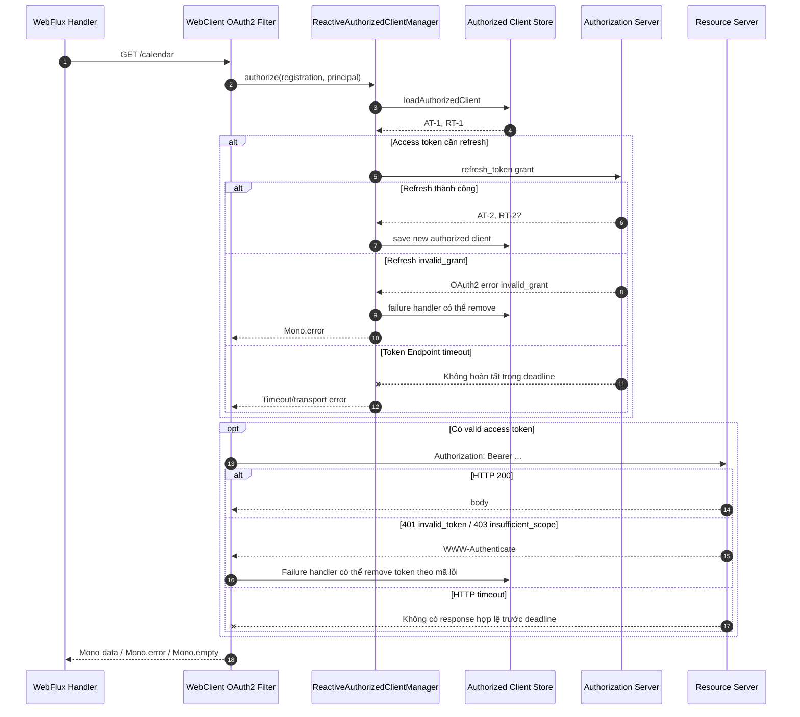
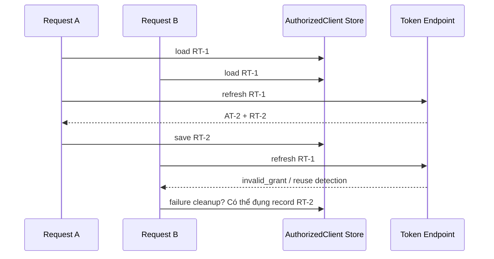

# 30.9. Kiểm thử timeout, refresh lỗi và failure handler

Trong **Spring Security OAuth 2.0/OIDC Client trên WebFlux**, lời gọi API qua `WebClient` thường gồm nhiều bước bất đồng bộ: tìm `OAuth2AuthorizedClient`, có thể refresh access token, gửi HTTP request đến Resource Server, đọc response và áp dụng failure handler. Một request chậm hoặc thất bại ở một bước có thể dẫn đến triệu chứng giống nhau ở UI nhưng đòi hỏi **cách khắc phục khác nhau**.

Ví dụ, ứng dụng đang gọi API lịch của người dùng:

- **Token Endpoint timeout** khi refresh: chưa biết refresh request có được Authorization Server xử lý hay không.
- **Token Endpoint trả `invalid_grant`**: refresh token có thể đã hết hạn, bị thu hồi hoặc bị thay bởi token rotation.
- **Resource Server trả 401 `invalid_token`**: access token đang dùng bị API từ chối.
- **Resource Server trả 403 `insufficient_scope`**: token thiếu quyền; refresh cùng một grant thường không tự cấp thêm scope.
- **HTTP client timeout**: có thể xảy ra trước khi có status hoặc response body.
- **Failure handler tùy chỉnh chỉ ghi log**: nếu quên cleanup, những lần gọi sau có thể tiếp tục dùng token sai.

Đối với ứng dụng **Reactive**, test còn phải kiểm tra **khi nào Publisher được subscribe**, cancellation, timeout boundary, retry policy và persistence side effects. Chỉ gọi `Mono.block()` trong một test rồi kiểm tra exception là chưa đủ để bảo vệ hệ thống đa provider và có refresh token rotation.

Bài học này trình bày cách kiểm thử có hệ thống với **Reactor Test `StepVerifier`, virtual time, WebClient mock/fake server, WebTestClient, reactive authorized-client manager, failure handler và authorized-client store**. Các đoạn code dùng Java/Spring Security 6.x phổ biến; khi chạy trên phiên bản khác, kiểm tra chính xác API của dependency đang sử dụng. Đây là tài liệu hướng dẫn; các ví dụ không được khẳng định đã chạy trong project.

> **Mục tiêu:** Phân biệt lỗi theo **stage, endpoint và grant type**; bảo đảm timeout không tạo retry nguy hiểm, refresh `invalid_grant` được cleanup đúng principal/registration, và Resource Server 401/403 không bị nhầm với lỗi OIDC login hoặc tự động mở rộng quyền.

## 1. Mục tiêu học tập

Sau bài, bạn có thể:

1. Nhận diện timeout khi connect, nhận response, xử lý body, chờ connection pool và chờ toàn bộ Mono.
2. Dùng `StepVerifier` và `StepVerifier.withVirtualTime` để kiểm tra timeout/retry/cancellation không phụ thuộc thời gian thật khi có thể.
3. Tạo fake Authorization Server/Resource Server để kiểm thử HTTP timeout và OAuth2 error response.
4. Dựng `ClientRegistration` và `OAuth2AuthorizedClient` hết hạn có refresh token cho test.
5. Hiểu `DefaultReactiveOAuth2AuthorizedClientManager` và `AuthorizedClientServiceReactiveOAuth2AuthorizedClientManager` khác nhau ở kho lưu và request context.
6. Kiểm tra `ReactiveOAuth2AuthorizationFailureHandler`, bao gồm cleanup khi `invalid_grant`.
7. Kiểm tra `ServerOAuth2AuthorizedClientExchangeFilterFunction` với Resource Server 401/403.
8. Phân biệt retry được phép với retry nguy hiểm ở Authorization Code/Refresh Token Grant.
9. Kiểm tra side effects, idempotency, concurrent refresh và token rotation.
10. Thiết kế telemetry/tình huống test không làm lộ access token, refresh token, code, `state`, `nonce` hoặc Client secret.

## 2. Xác định luồng Reactive cần kiểm thử



**Hai vị trí failure handler riêng biệt:**

- **Authorized-client manager failure handler** được gọi khi **authorize/re-authorize** thất bại, điển hình Refresh Token Grant `invalid_grant`.
- **OAuth2 WebClient filter failure handler** có thể xử lý **HTTP 401/403 của Resource Server** (khi có OAuth2 Bearer error thích hợp).

Bảo đảm test ở đúng lớp; đừng gọi cả hai là “login failure handler”. `ServerAuthenticationFailureHandler` của `oauth2Login` lại thuộc giai đoạn **đăng nhập**, không thay thế hai loại trên.

## 3. Bản đồ các loại lỗi

| Nơi lỗi | Ví dụ | Type/cách quan sát | Recovery thường phù hợp |
|---|---|---|---|
| DNS/Connect | Không kết nối được Token Endpoint | `WebClientRequestException`/transport cause | Kiểm tra mạng, retry giới hạn khi an toàn |
| TLS | Certificate/hostname không hợp lệ | SSL/handshake cause | Sửa trust/certificate, không bypass |
| Response timeout | Server quá chậm | Timeout/read timeout cause | Deadline, alert, backoff/circuit breaker |
| Overall reactive deadline | `Mono.timeout(...)` | `TimeoutException` hoặc mapped error | Cancel upstream, quyết định retry theo thao tác |
| Token Endpoint | `invalid_client` | `OAuth2AuthorizationException`/`OAuth2Error` | Sửa Client credentials/config |
| Token Endpoint refresh | `invalid_grant` | OAuth2 error | Không reuse token cũ, cleanup/reconnect |
| Resource Server | 401 `invalid_token` | `WWW-Authenticate`, WebClient 401 | Cleanup token phù hợp, không retry vô hạn |
| Resource Server | 403 `insufficient_scope` | `WWW-Authenticate`, WebClient 403 | Scope/consent/authorization policy |
| Reactive repository | Redis/JDBC down | Storage error | Fail closed, không dùng principal/token người khác |
| Application mapping | Connection không thuộc user | Business/authorization error | 403, không thử registration khác |
| OIDC login | `state`/nonce/ID Token invalid | Login authentication failure | Reject login, không bypass protocol |

**Quan trọng:** `invalid_grant` và `invalid_token` là **mã lỗi giao thức**. “Timeout” thường không có OAuth2 error body vì có thể chưa nhận được response nào.

## 4. Chọn đúng công cụ kiểm thử

| Mục đích | Công cụ | Không kiểm chứng được |
|---|---|---|
| Kiểm thử `Mono.timeout` | Reactor `StepVerifier` với virtual time | TLS/HTTP socket thật |
| Kiểm thử xử lý error operator | `StepVerifier` + fake publisher | Token Endpoint thực |
| Kiểm thử manager & store | Reactive service/repository giả/in-memory | Tương thích đa node thực tế |
| Kiểm thử response HTTP 401/403 | `WebClient` fake `ExchangeFunction` hoặc MockWebServer | OP login browser |
| Kiểm thử real transport deadline | MockWebServer/WireMock + Reactor Netty client | Production DNS/firewall/latency hoàn toàn |
| Kiểm thử WebFlux endpoint | `WebTestClient` | Mọi chi tiết OAuth2 protocol nếu chỉ mock principal |
| Kiểm thử token refresh E2E | Mock Token Endpoint + real reactive token client | OP production policy |
| Kiểm thử rotation race | Controlled publishers + DB/Redis integration | Toàn bộ multi-region production |

Một test suite vững thường gồm **unit tests rẻ/nhanh**, **integration tests có server giả** và một số **end-to-end contract tests** riêng với test tenant.

### 4.1. Thư viện test thường cần

Ứng dụng Spring Boot Reactive/OAuth2 Client thường có:

```text
spring-boot-starter-webflux
spring-boot-starter-oauth2-client
spring-boot-starter-test
spring-security-test
reactor-test
mockwebserver hoặc WireMock (test-only)
```

Tên artifact/version thay đổi theo Spring Boot BOM và build system. Đoạn danh sách này **không yêu cầu chạy Gradle** trong bài học; ở project thực cần version tương thích. Đối với `MockWebServer`, bảo đảm dùng API của version OkHttp đã chọn.

## 5. Phân biệt các tầng timeout

Từ “timeout” có ít nhất năm nghĩa khác nhau:

1. **Connect timeout:** TCP connection không hoàn thành trong hạn mức.
2. **TLS handshake timeout:** handshake không xong; có thể do chứng thư/mạng.
3. **Connection pool acquire timeout:** chờ một connection rảnh quá lâu.
4. **Response/read timeout:** server không gửi dữ liệu theo hạn mức HTTP client.
5. **Overall operation timeout:** toàn bộ Mono — gồm lookup, refresh, API call, xử lý response — vượt deadline do application đặt.

### 5.1. Bảng ý nghĩa và cách test

| Timeout | Đặt ở đâu | Test thích hợp | Điều cần tránh |
|---|---|---|---|
| Connect | Reactor Netty `HttpClient` | Destination có kiểm soát không accept/route hoặc mock network | Phụ thuộc một IP ngoài mạng ngẫu nhiên |
| TLS | SSL/network configuration | Fake TLS server/chứng thư test | Bỏ TLS verification |
| Pool acquire | Reactor Netty `ConnectionProvider` | Pool nhỏ + concurrent delayed calls | Dùng delay/sleep thiếu kiểm soát |
| Response | `HttpClient.responseTimeout` | MockWebServer trì hoãn response headers/body | Nhầm HTTP 503 với timeout |
| Overall | Reactor `Mono.timeout` | `StepVerifier.withVirtualTime` | Tưởng virtual time mô phỏng socket thật |
| Retry budget | Application workflow | `Retry` + StepVerifier | Retry vô hạn Token Endpoint grant |

**Virtual time chỉ thay lịch của Reactor operators dùng Scheduler thích hợp**, không tua nhanh thời gian của TCP socket/Netty I/O, DNS hoặc thread sleep ở thư viện khác.

### 5.2. Vì sao cần cả timeout HTTP và overall deadline?

Một HTTP client có response timeout không tự giới hạn thời gian chờ token store, refresh, connection acquisition và các bước chuyển đổi khác. Ngược lại, một `Mono.timeout` ngoài cùng có thể cancel pipeline nhưng không thay thế connect timeout/TLS timeout của HTTP client.

```text
WebFlux handler budget: 3 giây
  -> authorized-client lookup
  -> refresh token request
  -> downstream API request
  -> decode/transform response
```

Bạn phải quyết định **3 giây áp cho toàn bộ thao tác** hay **mỗi lần gọi HTTP**. Nếu mỗi dependency có timeout 3 giây và có 3 bước nối tiếp, tổng latency có thể vượt yêu cầu của handler.

## 6. Cấu hình WebClient timeout theo transport

Ví dụ Reactor Netty cho outbound API:

```java
import java.time.Duration;

import io.netty.channel.ChannelOption;
import reactor.netty.http.client.HttpClient;

import org.springframework.http.client.reactive.ReactorClientHttpConnector;
import org.springframework.web.reactive.function.client.WebClient;

public final class TimedWebClientFactory {

    public static WebClient forTrustedApi(String baseUrl) {
        HttpClient httpClient = HttpClient.create()
            .option(ChannelOption.CONNECT_TIMEOUT_MILLIS, 1_000)
            .responseTimeout(Duration.ofSeconds(2));

        return WebClient.builder()
            .baseUrl(baseUrl)
            .clientConnector(
                new ReactorClientHttpConnector(httpClient)
            )
            .build();
    }
}
```

Ở đây:

- `CONNECT_TIMEOUT_MILLIS` áp cho TCP connect.
- `responseTimeout` cấu hình timeout khi nhận response theo semantics Reactor Netty.
- `baseUrl` phải do backend chọn từ cấu hình đáng tin, không nhận arbitrary URL của browser nếu sẽ gắn Bearer token.
- Giá trị 1–2 giây là ví dụ test/kiến trúc, **không phải khuyến nghị chung** cho mọi provider/API.

### 6.1. Tách Token Endpoint client và Resource Server client

Token Endpoint phục vụ việc cấp/refresh token; Resource Server trả dữ liệu nghiệp vụ. Nên có **deadline, retry policy, metrics và failure handling riêng** cho hai loại.

Không áp một filter retry toàn cục cho mọi `POST /token` chỉ vì có WebClient chung. Một authorization code có thể đã bị tiêu thụ trước khi response timeout.

### 6.2. Không coi `timeout()` là token revoke

Nếu một client dùng:

```java
Mono<String> result = callCalendarApi()
    .timeout(Duration.ofSeconds(3));
```

khi deadline hết, subscription bị cancel và downstream có thể nhận cancel; nhưng server ở xa **có thể đã xử lý request**. Nếu request làm thay đổi dữ liệu, timeout không đồng nghĩa “chưa thành công”, phải cân nhắc idempotency key hoặc trạng thái kết quả không xác định.

## 7. Unit test timeout bằng `StepVerifier.withVirtualTime`

`StepVerifier` là công cụ của Reactor Test, cho phép kiểm tra sequence data/error/completion.

```java
import java.time.Duration;
import java.util.concurrent.TimeoutException;

import org.junit.jupiter.api.Test;
import reactor.core.publisher.Mono;
import reactor.test.StepVerifier;

class ReactiveTimeoutTest {

    @Test
    void slowPublisherTimesOutWithoutRealWaiting() {
        StepVerifier.withVirtualTime(
                () -> Mono.delay(Duration.ofMinutes(5))
                    .timeout(Duration.ofSeconds(1))
            )
            .expectSubscription()
            .thenAwait(Duration.ofSeconds(1))
            .expectError(TimeoutException.class)
            .verify();
    }
}
```

**Giải thích:**

1. `withVirtualTime` thiết lập scheduler ảo cho Reactor operators tạo **bên trong supplier**.
2. `Mono.delay(5 phút)` mô phỏng tác vụ rất chậm.
3. `timeout(1 giây)` phát lỗi sớm hơn.
4. `thenAwait(1 giây)` điều khiển đồng hồ ảo, không ngủ thật.
5. `expectError(TimeoutException.class)` xác minh lỗi quan sát được của `timeout`.

### 7.1. Lỗi thường gặp: xây Publisher trước khi bật virtual time

Kém tin cậy:

```java
Mono<Long> slow = Mono.delay(Duration.ofMinutes(5));

StepVerifier.withVirtualTime(() ->
    slow.timeout(Duration.ofSeconds(1))
);
```

Một số operators/schedulers đã được tạo và giữ trước khi scheduler ảo có hiệu lực. **Tạo pipeline trong supplier** để virtual scheduler có thể kiểm soát thời gian.

### 7.2. Test timeout boundary

```java
@Test
void resultBeforeDeadlineSucceeds() {
    StepVerifier.withVirtualTime(() ->
            Mono.delay(Duration.ofMillis(200))
                .map(ignored -> "ok")
                .timeout(Duration.ofSeconds(1))
        )
        .expectSubscription()
        .thenAwait(Duration.ofMillis(200))
        .expectNext("ok")
        .verifyComplete();
}
```

Test cả hai phía deadline giúp phát hiện code timeout đặt quá ngắn hoặc đặt nhầm bên ngoài một sequence.

### 7.3. Tránh assertion vào message

`TimeoutException` message có thể khác theo Reactor version. Test nên assert type/outcome, không phụ thuộc exact English error text hoặc timestamp thực.

## 8. Kiểm thử cancellation và resource cleanup

Trong Reactive, khi `Mono.timeout` phát lỗi, upstream subscription có thể bị cancel. Với HTTP client, việc giải phóng connection/body buffers và cancellation rất quan trọng.

Một test không cần network:

```java
import java.time.Duration;
import java.util.concurrent.TimeoutException;
import java.util.concurrent.atomic.AtomicBoolean;

import org.junit.jupiter.api.Test;
import reactor.core.publisher.Mono;
import reactor.test.StepVerifier;

import static org.assertj.core.api.Assertions.assertThat;

class CancellationTest {

    @Test
    void timeoutCancelsUpstream() {
        AtomicBoolean cancelled = new AtomicBoolean();

        StepVerifier.withVirtualTime(() ->
                Mono.<String>never()
                    .doOnCancel(() -> cancelled.set(true))
                    .timeout(Duration.ofSeconds(2))
            )
            .expectSubscription()
            .thenAwait(Duration.ofSeconds(2))
            .expectError(TimeoutException.class)
            .verify();

        assertThat(cancelled).isTrue();
    }
}
```

`Mono.never()` không hoàn thành, khiến timeout là nhánh duy nhất. Test chứng minh **upstream nhận cancellation**, không chứng minh mọi server từ xa đã rollback.

### 8.1. Cancellation không phải success/failure handler của OAuth2

Timeout upstream có thể xảy ra trước khi nhận OAuth2 error JSON. Khi không có `OAuth2AuthorizationException` mang mã `invalid_grant`, **không được tùy tiện xóa refresh token chỉ vì timeout**.

Một request refresh có thể đã thành công tại OP nhưng response bị mất. Cần recovery policy theo provider, hạn chế retry, và nhận diện kết quả không xác định.

### 8.2. Không nuốt cancellation

Tránh pattern:

```java
Mono<String> fallback = slowCall()
    .onErrorResume(any -> Mono.just("success"));
```

Nó biến mọi lỗi, kể cả security và timeout, thành kết quả thành công giả. Nếu có degradation được business cho phép, chỉ fallback các lỗi được phân loại rõ và trả trạng thái không gây hiểu nhầm.

## 9. Kiểm thử retry policy bằng thời gian ảo

`Retry` của Reactor có thể tạo backoff, nhưng phải phân loại lỗi trước.

```java
import java.time.Duration;
import java.util.concurrent.TimeoutException;
import java.util.concurrent.atomic.AtomicInteger;

import reactor.core.publisher.Mono;
import reactor.util.retry.Retry;
import reactor.test.StepVerifier;

AtomicInteger attempts = new AtomicInteger();

StepVerifier.withVirtualTime(() ->
        Mono.defer(() -> {
                attempts.incrementAndGet();
                return Mono.<String>error(
                    new TimeoutException("test-only")
                );
            })
            .retryWhen(
                Retry.backoff(2, Duration.ofMillis(100))
                    .filter(ex -> ex instanceof TimeoutException)
                    .jitter(0.0)
            )
    )
    .expectSubscription()
    .thenAwait(Duration.ofSeconds(2))
    .expectError()
    .verify();

org.assertj.core.api.Assertions.assertThat(attempts.get())
    .isEqualTo(3);
```

Ở đây `retryWhen(Retry.backoff(2,...))` cho phép **2 retries sau attempt đầu** → tối đa 3 attempts. Dùng `jitter(0.0)` chỉ để test có thời gian quyết định; trong production nên cân nhắc jitter để tránh retry storm.

### 9.1. Cẩn trọng loại exception cuối cùng

Khi hết retries, Reactor có thể phát một exception đại diện cho retry exhaustion có chứa cause. Vì vậy test có thể xác minh count và outcome error thay vì assert exact final type `TimeoutException`.

### 9.2. Không retry mọi Token Endpoint lỗi

Không nên:

```java
tokenClient.getTokenResponse(request)
    .retryWhen(Retry.backoff(10, Duration.ofMillis(50)));
```

vì:

- `invalid_grant` không được giải quyết bằng retry token cũ.
- `invalid_client` là lỗi Client authentication/config.
- Authorization code có tính dùng một lần.
- Refresh token rotation có thể khiến retry gây reuse detection.
- Timeout có thể xảy ra **sau khi OP đã xử lý** request.

Tốt hơn là có policy phân biệt GET resource idempotent với `POST /token`, theo provider contract và threat model.

## 10. HTTP timeout test với MockWebServer

Virtual time không mô phỏng socket. Muốn kiểm tra Reactor Netty `responseTimeout`, hãy chạy một fake HTTP server cục bộ.

Ví dụ với OkHttp MockWebServer (dependency chỉ dùng trong test):

```java
import java.time.Duration;
import java.util.concurrent.TimeUnit;

import io.netty.channel.ChannelOption;
import okhttp3.mockwebserver.MockResponse;
import okhttp3.mockwebserver.MockWebServer;

import org.junit.jupiter.api.Test;
import org.springframework.http.client.reactive.ReactorClientHttpConnector;
import org.springframework.web.reactive.function.client.WebClient;

import reactor.netty.http.client.HttpClient;
import reactor.test.StepVerifier;

class WebClientHttpTimeoutIT {

    @Test
    void delayedHeadersExceedResponseTimeout() throws Exception {
        try (MockWebServer server = new MockWebServer()) {
            server.start();

            server.enqueue(
                new MockResponse()
                    .setHeadersDelay(2, TimeUnit.SECONDS)
                    .setBody("{\"status\":\"ok\"}")
            );

            HttpClient http = HttpClient.create()
                .option(ChannelOption.CONNECT_TIMEOUT_MILLIS, 1_000)
                .responseTimeout(Duration.ofMillis(150));

            WebClient client = WebClient.builder()
                .clientConnector(
                    new ReactorClientHttpConnector(http)
                )
                .build();

            StepVerifier.create(
                    client.get()
                        .uri(server.url("/slow").toString())
                        .retrieve()
                        .bodyToMono(String.class)
                )
                .expectError()
                .verify(Duration.ofSeconds(5));
        }
    }
}
```

**Kiểm chứng:** response headers bị trì hoãn lâu hơn `responseTimeout`; client phải kết thúc bằng error thay vì chờ mãi.

### 10.1. Tại sao không assert đúng exception class thấp nhất?

Tùy Reactor Netty/WebClient version, lỗi có thể được wrap bởi `WebClientRequestException` hoặc các loại timeout cause. Test integration thường nên xác minh:

- Có error và không có body success.
- Request đến đúng fake server.
- Deadline nằm trong mức hợp lý.
- Không có retry vượt budget.
- Error mapping của application là đúng.

Nếu app có một stable domain exception, hãy assert **domain-level exception** do chính app định nghĩa.

### 10.2. Test thật không dùng virtual time

MockWebServer dùng real network và delayed headers theo đồng hồ thật. `StepVerifier.withVirtualTime` không khiến `setHeadersDelay` nhanh hơn. Đừng gộp hai cơ chế rồi kỳ vọng test HTTP socket hoàn tất tức thời.

### 10.3. Test connection timeout độc lập

Một fake server vẫn accept connection rồi trì hoãn response sẽ kiểm tra **response timeout**, không kiểm tra connect timeout. Với connect timeout, cần một network harness đủ kiểm soát để mô phỏng không hoàn thành TCP connect; tránh dùng một IP công cộng ngẫu nhiên vì CI/network có thể có behavior không ổn định.

## 11. Test không chỉ đo timeout mà còn đo retry count

Một server giả có thể enqueue:

```text
1st request: delayed response / 503
2nd request: HTTP 200
```

Nếu policy cho phép retry cho một thao tác idempotent, test nên:

1. Assert response cuối là thành công.
2. Assert fake server nhận đúng số requests.
3. Assert thứ tự và HTTP method không bị thay.
4. Assert token header đúng registration và không bị log.
5. Assert không retry vào một origin khác.
6. Assert tổng duration nằm trong deadline.

Với `POST /token`, **không mặc định** dùng cùng retry test pattern. Test riêng từng loại grant và policy được Authorization Server cho phép.

## 12. Reactive OAuth2 Client: các thành phần cần biết

| Thành phần | Vai trò |
|---|---|
| `ReactiveClientRegistrationRepository` | Tra ClientRegistration theo registration ID |
| `ReactiveOAuth2AuthorizedClientService` | Lưu/truy vấn authorized client theo registration/principal |
| `ServerOAuth2AuthorizedClientRepository` | Lưu/truy vấn authorized client trong WebFlux request/exchange |
| `ReactiveOAuth2AuthorizedClientManager` | Điều phối authorization, reauthorization, handlers |
| `ReactiveOAuth2AuthorizedClientProvider` | Chiến lược grant như refresh_token/client_credentials |
| `ReactiveOAuth2AccessTokenResponseClient<OAuth2RefreshTokenGrantRequest>` | Thực hiện Token Endpoint refresh |
| `WebClientReactiveRefreshTokenTokenResponseClient` | Token response client dựa trên WebClient |
| `ReactiveOAuth2AuthorizationFailureHandler` | Xử lý authorize/reauthorize thất bại |
| `RemoveAuthorizedClientReactiveOAuth2AuthorizationFailureHandler` | Loại authorized client theo OAuth2 error codes quy định |
| `ServerOAuth2AuthorizedClientExchangeFilterFunction` | Chọn token, gắn Bearer header và xử lý một số lỗi Resource Server |

### 12.1. Hai loại manager

**Có HTTP `ServerWebExchange`:**

```java
DefaultReactiveOAuth2AuthorizedClientManager
```

Thường kết hợp:

```java
ReactiveClientRegistrationRepository
ServerOAuth2AuthorizedClientRepository
```

**Chạy ngoài request như scheduled job:**

```java
AuthorizedClientServiceReactiveOAuth2AuthorizedClientManager
```

Thường kết hợp:

```java
ReactiveClientRegistrationRepository
ReactiveOAuth2AuthorizedClientService
```

Không giả định background worker luôn có WebSession/Reactive SecurityContext từ một HTTP request trước đó.

### 12.2. Mô hình lưu khóa

`OAuth2AuthorizedClient` gắn với:

```text
clientRegistration.registrationId
principalName
accessToken
refreshToken?
```

Nếu test gọi manager với principalName khác lúc lưu, nó có thể không tìm được token. Đây là lỗi **test setup/ownership key**, không nhất thiết refresh logic.

## 13. Fixture `ClientRegistration` dùng cho refresh tests

Không kết nối OP thật; tạo registration với Token Endpoint giả:

```java
import org.springframework.security.oauth2.client.registration.ClientRegistration;
import org.springframework.security.oauth2.client.registration.InMemoryReactiveClientRegistrationRepository;
import org.springframework.security.oauth2.core.AuthorizationGrantType;
import org.springframework.security.oauth2.core.ClientAuthenticationMethod;

public final class ReactiveClientFixtures {

    private ReactiveClientFixtures() {}

    public static ClientRegistration calendar() {
        return ClientRegistration.withRegistrationId("calendar")
            .clientId("calendar-test-client")
            .clientSecret("test-only-client-secret")
            .clientAuthenticationMethod(
                ClientAuthenticationMethod.CLIENT_SECRET_BASIC
            )
            .authorizationGrantType(
                AuthorizationGrantType.AUTHORIZATION_CODE
            )
            .authorizationUri(
                "https://id.example.test/authorize"
            )
            .tokenUri(
                "https://id.example.test/token"
            )
            .redirectUri(
                "{baseUrl}/login/oauth2/code/{registrationId}"
            )
            .scope("calendar.read")
            .build();
    }

    public static InMemoryReactiveClientRegistrationRepository registrations() {
        return new InMemoryReactiveClientRegistrationRepository(
            calendar()
        );
    }
}
```

Fixture trên dùng Authorization Code registration vì user đã cấp quyền Calendar trước đó, và test sẽ lưu `OAuth2AuthorizedClient` có refresh token. **Refresh grant không nhất thiết được tạo như một ClientRegistration mới**: nó là cách gia hạn authorized client đã có.

### 13.1. Vì sao không dùng real credentials?

- Không phát sinh API bill/token thật.
- Không lệ thuộc OP online.
- Không phải lưu refresh token thật trong test report.
- Dễ mock `invalid_grant`, timeout và rotation.
- Không rò secrets vào CI artifacts.

### 13.2. Tạo token hết hạn một cách quyết định

```java
import java.time.Instant;
import java.util.Set;

import org.springframework.security.oauth2.client.OAuth2AuthorizedClient;
import org.springframework.security.oauth2.core.OAuth2AccessToken;
import org.springframework.security.oauth2.core.OAuth2RefreshToken;

public final class AuthorizedClientFixtures {

    private AuthorizedClientFixtures() {}

    public static OAuth2AuthorizedClient expiredCalendar(
            String principalName) {

        Instant now = Instant.now();

        OAuth2AccessToken expiredAccess = new OAuth2AccessToken(
            OAuth2AccessToken.TokenType.BEARER,
            "FAKE_EXPIRED_ACCESS_TOKEN",
            now.minusSeconds(3600),
            now.minusSeconds(1800),
            Set.of("calendar.read")
        );

        OAuth2RefreshToken refresh = new OAuth2RefreshToken(
            "FAKE_REFRESH_TOKEN",
            now.minusSeconds(3600)
        );

        return new OAuth2AuthorizedClient(
            ReactiveClientFixtures.calendar(),
            principalName,
            expiredAccess,
            refresh
        );
    }
}
```

Access token đã hết hạn giúp manager đi vào refresh path **khi provider phù hợp được cấu hình**. Giá trị giả phải không thể dùng trên OP thật.

### 13.3. Test clock skew mà không chờ token thật hết hạn

Trong những tests cần biên hết hạn, ưu tiên tạo `OAuth2AccessToken` với `issuedAt`/`expiresAt` chính xác hoặc inject `Clock` vào provider được hỗ trợ. Không `Thread.sleep` vài phút để chờ token hết hạn.

## 14. Cấu hình authorized-client manager trong WebFlux

Ví dụ cho HTTP request context:

```java
import org.springframework.context.annotation.Bean;
import org.springframework.security.oauth2.client.ReactiveOAuth2AuthorizedClientManager;
import org.springframework.security.oauth2.client.ReactiveOAuth2AuthorizedClientProvider;
import org.springframework.security.oauth2.client.ReactiveOAuth2AuthorizedClientProviderBuilder;
import org.springframework.security.oauth2.client.registration.ReactiveClientRegistrationRepository;
import org.springframework.security.oauth2.client.web.DefaultReactiveOAuth2AuthorizedClientManager;
import org.springframework.security.oauth2.client.web.server.ServerOAuth2AuthorizedClientRepository;

@Bean
ReactiveOAuth2AuthorizedClientManager clientManager(
        ReactiveClientRegistrationRepository registrations,
        ServerOAuth2AuthorizedClientRepository clients) {

    ReactiveOAuth2AuthorizedClientProvider provider =
        ReactiveOAuth2AuthorizedClientProviderBuilder.builder()
            .authorizationCode()
            .refreshToken()
            .clientCredentials()
            .build();

    var manager = new DefaultReactiveOAuth2AuthorizedClientManager(
        registrations, clients
    );
    manager.setAuthorizedClientProvider(provider);

    return manager;
}
```

**Hành vi mặc định quan trọng:** theo Spring Security reference, `DefaultReactiveOAuth2AuthorizedClientManager` lưu authorized client khi cấp/refresh thành công và loại bỏ authorized client đã lưu khi reauthorization thất bại với `invalid_grant` thông qua failure handler mặc định. Cách cư xử có thể bị thay đổi khi ứng dụng gọi `setAuthorizationSuccessHandler`/`setAuthorizationFailureHandler`.

### 14.1. Service manager cho background tasks

```java
import org.springframework.security.oauth2.client.AuthorizedClientServiceReactiveOAuth2AuthorizedClientManager;
import org.springframework.security.oauth2.client.ReactiveOAuth2AuthorizedClientProviderBuilder;

var manager =
    new AuthorizedClientServiceReactiveOAuth2AuthorizedClientManager(
        registrations,
        authorizedClientService
    );

manager.setAuthorizedClientProvider(
    ReactiveOAuth2AuthorizedClientProviderBuilder.builder()
        .refreshToken()
        .clientCredentials()
        .build()
);
```

Trong background task, user delegation cần trusted connection record và principalName; đừng nhận trực tiếp registration/principal từ queue payload chưa được kiểm tra ownership.

## 15. Kiểm thử `invalid_grant` của refresh bằng fake provider

Để kiểm thử manager và cleanup policy mà không gọi Token Endpoint thật, ta có thể dùng một `ReactiveOAuth2AuthorizedClientProvider` giả phát lỗi.

```java
import java.util.List;

import org.junit.jupiter.api.Test;
import org.springframework.security.authentication.UsernamePasswordAuthenticationToken;
import org.springframework.security.core.Authentication;
import org.springframework.security.core.authority.SimpleGrantedAuthority;
import org.springframework.security.oauth2.client.AuthorizedClientServiceReactiveOAuth2AuthorizedClientManager;
import org.springframework.security.oauth2.client.InMemoryReactiveOAuth2AuthorizedClientService;
import org.springframework.security.oauth2.client.OAuth2AuthorizeRequest;
import org.springframework.security.oauth2.core.OAuth2AuthorizationException;
import org.springframework.security.oauth2.core.OAuth2Error;

import reactor.core.publisher.Mono;
import reactor.test.StepVerifier;

class RefreshInvalidGrantTest {

    @Test
    void invalidGrantRemovesPreviouslySavedAuthorizedClient() {
        var registrations = ReactiveClientFixtures.registrations();
        var service =
            new InMemoryReactiveOAuth2AuthorizedClientService(
                registrations
            );

        Authentication principal =
            new UsernamePasswordAuthenticationToken(
                "user-42",
                "not-a-real-password",
                List.of(new SimpleGrantedAuthority("ROLE_USER"))
            );

        var expired =
            AuthorizedClientFixtures.expiredCalendar(principal.getName());

        StepVerifier.create(
                service.saveAuthorizedClient(expired, principal)
            )
            .verifyComplete();

        var manager =
            new AuthorizedClientServiceReactiveOAuth2AuthorizedClientManager(
                registrations, service
            );

        manager.setAuthorizedClientProvider(context ->
            Mono.error(
                new OAuth2AuthorizationException(
                    new OAuth2Error("invalid_grant")
                )
            )
        );

        var request = OAuth2AuthorizeRequest
            .withClientRegistrationId("calendar")
            .principal(principal)
            .build();

        StepVerifier.create(manager.authorize(request))
            .expectErrorSatisfies(error -> {
                org.assertj.core.api.Assertions.assertThat(error)
                    .isInstanceOf(OAuth2AuthorizationException.class);
            })
            .verify();

        StepVerifier.create(
                service.loadAuthorizedClient(
                    "calendar", principal.getName()
                )
            )
            .verifyComplete();
    }
}
```

**Điều được test:** có authorized client cũ, reauthorization phát `invalid_grant`, manager đưa lỗi ra ngoài và default failure cleanup làm authorized client không còn trong service.

### 15.1. Giới hạn của fake provider test

- Không phát HTTP request thật tới Token Endpoint.
- Không kiểm tra form `grant_type=refresh_token`.
- Không kiểm tra Client authentication/response parsing.
- Không chứng minh race condition giữa nhiều pods.
- Không kiểm tra Resource Server `WWW-Authenticate`.

Đây là **unit/integration test ở tầng manager + service**, không phải test toàn bộ Refresh Token Grant.

### 15.2. Nếu test không đi qua refresh path

Kiểm tra:

1. Access token fixture có thật sự expired không.
2. ClientRegistration và principalName trùng record đã lưu không.
3. `ReactiveOAuth2AuthorizedClientProvider` đã được manager dùng chưa.
4. Test có vô tình dựng một manager khác hoặc storage khác không.
5. Có auth/attributes đặc biệt nào mà manager yêu cầu không.
6. Có custom handler làm thay đổi behavior mặc định không.

Không ép kết quả bằng cách tự gọi `removeAuthorizedClient(...)` trước khi test; điều đó chỉ kiểm thử chính test code, không kiểm thử manager.

## 16. Kiểm thử refresh thành công và token rotation

Test chỉ `invalid_grant` là chưa đủ. Với refresh thành công, cần xác nhận:

- Token mới được trả từ fake provider hoặc fake Token Endpoint.
- Authorized client mới được lưu đúng registration/principal.
- Access token thực sự được thay.
- Refresh token **mới** được lưu nếu provider rotation.
- Nếu provider không trả refresh token mới, behavior giữ/không giữ theo protocol/framework configuration là đúng.
- Không ghi đè token mới bằng snapshot cũ trong concurrent access.
- API request sau refresh dùng **access token mới**, không token cũ.

### 16.1. Ví dụ token response mới

```java
import java.time.Duration;

import org.springframework.security.oauth2.core.OAuth2AccessToken;
import org.springframework.security.oauth2.core.endpoint.OAuth2AccessTokenResponse;

OAuth2AccessTokenResponse response =
    OAuth2AccessTokenResponse.withToken("FAKE_AT_2")
        .tokenType(OAuth2AccessToken.TokenType.BEARER)
        .expiresIn(3600)
        .refreshToken("FAKE_RT_2")
        .scope("calendar.read")
        .build();
```

Đây là fixture token response, không phải bằng chứng token được OP thật chấp nhận. Khi test với fake server, assert refresh request đúng form/Client authentication **nhưng không dump token body vào log**.

### 16.2. Token rotation khi response timeout

Kịch bản nguy hiểm:

```text
RP gửi RT-1 -> OP trả RT-2, vô hiệu RT-1
                   |
                   + response bị mất trên mạng

RP vẫn lưu RT-1, retry RT-1
  -> OP trả invalid_grant / phát hiện reuse
```

Test retry policy phải phân biệt **timeout với “OP chưa xử lý”**; không thể suy ra từ một `TimeoutException`. Giải pháp sản phẩm có thể là reauthorize hoặc cơ chế recovery cụ thể của provider, thay vì retry token cũ vô hạn.

## 17. Failure handler mặc định và custom handler

Spring cung cấp interface:

```java
ReactiveOAuth2AuthorizationFailureHandler
```

với ý nghĩa:

```java
Mono<Void> onAuthorizationFailure(
    OAuth2AuthorizationException exception,
    Authentication principal,
    Map<String, Object> attributes
);
```

Và implementation:

```java
RemoveAuthorizedClientReactiveOAuth2AuthorizationFailureHandler
```

loại authorized client khi OAuth2 error code thuộc tập được cấu hình.

### 17.1. Sai lầm khi thay default handler chỉ để log

Không nên:

```java
manager.setAuthorizationFailureHandler(
    (exception, principal, attributes) -> {
        logger.warn("Refresh failed");
        return Mono.empty();
    }
);
```

Cấu hình này có thể **thay** handler cleanup mặc định. Kết quả: refresh token `invalid_grant` vẫn tồn tại trong store và job tiếp tục lặp lỗi.

### 17.2. Compose telemetry với removal handler

Một mẫu ý tưởng đúng hơn:

```java
import org.springframework.security.oauth2.client.RemoveAuthorizedClientReactiveOAuth2AuthorizationFailureHandler;
import org.springframework.security.oauth2.client.ReactiveOAuth2AuthorizationFailureHandler;

ReactiveOAuth2AuthorizationFailureHandler cleanup =
    new RemoveAuthorizedClientReactiveOAuth2AuthorizationFailureHandler(
        (registrationId, principal, attributes) ->
            authorizedClientService.removeAuthorizedClient(
                registrationId, principal.getName()
            )
    );

manager.setAuthorizationFailureHandler(
    (exception, principal, attributes) -> {
        String errorCode =
            exception.getError().getErrorCode();

        // Ghi metric với mã lỗi chuẩn hóa, không log refresh token.
        return cleanup.onAuthorizationFailure(
            exception, principal, attributes
        );
    }
);
```

Đây là cấu hình minh họa cho **service-backed manager**: `authorizedClientService` phải là service đang được manager sử dụng. Với **WebFlux HTTP request-backed manager**, cần remover thao tác đúng `ServerOAuth2AuthorizedClientRepository`/exchange context thay vì một service không chứa token.

**Không xóa tất cả authorized clients của user** khi một Calendar connection `invalid_grant`. Cleanup phải dùng registration và principal/connection đúng.

### 17.3. Test custom handler phải xác minh side effect

Một test chỉ kiểm tra `logger.warn(...)` đã được gọi **không đủ**. Hãy kiểm tra:

- `invalid_grant` → cleanup được gọi đúng key.
- Lỗi transient timeout → **không** tự cleanup token khi policy không cho phép.
- `invalid_client` → không lặng lẽ xóa hàng loạt user tokens như giải pháp duy nhất.
- Cleanup lỗi storage → kết quả và telemetry có phản ánh được không.
- Handler trả `Mono<Void>` và không tự subscribe bên trong.
- Exceptions từ handler không bị nuốt khiến application tưởng refresh đã thành công.
- Không log Client secret, raw token hoặc exception body có credential.

## 18. Test một failure handler với fake remover

Thay vì test trực tiếp manager, có thể cô lập logic handler bằng fake remover:

```java
import java.util.Map;
import java.util.concurrent.atomic.AtomicInteger;

import org.junit.jupiter.api.Test;
import org.springframework.security.authentication.UsernamePasswordAuthenticationToken;
import org.springframework.security.oauth2.client.RemoveAuthorizedClientReactiveOAuth2AuthorizationFailureHandler;
import org.springframework.security.oauth2.core.OAuth2AuthorizationException;
import org.springframework.security.oauth2.core.OAuth2Error;

import reactor.core.publisher.Mono;
import reactor.test.StepVerifier;

import static org.assertj.core.api.Assertions.assertThat;

class ReactiveFailureHandlerTest {

    @Test
    void invalidGrantInvokesRemover() {
        AtomicInteger removed = new AtomicInteger();

        var handler =
            new RemoveAuthorizedClientReactiveOAuth2AuthorizationFailureHandler(
                (registrationId, principal, attributes) -> {
                    removed.incrementAndGet();
                    return Mono.empty();
                }
            );

        var principal =
            new UsernamePasswordAuthenticationToken(
                "user-42", "unused", java.util.List.of()
            );

        var error = new OAuth2AuthorizationException(
            new OAuth2Error("invalid_grant")
        );

        // Bài test gọi handler theo contract và context mà manager cung cấp.
        // Trong test tích hợp thật, attributes phải mang đúng
        // clientRegistrationId (theo Spring Security version) và context.
        StepVerifier.create(
                handler.onAuthorizationFailure(
                    error,
                    principal,
                    Map.of("clientRegistrationId", "calendar")
                )
            )
            .verifyComplete();

        assertThat(removed.get()).isEqualTo(1);
    }
}
```

**Lưu ý về attributes:** Removal handler cần registration ID và thông tin ngữ cảnh như repository/exchange. Key `"clientRegistrationId"` trong ví dụ minh họa cần đối chiếu contract **của version đang dùng** khi chạy test thật; cách chắc chắn hơn là test qua manager cung cấp context thay vì dựng Map tùy ý. Nếu API version đặt tên key khác, sửa fixture theo documented constant thay vì đổi business logic.

### 18.1. Vì sao không tự subscribe trong handler?

Sai:

```java
// Sai: fire-and-forget side effect
service.removeAuthorizedClient(id, principalName).subscribe();
return Mono.empty();
```

Khi tự `subscribe()`, cleanup chạy ngoài chain của manager; test có thể kết thúc trước cleanup, lỗi storage không được propagate và cancellation/transaction context bị mất. **Trả lại Mono** để caller quản lý subscription.

### 18.2. Tách metrics khỏi xóa token

Nếu metric/telemetry lỗi, không nhất thiết nên ngăn cleanup, nhưng cũng không được nuốt cleanup failure. Thiết kế thứ tự và error policy rõ; test riêng các lỗi ở metric sink và storage.

## 19. Test HTTP OAuth2 error từ fake Token Endpoint

Với `WebClientReactiveRefreshTokenTokenResponseClient`, ta có thể cấu hình WebClient trỏ tới fake Token Endpoint.

### 19.1. WebClient dùng cho refresh riêng

```java
import java.time.Duration;

import reactor.netty.http.client.HttpClient;
import org.springframework.http.client.reactive.ReactorClientHttpConnector;
import org.springframework.web.reactive.function.client.WebClient;

import org.springframework.security.oauth2.client.endpoint.WebClientReactiveRefreshTokenTokenResponseClient;

HttpClient http = HttpClient.create()
    .responseTimeout(Duration.ofSeconds(1));

WebClient timedTokenWebClient = WebClient.builder()
    .clientConnector(
        new ReactorClientHttpConnector(http)
    )
    .build();

var refreshClient =
    new WebClientReactiveRefreshTokenTokenResponseClient();

refreshClient.setWebClient(timedTokenWebClient);
```

`WebClientReactiveRefreshTokenTokenResponseClient` thực hiện Refresh Token Grant. Trong test, ClientRegistration `tokenUri` nên trỏ tới fake server.

### 19.2. Trường hợp `invalid_grant`

Fake server trả:

```http
HTTP/1.1 400 Bad Request
Content-Type: application/json
Cache-Control: no-store

{
  "error": "invalid_grant",
  "error_description": "Test token was revoked"
}
```

Test cần:

1. Tạo `OAuth2RefreshTokenGrantRequest` từ ClientRegistration và authorized client fixture.
2. Subscribe vào `refreshClient.getTokenResponse(grantRequest)`.
3. Assert lỗi chứa `OAuth2Error` với `errorCode="invalid_grant"`.
4. Assert fake server nhận `grant_type=refresh_token`.
5. Assert credentials và refresh token được truyền theo form/auth method phù hợp, **không log raw value**.
6. Khi tích hợp manager, assert authorized client bị cleanup theo policy.

### 19.3. Trường hợp timeout Token Endpoint

Fake server trì hoãn headers vượt response timeout. Test cần phân biệt:

```text
Timeout/transport failure:
  Không có OAuth2 error code đáng tin
  Không tự khẳng định invalid_grant

HTTP 400 JSON invalid_grant:
  Có response hợp lệ từ OP
  Có thể cleanup/reconnect đúng connection
```

Không tạo `OAuth2Error("invalid_grant")` giả cho mọi timeout; việc đó làm hệ thống xóa token hợp lệ khi chỉ mất mạng.

### 19.4. Khi custom response parser

Nếu thay `BodyExtractor` của reactive token client, bạn có trách nhiệm xử lý **OAuth2 Error Response** đúng, không coi HTTP 400 JSON là token success. Test `invalid_grant`, `invalid_client`, malformed JSON và 5xx riêng.

## 20. Hai nguồn 401/403 khác với refresh errors

Sau khi có access token, OAuth2 `WebClient` gửi Bearer token tới Resource Server.

Ví dụ:

```http
HTTP/1.1 401 Unauthorized
WWW-Authenticate: Bearer error="invalid_token"
```

hoặc:

```http
HTTP/1.1 403 Forbidden
WWW-Authenticate: Bearer error="insufficient_scope"
```

Đây **không phải** Token Endpoint `invalid_grant`.

| HTTP / Bearer error | Ý nghĩa thường gặp | Hành động |
|---|---|---|
| 401 `invalid_token` | Access token không được Resource Server chấp nhận | Check audience/issuer/expiry, cleanup/retry policy |
| 403 `insufficient_scope` | Thiếu scope/permission | Cần consent/role, không auto retry token cũ |
| 401 không có Bearer error | Có thể là API auth khác hoặc gateway | Phân loại trước khi cleanup |
| 503/429 | Resource Server đang lỗi/rate limit | Retry/backoff khi idempotent |
| Response timeout | Không có HTTP status | Không gắn nhãn invalid_token |

### 20.1. `ServerOAuth2AuthorizedClientExchangeFilterFunction`

Reactive OAuth2 WebClient filter:

```java
import org.springframework.security.oauth2.client.registration.ReactiveClientRegistrationRepository;
import org.springframework.security.oauth2.client.web.server.ServerOAuth2AuthorizedClientRepository;
import org.springframework.security.oauth2.client.web.reactive.function.client.ServerOAuth2AuthorizedClientExchangeFilterFunction;
import org.springframework.web.reactive.function.client.WebClient;

var oauth2 = new ServerOAuth2AuthorizedClientExchangeFilterFunction(
    clientRegistrations,
    authorizedClientRepository
);

WebClient calendarApi = WebClient.builder()
    .baseUrl("https://api.calendar.example.test")
    .filter(oauth2)
    .build();
```

Khi sử dụng constructor nhận **`ReactiveClientRegistrationRepository` + `ServerOAuth2AuthorizedClientRepository`**, Spring Security cấu hình failure handler mặc định cho một số OAuth2 Bearer 401/403 errors. Với constructor chỉ nhận **`ReactiveOAuth2AuthorizedClientManager`**, **failure handler Resource Server không được tự cấu hình**, cần cân nhắc `setAuthorizationFailureHandler` tường minh.

### 20.2. Không đồng nhất manager handler và WebClient filter handler

Manager handler xử lý **lỗi cấp/refresh token từ Authorization Server**. WebClient filter handler xử lý **Bearer authentication/authorization errors từ Resource Server**. Chúng đều có thể dùng `ReactiveOAuth2AuthorizationFailureHandler` nhưng chạy ở **thời điểm khác nhau**.

Một unit test manager `invalid_grant` **không chứng minh** Resource Server 401 tự động xóa token; cần test riêng HTTP filter.

### 20.3. Chọn authorized client rõ ràng

```java
import static org.springframework.security.oauth2.client.web.reactive.function.client.ServerOAuth2AuthorizedClientExchangeFilterFunction.clientRegistrationId;

Mono<String> result = calendarApi.get()
    .uri("/v1/events")
    .attributes(clientRegistrationId("calendar"))
    .retrieve()
    .bodyToMono(String.class);
```

Không bật default authorized client cho một WebClient dùng chung nhiều HTTP origins nếu có nguy cơ gắn Bearer token vào sai host. **Đúng token nhưng sai destination vẫn là credential leak**.

## 21. Test Resource Server `401 invalid_token` đúng tầng

Một test tích hợp gợi ý:

1. Lưu `OAuth2AuthorizedClient` có access token giả `AT-OLD` cho registration `calendar` và principal `user-42`.
2. Dùng WebClient OAuth2 filter gắn token vào request đến fake Calendar Resource Server.
3. Fake server trả `401` kèm `WWW-Authenticate: Bearer error="invalid_token"`.
4. Kiểm tra request đầu có Bearer header đúng token giả.
5. Kiểm tra failure handler được gọi theo cấu hình.
6. Kiểm tra token cũ được loại/đánh dấu không hợp lệ theo removal policy.
7. Kiểm tra request sau không âm thầm dùng lại token cũ.
8. Kiểm tra local portal login session không tự bị xóa chỉ vì Calendar API 401.
9. Không để test lộ token vào logs.

### 21.1. Test riêng 403 insufficient_scope

Với 403, yêu cầu quan trọng là **không tự tăng quyền hoặc thử tất cả ClientRegistrations**. Việc removal có được thực hiện hay không phụ thuộc error code filter và removal policy. Test nên xác nhận không có retry loop, không tự redirect login khi user vẫn có phiên Portal hợp lệ, và phản hồi domain-level thiếu quyền rõ.

### 21.2. Đừng cho rằng mọi 401 đều sinh OAuth2AuthorizationException

WebClient `retrieve()` có thể báo `WebClientResponseException.Unauthorized`. OAuth2 filter có thể chuyển Bearer challenge sang failure handler khi response mang thông tin phù hợp. 401 do API gateway không có `WWW-Authenticate` hợp lệ có thể không được xử lý giống một OAuth2 Resource Server error.

### 21.3. Mock HTTP response ở tầng WebClient

Ví dụ test không có OAuth2 filter, chỉ minh họa `retrieve()` phân loại HTTP status:

```java
import org.junit.jupiter.api.Test;
import org.springframework.http.HttpHeaders;
import org.springframework.http.HttpStatus;
import org.springframework.web.reactive.function.client.ClientResponse;
import org.springframework.web.reactive.function.client.WebClient;
import org.springframework.web.reactive.function.client.WebClientResponseException;
import reactor.core.publisher.Mono;
import reactor.test.StepVerifier;

class BearerChallengeTest {

    @Test
    void invalidTokenResponseIsNotTreatedAsSuccess() {
        WebClient client = WebClient.builder()
            .exchangeFunction(request -> Mono.just(
                ClientResponse.create(HttpStatus.UNAUTHORIZED)
                    .header(
                        HttpHeaders.WWW_AUTHENTICATE,
                        "Bearer error=\"invalid_token\""
                    )
                    .build()
            ))
            .build();

        StepVerifier.create(
                client.get()
                    .uri("https://api.calendar.example.test/events")
                    .retrieve()
                    .bodyToMono(String.class)
            )
            .expectError(WebClientResponseException.Unauthorized.class)
            .verify();
    }
}
```

**Giới hạn rõ ràng:** Test trên **không cài OAuth2 filter**, vì vậy nó không chứng minh cleanup authorized client. Nó chỉ kiểm tra tầng `WebClient.retrieve()` xử lý 401. Để test filter, phải lắp filter và một authorized client/repository/manager giả hoặc thật phù hợp.

## 22. Test failure handler khi dùng manager constructor

Nếu bạn tạo filter bằng manager:

```java
var oauth2 =
    new ServerOAuth2AuthorizedClientExchangeFilterFunction(
        reactiveAuthorizedClientManager
    );
```

đừng mặc định Resource Server 401/403 tự kích hoạt authorized-client removal. Spring Security API ghi rõ constructor này **không tự cấu hình removal handler**.

Cần cấu hình nếu policy yêu cầu:

```java
oauth2.setAuthorizationFailureHandler(
    resourceServerFailureHandler
);
```

Trong đó `resourceServerFailureHandler` phải loại authorized client từ **đúng repository/service** đang được manager sử dụng, theo OAuth2 error code/registration/principal phù hợp.

### 22.1. Test regression nên có

- Constructor với repository+registrations → verify behavior mặc định khi API trả Bearer 401.
- Constructor với manager → verify handler được cấu hình explicitly.
- 401 `invalid_token` → loại token stale đúng key theo policy.
- 403 `insufficient_scope` → không tự retry vô hạn.
- 401 từ một API **không dùng Bearer** → không tự xóa token vô căn cứ.
- HTTP timeout → không tự gọi cleanup `invalid_grant`.
- Có nhiều ClientRegistrations → lỗi Calendar không xóa CRM.
- Có hai principals → lỗi user A không xóa token user B.

### 22.2. Không dùng auth token để xác định ownership business

Biết `registrationId="calendar"` chưa đủ để xóa authorized client tùy ý. Handler cần current trusted principal và repository/connection context. Trong hệ thống multi-tenant, test bảo vệ cả tenant ownership, không dùng principal lấy từ user-controlled query parameter.

## 23. Kết hợp timeout và failure handler mà không nuốt lỗi

Một service API có thể ánh xạ lỗi sang domain errors:

```java
import java.time.Duration;
import java.util.concurrent.TimeoutException;

import org.springframework.web.reactive.function.client.WebClientResponseException;
import reactor.core.publisher.Mono;

public Mono<String> loadCalendar() {
    return calendarApi.get()
        .uri("/v1/events")
        .attributes(
            ServerOAuth2AuthorizedClientExchangeFilterFunction
                .clientRegistrationId("calendar")
        )
        .retrieve()
        .bodyToMono(String.class)
        .timeout(Duration.ofSeconds(3))
        .onErrorMap(
            TimeoutException.class,
            ex -> new CalendarUnavailableException(
                "Calendar request exceeded deadline", ex
            )
        );
}
```

Đoạn method giả định `calendarApi` đã được inject và `CalendarUnavailableException` là exception do ứng dụng định nghĩa. Trong production, cần ánh xạ cả Reactor Netty transport timeout exceptions và các status errors theo policy.

### 23.1. Test domain mapping

```java
import java.time.Duration;
import java.util.concurrent.TimeoutException;

import reactor.core.publisher.Mono;
import reactor.test.StepVerifier;

StepVerifier.withVirtualTime(() ->
        Mono.<String>never()
            .timeout(Duration.ofSeconds(1))
            .onErrorMap(
                TimeoutException.class,
                ex -> new CalendarUnavailableException(
                    "deadline", ex
                )
            )
    )
    .thenAwait(Duration.ofSeconds(1))
    .expectError(CalendarUnavailableException.class)
    .verify();
```

Test này xác minh mapping operator, không phải HTTP/WebClient thật. Hãy kiểm tra cả WebTestClient endpoint response tương ứng (ví dụ 503/504 theo API contract) trong integration test.

### 23.2. Không map mọi exception thành 503

Nếu API trả 403 thiếu quyền, mapping thành “dịch vụ unavailable” che giấu sự cố authorization. Nếu refresh `invalid_grant`, thường cần reconnect. Nếu wrong issuer/tenant, đó là security rejection. Định nghĩa hierarchy domain exceptions rõ.

## 24. Kiểm thử WebFlux endpoint bằng `WebTestClient`

`WebTestClient` kiểm tra HTTP contract của reactive controller/router:

- 200 với body thành công.
- 503/504 khi downstream timeout theo policy.
- 409 hoặc mã ứng dụng phù hợp khi external connection cần reconnect.
- 403 khi user không sở hữu external connection.
- Không trả raw `OAuth2AuthorizationException`/token response cho browser.
- Không xóa WebSession do một external API error ngoài policy.

### 24.1. Test với mock service, không cần gọi OP thật

```java
import java.util.concurrent.TimeoutException;

import org.junit.jupiter.api.Test;
import org.springframework.beans.factory.annotation.Autowired;
import org.springframework.boot.test.autoconfigure.web.reactive.WebFluxTest;
import org.springframework.boot.test.mock.mockito.MockBean;
import org.springframework.test.web.reactive.server.WebTestClient;
import reactor.core.publisher.Mono;

import static org.mockito.Mockito.when;

@WebFluxTest(CalendarController.class)
class CalendarControllerWebTest {

    @Autowired
    WebTestClient client;

    @MockBean
    CalendarService calendarService;

    @Test
    void timeoutMapsToServiceUnavailable() {
        when(calendarService.load())
            .thenReturn(Mono.error(
                new CalendarUnavailableException("deadline")
            ));

        client.get()
            .uri("/calendar")
            .exchange()
            .expectStatus().is5xxServerError();
    }
}
```

Snippet giả định `CalendarController`/`CalendarService` và exception mapping đã tồn tại. `@MockBean` là API được dùng trong nhiều Spring Boot 3.x projects; những phiên bản mới có thể ưu tiên `@MockitoBean`, hãy kiểm tra dependency đang dùng.

### 24.2. Mock reactive controller không kiểm tra token lifecycle

Một `@WebFluxTest` với service mock không chứng minh manager refresh thành công, token cleanup, header Bearer hay Token Endpoint error parsing. Hãy phối hợp:

- Controller WebTestClient test.
- Manager/service StepVerifier test.
- WebClient/Token Endpoint integration test.
- Full OIDC Login/Resource Server contract test nếu cần.

### 24.3. HTTP status là contract nghiệp vụ

Không có quy định chung rằng refresh `invalid_grant` phải trở thành HTTP 401 ở Portal. Nếu user vẫn đăng nhập Portal và Calendar connection bị revoke, có thể trả một domain error và hiển thị “Kết nối lại Calendar”, thay vì ép user logout.

## 25. Kiểm thử thứ tự side effects trong Reactive chain

Vì `Mono` thường **lazy**, việc tạo Publisher chưa thực hiện persistence/HTTP request:

```java
Mono<Void> removal = service.removeAuthorizedClient(
    "calendar", "user-42"
);

// Đến đây chưa chắc đã có thao tác lưu trữ.
```

Cần subscribe thông qua caller hoặc test:

```java
StepVerifier.create(removal)
    .verifyComplete();
```

### 25.1. Tránh side effect chạy ngoài chain

Sai:

```java
service.removeAuthorizedClient("calendar", "user-42")
    .subscribe();

return Mono.empty();
```

Trong failure handler, điều này làm cleanup chạy fire-and-forget; lỗi Redis/JDBC có thể không báo về manager, test flaky, và context/transaction/cancellation khó kiểm soát.

Đúng hơn:

```java
return service.removeAuthorizedClient(
    "calendar", "user-42"
);
```

### 25.2. `doOnError` không xử lý lỗi

`doOnError` chỉ tạo side effect quan sát; nó không chuyển error thành success, không retry, không cleanup token. Muốn recovery cần `onErrorResume` hoặc handler có trả Mono, nhưng phải dùng theo policy rõ.

### 25.3. Kiểm tra thứ tự save và API call

Khi refresh thành công, cần bảo đảm token mới được lưu đúng trước hoặc nhất quán với lần gọi API tiếp theo. Test có thể dùng fake service ghi danh sách event:

```text
load_client
refresh_request
save_refreshed_client
api_request
```

Tuy nhiên không nên assert mọi internal method order nếu không phải business/security contract; ưu tiên assert dữ liệu kết quả, token key đúng và không có stale write.

## 26. Concurrent refresh và rotation race

Hai requests đồng thời có thể lấy cùng authorized client cũ:



**Điểm dễ bị bỏ qua:** nếu B gặp `invalid_grant` do dùng token cũ, một cleanup không kiểm tra version có thể **xóa record RT-2 mới do A lưu**. Vì vậy test không chỉ hỏi “invalid_grant có xóa token không”, mà còn hỏi **xóa có điều kiện theo version/ownership phù hợp không** khi có concurrent refresh.

### 26.1. Test concurrency có điều khiển

Thay vì `Thread.sleep`, dùng `Sinks.One`/`Sinks.Many` hoặc fake provider trả Monos được kích hoạt theo tín hiệu:

1. Tạo RT-1 trong store.
2. Để requests A và B cùng đọc snapshot RT-1.
3. Cho A refresh thành công, tạo RT-2 và save.
4. Cho B nhận `invalid_grant`.
5. Assert policy không làm mất RT-2 theo cơ chế optimistic locking/compare-and-remove đã thiết kế.
6. Assert không còn retry RT-1 vô hạn.
7. Assert logs không ghi raw RT-1/RT-2.
8. Nếu provider policy báo token family compromise, xử lý theo playbook riêng.

**Default manager cleanup không tự giải quyết distributed concurrency/atomicity.** Cần kiến trúc storage/versioning/locking phù hợp.

### 26.2. Dùng optimistic versioning

Một record authorized client custom có thể có:

```text
connection_id=calendar-42
registration_id=calendar
principal_name=user-42
version=19
refresh_token=(encrypted RT-1)
```

Khi refresh xong, save bằng compare-and-swap `WHERE version=19`. Nếu version đã thành 20, request chậm không được ghi đè. Cleanup sau `invalid_grant` cũng cần cân nhắc version; không dùng `DELETE WHERE registration_id=calendar` không có principal/connection.

### 26.3. Test fail-closed không có nghĩa xóa hàng loạt

Khi storage không chắc chắn, không tự dùng token của principal khác. Nhưng cũng không nên xóa tất cả external connections chỉ vì một Token Endpoint timeout. Fail-closed cho request đang xử lý, log category an toàn, và xử lý connection theo policy.

## 27. Retry policy: phân biệt idempotency và grant semantics

| Thao tác | Retry mặc định? | Lý do |
|---|---|---|
| GET Resource Server idempotent | Có thể retry giới hạn với timeout/503 | Cân nhắc rate limit, total deadline |
| POST nghiệp vụ tạo giao dịch | Cần idempotency key/contract | Timeout có thể sau khi server xử lý |
| Authorization Code token exchange | Không retry mù | Code dùng một lần |
| Refresh Token Grant | Không retry mù | Rotation/reuse detection |
| Client Credentials Token Grant | Có thể theo policy AS | Không tạo token storm/rate exhaustion |
| OIDC ID Token validation failure | Không retry bằng bỏ validation | Security boundary |
| 401 `invalid_token` | Không loop vô hạn | Cleanup/token reacquisition có giới hạn |
| 403 `insufficient_scope` | Không tự retry cùng quyền | Cần consent/scope/role |
| TLS invalid certificate | Không retry để vượt verification | Cần sửa trust/certificate |

### 27.1. Test retry count và budget

Test nên kiểm chứng:

- Tối đa N retries.
- Tổng deadline cho một inbound HTTP request.
- Backoff/jitter phù hợp.
- Retry không vượt trusted downstream origin.
- Có cancellation khi caller hết deadline.
- 4xx OAuth2 errors không bị retry như 5xx.
- Không tự retry dùng refresh token cũ khi `invalid_grant`.
- Không tạo duplicate business effects ở POST.

### 27.2. Mã `invalid_client` không do user nhập sai mật khẩu

Token Endpoint `invalid_client` thường là lỗi Client authentication, secret, key hoặc auth method. Không hiển thị “Sai mật khẩu”; không cho user thử login vô hạn để làm outage tệ hơn.

## 28. Failure handling theo trạng thái external connection

Một mô hình domain hữu ích:

```text
CONNECTED
  - Access/refresh token hợp lệ
  - API call có thể thực hiện

RECONNECT_REQUIRED
  - Refresh token bị revoked/expired (invalid_grant)
  - Không tiếp tục dùng credential hỏng

TEMPORARILY_UNAVAILABLE
  - Token Endpoint/API timeout hoặc 503
  - Chưa có bằng chứng token bị revoke

DISCONNECTED
  - User chủ động unlink/revoke
  - Token đã được cleanup theo policy
```

### 28.1. Không biến timeout thành `RECONNECT_REQUIRED` vô căn cứ

Token Endpoint timeout có thể là lỗi hạ tầng tạm thời. Nếu immediately xóa refresh token, hệ thống buộc user reconnect hàng loạt sau một outage ngắn.

Ngược lại, nhận được `invalid_grant` xác thực từ Token Endpoint là tín hiệu token/grant không hợp lệ, thường dẫn tới cleanup/reconnect.

### 28.2. API 403 khác revoke

Một access token còn hợp lệ nhưng thiếu `calendar.write` có thể trả 403. Reconnect với cùng scopes không tự cấp thêm quyền. UI nên phân biệt “Thiếu quyền ghi” với “Kết nối hết hạn”.

### 28.3. Local login vẫn có thể hợp lệ

User login Portal qua Corp OP, Calendar external connection bị invalid_grant. Không mặc định logout Corp session chỉ vì Calendar lỗi, trừ khi business/security policy đòi hỏi reauthentication.

## 29. Bảo mật logging và metrics khi test lỗi

Một event an toàn:

```json
{
  "event": "oauth2_refresh_failure",
  "stage": "TOKEN_REFRESH",
  "registration_id": "calendar",
  "error_category": "INVALID_GRANT",
  "grant_type": "refresh_token",
  "principal_category": "user_delegated",
  "connection_state": "RECONNECT_REQUIRED",
  "correlation_id": "independent-random-id"
}
```

Một timeout event khác:

```json
{
  "event": "oauth2_token_transport_failure",
  "stage": "TOKEN_REFRESH",
  "registration_id": "calendar",
  "error_category": "TIMEOUT",
  "connection_state": "TEMPORARILY_UNAVAILABLE",
  "duration_ms": 1000
}
```

### 29.1. Không log

```text
raw access_token / refresh_token / id_token
Authorization header
Client secret / private key
authorization code
state, nonce, PKCE verifier
Cookie / Set-Cookie
full token request/response
full callback/logout URL with secrets
raw UserInfo payload
```

Ngay cả trong test, không snapshot toàn bộ WebClient request vì nó có thể chứa headers/body credential.

### 29.2. Metric labels có cardinality thấp

Gợi ý:

```text
oauth2.refresh.attempts{registration="calendar",outcome="failure",error="invalid_grant"}
oauth2.http.timeouts{dependency="token_endpoint",registration="calendar"}
oauth2.resource_server.errors{service="calendar",status="401"}
oauth2.failure_handler.cleanup{registration="calendar",outcome="success"}
```

Không dùng user ID, full URL, token, `state` hay `error_description` làm labels. Trong tests, assert các label được giới hạn từ enum/allowlist.

### 29.3. Mất response không đồng nghĩa nhận OAuth2 error

Tránh log:

```text
error=invalid_grant
```

khi thực tế chỉ có `ReadTimeoutException`. Điều này làm dashboard và incident response ra quyết định sai.

## 30. Runbook khi một reactive integration thất bại

1. **Xác định request đang ở stage nào:** OAuth2 Login, refresh, resource-server call hay UserInfo.
2. **Xác định endpoint trả lỗi:** Token Endpoint hay Resource Server, không chỉ HTTP status.
3. **Đọc grant type:** `authorization_code`, `refresh_token` hay `client_credentials`.
4. **Xác định ClientRegistration và trusted principal/connection.**
5. **Nếu timeout:** kiểm tra connect/response/pool/overall deadline và OP/API latency.
6. **Nếu `invalid_grant`:** kiểm tra refresh token expiry/revoke/rotation và concurrency.
7. **Nếu `invalid_client`:** kiểm tra Client secret/key/auth method; không bắt user đổi password.
8. **Nếu 401/403 của Resource Server:** kiểm tra `WWW-Authenticate`, audience và scope.
9. **Kiểm tra manager/filter failure handlers** đã được cấu hình, tránh mất default cleanup.
10. **Kiểm tra token store** đã thực sự save/remove theo đúng registration/principal.
11. **Kiểm tra retries/cancellation:** không có loop hoặc duplicate POST.
12. **Kiểm tra logs đã redact:** không có token, secret, state, cookies.
13. **Chọn action phù hợp:** retry transient, reconnect invalid grant, sửa cấu hình, hay báo thiếu quyền.
14. **Kiểm tra regression tests** trước khi deploy policy mới.

### 30.1. Một bảng troubleshooting nhanh

| Triệu chứng | Nguyên nhân có thể | Hướng xử lý |
|---|---|---|
| StepVerifier virtual time vẫn chạy chậm | Publisher/scheduler tạo ngoài supplier hoặc real I/O | Dời pipeline vào supplier, tách integration test |
| `Mono.timeout` không kích hoạt | Publisher phát trước deadline hoặc timeout đặt sai | Test boundary và operator placement |
| HTTP client timeout test flaky | Dựa vào public IP/network hoặc delay sát ngưỡng | Fake server cục bộ, margin rõ |
| Refresh `invalid_grant` lặp lại | Handler tùy chỉnh bỏ cleanup | Kiểm tra manager failure handler |
| Token không bị remove sau 401 | Dùng WebClient filter constructor với manager, chưa set failure handler | Cấu hình handler đúng repository/service |
| 403 gây retry storm | Retry filter bắt mọi 4xx | Chỉ retry lỗi transient theo policy |
| Dùng lại RT-1 sau rotation | Race/stale write | Single-flight, optimistic lock/CAS |
| B gặp invalid_grant xóa RT-2 mới | Cleanup không kiểm tra version | Conditional remove và race test |
| Calendar timeout làm logout Portal | Lẫn API connection failure với local authentication | Tách trạng thái connection và session |
| Background job không thấy token | Sai principal/store hoặc thiếu ServerWebExchange | Service-based manager, trusted context |
| Test manager không đi vào refresh | Access token chưa expired / provider chưa cấu hình | Fixture expired, correct provider |
| OAuth2 error không parse | Fake server sai Content-Type/JSON hoặc custom extractor | Test chuẩn Token Endpoint error contract |
| HTTP 401 không kích hoạt OAuth2 handler | Không có Bearer challenge phù hợp hoặc filter chưa cài | Kiểm tra `WWW-Authenticate`/wiring |
| Test chỉ dùng WebTestClient vẫn xanh | Token manager bị mock | Thêm StepVerifier/integration token tests |

## 31. Bộ tình huống thực hành

### Bài 1 — Timeout với `Mono.never()`

Viết `StepVerifier.withVirtualTime` kiểm tra `Mono.never().timeout(2s)`.

**Gợi ý:** tạo Publisher trong supplier, `thenAwait(2s)` và `expectError(TimeoutException.class)`.

### Bài 2 — Kết quả trước deadline

`Mono.delay(100ms)`, timeout 1s.

**Gợi ý:** dùng virtual time và assert một giá trị/complete, không error.

### Bài 3 — Real HTTP vs virtual time

MockWebServer trì hoãn response 2s, Reactor `responseTimeout` 200ms.

**Gợi ý:** đây là real I/O test. Không dùng virtual scheduler để mong Netty socket tự chạy nhanh.

### Bài 4 — Retry count

`Retry.backoff(2,...)` trên một Mono luôn phát TimeoutException.

**Gợi ý:** tổng tối đa 3 attempts, không phải 2.

### Bài 5 — Token Endpoint trả `invalid_grant`

Calendar refresh token bị revoke.

**Gợi ý:** test manager failure cleanup, current connection cần reconnect; không retry RT cũ vô hạn.

### Bài 6 — Token Endpoint timeout

Refresh request bị timeout trước khi nhận JSON.

**Gợi ý:** không tự gán lỗi `invalid_grant` và xóa token; xét kết quả không xác định, retry policy an toàn.

### Bài 7 — Handler chỉ log

Developer gọi `manager.setAuthorizationFailureHandler((error,p,a) -> Mono.empty())`.

**Gợi ý:** handler mặc định có thể bị thay. Test token cũ bị giữ sau `invalid_grant` và sửa bằng composition với cleanup.

### Bài 8 — Reactive cleanup fire-and-forget

Handler dùng `service.removeAuthorizedClient(...).subscribe()` rồi trả Mono.empty.

**Gợi ý:** sai reactive chain; trả Mono để caller đợi và xử lý lỗi.

### Bài 9 — HTTP 401 từ Resource Server

API trả `WWW-Authenticate: Bearer error="invalid_token"`.

**Gợi ý:** test WebClient OAuth2 filter handler chứ không chỉ manager refresh handler.

### Bài 10 — 401 không có Bearer challenge

API gateway trả 401 HTML page.

**Gợi ý:** không mặc định OAuth2 error; xem response classification trước khi xóa token.

### Bài 11 — HTTP 403 thiếu scope

Calendar API trả `insufficient_scope`.

**Gợi ý:** cần quyền/consent, không refresh cùng token liên tục.

### Bài 12 — Hai users chung registration

User A refresh lỗi, user B vẫn có token tốt.

**Gợi ý:** cleanup đúng registration + principal, không xóa toàn bộ registration.

### Bài 13 — Refresh race

A lưu RT-2, B gặp invalid_grant với RT-1 và xóa record mới.

**Gợi ý:** versioned conditional cleanup/CAS và test concurrency.

### Bài 14 — WebClient filter constructor

Team khởi tạo `new ServerOAuth2AuthorizedClientExchangeFilterFunction(manager)`.

**Gợi ý:** cần set failure handler nếu muốn Resource Server 401/403 kích hoạt removal. Không tự có như constructor repository+registrations.

### Bài 15 — MockWebServer trả Token 400

Body `{"error":"invalid_client"}`.

**Gợi ý:** assert OAuth2 error code và không ghi body có credentials trong logs; alert integration owner.

### Bài 16 — Background scheduled job

Job dùng `DefaultReactiveOAuth2AuthorizedClientManager` nhưng không có ServerWebExchange.

**Gợi ý:** cân nhắc `AuthorizedClientServiceReactiveOAuth2AuthorizedClientManager` và principal/connection context đáng tin.

### Bài 17 — Timeout rồi API vẫn xử lý POST

RP nhận timeout khi tạo sự kiện Calendar, nhưng event thực đã được tạo.

**Gợi ý:** timeout không chứng minh rollback; dùng idempotency key/reconciliation theo API contract.

### Bài 18 — WebTestClient với service mock

Test controller trả 503 thành công khi service mock phát TimeoutException.

**Gợi ý:** test controller contract, chưa test token refresh, OAuth2 filter hay OP error parsing.

### Bài 19 — Wrong HTTP host

WebClient dùng `calendar` authorized client nhưng URI lấy từ browser trỏ tới attacker host.

**Gợi ý:** token leak dù registration đúng; kiểm tra allowlisted origins/redirects.

### Bài 20 — Error telemetry

Metrics gắn raw refresh token thành label.

**Gợi ý:** tuyệt đối không; chỉ tags registration/stage/normalized error/status.

## 32. Checklist kiểm thử trước production

- [ ] Phân biệt Connect, TLS, pool acquire, response và overall timeouts.
- [ ] Dùng `StepVerifier.withVirtualTime` cho Reactor timers; không giả định nó điều khiển socket.
- [ ] Test cả completion trước và timeout sau deadline.
- [ ] Test cancellation, cleanup và không tạo Publisher/fire-and-forget ngoài chain.
- [ ] Dùng MockWebServer/WireMock để test HTTP timeout/429/5xx thực.
- [ ] Dùng fake ClientRegistrations và tokens; không dùng production secrets.
- [ ] Fixture access token thực sự expired khi test refresh.
- [ ] Test đúng principal/registration và authorized client store.
- [ ] Test refresh success, save access/refresh token mới và token rotation.
- [ ] Test Token Endpoint `invalid_grant`, `invalid_client` và timeout riêng biệt.
- [ ] Test manager default cleanup khi `invalid_grant`.
- [ ] Custom manager handler không làm mất cleanup policy.
- [ ] Test handler trả Mono, không tự subscribe để làm side effect.
- [ ] Test Resource Server HTTP 401 `invalid_token` qua OAuth2 filter.
- [ ] Test Resource Server HTTP 403 `insufficient_scope` không tạo retry loop.
- [ ] Kiểm tra failure handler khác nhau theo constructor `ServerOAuth2AuthorizedClientExchangeFilterFunction`.
- [ ] Test 401 không có OAuth2 Bearer challenge không bị phân loại bừa.
- [ ] Retry có bounded attempts, backoff và total deadline.
- [ ] Không retry Authorization Code/Refresh Token Grant tùy tiện khi kết quả không xác định.
- [ ] Test hai pods/requests refresh cùng token với controlled race.
- [ ] Cleanup không xóa RT mới do request khác lưu nếu có versioning policy.
- [ ] Test storage failure và consistency sau error.
- [ ] Test background job ngoài WebFlux HTTP request context.
- [ ] Test external API failure không tự logout Portal trái policy.
- [ ] WebTestClient kiểm tra domain status/response, không lộ exception/raw token.
- [ ] Logging/tracing không chứa token, code, nonce, PKCE verifier hoặc cookies.
- [ ] Metrics không có high-cardinality user IDs/secrets.
- [ ] Không gửi Bearer token sang arbitrary user-controlled URL.
- [ ] Biết rõ đâu là unit test, integration test và contract test.
- [ ] Không đồng nhất một test xanh với kết luận provider production hoạt động.

## 33. Tài liệu tham khảo

1. [Spring Security Reference — Reactive OAuth2 Client](https://docs.spring.io/spring-security/reference/reactive/oauth2/client/index.html): cấu trúc OAuth2 Client/WebFlux.
2. [Spring Security Reference — Reactive OAuth2 Client Core](https://docs.spring.io/spring-security/reference/reactive/oauth2/client/core.html): ReactiveOAuth2AuthorizedClientManager, providers, success/failure handlers.
3. [Spring Security Reference — Reactive Authorization Grants](https://docs.spring.io/spring-security/reference/reactive/oauth2/client/authorization-grants.html): Refresh Token Grant và reactive token response clients.
4. [Spring Security API — DefaultReactiveOAuth2AuthorizedClientManager](https://docs.spring.io/spring-security/reference/api/java/org/springframework/security/oauth2/client/web/DefaultReactiveOAuth2AuthorizedClientManager.html): default persistence và `invalid_grant` cleanup.
5. [Spring Security API — AuthorizedClientServiceReactiveOAuth2AuthorizedClientManager](https://docs.spring.io/spring-security/reference/api/java/org/springframework/security/oauth2/client/AuthorizedClientServiceReactiveOAuth2AuthorizedClientManager.html): background/service-tier manager.
6. [Spring Security API — ReactiveOAuth2AuthorizationFailureHandler](https://docs.spring.io/spring-security/reference/api/java/org/springframework/security/oauth2/client/ReactiveOAuth2AuthorizationFailureHandler.html): failure handler contract.
7. [Spring Security API — RemoveAuthorizedClientReactiveOAuth2AuthorizationFailureHandler](https://docs.spring.io/spring-security/reference/api/java/org/springframework/security/oauth2/client/RemoveAuthorizedClientReactiveOAuth2AuthorizationFailureHandler.html): removal theo OAuth2 error codes.
8. [Spring Security API — ServerOAuth2AuthorizedClientExchangeFilterFunction](https://docs.spring.io/spring-security/reference/api/java/org/springframework/security/oauth2/client/web/reactive/function/client/ServerOAuth2AuthorizedClientExchangeFilterFunction.html): bearer token, Resource Server 401/403 và constructor-specific handler.
9. [Spring Security API — WebClientReactiveRefreshTokenTokenResponseClient](https://docs.spring.io/spring-security/reference/api/java/org/springframework/security/oauth2/client/endpoint/WebClientReactiveRefreshTokenTokenResponseClient.html): reactive refresh Token Endpoint client.
10. [Project Reactor — Testing](https://projectreactor.io/docs/core/release/reference/testing.html): StepVerifier, virtual time.
11. [Reactor Netty Reference](https://projectreactor.io/docs/netty/release/reference/index.html): connect/response timeout và HTTP client.
12. [Spring Framework — WebClient](https://docs.spring.io/spring-framework/reference/web/webflux-webclient.html): reactive HTTP client và error handling.
13. [Spring Framework — WebTestClient](https://docs.spring.io/spring-framework/reference/testing/webtestclient.html): WebFlux HTTP endpoint testing.
14. [RFC 6749 — OAuth 2.0](https://www.rfc-editor.org/rfc/rfc6749): Token Endpoint `invalid_grant`, `invalid_client` và grants.
15. [RFC 6750 — Bearer Token Usage](https://www.rfc-editor.org/rfc/rfc6750): 401 `invalid_token`, 403 `insufficient_scope`.
16. [RFC 9700 — OAuth 2.0 Security Best Current Practice](https://www.rfc-editor.org/rfc/rfc9700): refresh token rotation, replay và token security.
17. [OWASP Logging Cheat Sheet](https://cheatsheetseries.owasp.org/cheatsheets/Logging_Cheat_Sheet.html): logging không rò credentials.

## 34. Tổng kết

Kiểm thử lỗi trong **Reactive OAuth2/OIDC Client** phải bao quát cả **thời gian, token lifecycle và side effects**. `StepVerifier.withVirtualTime` phù hợp để kiểm tra `Mono.timeout`, retry/backoff và cancellation; fake HTTP server cần cho connect/response behavior của WebClient; fake token provider/authorized-client store giúp test cleanup và refresh; WebTestClient xác minh HTTP contract của application.

Hãy giữ riêng **lỗi transport timeout**, **Token Endpoint `invalid_grant`**, **Resource Server 401 `invalid_token`** và **403 `insufficient_scope`**. Chúng có nguồn gốc khác nhau: timeout có thể chưa có OAuth2 error body; `invalid_grant` thường đòi cleanup/reconnect đúng connection; 401 có thể làm authorized client không còn dùng được; còn 403 thường yêu cầu scope/consent/authorization đúng.

Đặc biệt, đừng thay failure handler mặc định chỉ để ghi log rồi làm mất hành vi cleanup. Đồng thời, default cleanup không tự giải quyết **concurrent refresh/rotation race**: một yêu cầu chậm có thể xóa token mới nếu storage không có cơ chế kiểm soát version. Test bằng controlled publishers, assert đúng registration/principal, bounded retries và consistency của token store.

Khi mọi case được gắn **stage + error category + grant type + registration + principal/connection context** (không log credential), hệ thống có thể phân biệt outage tạm thời với token bị thu hồi, xử lý lỗi mà không vượt ranh giới bảo mật và giữ trải nghiệm Portal ổn định ngay cả khi external provider gặp sự cố.
