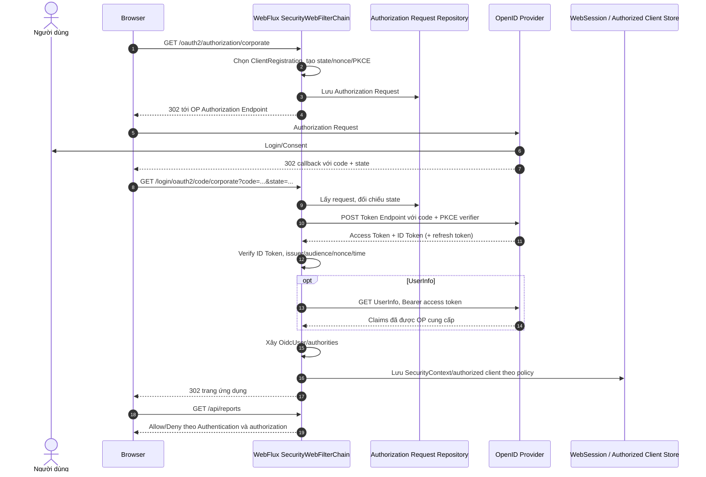
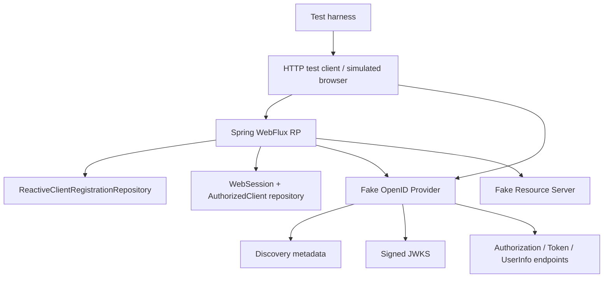

# 30.11. Giới hạn của mock authentication so với kiểm thử provider thực

> **Module:** Spring Security OAuth 2.0 OIDC Client  
> **Chương:** 30. Kiểm thử Reactive  
> **Ngữ cảnh:** Spring Boot, Spring Security WebFlux, `WebTestClient`, `SecurityWebFilterChain`, OAuth2 Login, OpenID Connect (OIDC), OAuth2 Client và việc tích hợp với một OpenID Provider (OP)/Authorization Server (AS) thực tế hoặc môi trường thử nghiệm của provider.

Một ứng dụng WebFlux có thể có hàng trăm phép thử dùng `mockOidcLogin()` đều xanh: người dùng có `ROLE_ADMIN` truy cập trang quản trị, người dùng thiếu `SCOPE_reports.read` bị 403 và endpoint `/me` trả về thông tin principal như dự kiến. Tuy nhiên, khi triển khai, người dùng bấm Login lại gặp lỗi `invalid_redirect_uri`, callback báo `authorization_request_not_found`, ID Token bị từ chối vì `issuer` không khớp, hoặc provider trả về định dạng `groups` khác fixture trong test.

Những lỗi ấy không mâu thuẫn với kết quả Mock Authentication. **Mock authentication chỉ mô phỏng một Authentication đã tồn tại** — thường bỏ qua quá trình browser đi đến Authorization Endpoint, lưu `state`, đăng nhập/consent tại OP, đổi authorization code, xác minh ID Token, lấy UserInfo, mapping authorities thật và lưu authorized client.

Ngược lại, kiểm thử với provider thực (thường là **sandbox/non-production tenant của provider**) quan sát được nhiều hành vi thật như metadata, đăng ký `redirect_uri`, cookie SSO, Client authentication, claims mapping, response codes và các chính sách của provider. Nhưng test live-provider cũng có nhược điểm: mạng không ổn định, người dùng test bị khóa hoặc bật MFA, quota/rate limits, dữ liệu không xác định, thay đổi cấu hình và khó tái hiện những trường hợp lỗi cụ thể.

Bài này không tìm cách loại bỏ mock tests. Mục tiêu là **chọn đúng lớp kiểm thử cho đúng câu hỏi**, kết hợp unit tests, WebFlux security tests, fake OP integration tests, sandbox-provider contract tests và một số smoke tests gần thực tế để có độ tin cậy mà vẫn giữ tốc độ CI, bảo mật secrets và tính ổn định.

---

## 1. Mục tiêu học tập

Sau bài này, bạn có thể:

1. Giải thích Mock Authentication trong Spring Security Test thay thế bước nào của OIDC Login.
2. Phân biệt `mockOidcLogin()`, `mockOAuth2Login()`, `mockJwt()`, `mockOpaqueToken()` và `@WithMockUser`.
3. Dùng `WebTestClient.bindToApplicationContext(...).apply(springSecurity())` để kiểm thử SecurityWebFilterChain trên WebFlux.
4. Hiểu các giới hạn khi dùng `WebTestClient.bindToServer()` với mock security configurers.
5. Viết URL authorization tests cho principal đã có authorities, CSRF và method-specific rules.
6. Phân biệt `OidcUser`/ID Token claims đã giả lập với OIDC claims thực sự được xác minh.
7. Hiểu vì sao `mockOidcLogin().idToken(...)` không tự gọi mapper, UserInfo Endpoint hay Token Endpoint.
8. Liệt kê những điểm mock không kiểm tra được: OIDC Discovery, issuer, audience, chữ ký JWT, `nonce`, `state`, PKCE và Client authentication.
9. Thiết kế fake OP/AS đủ khả năng đi qua Authorization Code Flow thật trong ứng dụng.
10. Phân biệt fake OP, local identity provider container, sandbox thực và tenant production.
11. Viết negative tests cho wrong `iss`/`aud`, JWKS rotation, expired ID Token, sai `state` và sai PKCE.
12. Hiểu các vấn đề browser/cookie/redirect mà mock tests không phát hiện.
13. Kiểm thử user authorities và tenant mapping từ verified provider claims theo pipeline thực.
14. Phân biệt OIDC browser session với Reactive OAuth2 Client được dùng để gọi API và Resource Server JWT.
15. Kiểm thử Reactive method authorization, Reactor Context và thời điểm subscribe.
16. Quản lý test secrets, test accounts, rate limits, CI retries và dữ liệu cá nhân khi dùng provider thật.
17. Lập một test strategy nhiều lớp, có tiêu chí rõ ràng về phần được bảo đảm và phần chưa được bảo đảm.

## 2. Ba câu hỏi khác nhau cần ba kiểu thử

Giả sử user truy cập:

```text
GET /api/reports
```

Các câu hỏi:

**Câu A — Policy:** Nếu đã có `Authentication` với `PERM_REPORT_READ`, ứng dụng có trả kết quả đúng và từ chối người thiếu quyền không?

Dùng `WebTestClient` + `mockOidcLogin().authorities(...)`. Không cần mở OP thật.

**Câu B — Protocol/wiring:** Khi OP trả ID Token hợp lệ chứa group `reports-readers`, Spring Security có xác minh token, gọi mapping và tạo `PERM_REPORT_READ` không?

Dùng integration test chạy **OIDC Authorization Code Flow** với fake OP/AS đã ký token bằng test key, hoặc test những components riêng kết hợp một login integration đại diện.

**Câu C — Provider contract:** Với cấu hình client đã đăng ký trong sandbox của OP thực, endpoint discovery, redirect URI, Client authentication, claims, UserInfo, logout và refresh có hành xử như dự kiến không?

Dùng provider sandbox/tenant non-production, kiểm tra capability và chính sách thực; không cố mô phỏng tất cả bằng fixtures tự viết.

**Ba câu hỏi không thay thế nhau.**

## 3. Mô hình kiểm thử nhiều lớp

| Tầng kiểm thử | Kết nối mạng tới OP? | Nhanh/ổn định | Chứng minh tốt nhất | Chưa chứng minh |
|---|---|---|---|---|
| Unit test của policy/mapper | Không | Rất tốt | Hàm ánh xạ và business rules | OAuth2 Login wiring |
| WebFlux Mock Authentication | Không | Rất tốt | URL/method authorization với principal đã cho | Authorization Code/OIDC protocol |
| Spring context + fake OP | Local/test network | Tốt nếu được thiết kế | Redirect, code exchange, state, PKCE, OIDC JWT validation, mapping | Quirks của nhà cung cấp thật |
| Local OP container | Local/test network | Trung bình | Một implementation OP gần thực | Provider-specific contract khác |
| Sandbox của provider thật | Có | Có thể chậm/flaky | Metadata, client registration, claims, consent và chính sách của provider | Production SSO/session policies hoàn toàn giống |
| Browser E2E + sandbox | Có, browser thật | Chậm hơn | Browser navigation, cookies, callback, UX/MFA behavior ở sandbox | Những trường hợp provider chưa tái hiện |
| Production smoke/monitoring được cho phép | Có | Rủi ro/chi phí cao | Tín hiệu triển khai thực | Không dùng làm nơi thử credential thật/negative attacks |

Đường đi lý tưởng: **nhiều tests nhỏ**, **một số integration tests điều khiển được**, và **một bộ contract/smoke tests nhỏ** cho từng provider quan trọng.

## 4. WebFlux OIDC Login chạy qua những thành phần nào?

Luồng rút gọn:



`mockOidcLogin()` chủ yếu giúp đi thẳng tới **bước cuối**: request có một Authentication OIDC giả và SecurityWebFilterChain đánh giá quyền. Những bước đầu không chạy chỉ vì test gọi postprocessor này.

## 5. Khái niệm Authentication đã mock trong Reactive Security

Trong Spring Security WebFlux, Authentication được dùng qua reactive security context; những thành phần security có thể đọc nó từ `ReactiveSecurityContextHolder`.

Test configurer như `mockOidcLogin()` cung cấp một principal/Authentication phù hợp cho request test, cho phép rules như:

```java
.pathMatchers("/api/admin/**").hasRole("ADMIN")
.pathMatchers("/api/reports/**").hasAuthority("PERM_REPORT_READ")
```

hoạt động mà không cần request đi đến Authorization Server.

### 5.1. Mô phỏng identity không phải xác minh identity

Nếu mock fixture có:

```text
issuer=https://login.corporate.test/oidc
sub=user-123
groups=["admins"]
```

nó **không chứng minh** token được ký bởi corporate OP; đó là dữ liệu mà test tự khai báo. Attacker không thể vì thế được phép gửi JSON tương tự vào production; production phải dùng security pipeline thật để xác minh nguồn.

### 5.2. Mock Authentication không phải “bypass mọi security”

Khi gắn đúng vào `WebTestClient` bound to Spring Security, request vẫn đi qua các filter/rules trong application context. Vì vậy mock rất có giá trị để kiểm thử **authorization**. Chỉ những bước **authentication protocol** bị mô phỏng/thay thế.

## 6. Những test helpers dễ bị nhầm

| Test helper | Mô phỏng điều gì? | Khi nào nên dùng? |
|---|---|---|
| `mockOidcLogin()` | OIDC Login principal/Authentication cho WebFlux | URL rules, claims presentation, session user |
| `mockOAuth2Login()` | OAuth2 Login không nhất thiết có OIDC ID Token | App dùng OAuth2 Login thường |
| `mockJwt()` | Bearer JWT authentication của Resource Server | API kiểm tra JWT token |
| `mockOpaqueToken()` | Opaque Bearer token authentication | API dùng introspection model |
| `mockUser()` / `@WithMockUser` | Spring Security user Authentication | Service/method policy hoặc authentication chung |
| Fake OP qua HTTP | Authorization, token, UserInfo và JWT signature test | Kiểm thử OAuth2/OIDC login wiring |
| Provider sandbox | Contract/capabilities của OP thực | Xác nhận production-like integration |

Các helpers có API thay đổi đôi chút theo Spring Security version. Với WebFlux, dùng namespace/test utilities dành cho **reactive WebTestClient**, không áp trực tiếp MockMvc helpers của Servlet.

## 7. WebTestClient: bindToApplicationContext và springSecurity()

Để dùng WebFlux security test configurers, một mẫu phổ biến là build client từ Spring application context:

```java
package example.reactive;

import org.junit.jupiter.api.BeforeEach;
import org.junit.jupiter.api.Test;
import org.springframework.beans.factory.annotation.Autowired;
import org.springframework.boot.test.context.SpringBootTest;
import org.springframework.context.ApplicationContext;
import org.springframework.test.web.reactive.server.WebTestClient;

import static org.springframework.security.test.web.reactive.server
    .SecurityMockServerConfigurers.springSecurity;
import static org.springframework.security.test.web.reactive.server
    .SecurityMockServerConfigurers.mockOidcLogin;

@SpringBootTest(webEnvironment = SpringBootTest.WebEnvironment.MOCK)
class ReactiveUrlSecurityTest {

    @Autowired
    ApplicationContext context;

    WebTestClient client;

    @BeforeEach
    void setUp() {
        client = WebTestClient
            .bindToApplicationContext(context)
            .apply(springSecurity())
            .configureClient()
            .build();
    }

    @Test
    void example() {
        client.mutateWith(mockOidcLogin())
            .get().uri("/api/profile")
            .exchange()
            .expectStatus().isOk();
    }
}
```

Điều kiện: test application context có WebFlux endpoints và SecurityWebFilterChain phù hợp. Với Spring Boot auto-configuration có thể inject `WebTestClient` khi dùng đúng test annotations, nhưng setup thủ công như trên làm rõ rằng **Spring Security test integration được gắn vào client**.

### 7.1. Không quên .apply(springSecurity())

Nếu dùng `WebTestClient.bindToApplicationContext(context)` mà không áp security configurer, một số mock security mutators hoặc filter-chain behaviors có thể không đúng kỳ vọng. Test sai setup có thể “200” vì SecurityWebFilterChain không được áp đúng.

### 7.2. mutateWith là đặc điểm của test client đã bind mock server

`mockOidcLogin()` tạo test authentication context trong in-memory server exchange. Khi dùng:

```java
WebTestClient.bindToServer().baseUrl("http://localhost:8080").build()
```

đây là HTTP client gọi **một server thật qua network**; không thể mong test postprocessor phía client tự chèn server-side SecurityContext vào process khác. Muốn full HTTP E2E, phải thực hiện login/session/cookie thực qua endpoints hoặc dùng một cơ chế test-auth riêng được kiểm soát và không có ở production.

**Đừng nhầm WebTestClient binding modes.**

## 8. SecurityWebFilterChain minh họa

Giả sử ứng dụng yêu cầu:

- `/public/**` public.
- `GET /api/reports/**` cần `PERM_REPORT_READ`.
- `POST /api/reports/**` cần `PERM_REPORT_WRITE`.
- `/api/admin/**` cần `ROLE_ADMIN`.
- Các request khác yêu cầu authenticated.

```java
import org.springframework.context.annotation.Bean;
import org.springframework.context.annotation.Configuration;
import org.springframework.http.HttpMethod;
import org.springframework.security.config.web.server.ServerHttpSecurity;
import org.springframework.security.web.server.SecurityWebFilterChain;

@Configuration
class ReactiveSecurityConfiguration {

    @Bean
    SecurityWebFilterChain filterChain(ServerHttpSecurity http) {
        return http
            .authorizeExchange(exchanges -> exchanges
                .pathMatchers("/public/**").permitAll()
                .pathMatchers("/api/admin/**").hasRole("ADMIN")
                .pathMatchers(
                    HttpMethod.POST, "/api/reports/**"
                ).hasAuthority("PERM_REPORT_WRITE")
                .pathMatchers(
                    HttpMethod.GET, "/api/reports/**"
                ).hasAuthority("PERM_REPORT_READ")
                .anyExchange().authenticated()
            )
            .oauth2Login(oauth2 -> {})
            .build();
    }
}
```

Code minh họa Servlet-independent **Reactive** security configuration. Một ứng dụng cần Client registrations, exception handling, logout, session and authorized-client storage, CSRF, security headers và nhiều policy khác tùy threat model.

### 8.1. Matcher order

Nếu `/api/**.authenticated()` được đặt trước `/api/admin/**.hasRole("ADMIN")`, rule rộng có thể bắt request trước và cho phép user thường. Mock tests rất phù hợp để phát hiện lỗi này bằng **negative case** (reader bị từ chối admin), dù chúng không xác minh OP.

## 9. Test URL authorization bằng mockOidcLogin()

Ví dụ request có `PERM_REPORT_READ`:

```java
import org.junit.jupiter.api.Test;
import org.springframework.security.core.authority.SimpleGrantedAuthority;

import static org.springframework.security.test.web.reactive.server
    .SecurityMockServerConfigurers.mockOidcLogin;

@Test
void reportReaderCanRead() {
    client.mutateWith(
        mockOidcLogin().authorities(
            new SimpleGrantedAuthority("PERM_REPORT_READ")
        )
    )
    .get().uri("/api/reports/42")
    .exchange()
    .expectStatus().isOk();
}

@Test
void reportReaderCannotReadAdmin() {
    client.mutateWith(
        mockOidcLogin().authorities(
            new SimpleGrantedAuthority("PERM_REPORT_READ")
        )
    )
    .get().uri("/api/admin/audit")
    .exchange()
    .expectStatus().isForbidden();
}
```

Điều kiện: application context có controllers cho routes và handlers trả các HTTP statuses phù hợp.

**Được kiểm tra:** SecurityWebFilterChain xử lý principal có authority READ đúng như policy.

**Không được kiểm tra:** provider có trả group reader thật không, Spring Security có xây đúng authority từ group không, Client ID/redirect URI có đúng không, ID Token có chữ ký hợp lệ không.

## 10. CSRF trong reactive tests

Với ứng dụng browser/session, request POST/PUT/PATCH/DELETE có thể bị CSRF protection từ chối dù Authentication có WRITE permission.

Ví dụ:

```java
import static org.springframework.security.test.web.reactive.server
    .SecurityMockServerConfigurers.csrf;

@Test
void writerCanCreateWithCsrf() {
    client.mutateWith(
        mockOidcLogin().authorities(
            new SimpleGrantedAuthority("PERM_REPORT_WRITE")
        )
    ).mutateWith(csrf())
     .post().uri("/api/reports")
     .exchange()
     .expectStatus().isCreated();
}

@Test
void readerCannotCreateEvenWithCsrf() {
    client.mutateWith(
        mockOidcLogin().authorities(
            new SimpleGrantedAuthority("PERM_REPORT_READ")
        )
    ).mutateWith(csrf())
     .post().uri("/api/reports")
     .exchange()
     .expectStatus().isForbidden();
}
```

### 10.1. Hai lỗi 403 có ý nghĩa khác nhau

| Request | CSRF | Authority | Kỳ vọng |
|---|---|---|---|
| POST report, writer | Hợp lệ | WRITE | 201 nếu controller contract phù hợp |
| POST report, writer | Thiếu | WRITE | 403 do CSRF với config mặc định |
| POST report, reader | Hợp lệ | READ | 403 do authorization |
| GET report, reader | Không cần CSRF mặc định | READ | 200 |
| GET report, anonymous | Không có | Không có | Login redirect/challenge tùy entry point |

Nếu test reader POST **không** gắn CSRF, 403 vẫn xuất hiện ngay cả khi URL policy bị sai. Vì vậy muốn chứng minh authorization cần dùng CSRF hợp lệ trong negative test.

### 10.2. Stateless Resource Server là trường hợp khác

Một API bearer-only có thể tắt CSRF cho các routes stateless sau đánh giá threat model. Trong browser OIDC Login, không tự vô hiệu hóa CSRF toàn ứng dụng chỉ để làm tests xanh.

## 11. Default mockOidcLogin() authorities không phải quyền thật

Một mock OIDC principal có authorities mặc định do test library tạo; không mặc định có business permissions như `PERM_REPORT_READ` hay `ROLE_ADMIN`.

Khi test yêu cầu một authority cụ thể, gắn tường minh:

```java
mockOidcLogin().authorities(
    new SimpleGrantedAuthority("ROLE_ADMIN")
)
```

Không viết test dựa trên suy đoán fixture default. Nếu Spring Security Test nâng cấp và default attributes thay đổi, những test tường minh vẫn phản ánh policy.

### 11.1. Roles và authorities

Theo Spring Security convention:

```java
.hasRole("ADMIN")
```

thường yêu cầu `ROLE_ADMIN`, còn:

```java
.hasAuthority("ADMIN")
```

yêu cầu chuỗi `ADMIN` chính xác.

Mock không giải quyết sự không nhất quán prefix. Test cả `ROLE_ADMIN` được phép và `ADMIN` đơn thuần bị từ chối khi cấu hình dùng default role prefix.

## 12. Mock ID Token claims không tự ánh xạ quyền

Bạn có thể thay claims fixture:

```java
client.mutateWith(
    mockOidcLogin().idToken(token -> token
        .claim("iss", "https://login.corporate.test/oidc")
        .claim("groups", java.util.List.of("finance-readers"))
    )
)
.get().uri("/api/reports/42")
.exchange();
```

Nhưng **chỉ có `groups=["finance-readers"]` trong mock token không tự gọi custom `GrantedAuthoritiesMapper` hoặc `OidcReactiveOAuth2UserService`** để tạo `PERM_REPORT_READ`.

Nếu URL rule cần `PERM_REPORT_READ`, fixture phải cung cấp authority tường minh **hoặc** test phải thực sự đi qua mapper trong một unit/integration test riêng.

### 12.1. Ba phép thử cần có

- **Mapper unit test:** claim finance-readers từ issuer được tin cậy → `PERM_REPORT_READ`.
- **WebTestClient mock test:** Authentication có `PERM_REPORT_READ` → được đọc reports.
- **OIDC integration test:** fake OP phát signed ID Token + UserInfo theo contract → login pipeline tạo principal có `PERM_REPORT_READ`.

Chỉ có hai phép thử đầu không chứng minh wiring production đang sử dụng mapper.

## 13. mockOAuth2Login() khác mockOidcLogin()

`mockOAuth2Login()` phù hợp cho OAuth2 Login không OIDC, khi principal là `OAuth2User` không có yêu cầu OIDC ID Token.

Ví dụ:

```java
import static org.springframework.security.test.web.reactive.server
    .SecurityMockServerConfigurers.mockOAuth2Login;

client.mutateWith(
    mockOAuth2Login().authorities(
        new SimpleGrantedAuthority("ROLE_USER")
    )
)
.get().uri("/api/profile")
.exchange()
.expectStatus().isOk();
```

Nếu app hỗ trợ OAuth2 Login thường qua provider không phải OIDC và OIDC Login qua OP khác, phải test cả hai loại principal, vì claim shapes/authority mapping không giống nhau.

Không dùng `mockOidcLogin()` để chứng minh provider OAuth2-only trả ID Token; nó không làm điều đó.

## 14. mockJwt() không phải mockOidcLogin()

Một ứng dụng WebFlux có thể vừa là OIDC Client (browser SSO), vừa là OAuth2 Resource Server (Bearer JWT API).

| Ngữ cảnh | Authentication thông dụng | Test helper |
|---|---|---|
| Browser đăng nhập bằng OIDC | `OAuth2AuthenticationToken` / `OidcUser` | `mockOidcLogin()` |
| OAuth2 Login không OIDC | `OAuth2AuthenticationToken` / `OAuth2User` | `mockOAuth2Login()` |
| API nhận Bearer JWT | `JwtAuthenticationToken` | `mockJwt()` |
| API dùng Bearer opaque token | Opaque-token authentication | `mockOpaqueToken()` |

Ví dụ Resource Server test:

```java
import static org.springframework.security.test.web.reactive.server
    .SecurityMockServerConfigurers.mockJwt;

client.mutateWith(
    mockJwt().authorities(
        new SimpleGrantedAuthority("SCOPE_reports.read")
    )
)
.get().uri("/api/bearer-reports")
.exchange()
.expectStatus().isOk();
```

Một test `mockJwt()` không kiểm tra OIDC browser login, session cookie hoặc custom `OidcUserService`. Ngược lại, `mockOidcLogin()` không xác minh JWT decoder của Resource Server.

## 15. Anonymous request và login entry point

Trong OIDC browser login, anonymous request tới endpoint protected có thể được redirect tới login page hoặc login entry point.

```java
client.get().uri("/api/reports/42")
    .exchange()
    .expectStatus().is3xxRedirection();
```

Nhưng đây chỉ là expected result khi SecurityWebFilterChain/authentication entry point được cấu hình theo browser redirect. Một API-specific entry point có thể trả 401.

Không hardcode 302 cho mọi ứng dụng; hãy test contract của chain được yêu cầu, bao gồm response header `Location` nếu có.

### 15.1. Cùng URL có nhiều chains

Một ứng dụng có thể cấu hình:

- `/api/**` nhận Bearer JWT với 401.
- `/web/**` dùng OIDC session và redirect login.

Trong trường hợp đó, dùng đúng helper/chain để test. Một test với `mockOidcLogin()` trên Bearer-only chain có thể không đại diện request production thực tế.

## 16. Reactive Method Security

Spring Security WebFlux hỗ trợ reactive method authorization, ví dụ:

```java
import org.springframework.security.access.prepost.PreAuthorize;
import org.springframework.stereotype.Service;
import reactor.core.publisher.Mono;

@Service
public class ReactiveReportService {

    @PreAuthorize("hasAuthority('PERM_REPORT_EXPORT')")
    public Mono<String> exportReport(long id) {
        return Mono.just("report-" + id);
    }
}
```

Với cấu hình phù hợp:

```java
import org.springframework.context.annotation.Configuration;
import org.springframework.security.config.annotation.method.configuration.EnableReactiveMethodSecurity;

@Configuration
@EnableReactiveMethodSecurity
class ReactiveMethodSecurityConfiguration {
}
```

### 16.1. Test qua Spring bean/proxy thật

Nếu test tạo:

```java
new ReactiveReportService().exportReport(42)
```

thì có thể bỏ qua Spring AOP proxy và `@PreAuthorize` không được enforce. Test phải lấy service bean từ Spring context.

### 16.2. Authentication trong Reactor Context

Reactive security dựa trên Reactor Context, không phải một ThreadLocal luôn có sẵn như nhiều code Servlet. Khi test method trực tiếp, phải chuẩn bị đúng reactive SecurityContext hoặc dùng integration với security test annotations/utilities phù hợp.

Ví dụ minh họa:

```java
import org.junit.jupiter.api.Test;
import org.springframework.beans.factory.annotation.Autowired;
import org.springframework.boot.test.context.SpringBootTest;
import org.springframework.security.test.context.support.WithMockUser;
import reactor.test.StepVerifier;

@SpringBootTest
class ReactiveReportMethodTest {

    @Autowired ReactiveReportService service;

    @Test
    @WithMockUser(authorities = "PERM_REPORT_EXPORT")
    void exporterCanExport() {
        StepVerifier.create(service.exportReport(42))
            .expectNext("report-42")
            .verifyComplete();
    }
}
```

Ví dụ cần `reactor-test` trong test dependencies, `@EnableReactiveMethodSecurity` và test setup hỗ trợ propagating mock SecurityContext. Nếu test framework/version yêu cầu tích hợp riêng, dùng `ReactiveSecurityContextHolder.withAuthentication(...)` để truyền context tường minh cho publisher.

### 16.3. Không tự subscribe() trong business code

Nếu service tự `subscribe()` bên trong trước khi framework/tracing/security context được gắn, behavior có thể không như mong đợi. Ưu tiên trả `Mono`/`Flux` và compose các operators; test subscriber nên dùng `StepVerifier` khi cần xác minh emission/error.

### 16.4. Mock method security không chứng minh OP

Một service test dùng `@WithMockUser` chỉ chứng minh authority policy. Nó không chứng minh ID Token từ OP thật được mapping thành authority đúng.

## 17. Những bước mock authentication bỏ qua

| Thành phần/thử nghiệm | Mock Authentication | Fake OP integration | Real provider sandbox |
|---|---|---|---|
| SecurityWebFilterChain authorization | Có | Có | Có |
| Reactive method authorization | Có nếu context/proxy đúng | Có | Có |
| OP discovery metadata | Không | Có khi triển khai endpoint giả | Có |
| Registration Client ID/secret | Không kiểm chứng giao thức | Có thể | Có |
| Authorization Endpoint redirect | Không | Có | Có |
| OP login/consent UI | Không | Thường giả lập | Có |
| State correlation callback | Không | Có | Có |
| PKCE code_verifier/challenge | Không | Có nếu fake OP verify | Có theo OP policy |
| Token Endpoint auth/exchange | Không | Có | Có |
| ID Token JWT signature | Không | Có nếu signed fake token | Có |
| Issuer/audience/nonce validation | Không | Có | Có |
| JWK rotation/caching | Không | Có nếu mô phỏng | Có, khó điều khiển |
| UserInfo response | Không | Có nếu fake endpoint | Có |
| Claim shape thực tế | Fixture tự quyết | Fixture tự quyết | Có |
| Refresh token behavior | Không | Có nếu mô phỏng | Có |
| Browser cookie/SSO/MFA | Không | Một phần | Có (sandbox) |
| Provider-specific errors | Không | Nếu mô phỏng | Có |
| Network/TLS/timeout | Không | Một phần | Có |
| Provider quotas, rate limit | Không | Nếu mô phỏng | Có |
| Redirect host/forwarded headers | Không đầy đủ | Có với full stack | Có khi topology giống production |

**Mock tests không có lỗi** vì bỏ qua protocol — đó chính là mục đích của chúng. Lỗi là sử dụng kết quả mock như bằng chứng những tầng chưa chạy.

## 18. OIDC Discovery và Client registration

Một OP thực thường công bố metadata tại well-known endpoint, ví dụ:

```text
https://idp.test.example/realms/acme/.well-known/openid-configuration
```

Metadata có thể chứa:

- `issuer`;
- `authorization_endpoint`;
- `token_endpoint`;
- `jwks_uri`;
- `userinfo_endpoint` nếu hỗ trợ;
- `end_session_endpoint` nếu hỗ trợ;
- supported signing algorithms;
- token endpoint authentication methods;
- một số capabilities mở rộng khác.

Mock Authentication **không fetch metadata** và không xác minh giá trị này có khớp configuration hay không.

### 18.1. Cấu hình sai nhưng test vẫn xanh

Ví dụ:

```yaml
spring:
  security:
    oauth2:
      client:
        registration:
          corporate:
            provider: corporate-op
            client-id: wrong-client-id
            client-secret: ${CORPORATE_CLIENT_SECRET}
            authorization-grant-type: authorization_code
            redirect-uri: "{baseUrl}/login/oauth2/code/{registrationId}"
            scope: [openid, profile]
        provider:
          corporate-op:
            issuer-uri: https://wrong-issuer.example.invalid
```

Một mock authorization test có thể chỉ dùng SecurityWebFilterChain + mock principal và pass; không chứng minh issuer URI hoạt động hay Client ID được OP chấp nhận.

Nếu Boot khởi tạo registration từ issuer discovery trong application context và issuer không truy cập được, context có thể fail trước cả test; đó là **chi tiết cấu hình**, không phải bằng chứng mock đang test remote contract. Trong mock tests cần test registration fixture thích hợp, nhưng vẫn có một lớp test xác nhận cấu hình non-production/real provider.

## 19. Redirect URI và reverse proxy

Một app chạy sau reverse proxy:

```text
Browser: https://app.example.test
Internal WebFlux: http://rp-service:8080
```

Nếu ứng dụng sinh redirect URI:

```text
http://rp-service:8080/login/oauth2/code/corporate
```

thì OP có thể từ chối vì đã đăng ký:

```text
https://app.example.test/login/oauth2/code/corporate
```

Mock Authentication không đi qua redirect nên không phát hiện.

### 19.1. Cần test những gì?

- Externally visible scheme/host/port.
- Context path/base URL.
- Trusted forwarded headers của reverse proxy.
- Registered redirect URI exactness.
- Không có Host/X-Forwarded-Host injection.
- Tenant-specific domains và allowed callback routes.
- Chuyển hướng sau login/logout không thành open redirect.

Fake OP integration có thể xác minh Authorization Request `redirect_uri`; sandbox provider test xác nhận OP thực chấp nhận nó.

## 20. State và Authorization Request Repository

Trong Authorization Code Flow, RP tạo một `state` khó đoán rồi lưu authorization request, liên kết nó với browser session/transaction.

Callback:

```text
/login/oauth2/code/corporate?code=CODE&state=STATE
```

phải được đối chiếu với request ban đầu. Khi test bằng `mockOidcLogin()`, bước lưu/đọc `ServerAuthorizationRequestRepository` không chạy.

### 20.1. Những lỗi mock bỏ qua

- Session cookie bị mất sau redirect.
- Browser chặn cookie vì SameSite/Secure/domain/path.
- Callback vào node không đọc được shared WebSession.
- Hai login tabs đồng thời làm mất một request.
- State sai hoặc bị replay.
- Authorization Request hết hạn.
- Tenant/registration bị thay giữa start và callback.
- Callback path không khớp registration.

### 20.2. Negative tests cần OP giả

1. Bắt đầu login, ghi nhận state.
2. Trả callback với state hợp lệ → tiến tới token exchange.
3. Trả state khác → không tạo Authentication.
4. Gửi lại cùng callback/code → bị từ chối theo state/code one-time use.
5. Mất cookie/session → login không được hoàn tất trái phép.
6. Thử login song song từ hai tabs → tuân concurrency policy.
7. Thử callback đến sai registration → không đổi token bằng Client khác.

Những kiểm tra này không có ý nghĩa nếu chỉ gọi `mockOidcLogin()`.

## 21. PKCE S256 và authorization code

PKCE ràng buộc authorization code với Client đã bắt đầu request:

```text
code_verifier -> SHA256 -> code_challenge (S256)

Authorization Request:
  code_challenge=...
  code_challenge_method=S256

Token Request:
  code=...
  code_verifier=...
```

Mock Authentication không tạo và đối chiếu PKCE verifier với AS.

### 21.1. Fake OP có thể kiểm thử PKCE thật

Một fake OP integration test đủ tốt phải:

- Lưu challenge theo authorization code test.
- Từ chối token request thiếu verifier nếu PKCE bắt buộc.
- Từ chối verifier sai.
- Chấp nhận verifier đúng một lần.
- Từ chối reuse code.
- Giữ Client ID/redirect URI binding.

Không viết fake OP luôn trả token bất kể code/verifier; như vậy integration test không chứng minh PKCE.

### 21.2. Không log code/verifier trong tests

Dùng synthetic credentials và request capture được redacted. Nếu cần assert verifier, kiểm tra sự hiện diện/định dạng hoặc bằng test-specific comparison rồi không in raw value trong CI logs.

## 22. Token Endpoint Client authentication

Tùy OP/Client registration, Token Endpoint có thể yêu cầu:

- `client_secret_basic`;
- `client_secret_post`;
- `private_key_jwt`;
- `client_secret_jwt`;
- `none` cho public Client với những bảo vệ phù hợp;
- một số phương thức mở rộng.

Mock Authentication không gọi Token Endpoint, nên không kiểm tra Client ID, secret, signature, clock, JWT assertion audience hay method đã đăng ký.

### 22.1. Contract test

Một integration/sandbox test phải xác nhận:

1. Client gửi đúng authentication method.
2. Credentials lấy từ secret manager/config non-production.
3. Token Endpoint thật chấp nhận request.
4. Không lộ secrets trong URL/log/traces.
5. Secret rotation được hỗ trợ theo policy.
6. Mã lỗi `invalid_client` được ứng dụng xử lý an toàn.

Không đưa Client secret production vào fake OP hoặc source code tests.

## 23. ID Token signature, JWK và claims validation

OIDC Login cần kiểm tra ID Token theo OIDC rules tương ứng, bao gồm:

- Trusted issuer `iss`;
- Intended audience `aud` chứa Client ID;
- Các điều kiện `azp` khi áp dụng;
- `exp`/`iat` và clock skew;
- Signature theo thuật toán/key được phép;
- `nonce` khi flow dùng nonce;
- Các yêu cầu khác tùy type/flow;
- Không tin untrusted JWKS URL/tùy ý JWT header.

Mock `mockOidcLogin().idToken(...)` không tự gọi JWT decoder/token validator của login flow. Claims mà fixture chứa được tin cho test authorization.

### 23.1. Fake OP signed ID Token

Để test validation thật, fake OP nên:

1. Tạo signing key test riêng, không dùng production key.
2. Công bố public JWKS tại endpoint test.
3. Ký ID Token theo algorithm đã cấu hình/được phép.
4. Phát `iss`, `sub`, `aud`, `iat`, `exp` hợp lệ.
5. Liên kết nonce với Authorization Request.
6. Trả response qua Token Endpoint sau code exchange.
7. Cho phép điều khiển negative cases: wrong issuer/audience, expired, kid unknown, signature bad.
8. Không tắt token verification ở RP chỉ để tích hợp fake OP.

Nếu fake OP trả unsigned/alg none token rồi RP “chấp nhận” do bypass validators, test không đại diện một OIDC Client an toàn.

### 23.2. JWKS rotation/caching

Test provider-side rotation cần:

- Key A ban đầu có `kid=A`.
- OP JWKS cung cấp public key A.
- Rotate sang key B và cập nhật JWKS.
- RP refresh/cache keys theo policy.
- ID Token ký B được xử lý đúng sau cập nhật.
- Token giả có `kid` không tồn tại/sai chữ ký bị từ chối.

Sandbox provider có thể không cho team tự rotate signing keys theo ý muốn, nên fake OP integration phù hợp hơn cho negative/edge cases này.

## 24. UserInfo Endpoint và claims thực tế

Một mock `OidcUser` có thể được dựng trực tiếp với:

```text
email=alice@example.test
groups=["reports-readers"]
department="finance"
```

Nhưng OP thực có thể:

- Không trả `groups` trong ID Token.
- Trả groups ở UserInfo thay vì ID Token.
- Đòi scope riêng để trả email/profile.
- Trả email chưa verified hoặc thiếu `email_verified`.
- Trả nested roles như `realm_access.roles`.
- Có claim namespaced theo provider.
- Giới hạn số groups, dùng overage/reference claims.
- Trả UserInfo HTTP 401/403 do access token/scope.
- Thay đổi claims theo consent/tenant settings.

### 24.1. Unit test mapper chưa đủ

Unit test:

```text
groups=["reports-readers"] -> PERM_REPORT_READ
```

có thể đúng, nhưng không bảo đảm OP sẽ phát đúng claim shape. Sandbox contract test nên xem **claims thật của tài khoản test có consent/scopes tương ứng** (trong giới hạn privacy), sau đó ánh xạ vào authorities theo policy.

### 24.2. Không tự cấp quyền từ email domain

Một ID Token có `email=person@company.test` không tự chứng minh user được quyền admin một tenant. Cần issuer/sub và membership mapping đáng tin; email có thể đổi, chưa verified hoặc được tái cấp.

## 25. Mapping authority: mock có thể che lỗi wiring

Giả sử user groups được ánh xạ:

```text
OIDC groups ["reports-readers"]
    -> GrantedAuthority("PERM_REPORT_READ")
```

Mock test:

```java
client.mutateWith(
    mockOidcLogin().authorities(
        new SimpleGrantedAuthority("PERM_REPORT_READ")
    )
)
.get().uri("/api/reports/42")
.exchange()
.expectStatus().isOk();
```

đúng nhưng không chứng minh mapper chạy khi login thật.

### 25.1. Bộ ba test nên có

1. **Mapping unit:** provider-specific claims fixture → expected authorities.
2. **Security rule mock:** expected authorities → allow/deny HTTP.
3. **Fake OP integration:** signed ID Token/UserInfo → OAuth2 Login pipeline → Authentication authorities → URL result.

Với provider có claim shape riêng, thêm **sandbox contract test** để xác nhận dữ liệu thật khớp assumptions.

### 25.2. Registration và issuer là hai khóa khác nhau

Cùng issuer có thể phục vụ nhiều Client registrations hoặc tenants. Mapper có thể cần `registrationId`, `iss/sub` và tenant membership; mock chỉ có một `ROLE_ADMIN` global sẽ bỏ qua vấn đề cross-tenant escalation.

## 26. Reactive session, cookie và browser restrictions

Mock Authentication gắn security context trực tiếp vào exchange; nó không yêu cầu browser giữ OP session cookie rồi quay về callback.

Những tình huống thực:

- `SESSION` cookie bị mất sau redirect sang OP.
- Cookie domain/path sai.
- SameSite chặn cross-site callback trong flow đặc biệt.
- Reverse proxy thêm/sửa `Secure`/forwarded headers.
- Load balancer chuyển node nhưng WebSession store không chia sẻ.
- Session fixation/rotation làm mismatch state.
- Browser profile mới không có session SSO.
- Third-party cookie restrictions ảnh hưởng front-channel/logout.
- Tài khoản ở OP đã có SSO session nên login không hiện form.

### 26.1. Kiểm thử bằng browser thật khi nào?

Khi câu hỏi liên quan cookie policy, cross-site redirects, MFA UX, Safari/Chrome privacy behavior hoặc browser history, test qua `WebTestClient` có thể chưa đủ. Dùng browser E2E automation (Playwright/Selenium tùy stack) với sandbox OP và một environment đúng topology.

### 26.2. Browser E2E cũng không kiểm tra mọi OAuth2 edge case

Nó giỏi cho happy path/cookie UX nhưng thường kém ổn định với MFA/CAPTCHA và không dễ tạo ID Token chữ ký sai. Kết hợp với fake OP integration để kiểm tra negative cases có kiểm soát.

## 27. Logout và session invalidation

Một mock-auth test có thể gọi `POST /logout` và xác nhận status/redirect theo security config. Nhưng nó không tự chứng minh:

- OP end-session endpoint có tồn tại;
- `id_token_hint`/post-logout redirect được OP chấp nhận;
- browser đã kết thúc SSO cookie tại OP;
- Back-Channel Logout Token từ OP được xác minh;
- các sessions của user ở thiết bị khác đã bị invalidated;
- Refresh token/grants bị revoke.

### 27.1. Fake OP logout test

Có thể mô phỏng end-session endpoint và kiểm tra RP redirect được tạo đúng; nếu dùng Back-Channel Logout, phát Logout Token có chữ ký test và verify session revocation.

### 27.2. Sandbox logout test

Để xác nhận OP thật hỗ trợ RP-Initiated Logout, behavior của OP cookies, consent và login lại, cần sandbox provider test. Không suy từ một mock `OidcUser` rằng global logout hoạt động.

## 28. Refresh token và authorized-client storage

Một ứng dụng Reactive OAuth2 Client có thể dùng `ReactiveOAuth2AuthorizedClientManager` hoặc repository/service tương ứng để refresh token, lưu authorized client và gọi API.

Mock `mockOidcLogin()` không tự kiểm tra:

- AS có cấp refresh token cho scopes/policy hiện tại không;
- refresh token rotation/expiry/revocation;
- Token Endpoint refresh grant;
- retry/race khi nhiều requests refresh đồng thời;
- lưu token vào Redis/R2DBC/JDBC/custom storage;
- Resource Server chấp nhận access token mới;
- refresh token invalid_grant cleanup.

### 28.1. Test tách theo trách nhiệm

| Cần kiểm tra | Cách làm |
|---|---|
| Authenticated user được phép gọi endpoint | Mock OIDC Authentication |
| Client chọn registration đúng khi gọi API | Unit/integration test reactive authorized-client manager |
| Refresh grant request/body/response | Fake AS Token Endpoint |
| Token persistence | Repository/service integration test |
| Rotation/reuse behavior của provider | Sandbox hoặc fake AS có policy đúng |
| API trả 401 khi token hết hạn | Fake Resource Server/integration |
| Quota, refresh expiry thực tế | Sandbox provider contract test |

Không đặt refresh token thật trong fixture/source hoặc CI log.

## 29. Provider-specific behavior mà mock không thấy

Có nhiều khác biệt giữa OPs:

- Metadata discovery paths và tenant-specific issuers.
- Redirect URI registration restrictions.
- Client authentication method.
- PKCE bắt buộc/không bắt buộc cho client type cụ thể.
- Consent screen, prompt, login_hint, max_age.
- Required scopes và optional claims.
- MFA/conditional access.
- Session duration, cookie policy.
- Claims trong ID Token/UserInfo.
- Refresh token rotation.
- Logout support.
- Signing algorithm/JWKS rotation.
- Error code/description và rate limiting.

Một mock principal không thể đại diện tất cả. Dù fake OP mô phỏng được nhiều trường hợp, vẫn nên có **contract smoke** cho provider thật khi dependency này quan trọng với sản phẩm.

## 30. Fake OP và sandbox provider: mục đích khác nhau

### 30.1. Fake OP

Ứng dụng/team tự kiểm soát:

- Các endpoints.
- Signing keys.
- Trạng thái user/consent.
- Code issuance.
- Token claims.
- Lỗi 4xx/5xx.
- Timeouts.
- JWKS rotation.
- Retry/replay.
- Negative cases.

Ưu điểm: deterministic, CI-friendly, tạo lỗi không cần hack provider thật.

Nhược điểm: bạn có thể vô tình mô phỏng sai chuẩn hoặc bỏ qua quirks của vendor.

### 30.2. Sandbox OP thực

Nhà cung cấp kiểm soát:

- Metadata và URLs.
- Cơ chế authentication/consent thật.
- Client registration.
- Claim policies.
- Signature/JWKS implementation.
- Operational limits.

Ưu điểm: kiểm tra hợp đồng tích hợp thật.

Nhược điểm: khó chủ động tạo token sai chữ ký, khó reset trạng thái, test có thể flaky và không nên chạy quá thường xuyên trong mọi PR.

### 30.3. Local OP container

Một OP thật chạy local/container (ví dụ một triển khai OIDC server cho test) giúp test protocol/cookies/consent sâu hơn fake stubs. Nhưng nó vẫn **không phải** provider đích của khách hàng nếu môi trường production dùng một vendor khác.

## 31. Kiến trúc kiểm thử tích hợp fake OP



Tất cả endpoints trong fixture dùng **test domains/localhost ports** và credentials giả. Test runner phải có cách cập nhật ClientRegistration issuer/redirect URI cho đúng địa chỉ động của fake OP.

### 31.1. Những gì fake OP phải cung cấp

Tùy mục tiêu test:

- `/.well-known/openid-configuration` với issuer/endpoint URLs nhất quán.
- Authorization Endpoint trả code/state qua redirect hợp lệ.
- Token Endpoint xác thực Client/PKCE và trả token response.
- JWKS Endpoint công bố public key ứng với signed ID Token.
- UserInfo Endpoint trả claims theo scopes nếu test cần.
- Logout Endpoint/Back-Channel messaging nếu test logout.
- Token Revocation/refresh grant nếu test token lifecycle.

Không cần dựng tất cả endpoints cho mọi test. Nhưng **đừng tuyên bố đã test một bước không tồn tại trong fake OP**.

## 32. Kịch bản fake OP hoàn chỉnh

Một test flow có thể là:

1. Khởi động fake OP với issuer và JWKS test.
2. Cấu hình RP registration trỏ tới fake OP.
3. Bắt đầu `GET /oauth2/authorization/corporate` trên RP qua HTTP client.
4. Đọc `Location` redirect và kiểm tra `client_id`, `redirect_uri`, `scope`, `state`, `nonce`/PKCE khi áp dụng.
5. Gửi request tới fake Authorization Endpoint và phát code đã bind với Client/redirect/challenge.
6. Browser giả giữ RP session cookie, follow callback chứa code/state.
7. RP gọi fake Token Endpoint, gửi code + PKCE verifier/Client authentication.
8. Fake OP trả signed ID Token và access token; RP xác minh chữ ký/claims.
9. RP gọi UserInfo nếu cấu hình và provider behavior yêu cầu.
10. RP tạo Authentication, lưu session/authorized client.
11. Browser gọi protected endpoint bằng session cookie.
12. Assert quyền từ verified claims đúng policy, và test user thiếu permission bị chặn.

### 32.1. Vì sao cần giữ browser cookies?

Authorization Request Repository thường liên quan WebSession của browser. Nếu test callback không gửi cùng cookie/session, RP có thể không tìm thấy request theo state. Đây là chính xác một loại lỗi mà mock Authentication bỏ qua.

### 32.2. Không test “happy path” bằng cách nhảy thẳng tới callback giả

Một fake OP test đúng phải bắt đầu từ Authorization Request của RP, giữ state, code, PKCE và session. Nếu test tự gửi `code=synthetic` tới callback mà không có request trước đó rồi vô hiệu hóa state check cho dễ pass, test đã phá cơ chế bảo mật cần kiểm chứng.

## 33. WebTestClient bindToServer cho E2E qua HTTP thật

Khi WebFlux RP đang chạy trên một port test:

```java
WebTestClient client = WebTestClient
    .bindToServer()
    .baseUrl("http://127.0.0.1:" + port)
    .build();
```

Từ đây, test phải thực hiện HTTP flow thật (redirects, cookies, callback, fake OP). Không dùng `mutateWith(mockOidcLogin())` như cách inject SecurityContext qua network; nó không được truyền tới server process như một cookie/session hợp lệ.

### 33.1. Khi nào WebTestClient chưa đủ tiện?

OIDC login là flow browser-mediated với redirect across origins và OP login UI. `WebTestClient` chủ yếu hỗ trợ HTTP testing, không phải trình duyệt hoàn chỉnh. Với redirect/cookie/JavaScript-heavy provider screens, dùng browser automation hoặc HTTP client có cookie jar/redirect control theo test design.

### 33.2. Không tự theo redirect mù quáng

Đừng để HTTP client tự follow mọi redirect rồi mất quyền kiểm tra `state`, `nonce` và `redirect_uri`. Test có thể cần xử lý từng bước với cookie store, allowlisted hosts và explicit assertions.

## 34. Cấu hình ReactiveClientRegistrationRepository cho fake OP

Ví dụ cấu hình test:

```yaml
spring:
  security:
    oauth2:
      client:
        registration:
          corporate:
            provider: test-op
            client-id: reactive-rp-test
            client-secret: ${TEST_OIDC_CLIENT_SECRET}
            authorization-grant-type: authorization_code
            redirect-uri: "{baseUrl}/login/oauth2/code/{registrationId}"
            scope:
              - openid
              - profile
        provider:
          test-op:
            issuer-uri: http://127.0.0.1:19090/oidc
```

Đây là cấu hình **chỉ cho local test network** với fake OP. Production dùng HTTPS và issuer hợp lệ theo nhà cung cấp. Nếu fake issuer chạy trên port động, cấu hình registry/test properties phải nhất quán; đừng hardcode sai port khi runner thay đổi.

### 34.1. Discovery bootstrap

Nếu app tự chạy OIDC discovery khi khởi tạo Client registration, fake OP phải sẵn sàng trước khi application context được tạo, hoặc test phải cung cấp explicit provider endpoints/registration fixture phù hợp. Đây là lỗi setup tích hợp hay gặp, không phải lỗi của mock Authorization.

## 35. Negative tests với fake OP

| Kịch bản | Fake OP thực hiện | RP mong đợi |
|---|---|---|
| Wrong state | Callback state khác request | Không tạo Authentication |
| Missing state | Callback thiếu state | Từ chối |
| Reused authorization code | Code được đổi token lần hai | AS từ chối, RP không login |
| Wrong PKCE verifier | Token request không khớp challenge | AS từ chối |
| Wrong redirect URI | Token request dùng redirect không khớp | AS từ chối |
| Wrong Client secret | Token Endpoint invalid_client | Login fail an toàn |
| ID Token sai chữ ký | JWT ký key lạ | RP từ chối |
| Wrong issuer | `iss` khác configured issuer | RP từ chối |
| Wrong audience | `aud` không chứa Client ID | RP từ chối |
| Expired ID Token | `exp` đã qua | RP từ chối |
| Wrong nonce | Nonce không khớp request | RP từ chối |
| JWKS kid unknown | Không tìm thấy key tin cậy | RP từ chối hoặc retry theo policy |
| UserInfo 401 | OP từ chối access token | Login failure/fallback đúng contract |
| Token Endpoint 503 | AS unavailable | Login failure/timeout UX an toàn |
| OP timeout | Response chậm | Timeout/retry policy phù hợp |
| Group thiếu | ID Token/UserInfo không có group | Không auto-grant quyền |
| Group của issuer khác | Claim trùng nhưng OP khác | Không map sai tenant |
| Refresh invalid_grant | Refresh token không còn hợp lệ | Không loop retry, cleanup policy |
| Revocation fail | AS không xác nhận revoke | Không claim remote revoke hoàn tất |

Các failure cases này không nên được “giả lập” bằng cách đặt `mockOidcLogin()` rồi tự expect 403; như vậy chỉ test policy, không test cách RP xử lý protocol failure.

## 36. Signature và issuer tests cần tách khỏi authority tests

Một test thường bị sai mục tiêu:

```java
client.mutateWith(
    mockOidcLogin().idToken(token ->
        token.claim("iss", "https://evil.example")
    )
)
.get().uri("/admin")
.exchange()
.expectStatus().isForbidden();
```

Kết quả 403 có thể đến từ **thiếu ROLE_ADMIN**, không phải Spring Security đã từ chối wrong issuer. Do mock authentication đã được chấp nhận sẵn, test này không đi qua ID Token verification.

Để test wrong issuer:

1. Bắt đầu OIDC Authorization Code Flow thật trong integration test.
2. Fake OP phát signed ID Token với `iss` khác configured issuer.
3. RP phải từ chối login trước khi cấp authenticated session.
4. Sau đó protected request không có authenticated principal từ flow thất bại.

Để test authority, dùng mock principal authorities và assert allow/deny.

## 37. Test phản ứng khi provider lỗi mạng

Những trường hợp chỉ full integration mới kiểm tra được:

- DNS/TLS failure khi gọi issuer/discovery.
- Token Endpoint connect timeout.
- Token Endpoint 429/rate limit.
- JWKS Endpoint tạm ngắt.
- UserInfo Endpoint trả 502.
- Connection reset giữa token exchange.
- Partial response/truncated body.
- AS trả HTTP 200 nhưng JSON không hợp lệ.
- Clock skew gây ID Token expired/not-yet-valid.
- Race giữa secret rotation và token request.

Fake OP phù hợp để tạo lỗi có kiểm soát. Sandbox dùng để xác nhận một số behaviors thật nhưng không nên chủ động gây sự cố production.

### 37.1. Đừng retry mọi lỗi theo cùng cách

`invalid_client` thường không được giải quyết bằng retry liên tục. 429/503 có thể cần backoff theo chính sách. `invalid_grant` có thể là code reused hoặc refresh token revoked, retry vô hạn tăng áp lực OP.

Test error category, timeout, retry caps và UX. Không log Client secret, auth code, PKCE verifier hay token response để debug.

## 38. Time, session expiry và test clock

Mock Authentication thường không thực thi expiration logic của ID Token như trong OIDC Login thật.

Fake OP có thể phát:

```json
{
  "iss": "https://idp.test.example/oidc",
  "aud": "reactive-rp-test",
  "sub": "test-user",
  "iat": 1893456000,
  "exp": 1893456300
}
```

Đây là ví dụ payload, **không phải JWT hoàn chỉnh có chữ ký**. Timestamps/clock phải được thiết kế tương ứng test runtime.

### 38.1. Không hardcode thời gian khiến test mau hết hạn

Tạo time claims dựa trên clock fixture/Clock injection khi có thể, để tests deterministic. Negative test expired ID Token cần token có `exp` nằm trước thời gian hiện tại một cách có chủ đích và có tính đến clock skew.

### 38.2. OP clock skew ngoài thực tế

Sandbox OP/client clocks có thể lệch nhau. Nếu chỉ mock principal, bạn sẽ không thấy lỗi nonce/time. Kiểm tra time synchronization, skew policy và logs an toàn khi triển khai.

## 39. Consent, scopes và nhóm người dùng thật

Với `mockOidcLogin()`:

```text
groups=["finance-admins"]
email_verified=true
roles=["editor"]
```

là giá trị do test author cung cấp.

Với provider thật:

- User test phải thuộc group chính xác.
- Tenant admin phải cấp scopes/claims phù hợp.
- Consent có thể thay đổi theo Client ID.
- Một số claims chỉ xuất hiện ở UserInfo.
- `email_verified` có thể false/absent.
- Role/group claim có thể thiếu khi số nhóm vượt giới hạn.
- Token audience có thể phụ thuộc resource/scope parameter.

### 39.1. Hợp đồng claims nên có tài liệu

Ví dụ:

| Dữ liệu | Contract dự kiến | Test |
|---|---|---|
| `iss` | Issuer string đã đăng ký | Sandbox metadata + token |
| `sub` | Stable user identifier trong issuer | Sandbox test account |
| `aud` | Có Client ID đúng | Token verification integration |
| `email_verified` | Boolean nếu dùng email để hiển thị/verify | Sandbox contract |
| `groups` | List string, từ ID Token hoặc UserInfo theo agreement | Mapper unit + sandbox |
| `acr/amr` | Mức/xác thực MFA khi có policy | Provider-specific test |
| Custom tenant claim | Namespace và nguồn đáng tin | Sandbox + app authorization |
| Refresh token | Có/không tùy scopes/consent policy | Sandbox grant lifecycle |

Không tự coi group name từ provider là role toàn cục trong SaaS; membership trong từng tenant vẫn là business authorization decision.

## 40. Provider sandbox account và dữ liệu test

Dùng provider thật trong test không có nghĩa dùng tài khoản production.

Quy tắc:

1. Tạo sandbox tenant/application/client riêng.
2. Tạo dedicated test users và test groups không chứa PII thật.
3. Dùng Client credentials non-production, lưu trong secret manager.
4. Không commit Client secret hoặc refresh token vào repository.
5. Không dùng shared human-admin account để chạy automated CI.
6. Hạn chế quyền test user/scopes.
7. Có cleanup session, grants và test data.
8. Tôn trọng rate limits, MFA, policy của OP.
9. Bật audit/monitoring cho test account nếu được phép.
10. Đừng gây brute force, tạo hàng nghìn failed logins hay quay vòng secrets trong tenant dùng chung với người thật.

### 40.1. CI logs cũng có thể lộ credentials

Không in HTTP Authorization headers, ID Tokens, Client secret, `code_verifier`, login cookies hoặc full callback URL vào CI artifacts. Với test failures, log status/error category/correlation ID thay vì raw request/response.

## 41. Test ổn định và nguyên nhân flaky

Sandbox-provider tests có thể fail do:

- Provider maintenance.
- Latency/network timeout.
- Rate limit.
- Test user cần đổi mật khẩu.
- MFA prompt/captcha.
- Consent settings thay đổi.
- Signing keys rotate.
- SSO session còn từ lần chạy trước.
- Clock skew.
- Sandbox account bị khóa.
- Policy conditional access theo IP/region.
- Test cleanup chưa hoàn tất.

Đừng tự “sửa” bằng cách retry vô hạn hoặc bỏ security assertions.

### 41.1. Phân loại lỗi trước khi retry

| Nhóm lỗi | Hướng xử lý |
|---|---|
| Contract mismatch (issuer/redirect/client) | Sửa cấu hình hoặc báo thay đổi provider; không retry mù |
| 401 invalid_client | Kiểm tra secret/method/client; không gửi secret trong log |
| 429 | Backoff/rate limit theo policy |
| 5xx/transient network | Retry có giới hạn, quan sát |
| MFA/consent interaction | Browser test/fixture account phù hợp |
| Login state mismatch | Kiểm tra cookies/state/session, không bypass |
| Wrong signature/aud/nonce | Fail closed; kiểm tra JWKS/config, không tắt validator |
| Missing groups | Kiểm tra claim contract hoặc tenant membership |

## 42. Test cadence: mỗi PR hay hằng ngày?

Một mô hình vận hành phù hợp:

- **Mỗi commit/PR:** unit mapper/policy tests, WebTestClient mock authentication, một số deterministic fake OP integration tests.
- **Mỗi merge/deploy staging:** full fake OP E2E và những sandbox-provider smoke tests trọng yếu.
- **Theo lịch hoặc trước release:** provider contract regression cho các registrations chính, cookie/login/logout UX bằng browser.
- **Sau thay đổi OP config/client secret/scopes:** chạy provider contract tests có mục tiêu.
- **Production:** theo dõi synthetic monitoring đã được phê duyệt, không tự động thử negative credentials với users thật.

Đây là gợi ý cadence, không phải luật bắt buộc. Với sản phẩm có SLA cao hoặc nhiều providers, có thể chạy sandbox tests thường xuyên hơn nhưng cần kiểm soát quota/chi phí và tính ổn định.

## 43. Không dùng live provider để thay mock unit tests

Chạy login thật cho mọi điều kiện:

```text
reader allowed
reader denied admin
admin allowed
writer denied export
all HTTP methods
CSRF missing
tenant mismatch
...
```

làm test suite chậm, flaky và phụ thuộc mạng. Những trường hợp authorization matrix được WebTestClient mock thực hiện nhanh và chính xác hơn.

Giữ provider tests cho **hợp đồng protocol/claims**; giữ mock tests cho **business policy**. Integration tests chọn lọc xác minh cầu nối giữa hai lớp.

## 44. Không dùng mock để thay security regression cho OP

Ngược lại, bộ MockMvc/WebTestClient mock-only có thể bỏ sót:

- OP đổi issuer URI hoặc discovery metadata.
- Client secret hết hạn.
- Redirect URI bị xóa khỏi registration.
- Provider thay authentication method.
- ID Token được phát bằng signing algorithm mới.
- Claim groups chuyển từ ID Token sang UserInfo.
- Refresh token policy thay đổi.
- Logout endpoint không còn hỗ trợ.
- Provider chuyển sandbox tenant/realm.
- Mạng/proxy chặn OP domain mới.

Những sự kiện này có thể khiến login production thất bại dù mọi mock tests đều xanh. Cần một số contract checks có giới hạn để phát hiện trước.

## 45. Multi-provider và multi-tenant: tăng mức rủi ro

Một SaaS có nhiều OP issuers:

```text
tenant acme   -> registration acme-oidc
tenant globex -> registration globex-oidc
tenant beta   -> registration beta-oidc
```

Mock test có thể gắn `ROLE_ADMIN` vào bất kỳ principal mà không quan tâm issuer. Nếu production mapper không namespace quyền theo `issuer + subject + tenant`, user từ tenant A có thể được cấp quyền ở tenant B.

### 45.1. Bộ thử cần có

- Mock: tenant A admin bị chặn khi truy cập tài nguyên tenant B.
- Mapper unit: group A từ issuer B không cấp role A.
- Fake OP integration: wrong issuer/audience token bị từ chối.
- Sandbox: claim shape/capabilities của mỗi provider khớp configuration.
- Callback: registration ID/state không bị tráo giữa OPs.
- Account linking: cùng email/sub khác issuer không tự hợp nhất.
- Logout/session: OP logout A không tự được coi là logout mọi OPs.

## 46. Security filters và test configuration drift

Một nguồn false confidence khác là test context không giống production:

- Test disable Spring Security filters để controller dễ chạy.
- Test dùng `permitAll()` thay vì production authorizations.
- Test thiếu `@EnableReactiveMethodSecurity`.
- Test có mock ClientRegistrationRepository khác production.
- Test dùng wrong chain matcher/order.
- Test profile tự tắt CSRF và kết luận CSRF hoạt động.
- Test dùng mocked service bỏ qua method-security proxy.
- Test auth postprocessor bị inject vào chain không dùng OIDC Login thật.
- Test dùng `@WebFluxTest` mà không import security config cần thiết.

### 46.1. Cách tách mục tiêu

- Unit tests có thể dùng minimal Spring context.
- WebTestClient authorization tests phải sử dụng **security policy thật** của application hoặc một config cố ý khớp và được duy trì.
- Full integration tests phải dùng production-like security auto-configuration.
- Provider sandbox tests phải dùng client registration/redirect policy gần production nhưng credentials/test accounts riêng.

## 47. Quan sát lỗi test mà không lộ token

Một thông báo an toàn:

```text
test=oidc_corporate_login
phase=token_exchange
registrationId=corporate
result=invalid_client
httpStatus=401
traceId=test-72c
```

Không ghi:

```text
Authorization: Basic <raw>
refresh_token=<raw>
code=<raw>
code_verifier=<raw>
id_token=<raw-jwt>
session_cookie=<raw>
```

Khi sandbox test fail, không upload HAR/network dump chứa tokens lên ticket công khai; phải sanitize và bảo vệ retention/access.

### 47.1. Test fixture lifecycle

Synthetic tokens nên ngắn hạn, không dùng production secrets. Signing keys test có thể được tạo khi chạy hoặc bảo vệ trong test fixture storage; public JWKS có thể công bố ở fake OP. Không dùng private signing key production để ký test ID Token.

## 48. Lab A — WebTestClient mock authorization

**Mục tiêu:** chứng minh authorization policy khi đã có OIDC Authentication.

1. Tạo WebFlux controller `GET /api/reports/42`.
2. Cấu hình `SecurityWebFilterChain` yêu cầu `PERM_REPORT_READ`.
3. Bind WebTestClient vào ApplicationContext và áp `springSecurity()`.
4. Test `mockOidcLogin().authorities(PERM_REPORT_READ)` → 200.
5. Test `mockOidcLogin().authorities(ROLE_USER)` → 403.
6. Test anonymous request → entry point đúng contract.
7. Test POST có và không có CSRF.
8. Ghi rõ những tests này **không** thực thi OP.

**Kết quả:** application authorization rules hoạt động với authorities đã khai báo.

## 49. Lab B — Claims fixture khác mapping thực

**Mục tiêu:** thấy `mockOidcLogin().idToken(...)` không tự gọi mapper.

1. Tạo rule READ.
2. Dùng `mockOidcLogin()` và chỉ thêm `groups=["reports-readers"]` trong ID Token.
3. Quan sát response khi thiếu PERM_REPORT_READ.
4. Unit test mapper group → READ.
5. Dùng `mockOidcLogin().authorities(PERM_REPORT_READ)` và xác nhận 200.
6. Thêm negative case group không allowlist.
7. Thêm wrong issuer case cho mapper.
8. Lập kế hoạch integration test chứng minh bean mapper được gọi.

**Kết quả:** claims, authorities và login wiring là những hợp đồng khác nhau.

## 50. Lab C — Fake OP Authorization Code Flow

**Mục tiêu:** kiểm tra đường giao thức mà mock bỏ qua.

1. Dựng fake OP với discovery/authorize/token/JWKS.
2. Cấu hình RP test registration trỏ fake OP.
3. Khởi tạo login và kiểm tra Authorization Request `state`/`nonce`/PKCE.
4. Fake OP phát authorization code bind Client/challenge.
5. Giữ browser session cookie khi callback.
6. RP đổi code tại fake Token Endpoint.
7. Fake OP trả signed ID Token hợp lệ.
8. Verify session được xác thực và request protected thành công.
9. Replay authorization code; AS phải từ chối.
10. Không log code/verifier/token raw.

**Kết quả:** login pipeline hoạt động thật ở tầng RP-protocol, dù OP là controlled test double.

## 51. Lab D — JWT validation negative cases

**Mục tiêu:** chứng minh application không chấp nhận sai chữ ký/issuer/audience.

1. Fake OP ký token bằng key A, công bố JWKS A.
2. Login hợp lệ thành công.
3. Phát ID Token với wrong issuer; RP từ chối.
4. Phát ID Token với wrong audience; RP từ chối.
5. Phát expired ID Token; RP từ chối.
6. Phát wrong nonce; RP từ chối.
7. Phát token với unknown kid/sai chữ ký; RP từ chối.
8. Thử rotate JWK và kiểm tra behavior cache/refresh.
9. Không tắt validators chỉ để tạo pass.

**Kết quả:** test protocol validation thật; không dùng `mockOidcLogin()` để giả lập sai issuer rồi kết luận decoder an toàn.

## 52. Lab E — Provider sandbox contract test

**Mục tiêu:** xác nhận configuration/app behavior khớp OP của khách hàng.

1. Tạo sandbox Client/tenant riêng.
2. Đăng ký callback URI đúng test deployment.
3. Tạo test user/group và scopes tối thiểu.
4. Đăng nhập qua Authorization Code + PKCE nếu policy áp dụng.
5. Xác nhận Token Endpoint Client authentication.
6. Xác nhận `iss`/`aud`/`sub` và claim shape.
7. Gọi UserInfo nếu ứng dụng phụ thuộc.
8. Kiểm tra role mapping và protected API.
9. Logout và xác nhận behavior đúng OP capability.
10. Làm sạch test grants/sessions và không lưu real tokens trong logs.

**Kết quả:** provider contract được kiểm tra trên hệ thống thật, không chỉ theo giả định của fake OP.

## 53. Lab F — Browser cookies và đa phiên

**Mục tiêu:** phát hiện lỗi mà WebTestClient mock không thấy.

1. Chạy WebFlux RP sau test reverse proxy.
2. Dùng browser automation với sandbox/fake OP có UI.
3. Đăng nhập trên Chrome/Firefox test profile.
4. Kiểm tra cookie path/domain/Secure/SameSite.
5. Đăng nhập trên hai browser profiles khác nhau.
6. Kiểm tra session independence.
7. Logout ở một profile và quan sát session/OP policy.
8. Thử callback qua proxy đổi host/scheme.
9. Kiểm tra CSRF và login state trong tình huống multi-tab.

**Kết quả:** browser-mediated behavior được đánh giá theo topology gần thực tế.

## 54. Lab G — Refresh token và API call

**Mục tiêu:** test authorized-client lifecycle ngoài mock authentication.

1. Fake AS cấp access token ngắn hạn và refresh token synthetic.
2. RP lưu authorized client qua reactive storage.
3. Gọi fake Resource Server với Authorization Bearer.
4. Cho access token expire.
5. Authorized-client manager gọi refresh grant.
6. Fake AS rotate refresh token, phát token mới.
7. Giả lập invalid_grant/revocation.
8. Kiểm tra RP ngừng retry sai và cập nhật storage theo policy.
9. Kiểm tra token không lộ qua logs/URLs.

**Kết quả:** refresh/persistence/API authorization flow được kiểm thử bằng HTTP-level fake AS/RS, không bằng `mockOidcLogin()` đơn lẻ.

## 55. Lab H — Reactive Method Security

**Mục tiêu:** kiểm tra `@PreAuthorize` và Reactor Context.

1. Bật `@EnableReactiveMethodSecurity`.
2. Tạo service Spring bean trả `Mono<String>`.
3. Gắn `@PreAuthorize("hasAuthority('PERM_REPORT_EXPORT')")`.
4. Dùng mock authorized principal.
5. Test bằng `StepVerifier` với EXPORT → success.
6. Test thiếu EXPORT → AccessDeniedException.
7. Kiểm tra gọi qua Spring proxy, không qua `new`.
8. Kiểm tra behavior qua `publishOn`/async boundary nếu code dùng.
9. Chạy thêm một HTTP integration test controller → method security.

**Kết quả:** chính sách phương thức được enforce trong reactive pipeline, không nhầm với OP verification.

## 56. Ma trận test chiến lược

| Rủi ro/kịch bản | Mock Auth | Fake OP integration | Sandbox provider |
|---|---|---|---|
| Admin route chặn reader | **Chính** | Có thể | Không cần mỗi lần |
| Method @PreAuthorize | **Chính** | Bổ trợ | Không cần |
| CSRF với session web | **Chính** | Bổ trợ | Browser E2E nếu cần |
| State mismatch | Không | **Chính** | Có thể kiểm tra có kiểm soát |
| PKCE verifier wrong | Không | **Chính** | Không cố phá provider shared tenant |
| Token Endpoint invalid_client | Không | **Chính** | **Contract** với test Client |
| Wrong ID Token signature | Không | **Chính** | Khó chủ động |
| Wrong issuer/audience/nonce | Không | **Chính** | Contract positive |
| JWKS rotation | Không | **Chính** | Quan sát capability |
| Claims group mapping | Mapper unit + mock rules | **Wiring** | **Claim shape thực** |
| Consent/MFA UI | Không | Có thể mô phỏng | **Chính** |
| Redirect URI allowlist | Không | Có | **Chính** |
| Browser SameSite cookies | Không | Browser harness | **Browser sandbox** |
| Provider UserInfo differences | Không | Fixture contract | **Chính** |
| Refresh token rotation | Không | **Chính** | Contract policy |
| OIDC logout OP behavior | Không | Một phần | **Chính** |
| Cross-tenant permissions | **Chính** | Bổ trợ | Một số contract |
| Network failure / timeout | Không | **Chính** | Chỉ quan sát |
| Quota/rate limits | Không | Có thể giả lập | **Chính** |
| Production deployment host/proxy | Không | Full stack proxy test | Staging sandbox |
| Test reliability mỗi PR | **Rất tốt** | Tốt | Hạn chế do external dependency |

Không nên gọi một suite chỉ có Mock Auth là “OIDC end-to-end”; hãy đặt tên tests phản ánh đúng phạm vi.

## 57. Những lỗi test/setup thường gặp

| Hiện tượng | Nguyên nhân có thể | Hướng xử lý |
|---|---|---|
| mockOidcLogin() không có hiệu lực | WebTestClient chưa apply springSecurity hoặc không bound đúng | Dùng bindToApplicationContext + springSecurity |
| Mock tests xanh nhưng login thật lỗi | Chỉ test authorization, không test OP flow | Thêm fake OP/sandbox contract |
| Wrong issuer fixture vẫn truy cập endpoint | Mock không validate issuer | Dùng fake OP signed token/real login path |
| Group claim có nhưng thiếu authority | Mock claims không tự chạy mapper | Test mapper, set authorities hoặc full login integration |
| 403 POST dù writer | Thiếu CSRF token | mutateWith(csrf()) khi test authorization |
| Anonymous trả redirect chứ không 401 | Browser OAuth2 Login entry point | Assert theo contract |
| @PreAuthorize không enforce | Method security chưa bật hoặc bypass proxy | @EnableReactiveMethodSecurity, Spring bean |
| WebTestClient bindToServer không nhận mock login | Server process không thể nhận in-memory test context | Dùng real HTTP login/cookies hoặc context-bound tests |
| Fake OP flow fail trước app start | Discovery server chưa ready | Khởi động fake OP trước registration bootstrap |
| invalid_redirect_uri với sandbox | Registered URI khác externally visible URI | Kiểm tra proxy/base URL/registration |
| invalid_client chỉ xảy ra sandbox | Client secret/method/registration sai | Contract test và secret config |
| missing groups trong production | Claim ở UserInfo hoặc scope chưa cấp | Kiểm tra provider contract |
| 2 tabs làm callback state mismatch | Authorization Request Repository/concurrency | Test multi-tab/session store |
| Token decoder pass với mock, fail thật | Mock không decode JWT | Signed fake OP ID Token tests |
| Cookie mất sau redirect | SameSite/domain/Secure/proxy | Browser E2E |
| Refresh storm trên staging | Manager concurrency/refresh policy | Fake AS tests + metrics |
| Sandbox tests flaky | Rate limit, MFA, user state, network | Dedicated accounts, retry hạn chế, tách cadence |
| Sai tenant vẫn có admin | Mapping chỉ nhìn role string | Issuer/sub/tenant membership checks |
| Logout mock pass, SSO còn | Mock không tác động OP cookie | Sandbox RP-Initiated Logout test |

## 58. Những hiểu lầm cần tránh

| Hiểu lầm | Cách hiểu đúng |
|---|---|
| “mockOidcLogin() test toàn bộ OAuth2/OIDC login.” | Chỉ mô phỏng Authentication để test downstream behavior. |
| “Gắn iss sai trong mock và thấy 403 chứng minh issuer verification.” | 403 có thể do thiếu role; decoder/protocol không chạy. |
| “Mock ID Token group tự chạy authority mapper.” | Mock fixture không tự gọi production mapper wiring. |
| “WebTestClient bindToServer có thể inject SecurityContext qua mutateWith.” | Mutator test chỉ có ý nghĩa trong in-memory/server-bound test integration; HTTP server độc lập không nhận context đó. |
| “Một ID Token có chữ ký trong fixture là token đã được ứng dụng verify.” | Phải đi qua login token decoder/validators thật. |
| “Có PKCE property là đã test PKCE.” | Fake OP phải verify challenge/verifier hoặc sandbox OP phải enforce. |
| “Login UI qua sandbox luôn ổn định trong CI.” | MFA, rate limits, network và user state có thể gây flaky. |
| “Fake OP thay thế hoàn toàn provider thật.” | Fake không bảo đảm vendor metadata/claims/consent contract. |
| “Provider sandbox thay toàn bộ unit tests.” | Sandbox không phù hợp kiểm thử hàng trăm authorization combinations mỗi PR. |
| “jwt() test OIDC browser login.” | JWT Resource Server authentication là flow khác. |
| “@WithMockUser chứng minh claims từ OP.” | Nó chỉ tạo Authentication giả. |
| “Mock method security pass chứng minh cookie SSO hoạt động.” | Method proxy/authorization khác browser redirect/cookie. |
| “Mọi OP trả groups trong ID Token.” | Có OP trả ở UserInfo, định dạng khác hoặc không trả. |
| “Same email từ hai OP là cùng user.” | Account linking cần xác minh issuer/sub và quy trình đáng tin. |
| “Test OP thật nên dùng production Client secret.” | Dùng sandbox creds/test accounts, secret management riêng. |
| “End-to-end test có thể bỏ signature validation để dễ chạy.” | Làm vậy mất mục tiêu security integration. |
| “Test 200 với admin là đủ.” | Cần negative authorization, state, protocol failures và tenant isolation. |
| “Một suite xanh nghĩa mọi behavior của provider production đã được phủ.” | Mỗi tầng chỉ bảo đảm những điều thực sự đã chạy. |

## 59. Câu hỏi tự kiểm tra

**1.** `mockOidcLogin()` thay thế phần nào của Authorization Code Flow?

*Gợi ý:* tạo OIDC Authentication cho request test, bỏ qua browser/OP/token exchange.

**2.** Vì sao một test `mockOidcLogin().idToken(claim("groups", ...))` không chứng minh mapper chạy?

*Gợi ý:* test fixture không tự đi qua production UserInfo/mapper pipeline.

**3.** Muốn test `state` mismatch trong callback phải dùng loại test nào?

*Gợi ý:* fake OP login integration hoặc protocol test có Authorization Request Repository thật.

**4.** Muốn test `hasRole("ADMIN")` trên WebFlux nên dùng công cụ nào?

*Gợi ý:* WebTestClient context-bound với mockOidcLogin authorities.

**5.** Tại sao `mockJwt()` không thay `mockOidcLogin()`?

*Gợi ý:* Bearer JWT Resource Server vs OIDC Client browser session.

**6.** Vì sao WebTestClient `bindToServer()` không tự inject mock server Authentication?

*Gợi ý:* test mutator không đi qua HTTP network boundary như một phiên hợp lệ.

**7.** OP thật có thể từ chối login dù mock policy tests đều xanh vì lý do nào?

*Gợi ý:* redirect URI, Client credentials, issuer/audience, nonce, PKCE, session cookie.

**8.** Fake OP cần có gì để test ID Token signature?

*Gợi ý:* signing key test, public JWKS, signed token và validation path thật.

**9.** Tại sao fake OP cần verify PKCE thay vì luôn trả token?

*Gợi ý:* nếu không thì test không chứng minh code_verifier binding.

**10.** Nếu group nằm ở UserInfo nhưng test chỉ set ID Token claims thì sao?

*Gợi ý:* fixture khác provider contract; cần test claim source thực.

**11.** Test nào nên chạy thường xuyên nhất trong PR?

*Gợi ý:* unit + mock authorization + deterministic fake OP integration.

**12.** Sandbox tests nên dùng credentials và users nào?

*Gợi ý:* dedicated non-production Client/test account với scopes tối thiểu.

**13.** Khi browser session cookie bị mất sau OP redirect, mock có phát hiện không?

*Gợi ý:* không, vì mock không thực hiện redirect/cookie lifecycle.

**14.** Vì sao cùng sub ở hai issuers không đủ liên kết account?

*Gợi ý:* subject có phạm vi issuer.

**15.** Thử wrong ID Token issuer bằng fake OP cần kỳ vọng điều gì?

*Gợi ý:* RP từ chối authentication trước khi có authenticated session.

**16.** Một test method `@PreAuthorize` cần lưu ý gì với WebFlux?

*Gợi ý:* Spring proxy, EnableReactiveMethodSecurity, Reactor Context và subscribe.

**17.** Khi sandbox smoke test timeout, có nên tắt TLS/JWT validation để pass không?

*Gợi ý:* không; phân loại network/OP timeout và xử lý đúng nguyên nhân.

**18.** Khi provider thay claims shape, suite nào phát hiện sớm?

*Gợi ý:* sandbox contract tests, bổ sung mapper unit tests và fake OP fixtures theo contract mới.

## 60. Checklist trước khi kết luận bộ test đáng tin

1. **Mục tiêu:** Mỗi test có ghi rõ là policy, protocol, provider contract hay browser E2E?
2. **Mock setup:** WebTestClient bind đúng Spring application context và apply springSecurity?
3. **Mock principals:** Dùng đúng helper OIDC Login, OAuth2 Login, JWT hay opaque token?
4. **Authorities:** Positive/negative tests có khai báo role/permission tường minh?
5. **CSRF:** 403 do thiếu CSRF được tách khỏi 403 do thiếu permission?
6. **Method security:** Proxy/Reactive Context có được test theo pipeline thật?
7. **Mapper:** Unit test group→authority và wrong issuer/tenant?
8. **Wiring:** Có ít nhất một fake OP login chứng minh mapper được production configuration gọi?
9. **Discovery:** Issuer, endpoints, JWKS trong registration có contract test?
10. **Redirect:** Authorization Request `client_id`, `redirect_uri`, scopes và base URL được kiểm tra?
11. **State:** Callback state matching, missing cookie và replay đã được test?
12. **PKCE:** Code challenge/verifier S256 được fake AS kiểm tra?
13. **Client authentication:** Token Endpoint method/credentials được xác minh?
14. **ID Token:** Signature, issuer, audience, expiry, nonce negative cases?
15. **UserInfo:** Claim source/shape và scope requirement được kiểm tra?
16. **Authorized client:** Refresh, rotation, persistence và API calls được kiểm tra?
17. **Logout:** RP local vs OP SSO vs back-channel/revocation được phân biệt?
18. **Multi-provider:** Sai issuer/client/tenant không làm nâng quyền hoặc mix-up?
19. **Browser:** Cookies, SameSite, SSO redirect/MFA được test khi sản phẩm yêu cầu?
20. **Sandbox:** Dedicated accounts/Client, secret manager, quotas và cleanup?
21. **Reliability:** CI không phụ thuộc live OP cho mọi policy case; retry có giới hạn?
22. **Logs:** Không có raw authorization code, token, Client secret, cookie hay PII trong test artifacts?
23. **Deployment:** Proxy/TLS/forwarded headers và callback URL được test ở staging phù hợp?
24. **Change management:** Sau khi provider đổi metadata/scopes/claims, có chạy contract regression?

## 61. Tài liệu tham khảo

- [Spring Security Reference — Reactive Testing](https://docs.spring.io/spring-security/reference/reactive/test/index.html): nền tảng kiểm thử security trong WebFlux.
- [Spring Security Reference — WebTestClient Testing](https://docs.spring.io/spring-security/reference/reactive/test/web/index.html): tích hợp `WebTestClient` với Spring Security.
- [Spring Security Reference — Reactive OAuth2](https://docs.spring.io/spring-security/reference/reactive/oauth2/index.html): các vai trò OAuth2 Client/Resource Server trên reactive stack.
- [Spring Security Reference — Reactive OAuth2 Login](https://docs.spring.io/spring-security/reference/reactive/oauth2/login/index.html): OIDC/OAuth2 Login trên WebFlux.
- [Spring Security Reference — Reactive OAuth2 Client](https://docs.spring.io/spring-security/reference/reactive/oauth2/client/index.html): authorized-client manager và token lifecycle.
- [Spring Security Reference — Reactive Method Security](https://docs.spring.io/spring-security/reference/reactive/authorization/method.html): `@EnableReactiveMethodSecurity` và Reactor Context.
- [Spring Security API — SecurityMockServerConfigurers](https://docs.spring.io/spring-security/reference/api/java/org/springframework/security/test/web/reactive/server/SecurityMockServerConfigurers.html): `springSecurity()` và mock helpers.
- [Spring Framework Reference — WebTestClient](https://docs.spring.io/spring-framework/reference/testing/webtestclient.html): context-bound/server-bound HTTP tests.
- [Spring Framework Reference — WebFlux](https://docs.spring.io/spring-framework/reference/web/webflux.html): reactive security/web stack context.
- [Spring Boot Reference — Testing](https://docs.spring.io/spring-boot/reference/testing/index.html): SpringBootTest, test configuration và application context.
- [OpenID Connect Core 1.0](https://openid.net/specs/openid-connect-core-1_0.html): ID Token, UserInfo, nonce, claims và token validation.
- [OpenID Connect Discovery 1.0](https://openid.net/specs/openid-connect-discovery-1_0.html): metadata/issuer/JWKS endpoints.
- [RFC 6749 — OAuth 2.0 Authorization Framework](https://www.rfc-editor.org/rfc/rfc6749): Authorization Code và Token Endpoint.
- [RFC 7636 — PKCE](https://www.rfc-editor.org/rfc/rfc7636): code challenge/verifier.
- [RFC 9207 — Authorization Server Issuer Identification](https://www.rfc-editor.org/rfc/rfc9207): issuer identification cho multi-AS và mix-up protection khi áp dụng.
- [RFC 9700 — OAuth 2.0 Security Best Current Practice](https://www.rfc-editor.org/rfc/rfc9700): state, redirect, PKCE và token security.
- [OWASP OAuth2 Cheat Sheet](https://cheatsheetseries.owasp.org/cheatsheets/OAuth2_Cheat_Sheet.html): thực hành bảo vệ OAuth2 Clients.
- [Project Reactor Reference](https://projectreactor.io/docs/core/release/reference/): Reactor Context/testing và reactive execution.
- [Reactor Test Reference](https://projectreactor.io/docs/core/release/reference/testing.html): `StepVerifier` và testing reactive publishers.

**Kết luận:** `mockOidcLogin()` và những mock authentication helpers là công cụ nhanh, rõ và cần thiết để chứng minh **ứng dụng xử lý đúng một Authentication đã có**. Chúng không kiểm tra việc **Authentication đó có thể được tạo ra an toàn từ OP hay không**. Muốn tin cậy vào integration WebFlux/OIDC, cần fake OP tests đi trọn Authorization Code Flow để xác minh state, PKCE, Token Endpoint, ID Token/JWKS, claims mapping và session; đồng thời cần một số sandbox-provider contract tests để xác nhận issuer metadata, Client registration, consent, cookies, UserInfo và chính sách thật của nhà cung cấp. Hãy ghi rõ ranh giới mỗi phép thử, chọn đúng test helper cho OIDC Client hay Resource Server, và dùng browser E2E khi vấn đề liên quan redirect/cookie/SSO. Chiến lược tốt không phải “mock hoặc provider thật” mà là **nhiều lớp kiểm thử hỗ trợ nhau**, không che lỗi bảo mật bằng fixtures quá dễ dãi và không biến mọi lần chạy CI thành một phiên đăng nhập qua mạng thật.
