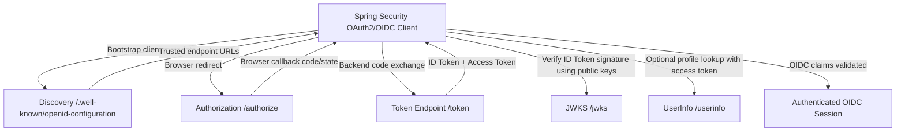

# 31.2. Mock discovery, JWKS, Token Endpoint và UserInfo Endpoint

Khi kiểm thử tích hợp **Spring Security OAuth 2.0/OIDC Client**, ta cần nhiều hơn một principal giả được đưa trực tiếp vào `SecurityContext`. Một lần OIDC Login thật sự phụ thuộc vào nhiều HTTP endpoints của OpenID Provider (OP): **Discovery**, **JWKS**, **Token Endpoint**, và đôi khi **UserInfo Endpoint**.

Ví dụ một ứng dụng Spring Boot chạy tại:

```text
https://portal.example.org
```

và đăng nhập qua:

```text
https://login.example.org
```

thường sử dụng:

```text
OIDC Discovery:
  https://login.example.org/.well-known/openid-configuration

Authorization Endpoint:
  https://login.example.org/authorize

Token Endpoint:
  https://login.example.org/token

JWKS:
  https://login.example.org/jwks

UserInfo:
  https://login.example.org/userinfo
```

Nếu bài kiểm thử chỉ dùng `oidcLogin()` để tạo `OidcUser`, Spring Security không cần tải Discovery, không xác thực chữ ký ID Token và không kiểm tra HTTP Token/UserInfo response của một OP. Loại test đó hữu ích cho controller, nhưng **không chứng minh protocol integration**.

Bài này hướng dẫn dựng một **OP giả lập trên HTTP localhost**, cho Spring Security tương tác qua các endpoint đúng vai trò, ký ID Token bằng RSA test key, và thực hiện authorization callback với `state`/`nonce` của chính authorization request đang chờ.

Trọng tâm là tạo môi trường kiểm thử **deterministic, offline và có thể chủ động tạo failure modes** mà không sử dụng tài khoản hoặc credentials của nhà cung cấp danh tính production.

---

## 1. Mục tiêu học tập

Sau bài này, bạn có thể:

1. Giải thích vì sao OIDC integration test cần nhiều endpoint chứ không chỉ Token Endpoint.
2. Dựng test OP với WireMock hoặc một HTTP mock server tương tự.
3. Trả Discovery metadata có `issuer` và các endpoints nhất quán.
4. Trả JWKS public key phù hợp với khóa dùng ký ID Token.
5. Trả OAuth2 token response chứa access token và ID Token được ký thật.
6. Trả UserInfo JSON với `sub` khớp ID Token.
7. Dùng `MockMvc` chạy authorization start rồi callback bằng cùng browser session.
8. Giữ nguyên `state`, `nonce`, và PKCE/redirect-uri binding khi mô phỏng callback.
9. Viết các trường hợp âm: sai issuer, chữ ký, `kid`, `aud`, `nonce`, `sub` hoặc Token Endpoint trả `invalid_grant`.
10. Biết ranh giới giữa HTTP stub, cryptographic validation, ứng dụng Servlet, và trình duyệt/SSO thực.
11. Thiết kế test không gọi OP production và không log tokens/client secrets.
12. Chẩn đoán lỗi khởi tạo context, JWKS caching, UserInfo retrieval và token response parsing.

## 2. Bức tranh tổng thể: các endpoint phục vụ chức năng khác nhau

Một OIDC Client không chỉ nhận một JSON “đăng nhập thành công”. Nó tham gia Authorization Code Flow và dùng metadata/token theo nhiều bước:



### 2.1. Mỗi endpoint cung cấp điều gì?

| Endpoint | Request | Response chính | Kiểm tra của RP |
|---|---|---|---|
| Discovery | GET metadata | issuer, endpoint URLs, supported algorithms | Metadata tương ứng trusted issuer |
| Authorization | Browser GET | Login/consent rồi redirect code/state | State và authorization transaction |
| Token | Backend POST | access token, ID Token, optional refresh token | Token response, client auth, protocol |
| JWKS | Backend GET | JWK Set chứa public signing keys | Chữ ký ID Token, `kid`, algorithm |
| UserInfo | Backend Bearer GET/POST tùy client | Claims của End-User | `sub` phải trùng ID Token `sub` |

**Authorization Endpoint** vẫn xuất hiện trong flow, nhưng trong nhiều MockMvc integration tests có thể **mô phỏng browser redirect/callback** thay vì xây cả login UI của OP. Khi mục tiêu kiểm thử là Spring Security Client, ta không nhất thiết phải thử giao diện đăng nhập của OP.

### 2.2. Các vai trò không được trộn

- Discovery xác định **địa chỉ và khả năng của OP**.
- JWKS cung cấp **khóa công khai** để RP xác minh tokens được ký.
- Token Endpoint phát **token response** cho authorization grant.
- UserInfo Endpoint cung cấp **profile claims** dựa trên access token.
- Callback tại RP kết thúc browser authorization transaction.
- Resource Server kiểm tra **access token** khi API được gọi; nó không phải UserInfo Endpoint mặc định.

## 3. Khi nào nên mock các endpoint này?

Các trường hợp rất phù hợp:

- Xác minh Spring Boot cấu hình `issuer-uri` và discovery metadata.
- Xác minh Spring Security chọn đúng Token Endpoint/JWKS.
- Kiểm tra ID Token `iss`, `aud`, `exp`, `nonce`, chữ ký.
- Kiểm tra logic `OidcUserService` khi UserInfo được gọi.
- Mô phỏng Token Endpoint lỗi `invalid_client`/`invalid_grant`.
- Mô phỏng key rotation hoặc `kid` không tồn tại.
- Kiểm tra userinfo `sub` mismatch bị từ chối.
- Xác minh application giữ nguyên session `state` qua callback.
- Kiểm tra mapping claims/authorities trong login integration.
- Kiểm tra failure handler không lộ lỗi nội bộ ra trình duyệt.

Không nên dùng test OP mock để tuyên bố:

- OP thật đã được cấu hình client/redirect/scopes chính xác.
- Reverse proxy production chuyển tiếp Host/Forwarded headers đúng.
- Browser thực tế xử lý SameSite/cookies/iframe đúng.
- MFA/consent UI ở OP production hoạt động.
- Access token của mock OP được Resource Server production chấp nhận.
- Network policies/TLS trust của production đã được xác minh.

Đó là các hợp đồng cần integration/E2E tests khác.

## 4. Chọn HTTP mock server: WireMock hay MockWebServer?

Hai lựa chọn phổ biến:

| Tiêu chí | WireMock | OkHttp MockWebServer |
|---|---|---|
| HTTP routing | Matching path, headers, form/body, scenarios | Queue responses hoặc custom dispatcher |
| Verify requests | Có request journal và verification DSL | RecordedRequest |
| Fault injection | Delays, disconnect, status/errors | Dispatcher/socket policies |
| JSON stubs | Tiện | Tự cấu hình response |
| Stateful flow | Có scenarios và custom transformers | Dispatcher / test state |
| Dễ mô phỏng nhiều endpoints | Rất phù hợp | Cũng phù hợp |
| Chi phí phụ thuộc | Thêm dependency riêng | Thêm dependency riêng |

Bài dùng **WireMock** vì endpoints được phân biệt rõ, có thể kiểm tra Token/UserInfo requests và cố ý đưa response lỗi.

Không bắt buộc dùng WireMock; công cụ tương đương có thể là MockWebServer, một test Authorization Server hoặc một OIDC test provider chạy trong container.

### 4.1. Khi nào cần test OP hoàn chỉnh?

Nếu cần chạy browser login form, consent, token signing, PKCE validation và logout theo chuẩn mà không tự viết các callbacks giả, một **test OP/AS có protocol implementation** thích hợp hơn HTTP stubs.

Mock endpoint rất tốt để xác minh **client behavior**, nhưng bản thân mock server có thể cố tình trả những responses AS thật sẽ không bao giờ tạo. Do đó phải phân biệt **negative protocol tests** với **conformance tests của Authorization Server**.

## 5. Dependencies minh họa

Với Gradle, Spring Boot Servlet:

```groovy
dependencies {
    implementation 'org.springframework.boot:spring-boot-starter-web'
    implementation 'org.springframework.boot:spring-boot-starter-security'
    implementation 'org.springframework.boot:spring-boot-starter-oauth2-client'

    testImplementation 'org.springframework.boot:spring-boot-starter-test'
    testImplementation 'org.springframework.security:spring-security-test'

    // Chọn phiên bản WireMock tương thích với JDK/Boot dự án.
    testImplementation 'org.wiremock:wiremock-standalone:<wiremock-version>'

    // Nimbus JOSE + JWT thường có sẵn qua OAuth2 JOSE dependencies;
    // khai báo trực tiếp nếu dependency graph dự án chưa cung cấp.
}
```

`<wiremock-version>` là placeholder cho phiên bản được quản lý cụ thể trong build; không phải một tọa độ Gradle hợp lệ để chạy nguyên văn.

Các thư viện/JDK được sử dụng trong ví dụ:

- JUnit 5.
- Spring Boot Test và MockMvc.
- WireMockServer.
- Nimbus JOSE + JWT: `RSAKeyGenerator`, `JWKSet`, `SignedJWT`, `RSASSASigner`.
- Spring Security OAuth2 Client.

### 5.1. Giữ khớp các phiên bản

Ví dụ API sau hướng tới Spring Boot 3.x / Spring Security 6.x cùng JUnit 5 và WireMock 3.x. Dự án đang dùng các phiên bản khác cần đối chiếu imports, constructors, tên property và test auto-configuration.

Không copy version từ ví dụ cũ rồi trộn với Spring Security mới mà chưa xem dependency management.

## 6. Cấu hình OIDC client dành cho test

Trong `src/test/resources/application-test.yml`:

```yaml
spring:
  security:
    oauth2:
      client:
        registration:
          company:
            provider: company
            client-id: portal-test-client
            client-secret: not-a-real-secret
            client-authentication-method: client_secret_basic
            authorization-grant-type: authorization_code
            redirect-uri: "{baseUrl}/login/oauth2/code/{registrationId}"
            scope:
              - openid
              - profile
              - email

        provider:
          company:
            # issuer-uri sẽ do @DynamicPropertySource cung cấp.
            # Không trỏ tới OP production trong test này.
```

Đây là cấu trúc minh họa test profile; nếu không muốn để key provider `company` rỗng trong YAML, có thể bỏ hẳn phần `provider` và thêm giá trị dynamic property khi chạy test.

Mục tiêu:

```text
registrationId = company
clientId = portal-test-client
grantType = authorization_code
scope = openid profile email
redirectUri = {baseUrl}/login/oauth2/code/company

provider issuer = http://127.0.0.1:<dynamic-port>
```

### 6.1. Tại sao issuer dùng localhost HTTP?

Trong test cô lập, WireMock thường mở HTTP trên loopback port. Dùng HTTP tại loopback là để đơn giản hóa test. **Production OIDC phải dùng HTTPS theo trust/security requirements** và không tự tắt TLS certificate validation.

### 6.2. Vì sao issuer được cấp động?

WireMock chọn port ngẫu nhiên để:

- Nhiều tests có thể chạy song song.
- Không đụng port dịch vụ khác trên CI.
- Không cần cố định `8099`.
- Tránh cấu hình sai khiến test gọi dịch vụ production.

Spring Boot property phải nhận đúng base URL **trước khi Spring khởi tạo `ClientRegistrationRepository`**.

## 7. Discovery cần được stub từ trước khi Spring context khởi tạo

Đây là một trong những lỗi integration test phổ biến nhất.

Spring Boot có thể tải OIDC Discovery **trong quá trình khởi tạo bean `ClientRegistration`** khi gặp `issuer-uri`. Nếu test chỉ tạo WireMock stubs trong `@BeforeEach`, thời điểm đó có thể **quá muộn**.

Timeline sai:

```text
Spring context startup
  -> reads issuer-uri
  -> attempts GET /.well-known/openid-configuration
  -> WireMock not ready / no stub
  -> context startup fails

@BeforeEach
  -> stub discovery (never reached)
```

Timeline đúng:

```text
Test class initializes mock OP
  -> mock server starts
  -> discovery stub installed
  -> JWKS stub installed

Spring context startup
  -> dynamic issuer URI resolved
  -> GET discovery -> mocked response

Test method
  -> configure token response for scenario
  -> execute MockMvc login flow
```

### 7.1. Không chỉ start server trước, phải stub discovery trước

Một mock server đã lắng nghe port nhưng trả 404 cho Discovery vẫn có thể khiến `ClientRegistrationRepository` initialization thất bại.

### 7.2. Khi dùng @DynamicPropertySource

`@DynamicPropertySource` cung cấp issuer tại thời điểm Spring Test đọc properties. Nhưng property supplier không tự dựng mock responses.

Một cách rõ ràng là khởi tạo mock server và các bootstrap stubs ở **static initializer**, trước khi context được tạo.

### 7.3. Dọn server và Spring context cache

Nếu dùng static mock server và dừng nó sau một test class, Spring Test có thể cache/reuse application context sang class khác; context cũ chứa issuer URL của server đã dừng.

Một số lựa chọn:

- `@DirtiesContext(classMode = AFTER_CLASS)` cho class cần teardown.
- Chia sẻ lifecycle mock server với context nếu dùng test infrastructure chung.
- Không reuse context có dynamic URL đã không còn hợp lệ.
- Dùng test class độc lập để tránh tình trạng URL port thay đổi mà bean cũ còn được cache.

## 8. Một test OP giả lập đơn giản với WireMockServer

Ví dụ phần setup:

```java
import com.github.tomakehurst.wiremock.WireMockServer;
import static com.github.tomakehurst.wiremock.client.WireMock.*;
import static com.github.tomakehurst.wiremock.core.WireMockConfiguration.options;

final class MockOidcProvider {

    private final WireMockServer server =
        new WireMockServer(options().dynamicPort());

    void start() {
        server.start();
        installDiscovery();
        installJwks();
        installUserInfo();
    }

    void stop() {
        server.stop();
    }

    String issuer() {
        return server.baseUrl();
    }

    private void installDiscovery() {
        String base = issuer();

        String json = """
            {
              "issuer": "%s",
              "authorization_endpoint": "%s/authorize",
              "token_endpoint": "%s/token",
              "jwks_uri": "%s/jwks",
              "userinfo_endpoint": "%s/userinfo",
              "response_types_supported": ["code"],
              "subject_types_supported": ["public"],
              "id_token_signing_alg_values_supported": ["RS256"],
              "token_endpoint_auth_methods_supported": ["client_secret_basic"]
            }
            """.formatted(base, base, base, base, base);

        server.stubFor(get(urlEqualTo("/.well-known/openid-configuration"))
            .willReturn(okJson(json)));
    }

    private void installJwks() {
        // Xem mục về tạo RSAKey/JWKSet; cần cấp public JWKS.
    }

    private void installUserInfo() {
        server.stubFor(get(urlEqualTo("/userinfo"))
            .willReturn(okJson("""
                {"sub":"employee-725","name":"Test User"}
                """)));
    }

    WireMockServer server() {
        return server;
    }
}
```

Đây là cấu trúc **minh họa lớp test OP**, chưa có code xây JWKS key và Token Endpoint. Ta sẽ bổ sung đầy đủ các phần này trong những mục kế tiếp.

### 8.1. Đúng đường dẫn Discovery

Với issuer gốc:

```text
http://127.0.0.1:54321
```

OIDC Discovery thường ở:

```text
http://127.0.0.1:54321/.well-known/openid-configuration
```

Nếu issuer có path, ví dụ:

```text
https://id.example/realms/alpha
```

Discovery có các cấu trúc đường dẫn khác nhau theo OIDC Discovery/RFC 8414 và helper implementation. Spring Security có thể thử nhiều vị trí. **Đừng giả định thêm `/.well-known/openid-configuration` vào root sẽ luôn đúng cho issuer có path.** Test phải stub theo lookup thực tế và chuẩn đang dùng.

### 8.2. Metadata issuer phải trùng trusted issuer

Nếu property là:

```text
issuer-uri = http://127.0.0.1:54321
```

nhưng Discovery trả:

```json
{"issuer":"http://127.0.0.1:54321/other"}
```

Spring có thể từ chối discovery/client registration vì issuer mismatch.

Không tự sửa thành “so hostname là đủ”: issuer là một định danh chính xác, path có thể phân biệt tenants/realms.

## 9. OP Discovery JSON cần những trường gì?

Một response cho OIDC Authorization Code Flow:

```http
GET /.well-known/openid-configuration HTTP/1.1
Host: 127.0.0.1:54321
```

```http
HTTP/1.1 200 OK
Content-Type: application/json

{
  "issuer": "http://127.0.0.1:54321",
  "authorization_endpoint": "http://127.0.0.1:54321/authorize",
  "token_endpoint": "http://127.0.0.1:54321/token",
  "userinfo_endpoint": "http://127.0.0.1:54321/userinfo",
  "jwks_uri": "http://127.0.0.1:54321/jwks",
  "response_types_supported": ["code"],
  "subject_types_supported": ["public"],
  "id_token_signing_alg_values_supported": ["RS256"],
  "token_endpoint_auth_methods_supported": ["client_secret_basic"],
  "scopes_supported": ["openid", "profile", "email"]
}
```

### 9.1. Các trường trọng tâm

| Metadata | Mục đích |
|---|---|
| `issuer` | Trusted issuer phải khớp configured issuer |
| `authorization_endpoint` | Browser authorization redirect |
| `token_endpoint` | Backend authorization code/refresh token exchange |
| `jwks_uri` | Tải khóa công khai để xác minh ID Token signature |
| `userinfo_endpoint` | Tải profile claims bằng access token |
| `response_types_supported` | Những response types OP hỗ trợ |
| `subject_types_supported` | Loại subject identifier OP hỗ trợ |
| `id_token_signing_alg_values_supported` | Các thuật toán ký ID Token |
| `token_endpoint_auth_methods_supported` | Client authentication methods |
| `scopes_supported` | Supported scopes, nếu quảng cáo |

Các trường trong ví dụ chỉ đủ cho một profile test nhất định. Đừng giả định mọi OP thực tế có cùng endpoint paths hay cùng supported algorithms.

### 9.2. Không mock metadata tùy tiện rồi bỏ validation

Nếu test cố tình trả issuer mismatch, expected behavior là client từ chối hoặc context initialization thất bại. **Không tắt issuer check** để “kết nối” test server.

### 9.3. Discovery và ClientRegistration

`spring.security.oauth2.client.provider.company.issuer-uri` khiến Spring dựa vào issuer để tạo provider metadata. Registration vẫn chứa client ID, authentication method, grant type, redirect URI và scopes.

Discovery không tự biết OAuth client secret của RP.

## 10. JWKS: chỉ công khai public key

Một ID Token thường là JWT được OP ký bằng private key. RP tải JWKS public keys để xác minh chữ ký.

```text
OP private RSA key
     |
     v
RS256 sign ID Token
     |
     v
Signed JWT with header kid="test-key-1"

OP public RSA key
     |
     v
GET /jwks -> {"keys":[... public JWK ...]}
     |
     v
Spring Security verifies JWT signature
```

### 10.1. JWKS JSON cơ bản

Một RSA JWK public key có dạng:

```json
{
  "keys": [
    {
      "kty": "RSA",
      "kid": "test-key-1",
      "use": "sig",
      "alg": "RS256",
      "n": "<base64url-modulus>",
      "e": "AQAB"
    }
  ]
}
```

Giá trị `n` là modulus RSA thật đã được mã hóa base64url; không phải chuỗi placeholder trong một test chạy thật.

**Không bao giờ gửi các private key fields như `d`, `p`, `q` trong JWKS response.**

### 10.2. kid và key selection

JWT header:

```json
{
  "alg": "RS256",
  "kid": "test-key-1"
}
```

JWKS phải chứa key phù hợp với `kid` và algorithm policy. Khi `kid` không match hoặc chữ ký sai, Spring phải từ chối ID Token, không chấp nhận “JWT có ba phần” như bằng chứng xác thực.

## 11. Tạo RSA test key bằng Nimbus JOSE + JWT

Một fixture:

```java
import com.nimbusds.jose.JOSEException;
import com.nimbusds.jose.jwk.RSAKey;
import com.nimbusds.jose.jwk.JWKSet;
import com.nimbusds.jose.jwk.gen.RSAKeyGenerator;

public final class OidcTestKeys {

    private OidcTestKeys() {}

    public static RSAKey createRsaKey() {
        try {
            return new RSAKeyGenerator(2048)
                .keyID("test-key-1")
                .generate();
        } catch (JOSEException ex) {
            throw new IllegalStateException(
                "Cannot generate OIDC test RSA key", ex);
        }
    }

    public static String publicJwksJson(RSAKey key) {
        return new JWKSet(key.toPublicJWK()).toString();
    }
}
```

Ví dụ:

```java
RSAKey signingKey = OidcTestKeys.createRsaKey();
String jwksJson = OidcTestKeys.publicJwksJson(signingKey);
```

### 11.1. Key public/private tương ứng

- `signingKey.toPrivateKey()` dùng để ký ID Token trong test OP.
- `signingKey.toPublicJWK()` được trả ở `GET /jwks`.
- RP không được nhận private key qua Discovery/JWKS.

### 11.2. Khóa tạo một lần theo fixture

Không tạo một RSA key mới khi trả mỗi `GET /jwks`. Nếu Token Endpoint ký bằng key A nhưng JWKS vừa trả key B, signature validation sẽ thất bại.

Có thể tạo key cố định theo test class hoặc mỗi test context, nhưng **token signer và JWKS stub phải dùng cùng một keypair**.

### 11.3. Không dùng production private key

Không lấy private key của OP production về CI. Test keys nên được generate/isolated trong môi trường kiểm thử.

## 12. Stub JWKS bằng WireMock

Sau khi tạo `RSAKey`:

```java
RSAKey signingKey = OidcTestKeys.createRsaKey();

wireMock.stubFor(get(urlEqualTo("/jwks"))
    .willReturn(okJson(
        OidcTestKeys.publicJwksJson(signingKey)
    )));
```

Khi Spring Security xử lý ID Token có `kid=test-key-1`, nó sẽ tìm key qua configured `jwks_uri`.

### 12.1. JWKS có thể được cache

Một lần JWKS response được tải có thể được cache bởi decoder/JWK source. Nếu test thay JWKS body sau khi context đã dùng key cũ, **không được mặc định request tiếp theo sẽ tải lại ngay**.

Để kiểm thử key rotation:

- Tạo context/decoder mới khi cần.
- Hoặc dùng cơ chế refresh được framework hỗ trợ.
- Cố tình dùng `kid` mới để kích hoạt refresh nếu implementation có semantics phù hợp.
- Kiểm tra HTTP requests bằng WireMock request journal, không chỉ suy đoán.

### 12.2. 404 và 500 từ JWKS

Nếu JWKS trả 404/500 hoặc JSON không hợp lệ, ID Token signature verification có thể thất bại. Không tắt signature verification vì test mock server chưa stub đúng path.

### 12.3. Unknown kid

Khi Token Endpoint ký bằng private key có `kid=key-2` mà JWKS chỉ chứa public key của `key-1`, RP phải từ chối token sau khi không thể tìm key hợp lệ.

## 13. Token Endpoint cần trả một OAuth2 token response hợp lệ

Sau browser authorization callback:

```text
GET /login/oauth2/code/company?code=CODE-1&state=STATE-1
```

Spring backend gọi Token Endpoint:

```http
POST /token HTTP/1.1
Host: 127.0.0.1:54321
Authorization: Basic <test-client-credentials>
Content-Type: application/x-www-form-urlencoded

grant_type=authorization_code&
code=CODE-1&
redirect_uri=http%3A%2F%2Flocalhost%2Flogin%2Foauth2%2Fcode%2Fcompany
```

Request có thể kèm `code_verifier` khi PKCE được sử dụng.

### 13.1. Response JSON cho OIDC Login

```json
{
  "access_token": "test-access-token",
  "token_type": "Bearer",
  "expires_in": 600,
  "scope": "openid profile email",
  "id_token": "<signed-compact-jwt>",
  "refresh_token": "test-refresh-token"
}
```

Trong OIDC Authorization Code Flow, ID Token là thành phần trọng tâm của response. `refresh_token` là optional, phụ thuộc grant/scope/provider policy.

### 13.2. Access token trong fixture có thể là opaque

```text
test-access-token
```

không cần là JWT nếu test chỉ dùng nó gọi mock UserInfo Endpoint. Resource Server production sẽ không chấp nhận chuỗi giả, và đó là chủ ý.

### 13.3. ID Token không thể là chuỗi bất kỳ khi muốn test signature validation

Sai nếu mục tiêu là OIDC integration:

```json
{"id_token": "fake-id-token"}
```

Spring phải parse/verify ID Token và sẽ từ chối chuỗi không phải signed JWT hợp lệ. Dùng signed JWT với RSA private key của mock OP.

## 14. Sinh ID Token đúng claims

Một ID Token được Spring Security chấp nhận phải đáp ứng yêu cầu OIDC và authorization transaction tương ứng.

Các claims cơ bản:

```json
{
  "iss": "http://127.0.0.1:54321",
  "sub": "employee-725",
  "aud": "portal-test-client",
  "iat": 1794800000,
  "exp": 1794800600,
  "nonce": "<nonce-from-authorization-request>"
}
```

### 14.1. iss

`iss` phải khớp issuer tin cậy từ Discovery/configuration.

### 14.2. aud

`aud` phải chứa **OAuth client ID**, ví dụ `portal-test-client`, không phải `registrationId=company`.

### 14.3. sub

`sub` định danh End-User trong issuer. Nếu UserInfo được gọi, `sub` trong response UserInfo phải khớp ID Token `sub`.

### 14.4. iat và exp

Dùng thời gian hợp lý, ví dụ `iat=now` và `exp=now+10 phút`. Đừng cố định một exp trong quá khứ rồi ngạc nhiên vì test luôn fail.

### 14.5. nonce

Nếu authorization request có `nonce`, ID Token phải có claim nonce đúng. Không tự hard-code `nonce=test` nếu Spring đã tạo nonce ngẫu nhiên khác cho transaction.

## 15. Hàm tạo signed ID Token bằng Nimbus

Ví dụ:

```java
import java.time.Instant;
import java.util.Date;
import java.util.List;

import com.nimbusds.jose.JOSEException;
import com.nimbusds.jose.JWSAlgorithm;
import com.nimbusds.jose.JWSHeader;
import com.nimbusds.jose.crypto.RSASSASigner;
import com.nimbusds.jose.jwk.RSAKey;
import com.nimbusds.jwt.JWTClaimsSet;
import com.nimbusds.jwt.SignedJWT;

public final class OidcTestTokenSigner {

    private OidcTestTokenSigner() {}

    public static String signedIdToken(
            RSAKey key,
            String issuer,
            String clientId,
            String subject,
            String nonce) {

        Instant now = Instant.now();

        JWTClaimsSet.Builder claims = new JWTClaimsSet.Builder()
            .issuer(issuer)
            .subject(subject)
            .audience(List.of(clientId))
            .issueTime(Date.from(now))
            .expirationTime(Date.from(now.plusSeconds(600)));

        if (nonce != null) {
            claims.claim("nonce", nonce);
        }

        SignedJWT jwt = new SignedJWT(
            new JWSHeader.Builder(JWSAlgorithm.RS256)
                .keyID(key.getKeyID())
                .build(),
            claims.build()
        );

        try {
            jwt.sign(new RSASSASigner(key.toPrivateKey()));
        } catch (JOSEException ex) {
            throw new IllegalStateException(
                "Cannot sign test ID Token", ex);
        }

        return jwt.serialize();
    }
}
```

Dùng:

```java
String idToken = OidcTestTokenSigner.signedIdToken(
    signingKey,
    wireMock.baseUrl(),
    "portal-test-client",
    "employee-725",
    nonceFromAuthorizationRequest
);
```

### 15.1. Đây là signed token, không phải trusted production token

Private key được tạo trong test. RP sẽ xác minh chữ ký bằng public JWKS của **test issuer**. Nó không có giá trị xác thực ở OP thật.

### 15.2. Vì sao không bỏ nonce?

Nếu Spring Security tạo `nonce` trong authorization request, bỏ nonce hoặc dùng nonce khác phải khiến token bị từ chối. Đây là validation quan trọng để chống token substitution/replay trong OIDC.

### 15.3. Vì sao không fake signature validation?

Nếu mục tiêu integration test là xác minh Spring đã dùng JWK đúng, **hãy để Spring xác minh chữ ký thật** của test token. Tắt validation sẽ khiến bài test không còn kiểm chứng đặc tính cốt lõi.

## 16. Stub Token Endpoint

Sau khi có signed ID Token:

```java
String tokenResponse = """
    {
      "access_token": "test-access-token",
      "token_type": "Bearer",
      "expires_in": 600,
      "scope": "openid profile email",
      "id_token": "%s"
    }
    """.formatted(idToken);

wireMock.stubFor(post(urlEqualTo("/token"))
    .withHeader("Authorization", matching("Basic .*"))
    .withRequestBody(containing("grant_type=authorization_code"))
    .willReturn(okJson(tokenResponse)));
```

### 16.1. Vì sao stub phải chấp nhận đúng HTTP method?

Token Endpoint dùng HTTP POST. Nếu stub nhầm GET, WireMock trả 404 hoặc unmatched request, Spring coi token exchange thất bại.

### 16.2. Kiểm tra client authentication

Với `client_secret_basic`:

```text
Authorization: Basic <base64-encoded-client-id-and-secret>
```

Test có thể assert header hiện diện và đúng phương thức. Không log/copy giá trị credential vào output công khai.

### 16.3. Đọc form body đúng

Body là `application/x-www-form-urlencoded`, không phải JSON trong Authorization Code Grant. Khi muốn assert code, redirect URI hay PKCE verifier, nên dùng request matching phù hợp sau encoding.

### 16.4. Không luôn luôn có code_verifier

Spring Security có những trường hợp bật PKCE theo public/confidential client policy và custom resolver. Không assert `code_verifier` luôn có nếu application configuration không bảo đảm PKCE được áp dụng.

Muốn test PKCE cụ thể, hãy cấu hình rõ policy/resolver và assert `code_challenge` trong authorization request, `code_verifier` trong token request, cùng quan hệ SHA-256 tương ứng.

## 17. UserInfo Endpoint trả claims, không trả OAuth token response

Sau ID Token validation, Spring Security có thể gọi UserInfo Endpoint bằng access token:

```http
GET /userinfo HTTP/1.1
Host: 127.0.0.1:54321
Authorization: Bearer test-access-token
```

Response:

```json
{
  "sub": "employee-725",
  "name": "Test User",
  "email": "employee-725@example.test",
  "email_verified": true
}
```

### 17.1. UserInfo sub phải khớp ID Token sub

Nếu ID Token nói:

```text
sub=employee-725
```

nhưng UserInfo trả:

```text
sub=employee-999
```

RP phải từ chối/mapping thất bại theo OIDC UserInfo subject verification. Không trộn claims của hai users.

### 17.2. UserInfo có phải luôn được gọi không?

**Không.** Việc OIDC client truy xuất UserInfo có thể phụ thuộc:

- OP metadata có `userinfo_endpoint` không.
- Requested/granted scopes và policy của `OidcUserService`.
- Custom `OidcUserService`/`OAuth2UserService` trong ứng dụng.
- Phiên bản/configuration Spring Security.
- Application có chọn dùng claims từ ID Token thay vì UserInfo không.

Vì thế một test cần **explicitly** chứng minh UserInfo được gọi trong cấu hình ấy, không mặc định một OIDC Login thành công luôn gọi UserInfo.

### 17.3. Stub UserInfo

```java
wireMock.stubFor(get(urlEqualTo("/userinfo"))
    .withHeader(
        "Authorization",
        equalTo("Bearer test-access-token"))
    .willReturn(okJson("""
        {
          "sub": "employee-725",
          "name": "Test User",
          "email": "employee-725@example.test",
          "email_verified": true
        }
        """)));
```

Nếu `OidcUserService` chỉ gọi UserInfo khi access token scopes tương ứng và endpoint available, test registration với `openid profile email` giúp tạo điều kiện cho retrieval trong nhiều cấu hình phổ biến.

### 17.4. Không nhầm UserInfo với Resource Server API

`/userinfo` là OIDC endpoint của OP, cung cấp user claims. Nó không phải Orders API của ứng dụng và không có nghĩa access token giả sẽ được chấp nhận bởi Resource Server production.

## 18. Luồng MockMvc: giữ state và nonce từ authorization request thật

Một test integration hữu ích phải để Spring tạo authorization request trước:

```text
GET /oauth2/authorization/company
     |
     v
Spring:
  - chọn ClientRegistration company
  - xây Authorization Request
  - tạo state
  - tạo nonce theo OIDC config
  - tạo PKCE challenge nếu áp dụng
  - lưu pending request trong session/repository
     |
     v
302 Location: http://127.0.0.1:<port>/authorize?...state=...&nonce=...
```

Test đọc **state** và **nonce** từ redirect này.

Sau đó test dựng signed ID Token với nonce đúng, stub Token Endpoint, rồi gọi Spring callback:

```text
GET /login/oauth2/code/company?code=test-code&state=<captured-state>
```

**Không tự viết state cố định** và mong Spring chấp nhận nếu chưa lưu authorization request gốc.

### 18.1. Tại sao giữ cùng session?

Spring Security mặc định có thể lưu `OAuth2AuthorizationRequest` trong Servlet session. Nếu callback chạy trên một `MockHttpSession` khác, app không tìm được transaction ban đầu.

### 18.2. Mock browser nhưng không cần đi qua OP login UI

Test nhận redirect URL trỏ `/authorize`, trích thông tin và tự tạo callback hợp lệ. Vì vậy không thật sự yêu cầu browser render login/consent của OP.

### 18.3. Đây là test gì?

Nó kiểm tra **client callback/token/JWKS/UserInfo integration** với mocked OP responses. Nó **không** chứng minh OP Authorization Endpoint đã xác thực user đúng hoặc AS đã ràng buộc code/PKCE đúng: trong mock Token Endpoint, chính test quyết định trả token.

## 19. Mẫu test end-to-end trong MockMvc ở tầng client

Một test class có thể dùng `@SpringBootTest`, `@AutoConfigureMockMvc`, WireMock trên random port và `@DynamicPropertySource`.

Để tránh lỗi Discovery khi context bootstrap, sử dụng server/stubs tạo trước context.

### 19.1. Khung khởi tạo test OP

```java
import java.time.Instant;

import org.junit.jupiter.api.AfterAll;
import org.junit.jupiter.api.Test;

import org.springframework.beans.factory.annotation.Autowired;
import org.springframework.boot.test.autoconfigure.web.servlet.AutoConfigureMockMvc;
import org.springframework.boot.test.context.SpringBootTest;
import org.springframework.test.annotation.DirtiesContext;
import org.springframework.test.context.DynamicPropertyRegistry;
import org.springframework.test.context.DynamicPropertySource;
import org.springframework.test.web.servlet.MockMvc;

import com.github.tomakehurst.wiremock.WireMockServer;
import com.nimbusds.jose.jwk.RSAKey;

import static com.github.tomakehurst.wiremock.client.WireMock.*;
import static com.github.tomakehurst.wiremock.core.WireMockConfiguration.options;

@SpringBootTest
@AutoConfigureMockMvc
@DirtiesContext(classMode = DirtiesContext.ClassMode.AFTER_CLASS)
class OidcEndpointsIntegrationTest {

    static final WireMockServer OP =
        new WireMockServer(options().dynamicPort());

    static final RSAKey TEST_KEY = OidcTestKeys.createRsaKey();

    static {
        OP.start();

        String issuer = OP.baseUrl();

        String discovery = """
            {
              "issuer":"%s",
              "authorization_endpoint":"%s/authorize",
              "token_endpoint":"%s/token",
              "jwks_uri":"%s/jwks",
              "userinfo_endpoint":"%s/userinfo",
              "response_types_supported":["code"],
              "subject_types_supported":["public"],
              "id_token_signing_alg_values_supported":["RS256"],
              "token_endpoint_auth_methods_supported":["client_secret_basic"]
            }
            """.formatted(
                issuer, issuer, issuer, issuer, issuer);

        OP.stubFor(get(urlEqualTo(
                "/.well-known/openid-configuration"))
            .willReturn(okJson(discovery)));

        OP.stubFor(get(urlEqualTo("/jwks"))
            .willReturn(okJson(
                OidcTestKeys.publicJwksJson(TEST_KEY)
            )));

        OP.stubFor(get(urlEqualTo("/userinfo"))
            .withHeader(
                "Authorization",
                equalTo("Bearer test-access-token"))
            .willReturn(okJson("""
                {
                  "sub":"employee-725",
                  "name":"Test User"
                }
                """)));
    }

    @DynamicPropertySource
    static void oidcProperties(DynamicPropertyRegistry registry) {
        registry.add(
            "spring.security.oauth2.client.provider.company.issuer-uri",
            OP::baseUrl
        );
    }

    @Autowired
    MockMvc mvc;

    @AfterAll
    static void stopOp() {
        OP.stop();
    }
}
```

Đây là **khung một test class**, chưa thêm method test. Nhờ static initializer, Discovery/JWKS đã có trước khi Spring context tìm metadata.

### 19.2. Nếu dùng @ActiveProfiles("test")

```java
@ActiveProfiles("test")
```

đảm bảo `application-test.yml` được load. Phần imports tương ứng là `org.springframework.test.context.ActiveProfiles`.

### 19.3. Cần một endpoint protected để assert login

Ví dụ app có:

```java
@RestController
public class SessionInfoController {

    @GetMapping("/session/whoami")
    public String whoami(
            @AuthenticationPrincipal OidcUser user) {
        return user.getSubject();
    }
}
```

Endpoint phải được bảo vệ bằng `authenticated()` trong SecurityFilterChain, và test có thể gọi sau callback để xác nhận local session.

## 20. Mẫu callback test: lấy state và nonce

Phần quan trọng nhất là đọc authorization redirect do Spring tạo:

```java
import java.net.URI;

import org.springframework.mock.web.MockHttpSession;
import org.springframework.test.web.servlet.MvcResult;
import org.springframework.web.util.UriComponentsBuilder;

import static org.springframework.test.web.servlet.request.MockMvcRequestBuilders.get;
import static org.springframework.test.web.servlet.result.MockMvcResultMatchers.status;
import static org.springframework.security.test.web.servlet.response.SecurityMockMvcResultMatchers.authenticated;

@Test
void loginWithSignedIdToken() throws Exception {

    MockHttpSession session = new MockHttpSession();

    MvcResult started = mvc.perform(
            get("/oauth2/authorization/company")
                .session(session))
        .andExpect(status().is3xxRedirection())
        .andReturn();

    String authorizationUrl =
        started.getResponse().getRedirectedUrl();

    var query = UriComponentsBuilder
        .fromUri(URI.create(authorizationUrl))
        .build()
        .getQueryParams();

    String state = query.getFirst("state");
    String nonce = query.getFirst("nonce");

    // Tạo ID Token ký bằng cùng private key dùng cho JWKS.
    String idToken = OidcTestTokenSigner.signedIdToken(
        TEST_KEY,
        OP.baseUrl(),
        "portal-test-client",
        "employee-725",
        nonce
    );

    String tokenJson = """
        {
          "access_token":"test-access-token",
          "token_type":"Bearer",
          "expires_in":600,
          "scope":"openid profile email",
          "id_token":"%s"
        }
        """.formatted(idToken);

    OP.stubFor(post(urlEqualTo("/token"))
        .withHeader("Authorization", matching("Basic .*"))
        .withRequestBody(containing(
            "grant_type=authorization_code"))
        .willReturn(okJson(tokenJson)));

    mvc.perform(get("/login/oauth2/code/company")
            .session(session)
            .param("code", "test-authorization-code")
            .param("state", state))
        .andExpect(status().is3xxRedirection())
        .andExpect(authenticated());
}
```

**Lưu ý về tính tự chứa của ví dụ:** đoạn code giả định class trên đã có static `OP`, `TEST_KEY`, `mvc` và `@DynamicPropertySource`; cần merge method vào class, không copy thành một class riêng không có fixtures.

### 20.1. Chú ý request/session persistence

`MockHttpSession` từ authorization start được dùng lại cho callback. Nếu security configuration custom session fixation strategy hoặc repository, cần kiểm tra session mà Spring trả về sau login và dùng session kết quả khi gọi protected endpoint.

### 20.2. Không ép "nonce" thành một hằng

Spring có thể tạo nonce ngẫu nhiên. Phải ký ID Token với **nonce của authorization request cụ thể**, không dùng hardcoded `"nonce-123"` cho mọi test.

### 20.3. Không dùng oauth2Login()/oidcLogin() trong cùng flow test này

Nếu thêm:

```java
.with(oidcLogin())
```

vào callback request, test có thể bypass Authentication path đang muốn kiểm chứng. Hãy để Spring xử lý code/token/JWKS/UserInfo.

### 20.4. Spring Boot configuration vẫn cần hợp lệ

Test class này giả định app đã có:

```java
http.oauth2Login(Customizer.withDefaults());
```

và `ClientRegistration` `company` với scopes `openid profile email`, client ID `portal-test-client`. Không phải chỉ copy test code là tự có OAuth2 Login filter chain.

## 21. Kiểm tra Token Endpoint thật sự được gọi

WireMock có thể verify request:

```java
OP.verify(postRequestedFor(urlEqualTo("/token"))
    .withRequestBody(
        containing("grant_type=authorization_code")));
```

Với Basic authentication:

```java
OP.verify(postRequestedFor(urlEqualTo("/token"))
    .withHeader(
        "Authorization",
        matching("Basic .*")));
```

### 21.1. Không log raw Basic credentials

Authorization header trong Token Endpoint request có thể chứa encoded client ID/secret. Base64 không phải encryption.

Test nên verify về presence/method, hoặc so sánh với giá trị fake nếu có lý do, **không in header ra test output**.

### 21.2. Kiểm tra redirect_uri

Token Endpoint request thường gửi `redirect_uri` khớp authorization transaction, tùy grant/profile. Trong test, có thể inspect form data của WireMock request và so với callback URL đã được Spring xây.

Đừng hard-code `https://portal.example.org` nếu MockMvc default request dùng `http://localhost`. Khi kiểm tra reverse proxy/trusted origin, cấu hình `secure`, server name và forwarded headers có chủ đích.

### 21.3. Kiểm tra code_verifier khi PKCE được bật

Nếu test configuration bật PKCE:

- Authorization redirect có `code_challenge`/`code_challenge_method=S256`.
- Token request có `code_verifier`.
- `BASE64URL(SHA256(verifier))` khớp challenge.

Không thay bằng chuỗi `"verifier"` tùy ý, không tắt PKCE vì mock endpoint chưa kiểm tra.

## 22. Kiểm tra JWKS thực sự được dùng

Nếu OIDC ID Token được ký bằng RS256 và không có key cache trước đó, Spring thường cần tải JWKS để xác minh.

WireMock verification:

```java
OP.verify(getRequestedFor(urlEqualTo("/jwks")));
```

Nhưng cần lưu ý:

- JWK cache có thể được dùng lại giữa nhiều requests/tests.
- Một test login lần thứ hai có thể không GET JWKS lần nữa.
- Cache policy tùy decoder, Spring Security/Nimbus version và `kid`.

Vì vậy không nên assert số lượng JWKS requests chính xác là `1` trong mọi test class trừ khi đã kiểm soát cache lifecycle.

### 22.1. Positive signature validation

Một signed ID Token bằng private key A + JWKS public key A nên được chấp nhận khi claims đúng.

### 22.2. Negative signature validation

Signed ID Token bằng private key B nhưng JWKS chỉ có public key A phải bị từ chối.

### 22.3. Không chỉ đọc payload rồi tin claims

JWT payload có thể được base64url-decode dễ dàng. Đọc `iss`/`sub` từ payload mà không verify signature **không phải OIDC authentication**.

## 23. Kiểm tra UserInfo thực sự được gọi

Nếu userinfo integration được cấu hình để truy xuất thông tin, có thể verify:

```java
OP.verify(getRequestedFor(urlEqualTo("/userinfo"))
    .withHeader(
        "Authorization",
        equalTo("Bearer test-access-token")));
```

### 23.1. Nếu verify không thấy request

Cần xem:

- Có `userinfo_endpoint` trong Discovery không?
- Access token scopes có `profile`/`email` theo UserInfo accessibility policy không?
- Spring `OidcUserService` có bị thay bằng custom user service không?
- Có custom `UserInfoEndpoint` configuration không?
- Có logic dùng chỉ ID Token claims không?
- Request thực tế có dùng GET hay một method khác theo client integration không?

**Đừng sửa bằng cách tự gọi `/userinfo` trong test rồi tuyên bố Spring đã gọi.** Test phải verify request xuất phát từ client integration đang kiểm tra.

### 23.2. Không cần UserInfo cho mọi OIDC login

OIDC Core không yêu cầu RP luôn tải UserInfo khi đã có ID Token hợp lệ. Nếu không cần profile claims, bỏ UserInfo retrieval có thể là hành vi đúng.

### 23.3. UserInfo sub equality

Một yêu cầu bảo mật: khi lấy UserInfo, response `sub` phải bằng `sub` trong ID Token. Test nên có negative case trả `sub` khác.

## 24. Test API sau login: xác minh local session thật

Sau callback thành công, có thể gọi một protected endpoint:

```java
MvcResult callbackResult = mvc.perform(
        get("/login/oauth2/code/company")
            .session(session)
            .param("code", "test-authorization-code")
            .param("state", state))
    .andExpect(status().is3xxRedirection())
    .andExpect(authenticated())
    .andReturn();

var authenticatedSession =
    callbackResult.getRequest().getSession(false);

mvc.perform(get("/session/whoami")
        .session((MockHttpSession) authenticatedSession))
    .andExpect(status().isOk())
    .andExpect(content().string("employee-725"));
```

Cần hiểu đây là snippet thay thế đoạn callback trước đó, **không gửi cùng authorization code tới Token Endpoint lần thứ hai**. Authorization code phải được dùng một lần; trong mock, việc stub trả success lặp lại không chứng minh AS thật cho phép.

### 24.1. MockMvc không chạy browser cookie jar thật

`MockHttpSession` giúp mô phỏng session persistence, nhưng không kiểm tra các thuộc tính cookie browser thực như SameSite, Secure, domain, cross-site redirects.

### 24.2. Login success không chứng minh downstream API access

`/session/whoami` xác minh RP đã tạo authenticated session. Orders API cần kiểm tra token/audience/permission trong bài kiểm thử riêng.

## 25. Test Token Endpoint trả invalid_client

Một failure scenario:

```java
OP.stubFor(post(urlEqualTo("/token"))
    .willReturn(aResponse()
        .withStatus(401)
        .withHeader("Content-Type", "application/json")
        .withHeader("WWW-Authenticate", "Basic realm=\\"oauth2\\"")
        .withBody("""
            {"error":"invalid_client"}
            """)));
```

Kỳ vọng:

- Callback không tạo authenticated session.
- Failure handler đưa user tới thông báo an toàn.
- Không lặp token request vô hạn.
- Không log client secret hoặc Basic Authorization header.
- Metrics/logs có thể phân loại phase=TOKEN_EXCHANGE, error=invalid_client.

### 25.1. Không nhầm invalid_client với sai user password

`invalid_client` thuộc OAuth client authentication. Nó có thể do client ID/secret sai, client auth method mismatch hoặc rotation.

### 25.2. Test nên chắc chắn stub được chọn

WireMock chọn mapping theo độ phù hợp/priority. Nếu positive token stub còn tồn tại và cùng matching rule, response có thể không như mong đợi. Dùng explicit `priority`, per-test server state, hoặc reset/reinstall scenario stubs một cách có kiểm soát.

### 25.3. Discovery phải còn khi reset

Nếu test gọi `resetAll()` rồi chạy request khiến context/decoder cần JWKS/metadata, toàn bộ bootstrap stubs có thể biến mất. Thay bằng `resetRequests()` khi chỉ muốn xóa request journal, hoặc dựng lại đúng các stubs.

## 26. Test Token Endpoint trả invalid_grant

`invalid_grant` có thể xảy ra khi authorization code sai/hết hạn, đã sử dụng, không khớp PKCE/redirect URI hoặc không thuộc client này.

```java
OP.stubFor(post(urlEqualTo("/token"))
    .willReturn(aResponse()
        .withStatus(400)
        .withHeader("Content-Type", "application/json")
        .withBody("""
            {
              "error":"invalid_grant",
              "error_description":"Code expired"
            }
            """)));
```

Kỳ vọng Spring nhận OAuth2 token error, login không thành công. Không xử lý bằng cách tự tạo Authentication hoặc bỏ `state`/PKCE checks.

### 26.1. Không retry cùng authorization code

Code là credential một lần. Nếu Token Endpoint đã xử lý thành công nhưng response bị mất do timeout, retry code có thể trả `invalid_grant`. Test client phải phản ánh recovery policy hợp lý, thường bắt đầu authorization flow mới.

### 26.2. Mock AS có thể trả kết quả không thực tế

Nếu mock Token Endpoint luôn phát token cho mọi `code`, nó không thật sự kiểm tra uniqueness, expiry hoặc PKCE. Nếu muốn kiểm thử **AS behavior**, dùng test Authorization Server hoặc làm stateful stub với policy rõ.

## 27. Test UserInfo trả sub khác ID Token

Giả sử signed ID Token:

```json
{"sub":"employee-725"}
```

UserInfo mock trả:

```json
{
  "sub":"employee-999",
  "name":"Wrong User"
}
```

Stub:

```java
OP.stubFor(get(urlEqualTo("/userinfo"))
    .withHeader(
        "Authorization",
        equalTo("Bearer test-access-token"))
    .willReturn(okJson("""
        {
          "sub":"employee-999",
          "name":"Wrong User"
        }
        """)));
```

Kỳ vọng khi ứng dụng gọi UserInfo: OIDC authentication phải bị từ chối hoặc user service ném validation error theo đúng Spring version.

### 27.1. Vì sao đây là trường hợp quan trọng?

Nếu RP gộp ID Token identity của user A với UserInfo claims của user B mà không kiểm tra `sub`, có thể bị identity confusion và cấp quyền không đúng.

### 27.2. Không chỉ assert HTTP 500

Failure handler có thể trả redirect/login error hoặc status khác. Test nên assert **không có authenticated session** và không có business operation được thực hiện với mixed identity, thay vì chỉ assert một HTTP code.

### 27.3. Nếu UserInfo không được gọi?

Negative test này sẽ không chạm tới code path. Cần cấu hình `OidcUserService` rõ để phải fetch UserInfo theo policy, rồi verify WireMock có nhận request.

## 28. Test Discovery issuer mismatch

Một lỗi cấu hình sớm:

```text
Configured issuer:
  http://127.0.0.1:54321

Discovery JSON:
  "issuer": "http://127.0.0.1:54321/other"
```

Spring có thể từ chối tạo `ClientRegistration`. Đây thường là **context bootstrap failure**, không phải controller test failure sau khi context đã chạy.

### 28.1. Tách failure test context

Không nên reset global mock OP của một test class có Spring context đã khởi tạo để mong discovery tự chạy lại.

Có thể tạo riêng một test class/context cấu hình sai issuer, hoặc test `ClientRegistrations.fromIssuerLocation(...)` trực tiếp với mock server setup.

### 28.2. Không so khớp host đơn lẻ

Hai issuers cùng hostname nhưng khác path có thể là hai trust domains khác nhau. Giữ exact issuer matching theo OIDC metadata.

### 28.3. Không tự động fallback tới issuer khác

Nếu configured issuer không khớp metadata, đừng tự chọn issuer từ JSON một cách vô điều kiện. Trusted issuer đến từ registration/admin-controlled policy.

## 29. Test JWKS kid không khớp

Kịch bản:

```text
ID Token header:
  alg=RS256
  kid=unknown-key

JWKS:
  keys=[public-key-with-kid=test-key-1]
```

RP không có khóa phù hợp, signature verification phải fail.

### 29.1. Test độc lập với cache

Để tránh test không như mong đợi do cached keys, có thể dùng context/decoder mới hoặc quản lý JWK source cache theo framework API.

### 29.2. Không tin unknown kid từ network tùy ý

Một JWT header có `kid` hoặc `jku` không được quyền chuyển RP sang JWKS URI do token chưa xác minh chỉ định. JWKS URI phải đến từ trusted issuer metadata/configuration.

### 29.3. Chữ ký sai nhưng kid đúng

Đây là negative case khác: key ID trùng nhưng private key thực sự ký không khớp public key trong JWKS. RP phải từ chối.

## 30. Test ID Token có aud sai

Registration:

```text
clientId=portal-test-client
```

Signed ID Token:

```json
{
  "iss":"http://127.0.0.1:54321",
  "sub":"employee-725",
  "aud":"another-client"
}
```

Dù chữ ký hợp lệ, `aud` không trỏ tới OAuth client đã khởi tạo authorization request. RP phải reject.

### 30.1. Vì sao signature hợp lệ chưa đủ?

OP có thể phát token hợp lệ cho **client khác**. Một RP không được nhận token chỉ vì OP ký đúng.

### 30.2. azp khi nhiều audiences

Khi ID Token có multiple audiences, OIDC có quy tắc kiểm tra `azp` trong những trường hợp liên quan. Test cần phản ánh client ID thật và behavior của Spring ID Token validator.

### 30.3. Không dùng registrationId làm aud

`aud` thường dùng OAuth `client_id`, không phải local registration ID.

## 31. Test ID Token có nonce sai

Authorization start sinh:

```text
nonce = N1
```

Mock ID Token trả:

```json
{"nonce":"N2"}
```

với `N2 != N1`. RP phải reject token trong flow yêu cầu nonce.

### 31.1. Không tắt nonce validation để test chạy

Nếu mock token bị từ chối, sửa signer fixture để dùng nonce từ authorization URL, không bỏ security check.

### 31.2. Nonce khác state

`state` được so trên browser callback và pending authorization request; `nonce` kiểm tra trong ID Token. Cả hai bảo vệ những phần khác nhau của OIDC login.

### 31.3. Test token thiếu nonce

Khi authorization request có nonce, ID Token thiếu nonce là một negative case. Nếu flow/config không dùng nonce, expected behavior có thể khác; cần biết contract thực.

## 32. Test expired ID Token và clock skew

Sinh JWT:

```java
Instant now = Instant.now();

JWTClaimsSet expiredClaims = new JWTClaimsSet.Builder()
    .issuer(OP.baseUrl())
    .subject("employee-725")
    .audience("portal-test-client")
    .issueTime(Date.from(now.minusSeconds(3600)))
    .expirationTime(Date.from(now.minusSeconds(60)))
    .build();
```

Khi được ký với test key, chữ ký vẫn hợp lệ nhưng time validation phải từ chối token hết hạn (ngoài leeway nếu có).

### 32.1. Dùng thời điểm có khoảng cách rõ

Đừng đặt `exp=now-1ms` hoặc `exp=now+1ms` rồi gặp flakiness do lệch đồng hồ/leeway.

### 32.2. Có thể kiểm thử nbf/iat

Tùy OIDC profile và validation library, `iat` quá xa trong tương lai hoặc `nbf` chưa hiệu lực có thể dẫn đến failure.

### 32.3. Không thay đổi toàn server clock cho một test

Nếu cần kiểm thử clock-skew behavior chi tiết, chọn validator/Clock injection ở tầng phù hợp hoặc tạo claims cách xa ranh giới thời gian.

## 33. Test UserInfo 401 hoặc 500

UserInfo Endpoint có thể trả:

```http
HTTP/1.1 401 Unauthorized
WWW-Authenticate: Bearer error="invalid_token"
```

hoặc:

```http
HTTP/1.1 500 Internal Server Error
Content-Type: application/json

{"error":"server_error"}
```

### 33.1. Trường hợp UserInfo 401

Có thể do access token sai, hết hạn, thiếu audience hoặc bị revoke. Spring user service sẽ có error handling tương ứng. Không mặc định cứ thất bại UserInfo thì được quyền bỏ qua subject verification.

### 33.2. Trường hợp UserInfo 500

Có thể retry có giới hạn theo client/service policy hoặc báo login failure; behavior tùy integration. Không tự dùng partial UserInfo chưa xác minh làm authenticated profile.

### 33.3. Test để phân biệt Token Endpoint và UserInfo errors

Nếu Token Endpoint trả 200 nhưng UserInfo trả 401, phase lỗi là UserInfo fetch. Không ghi log như thể client secret sai ở Token Endpoint.

## 34. Test discovery không khả dụng khi bootstrap

Nếu OP mock chưa start hoặc trả:

```http
HTTP/1.1 503 Service Unavailable
```

cho Discovery, ứng dụng cấu hình `issuer-uri` có thể không khởi tạo `ClientRegistration`.

### 34.1. Đây là bootstrap error

Nó xảy ra **trước khi test gọi `MockMvc.perform(...)`**. Cần dựng stubs trước Spring context.

### 34.2. Có thể cấu hình endpoints tĩnh để không discovery?

Spring OAuth2 Client cho phép khai báo provider endpoints/JWK URI theo cấu hình thay vì dựa hoàn toàn vào discovery ở một số setup. Đây là hướng test khác, hữu ích khi chỉ muốn test token/JWK behavior. Nhưng nó **không kiểm thử discovery integration**.

### 34.3. Đừng trộn hai loại test

- **Discovery test** phải khiến client thật sự đọc trusted metadata.
- **Token/JWK test với static endpoints** có thể bỏ discovery để test hẹp hơn.

Đặt mục tiêu rõ, không gọi một test static endpoint là discovery test.

## 35. Test metadata endpoints trỏ sai origin

Mock Discovery có thể trả:

```json
{
  "issuer":"http://127.0.0.1:54321",
  "token_endpoint":"https://untrusted.example/token",
  "jwks_uri":"https://untrusted.example/jwks"
}
```

Đây là kịch bản threat-model/test configuration control. OIDC discovery metadata được tin **chỉ sau khi** issuer và network trust rules được thiết lập.

### 35.1. Không cho user nhập issuer URL tùy ý

Nếu ứng dụng multi-tenant cho người dùng tùy ý đặt `issuer-uri` trong request, discovery có thể bị lợi dụng thành SSRF hoặc đưa client credentials tới endpoint do attacker kiểm soát.

### 35.2. Test metadata trust boundary

Cần xác định policy của hệ thống:

- Issuer được onboarding/admin approve?
- HTTPS certificate được xác minh?
- Allowed hosts/network destinations?
- Token Endpoint/JWKS origins có phù hợp issuer/provider policy?
- Có chặn metadata trả private network URLs nếu không được cho phép?

Test có thể verify client **không** gọi unauthorized endpoints. Không dựa vào việc tiêu chuẩn OIDC mặc định luôn bắt buộc mọi endpoint cùng hostname với issuer; providers thực tế có phân tách endpoints, và trust policy cần được thiết kế rõ.

### 35.3. Không follow redirects tùy ý trong test mà quên SSRF

HTTP mock server có thể trả 302 tới `localhost`, metadata IP hoặc private network. Nếu test hướng tới SSRF defenses, hãy kiểm tra client HTTP redirect behavior theo trusted policy, không tự động cho phép mọi redirect chains.

## 36. UserInfo claims mapping và custom OidcUserService

Một application có thể dùng `OidcUserService` để map UserInfo claims sang authorities.

Ví dụ:

```json
{
  "sub":"employee-725",
  "preferred_username":"employee725",
  "email":"employee725@example.test",
  "department":"engineering",
  "groups":["readers"]
}
```

Một custom user service có thể map `groups` sang application authorities, nhưng chỉ khi provider contract đáng tin.

### 36.1. Không coi claims từ UserInfo là domain authorization mặc định

Một claim `groups=["admin"]` trong mock response không chứng minh membership hoặc role cho tenant production. Mapping phải dựa trusted issuer and provider-specific policy.

### 36.2. Test khi claim bị thiếu

Mô phỏng:

```json
{"sub":"employee-725"}
```

Ứng dụng có thể dùng defaults, deny access hoặc require provisioning; cần rõ expected behavior.

### 36.3. Test claim type sai

Ví dụ `groups` là string thay vì array, hoặc `email_verified` là string `"true"` thay vì boolean. Mapper phải xử lý safely, không ném NullPointerException không kiểm soát.

### 36.4. Không trộn subject

Khi UserInfo `sub` khác ID Token `sub`, phải từ chối merge claims, không “sửa” bằng cách lấy `sub` của UserInfo ghi đè Identity ban đầu.

## 37. PKCE trong integration tests

Authorization Code Flow có thể dùng Proof Key for Code Exchange (PKCE):

```text
code_verifier: random secret held by client
code_challenge: BASE64URL(SHA256(code_verifier))
code_challenge_method: S256
```

Authorization redirect:

```text
/authorize?code_challenge=...&code_challenge_method=S256
```

Token request:

```text
POST /token
  code_verifier=...
```

### 37.1. Với confidential client, PKCE có thể phụ thuộc config

Một số Spring Security behaviors mặc định PKCE cho public clients hoặc khi policy/extension yêu cầu. Không viết test assert code verifier cho mọi client mà không cấu hình điều kiện sinh PKCE.

### 37.2. Stub không tự xác minh PKCE

Một WireMock stub trả 200 cho mọi `POST /token` sẽ không từ chối verifier sai như AS thật. Để test client gửi đúng PKCE, verify request; để test **AS PKCE enforcement**, dùng test AS hoặc stateful custom token endpoint.

### 37.3. Không bỏ state khi tập trung PKCE

`state` và PKCE có trách nhiệm khác nhau. Test callback phải giữ authorization transaction state và verifier correlation.

## 38. Reverse proxy, redirect URI và MockMvc

Ứng dụng production có thể public:

```text
https://portal.example.org
```

nhưng MockMvc mặc định có request:

```text
http://localhost
```

Vì vậy authorization redirect URI được Spring xây trong test có thể là:

```text
http://localhost/login/oauth2/code/company
```

Không hard-code kỳ vọng production HTTPS nếu test chưa cấu hình request server name/scheme hoặc public base URL.

### 38.1. Cách xác định redirect URI trong test

Lấy từ authorization URL:

```java
String sentRedirectUri = query.getFirst("redirect_uri");
```

So với expected callback theo test setup.

### 38.2. Kiểm thử forwarded headers riêng

Nếu muốn test `Forwarded`, `X-Forwarded-Host` hoặc `server.forward-headers-strategy`, cần một kịch bản riêng với trusted proxy assumptions. Không sử dụng untrusted forwarded host để tự thay callback mà không có allowlist.

### 38.3. Test OP có thể xác nhận redirect URI matching

HTTP stub Token Endpoint có thể ghi `redirect_uri` trong form request và so nó với URI đã gửi trên authorization request. Nhưng nếu muốn OP **từ chối** mismatch, phải viết stateful stub hoặc test AS biết bind code/redirect URI.

## 39. Multiple issuers/tenants: mỗi issuer phải có endpoint và key riêng

Giả sử:

```text
tenant alpha:
  issuer = http://127.0.0.1:50001
  clientId = alpha-test-client
  JWKS key = alpha-key

tenant beta:
  issuer = http://127.0.0.1:50002
  clientId = beta-test-client
  JWKS key = beta-key
```

Test không được chấp nhận ID Token do Alpha ký trong login transaction của Beta.

### 39.1. Các negative scenarios

- Beta callback nhưng ID Token `iss=alpha`.
- Beta `aud` sai client ID.
- Beta `kid` trùng tên Alpha nhưng public key khác.
- Dynamic client registration thay issuer khi callback.
- UserInfo response từ sai mock issuer.
- Authorized client token cache không phân biệt registration.

### 39.2. Đừng chỉ so hostname

Trong production, hai issuers có thể cùng host nhưng khác realm path. Exact `iss` validation vẫn quan trọng.

### 39.3. Test external identity mapping

Một `sub` giống nhau ở Alpha và Beta không tự là cùng user. Domain authorization phải dùng trusted external identity mapping như `(iss,sub)` rồi xác minh tenant membership.

## 40. Mock refresh token behavior

Mặc dù bài tập trung OIDC Login, cùng Token Endpoint còn phục vụ `refresh_token`.

Request:

```http
POST /token HTTP/1.1
Content-Type: application/x-www-form-urlencoded

grant_type=refresh_token&
refresh_token=test-refresh-token
```

Stub:

```java
OP.stubFor(post(urlEqualTo("/token"))
    .withRequestBody(containing(
        "grant_type=refresh_token"))
    .willReturn(okJson("""
        {
          "access_token":"test-access-token-2",
          "token_type":"Bearer",
          "expires_in":600,
          "refresh_token":"test-refresh-token-2"
        }
        """)));
```

### 40.1. Không trộn token stubs theo grant type

Nếu positive authorization_code stub match mọi `POST /token` trước refresh stub, test có thể trả ID Token response cho refresh request theo cách không mong muốn. Dùng `withRequestBody`/priority để phân biệt grant types.

### 40.2. Rotation và invalid_grant

Có thể dựng scenario:

```text
RT-1 -> AT-2 + RT-2
RT-1 reused -> invalid_grant
RT-2 -> AT-3 + RT-3
```

Với WireMock scenarios hoặc custom dispatcher, test manager và persistence để kiểm tra single-flight/CAS, không retry RT-1 sau rotate.

### 40.3. Không kết luận từ một stub happy path

Một static response luôn trả RT-2 không kiểm tra AS rotation contract, concurrency hoặc refresh family revocation.

## 41. HTTP fault injection

Một mock OP có thể mô phỏng:

- Discovery 404/503.
- Token Endpoint 400 `invalid_grant`.
- Token Endpoint 401 `invalid_client`.
- Token Endpoint 429 rate-limited.
- Token Endpoint 500.
- Connection reset/timeout.
- JWKS invalid JSON.
- JWKS không có matching `kid`.
- UserInfo 401/403/500.
- UserInfo JSON thiếu `sub`.
- UserInfo `sub` mismatch.

Ví dụ delay:

```java
OP.stubFor(post(urlEqualTo("/token"))
    .willReturn(aResponse()
        .withStatus(200)
        .withFixedDelay(2500)
        .withHeader("Content-Type", "application/json")
        .withBody(tokenJson)));
```

### 41.1. Timeout phải được test với client timeout settings

Nếu timeout của app là 10 giây, delay 2,5 giây không chứng minh timeout. Cần đặt timeouts ở test config, delay/fault đủ để kích hoạt đúng phase.

### 41.2. Không retry authorization code vô hạn

Một token request timeout có thể là kết quả ambiguous: AS đã xử lý grant nhưng response mất. Test cần xác minh app không tự reuse code không kiểm soát.

### 41.3. Phân biệt transient và protocol errors

`invalid_client`, `invalid_grant` không nên được retry như lỗi network transient. Một số 5xx/429 có thể retry có giới hạn, tùy grant idempotency và policy.

## 42. Request verification: đừng chỉ assert 302

Một test callback có status 302 có thể là:

```text
302 -> /app            (success)
302 -> /login?error    (failure)
302 -> /oauth2/authorization/... (retry)
```

Nếu chỉ assert `is3xxRedirection()`, cả success lẫn failure có thể pass.

### 42.1. Assert authenticated session

Dùng `SecurityMockMvcResultMatchers.authenticated()` nếu phù hợp security filter setup.

### 42.2. Assert location hoặc protected request

Có thể xác nhận redirect target theo `AuthenticationSuccessHandler` của app, hoặc gọi `/session/whoami` sau callback bằng session cuối cùng.

### 42.3. Verify Token Endpoint request

`OP.verify(postRequestedFor(urlEqualTo("/token")))` giúp xác nhận code exchange đã xảy ra.

### 42.4. Verify UserInfo có điều kiện

Nếu app policy yêu cầu UserInfo retrieval, verify `/userinfo` được gọi; nếu không, không đặt assertion này tùy tiện.

### 42.5. Assert token không lộ

Không đưa access token, refresh token, ID Token hoặc client secret vào HTTP response/UI chỉ để assert. Dùng mock server verification hoặc fake service callbacks.

## 43. Tổ chức test để tránh state leakage

WireMock có thể có stubs và request journal tồn tại qua nhiều test methods.

Một tổ chức rõ:

- Bootstrap discovery/JWKS stubs tạo một lần trước context.
- Mỗi test dùng authorization code/state/session mới.
- Token stub có condition/specific priority rõ.
- Test xóa request journal nếu cần đếm requests.
- Không dùng `resetAll()` mà quên dựng lại Discovery/JWKS.
- Tách failure test có thay issuer/JWKS/key cache vào context độc lập.
- Test data/user IDs tách biệt để tránh nhầm identity.
- Không reuse stale authorization code.
- Giữ test profile hoàn toàn local/offline.

### 43.1. Khi chạy parallel tests

Nếu nhiều test methods dùng cùng mock server và mỗi method cùng sửa `POST /token` stub, chúng có thể race. Giải pháp:

- Chạy sequential trong class này.
- Tạo OP server riêng per test context.
- Match request theo code/test correlation.
- Dùng dispatcher/test fixture state thread-safe.
- Tránh server global được share không kiểm soát giữa suites.

### 43.2. Không dựa thứ tự test methods

Một test “JWKS rotation” không nên dựa vào test “login success” đã chạy trước để cache key. Tạo setup explicit.

### 43.3. Khi context cache giữ OP URL cũ

Nếu static WireMockServer dừng sau class nhưng Spring context còn được cache, class khác có thể dùng port đã chết. Dùng `@DirtiesContext` hoặc quản lý server lifecycle theo test context.

## 44. Các anti-pattern thường gặp

### 44.1. Stub Discovery trong @BeforeEach

Spring đã tải metadata khi startup; test có thể fail trước khi stub.

### 44.2. JWKS chứa private key

Không bao giờ expose `d`/`p`/`q` trong HTTP JWKS response.

### 44.3. Token Endpoint trả id_token là chuỗi bất kỳ

Không kiểm tra được OIDC signed token validation.

### 44.4. Ký token bằng key A nhưng JWKS trả key B

Happy path thất bại do mismatch; có thể là negative case nhưng phải chủ động.

### 44.5. Dùng issuer khác configured issuer

Spring cần trusted issuer binding.

### 44.6. Hard-code nonce mà không lấy từ authorization request

Spring có thể từ chối token vì nonce mismatch.

### 44.7. Dùng callback state tự bịa

Không có pending authorization request tương ứng.

### 44.8. Gọi UserInfo trực tiếp trong test rồi coi Spring đã gọi

Phải verify request từ OIDC client integration.

### 44.9. Quên kiểm tra UserInfo sub

Có nguy cơ trộn profile giữa users.

### 44.10. Assert chỉ redirect status

302 có thể là login failure chứ không phải success.

### 44.11. Dùng oidcLogin() thay full callback test

Bypass discovery/token/JWKS/nonce verification.

### 44.12. Reset WireMock và làm mất bootstrap stubs

Context/test có thể fail bất ngờ.

### 44.13. Dùng issuer-uri trỏ production trong test

Có thể gửi test credentials/requests ngoài ý muốn.

### 44.14. Không phân biệt token grant types

Refresh stub và code stub có thể match sai.

### 44.15. Log raw code/state/token/client secret

Lộ credentials và correlation secrets.

### 44.16. Tắt JWT signature validation để test pass

Làm mất giá trị bảo mật chính của OIDC integration test.

### 44.17. Cho user tự cấu hình issuer URL không kiểm soát

Nguy cơ SSRF và trust confusion.

### 44.18. Xem WireMock như một Authorization Server conformance implementation

Stub chỉ trả những gì test định nghĩa; AS thật có thêm protocol invariants.

## 45. Ma trận kiểm thử đề xuất

| Kịch bản | Discovery | JWKS | Token | UserInfo | Kỳ vọng |
|---|---|---|---|---|---|
| Happy path | Issuer đúng | Key A | Signed JWT key A | `sub` đúng | Login thành công |
| Wrong issuer in discovery | Issuer sai | N/A | N/A | N/A | Bootstrap/config fail |
| Discovery unavailable | 503 | N/A | N/A | N/A | Startup fail hoặc explicit fallback |
| Wrong ID Token issuer | Issuer đúng | Key A | JWT `iss` sai | N/A | Authentication fail |
| Wrong audience | Đúng | Key A | JWT `aud` sai | N/A | Authentication fail |
| Nonce mismatch | Đúng | Key A | JWT nonce sai | N/A | Authentication fail |
| Expired ID Token | Đúng | Key A | JWT hết hạn | N/A | Authentication fail |
| Unknown kid | Đúng | Key A | Header kid khác | N/A | Signature/key selection fail |
| Invalid signature | Đúng | Key A | Ký bởi key B | N/A | Signature validation fail |
| Token invalid_client | Đúng | Có | 401 error | Không gọi | Authentication fail |
| Token invalid_grant | Đúng | Có | 400 error | Không gọi | Authentication fail |
| UserInfo sub mismatch | Đúng | Key A | JWT hợp lệ | `sub` sai | UserInfo validation fail |
| UserInfo 401 | Đúng | Key A | JWT hợp lệ | 401 | Error policy của client |
| UserInfo unavailable | Đúng | Key A | JWT hợp lệ | 500 | Error/retry policy |
| Access token scope khác | Đúng | Key A | Scope khác | Phụ thuộc policy | Kiểm tra scope/authority mapping |
| JWKS rotation | Đúng | A → B | JWT key B | Đúng | Refresh keys theo decoder policy |
| Refresh RT rotation | Đúng | Cached | RT-1 → RT-2 | N/A | Persist token mới |
| Callback state mismatch | Có thể cached | Không liên quan | Không được gọi | Không | Reject tại RP |
| Callback code missing | Có thể cached | Không liên quan | Không được gọi | Không | Reject callback |

Các expected failures cần assert đúng phase và không lộ credentials, không chỉ HTTP status.

## 46. Quan sát và debug an toàn

Dữ liệu có thể log theo dạng structured:

```text
event=oidc_integration_test
phase=TOKEN_EXCHANGE
registrationId=company
issuerAlias=mock-company-op
httpStatus=400
oauthError=invalid_grant
correlationId=test-login-7
```

Không log:

```text
authorization_code=...
code_verifier=...
state=...
nonce=...
access_token=...
refresh_token=...
id_token=...
client_secret=...
Authorization: Basic ...
Authorization: Bearer ...
```

### 46.1. Browser callback URL chứa secrets ngắn hạn

Nếu test traces ghi raw request target:

```text
/login/oauth2/code/company?code=...&state=...
```

có thể lộ transaction data vào CI logs. Hãy redaction query parameters khi xuất logs/reports.

### 46.2. WireMock request journal

WireMock lưu received requests, gồm Token Endpoint headers/body. Khi debug, request journal có thể chứa test credentials/tokens. Với test data synthetic thì vẫn nên tránh public artifacts không cần thiết.

### 46.3. Phân biệt lỗi phase

- Không nhận Discovery: context bootstrap.
- Token Endpoint nhận nhưng trả 400: token exchange.
- Token 200 nhưng JWKS fail: signature validation.
- JWKS hợp lệ nhưng issuer/audience/nonce fail: claim validation.
- ID Token valid nhưng UserInfo 401: profile retrieval.
- Login success nhưng controller 403: local domain authorization.

Đây là cách triage nhanh hơn việc gọi chung mọi sự cố là “OAuth login fail”.

## 47. Checklist triển khai

1. Đã xác định mục tiêu là test OIDC Client integration chứ không phải OP conformance chưa?
2. WireMock/test OP có khởi động **trước** Spring context không?
3. Discovery stub có sẵn **trước** `issuer-uri` binding không?
4. `issuer` trong Discovery có khớp property không?
5. Endpoint URLs trong metadata có đúng mock server port không?
6. `ClientRegistration` dùng client ID/secret fake không?
7. JWKS response chỉ có public keys không?
8. JWT signer và JWKS có dùng cùng keypair không?
9. JWT header `alg` và `kid` có phù hợp public JWKS không?
10. ID Token có `iss`, `sub`, `aud`, `iat`, `exp` đúng không?
11. Nonce có lấy từ authorization request thực của Spring không?
12. Callback có dùng cùng state và session không?
13. `redirect_uri` trong request có phù hợp test context không?
14. Token Endpoint stub có đúng HTTP POST/form body/client auth không?
15. Token response có `token_type`, `access_token`, `id_token` hợp lệ không?
16. UserInfo stub có Bearer header matching không?
17. Nếu muốn test UserInfo, đã bảo đảm client thực sự gọi endpoint không?
18. UserInfo `sub` có được kiểm tra khớp ID Token `sub` không?
19. Test có assert authenticated session thay vì chỉ 302 không?
20. Có negative tests cho issuer/audience/nonce/signature/expiry không?
21. Có negative tests Token Endpoint errors không?
22. Có tránh reset stubs trong lúc context phụ thuộc chúng không?
23. Có tính đến JWKS caching và key rotation không?
24. Test methods chạy song song có làm bẩn shared stubs không?
25. Có tách test token issuance, refresh, userinfo, và business authorization không?
26. Có tránh kết nối OP production/real secrets không?
27. Có scrub code, tokens, nonce, state, Basic/Bearer headers trong CI logs không?
28. Có tài liệu hóa giới hạn MockMvc so với browser/E2E SSO không?

## 48. Kết luận

Muốn kiểm thử tích hợp **Spring Security OAuth2/OIDC Client** đúng nghĩa, cần hiểu rằng login phụ thuộc một chuỗi hợp đồng chứ không phải một token string:

```text
ClientRegistration issuer-uri
     |
     v
Discovery -> trusted OP metadata
     |
     v
Authorization start -> state / nonce / optional PKCE
     |
     v
Callback with code/state
     |
     v
Token Endpoint -> access token + signed ID Token
     |
     v
JWKS -> verify ID Token signature
     |
     v
Validate issuer/audience/nonce/time
     |
     v
Optional UserInfo -> verify matching sub
     |
     v
Spring Security authenticated OIDC session
```

Dựng một **test OP** qua WireMock cho phép kiểm soát từng bước: metadata hợp lệ hoặc sai, public keys, signed ID Tokens, token responses và UserInfo claims. Khi kết hợp với **MockMvc session/state correlation**, test có thể xác nhận Spring xử lý đúng một Authorization Code callback với signed ID Token mà không cần OP production.

Tuy nhiên, cần giữ hai giới hạn:

1. **HTTP stubs không tự thực thi mọi quy tắc của Authorization Server**: code uniqueness, PKCE enforcement, consent, logout và policy phải được test ở tầng OP/AS riêng nếu cần.
2. **MockMvc không phải một browser thực**: SameSite cookies, MFA UI, cross-site navigation, reverse proxy production và SSO multi-device cần E2E tests bổ sung.

Một bộ integration tests đáng tin là bộ test **giữ nguyên issuer/signature/state/nonce validation**, dùng test keys và fake credentials, chủ động kiểm tra failure cases và phân biệt rõ backend client behavior với provider/browser behavior.

## 49. Tài liệu tham khảo

- [Spring Security — OAuth 2.0 Login, Servlet](https://docs.spring.io/spring-security/reference/servlet/oauth2/login/index.html): OIDC Login flow, callback và provider configuration.
- [Spring Security — OAuth 2.0 Client, Servlet](https://docs.spring.io/spring-security/reference/servlet/oauth2/client/index.html): ClientRegistration, authorized clients và token management.
- [Spring Security — MockMvc Testing](https://docs.spring.io/spring-security/reference/servlet/test/mockmvc/index.html): integration với SecurityFilterChain.
- [Spring Security — Testing OAuth2 Login](https://docs.spring.io/spring-security/reference/servlet/test/mockmvc/oauth2.html): khác biệt giữa mock principal/authorized client và real callback integration.
- [Spring Boot — Testing](https://docs.spring.io/spring-boot/reference/testing/index.html): `@SpringBootTest`, `@AutoConfigureMockMvc`, `@DynamicPropertySource`.
- [Spring Framework — DynamicPropertySource](https://docs.spring.io/spring-framework/reference/testing/testcontext-framework/ctx-management/dynamic-property-sources.html): cấp properties động khi integration test context khởi tạo.
- [OpenID Connect Core 1.0](https://openid.net/specs/openid-connect-core-1_0.html): Authorization Code Flow, ID Token, nonce, UserInfo `sub`.
- [OpenID Connect Discovery 1.0](https://openid.net/specs/openid-connect-discovery-1_0.html): `.well-known` metadata, issuer, jwks_uri, UserInfo metadata.
- [RFC 7517 — JSON Web Key (JWK)](https://www.rfc-editor.org/rfc/rfc7517): JSON Web Keys và JWKS.
- [RFC 7515 — JSON Web Signature (JWS)](https://www.rfc-editor.org/rfc/rfc7515): JWS header, signing và verification.
- [RFC 7519 — JSON Web Token (JWT)](https://www.rfc-editor.org/rfc/rfc7519): JWT claims như `iss`, `aud`, `exp` và `iat`.
- [RFC 6749 — OAuth 2.0 Authorization Framework](https://www.rfc-editor.org/rfc/rfc6749): Authorization Code Grant và Token Endpoint responses.
- [RFC 7636 — Proof Key for Code Exchange](https://www.rfc-editor.org/rfc/rfc7636): `code_challenge` và `code_verifier`.
- [WireMock — Stubbing](https://wiremock.org/docs/stubbing/): HTTP stubs, response bodies, priorities.
- [WireMock — Request Matching](https://wiremock.org/docs/request-matching/): kiểm tra method, headers và request body.
- [WireMock — Verifying Requests](https://wiremock.org/docs/verifying/): request journal và assertions.
- [Nimbus JOSE + JWT](https://connect2id.com/products/nimbus-jose-jwt): tạo/test signed JWT, RSA JWK và JWKSet.
