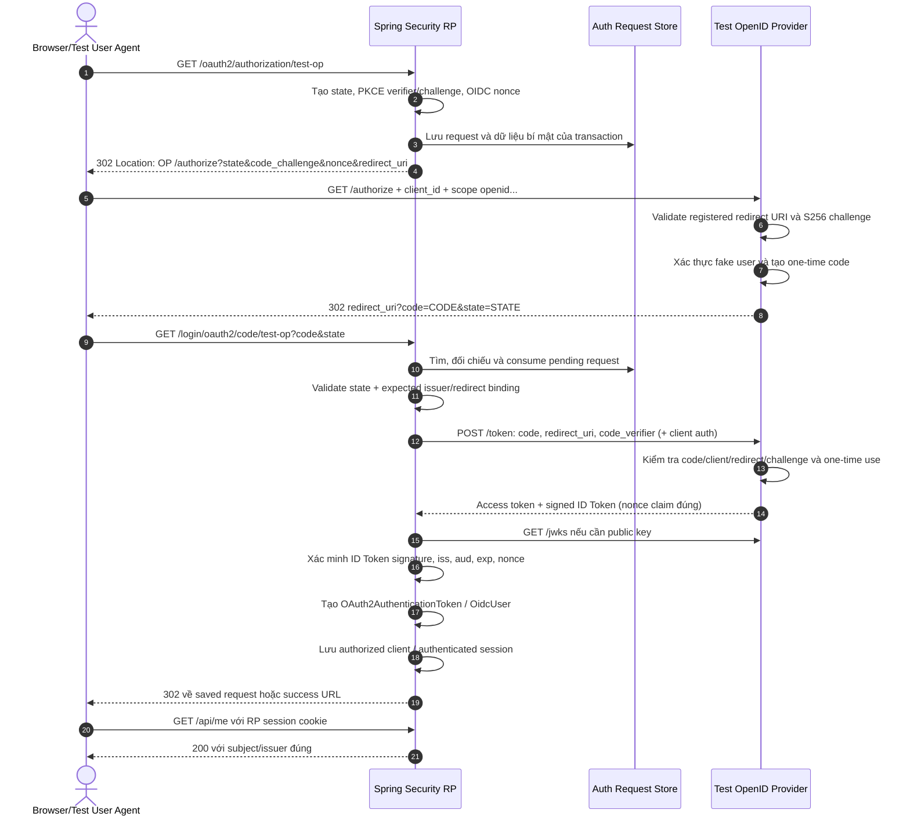
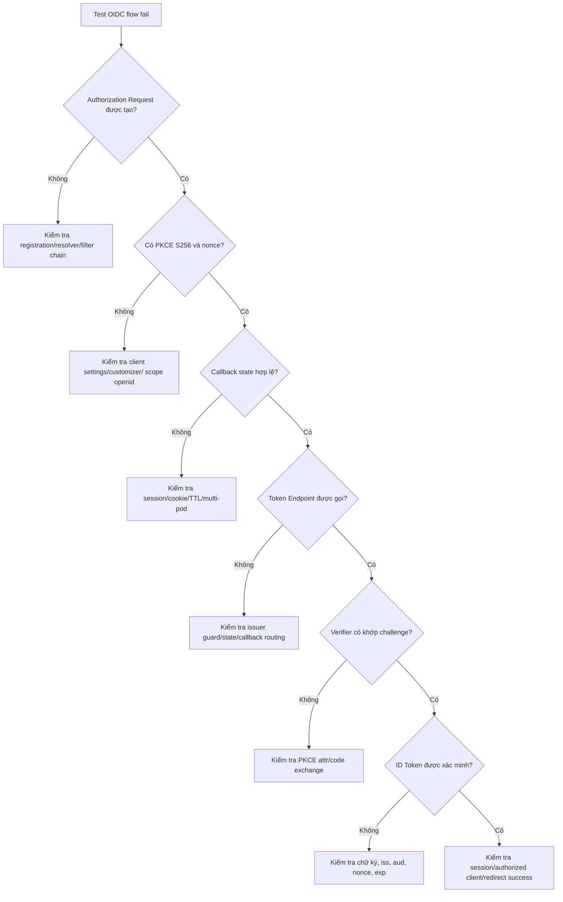

# 31.3. Kiểm thử Authorization Code Flow với PKCE và nonce

## 1. Mục tiêu: kiểm thử **toàn bộ giao thức**, không chỉ tạo mock user

Một ứng dụng Spring Security OAuth 2.0/OIDC Client có thể kiểm thử controller bằng:

```java
mockMvc.perform(get("/api/me").with(oidcLogin()));
```

hoặc trong Spring WebFlux:

```java
webTestClient.mutateWith(mockOidcLogin())
    .get().uri("/api/me")
    .exchange();
```

Các helpers này hữu ích khi kiểm tra controller, `SecurityContext` và phân quyền. Nhưng chúng **đã đặt sẵn một authentication** vào request. Vì vậy test đó **không chứng minh** Spring Security đã:

- Tạo một authorization request thực tế.
- Sinh `state` ngẫu nhiên và lưu authorization request.
- Sinh `code_verifier`, tính `code_challenge` theo PKCE S256.
- Chuyển browser tới đúng Authorization Endpoint của OpenID Provider (OP).
- Gửi OIDC `nonce` và giữ thông tin cần xác minh nó.
- Kiểm tra callback `code` và `state`.
- Gửi authorization code tới đúng Token Endpoint với cùng `redirect_uri` và `code_verifier`.
- Kiểm tra ID Token signature, issuer, audience, expiry và `nonce`.
- Từ chối callback bị tráo/replay, sai PKCE hoặc sai ID Token.
- Lưu `OAuth2AuthorizedClient` và thiết lập authenticated session **chỉ sau khi các bước hợp lệ**.

**Bài học này tập trung vào integration testing**: chạy bộ lọc bảo mật OAuth2/OIDC của ứng dụng thật và sử dụng một Authorization Server/OP test có hành vi đủ sát giao thức. Ta vẫn có thể dùng `MockMvc` hoặc `WebTestClient` để gửi HTTP exchanges tới ứng dụng, nhưng **không dùng `oidcLogin()`/`mockOidcLogin()` để bỏ qua bước đang kiểm thử**.

Một bài kiểm thử tốt phải chứng minh cả hai chiều:

1. **Happy path:** đúng `state`, đúng PKCE verifier, đúng `nonce`, đúng issuer/audience/chữ ký → login thành công.
2. **Negative paths:** một yếu tố không hợp lệ → **authentication không được tạo**; không chấp nhận token hoặc đưa code đến endpoint sai.

### 1.1. Kết quả học tập

Sau bài học, bạn có thể:

1. Phân biệt controller mock tests, integration tests và browser E2E tests.
2. Mô tả Authorization Code + PKCE + OIDC nonce và dữ liệu cần giữ qua redirect.
3. Xác định điểm bật PKCE trong Spring Security Servlet và Reactive.
4. Kiểm tra `code_challenge_method=S256` trong authorization request.
5. Bắt và kiểm tra `code_verifier` thật trong Token Request mà không log raw value.
6. Tự tính lại S256 challenge trong test để so khớp.
7. Kiểm thử `state` có liên kết với session/browser, dùng một lần và chống replay.
8. Kiểm thử OIDC nonce trong Authorization Request và ID Token response.
9. Dựng fake OP với `/authorize`, `/token`, `/jwks` và metadata được phê duyệt.
10. Ký một ID Token test bằng RSA key và cung cấp public JWK.
11. Kiểm thử ID Token sai nonce, issuer, audience, chữ ký và thời hạn.
12. Kiểm tra `redirect_uri` và `client_id` tại cả hai endpoint.
13. Kiểm tra cách callback được xử lý trong Servlet `MockMvc` và Reactive `WebTestClient`.
14. Phân biệt các lỗi do app, fake OP, session/cookie, proxy hoặc JWT validation.
15. Sắp xếp bộ test chạy ổn định trong CI mà không cần credentials production.

## 2. Bối cảnh và các thành phần

| Thành phần | Trách nhiệm |
| --- | --- |
| **Browser/User Agent** | Thực hiện redirects, giữ cookie của RP và OP |
| **Relying Party (RP)** | Ứng dụng Spring Security OAuth2/OIDC Client |
| **Authorization Server/OpenID Provider** | Cấp authorization code, access token và ID Token |
| **Authorization Endpoint** | Nhận `client_id`, `redirect_uri`, `scope`, `state`, PKCE challenge, `nonce` |
| **Token Endpoint** | Nhận code, `redirect_uri`, `code_verifier` và client authentication phù hợp |
| **JWKS Endpoint** | Công bố public keys để RP xác minh ID Token |
| **Authorization Request Repository** | Giữ `state`, nonce gốc, PKCE verifier/attributes qua browser redirect |
| **Authorized Client Repository/Service** | Lưu token sau khi hoàn tất authorization |
| **SecurityContext** | Chứa `Authentication` sau khi login thành công |

Tại thời điểm browser bắt đầu login, RP **chưa có ID Token**. Mọi kiểm tra ID Token chỉ diễn ra sau khi RP gửi code tới Token Endpoint và nhận Token Response.

### 2.1. Flow cần kiểm thử



Trong test, OP có thể là một server giả lập với code store và signing key cố định, hoặc một OP thật phục vụ riêng cho CI. Mức độ realism sẽ quyết định test xác nhận được những gì.

## 3. Ba giá trị khác nhau: `state`, PKCE và `nonce`

| Giá trị | Ai tạo? | Đi tới đâu? | Mục đích |
| --- | --- | --- | --- |
| OAuth2 `state` | RP | Authorization Request, được AS echo ở callback | Liên kết authorization response với transaction/browser |
| PKCE `code_verifier` | RP | Chỉ gửi tới **Token Endpoint**, không gửi trước tới browser/AS Authorization Endpoint | Chứng minh bên đổi code biết verifier ban đầu |
| PKCE `code_challenge` | RP tính từ verifier | Authorization Request | Ràng buộc authorization code với verifier |
| PKCE `code_challenge_method` | RP | Authorization Request | Chỉ ra cách biến verifier thành challenge, ưu tiên `S256` |
| OIDC `nonce` | RP | Authorization Request, và claim trong ID Token do OP trả | Gắn ID Token với một authentication request |
| OIDC nonce gốc trong request store | RP | Ở server-side pending transaction | Cho phép Spring Security xác minh nonce trong ID Token |

**Không dùng chung một giá trị cho ba cơ chế.** Chúng giải quyết các vấn đề khác nhau:

- `state` không thay PKCE.
- PKCE không thay `state`.
- `nonce` không phải là CSRF token của HTTP POST.
- Chữ ký ID Token không thay `nonce`.
- ID Token nonce không thay kiểm tra issuer/audience.
- Bảo vệ mix-up trước code exchange là trách nhiệm bổ sung khi client làm việc với nhiều AS.

### 3.1. Một lưu ý quan trọng về OIDC nonce

Theo OIDC Core, `nonce` **không bắt buộc trong Authorization Code Flow thuần** theo cùng cách như một số response types khác; tuy nhiên nó là cơ chế hữu ích và Spring Security thường tạo `nonce` cho OIDC authorization request.

Trong các implementation Spring Security quen thuộc, logic có thể:

1. Sinh nonce gốc ngẫu nhiên.
2. Lưu **nonce gốc** trong `OAuth2AuthorizationRequest.attributes`.
3. Tính SHA-256/Base64URL của nonce gốc.
4. Gửi **nonce đã băm** dưới dạng tham số `nonce` tới OP.
5. Sau token exchange, tính lại hash từ nonce gốc và so với **ID Token claim `nonce`**.

**Hệ quả cho test OP:** nếu browser-visible Authorization Request chứa:

```text
nonce=NONCE_VALUE_SEEN_BY_OP
```

OP phải đưa **đúng giá trị đó** vào claim `nonce` của ID Token theo OIDC protocol. Fake OP **không được tự băm nonce lần thứ hai**, cũng không được đòi ID Token phải chứa một nonce gốc mà OP không biết.

Đây là một implementation detail cần test theo phiên bản Spring Security thực tế; đừng hard-code cách lưu nonce nội bộ nếu có thể kiểm thử qua HTTP contract từ phía OP.

## 4. PKCE S256 theo RFC 7636

Một `code_verifier` hợp lệ:

- Được sinh ngẫu nhiên bằng nguồn entropy phù hợp.
- Có độ dài **43 đến 128 ký tự**.
- Chỉ dùng ký tự unreserved: chữ, số và một số dấu được RFC 7636 cho phép.
- Không gửi trong URL Authorization Request.
- Không cần log hay đưa ra client-side JavaScript trong server-side RP.

Với `S256`:

\[
\text{code\_challenge} =
\operatorname{BASE64URL\_NO\_PADDING}
\left(
\operatorname{SHA256}
\left(
\operatorname{ASCII}(\text{code\_verifier})
\right)
\right)
\]

Trong Authorization Request:

```text
code_challenge=...
code_challenge_method=S256
```

Trong Token Request:

```text
grant_type=authorization_code
code=...
redirect_uri=...
code_verifier=...
```

**Không gửi `code_verifier` ngay trong Authorization Request.** Nếu làm vậy, PKCE mất ý nghĩa chống đánh cắp authorization code.

### 4.1. Test helper tính S256

```java
import java.nio.charset.StandardCharsets;
import java.security.MessageDigest;
import java.util.Base64;

final class PkceAssertions {

    static String s256(String verifier) {
        try {
            byte[] input =
                verifier.getBytes(StandardCharsets.US_ASCII);

            byte[] digest =
                MessageDigest.getInstance("SHA-256")
                    .digest(input);

            return Base64.getUrlEncoder()
                .withoutPadding()
                .encodeToString(digest);
        }
        catch (Exception ex) {
            throw new IllegalStateException(
                "Could not calculate S256 challenge", ex);
        }
    }

    static boolean validVerifierSyntax(String value) {
        return value != null
            && value.matches("[A-Za-z0-9._~-]{43,128}");
    }
}
```

Thư viện test có thể dùng JUnit/AssertJ:

```java
assertThat(PkceAssertions.validVerifierSyntax(verifier))
    .isTrue();

assertThat(PkceAssertions.s256(verifier))
    .isEqualTo(challengeFromAuthorizationRequest);
```

**Không** đưa `verifier` vào thông báo assertion khi chạy CI nếu logs có thể truy cập rộng. Nên để assertion message nói “PKCE challenge mismatch” thay vì in raw secrets.

### 4.2. Vector chính thức của RFC 7636

RFC 7636 có test vector nổi tiếng:

```text
code_verifier:
dBjftJeZ4CVP-mB92K27uhbUJU1p1r_wW1gFWFOEjXk

code_challenge:
E9Melhoa2OwvFrEMTJguCHaoeK1t8URWbuGJSstw-cM
```

Đây là dữ liệu công khai dùng làm test vector, **không phải verifier để dùng trong production**.

```java
@Test
void computesRfc7636S256Vector() {
    String verifier =
        "dBjftJeZ4CVP-mB92K27uhbUJU1p1r_wW1gFWFOEjXk";

    assertThat(PkceAssertions.s256(verifier))
        .isEqualTo(
            "E9Melhoa2OwvFrEMTJguCHaoeK1t8URWbuGJSstw-cM");
}
```

Unit test này kiểm tra phép tính hash, **chưa chứng minh Authorization Server đã bắt buộc kiểm tra PKCE trong Token Endpoint**.

## 5. `state` là ràng buộc browser/authorization transaction

Một RP điển hình lưu pending authorization request trong session hoặc repository khác. Test phải xác minh:

```text
Request 1:
  state=S1
  callback code=C1,state=S1 -> được xem xét tiếp

Request 2:
  state=S2
  callback code=C1,state=S2 -> không được coi là cùng flow

Wrong browser:
  callback code=C1,state=S1 nhưng không có pending transaction -> reject
```

`state` nên có entropy và được liên kết với transaction/browser đã tạo request. Trong Servlet, `HttpSessionOAuth2AuthorizationRequestRepository` thường lưu request; trong Reactive, `WebSessionOAuth2ServerAuthorizationRequestRepository` đảm nhiệm vai trò tương ứng.

### 5.1. Không nhầm session cookie với state

- RP session cookie liên kết browser với session tại RP.
- `state` liên kết authorization response với request đã được lưu.
- Cả hai có thể cần đúng để callback hoàn tất.
- `state` có thể xuất hiện trong URL OP/callback, nên phải redact khỏi HTTP logs và traces.
- Cookie OP thuộc domain OP; cookie đó không thay RP session/correlation.

Nếu callback chạy ở pod khác mà pending request không có, RP **phải từ chối** chứ không tạo lại expected state từ giá trị callback.

## 6. Phân chia các mức integration test

Không phải test nào cũng cần Selenium/Playwright hoặc một OP thật.

| Mức | RP | OP/AS | Kiểm tra được | Giới hạn |
| --- | --- | --- | --- | --- |
| **A — Controller slice** | MockMvc/WebTestClient + mock login principal | Không | Controller/claims/authorization | Bỏ qua code, PKCE, nonce, JWT |
| **B — RP + fake OP Token/JWKS** | Spring Security filters thật | WireMock/MockWebServer | Authorization redirect, token request, PKCE/nonce/ID Token validation | Có thể giả lập browser callback |
| **C — RP + programmable OP** | App thật/test context | Test OP có `/authorize`, `/token`, `/jwks` | Hầu hết front-/back-channel protocol contract | Không phải OP production |
| **D — Browser + OP sandbox** | Server thật | OP test instance | Cookies, redirect chain, login UX, proxy, provider-specific policy | Chạy chậm hơn, phụ thuộc setup |
| **E — Multi-pod/security E2E** | Nhiều app instances | OP sandbox + shared store | Stateful correlation across nodes, ingress, rotation | Phức tạp |

**Bài này chủ yếu minh họa mức B/C**, sau đó chỉ ra cases cần nâng lên mức D/E.

### 6.1. Những gì không nên mock nếu muốn test PKCE/nonce

Đừng:

```java
.with(oidcLogin())
```

và kết luận PKCE hoạt động. Đừng thay toàn bộ OAuth2 authentication provider bằng stub luôn “success”. Đừng bỏ `JwtDecoder` hoặc tự chấp nhận một ID Token chưa ký trong bộ test khẳng định signature/nonce validation.

Có thể mock các dependencies **ngoài scope**, ví dụ database business, email notifier hoặc downstream reporting API.

## 7. Dependencies cho Servlet integration tests

Ví dụ Gradle:

```gradle
dependencies {
    implementation 'org.springframework.boot:spring-boot-starter-web'
    implementation 'org.springframework.boot:spring-boot-starter-security'
    implementation 'org.springframework.boot:spring-boot-starter-oauth2-client'

    testImplementation 'org.springframework.boot:spring-boot-starter-test'
    testImplementation 'org.springframework.security:spring-security-test'

    // Chọn một HTTP stub server:
    testImplementation 'com.github.tomakehurst:wiremock-jre8:<compatible-version>'
    // Hoặc MockWebServer theo dependency BOM của dự án.

    // Nếu dùng Nimbus API để tạo signed test ID Token:
    testImplementation 'com.nimbusds:nimbus-jose-jwt'
}
```

`<compatible-version>` là placeholder; không paste nguyên văn vào build. WireMock artifact coordinates/versions thay đổi giữa major versions, ví dụ WireMock 3 có distribution khác; hãy chọn **dependency tương thích với Spring Boot BOM**, không đồng thời kéo nhiều phiên bản xung đột.

Nếu dùng Maven, dependencies tương ứng thường là:

```xml
<dependency>
  <groupId>org.springframework.security</groupId>
  <artifactId>spring-security-test</artifactId>
  <scope>test</scope>
</dependency>
```

và một HTTP stub server/JWT signer cho tests.

### 7.1. Reactor/WebFlux

Ứng dụng Reactive thay `spring-boot-starter-web` bằng:

```gradle
implementation 'org.springframework.boot:spring-boot-starter-webflux'
testImplementation 'io.projectreactor:reactor-test'
```

Tương ứng dùng `SecurityWebFilterChain`, `WebTestClient`, `ReactiveClientRegistrationRepository` và reactive token exchange APIs. Tránh lẫn Servlet và Reactive security configurations trong cùng test context.

### 7.2. Không lấy client secret hoặc khóa ký thật

Dùng:

- `client_id` test riêng.
- `client_secret` giả nếu confidential client test.
- RSA key pair chỉ tồn tại trong test process.
- Fake access token chỉ test về OAuth2Client integration.
- Test identity `sub=user-123`, domain `.test` hoặc localhost.
- Không kết nối OP production khi chạy CI.

Không commit real `refresh_token`, OP private keys hoặc secret manager credentials vào repository.

## 8. Một `ClientRegistration` dùng trong test

Với Spring Security 6.5+ hoặc các phiên bản mới có `ClientRegistration.ClientSettings`, có thể định nghĩa **public OAuth2 Client** yêu cầu PKCE:

```java
static ClientRegistration testRegistration(
        URI fakeOpBaseUrl) {

    return ClientRegistration
        .withRegistrationId("test-op")
        .clientId("portal-integration-test")
        .clientAuthenticationMethod(
            ClientAuthenticationMethod.NONE)
        .authorizationGrantType(
            AuthorizationGrantType.AUTHORIZATION_CODE)
        .redirectUri(
            "{baseUrl}/login/oauth2/code/{registrationId}")
        .scope("openid", "profile")
        .issuerUri("https://issuer.example.test")
        .authorizationUri(
            fakeOpBaseUrl.resolve("/authorize").toString())
        .tokenUri(
            fakeOpBaseUrl.resolve("/token").toString())
        .jwkSetUri(
            fakeOpBaseUrl.resolve("/jwks").toString())
        .clientSettings(
            ClientRegistration.ClientSettings.builder()
                .requireProofKey(true)
                .build())
        .clientName("Test OIDC Provider")
        .build();
}
```

**Giải thích:**

- `client-authentication-method=none`: public client không dùng `client_secret` tại Token Endpoint.
- `requireProofKey(true)`: yêu cầu Spring Security tạo PKCE proof key. API này xuất hiện trong Spring Security **6.5 trở đi**; các dự án phiên bản cũ có thể cần cấu hình `OAuth2AuthorizationRequestCustomizers.withPkce()` ở resolver.
- `scope=openid`: flow được xử lý như OIDC Login thay vì OAuth2 Login thông thường.
- `issuerUri`: issuer **logic** của OP test dùng để kiểm tra ID Token.
- `authorizationUri`/`tokenUri`/`jwkSetUri`: endpoints test được cung cấp bởi fake server.
- `redirectUri`: callback URI của RP; trong test phải khớp request thực tế.

Ở đây `issuerUri` HTTPS có thể khác HTTP loopback URL của fake endpoints. Cách tách này **chỉ phù hợp test fixture với trust được phê duyệt tường minh**; production cần issuer/metadata/endpoints hợp lệ theo OP và TLS/egress policy. Không dùng arbitrary HTTP token/JWKS endpoints cho production.

### 8.1. Tự động bật PKCE và version compatibility

Theo tài liệu Spring Security, public client thường được bật PKCE khi:

```text
clientSecret = omitted/empty
clientAuthenticationMethod = none
```

Với confidential client, có thể bật PKCE bằng `requireProofKey(true)` khi phiên bản hỗ trợ hoặc thông qua custom authorization request resolver.

Không viết test chỉ assert **"public client → chắc chắn có S256"** mà không quan sát `Location` thực tế. Dependency upgrade hoặc custom resolver có thể làm hành vi thay đổi; contract phải được kiểm thử.

### 8.2. Confidential client vẫn nên được kiểm thử PKCE

PKCE không thay `client_secret`/mTLS/private key JWT trong confidential-client flow, và client authentication **không thay PKCE**.

Một confidential registration:

```java
ClientRegistration
    .withRegistrationId("test-confidential")
    .clientId("portal-backend-test")
    .clientSecret("FAKE_TEST_SECRET")
    .clientAuthenticationMethod(
        ClientAuthenticationMethod.CLIENT_SECRET_BASIC)
    .authorizationGrantType(
        AuthorizationGrantType.AUTHORIZATION_CODE)
    .redirectUri(
        "{baseUrl}/login/oauth2/code/{registrationId}")
    .scope("openid", "profile")
    .issuerUri("https://issuer.example.test")
    .authorizationUri(fakeAuthUri)
    .tokenUri(fakeTokenUri)
    .jwkSetUri(fakeJwksUri)
    .clientSettings(
        ClientRegistration.ClientSettings.builder()
            .requireProofKey(true).build())
    .build();
```

Đối với Spring Security version chưa có `ClientSettings`, có thể cấu hình resolver:

```java
DefaultOAuth2AuthorizationRequestResolver resolver =
    new DefaultOAuth2AuthorizationRequestResolver(
        registrations, "/oauth2/authorization");

resolver.setAuthorizationRequestCustomizer(
    OAuth2AuthorizationRequestCustomizers.withPkce());
```

Sau đó truyền `resolver` vào `oauth2Login().authorizationEndpoint(...)` theo Servlet DSL của phiên bản đang dùng. Dùng riêng `withPkce()` có thể thay một customizer khác đã có; nếu app còn thêm `prompt`, `audience` hoặc resource indicators, cần **compose** các customizations rõ ràng và kiểm thử.

## 9. Spring Security Servlet: test đúng SecurityFilterChain

Một cấu hình test OIDC Login đơn giản:

```java
@Configuration
class TestServletSecurity {

    @Bean
    ClientRegistrationRepository clientRegistrationRepository(
            TestOpFixture op) {
        return new InMemoryClientRegistrationRepository(
            testRegistration(op.baseUri()));
    }

    @Bean
    SecurityFilterChain securityFilterChain(
            HttpSecurity http) throws Exception {

        return http
            .authorizeHttpRequests(auth -> auth
                .requestMatchers("/api/public").permitAll()
                .anyRequest().authenticated())
            .oauth2Login(Customizer.withDefaults())
            .build();
    }
}
```

`TestOpFixture` là **class test do ứng dụng tự viết** quản lý fake OP. Nó không phải một Spring Security bean mặc định.

Test ứng dụng cần load actual OAuth2 Login filter chain, ví dụ:

```java
@SpringBootTest
@AutoConfigureMockMvc
class AuthorizationCodePkceNonceIT {

    @Autowired
    MockMvc mvc;

    // Fake OP fixture, signing key, token request recorder...
}
```

Nếu test dùng `@WebMvcTest` và thay security chain bằng `httpBasic()`, nó có thể kiểm tra controller nhưng **không còn kiểm tra Authorization Code Flow**.

### 9.1. Hai routes quan trọng

Mặc định khi dùng OAuth2 Login Servlet:

```text
Bắt đầu authorization:
  GET /oauth2/authorization/{registrationId}

Nhận callback:
  GET /login/oauth2/code/{registrationId}
```

Nếu bạn custom base URI, `redirectUri` và registration tại OP phải cập nhật đồng bộ. Đừng hard-code callback path trong test khác với cấu hình thật.

### 9.2. Vì sao fake OP phải chạy trước khi tạo repository bean?

`ClientRegistration` cần đúng URLs của fake server:

```text
http://127.0.0.1:<ephemeral-port>/authorize
http://127.0.0.1:<ephemeral-port>/token
http://127.0.0.1:<ephemeral-port>/jwks
```

Nếu test context đã tạo bean trước khi stub server chọn port, sẽ có URL `:0` hoặc port sai.

Có thể dùng:

- JUnit fixture được khởi động qua `@DynamicPropertySource`/test context initializer phù hợp.
- Test configuration factory với fake server startup theo Spring context lifecycle.
- `@Testcontainers`/OP sandbox service với address đã được cung cấp trước bean initialization.
- Full test application context và injected fake OP properties.

Nếu test dùng `@DynamicPropertySource`, các properties phải thực sự được tham chiếu trong bean creation, không chỉ được ghi vào test logs.

## 10. Reactive WebFlux: test đúng SecurityWebFilterChain

WebFlux dùng:

```java
@Configuration
@EnableWebFluxSecurity
class TestReactiveSecurity {

    @Bean
    ReactiveClientRegistrationRepository registrations(
            TestOpFixture op) {

        return new InMemoryReactiveClientRegistrationRepository(
            testRegistration(op.baseUri()));
    }

    @Bean
    SecurityWebFilterChain chain(ServerHttpSecurity http) {
        return http
            .authorizeExchange(exchanges -> exchanges
                .pathMatchers("/api/public").permitAll()
                .anyExchange().authenticated())
            .oauth2Login(Customizer.withDefaults())
            .build();
    }
}
```

Reactive test có thể dùng:

```java
@SpringBootTest(
    webEnvironment = SpringBootTest.WebEnvironment.MOCK)
@AutoConfigureWebTestClient
class ReactiveAuthorizationCodeIT {

    @Autowired
    ApplicationContext context;

    WebTestClient client;

    @BeforeEach
    void setUp() {
        client = WebTestClient.bindToApplicationContext(context)
            .apply(springSecurity())
            .configureClient()
            .build();
    }
}
```

Khi test **Authorization Code Flow thật**, **không** dùng:

```java
client.mutateWith(mockOidcLogin())
```

ở authorization initiation/callback test; helper này sẽ đặt sẵn OIDC Authentication và bỏ qua flow cần kiểm tra.

### 10.1. Reactive PKCE setup

Với public client hoặc `requireProofKey(true)` ở phiên bản phù hợp, PKCE có thể được bật từ registration. Ở phiên bản cũ hơn hoặc custom scenarios:

```java
DefaultServerOAuth2AuthorizationRequestResolver resolver =
    new DefaultServerOAuth2AuthorizationRequestResolver(
        reactiveClientRegistrationRepository);

resolver.setAuthorizationRequestCustomizer(
    OAuth2AuthorizationRequestCustomizers.withPkce());
```

Resolver được truyền vào `oauth2Login()` của `ServerHttpSecurity` thông qua method cấu hình phù hợp Spring Security version. Các resolver classes là **Reactive**; không dùng `DefaultOAuth2AuthorizationRequestResolver` Servlet trong `SecurityWebFilterChain`.

### 10.2. Reactor Context và session correlation

WebFlux lưu authentication trong Reactor Context; authorization request tạm thời thường được giữ qua WebSession và cookie `SESSION`.

Một test chỉ tạo một exchange rồi bỏ cookie/session sẽ không thể tái hiện callback. Cần **truyền tiếp session cookie** hoặc dùng test browser client có cookie jar phù hợp. `WebTestClient` không tự trở thành browser đầy đủ giữ mọi cookie/redirect như một real browser.

## 11. Fake OP cần mô phỏng những gì?

Một fake OP đủ tốt cho Authorization Code + PKCE + nonce không đơn thuần trả:

```json
{"access_token":"anything"}
```

Nó nên mô phỏng tối thiểu:

| Endpoint | Input | Hành vi |
| --- | --- | --- |
| `/.well-known/openid-configuration` nếu dùng discovery | GET | Trả issuer và endpoints đã được cấu hình test |
| `/authorize` | GET với client_id, redirect_uri, state, code_challenge, nonce, scope | Validate và cấp one-time authorization code |
| `/token` | POST authorization_code grant | Kiểm tra code, client, redirect_uri, code_verifier, grant |
| `/jwks` | GET | Trả public RSA key dùng ký ID Token |
| `/userinfo` nếu app dùng | GET access token | Trả claims, `sub` phải khớp ID Token |
| `/error`/invalid response scenarios | Tùy test | Trả OAuth2/OIDC errors có kiểm soát |

Với test tập trung vào RP filter chain, có thể **giả lập browser callback** mà không cần thật sự gọi `/authorize` qua browser. Nhưng fake OP vẫn phải lưu record đại diện code issuance để kiểm tra PKCE tại `/token`.

### 11.1. State và nonce thuộc trách nhiệm nào?

- AS **echo** `state` ở authorization response nếu RP đã gửi.
- AS dùng `nonce` từ Authorization Request làm claim trong ID Token.
- AS ràng buộc code với `client_id`, `redirect_uri`, PKCE challenge, scope, subject và expiry.
- RP đối chiếu `state` và xác minh ID Token `nonce`.
- Fake OP không được tự “giúp” RP bằng cách đưa `state` không có trong request thành hợp lệ.

### 11.2. Cần one-time code store

Ví dụ record test nội bộ:

```java
record IssuedAuthorizationCode(
    String code,
    String clientId,
    String redirectUri,
    String codeChallenge,
    String codeChallengeMethod,
    String requestedNonce,
    String subject,
    Instant expiresAt) {}
```

Khi Token Endpoint nhận code, fake OP nên dùng atomic consume:

```text
issuedCodes.remove(code)
```

rồi mới xét tiếp. Code không tồn tại/hết hạn/đã dùng → `invalid_grant`.

Một fake OP luôn trả token cho mọi code sẽ **không kiểm thử đúng PKCE hoặc one-time use**.

## 12. Thiết kế test fixture dùng HTTP stub server

Có thể dùng WireMock, OkHttp MockWebServer hoặc một test Spring Authorization Server. Một kiến trúc minh họa:

```text
JUnit 5 Test Class
    |
    +-- RP Spring ApplicationContext
    |     +-- OAuth2 Login filter chain thật
    |     +-- ClientRegistration(test-op)
    |     +-- Session / Auth Request Repository
    |     +-- JWT decoder / OIDC validators thật
    |
    +-- Fake OP HTTP Server
          +-- /authorize
          +-- /token
          +-- /jwks
          +-- issued-code store
          +-- token request recorder
          +-- RSA private signing key
          +-- scenario flags: wrong nonce/issuer/audience...
```

Các dependencies này là **test-only**. Không khởi động browser thật chỉ để đọc query của 302 khi integration scope đã cho phép mô phỏng redirect.

### 12.1. WireMock hay MockWebServer?

| Tool | Ưu điểm | Lưu ý |
| --- | --- | --- |
| WireMock | Stub request matching, scenarios, verification, templating | Dynamic token response/challenge validation có thể cần transformer/custom extension |
| MockWebServer | Ghi nhận HTTP requests, viết Dispatcher động | Cần tự viết OAuth2 token validation/code store |
| Spring Authorization Server test | Gần protocol behavior thật | Setup phức tạp, cần client/keys/user store |
| Keycloak/IdP test container | Provider-specific behavior sát production hơn | Chạy chậm, cần cấu hình realms, clients, credentials |
| OP sandbox được vận hành riêng | Kiểm tra compatibility với IdP thực | Network/reliability, lifecycle and access controls |

Không nhất thiết dùng tất cả; chọn một tool cho nhóm test. **Không dùng real production OP** trong unit/integration CI test mặc định.

## 13. Tạo một ID Token đã ký cho test

Để chứng minh RP thực sự xác minh ID Token, fake OP nên tạo một **signed JWT**, với public key xuất hiện ở JWKS endpoint.

Ví dụ dùng Nimbus JOSE + JWT (mã minh họa, cần import Nimbus classes tương ứng):

```java
RSAKey key = new RSAKeyGenerator(2048)
    .keyID("test-signing-key-1")
    .generate();

JWKSet publicKeys = new JWKSet(key.toPublicJWK());

String jwksJson = publicKeys.toString();
```

Dùng private key trong test fixture để ký:

```java
static String signedIdToken(
        RSAKey signingKey,
        String issuer,
        String clientId,
        String subject,
        String nonceClaim,
        Instant now) throws Exception {

    JWTClaimsSet claims = new JWTClaimsSet.Builder()
        .issuer(issuer)
        .subject(subject)
        .audience(clientId)
        .issueTime(Date.from(now))
        .expirationTime(Date.from(now.plusSeconds(300)))
        .claim("nonce", nonceClaim)
        .build();

    JWSHeader header = new JWSHeader.Builder(
        JWSAlgorithm.RS256)
        .keyID(signingKey.getKeyID())
        .type(JOSEObjectType.JWT)
        .build();

    SignedJWT jwt = new SignedJWT(header, claims);
    jwt.sign(new RSASSASigner(signingKey.toPrivateKey()));

    return jwt.serialize();
}
```

Ở đây:

- Key có `kid` để JWKS resolver chọn đúng key.
- Header khai báo RS256.
- ID Token `iss` phải khớp expected issuer.
- ID Token `aud` phải chứa `client_id` của RP.
- `iat`/`exp` hợp lệ.
- `sub` có giá trị không rỗng.
- `nonce` phải bằng **nonce mà OP nhận được trong Authorization Request**.
- Test token ký bằng private key mà public key tương ứng có ở JWKS endpoint.

Khi sử dụng OIDC UserInfo, fake `/userinfo` phải trả `sub` khớp với ID Token để tránh làm phát sinh lỗi không thuộc mục tiêu test.

### 13.1. Test signature failure

Tạo ID Token ký bằng một RSA private key khác, nhưng JWKS endpoint vẫn trả public key của key ban đầu.

Expected:

```text
Callback không dẫn tới authenticated session.
OIDC validation fails.
Access/refresh tokens không được chấp nhận.
SecurityContext vẫn anonymous/unauthenticated.
```

Không “mock JwtDecoder always returns JWT” trong test này, vì như vậy không kiểm tra được lỗi chữ ký.

### 13.2. Test issuer và audience

Tạo signed ID Token với:

```json
{
  "iss": "https://other-issuer.example.test",
  "sub": "user-42",
  "aud": "portal-integration-test"
}
```

hoặc:

```json
{
  "iss": "https://issuer.example.test",
  "sub": "user-42",
  "aud": "other-client"
}
```

Expected: **login không được chấp nhận**, dù chữ ký hợp lệ.

ID Token `aud` của OIDC Client là **client ID của RP**. Không nhầm với `aud` của downstream access token dành cho Resource Server.

## 14. Token Response từ fake OP

Nếu code/verifier/client/redirect_uri hợp lệ, Token Endpoint có thể trả:

```http
HTTP/1.1 200 OK
Content-Type: application/json
Cache-Control: no-store
Pragma: no-cache

{
  "access_token": "FAKE_OPAQUE_ACCESS_TOKEN",
  "token_type": "Bearer",
  "expires_in": 300,
  "scope": "openid profile",
  "id_token": "SIGNED_TEST_ID_TOKEN_JWT"
}
```

`SIGNED_TEST_ID_TOKEN_JWT` là placeholder trong ví dụ; test chạy thật phải thay bằng chuỗi JWT **đã ký** như mục 13.

Trong Authorization Code OIDC flow, Token Response có ID Token là yêu cầu quan trọng. Nếu thiếu `id_token` khi login OIDC, client phải coi flow không hợp lệ theo contract.

**Không dùng**:

```json
{
  "id_token": "hello-world"
}
```

rồi tắt JWT validation chỉ để test pass. Làm như vậy không kiểm tra được nonce/issuer/audience/signature.

### 14.1. Fake Token Endpoint cần kiểm tra

Giả sử nhận:

```text
grant_type=authorization_code
code=CODE123
redirect_uri=https://portal.example.test/login/oauth2/code/test-op
code_verifier=VERIFIER_SECRET
client_id=portal-integration-test
```

Fake OP:

1. Parse request là `application/x-www-form-urlencoded`.
2. Xác minh grant đúng.
3. Tìm và **consume one-time code**.
4. So client ID/client authentication theo registration.
5. So **exact** `redirect_uri` với giá trị lưu lúc cấp code.
6. Kiểm tra challenge method được cấp là `S256`.
7. Tính `S256(code_verifier)` và so với saved challenge.
8. Nếu sai → `invalid_grant`/error phù hợp, **không cấp token**.
9. Nếu đúng → phát access token và signed ID Token có `nonce` của authorization request.

Không biến fake OP thành “server luôn 200” vì sẽ che lỗi PKCE của RP.

## 15. Servlet: bắt Authorization Request từ MockMvc

Một test bắt đầu flow:

```java
MvcResult start = mvc.perform(
        get("/oauth2/authorization/test-op")
            .secure(true)
            .scheme("https")
            .serverName("portal.example.test")
            .serverPort(443))
    .andExpect(status().is3xxRedirection())
    .andExpect(header().exists(HttpHeaders.LOCATION))
    .andReturn();

String location = start.getResponse()
    .getHeader(HttpHeaders.LOCATION);
```

`location` phải trỏ đến **Authorization Endpoint** của fake OP. Nó chứa các query params cần test, nhưng đừng log raw Location khi có `state`, `nonce`, `code_challenge` hoặc dữ liệu nhạy cảm.

### 15.1. Parse query parameters đúng một lần

Một helper test minh họa:

```java
static Map<String, List<String>> parseFormQuery(String location) {
    String rawQuery = URI.create(location).getRawQuery();

    if (rawQuery == null) {
        return Map.of();
    }

    Map<String, List<String>> values =
        new LinkedHashMap<>();

    for (String part : rawQuery.split("&")) {
        String[] pair = part.split("=", 2);

        String key = URLDecoder.decode(
            pair[0], StandardCharsets.UTF_8);

        String value = URLDecoder.decode(
            pair.length == 2 ? pair[1] : "",
            StandardCharsets.UTF_8);

        values.computeIfAbsent(
            key, ignored -> new ArrayList<>()).add(value);
    }

    return values;
}

static String one(
        Map<String, List<String>> params,
        String key) {

    List<String> values = params.get(key);

    if (values == null || values.size() != 1) {
        throw new AssertionError(
            "Expected exactly one value for " + key);
    }

    return values.get(0);
}
```

`URLDecoder` phù hợp query form encoding ở ví dụ. Một parsing library production/test có thể thay thế; mục tiêu là **tránh decode hai lần** và phát hiện **duplicate parameters**.

Dùng:

```java
var query = parseFormQuery(location);

String clientId = one(query, "client_id");
String redirectUri = one(query, "redirect_uri");
String state = one(query, "state");
String challenge = one(query, "code_challenge");
String method = one(query, "code_challenge_method");
String nonce = one(query, "nonce");
```

### 15.2. Các asserts bắt buộc ở bước này

```java
assertThat(clientId)
    .isEqualTo("portal-integration-test");

assertThat(redirectUri)
    .isEqualTo(
        "https://portal.example.test/login/oauth2/code/test-op");

assertThat(one(query, "response_type"))
    .isEqualTo("code");

assertThat(one(query, "scope"))
    .contains("openid");

assertThat(state)
    .isNotBlank();

assertThat(nonce)
    .isNotBlank();

assertThat(method)
    .isEqualTo("S256");

assertThat(challenge)
    .matches("[A-Za-z0-9_-]+");
```

**Không** in `state`/`nonce`/challenge khi assertion lỗi. Nếu assertion framework in giá trị thực tế theo mặc định, cân nhắc security log policy của test CI.

### 15.3. Test “không gửi verifier trên front channel”

```java
assertThat(query)
    .doesNotContainKey("code_verifier");
```

Đây là một security assertion đáng có. PKCE verifier là một secret **chỉ được gửi tại Token Endpoint**, không thuộc authorization redirect URL.

## 16. Giữ session từ initiation đến callback trong Servlet

Trong MockMvc, hai request của test không tự mang cookie/session như browser thật trừ khi test setup xử lý.

Sau request bắt đầu login:

```java
MockHttpSession session =
    (MockHttpSession) start.getRequest().getSession(false);

assertThat(session).isNotNull();
```

Giả lập browser quay về callback, **giữ đúng session**:

```java
MvcResult callback = mvc.perform(
        get("/login/oauth2/code/test-op")
            .session(session)
            .secure(true)
            .scheme("https")
            .serverName("portal.example.test")
            .serverPort(443)
            .param("code", "FAKE_ONE_TIME_CODE")
            .param("state", state))
    .andReturn();
```

Ở flow thật, `FAKE_ONE_TIME_CODE` phải là code do fake OP phát hành và được lưu với challenge/nonce đã quan sát ở authorization request.

Nếu test dùng `MockMvc` session object mà bị invalidated/rotated sau successful login, cần lấy session/cookie **mới** từ response rồi kiểm tra route protected. Spring Security thường thực hiện session fixation protection; đừng giả định session ID trước và sau login luôn giống nhau.

### 16.1. Vì sao không nên tự điền `state` cố định?

Trong happy-path integration test, nên lấy `state` **từ `Location` thật** do Spring Security sinh. Hard-code:

```text
state=123
```

mà không khởi tạo authorization request tương ứng thì callback phải fail.

Một test chỉ sửa request repository bằng cách đặt state tùy ý có thể phù hợp **unit test nội bộ**, nhưng không xác minh được front-channel generation.

## 17. Test Fake OP được phát code từ Authorization Request

Một fixture có thể nhận các tham số sau khi test parse URL:

```java
record AuthorizationRequestObserved(
    String clientId,
    String redirectUri,
    String state,
    String codeChallenge,
    String challengeMethod,
    String nonce) {}
```

Fake OP cấp code:

```java
String code = fakeOp.issueCode(
    new AuthorizationRequestObserved(
        clientId,
        redirectUri,
        state,
        challenge,
        method,
        nonce),
    "test-subject-42");
```

`fakeOp.issueCode(...)` là **test API tự định nghĩa**, không phải Spring Security built-in API. Implementation phải lưu one-time code cùng challenge/client/redirect/nonce.

Sau đó callback dùng đúng `code`, `state`.

### 17.1. Fake OP phải echo state nguyên vẹn

Authorization response:

```http
HTTP/1.1 302 Found
Location: https://portal.example.test/login/oauth2/code/test-op?code=CODE123&state=STATE123
```

Nếu OP hỗ trợ RFC 9207, có thể thêm `iss` vào authorization response:

```text
iss=https%3A%2F%2Fissuer.example.test
```

Client cần kiểm tra `iss` theo issuer đã chọn **trước Token Endpoint** hoặc dùng mix-up defense được thiết kế khác khi có nhiều AS.

Không sinh một `state` mới ở fake OP.

### 17.2. Authorization Error

Test thêm:

```text
error=access_denied
state=SAME_PENDING_STATE
```

Expected: login thất bại có kiểm soát, **không** có Token Endpoint request. Nếu provider hỗ trợ RFC 9207, cần kiểm tra/áp dụng `iss` cho authorization errors theo contract.

## 18. Kiểm tra Token Request thực sự có PKCE verifier

Sau callback, fake OP recorder phải có request:

```http
POST /token HTTP/1.1
Content-Type: application/x-www-form-urlencoded

grant_type=authorization_code&
code=CODE123&
redirect_uri=https%3A%2F%2Fportal.example.test%2Flogin%2Foauth2%2Fcode%2Ftest-op&
code_verifier=...
```

Parse form body giống cách parse query (với utility dành riêng cho form body).

Các assertions:

```java
assertThat(one(tokenForm, "grant_type"))
    .isEqualTo("authorization_code");

assertThat(one(tokenForm, "code"))
    .isEqualTo(code);

assertThat(one(tokenForm, "redirect_uri"))
    .isEqualTo(redirectUri);

String verifier = one(tokenForm, "code_verifier");

assertThat(PkceAssertions.validVerifierSyntax(verifier))
    .isTrue();

assertThat(PkceAssertions.s256(verifier))
    .isEqualTo(challenge);
```

**Giá trị quan trọng nhất:** so **challenge trong front-channel request** với **verifier trong back-channel token request**. Chỉ assert “có tham số verifier” chưa đủ: client có thể gửi verifier sai transaction.

### 18.1. Token Request phải đến đúng OP

Ngoài PKCE, assert:

```text
Host/port của Token Endpoint = approved test OP.
HTTP method = POST.
Content-Type = application/x-www-form-urlencoded.
client_id/client authentication = theo registration.
redirect_uri = URI đã dùng khi khởi tạo flow.
```

Trong confidential client test, kiểm tra `client_secret_basic` hoặc authentication method tương ứng mà **không log secret**. Trong public client test, không kỳ vọng `client_secret` có mặt.

### 18.2. Một verifier khác phải bị fake OP từ chối

Sau khi phát code với saved challenge:

```text
code_verifier = wrong-value-with-valid-syntax...
```

Fake OP phải trả lỗi phù hợp, không cấp token.

Đây là **test của fake OP / tích hợp server behavior**. Để kiểm tra RP không tự tráo verifier, test normal flow sẽ so S256 khớp. Các negative tests có thể tùy biến pending authorization request trong *test-only setup* hoặc fake OP response policy để mô phỏng verifier mismatch.

## 19. ID Token nonce: cần echo **giá trị đã gửi tới OP**

Giả sử Spring Security tạo:

```text
Authorization Request:
    nonce=VISIBLE_NONCE_N1
```

Fake OP phát ID Token có:

```json
{
  "iss": "https://issuer.example.test",
  "sub": "test-subject-42",
  "aud": "portal-integration-test",
  "nonce": "VISIBLE_NONCE_N1"
}
```

**Không** dùng:

```json
"nonce": "UNHASHED_SERVER_SIDE_NONCE"
```

nếu OP không hề nhận giá trị đó, và **không** hash `VISIBLE_NONCE_N1` thêm lần nữa.

### 19.1. Mối liên hệ trong Spring Security

Mô hình khái niệm:

```text
RP internal:
    rawNonce = random()
    publicNonce = BASE64URL(SHA256(rawNonce))

RP Authorization Request:
    nonce=publicNonce

RP saved authorization request:
    attribute nonce=rawNonce

OP ID Token:
    nonce=publicNonce

RP validation:
    BASE64URL(SHA256(saved rawNonce))
        == ID Token nonce
```

Đây là behavior mà một số Spring Security versions triển khai. **Bài test cần ràng buộc qua protocol-observed nonce**, không phụ thuộc test fixture đọc private fields của implementation.

### 19.2. Vì sao nonce khác state?

| Giá trị | Test lấy từ đâu? | Được so với gì? |
| --- | --- | --- |
| State | Authorization redirect URL | Authorization response `state` |
| PKCE challenge | Authorization redirect URL | S256 của Token Request verifier |
| OIDC nonce | Authorization redirect URL | ID Token `nonce` đã ký |

Cả ba phải được **gắn với cùng một authorization transaction**, không dùng các giá trị của hai flows khác nhau.

## 20. Happy-path integration test: cách tổ chức theo Given–When–Then

### Given

- Một `ClientRegistration` OIDC `test-op` đã được duyệt.
- Public client hoặc confidential client được cấu hình **bắt buộc PKCE S256**.
- Fake OP với `/authorize`, `/token`, `/jwks`.
- Một RSA key pair test; fake OP có private key, RP chỉ thấy public JWKS.
- OP có issuer cố định `https://issuer.example.test`.
- RP có `SecurityFilterChain` và authorization request repository thật.
- Controller `/api/me` chỉ cho user authenticated.

### When — Initiation

1. Request `GET /oauth2/authorization/test-op`.
2. Assert redirect tới `/authorize` fake OP.
3. Parse `client_id`, `redirect_uri`, `state`, `code_challenge`, `code_challenge_method`, `nonce`.
4. Assert `scope` chứa `openid`.
5. Assert S256, nonce/state không rỗng, `code_verifier` không có trong front channel.

### When — OP và Callback

1. Fake OP lưu code record với clientId/redirectUri/challenge/nonce.
2. Fake OP cấu hình Token Endpoint trả signed ID Token có nonce như đã nhận.
3. Browser/test callback đến RP với `code`, cùng `state` và RP session.
4. RP gọi đúng Token Endpoint.
5. Fake OP kiểm tra verifier và redirect/client binding.
6. RP xác minh ID Token qua JWKS.

### Then

- Token Endpoint có **đúng một** token request hợp lệ.
- `S256(code_verifier)` bằng challenge đã quan sát.
- ID Token nonce được chấp nhận.
- RP tạo `OAuth2AuthenticationToken`/`OidcUser`.
- Route protected trả subject/issuer mong đợi.
- `OAuth2AuthorizedClient` được lưu nếu app configured persistence.
- Không có code/verifier/access token/ID Token/secret trong logs.
- Callback replay không tạo thêm một successful login.

### 20.1. Không chỉ assert một 302

Sau login, Spring Security thường trả `302` về saved request hoặc `/`. Một redirect thành công **chưa chắc** có authenticated session nếu success/failure handlers bị custom.

Nên test một subsequent request:

```text
GET /api/me với session sau login
    → HTTP 200
    → subject = test-subject-42
    → issuer = expected issuer
```

Đồng thời xác nhận fake Token Endpoint đã được gọi và verifier khớp. Đây là bằng chứng tốt hơn một response 302 đơn lẻ.

## 21. Một test skeleton cho toàn flow Servlet

Ví dụ sau mô tả cấu trúc JUnit; các class `FakeOp`, `FakeCode` và `CapturedTokenRequest` là **test fixture cần triển khai**, không phải classes Spring Security. Khi áp dụng vào dự án, cung cấp imports, test configuration và implementation của fixture.

```java
@SpringBootTest
@AutoConfigureMockMvc
class AuthorizationCodePkceNonceIT {

    @Autowired
    MockMvc mvc;

    @Autowired
    FakeOp op;

    @Test
    void exchangesCodeWithMatchingPkceAndNonce()
            throws Exception {

        // 1. RP phát Authorization Request thực.
        MvcResult start = mvc.perform(
                get("/oauth2/authorization/test-op")
                    .secure(true)
                    .scheme("https")
                    .serverName("portal.example.test")
                    .serverPort(443))
            .andExpect(status().is3xxRedirection())
            .andReturn();

        String location = start.getResponse()
            .getHeader(HttpHeaders.LOCATION);

        var params = parseFormQuery(location);

        String state = one(params, "state");
        String nonce = one(params, "nonce");
        String redirectUri = one(params, "redirect_uri");
        String challenge = one(params, "code_challenge");

        assertThat(one(params, "code_challenge_method"))
            .isEqualTo("S256");

        assertThat(params).doesNotContainKey("code_verifier");

        // 2. Giữ đúng browser/RP session.
        MockHttpSession session =
            (MockHttpSession) start.getRequest()
                .getSession(false);

        assertThat(session).isNotNull();

        // 3. Fake OP cấp code gắn challenge/nonce.
        FakeCode code = op.issueAuthorizationCode(
            one(params, "client_id"),
            redirectUri,
            challenge,
            nonce,
            "test-subject-42");

        // 4. RP thực hiện callback, token exchange,
        //    JWKS validation, nonce validation.
        MvcResult callback = mvc.perform(
                get("/login/oauth2/code/test-op")
                    .session(session)
                    .secure(true)
                    .scheme("https")
                    .serverName("portal.example.test")
                    .serverPort(443)
                    .param("code", code.value())
                    .param("state", state))
            .andReturn();

        // 5. Kiểm tra fake OP đã nhận token request.
        CapturedTokenRequest token = op.lastTokenRequest();

        assertThat(token)
            .isNotNull();

        assertThat(token.grantType())
            .isEqualTo("authorization_code");

        assertThat(token.redirectUri())
            .isEqualTo(redirectUri);

        assertThat(
            PkceAssertions.s256(token.codeVerifier()))
            .isEqualTo(challenge);

        // 6. Sau successful login, kiểm tra user thật
        //    trong SecurityContext/session theo app setup.
        assertThat(op.successfulTokenExchanges())
            .isEqualTo(1);

        // 7. callback.getResponse() phải đi qua
        //    success handler, không phải failure flow;
        //    kiểm tra thêm session/cookie cho /api/me.
    }
}
```

### 21.1. Vì sao skeleton này chưa phải copy-paste test hoàn chỉnh?

Nó minh họa **đường đi và assertions quan trọng**, còn những phần cần implementation trong project:

- `FakeOp` HTTP server, endpoints và code store.
- RSA signing key/JWKS response.
- Token endpoint handler kiểm tra PKCE rồi trả ID Token.
- `ClientRegistration` bean với URLs của fake OP.
- SecurityFilterChain và `/api/me`.
- Session fixation/success handler behavior.
- Helpers parse form request.
- Correlation session/cookie handling phù hợp app.
- Optional UserInfo stub nếu app gọi UserInfo.

Việc cố gọi skeleton này “đã chạy được ngay” khi thiếu fixture sẽ làm người học nhầm. Nó là **khung tích hợp** để xây test thật, không phải mock thuần.

### 21.2. Test token endpoint trước khi nối với Spring

Đối với fake OP do team tự viết, cần unit tests:

```text
Correct code + S256 verifier -> 200 signed token response.
Wrong code verifier -> invalid_grant.
Missing code_verifier when required -> reject.
Code already consumed -> invalid_grant.
Wrong client_id -> reject.
Wrong redirect_uri -> reject.
Expired code -> reject.
```

Nếu fake OP không enforce những điều này, integration test RP có thể pass dù Spring config sai.

## 22. Negative test: sai `state`

Happy path có `state=S1`. Một callback attacker gửi:

```text
GET /login/oauth2/code/test-op
    ?code=CODE1
    &state=SOME_OTHER_STATE
```

Expected:

- RP không tìm được pending authorization request phù hợp.
- RP từ chối callback.
- **Không gọi Token Endpoint**.
- Không tạo authenticated session.
- Không lưu authorized client.
- Không trả protected data.

Nếu fake OP/token server đã nhận một code exchange ở case này, cần điều tra callback filter order hoặc state repository implementation.

### 22.1. Missing state

Tương tự:

```text
GET /login/oauth2/code/test-op?code=CODE1
```

Expected: reject theo OAuth2 callback rules, không tạo Authentication.

### 22.2. State replay

Sau một callback thành công:

```text
GET /login/oauth2/code/test-op?code=CODE1&state=S1
```

được gửi lại.

Expected:

- State/pending request đã bị consume, hoặc code đã dùng một lần không thể đổi lại.
- Không có authenticated session mới được thiết lập từ replay.
- OP không phát token mới cho code cũ.
- API/response không tiết lộ raw error/credentials.

Cần phân biệt RP **đang còn session authenticated từ lần thành công trước** với việc replay **tạo session mới**. Để kiểm thử replay, nên dùng browser/session mới hoặc clear auth phù hợp để đo chính xác.

### 22.3. Browser khác

Browser B cố dùng `code` và `state` của browser A nhưng **không có session/correlation cookie** của A.

Expected: reject trước token exchange. Không tạo pending request giả từ callback.

## 23. Negative test: PKCE verifier không khớp

Trong lần bắt đầu login:

```text
code_challenge = S256(V1)
```

Nhưng Token Request chứa:

```text
code_verifier = V2
```

với `V2 != V1`.

Fake OP phải reject:

```http
HTTP/1.1 400 Bad Request
Content-Type: application/json

{
  "error": "invalid_grant"
}
```

AS có thể dùng error code/description cụ thể theo implementation, nhưng **không được cấp token**.

### 23.1. Cách tạo case này mà không phá production code

Các lựa chọn test:

- Một fake OP có thể **cố tình thay saved challenge** để tạo negative response, khi đó RP vẫn gửi verifier đúng nhưng OP sẽ reject. Test chứng minh RP xử lý token error an toàn, **không chứng minh RP sinh sai verifier**.
- Tại test-only repository, có thể thay verifier trước callback để tạo request mismatch; cần hiểu `OAuth2AuthorizationRequest.attributes` lifecycle.
- Có thể trực tiếp test fake Token Endpoint với wrong verifier để xác nhận nó enforce PKCE.
- Có thể test custom authorization request resolver/verifier repository riêng nếu dự án có customization.

**Không** sửa Spring Security production filter để cố tạo verifier sai chỉ nhằm làm một test case.

### 23.2. Thiếu `code_verifier`

Khi authorization request đã có challenge, Token Endpoint phải từ chối request thiếu verifier. Test case này đặc biệt hữu ích khi app có một custom token client bị cấu hình lỗi hoặc migration từ OAuth2 Client version cũ.

### 23.3. Không cho phép hạ cấp về `plain` một cách ngẫu nhiên

`code_challenge_method=S256` phải được xác minh trong test. Không mặc định mọi OP hỗ trợ `plain` an toàn tương đương; OAuth2 Security BCP khuyến nghị/đòi hỏi S256 trong các contexts hiện đại.

Nếu project có yêu cầu PKCE S256, test phải fail khi Authorization Request có:

```text
code_challenge_method=plain
```

hoặc thiếu challenge.

## 24. Negative test: ID Token nonce bị thiếu

Happy flow đã gửi một nonce trong authorization request. Fake OP trả ID Token signed hợp lệ, cùng issuer/audience, nhưng **bỏ claim `nonce`**.

```json
{
  "iss": "https://issuer.example.test",
  "sub": "test-subject-42",
  "aud": "portal-integration-test",
  "exp": 1790000000
}
```

Expected:

- Token Request có thể thành công về HTTP.
- RP nhận signed ID Token nhưng **OIDC nonce validation thất bại** vì pending request đã gửi nonce.
- Không tạo authenticated `OidcUser`.
- Không lưu authorized-client state như một successful login.
- Không gửi user tới protected page với authenticated session mới.

Đây là test rất quan trọng vì nó chứng minh Spring Security không chỉ tin chữ ký/issuer/audience mà còn kiểm tra **transaction binding**.

### 24.1. Test sai nonce

Fake OP phát ID Token:

```json
{
  "nonce": "A_DIFFERENT_NONCE"
}
```

mặc dù browser-visible request có:

```text
nonce=EXPECTED_NONCE
```

Expected: fail OIDC authentication. **Không** tắt nonce validation hoặc thay ID Token decoder thành mock chấp nhận token để test pass.

### 24.2. Test nonce của flow khác

Hai authorization requests:

```text
Flow A:
    state=S_A
    nonce=N_A

Flow B:
    state=S_B
    nonce=N_B
```

Callback cho Flow A nhưng ID Token chứa `nonce=N_B`.

Expected: reject. Test này chứng minh giá trị nonce được ràng buộc đúng **transaction**, không chỉ “nonce thuộc một session” hoặc “nonce không rỗng”.

### 24.3. Test callback không có nonce parameter

Nonce thường **không nằm trong authorization response query** của Authorization Code Flow. Nó nằm trong **Authorization Request** và sau đó được OP đưa vào **ID Token**.

Không viết test sai kỳ vọng:

```text
/login/oauth2/code/test-op?code=C&state=S&nonce=N
```

rồi dùng query callback `nonce` để xác minh ID Token. Giá trị nonce trong ID Token phải được so với **nonce của request được lưu**.

## 25. Negative test: ID Token issuer, audience, signature và time

Để tránh chẩn đoán nhầm mọi lỗi thành “nonce không khớp”, hãy tách test fixtures cho từng validator.

| Case | ID Token được ký? | `iss` | `aud` | `nonce` | Expected |
| --- | --- | --- | --- | --- | --- |
| Happy | Đúng key | Đúng | RP client ID | Đúng | Có thể thành công |
| Wrong nonce | Đúng | Đúng | Đúng | Sai | Reject |
| Missing nonce | Đúng | Đúng | Đúng | Thiếu | Reject nếu request đã gửi nonce |
| Wrong issuer | Đúng | Khác | Đúng | Đúng | Reject |
| Wrong audience | Đúng | Đúng | Client khác | Đúng | Reject |
| Wrong signature | Sai key | Đúng | Đúng | Đúng | Reject |
| Expired | Đúng | Đúng | Đúng | Đúng | Reject |
| Future-issued/invalid times | Đúng | Đúng | Đúng | Đúng | Reject theo clock skew policy |
| Missing ID Token | Không có | — | — | — | Reject OIDC Login |
| UserInfo sub mismatch | Đúng | Đúng | Đúng | Đúng | Reject UserInfo/OIDC consistency |

Các cases khác như `azp` khi nhiều audiences, algorithm allowlist, `auth_time`/`max_age` nếu sử dụng cũng cần kiểm tra theo OIDC Core và provider policy.

### 25.1. Dùng test clock để tránh flakiness

Nếu fake OP tạo ID Token:

```text
iat = now
exp = now + 5 minutes
```

thì integration test thường đủ ổn định với clock bình thường. Khi kiểm thử near-boundary expiry/time skew, nên dùng controllable clock hoặc cấu hình validators phù hợp để không có tests lúc pass lúc fail vì CI chậm.

Không hard-code `exp` trong quá khứ rồi dùng nó làm happy-path token.

### 25.2. OIDC audience khác API access token audience

Một ID Token có:

```json
"aud": "portal-integration-test"
```

đúng cho RP test.

Một access token được phát cho downstream API có thể có:

```json
"aud": "inventory-api"
```

Vì vậy không dùng ID Token `aud=inventory-api` trong test OIDC Client rồi cho là hợp lệ chỉ vì API name trông đúng. ID Token phải **chứa OAuth2 client ID của RP**.

## 26. Negative test: redirect URI, code reuse, client binding

Các yếu tố này không phải PKCE hoặc nonce, nhưng là ràng buộc của cùng Authorization Code Flow.

### 26.1. Redirect URI mismatch

Authorization Request ban đầu:

```text
redirect_uri=https://portal.example.test/login/oauth2/code/test-op
```

Token Request:

```text
redirect_uri=http://portal-internal:8080/login/oauth2/code/test-op
```

Expected: fake OP reject code exchange. Có thể là proxy base URL issue hoặc custom registration/token client config mismatch.

Test phải so URI đã dùng **ở hai bước**, không chỉ URI đăng ký tại OP.

### 26.2. Code reuse

Khi code đã được đổi thành token thành công, lần đổi thứ hai bằng cùng code phải fail.

Test fake OP:

```text
First POST /token(code=C)  -> 200
Second POST /token(code=C) -> invalid_grant
```

RP cũng không được tạo một successful authenticated session mới từ replayed callback.

### 26.3. Wrong client ID

Code được cấp cho:

```text
client_id=portal-integration-test
```

nhưng Token Request dùng:

```text
client_id=another-client
```

Expected: reject. Với confidential client, cũng test client authentication method, secret hoặc signed client assertion phù hợp.

### 26.4. Code đã hết hạn

Fake OP record có `expiresAt`. Callback sau expiry phải bị từ chối; không “gia hạn” code tự động hoặc retry với code đã hết hạn. Đây là khác biệt với refresh-token renewal.

## 27. Multi-AS mix-up và authorization response `iss`

Nếu RP làm việc với nhiều Authorization Servers, việc chỉ kiểm tra `state` + PKCE không tự chứng minh response đến từ AS dự kiến.

[RFC 9207](https://www.rfc-editor.org/rfc/rfc9207) quy định `iss` trong authorization response, cho phép client kiểm tra issuer **trước Token Endpoint**.

Một callback có thể là:

```text
/login/oauth2/code/test-op
  ?code=FAKE_CODE
  &state=EXPECTED_STATE
  &iss=https%3A%2F%2Fissuer.example.test
```

Test nên xác minh:

1. Expected issuer được lấy từ **approved ClientRegistration** đã chọn lúc bắt đầu flow.
2. Nếu AS quảng bá hỗ trợ response `iss`, parameter phải có và phải khớp.
3. Issuer khác → reject trước token exchange.
4. Missing `iss` khi required → reject.
5. Token Endpoint request count khi mismatch **bằng 0**.
6. Không dùng callback `iss` để tự động chọn một Token Endpoint mới.

Nếu phiên bản/framework/customization không hỗ trợ RFC 9207, multi-AS client cần một mix-up defense khác theo [RFC 9700](https://www.rfc-editor.org/rfc/rfc9700), ví dụ distinct redirect URIs có validation phù hợp.

**Không biến test PKCE thành bằng chứng đã chống AS mix-up** nếu chưa test issuer binding.

## 28. React​ive WebTestClient: giữ WebSession/cookies qua redirect

Với `WebTestClient` bound to ApplicationContext, một test có thể bắt đầu:

```java
EntityExchangeResult<Void> started =
    client.get()
        .uri("/oauth2/authorization/test-op")
        .exchange()
        .expectStatus().is3xxRedirection()
        .expectBody()
        .isEmpty();

String location = started.getResponseHeaders()
    .getFirst(HttpHeaders.LOCATION);
```

Để giữ session cookie:

```java
List<ResponseCookie> cookies =
    started.getResponseCookies().get("SESSION");
```

Trong thực tế `WebTestClient` có thể nhận cookies từ `Set-Cookie` như `SESSION` của `WebSession`; tên cookie có thể tùy config/session store. Không hard-code tên nếu dự án tùy biến cookie.

Callback cần truyền cookie được server phát:

```java
client.get()
    .uri(uriBuilder -> uriBuilder
        .path("/login/oauth2/code/test-op")
        .queryParam("code", code)
        .queryParam("state", state)
        .build())
    .cookie("SESSION", sessionCookieValue)
    .exchange();
```

`sessionCookieValue` được lấy từ `ResponseCookie` của initiation response, không tự tạo. Với server-bound WebTestClient `RANDOM_PORT`, cần real HTTP/cookie behavior. Với mock exchange, still cần application context và filters thật.

### 28.1. URL template và mock request host

Nếu `ClientRegistration.redirectUri` dùng `{baseUrl}`, test request phải có public scheme/host phù hợp. Trong WebTestClient bound to context, có thể cấu hình base URL:

```java
client = WebTestClient
    .bindToApplicationContext(context)
    .apply(springSecurity())
    .configureClient()
    .baseUrl("https://portal.example.test")
    .build();
```

Nếu app ở sau reverse proxy, cần test forwarded headers đáng tin cậy. Không lấy giá trị Host do attacker tự gửi làm `redirect_uri` production.

### 28.2. React​ive authorized client persistence

Reactive WebFlux dùng `ServerOAuth2AuthorizedClientRepository` hoặc `ReactiveOAuth2AuthorizedClientService` tùy cấu hình. Khi login thành công, test có thể assert repository/service đã có authorized client cho đúng registration/user.

**Không** dùng `mockOAuth2Client()` trong bài test đang chứng minh token exchange thật: helper này dựng sẵn authorized client và có thể che việc Token Endpoint chưa từng được gọi.

### 28.3. Không `.block()` trong production handler

Test code dùng `WebTestClient` để chờ assertions, nhưng reactive production code phải sử dụng `Mono`/`Flux` và non-blocking token/client I/O. Không sửa login handler bằng `.block()` để integration test “chạy cho dễ”.

## 29. Một OP test sandbox với real browser

HTTP-stub integration có thể giả lập callback. Tuy nhiên, khi hệ thống dùng:

- MFA/step-up authentication.
- Consent screens.
- Browser cookies với SameSite/Secure.
- PKCE qua cross-site redirects.
- Login initiation/callback khác domain.
- Authorization Response Form Post mode.
- Reverse proxy/ingress.
- Multi-pod session store.
- Provider-specific metadata và signing policies.

thì nên bổ sung **browser E2E** với OP sandbox hoặc test container.

### 29.1. Các assertions browser E2E

1. Browser bắt đầu ở public HTTPS RP URL.
2. RP redirect tới đúng OP Authorization Endpoint.
3. Authorization Request chứa `state`, `code_challenge_method=S256`, `code_challenge`, OIDC `nonce`.
4. Browser xác thực fake test user tại OP.
5. OP redirect callback đúng URI; RP cookie/session đi cùng.
6. RP gọi Token Endpoint với `code_verifier` tương ứng.
7. OP phát signed ID Token có đúng nonce.
8. RP hoàn thành login và tạo session.
9. User được đưa tới trang đã yêu cầu trước đó.
10. API authenticated trả đúng identity, không có token trong URL/log.

### 29.2. Không kiểm thử production account trên CI

- Dùng test realm/provider/tenant riêng.
- Tạo users chuyên dụng, phạm vi hẹp.
- Không in username/password/token trong CI logs.
- Reset/revoke test sessions.
- Pin hoặc verify test signing keys/issuer.
- Không phụ thuộc dữ liệu cá nhân thật.

## 30. Ma trận integration tests: flow và security failures

| ID | Tình huống | Assertion trọng tâm |
| --- | --- | --- |
| P01 | Authorization Request chứa `state` | Có một giá trị không rỗng |
| P02 | Authorization Request chứa `scope=openid` | OIDC flow |
| P03 | PKCE S256 enabled | `code_challenge_method=S256` |
| P04 | Challenge có format Base64URL | Không padding, ký tự hợp lệ |
| P05 | Front channel không chứa verifier | Không có `code_verifier` |
| P06 | Token Request có verifier | Không null, syntax hợp lệ |
| P07 | S256(verifier) bằng challenge | Binding đúng |
| P08 | Client public | Không gửi client secret |
| P09 | Client confidential với PKCE | Vừa client auth đúng vừa PKCE đúng |
| P10 | Token Request redirectUri đúng | Bằng URI ở Authorization Request |
| P11 | Code dành client khác | Fake OP reject |
| P12 | Wrong PKCE verifier | Fake OP reject |
| P13 | Missing verifier khi yêu cầu PKCE | Fake OP reject |
| P14 | PKCE method bị downgrade | Reject theo S256 policy |
| P15 | Code reuse | Reject second token request |
| P16 | Code expired | `invalid_grant`/reject |
| S01 | State echo đúng | Callback được xử lý tiếp |
| S02 | State sai | Reject trước token request |
| S03 | State thiếu | Reject trước token request |
| S04 | Callback session khác | Reject |
| S05 | State replay | Không tạo login mới |
| N01 | Authorization Request có nonce | Có một giá trị |
| N02 | ID Token claim nonce bằng nonce gửi OP | Login có thể thành công |
| N03 | ID Token thiếu nonce | Reject nếu request đã có nonce |
| N04 | ID Token nonce sai | Reject |
| N05 | ID Token nonce của flow khác | Reject |
| J01 | Signed ID Token bằng trusted key | Verify success |
| J02 | Wrong signing key | Reject |
| J03 | Wrong ID Token issuer | Reject |
| J04 | Wrong ID Token audience | Reject |
| J05 | Expired ID Token | Reject |
| J06 | Missing ID Token trong OIDC Token Response | Reject |
| J07 | UserInfo sub khác ID Token sub | Reject |
| M01 | Authorization response issuer mismatch | **0 token requests** |
| M02 | Response issuer missing khi required | **0 token requests** |
| M03 | Callback wrong registrationId | Không đổi code sai client |
| M04 | Multi-pod missing shared state | Fail closed |
| M05 | Wrong reverse proxy public redirect URI | OP reject, không mở wildcard |
| A01 | Successful login | RP authenticated, subject đúng |
| A02 | Successful login | Authorized client lưu đúng user/registration |
| A03 | Failed login | Không có authenticated session mới |
| A04 | Failed login | Không có token/secret trong response/logs |
| A05 | Test fake OP | Enforces one-time code/PKCE/client/URI |
| A06 | Browser E2E | Cookies/scheme/host/path phù hợp |

Không chỉ đếm tổng số tests. Quan trọng là **mỗi control được chứng minh ở đúng điểm trong protocol flow**.

## 31. Assertions nên đặt ở phía nào?

### 31.1. Tại RP Authorization Request

Quan sát từ `Location` hoặc fake OP `/authorize` recorder:

```text
response_type=code
client_id=...
redirect_uri=...
state=...
scope includes openid
code_challenge=...
code_challenge_method=S256
nonce=...
```

Đây là chứng cứ RP đã phát request đúng.

### 31.2. Tại OP Token Endpoint

Quan sát request thật:

```text
grant_type=authorization_code
code=...
redirect_uri=...
code_verifier=...
client authentication phù hợp
```

Đây là chứng cứ RP đã gửi đúng dữ liệu và OP có cơ hội validate PKCE.

### 31.3. Tại RP sau Token Response

Quan sát:

```text
Authentication contains expected OidcUser.
Correct authorized-client registration selected.
Correct issuer and subject.
Session/login success according to app policy.
```

Đây là chứng cứ client đã chấp nhận token **sau khi validation thành công**.

### 31.4. Tại negative scenarios

Quan sát:

```text
No authenticated session created.
No authorized client stored as success.
Correct token request count.
Correct error class/status/failure handler.
No data leakage.
```

Đây là chứng cứ RP **không fail open** khi protocol bị vi phạm.

## 32. Giữ `state`, nonce và verifier qua multi-pod

Đây là failure mode phổ biến trong production:

```text
Pod A:
  GET /oauth2/authorization/test-op
  Save pending state/nonce/verifier

Browser:
  Redirect to OP; user MFA 2 minutes

Pod B:
  GET /login/oauth2/code/test-op?code=...&state=...
  Cannot load pending request
```

Nếu app dùng `HttpSessionOAuth2AuthorizationRequestRepository`/WebSession local ở Pod A nhưng không chia sẻ session state, callback ở Pod B sẽ fail.

Giải pháp:

- Shared session store như Spring Session/Redis khi phù hợp.
- Sticky sessions theo policy nếu không dùng shared store (có hạn chế khi pod restart).
- TTL đủ phù hợp với OAuth2 login/MFA, nhưng không vô hạn.
- Session cookie domain/path/SameSite/Secure phù hợp callback mode.
- Đồng bộ registration/issuer/clientId/tokenURI version giữa các pods.
- Không dùng `state` từ callback để **tái tạo** missing verifier/nonce.

### 32.1. Integration test cross-pod

Có thể khởi tạo flow ở App Instance A, callback vào B:

1. Start A/B với shared session store.
2. Initiation qua A; capture cookie/state/challenge/nonce.
3. Fake OP issue code.
4. Callback qua B với cookie đúng.
5. Assert B tìm được saved request, gửi verifier đúng.
6. Assert login success.
7. Khởi tạo cùng test khi shared store bị ngắt → callback fail closed.

Đây là một test cấp cao; không cần chạy nó trong tất cả unit test methods.

## 33. Khi chuyển phiên bản Spring Security

PKCE/nonce code paths, default request resolver behavior và client settings APIs có thể thay đổi qua versions.

### 33.1. Những contract nên khóa bằng tests

- Có `code_challenge_method=S256`.
- Không gửi `code_verifier` trong Authorization Request.
- Token Request mang verifier tương ứng với challenge.
- Authorization Request có nonce khi OIDC login policy mong đợi.
- ID Token nonce có giá trị **OP đã nhìn thấy**.
- Wrong/missing nonce → reject.
- Issuer/audience/signature/expiry → kiểm tra đúng.
- Session/correlation state hoạt động qua callback.
- Callback mismatch không gửi token request.
- OAuth2 Client chỉ gọi trusted Token Endpoint.

Khi nâng Spring Security, chạy integration suite; đừng chỉ nhìn dependency build pass hoặc controller mock tests.

### 33.2. Cẩn thận khi custom authorization request resolver

Một resolver có thể:

```java
builder.additionalParameters(params ->
    params.put("prompt", "consent"));
```

Nếu code tùy biến **thay** consumer mặc định mà không compose đúng PKCE/nonce behavior, có thể vô tình không thêm challenge hoặc phá request attributes.

Cần test theo **observable request**, không chỉ test method `withPkce()` đã được gọi.

### 33.3. Quản lý custom registration repository

Nếu app dùng multi-tenant `ClientRegistrationRepository` hoặc Reactive variant:

- Registration ID phải ổn định trong một flow.
- Chọn đúng issuer và Token Endpoint khi callback.
- Không lấy Token Endpoint từ `iss`/provider param của callback.
- Không tự discovery từ URL user nhập.
- Không đổi issuer/clientId giữa initiation và callback mà không version/migration.
- Cần PKCE/nonce store và `state` gắn với đúng registration.

## 34. Những lỗi thường gặp và cách chẩn đoán

| Triệu chứng | Nguyên nhân khả dĩ | Bước xác minh |
| --- | --- | --- |
| `code_challenge` không có | PKCE chưa bật, wrong registration/resolver | Bắt Authorization Request |
| `code_challenge_method=plain` | Config/migration không yêu cầu S256 | Assert challenge method |
| Có challenge nhưng Token Request thiếu verifier | Saved attributes mất/custom token client sai | Inspect sanitized Token Request |
| S256(verifier) không khớp challenge | Tráo transaction/state hoặc custom resolver | Assert math binding |
| Token Endpoint `invalid_grant` | Code expired/reused, PKCE/redirect/client mismatch | Fake OP code record validation |
| Callback 302 `/login?error` | Xem stage: state, token, JWT, nonce | Security failure event/OP recorder |
| Callback không tìm được state | Cookie/session/pod/TTL | Session store + callback cookie |
| Token Request thành công nhưng login fail | ID Token issuer/aud/signature/nonce | Decoder and nonce validation |
| Nonce claim luôn mismatch | Fake OP băm nonce lần nữa | Echo Authorization Request nonce |
| ID Token có `nonce` nhưng Spring vẫn reject | Saved nonce attr mất, sai flow, OIDC validation | Check pending auth transaction |
| Signed JWT fail decode | JWKS `kid`/RSA mismatch, bad signature | Test signing key/JWKS response |
| Issuer mismatch | Test token `iss` sai registration/metadata | Expected issuer vs ID Token |
| Audience mismatch | Test ID Token `aud` không chứa client ID | Client registration and claims |
| `/userinfo` bị gọi và lỗi | App user service cần UserInfo endpoint | Stub userinfo and `sub` |
| Test pass với `oidcLogin()` nhưng real callback fail | Helper bypass protocol | Chuyển sang fake OP integration |
| Token server nhận hai requests không mong đợi | Retry/custom filter/replay | Recorder request count |
| WebFlux mock callback mất cookie | WebTestClient không giữ WebSession | Propagate `SESSION` cookie |
| MockMvc session cũ bị invalidated | Session fixation protection sau login | Kiểm tra rotated/new session |
| Redirect URI thành internal HTTP | Reverse proxy forwarded headers sai | Capture decoded redirect_uri |
| Test chạy local pass CI fail | OP container start order/clock/network | Dynamic port, readiness, fixed clock |
| OP metadata fetch lỗi trước test | Fake issuer/discovery chưa ready | Start fixture before context |
| JWT signature validation bị bypass | Mock decoder trong integration test | Use trusted public JWKS and real decoder |
| PKCE fixture có 200 dù verifier sai | Fake OP không enforce challenge | Unit test fake Token Endpoint |
| Unexpected callback issuer `iss` | Multi-AS mix-up or metadata issue | RFC9207 guard before code exchange |
| Logs có raw JWT/token/verifier | HTTP wire logging quá rộng | Redaction/test observability |

### 34.1. Một sơ đồ quyết định



Dùng flow này để **định vị lỗi**, không tự động coi mọi `invalid_grant` là PKCE failure hay mọi `OAuth2AuthenticationException` là nonce mismatch.

## 35. Logging và bảo vệ dữ liệu nhạy cảm khi test

Integration test càng thật thì càng có nguy cơ ghi ra credentials:

```text
Authorization Code
PKCE code_verifier
OAuth2 state
OIDC nonce
ID Token
Access Token
Refresh Token
Client Secret
Session Cookie
```

Không log full:

```text
Location: https://rp/callback?code=...&state=...
POST /token body=code=...&code_verifier=...
Authorization: Basic ...
Authorization: Bearer ...
Set-Cookie: SESSION=...
```

Thay bằng sanitized telemetry:

```text
event=oidc_authorize_request
registrationId=test-op
statePresent=true
pkcePresent=true
pkceMethod=S256
noncePresent=true
```

```text
event=oidc_token_exchange
registrationId=test-op
tokenRequestCount=1
redirectUriMatches=true
pkceVerifierMatches=true
```

```text
event=oidc_id_token_validation
issuerMatches=true
audienceMatches=true
nonceMatches=false
signatureValid=true
outcome=rejected
```

Nếu cần đối chiếu hai transaction, dùng **test-local correlation ID không chứa token**. Không sử dụng `state`/`nonce` raw làm metric label hoặc log correlation ID ở production.

### 35.1. Assertions cũng có thể leak secrets

Một số assertion frameworks in expected/actual values khi thất bại:

```java
assertThat(actualVerifier).isEqualTo(expectedVerifier);
```

Nếu verifier khác, CI logs có thể in cả hai. Với dữ liệu thật, điều này không phù hợp. Trong integration tests nên chỉ dùng **test-generated secrets**, và với secrets nhạy cảm cần assertion boolean + message generic:

```java
assertThat(
    MessageDigest.isEqual(
        actualBytes, expectedBytes))
    .as("PKCE proof comparison failed")
    .isTrue();
```

Test code có thể giữ giá trị trong memory để tính challenge mà không đưa chúng ra response/log.

## 36. Bài tập thực hành

### Bài tập A — Request có PKCE S256

Dựng public `ClientRegistration`, bắt `Location` của:

```text
GET /oauth2/authorization/test-op
```

Assert `state`, `nonce`, `code_challenge`, `code_challenge_method=S256`, `scope=openid` và không có `code_verifier` trong redirect.

### Bài tập B — Token exchange khớp challenge

Fake OP issue code cho challenge từ Authorization Request. Callback với session/state đúng; recorder lấy `code_verifier` từ Token Request. Dùng helper S256 tính challenge và assert match. Assert `redirect_uri` và `client_id` đúng.

### Bài tập C — Signed ID Token với nonce

Tạo RSA key pair test, serve public JWKS, phát ID Token có `nonce` bằng Authorization Request nonce và đúng `iss`/`aud`. Assert login thành công và user subject đúng.

### Bài tập D — ID Token nonce khác

Đổi **chỉ** claim `nonce`, giữ signature hợp lệ. Assert login fail, không lưu authenticated authorized client. Giải thích vì sao đây không phải lỗi JWT signature.

### Bài tập E — Callback `state` sai

Bắt state thật từ initiation; callback bằng random state khác. Assert Token Endpoint nhận **0** requests và RP từ chối tạo session.

### Bài tập F — PKCE verifier sai

Tại fake OP, sửa saved challenge hoặc trực tiếp gửi Token Request với verifier sai. Assert `invalid_grant` và không có token response. Phân biệt test OP enforces PKCE với test RP tạo đúng verifier.

### Bài tập G — Nâng lên confidential client

Thêm client secret test và bật `requireProofKey(true)`. Assert Token Request vừa dùng client authentication đúng vừa có verifier khớp. Không tiết lộ secret trong logs.

### Bài tập H — WebFlux

Chạy cùng flow qua Reactive `SecurityWebFilterChain`/`WebTestClient`. Giữ WebSession cookie giữa initiation và callback, dùng fake Token/JWKS server. Không dùng `mockOidcLogin()` cho flow integration.

### Bài tập I — Multi-AS issuer

Tạo hai client registrations có issuer khác nhau. Callback có `state` đúng nhưng response `iss` của provider khác. Với RFC9207 guard, assert callback fail và **0 Token Endpoint requests**.

### Bài tập J — Test browser thật

Chạy RP server, OP test sandbox và browser automation. Kiểm tra cookies/proxy/redirect URI, login xong gọi `/api/me` authenticated. So sánh kết quả với MockMvc/WebTestClient integration scope.

## 37. Câu hỏi ôn tập

**1. Vì sao `oidcLogin()` không đủ để kiểm thử PKCE?**  
Nó đặt sẵn OIDC Authentication cho request, không thực hiện authorization redirect/code exchange.

**2. Test nào chứng minh PKCE thật?**  
Bắt challenge ở Authorization Request, verifier ở Token Request, xác minh `S256(verifier) == challenge`, và fake OP từ chối verifier sai.

**3. `code_verifier` được gửi khi nào?**  
Ở Token Request, không gửi trong front-channel Authorization Request.

**4. `code_challenge_method` nên là gì?**  
`S256` khi test policy yêu cầu PKCE hiện đại.

**5. PKCE có thay client secret không?**  
Không. Confidential client có thể cần cả client authentication và PKCE.

**6. State dùng để làm gì?**  
Correlate authorization response với pending request/browser và chống CSRF/login injection.

**7. Nonce dùng để làm gì?**  
Liên kết ID Token với authentication request OIDC.

**8. `nonce` có bắt buộc trong pure OIDC Authorization Code Flow không?**  
Không phải lúc nào cũng bắt buộc theo OIDC Core, nhưng nếu RP đã gửi nonce thì cần xác minh nonce trong ID Token.

**9. Vì sao fake OP nên echo nonce từ Authorization Request?**  
OP chỉ biết giá trị được RP gửi trên front channel; đó là giá trị cần xuất hiện trong ID Token claim.

**10. Spring Security có thể lưu nonce khác giá trị gửi OP không?**  
Có. Một số implementation lưu nonce gốc và gửi hash để hạn chế lộ nonce gốc.

**11. Nếu fake OP băm nonce lần thứ hai thì sao?**  
Nonce validation có thể fail dù token issuer/audience/signature đúng.

**12. Làm sao kiểm tra callback state mismatch?**  
Gửi callback với state khác pending request và assert 0 Token Endpoint requests.

**13. Replay authorization code có được cấp token lần thứ hai không?**  
Không. Authorization code phải one-time; fake OP cần enforce.

**14. Vì sao fake OP luôn trả 200 là test kém?**  
Nó có thể không kiểm tra client/URI/PKCE và che lỗi thật.

**15. Một ID Token giả chưa ký có đủ để test nonce không?**  
Không cho security integration test; cần signed test ID Token và JWKS/validator thật.

**16. ID Token `aud` phải chứa gì?**  
Client ID của RP.

**17. `iss` trong ID Token phải như thế nào?**  
Khớp expected issuer của registration/OP đã được tin.

**18. JWT đúng chữ ký nhưng nonce sai có hợp lệ không?**  
Không khi request đã gửi nonce và RP cần validate nó.

**19. Cách duy trì state trong MockMvc là gì?**  
Giữ đúng `MockHttpSession` từ initiation tới callback.

**20. Cách duy trì state trong WebTestClient là gì?**  
Giữ/copy WebSession cookie hoặc browser cookie jar phù hợp.

**21. Vì sao không dùng `.mutateWith(mockOidcLogin())` ở Reactive integration flow test?**  
Nó bypass token/nonce/callback stages mà test đang cần kiểm tra.

**22. Khi nào cần `MockWebServer`/WireMock?**  
Khi muốn fake OP HTTP token/JWKS interactions và ghi nhận outbound Token Request.

**23. Khi nào cần browser E2E?**  
Khi cần kiểm tra real redirects, cookies, SameSite, proxy, consent/MFA và OP compatibility.

**24. `invalid_grant` có chắc là PKCE sai không?**  
Không. Có thể code expired/reused, redirect_uri mismatch, wrong client hoặc other grant binding.

**25. Vì sao cần kiểm tra redirect URI ở Token Request?**  
Code phải được đổi với đúng URI đã được dùng khi authorize và được AS chấp nhận.

**26. Vì sao phải có test issuer response `iss` khi nhiều AS?**  
Chống authorization server mix-up trước code exchange theo RFC9207/RFC9700.

**27. Một login response 302 có đủ chứng minh OIDC login thành công không?**  
Không. Cần kiểm tra authenticated session/subject và token exchange/validation outcomes.

**28. Test multi-pod cần gì?**  
Shared authorization request/session state, consistent registration config và callback tới pod khác.

**29. Nên log code verifier và JWT thật trong CI không?**  
Không. Dùng fake credentials, redact logs và tránh assertion messages in raw secrets.

**30. Điều quan trọng nhất khi nâng Spring Security version là gì?**  
Khóa **observable protocol contract** bằng integration tests: PKCE S256, nonce, state, token endpoint, ID Token validation và fail-closed.

## 38. Tài liệu tham khảo

- [RFC 6749 — The OAuth 2.0 Authorization Framework](https://www.rfc-editor.org/rfc/rfc6749)
- [RFC 7636 — Proof Key for Code Exchange by OAuth Public Clients](https://www.rfc-editor.org/rfc/rfc7636)
- [RFC 9700 — Best Current Practice for OAuth 2.0 Security](https://www.rfc-editor.org/rfc/rfc9700)
- [RFC 9207 — OAuth 2.0 Authorization Server Issuer Identification](https://www.rfc-editor.org/rfc/rfc9207)
- [RFC 8414 — OAuth 2.0 Authorization Server Metadata](https://www.rfc-editor.org/rfc/rfc8414)
- [OpenID Connect Core 1.0 — Authorization Code Flow](https://openid.net/specs/openid-connect-core-1_0.html#CodeFlowAuth)
- [OpenID Connect Discovery 1.0](https://openid.net/specs/openid-connect-discovery-1_0.html)
- [Spring Security Reference — Servlet OAuth2 Authorization Grants](https://docs.spring.io/spring-security/reference/servlet/oauth2/client/authorization-grants.html)
- [Spring Security Reference — Reactive OAuth2 Authorization Grants](https://docs.spring.io/spring-security/reference/reactive/oauth2/client/authorization-grants.html)
- [Spring Security Reference — Servlet OAuth2 Login](https://docs.spring.io/spring-security/reference/servlet/oauth2/login/index.html)
- [Spring Security Reference — Reactive OAuth2 Login](https://docs.spring.io/spring-security/reference/reactive/oauth2/login/index.html)
- [Spring Security Reference — Servlet MockMvc OAuth2 Tests](https://docs.spring.io/spring-security/reference/servlet/test/mockmvc/oauth2.html)
- [Spring Security Reference — Reactive WebTestClient OAuth2 Tests](https://docs.spring.io/spring-security/reference/reactive/test/web/oauth2.html)
- [Spring Security API — OAuth2AuthorizationRequestCustomizers](https://docs.spring.io/spring-security/reference/api/java/org/springframework/security/oauth2/client/web/OAuth2AuthorizationRequestCustomizers.html)
- [Spring Security API — ClientRegistration.ClientSettings.Builder](https://docs.spring.io/spring-security/reference/api/java/org/springframework/security/oauth2/client/registration/ClientRegistration.ClientSettings.Builder.html)
- [Spring Security API — DefaultOAuth2AuthorizationRequestResolver](https://docs.spring.io/spring-security/reference/api/java/org/springframework/security/oauth2/client/web/DefaultOAuth2AuthorizationRequestResolver.html)
- [Spring Security API — DefaultServerOAuth2AuthorizationRequestResolver](https://docs.spring.io/spring-security/reference/api/java/org/springframework/security/oauth2/client/web/server/DefaultServerOAuth2AuthorizationRequestResolver.html)
- [Spring Security Reference — WebFlux and WebTestClient](https://docs.spring.io/spring-security/reference/reactive/test/web/setup.html)
- [Spring Framework Reference — MockMvc](https://docs.spring.io/spring-framework/reference/testing/spring-mvc-test-framework.html)
- [Spring Framework Reference — WebTestClient](https://docs.spring.io/spring-framework/reference/testing/webtestclient.html)
- [Nimbus JOSE + JWT Project](https://connect2id.com/products/nimbus-jose-jwt)
- [Project Reactor — StepVerifier](https://projectreactor.io/docs/core/release/reference/testing.html)

**Ghi nhớ:** Một integration test đúng cho **Authorization Code Flow + PKCE + nonce** phải quan sát cả **front channel** (authorization redirect với `state`, `code_challenge_method=S256`, `code_challenge`, `nonce`) và **back channel** (Token Request chứa `code_verifier`, đúng code/client/redirect URI). Test phải kiểm chứng **S256(verifier) khớp challenge**, fake OP từ chối verifier sai/code replay, và RP xác minh **signed ID Token có issuer, audience, nonce đúng**. Với Spring Security, nonce được OP trả trong ID Token phải khớp **giá trị nonce OP nhìn thấy trong Authorization Request**, kể cả khi framework lưu nonce gốc và gửi hash. Đừng dùng `oidcLogin()` hoặc `mockOidcLogin()` để tuyên bố đã kiểm thử giao thức: chúng phục vụ controller/security context tests, còn flow integration cần **SecurityFilterChain thật + fake OP/test OP + negative cases + session/cookie correlation**.
