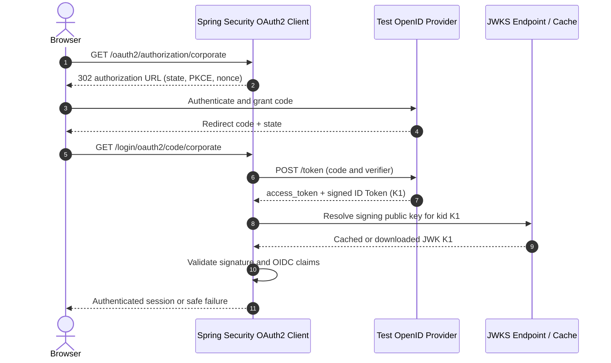

# 31.6. Kiểm thử key rotation và cache JWKS

## 1. Bài toán: OIDC Login chạy tốt hôm nay, nhưng có thể lỗi khi IdP đổi khóa

Trong ứng dụng **Spring Security OAuth 2.0/OIDC Client**, OpenID Provider (OP) có thể ký ID Token bằng khóa bất đối xứng, chẳng hạn RSA với `RS256`. Ứng dụng lấy **khóa công khai** qua một URL `jwks_uri` đã được cấu hình hoặc khám phá bằng OIDC Discovery để kiểm tra chữ ký.

Một ngày, OP đổi từ khóa ký **K1** sang **K2**:

```text
Ngày 1:
    OP ký ID Token bằng private key K1
    JWKS công khai public key K1
    Spring Security kiểm tra chữ ký bằng K1

Ngày 2: bắt đầu rotation
    OP xuất bản public keys K1 + K2
    OP chuyển dần sang ký bằng private key K2
    Spring Security có thể đang cache JWKS cũ: chỉ K1

Ngày 3: kết thúc rotation
    OP ngừng ký bằng K1
    OP chỉ công bố public key K2
    Các caches/phiên xác thực còn khác nhau theo thời điểm
```

Nếu client giữ cache JWKS cũ quá lâu, token ký bằng **K2** có thể bị từ chối. Nếu client xử lý quá dễ dãi khi không tìm thấy key, kẻ tấn công có thể lợi dụng việc kiểm tra chữ ký yếu hoặc trust sai issuer. Nếu operator xóa K1 trước khi những ID Token hợp lệ cũ hết thời hạn hoặc trước khi các consumers cập nhật, quá trình cutover có thể gây gián đoạn.

**Câu hỏi kiểm thử trung tâm:** Ứng dụng có xác minh ID Token đúng khóa, làm mới JWKS cache theo cơ chế dự kiến, chịu được giai đoạn hai khóa cùng tồn tại, và **fail closed** khi không thể xác minh chữ ký hay không?

> Bài học thuộc chương **31. Kiểm thử tích hợp**, module **Spring Security OAuth 2.0 OIDC Client**. Trọng tâm là kiểm thử hành vi thực của OIDC Client khi OP thay đổi bộ khóa ký; không đánh đồng với việc thay OAuth client secret, access-token refresh, TLS certificate hoặc session cookie.

### Mục tiêu học tập

Sau bài này, bạn có thể:

1. Giải thích JWKS, JWK, `jwks_uri`, `kid`, `alg`, issuer và bộ nhớ đệm khóa công khai.
2. Phân biệt **signing-key rotation**, **client-secret rotation**, **TLS rotation** và **refresh-token rotation**.
3. Xây fake OpenID Provider trả **JWKS động**, ký ID Token bằng nhiều khóa thử nghiệm.
4. Chạy integration test đi qua OAuth2 authorization redirect, callback, Token Endpoint và OIDC ID Token validation.
5. Kiểm tra cache hit, cache miss, key mới chưa biết, overlap K1/K2 và retirement của K1.
6. Kiểm tra negative cases: sai chữ ký, key ID không tồn tại, sai issuer/audience, thuật toán bị cấm, JWKS lỗi hoặc timeout.
7. Thiết kế test TTL/cache refresh mà không lạm dụng `Thread.sleep`.
8. Phân biệt bộ cache của **OIDC ID Token decoder** và bộ cache của **Resource Server JWT decoder**.
9. Kiểm soát multi-instance, multi-tenant, JWKS endpoint trust và các rủi ro từ dynamic key URLs.
10. Xây runbook quan sát sự cố JWKS rotation trên môi trường triển khai.

Các ví dụ dùng Spring Boot/Spring Security Servlet với OIDC Authorization Code Flow, fake OP trên loopback và các test keys **không dùng ngoài test**. Chi tiết cache của Nimbus/Spring Security có thể thay đổi theo phiên bản, HTTP client, cache provider và cấu hình. Không suy ra hành vi cache cụ thể chỉ từ API hay ví dụ mang tính khái niệm.

---

## 2. Những khái niệm nền tảng

### 2.1. JSON Web Key (JWK)

Một **JWK** là biểu diễn JSON cho một khóa mật mã. Với chữ ký RSA, các thông tin khóa công khai có thể gồm:

```json
{
  "kty": "RSA",
  "use": "sig",
  "alg": "RS256",
  "kid": "signing-2026-11-k2",
  "n": "PUBLIC_MODULUS_BASE64URL",
  "e": "AQAB"
}
```

`n` và `e` ở đây là giá trị minh họa; chúng không phải một khóa RSA thật dùng để verify. Trên OP thật, JWK chứa modulus/exponent public key chính xác.

**Private key không được công bố trong JWKS.**

### 2.2. JSON Web Key Set (JWKS)

JWKS là một JSON object chứa mảng `keys`:

```json
{
  "keys": [
    {
      "kty": "RSA",
      "use": "sig",
      "alg": "RS256",
      "kid": "signing-2026-10-k1",
      "n": "PUBLIC_MODULUS_K1",
      "e": "AQAB"
    },
    {
      "kty": "RSA",
      "use": "sig",
      "alg": "RS256",
      "kid": "signing-2026-11-k2",
      "n": "PUBLIC_MODULUS_K2",
      "e": "AQAB"
    }
  ]
}
```

Thời điểm overlap, OP có thể công bố **cả K1 và K2** mặc dù chỉ ký token mới bằng K2.

### 2.3. JWS header và `kid`

Một signed JWT thường có header:

```json
{
  "alg": "RS256",
  "kid": "signing-2026-11-k2",
  "typ": "JWT"
}
```

`kid` giúp decoder **chọn khóa ứng viên** trong JWKS. Nó không phải một bằng chứng tin cậy độc lập.

Muốn chấp nhận ID Token, client vẫn phải kiểm tra:

- Chữ ký khớp public key được lấy từ **issuer/JWKS nguồn tin cậy**.
- Thuật toán ký được phép.
- Claims OIDC hợp lệ.
- Token thuộc đúng client, issuer và authorization transaction.

### 2.4. `jwks_uri`

OP có thể công bố qua discovery:

```json
{
  "issuer": "https://login.example.test",
  "jwks_uri": "https://login.example.test/keys"
}
```

Spring Security dùng metadata/provider configuration để tìm JWKS phù hợp. `jwks_uri` phải thuộc **cấu hình provider đã được tin cậy**, không được lấy tùy ý từ JWT header do caller gửi.

### 2.5. Cache JWKS

Decoder thường không tải toàn bộ JWKS từ mạng mỗi lần nhận một token. Nó có thể cache keys trong bộ nhớ hoặc qua cache implementation riêng.

Cache giải quyết hiệu năng và tính sẵn sàng, nhưng tạo ra tình huống:

```text
Remote JWKS đã có K2
    nhưng
Pod A cache vẫn chỉ có K1.
```

Mức độ tự động refresh khi gặp `kid` mới, TTL, cooldown, cache-control handling, concurrent fetch và failure behavior phải được **xác minh trong phiên bản triển khai**, không giả định universal.

---

## 3. Phân biệt bốn loại "rotation" thường bị nhầm

| Loại thay đổi | Thành phần thay đổi | Liên quan JWKS? |
|---|---|---|
| **OP signing-key rotation** | Private key dùng ký ID Token và public key trong JWKS | **Có, trọng tâm bài** |
| OAuth2 client-secret rotation | `client_secret` xác thực client tại Token Endpoint | Không trực tiếp; lỗi thường là `invalid_client` |
| TLS certificate rotation | Certificate bảo vệ kết nối HTTPS tới OP | Không phải JWK ký token; có thể ảnh hưởng HTTP/TLS |
| Refresh-token rotation | OP cấp refresh token mới và vô hiệu hóa token cũ | Không phải JWKS; lỗi thường là `invalid_grant` |

### 3.1. Một token mới sau refresh vẫn cần xác minh theo ngữ cảnh

Nếu OP phát ID Token mới trong một response liên quan đến OIDC, client có thể phải xác minh bằng signing key hiện tại. Nhưng **Refresh Token Grant không đồng nghĩa luôn nhận ID Token mới**; chi tiết phụ thuộc chuẩn và provider.

### 3.2. Access token của provider không nhất thiết là JWT

Một OIDC Client có thể nhận **opaque access token**. Spring Security OAuth2 Client không tự mặc định decode mọi access token như một JWT dùng OP JWKS.

Đừng viết:

```text
JWKS integration test xanh
    => tất cả access tokens đều hợp lệ
```

JWKS test của **OIDC ID Token login** khác với test Resource Server xác minh **JWT access token**.

---

## 4. Vị trí kiểm tra ID Token trong Spring Security Servlet

Luồng tổng quát:



Một integration test đúng hướng phải để **OIDC validation thực sự chạy**. Nếu test gọi `.with(oidcLogin())`, nó đã bỏ qua các bước từ `/authorize` tới JWT/JWKS validation.

### 4.1. Thành phần Spring Security thường liên quan

Trong Servlet stack:

- `ClientRegistration` và `ClientRegistrationRepository`: issuer, JWK Set URI, client ID/secret, redirect URI.
- `OAuth2AuthorizationRequestRedirectFilter`: bắt đầu Authorization Code Flow.
- `OAuth2AuthorizationRequestRepository`: lưu state, PKCE verifier và transaction attributes.
- `OAuth2LoginAuthenticationFilter`: xử lý callback authorization code.
- `OidcAuthorizationCodeAuthenticationProvider`: xử lý nhánh OIDC trong login.
- `OidcIdTokenDecoderFactory`: xây decoder cho ID Token theo registration/provider.
- Nimbus JOSE/JWT/JWK support: xác minh JWS và truy xuất JWK qua những thành phần được cấu hình.
- `SecurityContextRepository` và `OAuth2AuthorizedClientRepository/Service`: lưu kết quả login/authorized client.

Các lớp này có thể được tùy biến hoặc thay thế theo Spring Security version. Kiểm thử cần nhắm vào **pipeline thực tế của project**, không tự mặc định mọi ứng dụng dùng một decoder singleton mặc định.

### 4.2. Không bắt nhầm một bean decoder

Một application có thể vừa:

```text
oauth2Login()     -> validate OIDC ID Token
oauth2ResourceServer().jwt() -> validate JWT access token
```

Hai nhánh có thể dùng **decoder factories, JWKS cache và TTL riêng**.

Tạo một `NimbusJwtDecoder` để test JWT ở Resource Server rồi kết luận cache của OIDC Login hoạt động đúng là không đủ.

---

## 5. Kịch bản rotation lý tưởng: pre-publish, switch, retire

Một kế hoạch **không gián đoạn** thường chia thành ba giai đoạn.

### Giai đoạn A — Chỉ K1

```text
OP ký token bằng K1
JWKS = [K1]
```

Client kiểm tra ID Token K1 thành công.

### Giai đoạn B — Overlap

```text
OP bắt đầu công bố [K1, K2]
OP có thể tiếp tục ký K1 một thời gian
Sau đó OP ký ID Tokens mới bằng K2
```

Clients cần khả năng tìm K2 mà không chấp nhận khóa ngoài trust boundary. K1 còn được công bố trong overlap để các consumers có thể kiểm tra token ký trước khi chuyển.

### Giai đoạn C — Retire

```text
OP ngừng ký K1
OP công bố [K2]
```

Khi JWKS cache của client cập nhật, decoder không còn sử dụng K1 nếu K1 không nằm trong tập khóa hợp lệ hiện tại.

**Nhưng:** xóa K1 khỏi JWKS **không thu hồi tức thì** mọi token K1 đã phát. Một client giữ cache cũ có thể tiếp tục chấp nhận token K1 chưa hết hạn cho tới khi cache bị làm mới hoặc chính sách bảo mật khác chặn. Trong incident compromise cần cơ chế revocation/session invalidation/deny-policy riêng, không chỉ sửa JWKS.

### 5.1. Các khoảng thời gian quyết định overlap

Cần xem:

- Tuổi thọ ID Token/access token ký bằng K1.
- Skew chấp nhận giữa các clocks.
- TTL/cache behavior của consumers.
- Chi phí kiểm tra và độ trễ JWKS endpoint.
- Tốc độ rollout key mới qua nhiều OP nodes.
- Concurrency và số lượng clients.
- Các session/token đã cấp trước rotation.

Không có một overlap duration universal. Provider xác định theo token lifetime và hệ sinh thái consumers.

---

## 6. Mục đích của integration test khác unit test

### 6.1. Unit test kiểm tra key selection bằng JWT test fixture

Có thể dựng:

```text
JWT signed K1, header kid=K1
decoder with public K1 -> success

JWT signed K2, header kid=K2
decoder with public K1 only -> cannot validate
```

Đây là test logic xác minh JWS/key selection. Nếu chỉ mock `JwtDecoder.decode()` trả `Jwt` dựng sẵn thì **không kiểm tra cryptography**.

### 6.2. Integration test kiểm tra cache và HTTP

Một fake JWKS server trả thay đổi theo trạng thái:

```text
GET /jwks -> [K1]
GET /jwks -> [K1,K2]
GET /jwks -> [K2]
```

Ứng dụng thật cần xử lý ID Token ký K1/K2 qua HTTP/TLS test setup, có kiểm soát cache TTL và lỗi.

### 6.3. Full OIDC login integration test kiểm tra cả callback

Chỉ gọi decoder trực tiếp không chứng minh:

```text
Authorization Code Flow
state/PKCE
nonce
token exchange
OIDC user mapping
session persistence
```

Khi yêu cầu kiểm thử **Spring Security OIDC Client**, nên có ít nhất một nhóm tests cho full callback pipeline ngoài các decoder-focused tests.

### 6.4. Browser E2E vẫn có vai trò riêng

MockMvc không tái hiện đầy đủ `SameSite` cookie, TLS termination, redirects qua browser và OP account chooser. Rotation/JWKS tests có thể chạy phần lớn ở backend, nhưng production-like smoke test vẫn quan trọng.

---

## 7. Kiến trúc fake OpenID Provider có JWKS thay đổi

Một fake OP hữu ích phải có:

```text
/.well-known/openid-configuration
/authorize
/token
/jwks
/userinfo (nếu flow sử dụng)
```

Ngoài ra, nó cần một **test control plane** không mở cho người dùng:

```text
publishKeys([K1])
publishKeys([K1,K2])
publishKeys([K2])

signNextIdTokenWith(K1)
signNextIdTokenWith(K2)

setJwksResponse(200/304/500/timeout)
setJwksCacheHeaders(...)
getJwksRequestCount()
```

Các methods trên là pseudocode cho fake server do test định nghĩa, không phải API của Spring Security/WireMock.

### 7.1. Tách private và public keys

```text
Fake OP private keystore:
    K1.private
    K2.private

GET /jwks:
    K1.public
    K2.public
```

Không bao giờ trả private key trong JWKS JSON.

### 7.2. Các công cụ có thể dùng

- **WireMock** hoặc **MockWebServer** để stub JWKS/Token/UserInfo.
- **Spring Authorization Server** làm test Authorization Server có protocol thực.
- Một test IdP container có rotation hooks.
- Custom fake OP cho những negative cases cần ký token bằng key cụ thể.
- JUnit 5, MockMvc, Testcontainers, Awaitility hoặc một controllable clock/cache adapter.

Fake chỉ trả JSON tokens cố định mà không verify authorization code/PKCE có thể hữu ích để test decoder, nhưng chưa chứng minh toàn bộ OIDC Login.

### 7.3. Không phụ thuộc IdP production trong CI tests

Dùng test RSA/EC keys được tạo cho fixture, không dùng private keys của provider thật. Provider sandbox có thể được dùng trong suite riêng, nhưng không dùng credentials/tokens production.

---

## 8. Chuẩn bị hai RSA signing keys độc lập

Với OIDC signing algorithm `RS256`, test có thể tạo hai RSA key pairs:

```java
import java.security.KeyPair;
import java.security.KeyPairGenerator;
import java.security.interfaces.RSAPrivateKey;
import java.security.interfaces.RSAPublicKey;

import com.nimbusds.jose.JWSAlgorithm;
import com.nimbusds.jose.jwk.KeyUse;
import com.nimbusds.jose.jwk.RSAKey;

public final class TestSigningKeys {

    public static RSAKey newRsaSigningKey(String kid)
            throws Exception {

        KeyPairGenerator generator =
            KeyPairGenerator.getInstance("RSA");
        generator.initialize(2048);

        KeyPair pair = generator.generateKeyPair();

        return new RSAKey.Builder(
                (RSAPublicKey) pair.getPublic()
            )
            .privateKey((RSAPrivateKey) pair.getPrivate())
            .keyID(kid)
            .keyUse(KeyUse.SIGNATURE)
            .algorithm(JWSAlgorithm.RS256)
            .build();
    }
}
```

Hai fixtures:

```java
RSAKey k1 = TestSigningKeys.newRsaSigningKey("test-k1");
RSAKey k2 = TestSigningKeys.newRsaSigningKey("test-k2");
```

**Quan trọng:**

- K1 và K2 phải có **key material khác nhau**.
- K1/K2 phải có `kid` khác nhau trong rotation bình thường.
- `kid` chỉ là selector; mọi token vẫn phải có chữ ký hợp lệ.
- Private keys chỉ tồn tại trong test process; không export vào HTTP JSON.
- Không dùng khóa test này để ký token ở production.

### 8.1. Vì sao không chỉ thay `kid` trên cùng một public key?

Nếu giữ nguyên RSA key material và đổi tên `kid`, test có thể không phát hiện lỗi về chọn key, vì cả hai token đều có thể xác minh với cùng public key nếu decoder tìm ra khóa đó.

Muốn kiểm tra rotation mật mã, hãy **thay thực sự cặp khóa**.

---

## 9. Phát JWKS chỉ chứa public keys

Dùng Nimbus `JWKSet`:

```java
import java.util.List;

import com.nimbusds.jose.jwk.JWK;
import com.nimbusds.jose.jwk.JWKSet;
import com.nimbusds.jose.jwk.RSAKey;

public String jwksBody(RSAKey... keys) {

    List<JWK> publicKeys = java.util.Arrays.stream(keys)
        .map(RSAKey::toPublicJWK)
        .map(key -> (JWK) key)
        .toList();

    JWKSet set = new JWKSet(publicKeys);
    return com.nimbusds.jose.util.JSONObjectUtils
        .toJSONString(set.toJSONObject());
}
```

Lưu ý về code: đây là helper minh họa bằng Nimbus JOSE/JWT; tùy phiên bản, bạn có thể dùng chính `JWKSet#toString()`/JSON serializer tương ứng thay vì `JSONObjectUtils`. Mục tiêu là trả đúng JSON JWKS public-only.

Ví dụ:

```java
String jwksK1 = jwksBody(k1);
String jwksBoth = jwksBody(k1, k2);
String jwksK2 = jwksBody(k2);
```

### 9.1. Không tự đưa private JWK vào response

Nguy hiểm:

```java
new JWKSet(List.of(k1, k2))
```

rồi serialize cả private properties nếu không lọc.

Luôn dùng `toPublicJWK()` trước khi xuất bản.

### 9.2. HTTP response cho JWKS

```http
HTTP/1.1 200 OK
Content-Type: application/json
Cache-Control: public, max-age=60
```

```json
{"keys":[{"kty":"RSA","kid":"test-k1","n":"...","e":"AQAB"}]}
```

`max-age=60` ở đây chỉ là fixture. Không mặc định Spring/Nimbus trong tất cả phiên bản sẽ dùng **đúng HTTP Cache-Control TTL** làm thời gian cache. Cần đo và kiểm tra effective cache implementation.

---

## 10. Ký ID Token bằng từng key

Ví dụ dựng signed JWT với Nimbus:

```java
import java.time.Instant;
import java.util.Date;

import com.nimbusds.jose.JOSEObjectType;
import com.nimbusds.jose.JWSAlgorithm;
import com.nimbusds.jose.JWSHeader;
import com.nimbusds.jose.crypto.RSASSASigner;
import com.nimbusds.jwt.JWTClaimsSet;
import com.nimbusds.jwt.SignedJWT;
import com.nimbusds.jose.jwk.RSAKey;

public String signIdToken(
        RSAKey signingKey,
        String issuer,
        String clientId,
        String subject,
        String nonce,
        Instant now) throws Exception {

    JWTClaimsSet claims = new JWTClaimsSet.Builder()
        .issuer(issuer)
        .subject(subject)
        .audience(clientId)
        .issueTime(Date.from(now))
        .expirationTime(Date.from(now.plusSeconds(300)))
        .claim("nonce", nonce)
        .build();

    JWSHeader header = new JWSHeader.Builder(
            JWSAlgorithm.RS256
        )
        .type(JOSEObjectType.JWT)
        .keyID(signingKey.getKeyID())
        .build();

    SignedJWT jwt = new SignedJWT(header, claims);

    jwt.sign(new RSASSASigner(
        signingKey.toRSAPrivateKey()
    ));

    return jwt.serialize();
}
```

Đây là helper cho **test fixture**; ID Token thật còn chịu các yêu cầu OIDC khác theo authorization flow, chẳng hạn validation thời gian, nonce, authorized party khi nhiều audiences và thuật toán đã đăng ký.

### 10.1. Vì sao nonce phải lấy từ authorization request?

Nếu OIDC Login flow gửi:

```text
nonce = N7
```

ID Token của fake OP cần:

```json
{"nonce":"N7"}
```

Trong negative test, sửa thành `N8` để xác nhận callback thất bại. Không dùng một nonce cố định tùy ý rồi bỏ qua OIDC nonce validation khi test fail.

### 10.2. Không chỉ assert JWT header `kid`

Một attacker có thể dựng header:

```json
{"kid":"test-k2","alg":"RS256"}
```

nhưng ký bằng private key khác. Decoder phải từ chối dù `kid` trùng.

---

## 11. OIDC Discovery phải chỉ tới đúng JWKS endpoint

Metadata ví dụ:

```json
{
  "issuer": "http://127.0.0.1:9009",
  "authorization_endpoint": "http://127.0.0.1:9009/authorize",
  "token_endpoint": "http://127.0.0.1:9009/token",
  "jwks_uri": "http://127.0.0.1:9009/jwks",
  "userinfo_endpoint": "http://127.0.0.1:9009/userinfo",
  "response_types_supported": ["code"],
  "subject_types_supported": ["public"],
  "id_token_signing_alg_values_supported": ["RS256"],
  "token_endpoint_auth_methods_supported": ["client_secret_basic"]
}
```

**Loopback HTTP chỉ phù hợp test local có kiểm soát.** Provider production cần HTTPS/TLS theo trust policy.

### 11.1. Mismatch issuer là lỗi khác rotation

Nếu metadata công bố:

```text
issuer=http://127.0.0.1:9009
```

nhưng ID Token ghi:

```text
iss=https://another.example
```

login phải thất bại do issuer validation ngay cả khi public key có thể verify chữ ký.

### 11.2. JWKS URI từ provider metadata là trust input

Không nhận JWT header `jku` hoặc `x5u` tùy ý rồi gọi network tới URL đó. JWKS endpoint phải được xác định bởi **ClientRegistration/issuer configuration đã được chấp thuận**.

### 11.3. Issuer đổi là trust-domain change

Nếu OP đổi issuer, đây không chỉ là thay K1→K2. App cần xem migration/tenant identity mapping `(iss,sub)`, không tự gộp users dựa trên `sub` hoặc email trùng.

---

## 12. Ma trận tối thiểu của key rotation

| Trạng thái JWKS | ID Token ký bằng | Kỳ vọng |
|---|---|---|
| `[K1]` | K1 | Thành công |
| `[K1]` | K2 | Không được chấp nhận nếu K2 chưa có và chưa được tải từ nguồn tin cậy |
| `[K1,K2]`, cache đã cập nhật | K1 | Thành công nếu token/claims hợp lệ |
| `[K1,K2]`, cache đã cập nhật | K2 | Thành công |
| `[K2]`, cache đã cập nhật | K2 | Thành công |
| `[K2]`, cache đã cập nhật, token K1 | K1 | Từ chối sau khi K1 không còn là trusted cached key |
| `[K2]`, cache cũ còn K1 | K1 | **Có thể còn được chấp nhận** tới khi cache refresh; cần đo theo chính sách |
| `[K1,K2]` | Key K3 không công bố | Từ chối |
| `[K1,K2]` | Header `kid=K2`, signature bởi K3 | Từ chối |
| Endpoint lỗi, không có cached key phù hợp | K2 | Từ chối, không bypass signature |
| Endpoint lỗi, cache còn K1 | K1 | Phụ thuộc cache policy; không được chấp nhận nếu không verify được |

### 12.1. Không gắn nhãn FAIL cho kết quả đúng nhưng không cùng cache policy

Ở hàng “JWKS mới `[K2]`, cache cũ K1”, một decoder cache có thể vẫn xác minh được **token K1 chưa hết hạn** trước khi cache refresh. Nếu test muốn yêu cầu **khóa K1 bị từ chối ngay sau rotate**, phải có một cơ chế emergency revocation/cache invalidation/deny rule cụ thể. Không giả định thay JSON JWKS ở server sẽ xóa đồng thời mọi local caches.

### 12.2. Test policy, không chỉ test thời điểm

Một test tốt mô tả rõ:

```text
After a client-observable JWKS refresh that replaces
the cached set with [K2]:
    Valid K2 tokens accepted.
    K1-only signatures not trusted.
```

Đó là điều kiện có thể xác minh. “Ngay sau khi server sửa JWKS, mọi pods phải từ chối K1” là một yêu cầu mạnh hơn cần kiến trúc bổ sung.

---

## 13. Test 1 — Cold cache, JWKS chứa K1

**Tiền điều kiện:**

```text
Fake OP signs ID Tokens using K1.
GET /jwks returns public K1.
Spring client decoder/cache is newly created or cleared.
```

**Thực hiện:**

1. Khởi tạo authorization request thật.
2. OP cấp authorization code cho đúng client, redirect URI và PKCE challenge.
3. Fake Token Endpoint trả signed ID Token K1 với nonce đúng.
4. Client thực hiện OIDC validation.
5. Dùng session đã được login, gọi `/api/me` **không gắn `oidcLogin()`**.

**Kỳ vọng:**

- HTTP callback thành công theo SecurityFilterChain.
- JWKS endpoint được truy vấn khi decoder cần public key.
- Session được authenticated bởi đúng external identity.
- `OidcUser`/application principal có subject đúng.
- Không có raw private key, ID Token hoặc access token trong logs.

### 13.1. Đừng đo sai request count

Một application context có thể khởi tạo decoder hoặc gọi discovery trước callback. Nếu assert:

```text
JWKS HTTP request count == 1
```

phải reset counter đúng thời điểm và hiểu caching behavior của decoder. Có thể tách bài test:

```text
Count after fresh decoder initialization
Count after first signed token validation
```

để không nhầm metadata/JWKS prefetch với refresh.

---

## 14. Test 2 — Cache hit khi cùng key vẫn hợp lệ

**Tiền điều kiện:**

```text
JWKS=[K1]
Client đã verify token K1 thành công.
Không thay cache version/issuer.
```

**Thực hiện:**

Xác thực thêm ID Token signed K1 hợp lệ với `sub`, `nonce`, `iat` và `exp` phù hợp; dùng một authorization transaction mới nếu test full login.

**Kỳ vọng:**

- Token tiếp tục được chấp nhận.
- Khi bộ nhớ đệm đang còn hiệu lực, decoder **có thể** không cần tải JWKS lại.
- Performance và request counts phù hợp effective cache policy.

### 14.1. Cache-hit assertion cần hiểu TTL

Nếu test không kiểm soát TTL/cache lifecycle, việc có thêm một GET /jwks không nhất thiết là lỗi; decoder có thể chủ động refresh hoặc do instance/cache khác.

Muốn assert **không phát sinh GET** phải tạo deterministic cache config và xác minh đó là cache thực sự đang được Spring OIDC Login sử dụng.

### 14.2. Session test không thay thế JWT test

Nếu request thứ hai chỉ dùng session cookie sau login ban đầu, Spring Security thường **không cần verify lại ID Token ở mỗi HTTP request**. Vì vậy nó không tạo cache hit theo nghĩa decode thêm JWT.

Muốn kiểm tra JWKS cache reuse, phải có **nhiều ID Token validations mới**, chẳng hạn nhiều OAuth2 Login transactions hợp lệ.

---

## 15. Test 3 — Pre-publish K2 trong overlap

**Tiền điều kiện:**

```text
OP ban đầu:
    JWKS=[K1]
    signWith=K1

OP chuẩn bị:
    JWKS=[K1,K2]
    signWith=K1
```

**Thực hiện:**

1. Client verify token K1.
2. Fake OP cập nhật JWKS response `[K1,K2]`.
3. Kích hoạt cache refresh theo cơ chế đã thiết kế hoặc kiểm soát.
4. Test các tokens hợp lệ ký K1 và K2 trong hai login transactions riêng.

**Kỳ vọng:**

- Sau khi decoder đã lấy JWKS `[K1,K2]`, cả K1 và K2 là key candidates hợp lệ, với thuật toán được phép và claims đúng.
- Không có chuyện “JWKS có nhiều keys ⇒ chọn key đầu tiên rồi bỏ qua `kid`”.
- Client không phụ thuộc vào thứ tự của mảng `keys` nếu keys có identifiers và metadata chính xác.

### 15.1. Test đảo thứ tự keys

Cho fake OP trả:

```text
[K1,K2]
```

rồi:

```text
[K2,K1]
```

và đảm bảo chữ ký K1/K2 được verify đúng sau khi refresh. JWK Set không yêu cầu first-key wins.

### 15.2. Test `use`/`key_ops`/`alg` phù hợp

Nếu JWKS gồm signing keys và encryption keys, decoder phải áp selection/algorithm policy, không dùng bất kỳ RSA key nào để verify chỉ vì cùng kty.

Cần biết thư viện JOSE/OP contract xử lý những metadata nào, không viết test mong mọi implementation buộc phải xử lý field optional theo cùng cách.

---

## 16. Test 4 — OP bắt đầu ký K2 khi client còn cache K1

Đây là ca quan trọng của rotation.

**Trình tự:**

```text
T0:
    Client cache = [K1]

T1:
    Remote JWKS = [K1,K2]

T2:
    OP signs ID Token with K2

T3:
    Client receives token header kid=K2
```

Client phải quyết định liệu có tải JWKS mới khi gặp unknown kid.

### 16.1. Hai hành vi có thể quan sát

**Hành vi A — unknown kid kích hoạt refresh:**

```text
Cache miss kid=K2
    -> GET /jwks
    -> [K1,K2]
    -> verify token K2 thành công
```

**Hành vi B — cache không refresh ngay:**

```text
Cache miss kid=K2
    -> decoder từ chối
    -> sau TTL/refresh cơ chế riêng, token K2 có thể được verify
```

**Hành vi nào đúng** phụ thuộc cache implementation/requirements. Spring/Nimbus có thể refetch JWKS khi gặp unknown `kid` trong những cấu hình nhất định, nhưng **không được khẳng định luôn xảy ra** nếu chưa xác minh effective version, custom cache, negative caching và refresh policy.

### 16.2. Test phải tuyên bố rõ hợp đồng

Ví dụ một acceptance criterion:

```text
Given OP has pre-published K2
When a valid K2 ID Token arrives after the application
has cached only K1
Then the application refreshes JWKS and accepts K2
within a bounded time under the configured strategy.
```

Nếu hệ thống chọn TTL-only, criterion có thể là:

```text
No cryptographic bypass.
A K2 token might temporarily fail before refresh,
then succeeds after controlled cache expiry.
```

Nhớ rằng availability requirement không cho phép bỏ signature validation để luôn “login thành công”.

---

## 17. Test 5 — Retire K1 sau refresh

**Trình tự:**

```text
Remote JWKS = [K2]
Client's effective JWKS cache has been refreshed to [K2].
```

**Positive:**

```text
ID Token signed K2, kid=K2
    -> accepted
```

**Negative:**

```text
ID Token signed K1, kid=K1
    -> rejected after old key removed from effective cache
```

### 17.1. Vì sao cần chứng minh effective cache đã refresh?

Nếu client vẫn giữ `[K1,K2]` trong cache, nó có thể tiếp tục verify token K1. Một test “đổi response ở WireMock, ngay lập tức gửi K1, mong fail” có thể thất bại vì **cache chưa được invalidated**, không phải vì decoder bỏ qua JWKS.

### 17.2. Key retirement là một quá trình

Provider nên cân nhắc giữ K1 công khai đủ lâu để token hợp lệ ký trước cutover còn được xác minh cho tới lúc hết hạn theo policy. Khi cần dừng khẩn K1 do lộ private key, quy trình security incident khác normal rotation.

---

## 18. Test 6 — Unknown `kid` và chữ ký không hợp lệ

Một test negative:

```text
Remote JWKS=[K1,K2]
ID Token header:
    kid=never-published-k3

JWT signature:
    private key K3
```

Kỳ vọng: **authentication thất bại**.

Một test khác:

```text
Remote JWKS=[K1,K2]
ID Token header:
    kid=K2

JWT signature:
    private key K3
```

Kỳ vọng: **authentication thất bại dù `kid` trùng K2**.

### 18.1. Không fallback sang “bỏ qua chữ ký”

Sai:

```text
if kid not found:
    parse JWT payload only
    accept based on sub/email
```

Đó là authentication bypass.

### 18.2. Không tin token-supplied `jku` hoặc `x5u`

JWT header có thể chứa URL gợi ý key:

```json
{
  "alg": "RS256",
  "kid": "k3",
  "jku": "https://attacker.example/jwks"
}
```

OIDC Client phải lấy keys từ **configured trusted JWKS source** của issuer, không tự tải URL trong token header do attacker điều khiển. Fake JWKS server có thể ghi nhận nếu test decoder bất ngờ gửi HTTP tới host attacker; cấu hình egress allowlist là biện pháp bổ sung.

### 18.3. Giới hạn refresh storm

Khi attacker gửi nhiều unknown kids khác nhau, decoder không nên gây HTTP storm vô hạn tới JWKS endpoint nếu resource/server exposure cho phép attacker kích hoạt validation liên tục.

Test rate limiting, negative-cache/cooldown, concurrent request coalescing theo **implementation và threat model**.

---

## 19. Test 7 — Algorithm mismatch và algorithm confusion

JWT header có:

```json
{"alg":"RS256","kid":"K1"}
```

nhưng ứng dụng có thể được cấu hình chỉ chấp nhận một tập algorithms.

Các ca cần thử:

- Token signed với thuật toán khác configured policy.
- Token khai `alg=none`.
- Token khai `HS256` dù client chỉ chấp nhận asymmetric signing.
- JWT header `alg` và JWK metadata không nhất quán.
- Token ký bằng key không phù hợp thuật toán.
- Mixed RSA/EC keys trong JWKS khi chỉ một alg được cho phép.

### 19.1. Không dùng “alg từ token quyết định decoder” vô điều kiện

Một decoder an toàn phải áp **allowed algorithms** từ cấu hình tin cậy và JWK selection, không tự tin header do caller gửi.

### 19.2. OIDC có nhiều phương thức ký

OP có thể dùng `RS256`, `ES256` hoặc thuật toán được đăng ký/hỗ trợ. Một số tình huống sử dụng MAC-based signing như `HS256` với client secret, không dựa trên JWKS theo cùng cách.

**Phạm vi bài:** key rotation của **asymmetric JWKS**. Muốn test `HS256`, phải thiết kế riêng với client-secret/MAC validation semantics, không dùng kịch bản RSA JWKS.

### 19.3. Đừng hardcode `RS256` cho mọi provider

Nếu provider thực dùng ES256, test RSA có thể không phản ánh production trust. Chọn signing algorithm theo provider contract và Spring Security configuration.

---

## 20. Test 8 — JWKS endpoint mất kết nối hoặc trả lỗi

Giả lập:

```text
GET /jwks -> HTTP 503
GET /jwks -> timeout
GET /jwks -> malformed JSON
GET /jwks -> empty keys
GET /jwks -> 404
GET /jwks -> 429
```

### 20.1. Cache chưa có key

Nếu chưa có public key phù hợp:

```text
JWKS unavailable
    -> cannot cryptographically verify ID Token
    -> authentication must fail closed
```

Không chấp nhận token chỉ vì issuer/audience/sub đúng hoặc JWT parse được.

### 20.2. Cache còn public key hợp lệ

Nếu bộ cache hiện có key K1 và một token K1 phù hợp:

```text
JWKS remote outage
    + valid cached K1
    -> may continue validation depending cache policy
```

Đây có thể là availability strategy hợp lệ **nếu cached key vẫn nằm trong thời hạn/trust policy**. Đừng mặc định thư viện sẽ luôn thực hiện stale-while-revalidate hoặc luôn fail; hãy kiểm tra thực tế.

### 20.3. Key mới không có trong cache

```text
Client cached only K1.
OP signs K2.
JWKS endpoint unavailable.
```

Không thể verify K2 bằng K1, nên **phải từ chối**, không thử đồng ý bằng `sub` hay certificate từ header tùy ý.

### 20.4. Timeout và retry có giới hạn

Khi JWKS endpoint chậm, cần timeout để tránh giữ thread/cạn pool. Test:

- HTTP connect timeout.
- HTTP read timeout.
- Bounded retries/backoff.
- Không tạo thác HTTP requests khi concurrent unknown kids.
- Failure handler hiển thị thông báo an toàn, không raw endpoint/stack trace.

---

## 21. Test 9 — HTTP caching headers, ETag và 304

JWKS endpoint có thể trả:

```http
HTTP/1.1 200 OK
Cache-Control: public, max-age=120
ETag: "jwks-v2"
Content-Type: application/json
```

Nếu client HTTP/cache implementation hỗ trợ conditional requests, lần tiếp theo có thể gửi:

```http
If-None-Match: "jwks-v2"
```

và server trả:

```http
HTTP/1.1 304 Not Modified
ETag: "jwks-v2"
```

**Không phải mọi Spring/Nimbus JWKS cache sẽ gửi conditional GET hoặc lấy TTL trực tiếp từ `Cache-Control`.** Chỉ tạo test ETag/304 khi application thực sự dùng layer hỗ trợ chức năng đó.

### 21.1. Test metadata không thay bằng đoán

Không kết luận:

```text
max-age=120 => decoder luôn refresh ở giây thứ 121.
```

Mức cache thực còn phụ thuộc implementation, clock, default expiration, refresh policy, caching proxy và HTTP client.

### 21.2. Kiểm tra sau 304

Nếu cache layer có conditional GET support:

- 304 không có body JWKS mới.
- Cached keys được giữ an toàn theo cache semantics.
- Không parse body rỗng như `{"keys":[]}` rồi mất hết keys.
- Cache metadata cập nhật đúng để tránh request storm.

### 21.3. Test Cache-Control no-store có đúng ý không?

Nếu JWKS response có `no-store`, phụ thuộc HTTP client/cache layer có tôn trọng hay không. Đừng đưa header đó rồi coi cache phải vô hiệu nếu thư viện thực không dùng HTTP cache semantics.

---

## 22. Cache TTL: test được thời gian mà không làm CI chậm

Một test kiểu:

```java
Thread.sleep(300_000); // 5 phút
```

không phù hợp: chậm, flakiness cao, chạy song song dễ vượt timeout.

### 22.1. Ưu tiên cache có thể kiểm soát trong test

Nếu application tự sở hữu cache adapter:

```text
JWKS cache TTL = 30s
TestClock:
    T0 -> K1 cached
    T0 + 31s -> expiry triggered
```

Một `Clock` giả hoặc cache implementation có test clock giúp deterministic tests. Tuy nhiên, **Spring/Nimbus internal caches có thể không sử dụng injected Spring Clock**. Không giả định `Clock.fixed()` tự điều khiển Nimbus cache.

### 22.2. Những lựa chọn khác

- Dùng short TTL **được chính cache implementation hỗ trợ** trong test profile.
- Expose test-only cache invalidation hook nếu production có abstraction thích hợp.
- Tạo decoder instance mới để test cold-cache loading (không thay test expiration).
- Dùng fake OP với HTTP request counters.
- Dùng Awaitility với deadline ngắn và polling phù hợp thay vì fixed long sleep.
- Tách suite thời gian dài thành nightly/compatibility tests khi không thể điều khiển TTL.

### 22.3. Ranh giới test cần tuyên bố

Một test tạo decoder mới sau khi OP thay JWKS chỉ chứng minh **cold cache tải K2**, không chứng minh decoder đã sống nhiều ngày biết refresh K1→K2.

Để kiểm tra stale-cache upgrade, phải tái sử dụng **cùng decoder/cache instance** qua transition.

### 22.4. Không tự xóa cache giữa mọi bước

Nếu test luôn gọi:

```text
cache.clear()
```

trước khi đưa token K2, nó bỏ qua chính vấn đề rotation cache. Nên có các bài test tách biệt:

- **Cold cache**.
- **Warm cache / unknown kid**.
- **Configured TTL expiration**.
- **Manual invalidation behavior** (nếu sản phẩm có).

---

## 23. Nimbus và Spring: tránh giả định về refresh nội bộ

Spring Security dùng Nimbus trong nhiều đường đi JOSE/JWT validation; nhưng implementation thực tế có thể thay đổi theo phiên bản Spring Security, Nimbus JOSE/JWT, dependency management và cách app custom `JwtDecoder`.

Một số điểm phải xác định:

1. Decoder nào được dùng cho **OIDC ID Token**?
2. Decoder đó được tạo **một lần**, theo registration, hay theo request?
3. JWKS cache tồn tại ở đâu?
4. Cache TTL/fetch cooldown hiện tại là bao lâu?
5. Unknown `kid` có kích hoạt HTTP fetch ngay không?
6. Nếu JWKS fetch lỗi, có sử dụng cache còn hiệu lực không?
7. Nếu HTTP trả 304, cache layer có hiểu không?
8. Nếu nhiều requests đồng thời gặp K2 mới, fetch có được coalesce không?
9. Khi tenant registration đổi issuer/JWKS URI, decoder/cache có được làm mới không?
10. Nếu `kid` được tái sử dụng cho key material mới, client sẽ xử lý sao?

### 23.1. OIDC decoder khác Resource Server decoder

Một ứng dụng có thể khai báo:

```java
NimbusJwtDecoder.withJwkSetUri("https://.../jwks")
```

cho **Resource Server JWT**. Điều này không chứng minh OIDC Login dùng đúng instance/cache đó.

Khi kiểm thử **OIDC Client**, phải kích hoạt callback/token exchange và xác minh decoder thực sự của OIDC Login; nếu kiểm thử trực tiếp decoder, cần biết nó có phải decoder do `OidcIdTokenDecoderFactory` tạo trong production hay không.

### 23.2. Không mock `JwtDecoder` cho JWKS cache test

Sai mục tiêu:

```java
when(jwtDecoder.decode(anyString())).thenReturn(fakeJwt);
```

Test trên hoàn toàn bỏ qua:

```text
JWKS HTTP fetch
JWK selection
JWS signature check
Cache refresh
Algorithm validation
```

Nó chỉ có ích cho controller/service logic đã giả định token hợp lệ.

### 23.3. Gắn cache vào đúng nơi

Nếu app có custom caching library, phải chứng minh cache đó nằm trên **đường gọi của actual decoder**. Một fake cache object được assert trong test nhưng không được Spring Security OIDC Login dùng thì không mang giá trị về rotation thực.

---

## 24. Dựng ClientRegistration cho fake OP

Có thể dùng `ClientRegistration` builder với các endpoint đã biết trong test:

```java
import org.springframework.security.oauth2.client.registration.ClientRegistration;
import org.springframework.security.oauth2.core.AuthorizationGrantType;
import org.springframework.security.oauth2.core.ClientAuthenticationMethod;

public ClientRegistration testRegistration(String opBaseUrl) {

    return ClientRegistration
        .withRegistrationId("test-corporate")
        .clientId("portal-test-client")
        .clientSecret("test-only-client-secret")
        .clientAuthenticationMethod(
            ClientAuthenticationMethod.CLIENT_SECRET_BASIC
        )
        .authorizationGrantType(
            AuthorizationGrantType.AUTHORIZATION_CODE
        )
        .redirectUri(
            "{baseUrl}/login/oauth2/code/{registrationId}"
        )
        .scope("openid", "profile")
        .authorizationUri(opBaseUrl + "/authorize")
        .tokenUri(opBaseUrl + "/token")
        .jwkSetUri(opBaseUrl + "/jwks")
        .issuerUri(opBaseUrl)
        .userInfoUri(opBaseUrl + "/userinfo")
        .userNameAttributeName("sub")
        .clientName("Test Corporate OP")
        .build();
}
```

Đây là một ví dụ cấu hình test. Nếu ứng dụng thực dựa vào `issuer-uri` và discovery, phải có **bài test riêng cho metadata discovery**, không chỉ cấu hình hardcoded endpoints.

### 24.1. Khi nào dùng issuer-uri?

Trong Spring Boot:

```yaml
spring:
  security:
    oauth2:
      client:
        registration:
          corporate:
            client-id: ${OIDC_CLIENT_ID}
            client-secret: ${OIDC_CLIENT_SECRET}
            scope:
              - openid
              - profile
        provider:
          corporate:
            issuer-uri: https://login.example.test
```

Spring Boot/Spring Security có thể dùng discovery để tạo provider metadata/ClientRegistration tương ứng. Với fake OP chạy random port, test cần đưa **actual issuer URI** qua dynamic properties hoặc programmatic registration trước khi application context khởi tạo.

### 24.2. Không cho user nhập arbitrary JWKS URI

Test server được hardcode/approved ở test context. Trong production, issuer/JWKS URI là trust configuration, không phải giá trị tùy ý từ browser/JWT header. Nếu có dynamic tenant onboarding cần allowlist/TLS/SSRF controls.

---

## 25. Một fake JWKS server có trạng thái

Pseudocode Java:

```java
// Test-only component: giao diện minh họa, không là Spring API.
public interface MutableTestJwksServer {

    void publish(RSAKey... publicAndPrivateTestKeys);

    void signTokensWith(RSAKey signingKey);

    void respondWithHttpStatus(int status);

    void delayResponses(java.time.Duration duration);

    int requestCount();

    void resetRequestCounter();
}
```

Một implementation WireMock/MockWebServer có thể giữ:

```java
AtomicReference<String> jwksResponse =
    new AtomicReference<>();

AtomicInteger jwksHits = new AtomicInteger();

AtomicReference<RSAKey> activeSigningKey =
    new AtomicReference<>();
```

Endpoint `/jwks` đọc `jwksResponse.get()` và tăng `jwksHits`. Token Endpoint dùng `activeSigningKey.get()` để ký ID Token.

### 25.1. Bắt đầu rotation trong test

```java
server.publish(k1);
server.signTokensWith(k1);

loginAndVerify();

server.publish(k1, k2);
server.signTokensWith(k2);

loginAndVerify();
```

`loginAndVerify()` là helper **do test tự triển khai**: bắt đầu authorization request, nhận code/state, fake OP xử lý PKCE và ký ID Token, callback vào Spring Security, kiểm tra session.

### 25.2. Tách remote state khỏi local cache state

Fake server đổi JWKS response không đồng nghĩa decoder cache đã đổi.

Trong test fixtures nên có hai quan sát:

```text
remotePublishedKids = [K1,K2]
clientObservedKids = inferred from successful validation/fetch count
```

Không lấy một variable `server.keys` rồi dùng nó làm chứng cứ client đã tải đúng keys.

---

## 26. Cấu trúc MockMvc full login integration

Một integration test có thể:

```java
// Pseudocode, cần fake OP và helpers thực trong project.

MvcResult begin = mockMvc.perform(
        get("/oauth2/authorization/test-corporate")
    )
    .andExpect(status().is3xxRedirection())
    .andReturn();

MockHttpSession session =
    (MockHttpSession) begin.getRequest().getSession(false);

String authorizationUrl =
    begin.getResponse().getHeader("Location");

FakeAuthorizationTransaction transaction =
    fakeOp.issueAuthorizationCodeFrom(authorizationUrl);

MvcResult callback = mockMvc.perform(
        get("/login/oauth2/code/test-corporate")
            .param("code", transaction.code())
            .param("state", transaction.state())
            .session(session)
    )
    .andExpect(status().is3xxRedirection())
    .andReturn();

MockHttpSession authenticatedSession =
    (MockHttpSession) callback.getRequest().getSession(false);

mockMvc.perform(
        get("/api/me").session(authenticatedSession)
    )
    .andExpect(status().isOk());
```

`fakeOp`, `FakeAuthorizationTransaction` và helpers là **custom test fixtures**, không phải Spring Security APIs. Session management có thể xoay ID hoặc chuyển session object theo framework/test setup; test thực phải lấy session/cookie sau callback từ kết quả response và repository đúng.

### 26.1. Điều kiện để test thực sự kiểm tra JWKS

Fake Token Endpoint phải trả:

```text
id_token = JWT signed with private K1 or K2
```

Spring Security phải thực hiện OIDC signature validation qua configured JWKS endpoint.

Nếu test thay bằng:

```java
.with(oidcLogin())
```

hoặc stub toàn bộ authentication provider trả success, JWKS cache hoàn toàn bị bỏ qua.

### 26.2. Fake OP phải quản lý authorization code

Fake OP nên enforce:

- Authorization code có TTL ngắn.
- Code one-time-use.
- Code thuộc đúng client/redirect URI.
- PKCE code verifier khớp challenge.
- OIDC nonce từ authorization request.
- Client authentication tại Token Endpoint.

Nếu fake OP không làm vậy, bài test vẫn có ích để kiểm tra JWKS nhưng **không chứng minh toàn bộ Authorization Code Flow**.

### 26.3. Dùng signed ID Token riêng cho mỗi login attempt

Khi test nhiều lần với K1/K2, mỗi transaction cần `state` và `nonce` mới; không tái sử dụng nguyên ID Token K1 của lần login trước với nonce cũ rồi kết luận khóa bị từ chối.

---

## 27. Một trường hợp sai phổ biến: thay key nhưng reuse `kid`

Provider có thể vô tình thay key material mà giữ nguyên:

```text
kid = signing-current
```

trong khi public key trước đây khác public key mới.

### 27.1. Tại sao nguy hiểm cho cache?

```text
Client cache:
    kid=signing-current -> public K1

Remote JWKS:
    kid=signing-current -> public K2
```

Khi nhận token header cùng `kid`, decoder có thể tiếp tục chọn K1 từ cache và từ chối chữ ký K2; nó **không nhất thiết nhận ra cần refresh** vì key ID vẫn được biết.

### 27.2. Test negative hữu ích

1. Cache K1 với `kid=signing-current`.
2. Remote JWKS chuyển sang public K2 **cùng kid**.
3. OP ký ID Token bằng private K2, header giữ kid.
4. Observe behavior trước và sau cache refresh.
5. Xác minh không có fallback bỏ signature check.

### 27.3. Provider practice

Thông thường nên **dùng `kid` mới cho key material mới** và overlap phù hợp. Đó không phải thay thế cho JWT signature validation, nhưng giúp consumers quản lý key cache an toàn.

### 27.4. Không tự sửa cache bằng cách nhìn `kid` thôi

Một cache keyed chỉ bởi `kid` trên toàn bộ ứng dụng có nguy cơ collision giữa issuers/tenants. Trust key phải gắn với provider/issuer/JWKS source và algorithm policy.

---

## 28. Multi-tenant: hai issuers có cùng `kid`

Giả sử:

```text
Tenant Alpha:
    issuer = https://id.alpha.example
    kid = current
    public key = AlphaKey

Tenant Beta:
    issuer = https://id.beta.example
    kid = current
    public key = BetaKey
```

Đây là trường hợp bình thường. `kid` **không global unique** giữa providers.

### 28.1. Test bắt buộc

- Token Alpha được verify bằng JWKS Alpha.
- Token Beta được verify bằng JWKS Beta.
- Alpha token không được chấp nhận tại Beta registration dù `kid` trùng.
- `iss` phải khớp ClientRegistration provider.
- Tenant authorization cho login/callback đúng trusted tenant context.
- Khi Alpha rotate K1→K2, Beta không bị invalidate nhầm cache.
- Khi tenant disables registration, callback mới bị chặn theo policy.

### 28.2. Đừng chia cache toàn cục keyed chỉ bằng kid

Sai:

```text
cache["current"] = publicKey
```

An toàn hơn về mặt trust:

```text
cache[trustedIssuerOrJwksSource][kid] = key
```

Tuy nhiên, implementation nên tuân theo lựa chọn cache/key source của thư viện bảo mật đã được kiểm chứng, không tự tạo decoder thủ công nếu không cần.

### 28.3. Issuer validation không được bỏ

Ngay cả khi Alpha và Beta công bố cùng public key vì cấu hình bất thường, token của Alpha không được tự nhận như token Beta nếu `iss`/audience không phù hợp.

---

## 29. Multi-instance và rolling deployment

Một ứng dụng chạy ba pods:

```text
Pod A:
    cached JWKS = [K1]

Pod B:
    cached JWKS = [K1,K2]

Pod C:
    just restarted, cache cold
```

Khi OP chuyển ký sang K2:

```text
Pod A:
    may need refresh and may temporarily fail

Pod B:
    validates K2

Pod C:
    fetches current JWKS and validates K2
```

### 29.1. Không phải bug session nếu lỗi chỉ xuất hiện trên một pod

Một lỗi `kid not found` ngẫu nhiên có thể đến từ local caches không đồng nhất, chứ không phải authorization request state.

Quan sát theo:

```text
deploymentVersion
pod/instance identifier
registration/issuer alias
JWKS fetch success/error
kid classification (không log token)
cache refresh timing
```

### 29.2. Test nhiều decoder instances độc lập

Khởi tạo hai application/decoder instances:

```text
Decoder A warmed with [K1]
Decoder B initialized after [K1,K2]
```

Kiểm tra chênh lệch behavior và eventual recovery theo policy, không chỉ một singleton trong JUnit class.

### 29.3. Shared cache không tự bảo đảm an toàn hơn

Một Redis/distributed JWKS cache có thể giảm HTTP fetch nhưng cần:

- Namespacing theo issuer/JWKS source.
- TTL và invalidation.
- Race handling giữa old/new key sets.
- Đảm bảo không ghi private key vào cache.
- Quyền truy cập và network isolation.
- Giám sát cache poisoning/misconfiguration.

Không chuyển JWKS sang shared cache chỉ để “các pods giống nhau” khi chưa hiểu invalidation/consistency.

---

## 30. JWKS fetch storm và concurrency

Khi một OP rotate key, hàng trăm login callbacks có thể cùng mang header:

```text
kid=K2
```

Trong khi mọi pods đang cache `[K1]`, chúng có thể cùng gọi:

```http
GET /jwks
```

### 30.1. Test load có kiểm soát

Một bài test:

1. Warm cache với K1.
2. Publish `[K1,K2]`.
3. Cho N concurrent ID Token validations ký bằng K2.
4. Ghi JWKS request count, latencies, error rate.
5. Kiểm tra không có unbounded retries, deadlocks hoặc OOM.
6. Xác minh accepted tokens đều có signature/claims hợp lệ.

### 30.2. Không áp điều kiện “chỉ một HTTP GET” chung

Một decoder có thể coalesce fetch, decoder khác không; nhiều pods có caches riêng. Acceptance criterion cần đặt từ SLO/traffic budget:

```text
Concurrent K2 validations recover within configured bound,
without bypassing signature verification and without
overloading the JWKS endpoint.
```

### 30.3. Unknown-kid DoS

Nếu attacker có thể kích hoạt hàng nghìn validations với random kids, cache-miss refresh có thể bị lợi dụng để gây network/CPU load. Rate limit, bounded refresh/retry và monitoring theo implementation.

### 30.4. HTTP retry không được làm lộ token

Một failed JWKS fetch không cần log raw ID Token. Nếu cần correlation, dùng request ID ngẫu nhiên và safe error category, không dùng token suffix/hash.

---

## 31. Kiểm tra cache staleness và key revocation

Một điểm cần phân biệt:

**Rotation bình thường:**

```text
K1 vẫn an toàn.
K2 mới được sử dụng.
K1 có thể được giữ public thêm một thời gian.
```

**Compromised K1:**

```text
Private key K1 bị lộ.
Attacker có khả năng ký token giả.
```

Nếu private K1 bị lộ, chỉ xóa K1 khỏi remote JWKS có thể không loại bỏ ngay nguy cơ đối với clients còn cached K1.

### 31.1. Các hành động ngoài JWKS

Tùy hệ thống và mức độ nghiêm trọng:

- Invalidate local authenticated sessions.
- Tăng tenant/account/session epoch hoặc central deny policy.
- Revoke/restrict existing authorizations.
- Thay key, cập nhật allowlist trust.
- Force cache invalidation/restart decoder theo kiến trúc.
- Thắt chặt token lifetime/time validation.
- Giám sát issuer/signature anomalies.
- Phối hợp OP và downstream Resource Servers.

### 31.2. Không giả định ID Token phải verify lại mỗi request

Sau OIDC Login, Spring Security có thể lưu SecurityContext trong session. Mỗi request business API tiếp theo **không nhất thiết tái giải mã ID Token**. Vì vậy JWKS removal không tự làm session cũ logout.

### 31.3. Test security incident khác test normal rotation

Normal rotation test chứng minh **availability + signature validation**.

Compromise-response test chứng minh **revocation/session enforcement/caching invalidation** theo kiến trúc riêng. Đừng chấm test normal rotation là “không an toàn” chỉ vì session cũ chưa tự biến mất sau khi remote JWKS đổi.

---

## 32. Negative test: JWKS chứa key không hợp lệ

Fake JWKS có thể trả:

```text
Malformed JSON
keys không phải array
key thiếu kty
RSA n/e không hợp lệ
duplicate kids nhưng key khác
unsupported kty
key use=enc (không phải sig)
key ops không phù hợp
key alg không khớp
empty keys
oversized JWKS
```

### 32.1. Kỳ vọng chung

- Không chấp nhận ID Token nếu không có một key hợp lệ để verify.
- Không crash toàn bộ application process.
- Không đưa raw JWT/JWKS body hoặc stack trace về browser.
- Thực hiện HTTP timeout/response size controls.
- Ghi safe metrics theo loại lỗi.

### 32.2. Duplicate `kid`

Một JWKS có hai public keys cùng `kid` nhưng material khác nhau là provider misconfiguration nghiêm trọng. Không dựa vào thứ tự keys hoặc tự chấp nhận bất kỳ key nào bỏ qua thuật toán/issuer.

### 32.3. JWKS chứa public key không đáng tin

Ngay cả một JSON key hợp lệ về mặt cú pháp cũng không đáng tin nếu tới từ server mà ứng dụng không cho phép. Cần issuer/JWKS URI trust, HTTPS/TLS và metadata validation.

---

## 33. HTTP/TLS và kiểm soát nguồn JWKS

Trong production, việc gọi JWKS endpoint cần:

- HTTPS với TLS hostname/certificate validation.
- URI được tạo từ provider configuration đã tin cậy.
- Redirect policy hạn chế không gửi traffic tới host nguy hiểm.
- DNS/egress policy phù hợp.
- Timeout và response-size limit.
- Chống SSRF khi cho tenant admin cấu hình issuer.
- Pin/allowlist hoặc approval theo provider onboarding policy.

### 33.1. Không tự tắt TLS verification trong test profile tràn sang production

Một fake OP dùng loopback HTTP là phù hợp cho môi trường test cô lập. Không đặt một custom `TrustManager` luôn chấp nhận certificates vào production code chỉ để test HTTPS fake server dễ hơn.

### 33.2. Test malicious `jku`

Có thể tạo ID Token header:

```json
{
  "alg": "RS256",
  "kid": "test-k1",
  "jku": "http://169.254.169.254/latest/meta-data/"
}
```

Kỳ vọng client **không tải** URL này chỉ vì token header. Một security egress monitor/fake HTTP client có thể xác nhận không có network request tới endpoint từ token-supplied header.

### 33.3. Rotation không biện minh cho arbitrary fallback

Sai:

```text
JWKS fetch fails:
    try decoding JWT without signature
```

Sai tương tự:

```text
kid unknown:
    follow any URL declared in token header
```

Một authentication system phải fail closed khi không có trusted verification key.

---

## 34. Quan sát rotation trên hệ thống vận hành

Những metrics đáng theo dõi:

```text
oidc_id_token_validation_total{
  provider="corporate",
  outcome="failure",
  reason="UNKNOWN_KID"
}

oidc_jwks_fetch_total{
  provider="corporate",
  outcome="success"
}

oidc_jwks_fetch_duration_seconds{
  provider="corporate"
}

oidc_login_failure_total{
  stage="ID_TOKEN_VALIDATION",
  reason="SIGNATURE_INVALID"
}

oidc_jwks_cache_events_total{
  event="refresh"
}
```

Các tên là **metrics custom minh họa**, không phải metrics bắt buộc được Spring Security tự xuất với chính xác các labels trên.

### 34.1. Không ghi token vào logs

Không log:

```text
id_token
access_token
refresh_token
client_secret
authorization_code
nonce
OAuth2 state
session cookie
private JWK
```

### 34.2. `kid` có thể là metadata nhưng không là bí mật

`kid` trong public JWKS/header thường không phải secret; tuy vậy raw `kid` có thể do attacker đặt và tạo high-cardinality metrics hoặc log injection. Nên ghi **known/unknown class** hoặc sanitized/bounded key alias theo policy.

### 34.3. Các chiều hữu ích cho troubleshooting

- Trusted provider/issuer alias.
- Tenant reference đã được authorized và có cardinality phù hợp.
- Pod/region.
- Spring Security/Nimbus dependency versions.
- JWKS cache version/age nếu có.
- Validation outcome.
- Token algorithm class được policy cho phép.
- JWKS request status/latency.
- Correlation ID trong logs/traces, **không** là metric label.

### 34.4. Không coi một unknown kid là chắc chắn attack

Một unknown kid có thể là dấu hiệu rotation bình thường, cấu hình JWKS lỗi hoặc token giả. Cần kết hợp pattern/time/provider metadata trước khi kết luận.

---

## 35. Runbook khi K2 token bị từ chối sau rotation

**Triệu chứng:**

```text
OAuth2 Login failure
reason=ID_TOKEN_SIGNATURE_VALIDATION_FAILED
kid_class=UNKNOWN
provider=corporate
```

Thứ tự điều tra:

1. Kiểm tra issuer/registration đang sử dụng.
2. Kiểm tra public JWKS hiện tại của trusted OP qua kênh vận hành có kiểm soát.
3. Kiểm tra OP có thực sự công bố K2 trước khi ký K2 không.
4. Kiểm tra all OP nodes đã phục vụ JWKS nhất quán chưa.
5. Xem client decoder/cache behavior với phiên bản dependency hiện tại.
6. Kiểm tra JWKS HTTP status, timeouts, DNS/TLS.
7. Xem một hay nhiều pods cùng lỗi.
8. Xem `kid` mới có bị tái sử dụng hoặc key material sai không.
9. Kiểm tra client đang trỏ nhầm issuer/JWKS URI do tenant config đổi không.
10. Xem JWKS cache refresh/expiration hoạt động như đã cấu hình.
11. Áp recovery/mitigation đúng policy; không tắt signature validation.
12. Ghi timeline rotation, phiên bản config và kết quả sau phục hồi.

### 35.1. Mã hỗ trợ cho người dùng

UI có thể hiển thị:

> Không thể xác minh đăng nhập lúc này. Vui lòng thử lại sau hoặc liên hệ hỗ trợ với mã `c-7f12`.

Không hiển thị raw JWT, stack trace, nội dung JWKS hoặc internal URL.

### 35.2. Nếu K2 chưa được pre-publish

Đây có thể là lỗi từ quy trình rotation phía OP: signing đã chuyển trước khi JWKS công bố key. Cần phối hợp OP publish K2 và bảo đảm clients có thể tải; không thay client policy bằng cách chấp nhận key lạ.

### 35.3. Nếu client vẫn cache K1

Tùy kiến trúc:

- Kiểm tra unknown-kid refresh behavior.
- Chờ TTL trong thời gian được phép nếu policy dự kiến.
- Kích hoạt approved cache invalidation/reload.
- Recycle instance/decoder theo change-management nếu cần.
- Giữ session/flow errors an toàn và thông báo UX phù hợp.

---

## 36. Test chạy CI ổn định: tránh flakiness

### 36.1. Mỗi test cần kiểm soát cache lifecycle

Các tests chia sẻ singleton decoder có thể ảnh hưởng nhau:

```text
Test A warming K1
Test B expects cold K2
Test C expects K1 already retired
```

Nếu chạy parallel không cô lập, kết quả sẽ phụ thuộc thứ tự test.

**Cách làm:**

- Dùng isolated Spring application context/registration per test group.
- Dùng fake OP instance/issuer độc lập.
- Dùng unique `kid`/issuer per fixture.
- Reset mutable fake server state đúng thời điểm.
- Không dùng shared test cache nếu không có isolation.
- Chỉ assert HTTP fetch count khi có controlled decoder/cache.

### 36.2. Không dùng random RSA keys nhưng assert hardcoded JWT signature

Nếu mỗi test tạo key mới, output JWT signature khác; kiểm tra verification outcome, không so sánh toàn chuỗi JWT với một string cố định.

### 36.3. Clock skew

ID Token fixture có:

```text
iat / exp / auth_time
```

Cần chọn times đủ ổn định để không tự hết hạn giữa CI run, hoặc inject controllable clock khi decoder/test infrastructure hỗ trợ.

Một test “rotation failed” có thể thực tế là `exp` đã qua hoặc nonce sai. Để phân lập nguyên nhân, test keys phải thay trong khi các claims OIDC khác vẫn hợp lệ.

### 36.4. Network random ports

Nếu fake OP chạy ephemeral port:

```text
issuer = http://127.0.0.1:<port>
```

metadata discovery, registration và signed ID Token `iss` phải dùng **cùng exact issuer**. Đừng để JWT ký issuer `localhost` nhưng discovery dùng `127.0.0.1` rồi nhầm là key rotation bug.

### 36.5. Reset HTTP request counter tại đúng boundary

Nếu test assert JWKS fetch count trong rotation, reset sau startup/discovery và trước action cần đo, hoặc lấy delta count:

```text
before = server.jwksHits()
perform login K2
after = server.jwksHits()

assert expected bounded delta, depending configured policy
```

---

## 37. Ma trận tests đề xuất cho Spring Security OIDC Client

| ID | Trạng thái | Test input | Kỳ vọng |
|---|---|---|---|
| R01 | Cold cache `[K1]` | Valid ID Token K1 | Login OK |
| R02 | Warm cache `[K1]` | Valid token K1 ở login mới | Login OK |
| R03 | Published overlap `[K1,K2]` | Valid K1 | Login OK sau refresh cần thiết |
| R04 | Published overlap `[K1,K2]` | Valid K2 | Login OK sau cache update |
| R05 | Old cache `[K1]`, OP publishes K2 | Valid K2 | Refresh/recover theo policy, không bypass verify |
| R06 | Effective cache `[K2]` | Valid K2 | Login OK |
| R07 | Effective cache `[K2]` | Valid K1 | Reject nếu không còn K1 trusted |
| R08 | `[K1,K2]` | Unknown `kid=K3` | Reject |
| R09 | `[K1,K2]` | Header `kid=K2`, signed K3 | Reject |
| R10 | `[K1,K2]` | Wrong algorithm/`none` | Reject |
| R11 | `[K1,K2]` | Wrong issuer | Reject |
| R12 | `[K1,K2]` | Wrong audience | Reject |
| R13 | `[K1,K2]` | Wrong nonce | Reject |
| R14 | Cold cache, JWKS 503 | Token K2 | Reject, safe error |
| R15 | Warm cache K1, JWKS 503 | Token K1 | Theo trusted cache policy |
| R16 | JWKS malformed/empty | Token K2 | Reject nếu không có matching trusted key |
| R17 | JWKS slow | Token K2 | Timeout/bounded failure |
| R18 | Same `kid`, different key material | Token signed new key | Không accept invalid signature; recovery theo policy |
| R19 | Two tenants share `kid` | Token Alpha at Beta | Reject |
| R20 | Two decoder instances | K1/K2 transition | Eventual recovery per cache policy |
| R21 | Concurrent unknown K2 | N valid K2 tokens | Bounded load and valid signatures |
| R22 | JWT header malicious `jku` | Signed untrusted K3 | Reject; no fetch of attacker URL |
| R23 | Authenticated session created pre-rotation | Business request after rotation | Theo session policy, không tự assume revalidate JWT |
| R24 | Browser callback after rotation | Valid K2 | Session/cookies/proxy OK |
| R25 | Log capture on JWKS fail | Fake token and secrets | Không lộ secrets/token payload |
| R26 | Issuer metadata updated | JWKS URL changes | Theo approved registration/cache invalidation policy |

### 37.1. Tại sao nhiều test cases trông giống nhau?

Chúng kiểm tra **các lớp khác nhau**:

```text
R05: cache refresh on unknown key
R07: removal of retired key after effective refresh
R18: same kid but changed cryptographic material
R19: cross-issuer key isolation
R23: session lifecycle independent of JWT verification
```

Gộp chúng thành một “rotate success” test có thể bỏ sót lỗi quan trọng.

---

## 38. Đối chiếu Resource Server JWT tests

Một ứng dụng có thể cần cả:

```text
OIDC Client:
    Validate ID Token during login.

Resource Server:
    Validate JWT access token on each API request.
```

Với Resource Server, Spring Security có thể cấu hình:

```java
http.oauth2ResourceServer(oauth2 ->
    oauth2.jwt(Customizer.withDefaults())
);
```

và một `JwtDecoder` xác minh access token theo issuer/JWK Set URI.

### 38.1. Khác biệt về tần suất validation

**OIDC Login:** ID Token được xác minh khi hoàn tất authentication/authorization transaction, không nhất thiết mỗi business request.

**Resource Server:** JWT access token thường được decode/verify cho từng request mang Bearer token (theo security architecture).

Do đó cache JWKS của Resource Server có thể gặp K2 thường xuyên hơn khi OP rotate và access token được phát liên tục.

### 38.2. Test riêng về audience/scope/resource

Một access token được ký đúng K2 nhưng có:

```text
aud = wrong-api
```

phải bị Resource Server từ chối theo audience policy, nếu application cấu hình validator đúng.

Rotation test không được coi “verify chữ ký OK” là đồng nghĩa token được phép truy cập mọi API.

### 38.3. Không copy cache configuration một cách mù quáng

`NimbusJwtDecoder` cho Resource Server có thể được xây với các options riêng, còn OIDC ID Token decoder theo ClientRegistration có lifecycle khác. Hai test suites phải chỉ rõ **đối tượng thực cần kiểm tra**.

---

## 39. Khác biệt giữa key rotation và `kid` cache poisoning

### 39.1. `kid` không đáng tin độc lập

JWT header là dữ liệu có thể do attacker tạo. Chỉ dùng `kid` như selector **bên trong nguồn khóa tin cậy**.

### 39.2. Không tự fallback đến một key từ issuer khác

Sai:

```text
if key missing in issuer A:
    search all known JWK sets by kid
```

Một token Alpha không thể dùng khóa Beta chỉ vì `kid` trùng.

### 39.3. Không để tenant tùy ý thay JWKS URI tại runtime

Dynamic tenant onboarding cần issuer allowlist/approval, metadata validation, HTTPS và SSRF controls. Nếu user có thể gửi:

```text
jwks_uri=https://attacker.example
```

rồi decoder tin JWKS đó cho corporate issuer, attacker có thể ký token giả được chấp nhận.

### 39.4. Test metadata tampering

- Provider metadata issuer khác expected issuer.
- JWKS URI đổi sang untrusted host.
- JWK có `kid` trùng trusted key nhưng public material khác.
- JWT có `jku`/`x5u` trỏ đến untrusted host.
- Discovery endpoint redirect vào private network.

Expected: validation/configuration policy không silently trust nguồn khóa mới chưa được approve.

---

## 40. Các lỗi kiểm thử phổ biến

### Lỗi 1 — Chỉ dùng `oidcLogin()` rồi tuyên bố đã test JWKS

Post-processor không gọi Token Endpoint và không verify signed ID Token.

**Cách đúng:** fake OP + signed JWT/JWKS + actual decoder, ít nhất một full OIDC callback test.

### Lỗi 2 — Fake JWKS chứa private key

Sử dụng `JWKSet` mà không strip private material.

**Cách đúng:** trả `toPublicJWK()`.

### Lỗi 3 — K1/K2 cùng RSA material

Chỉ đổi `kid` mà không thay keypair, khiến test không phát hiện key-selection failures.

**Cách đúng:** hai independent keypairs.

### Lỗi 4 — Test `kid` thay vì chữ ký

Assert header `.kid=K2` rồi coi token đã được xác minh.

**Cách đúng:** chạy JWS verifier/decoder và assert acceptance/rejection.

### Lỗi 5 — Không giữ nguyên session/state/nonce khi test callback

Callback fail vì nonce/state không khớp, nhưng bị chẩn đoán nhầm là lỗi JWKS.

**Cách đúng:** dùng một authorization transaction thật và fixtures claims hợp lệ.

### Lỗi 6 — Mỗi test tạo decoder mới

Chỉ kiểm tra cold-cache JWKS loading, không kiểm tra refresh của decoder đã warm cache.

**Cách đúng:** reuse same decoder/cache qua transition trong warm-cache tests.

### Lỗi 7 — Xóa K1 từ fake server rồi mong mọi cached clients lập tức từ chối K1

Remote JWKS không tự invalidated local caches.

**Cách đúng:** kiểm tra theo trạng thái **effective local cache** và documented TTL/invalidation policy.

### Lỗi 8 — Tắt signature validation khi JWKS timeout

Đây là authentication bypass.

**Cách đúng:** fail closed, hoặc dùng cached trusted key còn hợp lệ theo explicit cache policy.

### Lỗi 9 — Dùng Resource Server decoder để suy OIDC Login cache

Hai nhánh có thể dùng decoders khác nhau.

**Cách đúng:** kiểm tra đúng actual decoder/pipeline.

### Lỗi 10 — Assert số lần HTTP GET cố định cho mọi Spring/Nimbus versions

Cache refresh behavior có thể thay đổi.

**Cách đúng:** pin versions/config và đo request count trong controlled setup; cho phép bounded observations khi contract phù hợp.

### Lỗi 11 — Log raw ID Token khi failure

JWT có thể chứa PII và authentication claims; không dùng làm correlation ID.

**Cách đúng:** stage, error category, registration alias, request ID.

### Lỗi 12 — Same `kid` giữa tenants bị coi là cùng key

`kid` không global unique; issuer/JWKS source là trust boundary.

### Lỗi 13 — Dùng HTTP test issuer rồi copy config sang production

Loopback HTTP chỉ dành cho test, production cần TLS/trust controls.

### Lỗi 14 — Gọi một lần login K2 rồi coi đã kiểm tra cache

Một decoder cold-cache có thể luôn tải K2; không chứng minh behavior khi đã cache K1.

### Lỗi 15 — Nhầm signing key rotation với token revocation

Xóa K1 remote không bảo đảm session cũ bị logout hoặc mọi cached tokens K1 bị từ chối ngay.

---

## 41. Troubleshooting theo triệu chứng

| Triệu chứng | Khả năng | Cách khoanh vùng |
|---|---|---|
| Login chỉ lỗi sau rotation K2 | Old JWKS cache hoặc OP publish K2 muộn | Kiểm tra remote JWKS, `kid`, cache refresh |
| Pod A lỗi, pod B ổn | Caches/versions khác nhau | So sánh instance age, decoder cache lifecycle |
| `kid` có trong JWKS nhưng verify fail | Chữ ký sai, key material/alg mismatch | Kiểm tra public JWK, signer key, `alg` |
| K2 token fail khi JWKS 503 | Không tải được key mới | Network status/timeout, no insecure fallback |
| K1 token vẫn được nhận sau OP remove K1 | Local cache K1 còn hiệu lực | Verify effective cache/TTL; xem incident policy |
| Token valid K2 nhưng login fail | Có thể nonce/issuer/audience/state sai | Tách error stage trước khi đổ lỗi rotation |
| Unknown kid gây nhiều JWKS GET | Refresh storm/DoS | Load test + bounded retry/cache controls |
| Same kid reissued key mới | Cache chọn material cũ | Provider nên dùng new kid; test recovery |
| JWKS JSON hợp lệ nhưng wrong issuer | Trust config mismatch | Validate discovery issuer, registration |
| Test xanh nhưng production sai | Đang test decoder mock thay full flow | Thêm fake OP/full callback integration |
| HTTP 304 gây lỗi parse JSON | Cache layer xử lý conditional GET sai | Test ETag support thực |
| Invalid signature khi key dùng ES256 | Test/registration chỉ allow RS256 | Provider algorithm policy và key type |
| Login vẫn có session sau key retirement | Existing SecurityContext không verify ID Token mỗi request | Test session invalidation policy riêng |
| Multiple tenant có same kid fail chéo | Shared cache keyed only by kid | Namespace by issuer/source |
| Test ngẫu nhiên theo thứ tự chạy | Shared fake server/cache giữa tests | Isolation/context/fixtures độc lập |
| JWKS fetch bị timeout khi peak traffic | Network/refresh herd | Timeout, coalescing, capacity |
| Metrics có hàng triệu `kid` labels | Attacker/unbounded cardinality | Bucket unknown kids, không dùng raw kid label |
| JWT header `jku` gây HTTP request lạ | Untrusted header URL handling | Trust fixed JWKS source, block egress |
| JWKS có private fields | Test/server serializer sai | Chỉ serialize public JWK |

### 41.1. Phân biệt ba loại lỗi gần giống nhau

**Unknown kid:**

```text
Không tìm thấy key selector phù hợp trong effective cache.
```

**Bad signature:**

```text
Có key ứng viên nhưng chữ ký không verify.
```

**Wrong issuer/audience/nonce:**

```text
JWS signature có thể hợp lệ, nhưng OIDC identity/transaction validation fail.
```

Đừng gộp tất cả thành “không tải được JWKS”.

---

## 42. Các tình huống thực hành

### Tình huống A — K1 đang chạy, OP vừa công bố K2

**Mục tiêu test:** sau khi cache cập nhật, K1 và K2 đều verify; không làm gián đoạn login K1 trong overlap.

### Tình huống B — OP bắt đầu ký K2 ngay khi publish

**Mục tiêu test:** unknown-kid refresh/recovery behavior theo cấu hình, không bypass signature.

### Tình huống C — OP retire K1 nhưng Pod A vẫn cache K1

**Mục tiêu test:** xác định window Pod A có thể chấp nhận K1; không giả định mọi caches cập nhật tức thì.

### Tình huống D — K2 chưa có trong JWKS

**Mục tiêu test:** token ký K2 bị từ chối, không fallback cho unsigned claims.

### Tình huống E — Token header khai `kid=K2` nhưng ký bằng K3

**Mục tiêu test:** verify fail; `kid` không thay cryptographic proof.

### Tình huống F — OP dùng cùng `kid` cho key mới

**Mục tiêu test:** stale cache mismatch và recovery theo TTL/invalidation; khuyến nghị distinct kids.

### Tình huống G — JWKS endpoint HTTP 503 khi cache cold

**Mục tiêu test:** fail closed, safe error UX, bounded timeout.

### Tình huống H — JWKS endpoint HTTP 503 khi client có K1 cache

**Mục tiêu test:** behavior theo trusted cache policy, không dùng key ngoài policy.

### Tình huống I — JWKS endpoint trả body malformed

**Mục tiêu test:** login fail an toàn, không crash process, không log raw body.

### Tình huống J — JWKS endpoint trả 304

**Mục tiêu test:** chỉ áp nếu caching HTTP layer hỗ trợ ETag, cached keys vẫn còn phù hợp.

### Tình huống K — Hai tenants dùng cùng kid `current`

**Mục tiêu test:** Alpha token không được verify ở Beta, dù key ID bằng nhau.

### Tình huống L — K2 có valid signature nhưng `iss` sai

**Mục tiêu test:** OIDC validation vẫn từ chối.

### Tình huống M — K2 valid signature nhưng `nonce` sai

**Mục tiêu test:** login callback từ chối, không coi chữ ký đủ để authenticate.

### Tình huống N — K2 token từ một user khác nhưng same tenant

**Mục tiêu test:** business account linking/pending consent flow không gắn nhầm local principal; identity `(iss,sub)` vẫn được kiểm tra.

### Tình huống O — Browser login từ nhiều tabs sau rotation

**Mục tiêu test:** các state/nonce/authorization transactions không trộn lẫn, JWKS cache vẫn an toàn.

### Tình huống P — JWKS URI được đổi do tenant config update

**Mục tiêu test:** chỉ chấp nhận URL đã được approve, cache/decoder làm mới theo version policy, không dùng attacker key set.

### Tình huống Q — Rotation trong lúc refresh token grants

**Mục tiêu test:** phân biệt ID Token signature validation với refresh token lifecycle; không suy mọi token response đều có ID Token.

### Tình huống R — Provider private K1 bị compromise

**Mục tiêu test:** incident response/session revocation khác normal key rotation; remote JWKS removal không là full revocation.

### Tình huống S — Một trăm login callbacks K2 đồng thời

**Mục tiêu test:** bounded JWKS requests/latency, no deadlock, no insecure fallback.

### Tình huống T — Resource Server cũng dùng issuer này

**Mục tiêu test:** kiểm thử JWT access-token decoder riêng; không suy kết quả từ OIDC Login decoder.

---

## 43. Câu hỏi tự kiểm tra

**1. JWKS là gì?**  
Một JSON Web Key Set chứa tập khóa, thường công khai public signing keys để verifier chọn và kiểm tra chữ ký JWT.

**2. `kid` có phải chứng cứ token đáng tin không?**  
Không. Nó chỉ là key selector. Cần verify JWS signature và OIDC claims.

**3. Vì sao OP pre-publish K2 trước khi dùng K2 để ký?**  
Để clients có thời gian tải/cập nhật bộ khóa, giảm lỗi unknown kid khi cutover.

**4. Vì sao giữ K1 trong overlap?**  
Để clients có thể verify những tokens K1 hợp lệ trước khi hết hạn và hoàn tất migration.

**5. Xóa K1 remote JWKS có revoke ngay mọi token K1 không?**  
Không. Caches có thể còn K1, sessions đã được tạo có thể không verify lại JWT.

**6. `oidcLogin()` MockMvc có test JWKS không?**  
Không. Nó dựng OIDC principal mock và bỏ qua token signature verification.

**7. Làm sao test JWKS thật?**  
Fake OP với signed JWT keys K1/K2, JWKS endpoint động và actual Spring OIDC decoder/full callback.

**8. Vì sao phải dùng hai keypairs khác nhau?**  
Để kiểm tra key rotation thực, không chỉ đổi tên kid.

**9. Khi token K2 đến mà cache chỉ có K1, điều gì xảy ra?**  
Decoder có thể refresh khi gặp unknown kid hoặc fail tới khi cache update, tùy implementation/policy; không được bỏ signature validation.

**10. Vì sao không assert mọi lúc `JWKS GET count==1`?**  
Cache TTL, prefetch, decoder lifecycle và refresh semantics khác nhau.

**11. Nếu JWKS 503 và cache cold, có được chấp nhận token không?**  
Không nếu không có trusted key phù hợp để verify.

**12. Nếu JWKS 503 nhưng cache có K1, có thể verify K1 không?**  
Tùy trusted cache policy và key validity; không được verify khi key không còn trusted theo policy.

**13. K2 token có valid signature nhưng sai issuer có hợp lệ không?**  
Không. OIDC validation phải kiểm tra issuer và các claims khác.

**14. Cần test nonce trong rotation không?**  
Có để bảo đảm fake OP/full callback hợp lệ và không nhầm lỗi nonce với lỗi JWKS.

**15. Resource Server JwtDecoder có giống OIDC Login decoder không?**  
Không nhất thiết. Có thể khác instance, cache và lifecycle; phải test riêng.

**16. Hai issuers có thể cùng `kid` không?**  
Có. `kid` không global unique, phải namespace theo nguồn JWKS/issuer.

**17. Khi key mới cùng kid nhưng material khác, cache có vấn đề gì?**  
Cache có thể giữ material cũ và từ chối chữ ký mới; nên dùng distinct kids và test refresh strategy.

**18. Khi cache TTL 5 phút, có cần sleep 5 phút trong CI không?**  
Không nên. Dùng controllable cache/clock/short test TTL hoặc suite dài riêng.

**19. Có được tải JWK từ URL trong JWT `jku` tùy ý không?**  
Không. Chỉ tin configured/approved JWKS source.

**20. JWKS có public keys hay private keys?**  
Thông thường chỉ public keys dành cho verification, không công bố private key.

**21. Khi nhiều pods dùng caches khác nhau có biểu hiện gì?**  
Login K2 có thể thành công trên một pod nhưng thất bại ở pod khác; cần quan sát instance và cache behavior.

**22. Test JWKS endpoint timeout có cần thử không?**  
Có. Cần fail closed, bounded timeout/retry và safe error messaging.

**23. HTTP ETag/304 có được decoder nào cũng hỗ trợ không?**  
Không. Chỉ test conditional GET khi implementation thực sự hỗ trợ.

**24. Vì sao không lưu raw `id_token` trong metrics?**  
Vì JWT có thể chứa PII/credentials và gây exposure/high cardinality.

**25. Tiêu chí quan trọng nhất trong rotation là gì?**  
Chấp nhận các ID Tokens được ký bằng trusted active keys theo policy khi cache cập nhật, từ chối chữ ký/issuer không hợp lệ và xử lý chuyển khóa mà không làm suy yếu xác minh.

---

## 44. Bảng ghi nhớ nhanh

| Khái niệm | Ý nghĩa |
|---|---|
| JWK | JSON biểu diễn khóa mật mã |
| JWKS | Tập các JWK, thường dùng public keys |
| `jwks_uri` | Endpoint được cấu hình/khám phá từ trusted issuer |
| `kid` | Key ID dùng chọn key candidate; không tự là trust |
| `alg` | JWS algorithm, phải được allowlist |
| `RS256` | RSA SHA-256 signature algorithm |
| K1/K2 | Old/new signing keypairs |
| Pre-publish | OP xuất bản K2 trước khi ký bằng K2 |
| Overlap | OP công bố K1 và K2 cùng lúc |
| Retirement | OP ngừng công bố K1 sau kế hoạch cutover |
| Cold cache | Decoder chưa có trusted JWKs |
| Warm cache | Decoder đang giữ previously fetched JWKs |
| Unknown kid | Không có key identifier tương ứng trong effective cache |
| Cache TTL | Thời gian cache hoạt động theo implementation |
| Cache invalidation | Loại bỏ stale key set theo policy |
| Fake OP | Test OpenID Provider phát code/tokens/JWKS |
| JWS signature | Chứng minh token được ký bằng key tương ứng |
| `OidcIdTokenDecoderFactory` | Thành phần Spring tạo decoder cho OIDC ID Token |
| `NimbusJwtDecoder` | JWT decoder dùng ở nhiều cấu hình; không tự là OIDC Client decoder mặc định |
| `OAuth2LoginAuthenticationFilter` | Xử lý OAuth2 callback |
| ID Token | OIDC token chứng thực user cho client |
| Access token | Credential gọi API; có thể opaque hoặc JWT |
| Nonce | Correlate OIDC ID Token với login request |
| Issuer | Trust domain của OP; phải validate |
| Audience | Client/resource đích của token |
| JWKS outage | Endpoint không trả keys; cần cached-key/fail-closed policy |
| Rotation window | Giai đoạn old/new keys cùng tồn tại |
| Same kid reuse | Rủi ro cache khi key material đổi nhưng ID không đổi |
| Multi-tenant key isolation | Không dùng key của issuer khác |
| Fetch storm | Nhiều HTTP requests do cache misses đồng thời |
| Security incident | Key compromise, cần revocation/session policy bổ sung |
| JWT validation test | Decode/verify signed token và claims |
| Full login integration test | Redirect→code→token→ID Token→session |
| Browser E2E | Redirect/cookie/HTTPS/real browser behavior |

### Kết luận

**Kiểm thử key rotation và JWKS cache** không chỉ là đổi `kid` trong một JWT mock rồi xem controller trả 200. Trong Spring Security OAuth2/OIDC Client, bài kiểm thử có giá trị phải có:

1. **Hai signing keypairs K1/K2 thật** ở môi trường test và một fake OP chỉ công bố public JWKs.
2. **JWKS endpoint động** mô phỏng `[K1] → [K1,K2] → [K2]`.
3. **Signed ID Tokens thật** được Spring Security OIDC decoder xác minh, không dùng `oidcLogin()` hoặc mock `JwtDecoder` làm thay.
4. **Cold-cache và warm-cache tests riêng biệt**, gồm unknown kid và TTL/invalidation policy.
5. **Negative cases** cho wrong signature, unknown kid, wrong issuer/audience/nonce, algorithm và JWKS outage.
6. **Multi-issuer/multi-pod isolation**, chống cache confusion và fetch storm.
7. **Bằng chứng rõ ràng về session lifecycle:** key retirement không tự invalidate existing authenticated sessions.
8. **Runbook/observability** giúp phát hiện rotation lỗi mà không log raw tokens hoặc bỏ cryptographic validation.

**Không bao giờ đổi tính đúng đắn của chữ ký lấy sự tiện lợi khi rotation.** Nếu key mới chưa được tải, client có thể cần refresh an toàn hoặc tạm từ chối login; tuyệt đối không chấp nhận token không xác minh được từ một nguồn khóa tin cậy.

## Tài liệu tham khảo

- [Spring Security — OAuth2 Login (Servlet)](https://docs.spring.io/spring-security/reference/servlet/oauth2/login/index.html) — OIDC Login và callback.
- [Spring Security — OAuth2 Login Advanced Configuration](https://docs.spring.io/spring-security/reference/servlet/oauth2/login/advanced.html) — OIDC user services và customizations.
- [Spring Security — MockMvc OAuth2 Testing](https://docs.spring.io/spring-security/reference/servlet/test/mockmvc/oauth2.html) — khác biệt mock principal và full flow.
- [Spring Security — OAuth2 Client Core](https://docs.spring.io/spring-security/reference/servlet/oauth2/client/core.html) — ClientRegistration và provider details.
- [Spring Security API — OidcIdTokenDecoderFactory](https://docs.spring.io/spring-security/reference/api/java/org/springframework/security/oauth2/client/oidc/authentication/OidcIdTokenDecoderFactory.html) — OIDC ID Token decoder factory.
- [Spring Security — JWT Resource Server](https://docs.spring.io/spring-security/reference/servlet/oauth2/resource-server/jwt.html) — resource-server JWT decoder/JWKS behavior (pipeline khác OIDC Client).
- [OpenID Connect Core 1.0](https://openid.net/specs/openid-connect-core-1_0.html) — OIDC ID Token validation, issuer, audience, nonce.
- [OpenID Connect Discovery 1.0](https://openid.net/specs/openid-connect-discovery-1_0.html) — `jwks_uri` và OP metadata.
- [RFC 7517 — JSON Web Key (JWK)](https://www.rfc-editor.org/rfc/rfc7517) — JWK và JWK Set.
- [RFC 7515 — JSON Web Signature (JWS)](https://www.rfc-editor.org/rfc/rfc7515) — `kid`, JWS headers và signature.
- [RFC 7518 — JSON Web Algorithms (JWA)](https://www.rfc-editor.org/rfc/rfc7518) — algorithms và key types.
- [RFC 7519 — JSON Web Token (JWT)](https://www.rfc-editor.org/rfc/rfc7519) — JWT claims.
- [RFC 8414 — OAuth 2.0 Authorization Server Metadata](https://www.rfc-editor.org/rfc/rfc8414) — metadata endpoints.
- [RFC 9700 — OAuth 2.0 Security Best Current Practice](https://www.rfc-editor.org/rfc/rfc9700) — OAuth security.
- [Nimbus JOSE + JWT Documentation](https://connect2id.com/products/nimbus-jose-jwt) — JWK/JWS/JWT operations và library-specific behavior.
