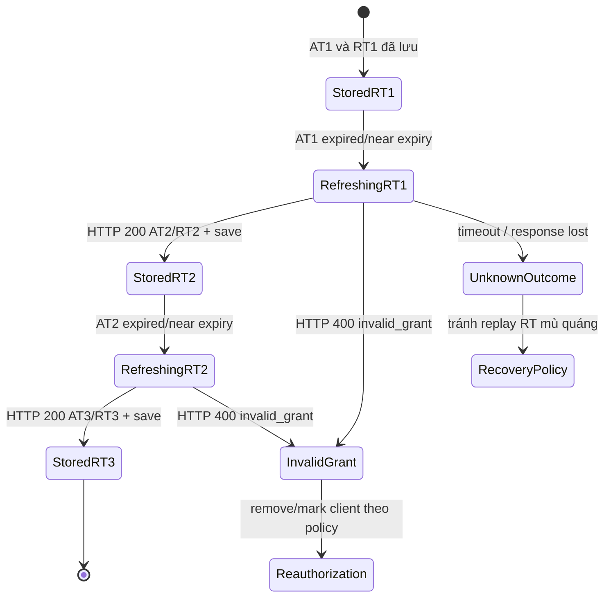
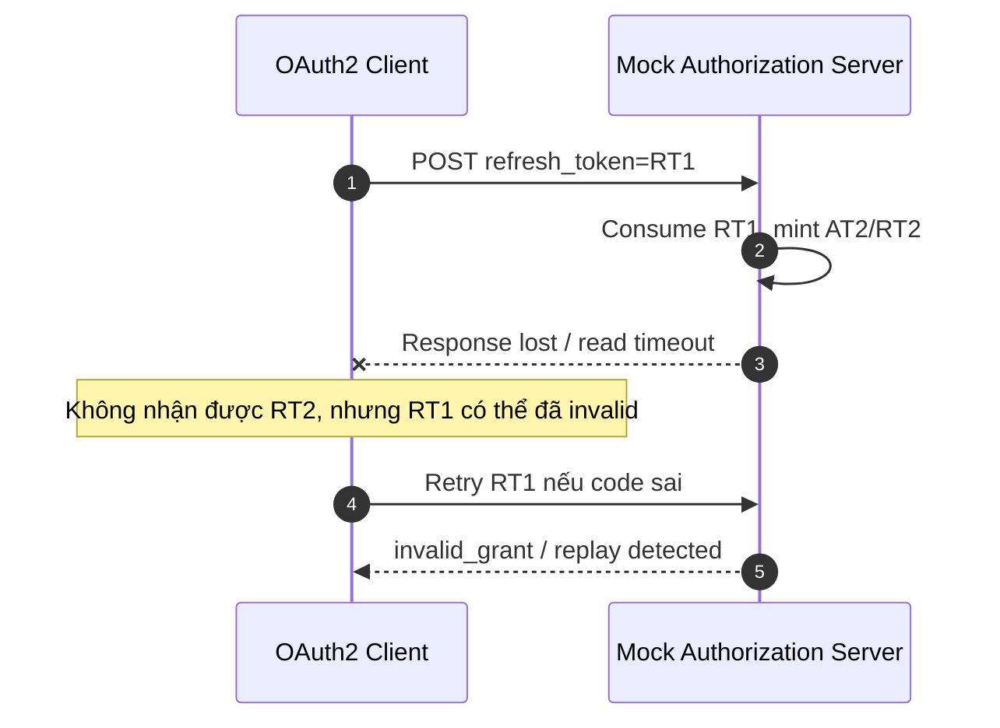
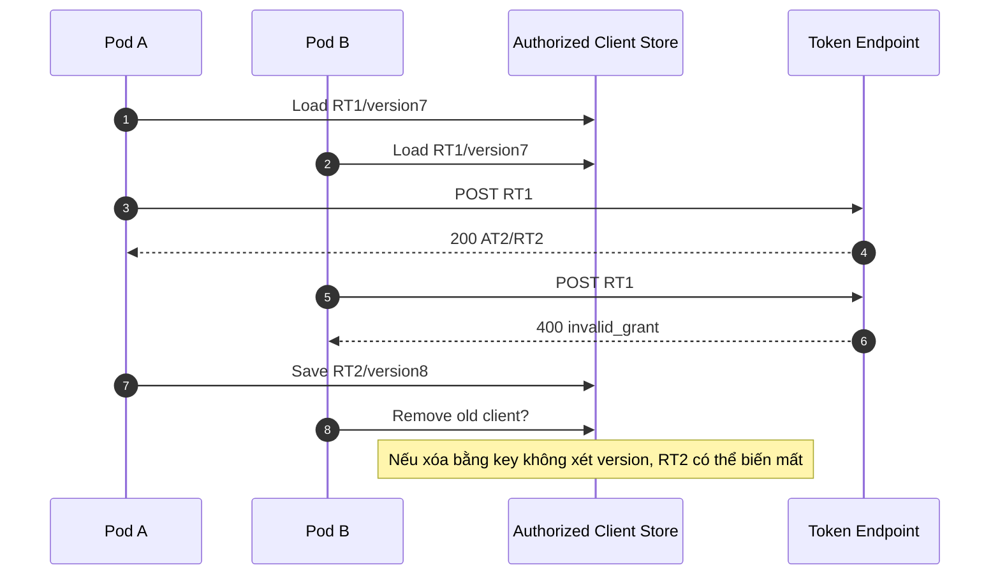
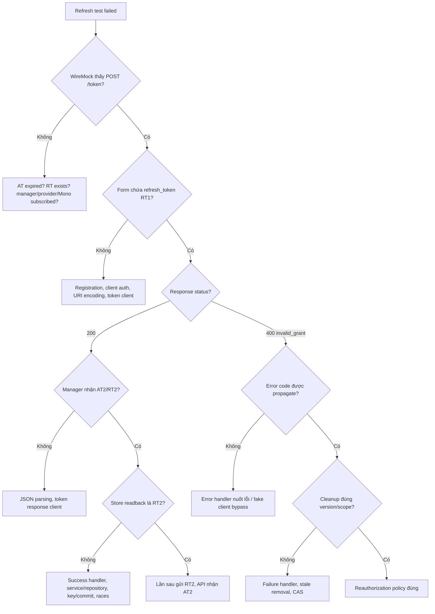

# 31.7. Kiểm thử refresh token rotation và invalid_grant

Trong một ứng dụng **Spring Security OAuth 2.0 / OpenID Connect (OIDC) Client**, lần đăng nhập ban đầu có thể hoạt động hoàn hảo nhưng sau một thời gian các API downstream lại trả 401, người dùng bị yêu cầu cấp quyền lại hoặc nhiều request đồng thời cùng thất bại. Một nguyên nhân quan trọng là **refresh token rotation**: khi Authorization Server (AS) nhận refresh token `RT1` và cấp access token mới `AT2`, nó có thể cấp thêm **refresh token mới `RT2` để thay thế RT1**. Lần làm mới tiếp theo phải sử dụng RT2, không phải RT1 đã tiêu thụ.

Khi một refresh token cũ bị dùng lại, AS có thể trả lỗi OAuth2 **`invalid_grant`**. Tùy chính sách của provider, đây có thể là token hết hạn, đã revoke, sai client, đã bị rotation hoặc một dấu hiệu replay; một số AS còn vô hiệu cả token family. Vấn đề không chỉ nằm ở HTTP response. Ứng dụng phải **lưu RT2 đúng chỗ, đọc lại đúng principal/registration, tránh race condition giữa các instances và xử lý invalid_grant mà không xóa nhầm token mới**.

Bài **“31.7. Kiểm thử refresh token rotation và invalid_grant”** trong chương **31. Kiểm thử tích hợp** xây dựng các integration tests có kiểm soát với **JUnit 5, WireMock, Spring Security OAuth2AuthorizedClientManager, authorized-client storage và Reactor/WebFlux**. Ví dụ không cần OP production, mật khẩu thật hoặc client secret thật; các chuỗi `AT1`, `RT1`, `RT2` chỉ là fixture.

> **Điểm cần chứng minh:** Không chỉ kiểm HTTP 200 từ token endpoint, mà còn phải xác minh **request gửi RT1 → response cấp AT2/RT2 → authorized client lưu RT2 → lần refresh tiếp theo gửi RT2**. Khi có `invalid_grant`, phải kiểm lỗi được truyền đúng, cleanup/reauthorization theo policy và không gây mất token của request khác.

## 1. Mục tiêu học tập

Sau bài này, bạn có thể:

1. Giải thích refresh token grant và vòng đời AT1/RT1 → AT2/RT2 → AT3/RT3.
2. Phân biệt refresh token rotation, token revocation, reuse detection và lỗi `invalid_grant`.
3. Dựng token endpoint giả phản hồi đúng HTTP 200 hoặc OAuth2 error 400.
4. Tạo `ClientRegistration` và `OAuth2AuthorizedClient` hết hạn để kích hoạt refresh có chủ đích.
5. Dùng `AuthorizedClientServiceOAuth2AuthorizedClientManager` với refresh provider trong test backend/Servlet.
6. Kiểm form request `grant_type=refresh_token`, refresh token value và client authentication bằng WireMock.
7. Đọc lại `OAuth2AuthorizedClientService` để kiểm RT2 đã được lưu bền vững trong phạm vi store test.
8. Test `invalid_grant` và failure handler không nuốt lỗi, không retry vô hạn, không xóa nhầm authorized client khác.
9. Mô phỏng concurrent refresh, stale write, stale delete và optimistic locking.
10. Viết Reactive integration test bằng `AuthorizedClientServiceReactiveOAuth2AuthorizedClientManager`/`StepVerifier`.
11. Kiểm downstream `WebClient` gửi access token mới, không bao giờ gửi refresh token làm bearer.
12. Phân biệt test unit/component/integration/contract và xác định giới hạn của từng lớp.

## 2. Hai vòng đời khác nhau: đăng nhập OIDC và refresh token

Authorization Code + OIDC Login:

```text
Browser -> /oauth2/authorization/company-login
        -> OpenID Provider /authorize
        -> callback ?code=...&state=...
Portal  -> POST /token, grant_type=authorization_code
AS      -> access_token, id_token, refresh_token (nếu được cấp)
Portal  -> validate ID Token, Authentication, OAuth2AuthorizedClient
```

Sau khi user đã đăng nhập:

```text
Authorized Client Store:
  registrationId = reports-api
  principalName  = alice
  accessToken    = AT1 (expired)
  refreshToken   = RT1 (available)

Portal -> POST /token
          grant_type=refresh_token
          refresh_token=RT1
AS     -> access_token=AT2
          refresh_token=RT2 (nếu rotation)

Portal -> save AT2/RT2 vào đúng authorized client
```

Refresh token grant thường không cần browser quay lại màn hình OP; nó **không tự tạo OIDC Login mới, không tự yêu cầu MFA và không tự cập nhật toàn bộ `SecurityContext`**. Browser session có thể vẫn authenticated trong khi token để gọi Reports API không còn được refresh.

### 2.1. Vai trò của các giá trị

| Giá trị | Loại | Dùng ở đâu? |
|---|---|---|
| `AT1` | Access token cũ | Bearer khi gọi API, có thể đã hết hạn |
| `RT1` | Refresh token cũ | Body của token refresh request |
| `AT2` | Access token mới | Bearer cho Reports API sau refresh |
| `RT2` | Refresh token mới | Dùng thay RT1 ở lần refresh sau |
| `AT3`/`RT3` | Tokens của vòng tiếp theo | Chứng minh không reuse RT1 |
| `ID Token` | OIDC identity token | Kiểm identity; không phải refresh credential |
| `ClientRegistration` | OAuth2 client config | Registration ID, client ID, token URI, grant, scopes |
| `OAuth2AuthorizedClient` | Token state | Registration + principal + AT/RT |

Không gửi `RT1`/`RT2` trong HTTP `Authorization: Bearer` tới Resource Server, không dùng ID Token làm refresh token.

### 2.2. HTTP refresh request

```http
POST /oauth2/token HTTP/1.1
Host: idp.example.org
Content-Type: application/x-www-form-urlencoded
Authorization: Basic <TEST_CLIENT_CREDENTIALS>

grant_type=refresh_token&refresh_token=RT1
```

Đây là nội dung minh họa; HTTP client thật sẽ URL-encode các tham số form và tạo client authentication theo `ClientRegistration`. Không chèn credential production vào code hoặc test logs.

### 2.3. Token response có rotation

```http
HTTP/1.1 200 OK
Content-Type: application/json
Cache-Control: no-store

{
  "access_token": "AT2",
  "token_type": "Bearer",
  "expires_in": 3600,
  "refresh_token": "RT2",
  "scope": "reports.read"
}
```

AS có thể **không** cấp refresh token mới. Khi response không có field `refresh_token`, nhiều OAuth2 clients giữ RT đang có theo provider contract. Điều này khác với response chứa refresh token rỗng hoặc không hợp lệ.

### 2.4. invalid_grant không chỉ có một nguyên nhân

```http
HTTP/1.1 400 Bad Request
Content-Type: application/json

{
  "error": "invalid_grant",
  "error_description": "Refresh token is not valid"
}
```

Các khả năng:

- Refresh token hết hạn.
- User/admin thu hồi quyền hoặc token.
- RT1 đã tiêu thụ trong rotation.
- Một pod khác đang dùng RT1.
- Token phát cho client khác hoặc bị dùng sai client authentication.
- Provider áp chính sách replay/family revocation.

**Không suy luận chắc chắn đã có tấn công replay chỉ từ mã `invalid_grant`.** Lý do gốc cần dữ liệu quan sát và contract của provider.

## 3. State machine refresh token rotation



**Bất biến cần test**:

1. Request #1 có `refresh_token=RT1`, không phải AT1.
2. Response #1 được parse thành AT2/RT2.
3. `OAuth2AuthorizedClient` trả về và **store readback** đều có RT2.
4. Request #2 có RT2, không dùng lại RT1.
5. `invalid_grant` từ AS là failure, không bị chuyển thành successful authorized client.
6. Nếu custom failure handler remove client, chỉ xóa record tương ứng, không xóa token mới của concurrent request.
7. Reports API nhận Bearer AT2, không nhận RT1/RT2.
8. Không có token value/client secret trong logs, metrics, HTTP response cho browser.

## 4. Chọn đúng lớp kiểm thử

| Lớp | Thiết bị test | Điều được chứng minh |
|---|---|---|
| Unit token client | Fake `OAuth2AccessTokenResponseClient` | Response/error mapping tại class |
| Component manager | Fake token response client + in-memory service | Manager load, refresh, save/remove |
| **HTTP integration** | **WireMock/MockWebServer + real token response client** | Form POST, client auth, HTTP parse, manager, storage |
| Persistence integration | Testcontainers JDBC/Redis | Commit, serialization, versioning, race |
| Servlet HTTP integration | MockMvc + session/repository | Web request thực sự trigger reauthorization |
| Reactive integration | WebFlux/StepVerifier + reactive store + HTTP stub | Mono subscription, save/remove/error |
| Provider contract | Staging tenant/realm do tổ chức quản lý | Chính sách rotation, grace period, reuse detection của OP thực |

Mock `getTokenResponse()` không tự chứng minh HTTP form encoding hoặc client authentication. Ngược lại, chỉ gọi `POST /token` bằng RestClient mà không thông qua manager **không chứng minh RT2 được lưu đúng vào authorized client service**.

### 4.1. Mock OAuth2 Login không đủ kiểm refresh

`mockOidcLogin()`, `oidcLogin()` hoặc `mockOAuth2Client()` giúp kiểm app code có Authentication/authorized client giả; chúng **không thực hiện token endpoint grant theo nghĩa integration**. Để test rotation, phải có expired authorized client, refresh provider, token HTTP client và storage phù hợp.

### 4.2. Cần test cả object và tác động phụ

```text
Object result:
  manager.authorize(...) -> OAuth2AuthorizedClient(AT2, RT2)

Storage effect:
  loadAuthorizedClient("reports-api", "alice") -> AT2, RT2

External effect:
  WireMock journal -> refresh_token=RT1 exactly once
```

Thiếu một trong ba tầng có thể bỏ qua lỗi quan trọng.

## 5. Test infrastructure và dependencies

Ví dụ Maven:

```xml
<dependencies>
  <dependency>
    <groupId>org.springframework.boot</groupId>
    <artifactId>spring-boot-starter-oauth2-client</artifactId>
  </dependency>
  <dependency>
    <groupId>org.springframework.boot</groupId>
    <artifactId>spring-boot-starter-test</artifactId>
    <scope>test</scope>
  </dependency>
  <dependency>
    <groupId>org.springframework.security</groupId>
    <artifactId>spring-security-test</artifactId>
    <scope>test</scope>
  </dependency>
  <dependency>
    <groupId>org.wiremock</groupId>
    <artifactId>wiremock</artifactId>
    <version><!-- Bản 3.x do dự án chọn --></version>
    <scope>test</scope>
  </dependency>
</dependencies>
```

Gradle tương ứng:

```gradle
implementation 'org.springframework.boot:spring-boot-starter-oauth2-client'
testImplementation 'org.springframework.boot:spring-boot-starter-test'
testImplementation 'org.springframework.security:spring-security-test'
testImplementation 'org.wiremock:wiremock:3.9.2' // Phiên bản ví dụ
```

Các API ví dụ theo Spring Security 6.4+ nơi có `RestClientRefreshTokenTokenResponseClient`; với project dùng phiên bản cũ có thể phải dùng `DefaultRefreshTokenTokenResponseClient`/`RestOperations`. Với Spring Security 7.x hoặc Boot release khác, kiểm tài liệu API version tương ứng. Không ghép các API của nhiều major versions tùy tiện.

### 5.1. Port động và server lifecycle

```java
import com.github.tomakehurst.wiremock.WireMockServer;
import static com.github.tomakehurst.wiremock.core
        .WireMockConfiguration.options;

WireMockServer tokenServer =
        new WireMockServer(options().dynamicPort());

tokenServer.start();
try {
    String tokenUri = tokenServer.baseUrl() + "/oauth2/token";
    // Dùng URI này trong ClientRegistration của test.
} finally {
    tokenServer.stop();
}
```

Port động tránh đụng port giữa CI agents. HTTP loopback ở đây chỉ dành cho **test-local stub**; production token endpoint phải dùng HTTPS và truststore phù hợp. Nếu muốn test TLS/mTLS, tạo một HTTPS mock server và cấu hình trust material riêng trong test.

### 5.2. Một test không cần SpringBootTest toàn hệ thống

Bạn có thể khởi tạo manager, registrations, in-memory service và WireMock ngay trong JUnit test class. Điều này kiểm code path OAuth2 token refresh và HTTP transport. Chỉ dùng `@SpringBootTest` khi cần xác minh bean wiring, repository JDBC thật, security filter chain, callback hoặc controller.

## 6. Fixture: ClientRegistration

```java
import org.springframework.security.oauth2.client.registration.ClientRegistration;
import org.springframework.security.oauth2.core.AuthorizationGrantType;
import org.springframework.security.oauth2.core.ClientAuthenticationMethod;

static ClientRegistration testRegistration(String tokenUri) {
    return ClientRegistration.withRegistrationId("reports-api")
            .clientId("reports-client-test")
            .clientSecret("fake-secret-test-only")
            .clientAuthenticationMethod(
                    ClientAuthenticationMethod.CLIENT_SECRET_BASIC)
            .authorizationGrantType(
                    AuthorizationGrantType.AUTHORIZATION_CODE)
            .authorizationUri("http://localhost/unused-authorization")
            .redirectUri("{baseUrl}/login/oauth2/code/{registrationId}")
            .tokenUri(tokenUri)
            .scope("openid", "reports.read")
            .clientName("Reports API Test")
            .build();
}
```

Lưu ý: `ClientRegistration.authorizationGrantType` vẫn là `authorization_code` vì authorized client bắt nguồn từ việc người dùng cấp quyền. `refresh_token` là grant **sử dụng sau khi có OAuth2AuthorizedClient**, không phải giá trị phải thay vào registration để test rotation.

### 6.1. Khóa lookup

Một authorized client được quản lý theo:

```text
registrationId = reports-api
principalName  = alice
```

`clientId=reports-client-test` do AS cấp không phải `registrationId` của Spring Security. Nếu seed token cho Alice nhưng authorize theo Bob, manager không đọc được RT1 của Alice — test sai fixture chứ không chứng minh refresh lỗi.

## 7. Fixture: expired OAuth2AuthorizedClient

```java
import java.time.Instant;
import java.util.Set;
import org.springframework.security.oauth2.client.OAuth2AuthorizedClient;
import org.springframework.security.oauth2.client.registration.ClientRegistration;
import org.springframework.security.oauth2.core.OAuth2AccessToken;
import org.springframework.security.oauth2.core.OAuth2RefreshToken;

static OAuth2AuthorizedClient expiredClient(
        ClientRegistration registration,
        String principalName,
        String atValue,
        String rtValue) {

    Instant now = Instant.now();
    var accessToken = new OAuth2AccessToken(
            OAuth2AccessToken.TokenType.BEARER,
            atValue,
            now.minusSeconds(7200),
            now.minusSeconds(3600),
            Set.of("reports.read"));

    var refreshToken = new OAuth2RefreshToken(
            rtValue, now.minusSeconds(7200));

    return new OAuth2AuthorizedClient(
            registration, principalName, accessToken, refreshToken);
}
```

AT đã hết hạn cách đây một giờ để refresh provider chắc chắn chọn refresh branch. **Không dùng `Thread.sleep()` để chờ token hết hạn**, vì test sẽ chậm và flaky. Các test riêng về clock skew có thể dùng `Clock.fixed(...)` hoặc refresh provider clock configuration nếu API hỗ trợ.

### 7.1. Không suy luận refresh token luôn sống mãi

Refresh token có thể bị AS giới hạn tuổi, số lần sử dụng, inactivity timeout hoặc revoke; expiration metadata có thể không đầy đủ ở client. Trong test với RT1, chính WireMock quyết định nhận hay từ chối theo scenario, thay vì dựa vào một token string “trông hợp lệ”.

## 8. Manager đồng bộ phù hợp cho test backend

Trong Servlet, `DefaultOAuth2AuthorizedClientManager` sử dụng `OAuth2AuthorizedClientRepository` và Servlet request context. Để cô lập token lifecycle ngoài HTTP request, dùng `AuthorizedClientServiceOAuth2AuthorizedClientManager` dựa trên `OAuth2AuthorizedClientService`.

```java
import org.springframework.security.oauth2.client
        .AuthorizedClientServiceOAuth2AuthorizedClientManager;
import org.springframework.security.oauth2.client
        .OAuth2AuthorizedClientProviderBuilder;
import org.springframework.security.oauth2.client
        .OAuth2AuthorizedClientProvider;
import org.springframework.security.oauth2.client.OAuth2AuthorizedClientService;
import org.springframework.security.oauth2.client.registration
        .ClientRegistrationRepository;
import org.springframework.security.oauth2.client.endpoint
        .RestClientRefreshTokenTokenResponseClient;

static AuthorizedClientServiceOAuth2AuthorizedClientManager testManager(
        ClientRegistrationRepository registrations,
        OAuth2AuthorizedClientService service) {

    var refreshTokenHttpClient =
            new RestClientRefreshTokenTokenResponseClient();

    OAuth2AuthorizedClientProvider provider =
            OAuth2AuthorizedClientProviderBuilder.builder()
                .refreshToken(refresh ->
                        refresh.accessTokenResponseClient(
                                refreshTokenHttpClient))
                .build();

    var manager =
            new AuthorizedClientServiceOAuth2AuthorizedClientManager(
                    registrations, service);
    manager.setAuthorizedClientProvider(provider);
    return manager;
}
```

Provider chain của test chỉ bật `refreshToken()` để không vô tình khởi động client credentials hoặc authorization code flow khác. Trong production chain có thể gồm `authorizationCode()`, `clientCredentials()`, custom token exchange và success/failure handlers.

### 8.1. Những managers cần phân biệt

| Manager | Dùng trong | Authorized client storage |
|---|---|---|
| `DefaultOAuth2AuthorizedClientManager` | Servlet request | `OAuth2AuthorizedClientRepository` |
| `AuthorizedClientServiceOAuth2AuthorizedClientManager` | Backend job ngoài Servlet request | `OAuth2AuthorizedClientService` |
| `DefaultReactiveOAuth2AuthorizedClientManager` | WebFlux `ServerWebExchange` | `ServerOAuth2AuthorizedClientRepository` |
| `AuthorizedClientServiceReactiveOAuth2AuthorizedClientManager` | Reactive service/background | `ReactiveOAuth2AuthorizedClientService` |

Một integration test manager/service không tự chứng minh session-based repository của Servlet/Reactive UI. Cần test tầng đó riêng nếu ứng dụng sử dụng.

## 9. WireMock token endpoint: RT1 -> AT2/RT2

```java
import static com.github.tomakehurst.wiremock.client.WireMock.*;

tokenServer.stubFor(
    post(urlEqualTo("/oauth2/token"))
        .withRequestBody(containing("grant_type=refresh_token"))
        .withRequestBody(containing("refresh_token=RT1"))
        .willReturn(okJson("""
            {
              "access_token":"AT2",
              "token_type":"Bearer",
              "expires_in":3600,
              "refresh_token":"RT2",
              "scope":"reports.read"
            }
            """)));
```

Đây là HTTP response của **AS giả**. Vì token response client thật phát request tới WireMock, test có thể kiểm:

- HTTP method POST, path/tokenUri đúng.
- Body `grant_type=refresh_token`.
- Body chứa đúng RT1.
- HTTP Basic/client-auth method theo registration.
- JSON được token client parse.
- Returned object và store được cập nhật.

### 9.1. Verify client authentication trong test

```java
tokenServer.verify(
        1,
        postRequestedFor(urlEqualTo("/oauth2/token"))
                .withRequestBody(containing(
                        "refresh_token=RT1"))
                .withHeader(
                        "Authorization",
                        matching("Basic .+")));
```

Ở production, OAuth2 client authentication có thể là `client_secret_basic`, `client_secret_post`, mTLS hoặc `private_key_jwt` theo provider contract; ví dụ dùng Basic chỉ để dễ hình dung. Không log header chứa credential thật.

### 9.2. Form encoding cần được kiểm đúng

Một RT là opaque string có thể chứa `+`, `/`, `=` hoặc `%`. Nếu tự ghép:

```text
refresh_token=opaque+/=value
```

thì trong `application/x-www-form-urlencoded`, ký tự `+` có thể bị giải mã thành space. Dùng token response client chuẩn và test URL encoding, chẳng hạn token `opaque+/=value` phải được gửi theo form encoding tương ứng. Không tự nối refresh token vào URL query.

## 10. Integration test đầy đủ: refresh và lưu token mới

Ví dụ dưới đây sử dụng các helpers `testRegistration`, `expiredClient` và `testManager` đã định nghĩa ở mục 6–8. Project cần Java 17+ cho text blocks.

```java
import com.github.tomakehurst.wiremock.WireMockServer;
import java.util.List;
import org.junit.jupiter.api.AfterEach;
import org.junit.jupiter.api.BeforeEach;
import org.junit.jupiter.api.Test;
import org.springframework.security.authentication
        .UsernamePasswordAuthenticationToken;
import org.springframework.security.core.Authentication;
import org.springframework.security.oauth2.client.OAuth2AuthorizeRequest;
import org.springframework.security.oauth2.client.OAuth2AuthorizedClient;
import org.springframework.security.oauth2.client
        .AuthorizedClientServiceOAuth2AuthorizedClientManager;
import org.springframework.security.oauth2.client
        .InMemoryOAuth2AuthorizedClientService;
import org.springframework.security.oauth2.client.registration.ClientRegistration;
import org.springframework.security.oauth2.client.registration
        .InMemoryClientRegistrationRepository;

import static com.github.tomakehurst.wiremock.client.WireMock.*;
import static com.github.tomakehurst.wiremock.core
        .WireMockConfiguration.options;
import static org.assertj.core.api.Assertions.assertThat;

class RefreshRotationIntegrationTest {

    private WireMockServer server;
    private ClientRegistration registration;
    private InMemoryOAuth2AuthorizedClientService service;
    private AuthorizedClientServiceOAuth2AuthorizedClientManager manager;
    private Authentication alice;

    @BeforeEach
    void setUp() {
        server = new WireMockServer(options().dynamicPort());
        server.start();

        registration = testRegistration(
                server.baseUrl() + "/oauth2/token");
        var registrations =
                new InMemoryClientRegistrationRepository(registration);
        service = new InMemoryOAuth2AuthorizedClientService(
                registrations);
        manager = testManager(registrations, service);
        alice = UsernamePasswordAuthenticationToken.authenticated(
                "alice", "N/A", List.of());

        service.saveAuthorizedClient(
                expiredClient(registration, "alice", "AT1", "RT1"),
                alice);
    }

    @AfterEach
    void tearDown() {
        if (server != null) server.stop();
    }

    @Test
    void refreshRotatesTokenAndPersistsRt2() {
        server.stubFor(
            post(urlEqualTo("/oauth2/token"))
                .withRequestBody(containing("grant_type=refresh_token"))
                .withRequestBody(containing("refresh_token=RT1"))
                .willReturn(okJson("""
                    {
                      "access_token":"AT2",
                      "token_type":"Bearer",
                      "expires_in":3600,
                      "refresh_token":"RT2",
                      "scope":"reports.read"
                    }
                    """)));

        OAuth2AuthorizeRequest request = OAuth2AuthorizeRequest
                .withClientRegistrationId("reports-api")
                .principal(alice)
                .build();

        OAuth2AuthorizedClient result = manager.authorize(request);
        assertThat(result).isNotNull();
        assertThat(result.getAccessToken().getTokenValue())
                .isEqualTo("AT2");
        assertThat(result.getRefreshToken().getTokenValue())
                .isEqualTo("RT2");

        OAuth2AuthorizedClient persisted = service.loadAuthorizedClient(
                "reports-api", alice.getName());
        assertThat(persisted).isNotNull();
        assertThat(persisted.getAccessToken().getTokenValue())
                .isEqualTo("AT2");
        assertThat(persisted.getRefreshToken().getTokenValue())
                .isEqualTo("RT2");

        server.verify(
                1,
                postRequestedFor(urlEqualTo("/oauth2/token"))
                    .withRequestBody(containing(
                            "grant_type=refresh_token"))
                    .withRequestBody(containing(
                            "refresh_token=RT1")));
    }
}
```

### 10.1. Vì sao phải readback storage?

Object returned bởi `manager.authorize(...)` có thể đúng AT2/RT2, nhưng nếu success handler lưu DB thất bại hoặc application dùng repository khác, lần gọi tiếp theo vẫn có thể đọc RT1. Đọc lại `OAuth2AuthorizedClientService` kiểm **tác động lưu trữ của integration path**, không chỉ kết quả của method.

Với test này, readback chứng minh in-memory service của test; nếu production dùng JDBC/Redis, cần thêm integration test thật của store đó.

### 10.2. Expected HTTP request count

Một lần refresh trong happy path tương ứng một POST token request nếu không có retry. Nếu code dùng HTTP client có retry nội bộ, phải phân biệt **logical authorize call** và **physical HTTP attempts**; test ở HTTP boundary nên kiểm attempt count thật.

### 10.3. Không cần gọi OP /authorize trong test refresh

Chúng ta seed authorized client như thể login đã xảy ra. Mục tiêu ở đây là refresh grant, không phải PKCE/state/nonce/callback validation. Những thứ thuộc một OIDC Login integration test khác.

## 11. Chứng minh RT2 được dùng cho lần tiếp theo

Sau khi refresh xong, AT2 từ mock có `expires_in=3600` nên manager sẽ tái sử dụng nó nếu gọi ngay. Để ép bước refresh tiếp theo **không chờ một giờ**, thay fixture trong store bằng một authorized client đã hết hạn **nhưng giữ chính RT2 đã được assert/readback**:

```java
OAuth2AuthorizedClient saved = service.loadAuthorizedClient(
        "reports-api", alice.getName());
assertThat(saved.getRefreshToken().getTokenValue())
        .isEqualTo("RT2");

service.saveAuthorizedClient(
        expiredClient(
                registration,
                alice.getName(),
                saved.getAccessToken().getTokenValue(),
                saved.getRefreshToken().getTokenValue()),
        alice);

server.stubFor(
    post(urlEqualTo("/oauth2/token"))
        .withRequestBody(containing("refresh_token=RT2"))
        .willReturn(okJson("""
            {
              "access_token":"AT3",
              "token_type":"Bearer",
              "expires_in":3600,
              "refresh_token":"RT3"
            }
            """)));

OAuth2AuthorizedClient result = manager.authorize(
        OAuth2AuthorizeRequest
            .withClientRegistrationId("reports-api")
            .principal(alice)
            .build());

assertThat(result.getAccessToken().getTokenValue())
        .isEqualTo("AT3");
assertThat(result.getRefreshToken().getTokenValue())
        .isEqualTo("RT3");

server.verify(
        1,
        postRequestedFor(urlEqualTo("/oauth2/token"))
            .withRequestBody(containing("refresh_token=RT2")));
```

**Quan trọng:** Đầu tiên phải chứng minh RT2 đến từ manager/store sau refresh #1. Nếu tự gán `RT2` vào fixture mà không assert storage, test #2 có thể pass dù application không lưu token mới trong thực tế.

### 11.1. Normal path không được reuse RT1

Nếu hai lần refresh thành công:

```text
Request #1: refresh_token=RT1 -> AT2, RT2
Request #2: refresh_token=RT2 -> AT3, RT3
Store cuối:  AT3, RT3
```

Đừng chỉ kiểm số requests = 2; test nên kiểm **giá trị refresh token theo từng attempt**.

## 12. WireMock Scenario mô phỏng one-time token

Một WireMock stub đơn giản có thể chấp nhận RT1 vô hạn, trong khi nhiều providers tiêu thụ RT sau khi rotation. Dùng Scenario:

```text
State STARTED:
   RT1 -> 200 AT2/RT2, chuyển sang RT1_SPENT

State RT1_SPENT:
   RT1 -> 400 invalid_grant
   RT2 -> 200 AT3/RT3, chuyển sang RT2_SPENT

State RT2_SPENT:
   RT2 -> 400 invalid_grant
```

### 12.1. Stub RT1 chỉ dùng một lần

```java
import static com.github.tomakehurst.wiremock.stubbing.Scenario.STARTED;

server.stubFor(
    post(urlEqualTo("/oauth2/token"))
        .inScenario("refresh-rotation")
        .whenScenarioStateIs(STARTED)
        .withRequestBody(containing("refresh_token=RT1"))
        .willReturn(okJson("""
            {
              "access_token":"AT2",
              "token_type":"Bearer",
              "expires_in":3600,
              "refresh_token":"RT2"
            }
            """))
        .willSetStateTo("RT1_SPENT"));

server.stubFor(
    post(urlEqualTo("/oauth2/token"))
        .inScenario("refresh-rotation")
        .whenScenarioStateIs("RT1_SPENT")
        .withRequestBody(containing("refresh_token=RT1"))
        .willReturn(
            aResponse().withStatus(400)
                .withHeader("Content-Type", "application/json")
                .withBody("""
                    {
                      "error":"invalid_grant",
                      "error_description":"RT already used"
                    }
                    """)));
```

### 12.2. RT2 vẫn hợp lệ sau lần đầu

```java
server.stubFor(
    post(urlEqualTo("/oauth2/token"))
        .inScenario("refresh-rotation")
        .whenScenarioStateIs("RT1_SPENT")
        .withRequestBody(containing("refresh_token=RT2"))
        .willReturn(okJson("""
            {
              "access_token":"AT3",
              "token_type":"Bearer",
              "expires_in":3600,
              "refresh_token":"RT3"
            }
            """))
        .willSetStateTo("RT2_SPENT"));
```

Scenario của WireMock là test double, không phải chứng cứ AS production sử dụng chính sách grace/reuse giống như vậy. Muốn xác minh provider-specific semantics, dùng test realm/staging được nhà cung cấp hỗ trợ và các credentials giới hạn quyền.

### 12.3. Reset scenario state

Nếu chạy nhiều tests trên cùng WireMock server:

- Reset stubs, scenarios và request journal giữa tests.
- Hoặc tạo server riêng per test.
- Không share một Scenario mutable cho các tests chạy parallel.

Một test chạy riêng pass nhưng cả suite fail rất có thể vì state `RT1_SPENT` bị giữ từ test trước.

## 13. invalid_grant: kiểm HTTP error và manager behavior

Giả lập AS từ chối refresh token:

```java
server.stubFor(
    post(urlEqualTo("/oauth2/token"))
        .withRequestBody(containing("refresh_token=RT1"))
        .willReturn(
            aResponse().withStatus(400)
                .withHeader("Content-Type", "application/json")
                .withBody("""
                    {
                      "error":"invalid_grant",
                      "error_description":"Token invalid or revoked"
                    }
                    """)));
```

### 13.1. Exception phải mang OAuth2 error code

```java
import org.springframework.security.oauth2.core.OAuth2AuthorizationException;
import static org.assertj.core.api.Assertions.assertThatThrownBy;

var request = OAuth2AuthorizeRequest
        .withClientRegistrationId("reports-api")
        .principal(alice)
        .build();

assertThatThrownBy(() -> manager.authorize(request))
        .isInstanceOf(OAuth2AuthorizationException.class)
        .satisfies(error -> {
            var oauth = (OAuth2AuthorizationException) error;
            assertThat(oauth.getError().getErrorCode())
                    .isEqualTo("invalid_grant");
        });
```

Tùy wrapper/version, OAuth2 exception có thể nằm trong cause chain. Test ở controller/WebClient layer có thể cần tìm `OAuth2AuthorizationException` bên trong một exception cao hơn. Đừng so sánh raw `error_description` như một contract bảo mật của Spring Security.

### 13.2. Kiểm failure handler

Spring Security OAuth2 managers có extension point `OAuth2AuthorizationFailureHandler`. Với nhiều cấu hình built-in, `invalid_grant` được xử lý bằng cách remove authorized client cũ để tránh dùng lại refresh token đã bị AS từ chối. Nếu application đặt custom handler, behavior có thể khác.

Với chính sách **remove-on-invalid_grant**, sau exception:

```java
OAuth2AuthorizedClient remaining =
        service.loadAuthorizedClient("reports-api", "alice");
assertThat(remaining).isNull();
```

Assertion trên chỉ đúng khi manager/test thực sự dùng failure handler remove ở đúng service. Nếu business giữ trạng thái `reauthorization_required` trong custom store, assert trạng thái đó thay vì bắt buộc null.

### 13.3. Không xóa tất cả token/session

`invalid_grant` của `(reports-api, alice)` thường chỉ liên quan authorized client cụ thể. Test seed:

```text
(reports-api, alice)   -> invalid RT1
(reports-api, bob)     -> valid RT_BOB
(inventory-api, alice) -> valid RT_INVENTORY
```

Sau failure của Alice/Reports:

- Alice/Reports được remove hoặc mark theo policy.
- Bob/Reports không thay đổi.
- Alice/Inventory không thay đổi.
- Browser authentication session không bị xóa toàn bộ nếu business không yêu cầu.

### 13.4. Invalid_grant không phải reauthentication tự động

Manager có thể báo lỗi và remove token, nhưng không tự hoàn tất OIDC Authorization Code/MFA lại cho user. Browser-facing layer phải định nghĩa reauthorization UX, còn background job cần event/error riêng. Không tự retry RT1 vô hạn để “lấy lại token”.

## 14. AS trả 200 mà không có refresh_token mới

Một AS không rotation có thể trả:

```json
{
  "access_token":"AT2",
  "token_type":"Bearer",
  "expires_in":3600,
  "scope":"reports.read"
}
```

Client thường giữ refresh token cũ theo OAuth2 semantics khi AS không cấp token mới:

```text
Before: AT1 expired, RT1
After:  AT2 valid,   RT1
```

Đây **không tự là lỗi**. Test này nên khác với rotation:

1. Stub response không có `refresh_token`.
2. Gọi manager với AT1 expired/RT1.
3. Assert AT2 được lưu.
4. Assert RT1 được giữ theo client implementation/provider contract.
5. Không tự tạo RT2 trong application.

Ngược lại, response `refresh_token=""` có thể là response không hợp lệ. Hãy kiểm parser/error behavior riêng; đừng lưu empty string như một credential hợp lệ.

## 15. Thiếu refresh token ban đầu

Một số registrations không có RT do consent/scope/provider policy. Tạo:

```java
OAuth2AuthorizedClient withoutRefresh =
        new OAuth2AuthorizedClient(
                registration,
                "alice",
                expiredAccessToken,
                null);
```

Khi provider chain chỉ có `refreshToken()`, không thể thực hiện refresh grant. Hành vi manager có thể trả authorized client không được reauthorize hoặc xử lý khác theo cấu hình; **không assert tự động HTTP 400 invalid_grant**, vì AS thậm chí chưa nhận request.

Kiểm:

- Token endpoint không nhận `POST /token`.
- Application có error/reauthorization policy rõ.
- Không gửi AT đã expired tới API như token còn hợp lệ.

## 16. Kiểm lỗi HTTP 503, TLS và network khác invalid_grant

| Loại | Quan sát | Hướng xử lý |
|---|---|---|
| `invalid_grant` | OAuth2 error 400 | Refresh credential không dùng được; remove/re-authorize theo policy |
| `invalid_client` | OAuth2 error 400/401 | Kiểm client auth/secret/mTLS/config, không đổ cho user |
| `temporarily_unavailable` | AS báo tạm lỗi | Giữ RT theo policy, bounded retry/backoff |
| HTTP 500/502/503 | Provider/network hạ tầng | Không remove RT như invalid_grant nếu không có bằng chứng |
| DNS/connect timeout | Không kết nối được | Check egress/DNS/pool; xử lý outage |
| Read timeout sau POST | **Unknown outcome** | Không replay RT mù quáng |
| TLS handshake failure | Truststore/SAN/mTLS | Sửa TLS transport, không sửa OAuth2 grant |
| Invalid JSON | Token endpoint/parser lỗi | Không save response invalid |
| API 401/403 | Resource Server reject access token | Không đồng nghĩa token endpoint invalid_grant |

Ví dụ WireMock trả 503:

```java
server.stubFor(
    post(urlEqualTo("/oauth2/token"))
        .willReturn(
            aResponse().withStatus(503)
                .withHeader("Content-Type", "application/json")
                .withBody("""
                    {"error":"temporarily_unavailable"}
                    """)));
```

Test cần phân biệt **failure handler cleanup**. Không xóa token chỉ vì mọi network errors đều được map thành failure.

## 17. Unknown outcome: timeout sau khi AS đã rotation



Khi request timeout, không thể kết luận AS đã/ chưa xử lý token. Test có thể dùng WireMock delay:

```java
server.stubFor(
    post(urlEqualTo("/oauth2/token"))
        .withRequestBody(containing("refresh_token=RT1"))
        .willReturn(
            aResponse()
                .withFixedDelay(10_000)
                .withStatus(200)
                .withHeader("Content-Type", "application/json")
                .withBody("""
                    {"access_token":"AT2",
                     "token_type":"Bearer",
                     "expires_in":3600,
                     "refresh_token":"RT2"}
                    """)));
```

Cấu hình **read/response timeout** của token HTTP client ngắn hơn mock delay (ví dụ vài trăm ms) để test nhanh. Kỳ vọng:

- Không có AT2/RT2 “thành công” nếu app chưa nhận response.
- HTTP call count/retry behavior đúng budget.
- Không auto-retry RT1 vô hạn.
- Error được phân loại `network/unknown_outcome`, không giả định `invalid_grant`.
- Không log RT1/RT2.
- Store tuân theo recovery policy đã định nghĩa.

Một số AS có grace period/idempotency hỗ trợ; chỉ dựa vào provider contract được xác minh, không tự đặt header `Idempotency-Key` rồi giả định AS sẽ hiểu.

## 18. Concurrency: hai pod cùng refresh một token

Đây là tình huống dễ tạo production incident nhất.



### 18.1. Hai race khác nhau

**Race A — stale remove:** Pod B nhận `invalid_grant` trên RT1 và failure handler remove toàn bộ record theo `registrationId+principal` **sau khi** Pod A đã lưu RT2. RT2 hợp lệ bị xóa.

**Race B — stale write:** Pod B giữ snapshot cũ và ghi đè record mới AT2/RT2 bằng AT1/RT1 hoặc trạng thái không hợp lệ.

Vì thế unit test chỉ dùng một `InMemoryOAuth2AuthorizedClientService` một luồng chưa đủ.

### 18.2. Giải pháp kiến trúc cần kiểm thử

Tùy provider và store, có thể dùng:

- Single-flight refresh trong một JVM.
- Distributed lock theo `(tenant, registrationId, principal)`.
- Optimistic locking hoặc compare-and-set (CAS) trên authorized client record.
- Chỉ remove record nếu version hiện tại bằng version mà request lỗi đã đọc.
- Reload client sau khi phát hiện stale state trước khi quyết định reauthorize.
- Không retry một refresh token cũ đã có `invalid_grant`.
- Ghi metrics conflict/replay với nhãn hữu hạn, không lộ token.

**Không có một cơ chế duy nhất được mọi Spring Security store tự bảo đảm.** Cần test dựa trên implementation, nhất là khi dùng JDBC/Redis tùy chỉnh.

### 18.3. SQL compare-and-swap minh họa

Ví dụ schema **của ứng dụng**, không phải schema mặc định Spring Security:

```sql
CREATE TABLE authorized_client_state (
    tenant_id         varchar(100) NOT NULL,
    registration_id   varchar(150) NOT NULL,
    principal_id      varchar(300) NOT NULL,
    record_version    bigint NOT NULL,
    encrypted_access  bytea NOT NULL,
    encrypted_refresh bytea NOT NULL,
    PRIMARY KEY (tenant_id, registration_id, principal_id)
);
```

Khi Pod A nhận RT2:

```sql
UPDATE authorized_client_state
   SET encrypted_access = :encryptedAT2,
       encrypted_refresh = :encryptedRT2,
       record_version = record_version + 1
 WHERE tenant_id = :tenantId
   AND registration_id = :registrationId
   AND principal_id = :principalId
   AND record_version = :observedVersion;
```

Affected rows = 0 cho thấy record đã thay đổi đồng thời. Không tự ghi đè bằng snapshot cũ. Schema thật còn cần token type, scopes, issuedAt/expiresAt, serialization, encryption-key metadata.

### 18.4. Conditional remove khi invalid_grant

Không xóa unconditional:

```sql
DELETE FROM authorized_client_state
 WHERE registration_id = :registrationId
   AND principal_id = :principalId;
```

Thay bằng remove có điều kiện nếu policy yêu cầu:

```sql
DELETE FROM authorized_client_state
 WHERE tenant_id = :tenantId
   AND registration_id = :registrationId
   AND principal_id = :principalId
   AND record_version = :versionSeenByFailedRefresh;
```

Nếu Pod A đã lưu RT2/version8, Pod B giữ version7 sẽ delete 0 rows; RT2 không bị mất. Đây là một **custom storage/failure-handler design**, không phải tính năng được bảo đảm bởi mọi built-in OAuth2AuthorizedClientService.

### 18.5. Kiểm race mà không sleep

```java
CountDownLatch bothReadRt1 = new CountDownLatch(2);
CountDownLatch allowRequests = new CountDownLatch(1);

// Fake store/test hooks:
// mỗi worker load RT1 -> bothReadRt1.countDown()
// mỗi worker await allowRequests
//
// Test đợi cả hai đã load snapshot, sau đó:
// allowRequests.countDown()
// Mock AS cho một request RT1 success, một request invalid_grant.
```

Dùng `CountDownLatch`, `CyclicBarrier` hoặc fake store có hooks điều khiển interleaving; không dùng `Thread.sleep(...)` rồi kỳ vọng race xuất hiện ổn định trên CI.

### 18.6. Hai types của concurrency contract

| Chiến lược | HTTP requests tới AS | Storage kỳ vọng |
|---|---|---|
| Distributed lock/single-flight | Có thể chỉ một refresh RT1 | RT2 lưu, request khác reuse kết quả |
| CAS không khóa HTTP calls | Có thể hai POST RT1, một invalid_grant | RT2 không bị stale remove/write |
| Không có concurrency control | Hai POST và cleanup race | Có thể mất RT2; test phải làm lộ |

Đừng assert “chỉ một HTTP request” nếu thiết kế chỉ hứa storage CAS; đó là hai thuộc tính khác nhau.

## 19. Failure handler và race

Spring Security cung cấp các extension points:

- `OAuth2AuthorizationSuccessHandler`.
- `OAuth2AuthorizationFailureHandler`.
- `RemoveAuthorizedClientOAuth2AuthorizationFailureHandler` cho những trường hợp tương ứng.
- Reactive success/failure handlers ở Reactive OAuth2 Client.

Trong nhiều cấu hình manager, khi `invalid_grant` xuất hiện, handler mặc định loại bỏ authorized client cũ khỏi repository/service. Điều này giúp tránh tái sử dụng RT1 vô hiệu trong một luồng đơn. Nhưng ở multi-pod, **remove theo key không bảo đảm bảo vệ RT2 vừa lưu trong race**, trừ khi store/handler có điều kiện version phù hợp.

Test nên có hai tình huống:

1. **Không race:** RT1 thực sự invalid; client cũ bị remove/đánh dấu cần reauthorize, không retry.
2. **Có race:** Pod A đã lưu RT2; Pod B thất bại vì stale RT1; Pod B không được xóa RT2 mới.

Không disable toàn bộ cleanup để làm test xanh nếu điều đó khiến ứng dụng cứ dùng RT1 vô hạn. Policy phải xử lý cả invalid token thật và stale failure an toàn.

## 20. Test persistence thật với Testcontainers

`InMemoryOAuth2AuthorizedClientService` chỉ chứng minh behavior trong một JVM. Production dùng Redis/JDBC cần integration test riêng:

```text
Manager A + Service A:
  load RT1
  HTTP refresh -> RT2
  commit RT2

Manager B + Service B:
  load same (registration, principal) from shared DB
  assert RT2
```

Những thứ cần kiểm:

- DB commit/rollback.
- Encryption at rest, serialization của access/refresh token.
- Khóa lookup theo registration/principal/tenant.
- Optimistic locking/version tăng khi save.
- Conditional delete không xóa version mới.
- Concurrent refresh hai instances.
- Refresh token rotation trong lúc DB unavailable.
- Logout và refresh tranh chấp ghi/xóa.

### 20.1. AS success nhưng DB save fail

```text
POST RT1 -> AS đã tiêu thụ RT1, cấp RT2
DB save RT2 -> exception/rollback
DB vẫn RT1
Next refresh RT1 -> invalid_grant
```

Một test phải chứng minh ứng dụng không báo token được lưu thành công khi DB fail, và có recovery/re-authentication policy. Không thể rollback một token rotation đã hoàn tất ở AS bằng một JDBC transaction local.

### 20.2. Logout/refresh race

```text
T1: Refresh RT1 -> AT2/RT2 đang chờ response
T2: User logout, authorized client bị remove
T3: Refresh success handler lưu AT2/RT2 lại
```

Nếu logout phải thu hồi quyền dùng token, cần session generation/version guard hoặc coordination để không tái lưu RT sau logout. Test song song này khác race giữa hai refresh requests.

## 21. Reactive WebFlux: manager và StepVerifier

Với Reactive, dùng:

- `InMemoryReactiveClientRegistrationRepository`.
- `InMemoryReactiveOAuth2AuthorizedClientService`.
- `AuthorizedClientServiceReactiveOAuth2AuthorizedClientManager`.
- `ReactiveOAuth2AuthorizedClientProviderBuilder.refreshToken()`.
- `WebClientReactiveRefreshTokenTokenResponseClient`.
- `StepVerifier`.

### 21.1. Setup reactive manager

```java
import org.springframework.security.oauth2.client
        .AuthorizedClientServiceReactiveOAuth2AuthorizedClientManager;
import org.springframework.security.oauth2.client
        .InMemoryReactiveOAuth2AuthorizedClientService;
import org.springframework.security.oauth2.client
        .ReactiveOAuth2AuthorizedClientProvider;
import org.springframework.security.oauth2.client
        .ReactiveOAuth2AuthorizedClientProviderBuilder;
import org.springframework.security.oauth2.client.endpoint
        .WebClientReactiveRefreshTokenTokenResponseClient;
import org.springframework.security.oauth2.client.registration
        .InMemoryReactiveClientRegistrationRepository;
import org.springframework.web.reactive.function.client.WebClient;

var registrations =
        new InMemoryReactiveClientRegistrationRepository(registration);
var service =
        new InMemoryReactiveOAuth2AuthorizedClientService(registrations);

var tokenHttpClient =
        new WebClientReactiveRefreshTokenTokenResponseClient();
tokenHttpClient.setWebClient(WebClient.builder().build());

ReactiveOAuth2AuthorizedClientProvider provider =
        ReactiveOAuth2AuthorizedClientProviderBuilder.builder()
            .refreshToken(refresh ->
                    refresh.accessTokenResponseClient(tokenHttpClient))
            .build();

var manager =
        new AuthorizedClientServiceReactiveOAuth2AuthorizedClientManager(
                registrations, service);
manager.setAuthorizedClientProvider(provider);
```

WebClient dùng token URI trong `ClientRegistration`, trỏ WireMock loopback. Nếu application dùng proxy/TLS/mTLS, phải cấu hình chính HTTP client mà token response client thật sự sử dụng.

### 21.2. Reactive test RT1 → RT2

```java
import org.springframework.security.oauth2.client.OAuth2AuthorizeRequest;
import org.springframework.security.oauth2.client.OAuth2AuthorizedClient;
import org.springframework.security.authentication
        .UsernamePasswordAuthenticationToken;
import reactor.core.publisher.Mono;
import reactor.test.StepVerifier;

var principal =
        UsernamePasswordAuthenticationToken.authenticated(
                "alice", "N/A", java.util.List.of());

var initial = expiredClient(registration, "alice", "AT1", "RT1");
var authorizeRequest = OAuth2AuthorizeRequest
        .withClientRegistrationId("reports-api")
        .principal(principal)
        .build();

Mono<OAuth2AuthorizedClient> operation =
        service.saveAuthorizedClient(initial, principal)
            .then(manager.authorize(authorizeRequest))
            .flatMap(result ->
                service.loadAuthorizedClient("reports-api", "alice")
                    .map(stored -> {
                        org.assertj.core.api.Assertions.assertThat(
                                result.getRefreshToken()
                                        .getTokenValue())
                                .isEqualTo("RT2");
                        return stored;
                    }));

StepVerifier.create(operation)
        .assertNext(stored -> {
            org.assertj.core.api.Assertions.assertThat(
                    stored.getAccessToken().getTokenValue())
                    .isEqualTo("AT2");
            org.assertj.core.api.Assertions.assertThat(
                    stored.getRefreshToken().getTokenValue())
                    .isEqualTo("RT2");
        })
        .verifyComplete();
```

WireMock phải được stub `RT1 → 200 AT2/RT2` trước khi subscribe. Sau `verifyComplete()`, kiểm request journal đúng RT1.

### 21.3. Reactive invalid_grant

Với WireMock trả HTTP 400:

```java
StepVerifier.create(
        service.saveAuthorizedClient(initial, principal)
            .then(manager.authorize(authorizeRequest)))
        .expectErrorMatches(error ->
                "invalid_grant".equals(
                        findOAuth2ErrorCode(error)))
        .verify();
```

`findOAuth2ErrorCode(Throwable)` là test helper cần tự triển khai theo cause chain/`OAuth2AuthorizationException`. Nếu có remove-on-invalid_grant:

```java
StepVerifier.create(
        service.loadAuthorizedClient("reports-api", "alice"))
        .verifyComplete(); // Mono.empty() sau cleanup
```

Không assert empty nếu custom failure handler cố ý giữ trạng thái khác; kỳ vọng phải đi từ contract của ứng dụng.

### 21.4. Mono cold và subscriptions

`manager.authorize(...)` trả `Mono`. **Chỉ tạo Mono không làm token endpoint được gọi.** `StepVerifier.verify()` subscribe và thực thi flow.

Nếu subscribe hai lần một cold publisher, có thể tạo hai lần token request và vô tình sử dụng lại RT1. Test phải kiểm số subscriptions/retries, không gọi `block()` từ Reactive controller để ép thực thi.

### 21.5. Reactive service manager vs WebFlux exchange manager

`AuthorizedClientServiceReactiveOAuth2AuthorizedClientManager` phù hợp cho service/background contexts. Nếu app dùng `DefaultReactiveOAuth2AuthorizedClientManager` trong request, nó phụ thuộc `ServerWebExchange` và `ServerOAuth2AuthorizedClientRepository`. Khi đó cần test bổ sung qua `WebTestClient` với repository thật/fixture tương ứng.

`mockOAuth2Client()` tạo sẵn client trong test repository, không tự thực hiện HTTP refresh; không dùng nó làm bằng chứng rotation.

## 22. Test outbound WebClient gửi AT2, không phải RT2

Sau refresh, Reports API phải nhận:

```http
GET /summary HTTP/1.1
Host: reports-api.example.org
Authorization: Bearer AT2
```

Không được nhận:

```text
Bearer AT1 (expired)
Bearer RT1
Bearer RT2
```

Ví dụ stub Reports API:

```java
reportsServer.stubFor(
    get(urlEqualTo("/summary"))
        .withHeader("Authorization", equalTo("Bearer AT2"))
        .willReturn(okJson("""
            {"status":"ok","reports":3}
            """)));
```

Sau khi controller/WebClient thực hiện lời gọi:

```java
reportsServer.verify(
    1,
    getRequestedFor(urlEqualTo("/summary"))
        .withHeader("Authorization", equalTo("Bearer AT2")));
```

Một fake API luôn trả 200 mà không kiểm Authorization header sẽ bỏ qua lỗi chọn token sai. Cũng cần kiểm đích outbound thuộc host allowlist; đừng gửi bearer đến URL do browser tùy ý nhập.

## 23. Servlet MockMvc và browser session

Với Servlet application, flow thực có thể là:

```text
HTTP session + SecurityContext
  -> Controller / Service
  -> OAuth2AuthorizedClientRepository
  -> DefaultOAuth2AuthorizedClientManager
  -> RefreshTokenOAuth2AuthorizedClientProvider
  -> HTTP token endpoint
  -> Save authorized client
  -> Outbound API
```

`MockMvc` với `oauth2Login()` hoặc `oidcLogin()` có thể tạo authenticated principal, **nhưng không tự bảo đảm** authorized client store chứa expired AT1/RT1 đúng theo application repository. Cần seed explicitly và kiểm cả:

- Session/principal có đúng tên?
- Registration có trỏ test token URI?
- Manager đã được inject từ context đúng?
- Token request tới WireMock có RT1?
- Repository/service readback có RT2?
- Downstream API nhận AT2?

Test `DefaultOAuth2AuthorizedClientManager` ngoài Servlet request context có thể thất bại vì thiếu `HttpServletRequest`/`HttpServletResponse`; dùng service manager để cô lập hoặc MockMvc để cung cấp request thật trong test.

### 23.1. Invalid_grant không phải logout mặc định

Một user vẫn có thể có `Authentication` trong `SecurityContext` dù `reports-api` refresh bị từ chối. Business có thể yêu cầu “Kết nối lại Reports API” mà không logout mọi dịch vụ. Test response/error mapping và session state theo chính sách đã chọn; không mặc định mọi invalid_grant phải xóa web session.

## 24. Multi-user và multi-tenant isolation

Seed nhiều authorized clients:

```text
(reports-api, alice)   -> AT1/RT1
(reports-api, bob)     -> BAT/BRT
(inventory-api, alice) -> IAT/IRT
```

Khi Alice/Reports refresh:

- Chỉ record Alice/Reports đổi sang AT2/RT2.
- Bob/Reports không bị dùng token hoặc xóa token.
- Alice/Inventory không bị đụng đến.

Khi Alice/Reports nhận invalid_grant:

- Không xóa toàn bộ user sessions.
- Không xóa Bob hay Inventory.
- Nếu application dùng cùng registration cho nhiều tenants, storage key cần tenant isolation theo thiết kế.

OIDC `sub` cùng chuỗi từ hai issuers **không chứng minh cùng user**; mapping local identity phải xét `(iss, sub)` và business authorization. Không lấy `principalName` từ query parameter browser tùy ý để load người khác.

## 25. Refresh token rotation và OIDC claims

Sau successful refresh:

```text
OAuth2AuthorizedClient:
  accessToken = AT2
  refreshToken = RT2

SecurityContext:
  Authentication có thể vẫn là principal ban đầu
```

Refresh không tự buộc MFA, không tự làm mới mọi `OidcUser` claims hoặc business membership. Nếu provider có phát ID Token mới trong refresh response theo OIDC contract, cách xử lý thuộc library/ứng dụng; không giả định mọi token refresh đều trả ID Token.

Nếu một user bị thu hồi membership của tenant trong khi session còn sống, cần policy re-check phù hợp ở resource boundary; một valid access/refresh token không tự chứng minh người dùng còn quyền nghiệp vụ.

## 26. Bảo mật test data, logs và metrics

**Chỉ dùng fake credentials:**

```text
client_id     = reports-client-test
client_secret = fake-secret-test-only
access_token  = AT1, AT2, AT3
refresh_token = RT1, RT2, RT3
```

Không dùng secrets production trong unit tests, WireMock recordings, Postman exports hay CI logs. Khi bật WireMock request journal/wiretap, nhớ nó có thể giữ HTTP Authorization và body mang refresh token — trong test chỉ được là fake values.

### 26.1. Metric names/labels

Ví dụ:

```text
oauth2_refresh_requests_total{
  registration="reports-api",
  outcome="failure",
  reason="invalid_grant"
}
```

Không đưa các giá trị `access_token`, `refresh_token`, user email, subject, session ID, raw error_description hoặc authorization code vào labels. Các dữ liệu đó nhạy cảm và có high cardinality.

### 26.2. Unknown outcome phải ghi đúng ngữ nghĩa

Một network timeout nên được phân loại `network`/`unknown_outcome` nếu AS có thể đã rotation. Không tự ghi `invalid_grant` hoặc “provider đã từ chối” khi chưa nhận HTTP response xác thực.

### 26.3. Debug không được thay đổi bảo mật

Không dùng `trust-all SSLContext`, bỏ xác minh issuer/nonce, tắt CSRF, log raw RT hoặc tăng retry vô hạn chỉ để test qua. Test phải độc lập với provider production và giới hạn network.

## 27. Test matrix khuyến nghị

| Tình huống | Mock input | Assertion |
|---|---|---|
| Refresh thành công | RT1 → 200 AT2/RT2 | Manager + service đều có AT2/RT2 |
| Refresh lần tiếp | RT2 → 200 AT3/RT3 | Request dùng RT2, store có RT3 |
| RT1 dùng lại | RT1 → 400 invalid_grant | Không replay RT1, failure đúng |
| RT revoked | 400 invalid_grant | Remove/reauthorize theo policy |
| Không rotation | 200 AT2, không RT mới | Giữ RT1 nếu contract cho phép |
| Token còn hạn | AT1 expires +1h | Không gọi HTTP token endpoint |
| No RT | RT null | Không làm refresh HTTP bất hợp lệ |
| Missing registration | Không có ClientRegistration | Fail rõ, không gọi OP thật |
| Mismatch principal | Alice store, Bob authorize | Không lấy token Alice |
| HTTP 503 | Token AS unavailable | Không xóa RT như invalid_grant theo policy |
| invalid_client | AS reject client auth | Phân biệt cấu hình client |
| Read timeout | Unknown server outcome | Không retry RT1 mù quáng |
| Invalid JSON | Malformed token response | Không save token rác |
| DB save fails | AT2/RT2 response nhưng save exception | Không báo persistence thành công |
| Concurrent refresh | Hai requests RT1 | Không stale-write/remove RT2 |
| Logout cùng refresh | RT2 response đến sau logout | Không resurrect token |
| API call sau refresh | Reports stub | Bearer AT2, không RT2 |
| Alice/Bob isolation | Multiple authorized clients | Không xóa/ghi đè token khác |
| Multi-tenant isolation | North/South keys | Không cross-tenant tokens |
| Reactive cancellation | Cancel Mono | Không tự báo success |
| Metrics/logging | Inject fake distinctive strings | Không lộ raw tokens |

## 28. CI stability: tránh tests flaky

1. **Port động:** dùng WireMock dynamic port, không giả định localhost:8080 rảnh.
2. **Test isolation:** tạo mới manager/service và reset WireMock scenarios/request journal giữa mỗi test.
3. **Không sleep:** tạo expired AT fixture hoặc injectable clock; concurrency dùng CountDownLatch/Barrier.
4. **Không dùng provider thật:** tránh MFA, consent, network và secrets bên ngoài.
5. **Không so sánh expiresAt chính xác đến nanosecond:** token response `expires_in` được parse dựa trên clock; dùng tolerance.
6. **Đừng gọi manager.authorize() hai lần chỉ để assert:** lần thứ hai có thể thay đổi state hoặc tạo thêm HTTP request. Giữ returned object và readback store.
7. **Reactive phải subscribe:** `StepVerifier.verify()` mới khiến Mono cold thực thi.
8. **Timeout test có bounded client timeouts:** mock delay dài nhưng timeout ngắn để suite không bị treo.
9. **Không share mutable static fake store giữa parallel tests** nếu không có isolation.
10. **Luôn cleanup resources:** WireMock server, HTTP clients/pools, Testcontainers DB đúng lifecycle.

## 29. Chẩn đoán lỗi khi test thất bại



### 29.1. WireMock không nhận request

Kiểm expiration/skew, refresh token có tồn tại, registration/principal key trùng không, provider chain có `refreshToken()` không, manager được gọi và Reactive Mono đã subscribe chưa.

### 29.2. Manager có AT2 nhưng store vẫn RT1

Kiểm success handler, repository/service có phải **cùng instance/store** không, transaction có commit không và có concurrent writer ghi đè không.

### 29.3. RT2 vừa lưu bị mất sau invalid_grant

Kiểm failure handler có remove unconditional theo registration/principal không. Ép hai worker cùng load RT1 rồi cho một worker save RT2 trước khi worker còn lại remove; xác minh CAS/conditional cleanup.

### 29.4. API vẫn trả 401 sau refresh

Kiểm `Authorization: Bearer AT2`, audience/scope/issuer đúng và client registration được chọn cho downstream API. HTTP 200 của token endpoint không bảo đảm API công nhận AT2.

## 30. Kịch bản tổng hợp: 3 pods dùng chung storage

Một Reports Portal chạy 3 pods:

- User login qua OIDC `company-login`.
- Authorized client `reports-api` lưu JDBC.
- Reports API yêu cầu access token.
- AS dùng one-time refresh token rotation.
- Multiple concurrent web requests có thể cần refresh.

### 30.1. Normal flow

```text
DB: (reports-api,alice) -> AT1 expired, RT1, version5
Pod A: load version5
Pod A: POST /token RT1 -> 200 AT2/RT2
Pod A: CAS save version6
Pod A: GET Reports API with Bearer AT2
DB: AT2/RT2 version6
```

Test verify HTTP RT1, DB RT2, outbound AT2 và lần tiếp theo dùng RT2.

### 30.2. Race flow

```text
A and B read RT1/version5
A refresh RT1 -> 200 RT2
B refresh RT1 -> 400 invalid_grant
A save RT2/version6
B conditional delete(version5) -> 0 rows
DB keeps RT2/version6
```

Test verify không retry RT1, không delete RT2, không overwrite version6. Nếu có single-flight/lock, test có thể kỳ vọng chỉ một HTTP request; nếu chỉ có CAS, hai HTTP requests vẫn có thể xảy ra.

### 30.3. Revoked user

```text
DB: RT1/version5
AS: RT1 revoked
Refresh -> 400 invalid_grant
No concurrent successful rotation
Conditional delete(version5) -> 1 row
App marks reauthorization required
```

Test verify xóa đúng authorized client và trả lỗi an toàn, không xóa user/session khác.

## 31. Checklist trước khi merge

| Câu hỏi | Điều cần xác nhận |
|---|---|
| Mock token endpoint độc lập OP thật? | WireMock port động |
| Client registration đúng grant/client auth? | authorization_code registration + refresh provider |
| Fixture AT1 thực sự expired? | Không sleep, hiểu clock skew |
| RT1 đúng principal/registration? | Store lookup key chính xác |
| HTTP POST đúng form? | grant_type=refresh_token, RT1 |
| Response AT2/RT2 được parse? | Manager returned object |
| Storage đã lưu RT2? | Readback service/JDBC/Redis |
| Lần sau dùng RT2? | Verify token request thứ hai |
| invalid_grant được xử lý? | Error code, cleanup, reauth |
| Non-rotation response được xét? | Không tự coi thiếu RT là lỗi |
| 503/timeout khác invalid_grant? | Không xóa RT sai policy |
| Có concurrency tests? | Latch/CAS/conditional remove |
| Store production được kiểm? | Testcontainers nếu dùng JDBC/Redis |
| Reactive code không block? | StepVerifier, Mono composition |
| Reports API nhận AT2? | Bearer header assertion |
| Multi-user/tenant isolation? | Không leak token chéo |
| Logout/refresh race được xét? | Không resurrect authorized client |
| Không token trong logs/metrics? | Fake data và redaction |
| Test order/parallel không ảnh hưởng? | State isolation |
| Provider rotation behavior đã biết? | Contract/staging test khi cần |

## 32. Những sai lầm cần tránh

1. Chỉ test token endpoint HTTP 200 mà không assert RT2 được lưu.
2. Tự seed RT2 trước khi kiểm manager save RT2.
3. Đổi registration grant thành refresh_token để “bật” refresh.
4. Dùng access token còn hạn nhưng mong token endpoint bị gọi.
5. Quên RT1 trong expired OAuth2AuthorizedClient.
6. Dùng fake token response client rồi gọi đó là HTTP integration test.
7. Coi mọi provider đều luôn phát RT mới.
8. Coi mọi invalid_grant đều là replay attack.
9. Retry RT1 sau invalid_grant/unknown timeout vô hạn.
10. Xóa authorized client unconditional khi có concurrent refresh.
11. Ghi đè RT2 bằng stale RT1.
12. Tin in-memory test đã chứng minh multi-pod JDBC safety.
13. Không kiểm returned object và storage side effect cùng lúc.
14. Không kiểm token response form encoding/client authentication.
15. Đưa refresh token vào Bearer header của downstream API.
16. Dùng raw token trong metrics/log/test report.
17. Dùng cùng principal cho mọi users/tenants rồi bỏ qua isolation.
18. Dùng Thread.sleep để mô phỏng race.
19. Không reset WireMock Scenario khi chạy cả test suite.
20. Không subscribe Mono ở Reactive integration test.
21. Đặt generic retryWhen() trên token refresh HTTP POST.
22. Lẫn lỗi 503/TLS/invalid_client với invalid_grant.
23. Không kiểm DB save failure sau AS success.
24. Không kiểm logout concurrent với refresh.
25. Gọi OP production bằng credentials thật trong test.
26. Giả định WireMock mô phỏng chính xác provider grace/replay policy khi chưa contract-test.

## 33. Câu hỏi ôn tập

1. Refresh token grant khác Authorization Code OIDC Login ở điểm nào?
2. Tại sao AS có thể trả RT2 sau khi dùng RT1?
3. Vì sao lần refresh kế tiếp phải dùng RT2?
4. invalid_grant có những nguyên nhân nào ngoài RT reuse?
5. Provider có bắt buộc rotate refresh token trong mọi response không?
6. Vì sao phải đọc lại authorized-client store sau manager.authorize()?
7. ClientRegistration của user có nên đổi grant thành refresh_token không?
8. Test HTTP WireMock chứng minh điều gì mà fake token client không chứng minh?
9. Test RT1→RT2→RT3 cần làm gì để không chờ expires_in thật?
10. Vì sao một Scenario stateful hữu ích hơn stub RT1 luôn trả 200?
11. Khi invalid_grant, failure handler nên remove record nào?
12. Làm sao tránh Pod B xóa RT2 mới của Pod A?
13. CAS theo record version có ưu điểm gì?
14. Read timeout sau POST có chứng minh RT1 chưa bị tiêu thụ không?
15. Tại sao retry refresh POST khác retry GET thông thường?
16. HTTP 503 khác invalid_grant về cleanup policy thế nào?
17. Vì sao access token còn hạn không trigger refresh?
18. Thiếu RT trong authorized client có làm token endpoint trả invalid_grant không?
19. Test DB save error sau HTTP 200 cần chú ý điều gì?
20. Reactive StepVerifier giúp đảm bảo refresh Mono đã thực thi như thế nào?
21. mockOAuth2Client có tự chứng minh rotation không?
22. Làm sao test Reports API nhận AT2 mà không nhận RT2?
23. Browser Authentication có bắt buộc bị xóa khi refresh invalid_grant không?
24. Multi-user/tenant storage key sai có thể gây nguy hiểm gì?
25. Vì sao tránh raw RT trong WireMock recordings/CI logs?
26. Khi test pass riêng nhưng fail cả suite, những trạng thái nào cần kiểm?

## Tài liệu tham khảo

- [Spring Security Reference — OAuth2 Client Core](https://docs.spring.io/spring-security/reference/servlet/oauth2/client/core.html)
- [Spring Security Reference — OAuth2 Client Authorization Grants](https://docs.spring.io/spring-security/reference/servlet/oauth2/client/authorization-grants.html)
- [Spring Security Reference — OAuth2 Client Authorized Clients](https://docs.spring.io/spring-security/reference/servlet/oauth2/client/authorized-clients.html)
- [Spring Security Reference — OAuth2 Login](https://docs.spring.io/spring-security/reference/servlet/oauth2/login/index.html)
- [Spring Security Reference — Reactive OAuth2 Client](https://docs.spring.io/spring-security/reference/reactive/oauth2/client/index.html)
- [Spring Security Reference — Reactive OAuth2 Login](https://docs.spring.io/spring-security/reference/reactive/oauth2/login/index.html)
- [Spring Security API — AuthorizedClientServiceOAuth2AuthorizedClientManager](https://docs.spring.io/spring-security/reference/api/java/org/springframework/security/oauth2/client/AuthorizedClientServiceOAuth2AuthorizedClientManager.html)
- [Spring Security API — DefaultOAuth2AuthorizedClientManager](https://docs.spring.io/spring-security/reference/api/java/org/springframework/security/oauth2/client/web/DefaultOAuth2AuthorizedClientManager.html)
- [Spring Security API — OAuth2AuthorizedClientProviderBuilder](https://docs.spring.io/spring-security/reference/api/java/org/springframework/security/oauth2/client/OAuth2AuthorizedClientProviderBuilder.html)
- [Spring Security API — OAuth2AuthorizedClientService](https://docs.spring.io/spring-security/reference/api/java/org/springframework/security/oauth2/client/OAuth2AuthorizedClientService.html)
- [Spring Security API — RestClientRefreshTokenTokenResponseClient](https://docs.spring.io/spring-security/reference/api/java/org/springframework/security/oauth2/client/endpoint/RestClientRefreshTokenTokenResponseClient.html)
- [Spring Security API — WebClientReactiveRefreshTokenTokenResponseClient](https://docs.spring.io/spring-security/reference/api/java/org/springframework/security/oauth2/client/endpoint/WebClientReactiveRefreshTokenTokenResponseClient.html)
- [Spring Security API — AuthorizedClientServiceReactiveOAuth2AuthorizedClientManager](https://docs.spring.io/spring-security/reference/api/java/org/springframework/security/oauth2/client/AuthorizedClientServiceReactiveOAuth2AuthorizedClientManager.html)
- [Spring Security Reference — Reactive OAuth2 Testing](https://docs.spring.io/spring-security/reference/reactive/test/web/oauth2.html)
- [WireMock — Request Matching](https://wiremock.org/docs/request-matching/)
- [WireMock — Stateful Behaviour / Scenarios](https://wiremock.org/docs/stateful-behaviour/)
- [Project Reactor — Testing](https://projectreactor.io/docs/core/release/reference/testing.html)
- [Testcontainers for Java](https://java.testcontainers.org/)
- [RFC 6749 — Refreshing an Access Token](https://datatracker.ietf.org/doc/html/rfc6749#section-6)
- [RFC 6749 — invalid_grant Error Response](https://datatracker.ietf.org/doc/html/rfc6749#section-5.2)
- [RFC 9700 — OAuth 2.0 Security Best Current Practice](https://www.rfc-editor.org/rfc/rfc9700.html)
- [OpenID Connect Core — Refresh Token Request](https://openid.net/specs/openid-connect-core-1_0.html#RefreshTokenRequest)
