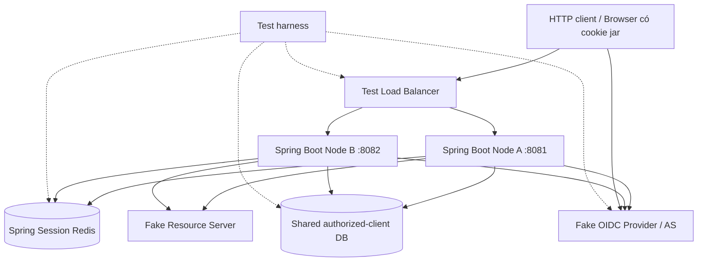
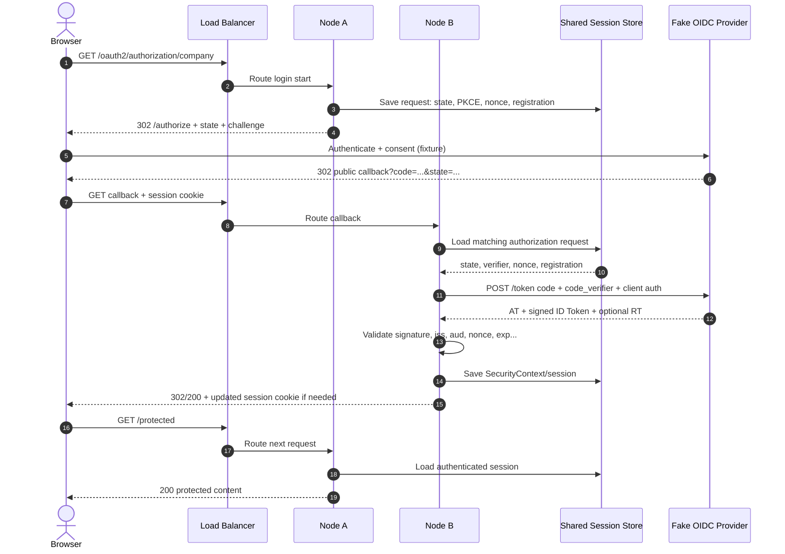
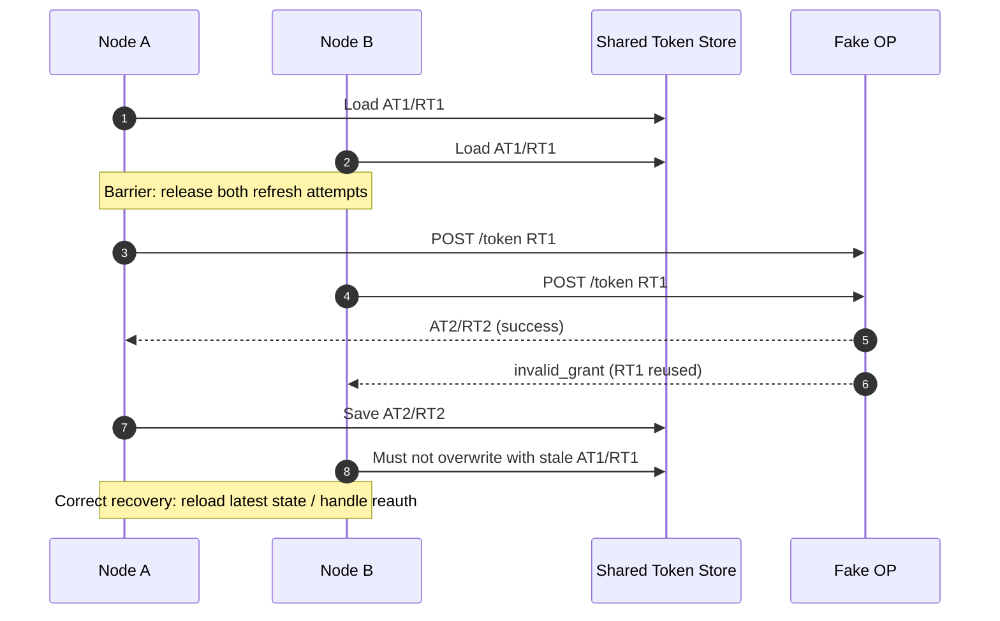
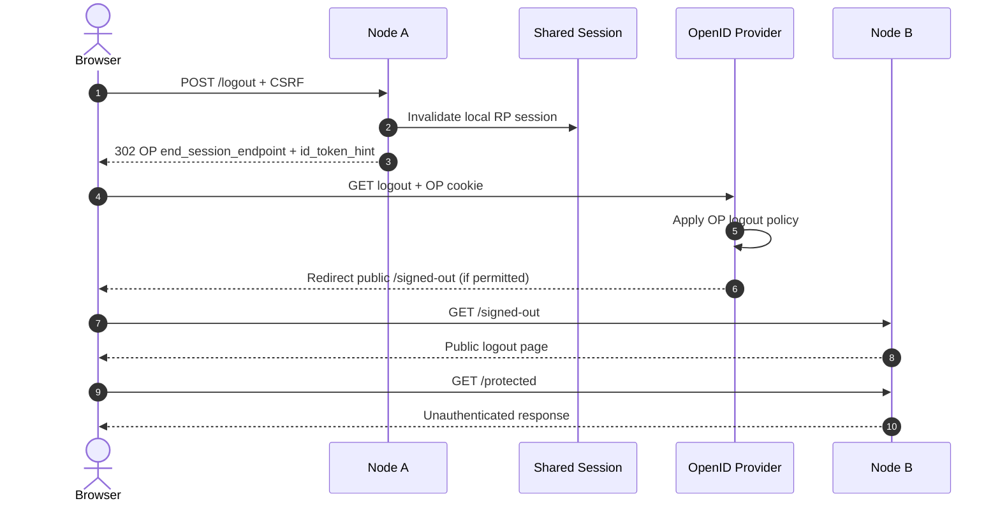

# 31.9. Kiểm thử login, token refresh và logout qua nhiều instance

Một ứng dụng **Spring Security OAuth 2.0 / OpenID Connect (OIDC) Client** thường chạy tốt khi phát triển trên một máy. Người dùng mở trang đăng nhập, ứng dụng chuyển trình duyệt tới OpenID Provider (OP), nhận authorization code, đổi lấy token, lưu phiên và xử lý logout. Nhưng khi triển khai **nhiều instance** sau load balancer, một lớp lỗi mới xuất hiện: request bắt đầu ở **node A** nhưng callback lại vào **node B**; hai nodes cùng refresh một refresh token; hoặc logout ở A nhưng B vẫn phục vụ phiên cũ.

Những lỗi này thường không thể phát hiện bằng một test `MockMvc` chỉ gọi `oauth2Login()`. Test helper đó tạo Authentication giả cho **một request trong một application context**, không kiểm tra HTTP cookie, shared session, PKCE/`state` correlation, token endpoint, distributed persistence, concurrency hoặc OP logout.

Bài này trình bày cách **kiểm thử tích hợp login, token refresh và logout qua nhiều instance** trong ngữ cảnh Spring Security OAuth 2.0 OIDC Client, thuộc chương **31. Kiểm thử tích hợp**. Nội dung dùng **Spring Boot 3.x, Spring Security 6.x, Spring MVC/Servlet** làm ví dụ chính và nêu các điểm khác của **WebFlux/Reactive**. Mọi địa chỉ, token, key và user trong ví dụ đều là fixture; không sử dụng credentials production trong test.

> **Nguyên tắc trung tâm:** Một bài kiểm thử multi-instance chỉ có ý nghĩa khi **ít nhất hai application instances thực sự độc lập** nhận các HTTP requests qua mạng, cùng phụ thuộc vào storage/control-plane được thiết kế cho production. Kiểm thử phải chủ động đổi node giữa các bước, tạo refresh race và xác minh session invalidation, chứ không chỉ gửi nhiều requests vào cùng một `MockMvc`.

## 1. Kết quả cần đạt

Sau bài học, bạn có thể:

1. Mô tả những state cần tồn tại xuyên suốt Authorization Code/OIDC Login: session, `state`, PKCE verifier, `nonce`, authorized client và user mapping.
2. Phân biệt **sticky sessions** với **shared session storage** và hiểu vì sao sticky routing có thể che giấu lỗi failover.
3. Thiết kế môi trường tích hợp có **hai hoặc nhiều app processes**, load balancer có thể kiểm soát routing, Redis/session store, authorized client storage và OP test double.
4. Kiểm tra flow **login bắt đầu ở node A, callback xử lý ở node B** mà vẫn xác minh `state`, PKCE, nonce, issuer và audience.
5. Kiểm tra phiên và authorized client còn đọc được khi request tiếp theo chuyển giữa nodes.
6. Tạo refresh token race có kiểm soát khi hai nodes cùng nhìn thấy access token hết hạn.
7. Phát hiện refresh token reuse/rotation, lost updates và lỗi cache stale; thiết kế assertions cho persistence an toàn.
8. Kiểm thử **local logout**, **RP-Initiated Logout**, **OP-Initiated/Back-Channel Logout** và token revocation như các cơ chế khác nhau.
9. Đảm bảo logout ở A vô hiệu hóa quyền truy cập session ở B theo chính sách đã chọn.
10. Sử dụng fake OP hoặc OP sandbox, Testcontainers, WireMock/MockWebServer, HTTP clients và browser automation đúng phạm vi.
11. Áp dụng fault injection: node restart, Redis failover, OP outage, timeout, key rotation, duplicate callbacks và retry.
12. Thu thập metrics, logs và trace an toàn để chẩn đoán lỗi mà không làm lộ token hoặc session cookie.

## 2. Bài toán: tại sao một instance chạy đúng nhưng nhiều instance lại lỗi?

Giả sử cổng ứng dụng có ba replicas:

```text
               https://portal.example.com
                          |
                     Load Balancer
                          |
            +-------------+-------------+
            |             |             |
          Node A        Node B        Node C
          :8081         :8082         :8083
            |             |             |
            +------+------+-------------+
                   |
             Shared Redis
        (Spring Session / WebSession)
                   |
             Shared Database
        (Authorized Clients / Identity)
                   |
             Trusted OpenID Provider
```

Đây là mô hình minh họa. Một ứng dụng có thể lưu authorized clients ngay trong session; một ứng dụng khác lưu chúng ở database/service. **Phải xác định storage thực tế**, không giả định hai lớp đó dùng chung một backend.

### 2.1. Lỗi login qua hai nodes

```text
1. Browser -> Node A: GET /oauth2/authorization/company
2. Node A lưu authorization request/state vào local HttpSession.
3. Browser đăng nhập tại OP.
4. OP redirect callback -> Node B.
5. Node B không có authorization request/state trong session.
6. Spring Security từ chối callback, thường do authorization request missing/state mismatch.
```

Khi bật sticky sessions, callback có thể vô tình luôn về A, khiến test thành công. Nhưng A restart hoặc load balancer đổi route là lỗi xuất hiện.

### 2.2. Lỗi refresh token qua hai nodes

```text
Shared authorized client ban đầu:
  Access token AT1 gần hết hạn
  Refresh token RT1

Node A: load RT1 -> POST /token grant_type=refresh_token
Node B: load RT1 -> POST /token grant_type=refresh_token

OP:
  A thành công -> AT2, RT2
  B dùng lại RT1 -> invalid_grant / reuse detection
```

Nếu storage không có cơ chế điều phối, một node có thể ghi đè trạng thái mới bằng token cũ hoặc khiến provider thu hồi cả refresh token family.

### 2.3. Lỗi logout qua hai nodes

```text
Browser POST /logout -> Node A
Node A xóa local SecurityContext hoặc local session.

Browser GET /protected -> Node B
Node B vẫn có bản sao session/token cũ và trả HTTP 200.
```

Nếu chính sách là **logout phiên hiện tại**, kết quả này không phù hợp. Tuy nhiên cần phân biệt **browser session** với **access token đã được cấp**: xóa session RP không tự thu hồi Bearer tokens bên ngoài RP hay phiên SSO của OP.

## 3. Ba lớp trạng thái cần kiểm thử riêng

| Lớp trạng thái | Chứa gì? | Dùng lúc nào? | Cần chia sẻ hoặc cô lập thế nào? |
| --- | --- | --- | --- |
| **Authorization request** | `state`, redirect URI, PKCE `code_verifier`, OIDC nonce và ngữ cảnh registration | Bắt đầu login → callback | Cùng login attempt phải đọc được ở node nhận callback |
| **Browser session / SecurityContext** | User Authentication, session ID, CSRF context và application session attributes | Sau login và các requests tiếp theo | Mọi node phục vụ cùng browser phải nhìn thấy trạng thái nhất quán |
| **OAuth2AuthorizedClient** | Registration ID, principal, access token, refresh token, expiration | Gọi downstream API, refresh, revoke | Storage phải đồng bộ theo principal/registration; xử lý concurrent refresh |

Các lớp khác:

- **ClientRegistration/issuer metadata:** cấu hình OAuth2 client, cần nhất quán giữa nodes.
- **OIDC JWKS/decoder:** dùng xác minh ID Token, cache có thể riêng từng process nhưng trust/issuer/alg/audience policy phải đồng nhất.
- **Tenant/account policy:** sau khi login, quyền truy cập phải được kiểm tra theo nguồn tin cậy.
- **OP browser session:** tồn tại ở OP, không tự biến mất khi ứng dụng hủy `HttpSession`.
- **CSRF token:** ràng buộc với browser/session và phải hoạt động khi POST sang node khác.
- **Logout correlation:** nếu dùng OP-initiated/back-channel, cần tìm được RP session theo `sid`/`sub` phù hợp.

### 3.1. Dùng cùng Redis không có nghĩa mọi token tự được chia sẻ

Spring Session Redis quản lý session. Nếu application lưu authorized clients trong `OAuth2AuthorizedClientService` database thì Redis session **không thay thế database đó**. Nếu ứng dụng dùng `HttpSessionOAuth2AuthorizedClientRepository`, authorized clients có thể nằm trong session; khi đó security/privacy/serialization của Redis có ảnh hưởng trực tiếp đến token storage.

Kiểm tra bean và đường đi thật trong application:

```text
HttpSessionOAuth2AuthorizationRequestRepository
        -> session-backed authorization request

SecurityContextRepository / HttpSession
        -> session-backed authentication

OAuth2AuthorizedClientRepository
        -> session hoặc service-backed client

OAuth2AuthorizedClientService
        -> memory / JDBC / custom encrypted storage
```

Không chạy integration test với in-memory authorized client service trong khi production dùng JDBC nếu mục tiêu là kiểm chứng multi-node persistence.

## 4. Mô hình kiểm thử chuẩn: hai app processes và một OP kiểm soát được

Một setup phù hợp:



Các thành phần cần thiết:

1. **Hai JVM/application contexts độc lập** với hai ports khác nhau; không chỉ hai controller beans cùng process.
2. **Một địa chỉ RP công khai cố định** qua load balancer, ví dụ `https://portal.test.local`.
3. **Cơ chế ép request cụ thể về A hoặc B** chỉ trong hạ tầng kiểm thử, không public bypass trong production.
4. **Redis/session store** và **authorized client store** giống topology production.
5. **Fake OP/AS** có authorization, token, JWKS, discovery, optional end-session/revocation/back-channel.
6. **Fake downstream Resource Server** nhận access token và trả response/counters theo fixture.
7. **HTTP client có cookie jar** hoặc trình duyệt thật để giữ session cookie qua redirects.
8. **Clock/time control** và fault injection cho expiry, rotation, timeout và outage.
9. Logs/metrics phân biệt node A/B, request correlation ID, registration ID nhưng không ghi raw credentials.

### 4.1. Tại sao phải có một public redirect URI cố định?

Authorization Code Flow thường dùng redirect URI đã đăng ký tại OP, ví dụ:

```text
https://portal.test.local/login/oauth2/code/company
```

Nếu browser bắt đầu ở A rồi callback đến B, **redirect URI vẫn phải là URI công khai của RP**, không tự đổi thành:

```text
http://node-b:8082/login/oauth2/code/company
```

chỉ để test được. Việc làm đó có thể thay đổi client registration, cookie domain, TLS/SameSite và callback semantics.

Trong test, **load balancer** nhận callback ở public URI rồi chuyển nó sang B theo routing rule do test harness kiểm soát. Proxy phải xử lý `Host`/`Forwarded`/`X-Forwarded-*` từ nguồn đáng tin cậy.

### 4.2. Sticky session: nên kiểm thử cả bật và tắt

| Chế độ | Lợi ích | Rủi ro bị che giấu |
| --- | --- | --- |
| Sticky routing | Giữ các requests thường đến cùng node, có thể giảm state lookups | Che lỗi session local và failover |
| Non-sticky + shared state | Phơi bày tính đúng đắn của shared session/authorized client | Yêu cầu session/DB hoạt động nhất quán |
| Sticky + node failure | Gần production nếu LB có affinity | Cần test failover sang node khác |
| Cross-node forced routing | Chứng minh A/B đọc được cùng state | Phải tránh test-only routing bypass ra Internet |

Đừng tuyên bố “hệ thống hỗ trợ multi-instance” chỉ vì đã bật sticky sessions và test mọi bước trên A.

## 5. Thành phần quan trọng của OIDC Login đa instance

Một luồng Authorization Code + OIDC có các bước:



**Đây là một kịch bản phải chủ động kiểm thử.** Nếu tất cả requests vô tình về B, lỗi A→B không được kiểm tra.

### 5.1. Các điều kiện login test không thể bỏ

- `state` từ authorization request được so khớp khi callback.
- `code_verifier` khớp `code_challenge` đã gửi; OP test double phải có thể từ chối PKCE sai.
- OIDC `nonce` trong ID Token khớp request khi flow yêu cầu.
- `issuer` của ID Token đúng OP được đăng ký.
- `aud` của ID Token khớp OAuth2 `client_id`.
- Signature được xác minh bằng public JWKS của OP đã cấu hình, không phải một token chuỗi giả.
- `exp`, `iat`, và các OIDC validators theo profile được thực thi.
- Browser cookie dùng đúng domain, path, SameSite, Secure.
- Tạo/đổi session ID sau xác thực theo session fixation policy.
- Authorized client được lưu theo đúng registration và principal.
- Request tới node khác sau callback vẫn authenticated.
- Login từ tenant A không tự trở thành login của tenant B.

### 5.2. Mất `state` không được sửa bằng cách bỏ kiểm tra

Nếu callback sang B gây lỗi “authorization request not found”, nguyên nhân thường là **session/state repository không nhất quán** hoặc browser không gửi cookie.

Không được:

- Tắt `state` correlation.
- Tắt PKCE/nonce.
- Cho callback query tự chọn Token Endpoint.
- Tạo authorization request mới từ callback.
- Chấp nhận authorization code không thuộc login attempt hiện tại.

Hướng xử lý đúng là xác định **cookie, session ID, shared store, serialization, proxy và registration binding**.

## 6. Một cấu hình Spring Boot mẫu cho session chia sẻ

Nếu dùng **Spring MVC/Servlet**, một lựa chọn phổ biến là **Spring Session Redis**.

### 6.1. Gradle dependencies

```groovy
dependencies {
    implementation 'org.springframework.boot:spring-boot-starter-web'
    implementation 'org.springframework.boot:spring-boot-starter-security'
    implementation 'org.springframework.boot:spring-boot-starter-oauth2-client'

    implementation 'org.springframework.session:spring-session-data-redis'
    implementation 'org.springframework.boot:spring-boot-starter-data-redis'

    testImplementation 'org.springframework.boot:spring-boot-starter-test'
    testImplementation 'org.springframework.security:spring-security-test'
    testImplementation 'org.testcontainers:junit-jupiter'
    testImplementation 'org.testcontainers:testcontainers'
}
```

Ví dụ phụ thuộc vào Spring Boot dependency management. Không hardcode version lẻ không tương thích Spring Security/Session.

### 6.2. `application-it.yml`

```yaml
server:
  forward-headers-strategy: framework
  servlet:
    session:
      timeout: 30m

spring:
  data:
    redis:
      host: ${IT_REDIS_HOST:localhost}
      port: ${IT_REDIS_PORT:6379}

  session:
    redis:
      namespace: oidc-it:sessions

  security:
    oauth2:
      client:
        registration:
          company:
            provider: test-op
            client-id: oidc-it-client
            client-secret: ${IT_OIDC_CLIENT_SECRET}
            client-authentication-method: client_secret_basic
            authorization-grant-type: authorization_code
            redirect-uri: "{baseUrl}/login/oauth2/code/{registrationId}"
            scope:
              - openid
              - profile
        provider:
          test-op:
            issuer-uri: ${IT_OP_ISSUER}
```

Cả node A và node B phải có:

- **Cùng** session namespace và Redis store cho cùng test environment.
- Cùng trust/config của OP issuer, client ID, redirect URI và secrets.
- **Khác** `server.port`, process ID và logging instance name.
- Cùng logic authorized client persistence.
- Không dùng cookie domain/path riêng theo node nếu browser truy cập qua public LB.

`server.forward-headers-strategy=framework` chỉ phù hợp khi reverse proxy **xóa/ghi đè forwarded headers chưa tin cậy**. Không cho Internet client tự đặt `X-Forwarded-Host` rồi dùng nó tạo `redirect_uri`.

### 6.3. Java security chain cơ bản

```java
import org.springframework.context.annotation.Bean;
import org.springframework.context.annotation.Configuration;
import org.springframework.security.config.Customizer;
import org.springframework.security.config.annotation.web.builders.HttpSecurity;
import org.springframework.security.web.SecurityFilterChain;

@Configuration
public class WebSecurityConfig {

    @Bean
    SecurityFilterChain webSecurity(HttpSecurity http)
            throws Exception {

        return http
                .authorizeHttpRequests(auth -> auth
                        .requestMatchers(
                                "/", "/signed-out", "/error",
                                "/assets/**")
                            .permitAll()
                        .anyRequest()
                            .authenticated())
                .oauth2Login(Customizer.withDefaults())
                .logout(logout -> logout
                        .logoutUrl("/logout")
                        .invalidateHttpSession(true)
                        .clearAuthentication(true))
                .build();
    }
}
```

Đây là cấu hình **local logout cơ bản**. Phần OP RP-Initiated Logout được thêm bằng success handler ở mục sau. Không tắt CSRF để dễ test: với browser session, `POST /logout` phải mang CSRF token theo policy của Spring Security.

### 6.4. Redis/session serialization

Một hệ thống nhiều instance cần thống nhất:

- Spring Boot, Spring Security và Spring Session versions.
- Session serializer/`ObjectMapper` modules nếu dùng JSON.
- Serialization compatibility khi rolling upgrade.
- Cookie name/domain/path và session timeout.
- Redis ACL/TLS, network isolation, eviction và memory policy.
- SecurityContext/OAuth2User/OIDC principal types có thể deserialize qua nodes.
- Session attributes custom của ứng dụng phải serialize an toàn.

**Không chuyển Redis thành nơi lưu raw session/token không được bảo vệ** chỉ vì test dễ chạy. Production cần security controls; test dùng credentials giả riêng.

## 7. Session storage và authorized client storage: chọn đúng kiến trúc

Có hai mô hình thường gặp.

### 7.1. Authorized client nằm trong session

```text
Browser cookie SESSION
        |
        v
Spring Session Redis
        |
        +--> SecurityContext
        +--> OAuth2 authorization request state
        +--> OAuth2AuthorizedClient nếu session repository được dùng
```

Ưu điểm: token gắn với browser session; session invalidation có thể dọn local authorized client. Hạn chế: session chứa access/refresh token nhạy cảm, có serialization/cache TTL/eviction và mất session khi browser logout.

### 7.2. Authorized client nằm trong shared service/database

```text
Browser cookie SESSION -> shared Redis (SecurityContext)

OAuth2AuthorizedClient:
  key = registrationId + principalName + security context
       |
       v
Shared encrypted JDBC/custom store
```

Ưu điểm: tách token lifecycle khỏi browser session, hỗ trợ một số background jobs khi được phép. Hạn chế: logout browser không tự xóa token service-backed; cần cleanup/revocation và concurrency control riêng.

**Không dùng in-memory `InMemoryOAuth2AuthorizedClientService` để đại diện cho DB shared trong bài test multi-node**, trừ khi chủ đích kiểm tra rằng in-memory state không thể chia sẻ.

### 7.3. Những object cần kiểm chứng sau login

| Object | Kiểm chứng |
| --- | --- |
| Authorization request | Được đọc đúng từ session khi callback sang B |
| Authentication | Đúng user, registration và authorities sau callback |
| Session | A và B đọc cùng logical session khi dùng cùng cookie |
| Authorized client | Đúng principal/registration, token được lưu nhất quán |
| Token expiry | Refresh được kích hoạt khi cần theo provider policy |
| Tenant membership | Không lấy token/role user khác khi đổi node |
| Session invalidation | Sau logout, cả A và B không còn authenticated |
| Token revocation | Được thực hiện **nếu** policy/disconnect flow yêu cầu |

## 8. Test infrastructure: sử dụng công cụ nào?

Không có một công cụ duy nhất làm được cả HTTP browser, OP protocol, Redis và multi-process concurrency.

| Công cụ | Mục tiêu | Không thay thế được |
| --- | --- | --- |
| **Testcontainers** | Khởi tạo Redis, DB, một số OP/test services trong Docker | Browser redirect/state logic |
| **WireMock/MockWebServer** | Stub discovery, JWKS, token endpoint và HTTP failure | OIDC protocol state machine đầy đủ nếu stub quá đơn giản |
| **Fake OIDC Provider stateful** | Quản lý authorization code, PKCE, nonce, token issuance và RT rotation | Production OP policy hoàn toàn |
| **Keycloak/OP sandbox trong container** | Integration với OIDC implementation thực | Tất cả vendor-specific behavior |
| **Java HttpClient + CookieManager** | Kiểm tra HTTP cookies/redirects giữa nodes | Browser SameSite/CSP behavior |
| **Selenium/Playwright** | Trình duyệt thật, cookie, redirects, SSO/logout UX | Database concurrency assertions |
| **Toxiproxy/network chaos** | Chèn latency, cut connection, timeout | Identity/security assertions |
| **JUnit 5** | Orchestration và assertions | Infrastructure topology |
| **Metrics/log collection** | Chẩn đoán node, refresh attempts, failures | Bằng chứng riêng về token validity |

Một test suite tốt thường có **một số lớp**: unit/controller tests chạy nhanh, multi-instance HTTP integration tests, rồi browser/OP sandbox tests khi cần.

### 8.1. Vì sao `MockMvc` không đủ?

`MockMvc` thường chạy bên trong một application context và giả lập Servlet request/response. Với:

```java
mvc.perform(get("/api/me").with(oidcLogin()))
```

bạn đã **gắn OIDC Authentication giả**, không chạy `/oauth2/authorization/...`, không nhận callback qua load balancer, không kiểm tra Redis và không gọi Token Endpoint.

`MockMvc` vẫn phù hợp cho URL authorization/method security/CSRF trong từng node, nhưng **bài test A→B** phải dùng real HTTP endpoints hoặc tối thiểu hai contexts với shared infrastructure và transport được kiểm soát. Một test được đặt tên “multi-instance” nhưng chỉ có một context không cung cấp bằng chứng yêu cầu.

### 8.2. Một OP test double phải stateful đến mức nào?

Để test login/refresh nghiêm túc, fake OP tối thiểu cần:

- Discovery metadata với `issuer`, authorization/token/JWKS endpoints.
- Một hoặc nhiều public signing JWKs; private test key chỉ nằm trong OP fixture.
- Authorization Endpoint cấp `code` gắn với `client_id`, `redirect_uri`, `code_challenge`, `nonce` và user fixture.
- Token Endpoint **chỉ redeem code một lần**, kiểm tra client authentication/redirect URI/PKCE.
- ID Token được **ký thật bằng test key**, chứa issuer/audience/nonce/exp phù hợp.
- Refresh grant có token families và optional one-time refresh token rotation.
- Structured `invalid_grant`/`invalid_client`/`temporarily_unavailable` responses.
- Bộ đếm số lần authorize, code redemption, refresh, revocation/logout.
- Điều khiển thời gian, key rotation và fault injection.

**Không trả chuỗi `"id_token": "fake"` rồi coi đó là OIDC integration test**: Spring Security cần decode/validate signed ID Token đúng chuẩn, nên test sẽ không phản ánh protocol.

## 9. Khởi động Redis bằng Testcontainers

Ví dụ JUnit 5 dùng Docker để tạo Redis test-only:

```java
import org.junit.jupiter.api.TestInstance;
import org.springframework.test.context.DynamicPropertyRegistry;
import org.springframework.test.context.DynamicPropertySource;
import org.testcontainers.containers.GenericContainer;
import org.testcontainers.junit.jupiter.Container;
import org.testcontainers.junit.jupiter.Testcontainers;
import org.testcontainers.utility.DockerImageName;

@Testcontainers
@TestInstance(TestInstance.Lifecycle.PER_CLASS)
class SharedRedisInfrastructureIT {

    @Container
    static final GenericContainer<?> REDIS =
            new GenericContainer<>(
                    DockerImageName.parse("redis:7-alpine"))
                    .withExposedPorts(6379);

    @DynamicPropertySource
    static void redisProperties(DynamicPropertyRegistry properties) {
        properties.add(
                "spring.data.redis.host", REDIS::getHost);
        properties.add(
                "spring.data.redis.port",
                () -> REDIS.getMappedPort(6379));
    }
}
```

**Giới hạn ví dụ:** đoạn này minh họa bootstrap Redis cho một Spring Test context. Nó **chưa tự khởi động hai app instances** và chưa tạo OP giả. Muốn thực sự test A/B, cần thêm harness khởi động hai processes/containers và truyền Redis host/port tới cả hai, hoặc một Docker Compose/Testcontainers topology.

### 9.1. Isolation giữa test cases

Nếu nhiều test classes dùng cùng Redis:

- Dùng namespace khác nhau theo test run.
- Cleanup sessions/tokens sau test.
- Không xóa một Redis database dùng chung production.
- Không chạy các tests ảnh hưởng cùng user/tenant concurrently nếu không chủ động điều phối.
- Đặt TTL cho fixture sessions.
- Đảm bảo test không ngẫu nhiên đọc session từ lần chạy trước.

Đối với shared DB authorized clients, dùng unique test principals và cleanup có transaction/ID prefix phù hợp.

## 10. Khởi chạy hai app instances

Để ví dụ rõ ràng, giả sử **cùng một artifact** được chạy hai lần.

### 10.1. Cấu hình logic của từng node

```text
Node A:
  SERVER_PORT=8081
  INSTANCE_ID=A
  IT_REDIS_HOST=redis
  IT_OIDC_ISSUER=https://op.test.local/realms/it
  OIDC_CLIENT_ID=oidc-it-client
  OIDC_CLIENT_SECRET=<test-only-secret>

Node B:
  SERVER_PORT=8082
  INSTANCE_ID=B
  IT_REDIS_HOST=redis
  IT_OIDC_ISSUER=https://op.test.local/realms/it
  OIDC_CLIENT_ID=oidc-it-client
  OIDC_CLIENT_SECRET=<test-only-secret>
```

Tên môi trường là minh họa; trong `application-it.yml` cần bind các biến tương ứng. Test có thể dùng ephemeral ports thay cho 8081/8082 nếu harness cấp. Cả hai nodes phải **trỏ cùng session/authorized-client infrastructure**, không tạo một Redis riêng cho mỗi node.

### 10.2. Cấu hình OP fixture và redirect URI

```text
Public test origin:
  https://portal.test.local

Registered redirect URI tại fake OP:
  https://portal.test.local/login/oauth2/code/company

RP Authorization start:
  https://portal.test.local/oauth2/authorization/company

Token Endpoint:
  https://op.test.local/realms/it/token
```

Fake OP có thể dùng HTTPS trong một test network có test CA phù hợp. Đừng tắt TLS hostname/certificate validation trong production hoặc sao chép `trustAll` từ test environment.

### 10.3. Routing control chỉ dùng trong test

Một test load balancer có thể cung cấp API nội bộ:

```text
forceNextRequestTo(A)
forceNextRequestTo(B)
clearStickyMapping()
stopNode(A)
startNode(A)
```

Đây là **pseudo API của harness**, không phải một Spring Security class. Nếu sử dụng ingress test thật, có thể điều khiển backend route qua test-only configuration, nhưng phải ngăn người dùng Internet chọn backend bằng header đặc quyền.

## 11. Kịch bản LOGIN-01: bắt đầu trên A, callback trên B

Đây là test căn bản nhất.

### 11.1. Arrange

- Fake OP có user fixture `alice`.
- Registration `company` đã được cấu hình tại cả A/B.
- Redis dùng chung, có session namespace sạch.
- Browser HTTP client giữ cookie jar.
- Load balancer có thể ép route từng request.
- Fake OP tạo code và ký ID Token đúng nonce/issuer/audience.
- Các clocks giữa A/B/OP đủ đồng bộ.

### 11.2. Act

```text
1. route(A)
   GET /oauth2/authorization/company

2. Capture:
   RP session cookie
   Location authorization URL chứa state (+ PKCE challenge, nonce)

3. Browser thực hiện authorization tại fake OP
   OP xác thực alice, cấp one-time code

4. route(B)
   Browser GET public /login/oauth2/code/company?code=...&state=...
   + đúng RP session cookie

5. Capture:
   status/redirect, Set-Cookie mới nếu session fixation rotation

6. route(A)
   GET /protected với cookie mới nhất

7. route(B)
   GET /protected với cùng browser cookie
```

### 11.3. Assert

- Authorization request và callback liên kết đúng `state`.
- Fake OP ghi nhận `code_verifier` hợp lệ đối với `code_challenge` (nếu PKCE được bật/được yêu cầu).
- ID Token được RP xác minh với đúng issuer, audience, nonce.
- Code chỉ redeem **một lần** tại Token Endpoint.
- A và B cùng nhận diện authenticated principal.
- Session ID thay đổi sau login nếu session fixation policy áp dụng.
- Không tạo thêm một session login vô tình do callback qua B.
- Authorized client được lưu đúng registration/principal.
- Không có token/secret/authorization code trong application access logs.

### 11.4. Pseudocode của test harness

```java
// PSEUDOCODE: các class dưới là abstraction của test harness,
// không phải class có sẵn trong Spring Security.
@Test
void loginCanStartOnAAndFinishOnB() {
    TestBrowser browser = harness.newBrowser();

    harness.routeNextTo("A");
    AuthorizationRedirect redirect =
            browser.getAuthorizationStart(
                    "/oauth2/authorization/company");

    assertThat(redirect.state()).isNotBlank();

    FakeOpCallback callback = fakeOp.loginAndAuthorize(
            redirect.url(), "alice-test-account");

    harness.routeNextTo("B");
    browser.followCallback(callback);

    harness.routeNextTo("A");
    assertThat(browser.get("/protected").status()).isEqualTo(200);

    harness.routeNextTo("B");
    assertThat(browser.get("/protected").status()).isEqualTo(200);

    assertThat(fakeOp.authorizationCodeRedeemCount()).isEqualTo(1);
    assertThat(fakeOp.lastCodeVerifierWasValid()).isTrue();
}
```

Giá trị của pseudocode là mô tả **chuyển node bắt buộc**, không hứa đây là test chạy được chỉ bằng cách copy mà không xây harness/fake OP.

## 12. Các negative cases của login phải đi cùng cross-node test

| ID | Tình huống | Kỳ vọng |
| --- | --- | --- |
| LOGIN-02 | A/B dùng **Redis khác nhau** | Callback B không tìm được state; test phát hiện cấu hình sai |
| LOGIN-03 | Browser không gửi RP cookie trên callback | Login không được chấp nhận |
| LOGIN-04 | Callback `state` khác request | Từ chối, không redeem code như flow hợp lệ |
| LOGIN-05 | OP trả code thuộc client khác | Token Endpoint/RP từ chối |
| LOGIN-06 | PKCE verifier không khớp challenge | Fake OP trả `invalid_grant`; RP không authenticated |
| LOGIN-07 | ID Token `nonce` sai | RP từ chối OIDC Login |
| LOGIN-08 | ID Token issuer/audience sai | RP từ chối, không map user |
| LOGIN-09 | ID Token signing key không nằm trong OP JWKS | RP không chấp nhận signature |
| LOGIN-10 | Code đã redeem, callback bị gửi lại | Không tạo login mới từ code tái sử dụng |
| LOGIN-11 | Node A restart sau authorization request | Callback B vẫn hoạt động nếu state đã persist đúng |
| LOGIN-12 | Redis unavailable tại callback | Fail có kiểm soát, không bypass `state` |
| LOGIN-13 | Nodes dùng ClientRegistration version khác | Phát hiện callback/client mismatch, không tráo token endpoint |
| LOGIN-14 | Multi-tab cùng session, hai `state` | Kiểm tra correlation không bị ghi đè; behavior theo repository thực |
| LOGIN-15 | Alpha/Beta issuers khác nhau | Không chấp nhận token của OP B trong login OP A |
| LOGIN-16 | Proxy public host/scheme sai | Phát hiện redirect URI mismatch, không chấp nhận arbitrary redirect |
| LOGIN-17 | Session serializer A khác B | Test phát hiện deserialize/missing authentication |
| LOGIN-18 | Thay user sau logout rồi login lại | Không tái sử dụng principal/token của user trước |

**Đặc biệt với multi-tab:** một số authorization request repositories mặc định lưu **một login attempt** trong session. Khi hai tabs bắt đầu cùng lúc, request có thể ghi đè nhau. Không mặc định “có Redis” là giải quyết được vấn đề; phải kiểm thử repository thực tế và nếu UX cần nhiều attempts song song, thiết kế storage keyed-by-state có expiry/cleanup đúng chuẩn.

## 13. Session ID rotation và cookie jar phải được mô phỏng đúng

Spring Security thường áp dụng session fixation protection khi authentication thành công. Tùy Servlet container/Spring Session configuration, browser có thể nhận **session cookie mới** sau callback.

Sai lầm trong test:

```text
T0: lấy cookie SESSION trước login
T1: callback trả Set-Cookie SESSION mới
T2: test vẫn dùng cookie T0 để GET /protected
T3: nhận redirect/401 và kết luận multi-node session lỗi
```

Một HTTP client phù hợp phải:

- Giữ cookie theo domain/path và các thuộc tính liên quan.
- Cập nhật cookie từ `Set-Cookie` của callback.
- Duy trì cookies của RP và OP ở đúng origins.
- Không giả định session ID giữ nguyên trong toàn flow.
- Không gửi cookie RP tới OP domain.
- Trong browser E2E, để trình duyệt thực xử lý SameSite/Secure.
- Kiểm tra session ID cũ **không còn truy cập được** khi policy đòi session fixation rotation.

### 13.1. Java HTTP client với cookie manager

Một skeleton cho các HTTP requests test:

```java
import java.net.CookieManager;
import java.net.CookiePolicy;
import java.net.http.HttpClient;

CookieManager cookies = new CookieManager(
        null, CookiePolicy.ACCEPT_ORIGINAL_SERVER);

HttpClient browserClient = HttpClient.newBuilder()
        .cookieHandler(cookies)
        .followRedirects(HttpClient.Redirect.NEVER)
        .build();
```

Khi muốn chuyển node A/B, gửi requests qua **cùng public load balancer URL** rồi điều khiển route nội bộ; `CookieManager` chỉ xử lý cookies. Để kiểm tra browser SameSite thật, dùng Selenium/Playwright vì Java HttpClient không tái hiện đầy đủ browser cookie policy.

## 14. AUTHZ-01: session sau login phải hoạt động trên mọi node

Sau LOGIN-01, dùng **cookie mới nhất** để gọi:

```text
GET /api/profile   -> A -> 200, user=alice
GET /api/profile   -> B -> 200, user=alice
GET /api/admin     -> A -> 403 nếu alice không có role
GET /api/admin     -> B -> 403 cùng policy
```

Assertions:

- `Authentication.getName()` hoặc internal account ID nhất quán.
- Authorities giống nhau giữa A/B.
- Node B không tự thực hiện một login flow khác.
- App session data cần thiết cùng một phiên không bị mất.
- Không lộ `OAuth2AuthorizedClient` object, refresh token hoặc ID Token ra JSON.
- Một request của Alice không đọc được session của Bob dù cùng Redis backend.
- Policy tenant được áp dụng ở mỗi node, không dựa trên routing hint chưa xác minh.

### 14.1. Session store dùng Redis không tự đảm bảo authorization cập nhật tức thời

Nếu quyền của Alice bị thu hồi trong database nhưng SecurityContext chứa authorities cũ, cả A/B có thể vẫn tin session đó cho tới khi application refresh/revoke authorization state theo policy.

Đây không chỉ là lỗi replication. Cần test entitlement/session invalidation khi nghiệp vụ yêu cầu **revocation gần realtime**.

### 14.2. Session data ghi đồng thời có thể bị lost update

Hai requests trên A và B cùng sửa một session attribute có thể ghi đè nhau nếu store dùng last-write-wins. Spring Session giúp chia sẻ session nhưng không tự cung cấp transaction isolation cho mọi custom attribute.

Nếu app dùng session lưu workflow state có tính quan trọng, cần kiểm thử concurrent writes và có data model/versioning phù hợp.

## 15. Token refresh: manager và storage thật phải được kiểm tra

Sau login, OAuth2 Client có một `OAuth2AuthorizedClient`, thường chứa:

```text
registrationId = company
principalName  = alice
accessToken    = AT1 (expiresAt = T1)
refreshToken   = RT1
```

Khi access token gần hết hạn, một `OAuth2AuthorizedClientManager` được cấu hình có thể dùng `refresh_token` để xin AT2 (và RT2 nếu AS rotate).

### 15.1. Bean manager ví dụ cho Servlet request context

```java
import org.springframework.context.annotation.Bean;
import org.springframework.context.annotation.Configuration;
import org.springframework.security.oauth2.client.DefaultOAuth2AuthorizedClientManager;
import org.springframework.security.oauth2.client.OAuth2AuthorizedClientManager;
import org.springframework.security.oauth2.client.OAuth2AuthorizedClientProvider;
import org.springframework.security.oauth2.client.OAuth2AuthorizedClientProviderBuilder;
import org.springframework.security.oauth2.client.registration.ClientRegistrationRepository;
import org.springframework.security.oauth2.client.web.OAuth2AuthorizedClientRepository;

@Configuration
class AuthorizedClientManagerConfig {

    @Bean
    OAuth2AuthorizedClientManager authorizedClientManager(
            ClientRegistrationRepository registrations,
            OAuth2AuthorizedClientRepository repository) {

        OAuth2AuthorizedClientProvider provider =
                OAuth2AuthorizedClientProviderBuilder.builder()
                        .authorizationCode()
                        .refreshToken()
                        .build();

        var manager = new DefaultOAuth2AuthorizedClientManager(
                registrations, repository);
        manager.setAuthorizedClientProvider(provider);
        return manager;
    }
}
```

**Giới hạn:** `DefaultOAuth2AuthorizedClientManager` phù hợp Servlet `HttpServletRequest` context. Với scheduled/batch jobs không có request, thường sử dụng `AuthorizedClientServiceOAuth2AuthorizedClientManager` với service-backed storage.

Nếu application dùng custom manager hoặc provider chain, test phải đi qua **đúng manager được production dùng**, không tạo một fake manager khác bỏ qua refresh behavior.

### 15.2. Một service dùng manager để gọi API cố định

```java
import org.springframework.security.core.Authentication;
import org.springframework.security.oauth2.client.OAuth2AuthorizeRequest;
import org.springframework.security.oauth2.client.OAuth2AuthorizedClient;
import org.springframework.security.oauth2.client.OAuth2AuthorizedClientManager;
import org.springframework.stereotype.Service;
import org.springframework.web.client.RestClient;

@Service
public class ProfileGateway {

    private final OAuth2AuthorizedClientManager manager;
    private final RestClient resourceApi;

    public ProfileGateway(
            OAuth2AuthorizedClientManager manager,
            RestClient.Builder restClientBuilder) {
        this.manager = manager;
        this.resourceApi = restClientBuilder
                .baseUrl("https://resource-api.test.local")
                .build();
    }

    public String fetchProfile(Authentication authentication) {
        OAuth2AuthorizeRequest authorizeRequest =
                OAuth2AuthorizeRequest
                        .withClientRegistrationId("company")
                        .principal(authentication)
                        .build();

        OAuth2AuthorizedClient client =
                manager.authorize(authorizeRequest);

        if (client == null) {
            throw new IllegalStateException(
                    "No authorized OAuth2 client for user");
        }

        return resourceApi.get()
                .uri("/profile")
                .headers(headers ->
                        headers.setBearerAuth(
                                client.getAccessToken().getTokenValue()))
                .retrieve()
                .body(String.class);
    }
}
```

`https://resource-api.test.local` là fake Resource Server trong test topology. Trong production, URI phải lấy từ trusted configuration/allowlist, không từ `?url=...` do caller kiểm soát. **Đừng log Bearer token hoặc response request headers.**

### 15.3. Mấu chốt để kích hoạt refresh trong test

Manager/provider thường quyết định refresh theo `expiresAt` và một **clock skew** nhất định. Không nhất thiết chờ đến đúng giây token hết hạn.

Test harness nên điều khiển:

- Access token `expires_in` do fake OP cấp.
- Thời điểm kiểm tra refresh, hoặc một `Clock`/provider configuration được kiểm soát nếu API version hỗ trợ.
- Count of refresh requests tại OP.
- Authorized client state trước/sau refresh.
- Token binding với principal và registration.

**Không tạo AT có `expires_in=1` rồi dùng `Thread.sleep` tùy tiện trong hàng trăm tests**: dễ chậm và flake. Ưu tiên clock control/fixture state khi có thể, đồng thời có ít nhất một end-to-end test trên HTTP thật xác minh thời gian thực.

## 16. REFRESH-01: refresh qua node khác sau login

### 16.1. Arrange

- Login kết thúc ở B, authorized client lưu trong storage được chia sẻ.
- Fake OP cấp AT1 có thời hạn phù hợp test.
- RT1 hợp lệ, fake OP được cấu hình rotate RT1 thành RT2.
- Đợi/điều khiển thời gian đến lúc AT1 cần refresh.

### 16.2. Act

```text
1. Browser login hoàn tất trên B -> AT1 / RT1 đã persist.
2. Điều chỉnh clock/test state để AT1 cần refresh.
3. Route request gọi downstream qua A.
4. A load authorized client cho Alice/company.
5. A gửi refresh grant với RT1 đến fake OP.
6. Fake OP trả AT2 / RT2.
7. A persist authorized client mới.
8. Route request tiếp theo qua B.
9. B đọc AT2 / RT2 đã cập nhật và gọi downstream.
```

### 16.3. Assert

- Fake OP nhận đúng **một refresh** khi chỉ có một caller.
- Client authentication method/registration đúng.
- `grant_type=refresh_token`, RT1 thuộc Alice/company.
- AT2 dùng cho đúng audience của fake Resource Server.
- RT2 được lưu nếu fake OP rotate.
- Node B không dùng lại RT1 sau khi A đã hoàn tất refresh.
- Không làm thay đổi authorized client của Bob hoặc tenant khác.
- Không log request-body chứa refresh token.

**Vấn đề cần tránh:** nếu B có một in-memory token cache riêng chưa được invalidate, B có thể vẫn đọc RT1. Test phải phát hiện **cache coherence**, không chỉ database record mới.

## 17. REFRESH-02: hai nodes đồng thời refresh RT1

Đây là bài kiểm thử concurrency quan trọng nhất.



### 17.1. Fake OP phải mô phỏng refresh token rotation đúng

Đơn giản hóa state machine trong fake OP:

```text
RT1: ACTIVE

First valid refresh(RT1):
  -> mark RT1 USED
  -> issue AT2 and RT2
  -> mark RT2 ACTIVE

Second refresh(RT1):
  -> invalid_grant
  -> optionally revoke token family (provider policy)
```

Điều kiện **atomic** ở OP test double rất quan trọng. Nếu fake OP cho phép cả hai refresh cùng RT1 thành công, nó không bộc lộ được race nghiêm trọng.

Không phải mọi OP rotate RT giống nhau. Một số có **grace window** hoặc family reuse detection. Test nên có mode tương ứng **provider contract thực tế**, không mặc định tất cả OP cùng semantics.

### 17.2. Barrier để ép race, không dựa vào may mắn

Không làm một test gửi hai requests nối tiếp rồi gọi là “concurrent”. Cần:

1. Đảm bảo cả A/B đã load cùng version AT1/RT1.
2. Dùng barrier/latch ở **test-only storage adapter**, fake OP hoặc pre-refresh hook.
3. Khi cả hai sẵn sàng, release đồng thời.
4. Quan sát hai requests và kết quả.
5. Assert storage không bị ghi đè về RT1.
6. Kiểm tra request tiếp theo còn có thể authorize, hoặc hệ thống chuyển sang reauthorization rõ ràng theo policy.

```java
// PSEUDOCODE test harness: không phải một Spring API cụ thể.
CountDownLatch bothLoaded = new CountDownLatch(2);
CountDownLatch release = new CountDownLatch(1);

fakeTokenStore.onRead((registration, principal) -> {
    if (registration.equals("company")
            && principal.equals("alice")) {
        bothLoaded.countDown();
        release.await(); // chỉ trong test harness thread, có timeout thật
    }
});

CompletableFuture<Response> callA = harness.getAsync("A", "/api/profile");
CompletableFuture<Response> callB = harness.getAsync("B", "/api/profile");

assertThat(bothLoaded.await(10, TimeUnit.SECONDS)).isTrue();
release.countDown();

Response a = callA.get(10, TimeUnit.SECONDS);
Response b = callB.get(10, TimeUnit.SECONDS);

assertThat(fakeOp.refreshTokenUseCount("RT1")).isLessThanOrEqualTo(2);
assertThat(sharedStore.latestRefreshToken()).isNotEqualTo("RT1");
```

**Lưu ý:** đoạn trên chỉ mô tả cơ chế ép race. Assertion `useCount <= 2` **không phải tiêu chí đủ để coi đúng**; tùy chính sách, mục tiêu lý tưởng là **chỉ một request refresh thật**, hoặc một request refresh thành công và request còn lại reload state/recover/fail an toàn. Production test cần thêm assert không lộ token, không ghi đè RT2 và không vô hiệu hóa RT family. Trong nhiều cases với token reuse detection nghiêm ngặt, việc OP nhận RT1 lần hai đã là dấu hiệu cần sửa concurrency.

## 18. Giải pháp concurrency: single-flight, lock, CAS và fencing

Spring Security OAuth2 Client cung cấp manager/provider cho refresh, nhưng **không nên giả định một manager mặc định tự đồng bộ mọi nodes** khi lưu authorized clients vào shared store. Đồng bộ trong một JVM không đồng nghĩa đồng bộ trên cluster.

### 18.1. Single-flight trong một process

Một map `(registrationId, principal) -> ongoing refresh` có thể cho nhiều threads trong cùng node chờ một kết quả. Nhưng Node B có map khác, nên single-flight local **không giải quyết multi-node race**.

### 18.2. Distributed lock

Một khóa logic:

```text
oauth-refresh-lock:<registrationId>:<principalReference>
```

có thể đảm bảo tại một thời điểm chỉ một worker refresh cùng authorized client. Cần:

- Lock timeout/lease có hạn.
- Owner identity và fencing nếu state updates có nguy cơ đến trễ.
- Khi lấy lock, **đọc lại token state** trước khi refresh.
- Giới hạn thời gian giữ lock và Token Endpoint timeout.
- Khi không lấy được lock, chờ có giới hạn rồi reload token.
- Không lưu raw refresh token hoặc user email vào lock key/metrics.
- Không tạo deadlock khi OP unavailable.

**Chỉ dùng Redis `SET NX PX` không tự bảo đảm một process giữ lock mãi đúng trong mọi partition/failover.** Nếu lock lease hết hạn, worker cũ có thể vẫn tiếp tục và ghi trễ. Cần fencing/version checks ở storage nếu mức nhất quán đòi hỏi.

### 18.3. Optimistic concurrency / CAS trên token record

Một custom authorized client store có thể có version:

```text
(registration_id, principal_name, version, encrypted_access_token,
 encrypted_refresh_token, access_expiry, ...)
```

Sau refresh:

```sql
-- MINH HỌA: schema custom do ứng dụng thiết kế,
-- không phải SQL của JdbcOAuth2AuthorizedClientService mặc định.
UPDATE oauth2_authorized_client
SET access_token_ciphertext = :at2,
    refresh_token_ciphertext = :rt2,
    access_expires_at = :expiry,
    version = version + 1
WHERE registration_id = :registration
  AND principal_name = :principal
  AND version = :expected_version;
```

Nếu số rows updated bằng 0, một worker khác đã sửa record. **Không ghi đè RT2 bằng RT1**. Reload và áp dụng policy tương ứng.

Chú ý: CAS chỉ bảo vệ DB state; nếu hai workers đã cùng gửi RT1 đến OP, reuse detection vẫn có thể xảy ra. Vì vậy trong môi trường RT rotation nghiêm ngặt, kết hợp **serialization trước Token Endpoint call** và **conditional persistence**.

### 18.4. Không giữ database transaction lock quá lâu tùy tiện

Một cách đơn giản là giữ row lock trong khi HTTP call tới Token Endpoint. Nhưng network timeout/OP latency có thể giữ transaction và connection lâu, làm giảm throughput.

Nếu dùng row lock, phải có timeout, pool sizing và tài liệu về failure mode. Một phương án khác là **lease + fencing token + CAS**, hoặc đưa refresh vào một service điều phối chuyên dụng. Chọn theo yêu cầu consistency và khả năng vận hành.

### 18.5. Không retry RT đã có thể bị dùng

Nếu HTTP timeout xảy ra sau khi gửi RT1, AS có thể đã cấp RT2 nhưng client chưa nhận response. Retry RT1 có thể bị coi là replay.

Cần test tình huống “server processed, response lost” riêng. Ứng dụng phải theo AS policy: có thể cần reload shared store, reauthorization, hoặc một recovery mechanism được provider hỗ trợ. Không tự lặp request RT1 vô hạn.

## 19. REFRESH-03: kiểm tra lỗi và phục hồi

| Tình huống | Kết quả cần kiểm tra |
| --- | --- |
| Access token còn hạn | Không refresh không cần thiết |
| Access token gần hết hạn | Một refresh phù hợp clock skew |
| RT1 hết hạn/đã revoke | `invalid_grant`, xử lý authorized client theo policy |
| Client secret sai | `invalid_client`, không tự chuyển tenant/provider |
| Token Endpoint trả 5xx | Bounded retry/backoff; không phá RT family |
| Timeout sau khi OP xử lý | Không replay RT1 mù |
| Shared DB tạm unavailable khi lưu RT2 | Không trả AT2 rồi để storage vĩnh viễn giữ RT1 mà không có recovery |
| Node A crash sau khi OP cấp RT2 | Recovery policy rõ, không giả định có thể refresh RT1 lại |
| Hai nodes cùng refresh | Không lost update; không vô hiệu hóa family nếu có thể tránh |
| RT rotation bị delay/cache | Node B không lấy stale RT1 sau A |
| Sai principal | Không dùng RT của Alice cho Bob |
| Sai registration | Không refresh token Company bằng client Partner |
| Tenant suspended | Policy có thể chặn refresh/use, dù token còn hiệu lực |
| Fake OP đổi signing key | ID Token/JWT validation theo trusted JWKS, không ảnh hưởng RT CAS trực tiếp |
| Reactive client | Không block event-loop khi lock/fetch/refresh |

## 20. Logout gồm nhiều nghĩa khác nhau

Một ứng dụng OIDC Client cần xác định sản phẩm yêu cầu điều gì khi người dùng nhấn “Đăng xuất”.

| Loại | Ai khởi xướng? | Điều được kiểm tra |
| --- | --- | --- |
| **Local RP logout** | Browser → ứng dụng | Session/SecurityContext bị invalidated đúng toàn cluster |
| **RP-Initiated Logout** | RP → browser redirect tới OP | Browser tới đúng OP `end_session_endpoint` và local logout vẫn hoàn thành |
| **OP-Initiated/Back-Channel Logout** | OP → RP endpoint | RP xác minh Logout Token và xóa sessions tương ứng trên cluster |
| **OAuth2 token revocation** | RP → AS revocation endpoint | Token bị revoke nếu OP hỗ trợ/policy yêu cầu |
| **Global sign-out** | Product-specific | Tất cả sessions/devices/tokens theo hợp đồng bảo mật |

**Không coi `LogoutSuccessHandler` là một API tự revoke mọi refresh token hoặc mọi SSO session.**

## 21. LOGOUT-01: local logout ở A, request mới vào B phải bị chặn

### 21.1. Arrange

- Alice đã login bằng OIDC qua A/B.
- Browser có session cookie sau login.
- Session nằm ở Redis shared.
- Route `/protected` đòi authenticated.
- `POST /logout` được bảo vệ bằng CSRF.
- App logout policy yêu cầu invalidate session hiện tại.

### 21.2. Act

```text
1. route(A): GET /protected        -> 200
2. route(B): GET /protected        -> 200
3. route(A): POST /logout + CSRF   -> logout response
4. Browser cập nhật cookie jar theo Set-Cookie.
5. route(B): GET /protected        -> redirect/login hoặc 401
6. route(A): GET /protected        -> redirect/login hoặc 401
7. Dùng cookie session CŨ cố ý gọi A/B -> vẫn bị từ chối
```

### 21.3. Assert

- Logout POST không bị 403 do test quên CSRF.
- Nếu thiếu/sai CSRF, logout **không được thực hiện**.
- Server-side session invalidation có hiệu lực khi request chuyển node.
- SecurityContext/Authentication cũ không còn phục vụ trên A/B.
- Không có instance-local session cache tồn tại vô thời hạn.
- Browser session ID cũ không được tái kích hoạt chỉ nhờ gửi lại cookie.
- Session state của Bob hoặc các tenants khác không bị xóa nhầm.
- Response/logout redirect hợp lệ theo security chain.
- Test không khẳng định AT đã revoke trừ khi có revocation protocol riêng.

### 21.4. CSRF trong test logout

Một HTTP client/browser phải lấy được token CSRF theo UI pattern đang dùng và gửi nó qua `POST /logout`.

```html
<!-- Mẫu form Spring MVC + Thymeleaf -->
<form th:action="@{/logout}" method="post">
  <input type="hidden"
         th:name="${_csrf.parameterName}"
         th:value="${_csrf.token}" />
  <button type="submit">Đăng xuất</button>
</form>
```

Nếu dùng browser automation, submit form thật giúp kiểm tra CSRF/cookie flow. Nếu dùng raw Java HttpClient, test harness phải parse form và gửi đúng token; không hardcode CSRF fixture ở mọi request rồi cho rằng đã kiểm thử cross-node token persistence.

### 21.5. Local logout không bảo đảm session bất kỳ request đang chạy bị hủy ngay

Nếu request R1 vào B **đã được cho phép** trước khi A xóa session, R1 có thể hoàn tất dù logout xảy ra giữa chừng. Sự đảm bảo thông thường là **những requests mới sau khi session invalidation đã commit không được authenticated**.

Nếu business yêu cầu ngăn mọi in-flight write sau logout, cần authorization/transaction/session generation checks ở bước thực hiện nghiệp vụ; đừng kỳ vọng chỉ xóa cookie sẽ hủy mọi threads đang chạy.

## 22. LOGOUT-02: RP-Initiated OIDC Logout giữa hai nodes

Spring Security Servlet cung cấp:

```java
OidcClientInitiatedLogoutSuccessHandler
```

Một cấu hình minh họa:

```java
import org.springframework.context.annotation.Bean;
import org.springframework.context.annotation.Configuration;
import org.springframework.security.config.annotation.web.builders.HttpSecurity;
import org.springframework.security.oauth2.client.oidc.web.logout
        .OidcClientInitiatedLogoutSuccessHandler;
import org.springframework.security.oauth2.client.registration
        .ClientRegistrationRepository;
import org.springframework.security.web.SecurityFilterChain;

@Configuration
public class OidcLogoutSecurityConfig {

    @Bean
    SecurityFilterChain filterChain(
            HttpSecurity http,
            ClientRegistrationRepository registrations)
            throws Exception {

        var success =
                new OidcClientInitiatedLogoutSuccessHandler(
                        registrations);
        success.setPostLogoutRedirectUri("{baseUrl}/signed-out");

        return http
                .authorizeHttpRequests(auth -> auth
                        .requestMatchers("/", "/signed-out", "/error")
                            .permitAll()
                        .anyRequest()
                            .authenticated())
                .oauth2Login(
                        org.springframework.security.config
                                .Customizer.withDefaults())
                .logout(logout -> logout
                        .logoutSuccessHandler(success)
                        .invalidateHttpSession(true)
                        .clearAuthentication(true))
                .build();
    }
}
```

**Đây là cấu hình thay thế** cho chain local logout ở mục 6. Không khai báo hai `SecurityFilterChain` có matcher mặc định cạnh tranh trong cùng application.

### 22.1. Chuỗi hành vi cần test



### 22.2. Assert

- Local RP session bị hủy trên cluster trước/đúng logout response theo handler policy.
- `Location` dùng **trusted OP `end_session_endpoint`**, không lấy URL từ browser.
- `id_token_hint` là ID Token phù hợp, không phải refresh/access token.
- `post_logout_redirect_uri` là public HTTPS URI đã đăng ký ở OP.
- `/signed-out` được `permitAll` để tránh login loop.
- Browser truy cập OP bằng cookie OP của chính nó.
- Nếu OP không cho redirect, RP session vẫn đã logout.
- Request mới ở B dùng session cũ bị từ chối.
- Không log nguyên `Location` chứa `id_token_hint`.

### 22.3. Không tự gọi OP logout bằng backend HTTP client

Nếu RP gửi `WebClient`/`RestClient` GET đến `end_session_endpoint` từ backend, request đó không tự mang cookie SSO của browser tại OP. RP-Initiated Logout được thiết kế như **browser redirect/user-agent flow**.

Nếu cần OP server-to-server logout notification, dùng **Back-Channel Logout** hoặc API provider được đăng ký riêng, không giả lập browser bằng backend GET.

## 23. LOGOUT-03: Back-Channel Logout đến node B, phiên A phải bị hủy

**Back-Channel Logout** là một protocol khác với RP-Initiated Logout. OP gửi một **Logout Token** tới endpoint của RP; RP kiểm tra token rồi tìm và hủy sessions phù hợp.

```text
OP server -> POST back-channel logout endpoint (qua LB tới B)
Node B:
  - Verify JWT signature bằng OP JWKS tin cậy
  - Verify iss, aud, events, iat, exp/jti, sid/sub theo spec
  - Find session(s) đã liên kết từ shared session index
  - Invalidate/cancel sessions theo policy

Browser với session đã từng vào A:
  GET /protected -> A -> phải unauthenticated
```

### 23.1. Các điều kiện cần test

- Logout Token có chữ ký hợp lệ, issuer đúng, audience là RP đúng.
- Có claim `events` theo OIDC Back-Channel Logout spec.
- `sid` hoặc `sub` được dùng đúng semantics/provider policy.
- Không dùng Logout Token có `nonce` giống ID Token.
- Replay/duplicate Logout Token được xử lý an toàn và idempotent.
- Token từ OP khác/tenant khác không được hủy nhầm session.
- Shared session registry tìm đúng session trên các nodes.
- Node nhận back-channel B không cần có browser cookie từ user.
- Session A/B bị vô hiệu hóa theo scope logout.
- OP delivery retry không gây xóa nhầm session/account khác.

Khả năng hỗ trợ/configuration của Spring Security reactive/Servlet thay đổi theo phiên bản. Nếu project sử dụng built-in `oidcLogout().backChannel(...)` hoặc custom endpoint, **test phải gắn với implementation thực sự**. Không coi RP-Initiated Logout handler tự tạo back-channel endpoint.

## 24. LOGOUT-04: khi nào cần token revocation?

Nếu sản phẩm có nút **“Ngắt kết nối tài khoản”** hoặc “Dừng đồng bộ dữ liệu”, logout session có thể không đủ. Một `OAuth2AuthorizedClientService` dùng database có thể còn refresh token và background job tiếp tục hoạt động.

Test revocation riêng:

```text
1. Login Alice, authorized client được lưu.
2. User nhấn Disconnect / revoke consent.
3. RP gọi revocation endpoint theo RFC 7009 nếu OP hỗ trợ.
4. RP remove authorized client theo principal/registration.
5. Background job không thể tiếp tục refresh token.
6. Session/login UI behavior được định nghĩa riêng.
```

Assert fake OP revocation endpoint nhận **đúng token family/client identity**, không cần in raw token. Token revocation không đồng nghĩa OP SSO session logout. Ngược lại, OP SSO logout không tự đảm bảo refresh tokens đã bị revoke ở mọi AS.

### 24.1. Test “Sign out everywhere”

Một yêu cầu global sign-out có thể cần:

- Session registry theo account/tenant.
- Invalidation mọi active sessions ở các nodes.
- Back-channel/global OP session handling.
- Revocation authorized clients/tokens.
- Background job cancellation.
- Audit và policy cho offline clients.

Không mô tả test `POST /logout` của một browser là đủ để kiểm chứng global sign-out nếu hệ thống chưa có các cơ chế đó.

## 25. Fault injection: node A bị kill giữa login

Một test có giá trị:

```text
T0: Browser bắt đầu login trên A.
T1: A lưu authorization request/state vào Redis và trả 302.
T2: Test dừng process A.
T3: Browser hoàn tất login tại OP.
T4: LB chuyển callback sang B.
T5: B load state từ Redis, đổi code và tạo session.
T6: Browser truy cập /protected qua B -> 200.
```

Test phải phân biệt hai giai đoạn:

- Nếu A **đã trả redirect nhưng chưa persist state**, có thể lỗi vì session save race.
- Nếu state đã persist hoàn toàn trước redirect, B cần đọc được state.

Đừng chỉ test node kill sau login khi state đã được load vào B. Lỗi cần phát hiện nằm ở **persistence boundary** giữa redirect và callback.

### 25.1. Node crash giữa token refresh

```text
A gửi RT1 -> OP xử lý và tạo RT2
A crash trước khi ghi RT2 vào shared DB
B vẫn thấy RT1
```

Đây là một failure mode khó có thể phục hồi hoàn hảo nếu OP dùng strict rotation và không hỗ trợ idempotency/grace. Không hứa có thể xử lý hoàn toàn chỉ bằng Redis lock.

Test phải:

1. Inject crash tại mốc đã chọn.
2. Xác nhận DB không ghi bừa RT1 đè RT2.
3. Kiểm tra behavior khi B thử authorize.
4. Theo AS policy, yêu cầu reauthorization nếu không thể phục hồi.
5. Cảnh báo rõ ràng thay vì retry RT1 vô hạn.

### 25.2. Node crash giữa logout

Nếu A nhận POST logout nhưng chết trước khi invalidate session, browser có thể không biết logout thành công hay chưa. Cần định nghĩa **logout commit boundary** và retry semantics; CSRF/session invalidation phải idempotent khi phù hợp.

Nếu yêu cầu có độ đảm bảo cao, ghi sự kiện logout vào shared storage và xác nhận invalidation trước khi trả response. Với các in-flight requests, policy phải nói rõ guarantee.

## 26. Fault injection: Redis/DB lỗi hoặc failover

| Failure | Điều cần xác nhận |
| --- | --- |
| Redis unavailable khi login start | Không phát auth redirect có `state` chưa persist nếu flow không recover |
| Redis unavailable khi callback | Không bypass state/nonce/PKCE; báo lỗi an toàn |
| Redis failover mất một write mới | Callback/session bị từ chối có kiểm soát; có monitoring |
| Redis TTL quá ngắn | Callback chậm mất session; UX/restart login rõ |
| Redis eviction | Authentication không bị giả mạo; user có thể cần login lại |
| Redis phân vùng A/B | Không dựa vào local stale session để cho login/logout sai policy |
| DB authorized client unavailable | Token refresh không ghi trạng thái sai |
| DB timeout sau refresh | Không retry RT cũ mù; có recovery/reauthorization |
| DB replica lag | Node B không đọc stale token nếu policy đòi read-after-write |
| Cache local stale | Invalidation/versioning ngăn dùng RT cũ/session cũ |
| Redis serializer mismatch | Rolling upgrade không làm deserialize sai quyền/token |
| Storage cleanup lỗi sau logout | Alert và authorization check fail-closed theo yêu cầu sản phẩm |

**Không giải quyết Redis outage bằng cách tắt Spring Security session checks**. Availability strategy phải giữ security boundary; một số flows có thể phải fail closed và yêu cầu user thử lại.

## 27. Fault injection: OP gặp lỗi, timeout hoặc key rotation

### 27.1. OP downtime

Test:

- Authorization endpoint unavailable.
- Token endpoint trả 500/503/429.
- JWKS endpoint unreachable.
- OP trả metadata sai issuer.
- OP ký ID Token bằng `kid` mới; A cache cũ, B cache mới.
- Client secret vừa rotate; A dùng S1, B dùng S2.
- OP quay về sau outage.

Assert:

- Không chấp nhận unsigned/wrong issuer token.
- Không tự đổi Token Endpoint sang OP khác.
- Có bounded retry/backoff, không tạo retry storm.
- Errors được phân loại rõ: network, `invalid_client`, `invalid_grant`, signature validation.
- Cache JWKS còn fresh có thể dùng theo policy; key mới chưa được trust phải fail closed nếu không thể fetch.
- Các nodes áp dụng cùng approved issuer/alg/audience policy dù key cache freshness khác.
- Không log client secret/RT khi chẩn đoán.

### 27.2. Key rotation và callback qua nodes

Một test:

```text
1. A thấy OP JWKS = {K1}.
2. OP publish {K1, K2}, bắt đầu ký ID Token bằng K2.
3. Callback được B xử lý, B refresh key source theo policy.
4. B verify signed ID Token K2 + iss/aud/nonce.
5. Request tiếp theo ở A vẫn authenticated qua shared session.
```

Không nhầm OP signing key rotation với refresh token rotation; chúng ở hai lớp khác nhau. **Không vô hiệu hóa signature validation chỉ vì node A chưa có K2 trong cache**.

## 28. Mô hình test matrix tổng hợp

Một suite multi-instance tối thiểu:

| ID | Kịch bản | Node routing | Assertions then chốt |
| --- | --- | --- | --- |
| L1 | Login cùng node | A → A | Baseline OIDC login |
| L2 | Login cross-node | A → B → A | State/PKCE/nonce + shared session |
| L3 | Node crash sau redirect | A (kill) → B | Callback vẫn hoàn tất khi state persisted |
| L4 | Session cookie missing | A → B | Từ chối, không bypass |
| L5 | Callback `state` sai | A → B | Không login |
| L6 | Same browser multi-tab | A/B callbacks đảo thứ tự | Correlation đúng hoặc lỗi có kiểm soát |
| L7 | Wrong OP/tenant | A → B | Issuer/audience binding |
| A1 | Đọc profile cross-node | A ↔ B | Auth/principal/authorities nhất quán |
| A2 | Authorized client cross-node | B → A | Token đúng principal/registration |
| R1 | Sequential refresh | A → B | B thấy RT2/AT2 |
| R2 | Simultaneous refresh | A ∥ B | No lost update, strict-RT policy |
| R3 | Refresh timeout | A → B | Không replay unsafe RT |
| R4 | Crash sau OP cấp RT2 | A kill → B | Recovery/reauthorize có kiểm soát |
| R5 | Refresh wrong tenant | A/B | Không lẫn RT/user |
| R6 | OP error/slow_down | A/B | Retry/budget phù hợp grant |
| O1 | Local logout cross-node | A logout → B protected | Session bị vô hiệu hóa |
| O2 | Missing CSRF logout | A | Không logout |
| O3 | Replay old session cookie | A logout → B old cookie | Không authenticated |
| O4 | RP-Initiated Logout | A → OP → B | Đúng OP/logout URI, local logout |
| O5 | Back-channel đến B | B invalidates session A | Signed Logout Token, session index |
| O6 | Disconnect/revocation | A/B | RT cleanup và job dừng theo policy |
| O7 | In-flight request lúc logout | A/B | Guarantee theo product policy |
| F1 | Redis outage | A/B | Không bypass security state |
| F2 | DB/cache stale | A/B | Không lost updates hoặc quyền stale |
| F3 | OP JWKS rotation | A/B | Verify đúng issuer/key/alg |
| F4 | Rolling deploy config version | A/B | Không dùng sai client ID/secret |
| F5 | Proxy spoofed host | LB → A/B | Không open redirect/issuer confusion |
| F6 | Session serialization version khác | A/B | Phát hiện không tương thích |

Có thể chia ma trận thành **smoke tests mỗi pull request**, **full integration hàng đêm** và **chaos/security tests trước release** để không làm pipeline quá chậm.

## 29. Một test không được tuyên bố thành công chỉ vì HTTP 200

Các false positives phổ biến:

### 29.1. Fake OP trả 200 nhưng không kiểm PKCE

Khi đó callback sẽ pass dù RP gửi `code_verifier` sai. Fake OP phải ràng buộc code/challenge và từ chối code reuse.

### 29.2. Test dùng `oidcLogin()` để điền session

Post-processor không đi qua LB, Redis state correlation, Token Endpoint hay OIDC signature verification. Không phù hợp làm bằng chứng L2.

### 29.3. Test dùng session trực tiếp của Node A khi gọi B

Nếu harness tự chuyển Java `HttpSession` object giữa processes, nó đã **bỏ qua shared store/serialization**. Phải gửi **browser cookie** và để B load session qua infrastructure thật.

### 29.4. Token refresh test chỉ gọi API đang có AT còn hạn

AT cache hit khiến không có refresh grant; test không chứng minh rotation. Cần assert fake OP refresh count và new token persistence.

### 29.5. Test sequential calls rồi gọi là concurrency

Không có barrier thì A có thể refresh xong trước B load RT1. Một race bug thật vẫn không xuất hiện.

### 29.6. Logout test chỉ assert 302

`302` có thể là OP redirect; nó không chứng minh session đã invalidated ở B hay OP SSO session đã hết.

### 29.7. Test chỉ kiểm database sau logout, bỏ session

Xóa `OAuth2AuthorizedClientService` không tự xóa SecurityContext. Browser có thể vẫn authenticated cho RP.

### 29.8. Shared Redis test nhưng production dùng một session store khác

Test topology không cùng semantics production. Cần tài liệu so sánh và một số staging tests trên infrastructure tương đương.

## 30. Test nào cần dùng browser thật?

Một HTTP client với CookieManager đủ cho nhiều protocol tests, nhưng **không mô phỏng đầy đủ browser**.

Browser E2E cần cho:

- SameSite cookies qua RP ↔ OP redirects.
- Secure/HttpOnly/domain/path behavior.
- CORS, CSP hoặc popup login strategy.
- Front-channel/RP-Initiated Logout UI.
- Multiple tabs và account switching.
- Login loops sau logout hoặc callback.
- Reverse proxy HTTPS redirect URI.
- SSO cookie tồn tại ở domain OP.
- User consent/MFA screens trong sandbox.

### 30.1. Pseudocode Playwright-style

```javascript
// PSEUDOCODE: testHarness.routeNextTo(...)
// chỉ tồn tại trong môi trường kiểm thử của ứng dụng.
test("login A -> callback B -> protected A", async ({ page }) => {
  await testHarness.routeNextTo("A");
  await page.goto("https://portal.test.local");

  await page.click("text=Đăng nhập với Company");

  // Fake OP hiện login/consent fixture.
  await fakeOp.completeLoginFor("alice-test");

  // Test LB phải chuyển callback vào B; có thể cần setup
  // routing rule TRƯỚC khi fake OP gửi redirect callback.
  await testHarness.routeNextTo("B");

  await page.waitForURL("**/home");
  await testHarness.routeNextTo("A");
  await page.goto("https://portal.test.local/protected");

  await expect(page.locator("[data-test=user]"))
      .toContainText("alice");
});
```

Ví dụ thể hiện ý tưởng; timing thực tế **phải set callback route trước khi browser tự follow redirect**, thường thông qua deterministic test proxy. Đừng copy ví dụ rồi tự động mong có `fakeOp.completeLoginFor`/`testHarness.routeNextTo` sẵn.

### 30.2. Khi nào cần test thủ công?

Những OP thực có CAPTCHA, passkey, conditional access, MFA hoặc corporate federation có thể khó tự động hóa. Duy trì sandbox/test accounts và xác định **phần nào chỉ test thủ công**, tránh để test phụ thuộc production credentials.

## 31. Đo lường và tracing không lộ token

Multi-instance failures khó chẩn đoán nếu không biết request rơi vào node nào hoặc config revision nào.

### 31.1. Các fields nên log/trace

```text
event=oauth2_login_callback
instanceId=B
registrationId=company
issuerAlias=company-op
outcome=success
sessionStore=redis
configRevision=42
requestId=opaque-request-id
```

Refresh:

```text
event=oauth2_refresh
instanceId=A
registrationId=company
credentialRevision=7
result=success
tokenStoreVersion=18
refreshDurationMs=84
```

Logout:

```text
event=oauth2_logout
instanceId=A
registrationId=company
type=local-rp-logout
outcome=session-invalidated
```

**Không log** raw `state`, PKCE verifier, authorization code, ID/access/refresh tokens, client assertion, client secret, session cookies hoặc `id_token_hint`.

### 31.2. Metrics hữu ích

| Metric | Chẩn đoán |
| --- | --- |
| Login starts/callback successes by instance | Có callback cross-node không? |
| `authorization_request_not_found` | Shared session/cookie problem |
| OAuth2 `invalid_state`/PKCE/nonce failures | Correlation/protocol issues |
| Session store reads/writes/latency | Redis network/cache problem |
| Session deserialization errors | Version drift |
| OAuth2 refresh attempts/success/fail | RT lifecycle |
| Refresh `invalid_grant`/reuse detections | Concurrent RT1 reuse |
| Distributed lock waits/timeouts | Refresh contention |
| Authorized client CAS conflicts | Lost-update prevention hoạt động? |
| Token Endpoint 5xx/timeout | OP availability |
| Logout request/session invalidation count | Cross-node cleanup |
| Post-logout authenticated requests | Session invalidation leakage |
| Back-channel logout token failures | Issuer/sid/session mapping |
| Instance config revision drift | Secret/registration rollover |
| JWKS unknown `kid` events | Key rotation/outage |
| Test LB actual routing decisions | Suite có thật sự chuyển A/B không? |

Tránh high-cardinality labels như raw user ID/email/session ID/refresh token. Có thể dùng **test correlation ID ngẫu nhiên không nhạy cảm** trong test network để liên kết events.

## 32. Vì sao cần test có thời gian kiểm soát?

Token expiry, session timeout và refresh concurrency phụ thuộc time. Một test dễ flake:

```java
Thread.sleep(61000); // Chờ token hết hạn theo đồng hồ thật.
```

Nó chậm, không ổn định trong CI và dễ vượt timeout nếu hệ thống có clock skew.

Tốt hơn:

1. Fake OP hỗ trợ phát AT với lifespan đã biết.
2. App có thể inject `Clock` hoặc cấu hình clock skew trên provider/API thích hợp với version.
3. Test harness có thể điều khiển fake OP issuance time.
4. Với session timeout, dùng bounded waits/TTL test config rõ.
5. Mọi barrier/concurrent test phải có timeout; không treo vô hạn.
6. Có một nhóm real-time tests giới hạn để kiểm chứng toàn chuỗi, còn lại dùng deterministic clocks.

Không làm lệch clock giữa A/B/OP đến mức vô tình phá `iat`/`exp`/`nonce` rồi quy kết lỗi do Redis. Clock skew cũng nên có test riêng.

## 33. Vòng đời dữ liệu test và cleanup

Một suite multi-instance có thể tạo nhiều sessions, RT families, JWKS fixtures và test clients.

### 33.1. Dùng namespace riêng

```text
testRunId = it-2026-11-16-<random>
session namespace = oidc-it:<testRunId>:sessions
database principals = <testRunId>-alice, <testRunId>-bob
fake OP realm/client = <testRunId>
```

Đây là mô hình tổ chức test data; đừng đặt raw credentials trong namespace hay metrics.

### 33.2. Cleanup sau test

- Logout/destroy browser contexts.
- Xóa test sessions khỏi Redis namespace của run.
- Dọn fake OP authorization codes, RT families, signing keys fixtures.
- Dọn authorized clients của test principals.
- Reset fault injections/proxy rules.
- Stop application instances và test containers.
- Xác nhận không để port/background process treo giữa CI jobs.
- Không dùng lệnh xóa rộng lên Redis/DB ngoài test environment.
- Không giữ tokens trong test report/artifacts.

### 33.3. Song song hóa test có kiểm soát

Không chạy các tests cùng sửa **một user/RT family** song song trừ khi đó chính là concurrency case. Nếu cần parallel CI jobs, mỗi job có session namespace/DB schema/fake OP state riêng.

## 34. Kiểm thử rolling deploy và cấu hình không đồng nhất

Một vấn đề thực tế:

```text
Node A (version V1):
  client_id = portal-v1
  session serializer = serializer-v1

Node B (version V2):
  client_id = portal-v2
  session serializer = serializer-v2
```

Nếu flow bắt đầu trên A nhưng callback về B:

- B có thể dùng client ID mới để đổi code V1.
- Session có thể không deserialize.
- Token audience/issuer validators có thể khác.
- Authorized client store có thể ghi record dưới registration ID mới.

Test rolling upgrade cần kiểm tra **config/schema/credential compatibility**.

### 34.1. Client secret rotation khác client ID migration

Nếu AS chấp nhận S1 và S2 cho **cùng client ID**, A/B có thể tạm dùng secrets khác nhau trong overlap. Nếu client ID/issuer thay đổi, đó là một **client/identity migration** có thể cần versioned registration IDs và in-flight callback window.

### 34.2. Phương án versioned registrations

```text
company-v1:
  client_id = portal-old
  registration ID = company-v1

company-v2:
  client_id = portal-new
  registration ID = company-v2

New login routing -> company-v2
Old callbacks  -> giữ company-v1 trong window được duyệt
```

Không tự đem refresh token cấp cho client V1 chuyển sang V2. Duy trì issuer/client/trust boundary và reauthorization policy.

### 34.3. Cùng artifact chưa chắc có cùng cấu hình

Hai JVM chạy một JAR vẫn có thể đọc **environment variables, secrets, mounted config hoặc DNS** khác nhau. Ghi lại non-secret config revision/issuer alias, client registration IDs và security profile trong metrics; không đổ toàn bộ ClientRegistration/secret ra log.

## 35. Test cùng principal nhưng nhiều tenants

Có thể có cùng user đăng nhập ở hai OP/tenants:

```text
Alpha OP:
  issuer=alpha
  sub=123

Beta OP:
  issuer=beta
  sub=123
```

Không coi `sub=123` ở hai issuers là cùng identity. Shared authorized client store cần namespace theo registration/trust policy; account mapping phải sử dụng verified issuer + subject và internal account/tenant membership.

### 35.1. Các test tối thiểu

- Login Alpha ở A, gọi Alpha API ở B đúng token.
- Login Beta ở B trong browser/session khác, không đọc token Alpha.
- Logout Alpha session không xóa Beta session nhầm.
- Refresh RT Alpha ở A không làm sai record Beta.
- Back-channel logout của OP Alpha không hủy Beta session.
- Đổi `ClientRegistration` Alpha không ảnh hưởng Beta decoder/JWKS.
- Account linking chỉ diễn ra theo policy đã xác minh, không dựa vào email giống nhau.

## 36. Servlet và Reactive: cùng bài toán, khác APIs

Các nguyên tắc multi-instance giữ nguyên nhưng implementation khác.

| Trách nhiệm | Servlet/MVC | WebFlux/Reactive |
| --- | --- | --- |
| Web security chain | `SecurityFilterChain` / `HttpSecurity` | `SecurityWebFilterChain` / `ServerHttpSecurity` |
| Session | `HttpSession` + Spring Session | `WebSession` + Spring Session |
| Registration lookup | `ClientRegistrationRepository` | `ReactiveClientRegistrationRepository` |
| Authorized client manager | `OAuth2AuthorizedClientManager` | `ReactiveOAuth2AuthorizedClientManager` |
| Authorized client repository | `OAuth2AuthorizedClientRepository` | `ServerOAuth2AuthorizedClientRepository` |
| Request context | Servlet request/response | `ServerWebExchange`, Reactor Context |
| Logout handler | Servlet `LogoutHandler` | `ServerLogoutHandler` |
| OIDC logout success | `OidcClientInitiatedLogoutSuccessHandler` | `OidcClientInitiatedServerLogoutSuccessHandler` |
| HTTP client | `RestClient`/servlet integrations | `WebClient` |
| Test client thông dụng | `MockMvc` cho unit/slice; real HTTP cho multi-node | `WebTestClient` cho slice; real HTTP cho multi-node |

### 36.1. Reactive-specific pitfalls

- Không gọi `block()` trên Reactor event-loop để load session/authorized client hoặc lấy lock.
- `ReactiveSecurityContextHolder` dùng Reactor Context; background thread/job không tự giữ user authentication.
- Khi dùng WebSession Redis, callback B phải đọc được state/nonce/PKCE như A đã lưu.
- Shared reactive authorized client service vẫn cần concurrency control khi RT rotate.
- `Mono.empty()`/error từ provider và transaction/cancellation semantics phải được test.
- Redis/reactive DB I/O latency và connection pool exhaustion cần fault injection.
- Không tự tạo subscription ngoài request pipeline để ghi token/session.
- Browser semantics về OP cookies/redirect vẫn giống Servlet.

### 36.2. Reactive test helper không thay multi-node E2E

`mockOidcLogin()` và `WebTestClient.mutateWith(...)` có thể kiểm tra controllers/security trong một application context. Chúng không chứng minh session replication, OP browser flow hoặc token refresh race giữa hai processes.

## 37. Phân chia suite theo tốc độ và trách nhiệm

Một cách thực dụng:

| Tầng | Chạy khi nào | Mục tiêu |
| --- | --- | --- |
| **Unit tests** | Mỗi commit | Token-policy state machine, CAS logic, identity mapping |
| **MockMvc/WebTestClient** | Mỗi PR | URL/method security, CSRF, controller behavior |
| **Two-node integration smoke** | Mỗi PR hoặc merge | Login A→B, protected A↔B, local logout A→B |
| **Refresh concurrency suite** | Mỗi PR quan trọng/nightly | RT race, stale writes, lock/lease failure |
| **Full OP/browser E2E** | Nightly/release | Cookie, SameSite, redirects, real OIDC conformance |
| **Chaos/failover/security** | Nightly/pre-release | Node crash, Redis failover, OP timeout, JWKS/key rotation |
| **Production synthetic checks** | Được phê duyệt, giới hạn | Quan sát health qua **test identity riêng**, không dùng credential user |

Không đưa user production hoặc refresh token thật vào synthetic tests. Nếu test ở staging/pre-prod, tách trust domains và test accounts.

## 38. Troubleshooting theo triệu chứng

| Triệu chứng | Nghi ngờ đầu tiên | Kiểm tra |
| --- | --- | --- |
| Login A→A pass, A→B fail | Session/state không chia sẻ | Redis namespace, session cookie, serialization |
| Callback `authorization_request_not_found` | Session ID/cookie khác hoặc state repo không lưu | Cookie jar, Set-Cookie, Redis TTL |
| `invalid_state` khi mở nhiều tabs | Authorization request store ghi đè | Per-state correlation/repository behavior |
| `invalid_grant` khi redeem code | Code used/expired, client mismatch, PKCE sai | Fake OP audits, code+client binding |
| ID Token nonce failure | Nonce không được chia sẻ/đúng login attempt | State/nonce storage |
| ID Token issuer failure | Node B dùng registration/issuer khác | Config revision drift |
| A authenticated, B anonymous | B không đọc SecurityContext | Session store/serializer/cookie |
| A/B khác role | Session stale hoặc authorization policy khác | Config/DB cache revision |
| Refresh nhiều lần trên cùng RT1 | Không có distributed coordination | Barrier test, lock/CAS, token store |
| B ghi RT1 đè RT2 | Lost update | Optimistic versioning/conditional save |
| `invalid_client` khi refresh sau deploy | Secret/key rotation không nhất quán | Credential revision, AS overlap |
| Timeout refresh làm RT family revoke | Retry RT1 không an toàn | Retry policy, OP semantics |
| Logout A rồi B vẫn authenticated | Session invalidation không shared | Redis delete/invalidation, cache stale |
| GET `/logout` không logout | CSRF/method mặc định | POST + CSRF form |
| RP logout rồi user login lại ngay | OP SSO session còn | RP-Initiated Logout/OP policy |
| Browser không về `/signed-out` | OP redirect policy/URI mismatch | end_session_endpoint, registered URI |
| Back-channel logout chỉ hủy node B | Session index không shared | `sid`/`sub` mapping, shared registry |
| Session mất khi node restart | State lưu local hoặc Redis mất write | Persistence boundary, store failover |
| WebFlux load cao làm timeout | Blocking Redis/DB/HSM calls | Event-loop/blocking analysis |
| Key rotation chỉ lỗi một node | JWKS cache không đồng bộ | Cache refresh/issuer/alg validations |
| CI flaky | Sleep/timeouts/routing không deterministic | Clock control, barriers, test LB |
| Test báo pass nhưng không có OP calls | Đã mock `oidcLogin()` hoặc token còn hạn | Verify fake OP counters và route logs |

### 38.1. Thứ tự điều tra

1. Xác nhận test thật sự có hai độc lập app instances.
2. Xác nhận request đi đúng node dự kiến (A/B), không chỉ theo test intention.
3. Kiểm tra public RP host, cookie jar và forwarded headers.
4. Kiểm tra `state`/PKCE/nonce/registration correlation mà không log raw secrets.
5. Kiểm tra shared session backend và serializer.
6. Kiểm tra authorized client storage, principal key, token versions.
7. Kiểm tra fake OP event log: token grant, code redemption, refresh count.
8. Nếu refresh lỗi, phân biệt `invalid_grant`, `invalid_client` và timeout.
9. Nếu logout lỗi, xác định local, OP redirect, back-channel hay revocation.
10. Kiểm tra node/config revisions và metrics, sau đó thu hẹp lỗi theo security boundary.

## 39. Các anti-pattern phải tránh

### 39.1. Dùng sticky session như bằng chứng duy nhất về HA

Khi node chết, callback vẫn có thể chuyển node. Test phải ép failover và cross-node state.

### 39.2. Dùng một JVM với hai controllers rồi gọi là multi-instance

Không kiểm tra serialization, network, container instances hay session persistence.

### 39.3. Dùng `oidcLogin()` mock rồi tuyên bố test OIDC callback

Mock bypass authorize, token exchange, signature, nonce và state.

### 39.4. Đặt một RT cố định dùng lại vô hạn trong fake OP

Không phát hiện được refresh token rotation races/reuse detection.

### 39.5. Làm cho test pass bằng cách tăng `Thread.sleep`

Che timing bugs, tạo CI flakiness và không tạo race một cách deterministic.

### 39.6. Cho Node B đọc trực tiếp object session của Node A

Bypass Redis serialization và cookie behavior; không phản ánh production.

### 39.7. Dùng in-memory authorized client service cho ứng dụng production dựa DB

Không kiểm tra cross-node token availability hay concurrent persistence.

### 39.8. Retry RT1 khi timeout không giới hạn

Có thể gây reuse detection và token family revocation; test phải ép trường hợp OP xử lý nhưng response bị mất.

### 39.9. Chỉ xóa cookie khi logout

Node B vẫn có thể chấp nhận session ID cũ nếu server-side state không bị invalidated.

### 39.10. Chỉ xóa SecurityContext mà coi đã revoke mọi token

Access/refresh tokens trong service-backed store và OP sessions có vòng đời riêng.

### 39.11. Dùng back-channel Logout Token chưa verify

OP event phải được xác minh issuer, audience, signature, events và replay policy trước khi hủy session.

### 39.12. Tắt TLS/CSRF/state/PKCE/nonce để tránh lỗi cross-node

Đây là bypass security, không phải giải pháp test. Sửa state persistence/configuration.

### 39.13. Log raw token và cookie để debug race

Dùng correlation IDs, registration aliases và token version counters, không để credential trong CI artifacts.

### 39.14. Chỉ test một account một tenant

Không bắt được cross-user/tenant token leakage và nhầm issuer.

### 39.15. Quên session ID rotation trong HTTP client

Dùng cookie cũ sau callback có thể cho kết quả sai hoặc bỏ lỡ session fixation tests.

## 40. Bài tập và câu hỏi thảo luận

**Bài 1 — Login qua hai nodes.** A lưu authorization request trong `HttpSession` local, callback về B. B không tìm thấy `state`. Bạn sửa thế nào?

> Dùng shared/session-aware authorization request storage và giữ đúng browser cookie; không bỏ `state` validation.

**Bài 2 — Sticky session.** Test A→A pass 100 lần. Có đủ chứng minh HA khi A restart không?

> Không. Phải ép A→B và node failover.

**Bài 3 — Cookie.** Browser nhận `Set-Cookie` mới sau callback nhưng test tiếp tục gửi cookie cũ.

> Test harness sai browser semantics. Cần cookie jar cập nhật và test session fixation riêng.

**Bài 4 — PKCE.** Fake OP cấp token dù `code_verifier` sai. Test login pass có ý nghĩa không?

> Không đủ cho PKCE; fake OP phải ràng buộc challenge và từ chối verifier sai.

**Bài 5 — Nonce.** Callback trên B dùng OIDC ID Token nonce từ request khác.

> RP phải từ chối, không tạo authenticated session.

**Bài 6 — Redis.** Nodes dùng cùng Redis server nhưng namespaces khác.

> Không chia sẻ session logic; callback/user auth có thể mất. Đồng bộ namespace theo test environment.

**Bài 7 — Token refresh.** AT1 còn hạn nên test không gọi Token Endpoint, nhưng assert HTTP 200.

> Chưa kiểm tra refresh. Cần expiry/clock control và fake OP refresh count.

**Bài 8 — Concurrent RT.** A/B cùng gửi RT1, OP trả RT2 cho A và `invalid_grant` cho B.

> Cần coordination và conditional persistence; không để B ghi đè RT2/đẩy RT family vào reuse detection.

**Bài 9 — Redis lock.** Lease hết hạn trong lúc A đang gọi OP, B lấy lock và cũng refresh.

> Cần fencing/CAS/lease policy, không coi `SET NX` một mình là bảo đảm đầy đủ.

**Bài 10 — Timeout.** OP đã xử lý RT1 nhưng response bị mất. Có nên retry RT1 10 lần?

> Không. Provider có thể coi là replay. Cần bounded recovery hoặc reauthorization theo policy.

**Bài 11 — Logout.** POST logout ở A, gửi cookie cũ tới B vẫn nhận 200.

> Kiểm tra server-side session invalidation/shared storage/cache stale; đây là test thất bại cho local logout policy.

**Bài 12 — CSRF.** `POST /logout` thiếu token và trả 403. Có phải logout security bị hỏng không?

> Không. Đây là expected CSRF defense khi browser session dùng CSRF protection.

**Bài 13 — OP SSO.** RP đã xóa local session nhưng user đăng nhập lại ngay không cần mật khẩu.

> OP SSO session vẫn có thể còn. Cần RP-Initiated Logout nếu sản phẩm muốn yêu cầu OP logout.

**Bài 14 — Back-channel.** OP gửi Logout Token đến B, trong khi session được tạo qua A.

> B phải verify Logout Token và hủy session từ shared session index; A không được tiếp tục cho truy cập.

**Bài 15 — Token revocation.** Logout browser nhưng scheduled job vẫn có RT trong shared DB.

> Cần policy riêng cho disconnect/revoke/job cancellation. Local logout không tự revoke token.

**Bài 16 — Node crash.** A chết sau khi OP cấp RT2 nhưng trước khi lưu DB. B vẫn có RT1.

> Đây là ambiguity không luôn recover được nếu strict RT rotation; thiết kế reauthorization/incident handling, không blind retry.

**Bài 17 — OP key rotation.** A cache JWKS K1, B vừa nhận K2. Callback ký K2 đến B.

> B cần xác minh signature/issuer/audience/nonce theo trusted key source. A có thể dùng shared authenticated session cho request sau, không cần chấp nhận unverified K2.

**Bài 18 — Multi-tenant.** OP Alpha/Beta cùng `sub=123`. Có thể dùng chung authorized client không?

> Không. Phải ràng buộc trusted issuer, registration, principal và tenant policy; `sub` không unique across issuers.

**Bài 19 — Test coverage.** Có 100 tests dùng `MockMvc. Đã chứng minh distributed login/logout chưa?

> Chưa. Cần ít nhất hai independent processes, real HTTP/cookies/shared storage và forced node routing.

**Bài 20 — Global sign-out.** Một browser POST `/logout` và test nhận 302. Có chứng minh mọi devices/tokens đã revoke không?

> Không. Global sign-out cần session registry, OP/back-channel/revocation theo hợp đồng bảo mật.

## 41. Checklist cuối để nghiệm thu multi-instance integration tests

- [ ] Có ít nhất **hai app instances/processes độc lập**.
- [ ] Routing test biết request thực tế đi vào node nào.
- [ ] Public redirect URI giữ nguyên khi callback chuyển node.
- [ ] Session cookie jar và session fixation rotation được xử lý đúng.
- [ ] Authorization request state, PKCE verifier và nonce đọc được khi A→B.
- [ ] OP test double thực sự kiểm code reuse, PKCE, issuer/audience và ký ID Token.
- [ ] Redis/session namespace và serialization phù hợp cả hai nodes.
- [ ] Authorized client storage phù hợp kiến trúc production.
- [ ] Có test đăng nhập A→B và truy cập protected A↔B.
- [ ] Có negative tests: wrong `state`, wrong nonce/issuer/audience, missing cookie.
- [ ] Có test node failover giữa login start/callback.
- [ ] Có test access token expiry, refresh grant và lưu RT2.
- [ ] Có **barrier-driven refresh race** với strict RT rotation fixture.
- [ ] Có concurrency protection và assertions chống lost updates/RT reuse.
- [ ] Có test timeout “OP processed, response lost” và recovery rõ ràng.
- [ ] Có test logout A→B và **replay old session cookie**.
- [ ] Logout POST vẫn kiểm CSRF.
- [ ] RP-Initiated Logout khác Back-Channel Logout và token revocation.
- [ ] Có OP/browser E2E khi cần kiểm cookies, redirects và SSO.
- [ ] Có fault injection Redis/DB/OP, rolling upgrade và config drift.
- [ ] Có tests cross-user/tenant isolation.
- [ ] Test không dùng secrets/tokens production và không log raw credentials.
- [ ] Suite dọn sạch sessions/authorized clients/RT fixtures và test containers.
- [ ] Metrics phân biệt nodes, registration và config revision.
- [ ] Không tắt signature, issuer/audience, state, PKCE, nonce hoặc TLS để test pass.

## 42. Tổng kết kiến trúc

```text
                  Browser / Integration Test
                         cookie jar
                             |
                        Public URL
                             |
                       Load Balancer
                         /        \
                        /          \
                      A              B
                      |              |
                      +------+-------+
                             |
                    Shared Session Store
                    - state / PKCE / nonce
                    - SecurityContext
                    - browser session lifecycle
                             |
                    Shared Authorized Client
                    - registration + principal
                    - AT/RT and expiry
                    - concurrency lock/CAS
                             |
                      Fake Trusted OP
                    - authorization code
                    - PKCE/nonce/ID Token
                    - rotating refresh token
                    - logout/revocation events
                             |
                    Fake Resource Server
                    - validate AT / count calls
                             |
                        Test harness
                    - force A/B routing
                    - barriers / clock
                    - crash / timeout
                    - assertions / cleanup

Critical paths:
  LOGIN:   A /authorize start -> B callback -> A protected
  REFRESH: A and B race -> one safe token generation
  LOGOUT:  A invalidates -> B rejects old session
```

### Những điều quan trọng nhất

1. **Multi-instance integration test không phải MockMvc authentication test.** Cần real HTTP giữa ít nhất hai processes, shared infrastructure và cookie behavior thực.
2. **Login phải thử A→B**, gồm authorization request/state, PKCE verifier, nonce, registration, signed ID Token và session persistence.
3. **Sticky sessions chỉ giúp routing**, không chứng minh failover; luôn có forced cross-node tests.
4. **Session, authorized client và OP SSO session là các lớp khác nhau**, cần test đúng storage/lifecycle.
5. **Refresh token rotation là nguồn race nghiêm trọng**, phải ép simultaneous access bằng barrier và kiểm tra no lost updates/reuse.
6. **Distributed lock + CAS/fencing** có thể cần thiết; local synchronization không bảo vệ các nodes khác.
7. **Timeout sau refresh có thể tạo kết quả không rõ ràng**, không retry refresh token đã có thể bị dùng một cách vô hạn.
8. **Logout local ở A phải vô hiệu phiên trên B** theo policy, kể cả khi browser cố dùng lại cookie cũ; POST cần CSRF.
9. **RP-Initiated Logout, Back-Channel Logout và Token Revocation là ba cơ chế riêng**; không coi một redirect 302 là global sign-out.
10. **Fault injection phải đi cùng assertions bảo mật:** mất node, Redis/DB, OP error, JWKS rotation và config drift không bao giờ là lý do bỏ state/PKCE/nonce/signature checks.
11. **Test OP cần stateful và ký ID Token thật bằng test key** để kiểm tra giao thức, không chỉ trả HTTP 200.
12. **Observability và cleanup là một phần của test**, nhưng tuyệt đối không để raw tokens, secrets, cookies và authorization codes vào logs/artifacts.

### Tài liệu tham khảo

- [Spring Security Reference — OAuth 2.0 Login, Servlet](https://docs.spring.io/spring-security/reference/servlet/oauth2/login/index.html).
- [Spring Security Reference — OAuth 2.0 Client, Servlet](https://docs.spring.io/spring-security/reference/servlet/oauth2/client/index.html).
- [Spring Security Reference — OAuth 2.0 Login, Reactive](https://docs.spring.io/spring-security/reference/reactive/oauth2/login/index.html).
- [Spring Security Reference — OAuth 2.0 Client, Reactive](https://docs.spring.io/spring-security/reference/reactive/oauth2/client/index.html).
- [Spring Security Reference — OIDC Logout, Servlet](https://docs.spring.io/spring-security/reference/servlet/oauth2/login/logout.html).
- [Spring Security Reference — Testing OAuth2, Servlet](https://docs.spring.io/spring-security/reference/servlet/test/mockmvc/oauth2.html).
- [Spring Security Reference — Testing OAuth2, Reactive](https://docs.spring.io/spring-security/reference/reactive/test/web/oauth2.html).
- [Spring Session Reference](https://docs.spring.io/spring-session/reference/).
- [Spring Boot Reference — Testing](https://docs.spring.io/spring-boot/reference/testing/).
- [Testcontainers Java](https://java.testcontainers.org/).
- [WireMock Documentation](https://wiremock.org/docs/).
- [OpenID Connect Core 1.0](https://openid.net/specs/openid-connect-core-1_0.html).
- [OpenID Connect Discovery 1.0](https://openid.net/specs/openid-connect-discovery-1_0.html).
- [OpenID Connect RP-Initiated Logout 1.0](https://openid.net/specs/openid-connect-rpinitiated-1_0.html).
- [OpenID Connect Back-Channel Logout 1.0](https://openid.net/specs/openid-connect-backchannel-1_0.html).
- [RFC 6749 — OAuth 2.0 Authorization Framework](https://www.rfc-editor.org/rfc/rfc6749).
- [RFC 7636 — Proof Key for Code Exchange (PKCE)](https://www.rfc-editor.org/rfc/rfc7636).
- [RFC 7009 — OAuth 2.0 Token Revocation](https://www.rfc-editor.org/rfc/rfc7009).
- [RFC 9700 — OAuth 2.0 Security Best Current Practice](https://www.rfc-editor.org/rfc/rfc9700).
- [OWASP OAuth2 Cheat Sheet](https://cheatsheetseries.owasp.org/cheatsheets/OAuth2_Cheat_Sheet.html).
- [OWASP Session Management Cheat Sheet](https://cheatsheetseries.owasp.org/cheatsheets/Session_Management_Cheat_Sheet.html).
