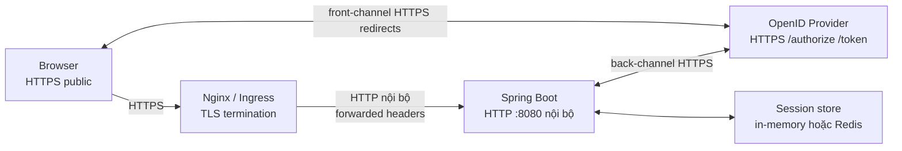

# 31.10. Kiểm thử reverse proxy, HTTPS và cookie SameSite

## Mục tiêu bài học

Trong **Spring Security OAuth 2.0/OIDC Client**, một hệ thống chạy đúng trên `localhost` chưa chắc đăng nhập được sau khi đặt sau Nginx, HAProxy, Ingress, API Gateway hoặc load balancer. Những lỗi như **`redirect_uri` chuyển thành HTTP**, **callback trả `invalid_state`**, **cookie bị browser chặn**, hoặc **đăng nhập thành công rồi quay lại trang login** thường chỉ xuất hiện khi kiểm thử triển khai thực tế.

Sau bài học, bạn có thể:

- Vẽ luồng **browser HTTPS → reverse proxy/TLS termination → Spring Boot HTTP nội bộ → OpenID Provider → callback** và hiểu ranh giới tin cậy của từng hop.
- Giải thích `Host`, `Forwarded`, `X-Forwarded-Proto`, `X-Forwarded-Host`, `X-Forwarded-Port` và `X-Forwarded-Prefix` ảnh hưởng thế nào đến **public base URL** và `redirect_uri`.
- Cấu hình `server.forward-headers-strategy` cho Servlet/WebFlux theo cách phù hợp với proxy thực, đồng thời ngăn **forged forwarded headers/host-header poisoning**.
- Phân biệt **HTTPS ở browser**, **HTTP/TLS giữa proxy và app**, **TLS tới OP**; hiểu TLS termination không tự thay thế bảo vệ mạng nội bộ.
- Giải thích cookie `Secure`, `HttpOnly`, `Path`, `Domain`, `SameSite=Strict/Lax/None`, `__Host-` và `__Secure-` cùng ảnh hưởng của **schemeful same-site** đến OIDC login.
- Dự đoán khi nào **SameSite=Lax** hoạt động với callback **top-level GET**, và khi nào callback **cross-site POST (`response_mode=form_post`)** cần thiết kế cookie/policy khác.
- Kiểm thử **HttpSession** trong Spring MVC/Servlet và **WebSession** trong Spring WebFlux; phân biệt session cookie của container với **Spring Session**.
- Dựng test nhiều lớp: `MockMvc`/`WebTestClient` để kiểm tra forwarding và security behavior; **reverse proxy + HTTPS + fake OP + real browser** để kiểm tra hành vi cookie thực.
- Phân tích lỗi state/session qua redirect, path prefix rewriting, cookie domain, load balancer nhiều instances, logout và redirect loop.
- Xây checklist test dương/âm, quan sát browser DevTools đúng chỗ, và bảo vệ logs khỏi lộ authorization code, `state`, ID Token, Access Token hoặc session cookie.

---

## 1. Bài toán triển khai thực tế

Giả sử **Learning Portal** là Spring Boot OAuth2/OIDC Client dùng Campus Identity:

```text
Public URL của RP:
    https://portal.example.org

Public OpenID Provider:
    https://login.example.edu

Internal Spring Boot:
    http://learning-app:8080
```

Sơ đồ:



Với Spring Security OAuth2 Login, browser bắt đầu:

```http
GET https://portal.example.org/oauth2/authorization/campus
```

RP trả redirect đến OP, có `redirect_uri` mong muốn:

```text
https://portal.example.org/login/oauth2/code/campus
```

Nếu Spring Boot chỉ nhìn thấy request nội bộ:

```text
scheme=http
host=learning-app
port=8080
```

nó có thể tạo:

```text
http://learning-app:8080/login/oauth2/code/campus
```

hoặc:

```text
http://portal.example.org/login/oauth2/code/campus
```

cả hai đều không khớp **redirect URI được đăng ký** ở OP.

Một lỗi khác: RP trả HTTP 302 đúng nhưng browser không gửi session cookie khi quay về callback:

```text
GET /login/oauth2/code/campus?code=...&state=...
```

Spring Security không tìm thấy authorization request đã lưu, dẫn đến lỗi `invalid_state` hoặc authorization request missing.

> **Mục tiêu tích hợp:** Chứng minh hệ thống chạy đúng khi browser giao tiếp **HTTPS public**, app nhận request qua **proxy đáng tin**, session được nhận diện sau **cross-site redirect**, và toàn bộ state/nonce/PKCE validation của OAuth2/OIDC vẫn được giữ nguyên.

## 2. Authorization Code Flow qua reverse proxy

```mermaid
sequenceDiagram
    autonumber
    actor Browser
    participant Proxy as Reverse Proxy :443
    participant RP as Spring Boot :8080
    participant OP as OpenID Provider
    participant Store as Session Store

    Browser->>Proxy: HTTPS GET /oauth2/authorization/campus
    Proxy->>RP: HTTP GET + trusted forwarded headers
    RP->>Store: Save AuthorizationRequest / state
    RP-->>Proxy: 302 Location: OP /authorize + https redirect_uri
    Proxy-->>Browser: 302 + RP session cookie attributes
    Browser->>OP: HTTPS GET /authorize (front-channel)
    OP-->>Browser: 302 to RP callback (code, state)
    Browser->>Proxy: HTTPS GET /login/oauth2/code/campus + RP cookie
    Proxy->>RP: HTTP GET + forwarded headers + Cookie
    RP->>Store: Retrieve matching state/session
    RP->>OP: HTTPS POST /token (back-channel)
    OP-->>RP: OAuth2 token response
    RP->>RP: Validate ID Token, nonce, issuer, audience
    RP-->>Proxy: 302 /dashboard; session/security context
    Proxy-->>Browser: 302 /dashboard
    Browser->>Proxy: HTTPS GET /dashboard + cookie
```

Ba đường truyền khác nhau:

1. **Browser ↔ RP proxy:** public HTTPS, browser quyết định gửi cookie dựa trên URL và thuộc tính cookie.
2. **Proxy ↔ Spring Boot:** có thể HTTP trên mạng riêng, cần header trust và bảo vệ hạ tầng; đây không phải request từ browser trực tiếp.
3. **RP ↔ OP Token Endpoint:** back-channel HTTPS do server thực hiện, **không dùng session cookie của browser**.

Nếu callback mất session, cần điều tra **browser ↔ RP cookie** và authorization request persistence, không tự cho rằng `/token` bị lỗi.

## 3. Những địa chỉ cần phân biệt

| Địa chỉ | Ví dụ | Vai trò |
| --- | --- | --- |
| Public RP origin | `https://portal.example.org` | Origin browser dùng để truy cập |
| Internal app URL | `http://learning-app:8080` | Endpoint private phía sau proxy |
| OP issuer | `https://login.example.edu/realms/campus` | `iss` tin cậy của OIDC |
| Authorization endpoint | `https://login.example.edu/realms/campus/protocol/openid-connect/auth` | Browser được redirect đến |
| Token endpoint | `https://login.example.edu/realms/campus/protocol/openid-connect/token` | RP gọi server-to-server |
| RP callback URI | `https://portal.example.org/login/oauth2/code/campus` | OP redirect browser về |
| RP post-login URL | `https://portal.example.org/dashboard` | UI sau đăng nhập |
| RP logout return | `https://portal.example.org/signed-out` | Return URI theo logout contract |

**Public base URL** không nhất thiết bằng hostname/port mà Spring Boot socket đang lắng nghe. `ClientRegistration.redirectUri` có thể được mở rộng bằng dữ liệu request đã qua forwarded-header processing.

### 3.1. Origin và site không giống nhau

**Origin** gồm:

```text
scheme + host + port
```

Ví dụ:

```text
https://portal.example.org
https://login.example.org
```

là hai origins khác nhau.

Trong cookie SameSite, khái niệm **site** liên quan **scheme và registrable domain** theo quy tắc trình duyệt. Hai subdomains có thể khác origin nhưng cùng site; khác scheme HTTP/HTTPS có thể được coi khác site theo **schemeful same-site**.

Vì vậy khi đánh giá cookie, không suy chỉ từ việc hostname khác là chắc chắn cross-site; cũng không suy same registrable domain thì mọi request đều same-origin.

## 4. Reverse proxy và TLS termination

Một deployment phổ biến:

```text
Browser --HTTPS:443--> Reverse Proxy --HTTP:8080--> Spring Boot
```

Proxy giải mã TLS, sau đó giao tiếp với app qua network private.

### 4.1. App có thể thấy HTTP

Nếu không xử lý forwarded headers:

```java
request.getScheme()     // "http"
request.isSecure()      // false
request.getServerName() // "learning-app" hoặc "portal.example.org"
request.getServerPort() // 8080
```

Những giá trị này có thể ảnh hưởng:

- OAuth2 `redirect_uri`.
- URL tuyệt đối trong redirects.
- Cookie `Secure` khi dựa vào độ an toàn của request.
- URL xây dựng từ `ServletUriComponentsBuilder` hoặc reactive request context.
- OIDC logout `post_logout_redirect_uri`.
- Các kiểm tra canonical origin/redirect allowlist.

### 4.2. HTTPS public vẫn cần được duy trì đến browser

Không sửa lỗi proxy bằng cách hạ RP public về HTTP hoặc thêm callback HTTP vào OP chỉ để pass. Điều đó có thể làm lộ authorization code/session cookie trên đường truyền.

### 4.3. HTTP proxy-to-app là quyết định triển khai

HTTP nội bộ có thể được chấp nhận trong một vùng mạng được kiểm soát theo threat model, nhưng không đồng nghĩa kết nối này luôn an toàn.

Khi kiến trúc yêu cầu, dùng:

```text
Proxy -> Spring Boot HTTPS/mTLS
NetworkPolicy / firewall
Private service discovery
Identity và trust cho proxy
```

Bảo vệ đường truyền và xác minh forwarded headers là **hai vấn đề riêng**.

## 5. `Forwarded` và `X-Forwarded-*`

Proxy thường thêm thông tin public request:

```http
Host: portal.example.org
X-Forwarded-Proto: https
X-Forwarded-Host: portal.example.org
X-Forwarded-Port: 443
X-Forwarded-For: 203.0.113.10
```

Hoặc header chuẩn RFC 7239:

```http
Forwarded: for=203.0.113.10;proto=https;host=portal.example.org
```

Tùy hạ tầng, còn có:

```http
X-Forwarded-Prefix: /portal
```

khi public URL có prefix nhưng app nội bộ chạy ở `/`.

### 5.1. Ý nghĩa từng header

| Header | Nội dung biểu diễn | Nếu tin sai có thể gây |
| --- | --- | --- |
| `X-Forwarded-Proto` | Scheme bên ngoài | Redirect HTTP/HTTPS sai, secure URL confusion |
| `X-Forwarded-Host` | Host public | Host-header poisoning, redirect URI đến domain attacker |
| `X-Forwarded-Port` | Public port | URI bị thêm `:8080` hoặc sai `:443` |
| `X-Forwarded-Prefix` | Public base path | Callback thiếu hoặc bị lặp prefix |
| `X-Forwarded-For` | Client IP chain | Audit/rate-limit theo IP giả |
| `Forwarded` | Thông tin chuẩn gộp | Conflicting/forged forwarding data |
| `Host` | Host của HTTP request | Virtual-host routing và absolute links sai |

### 5.2. `X-Forwarded-For` không trực tiếp quyết định cookie SameSite

Cookie SameSite do browser so khớp site/request context. Nhưng `X-Forwarded-Proto`/host/prefix có thể làm RP xây URL/cookie không đúng.

### 5.3. Nhiều proxy hops

Một request có thể đi qua:

```text
Browser -> CDN -> Load Balancer -> Ingress -> Spring Boot
```

Headers có thể xuất hiện nhiều giá trị hoặc được nối chuỗi. Chính sách phải xác định **hops nào tin cậy**, ai chịu trách nhiệm xóa/ghi đè header từ client, và framework đọc giá trị nào. Không lấy phần tử cuối/đầu bằng quy tắc tự chế nếu hạ tầng chưa định nghĩa.

## 6. Trust boundary: không chấp nhận forged forwarded headers

Một cấu hình nguy hiểm:

```text
Internet trực tiếp -> Spring Boot :8080
```

đồng thời Boot tin:

```http
X-Forwarded-Host: attacker.example
X-Forwarded-Proto: https
```

Nếu app xây redirect URL từ header không được xác thực, attacker có thể làm RP phát `Location` không đúng domain hoặc gây **host-header poisoning**.

### 6.1. Edge proxy phải xóa/ghi đè input untrusted

Yêu cầu:

- Chỉ **reverse proxy đáng tin** được kết nối trực tiếp tới backend.
- Proxy không chuyển tiếp nguyên `Forwarded`/`X-Forwarded-*` từ browser chưa được tin.
- Hệ thống ghi đè các giá trị public scheme/host/port theo route đã được khai báo.
- Hostnames được allowlist.
- Gateway chặn request `Host` ngoài danh sách.
- Không cho user tự đặt `X-Forwarded-Prefix` hoặc URL của OP.

### 6.2. Test spoofing phải đi qua proxy thật

Một test chỉ gọi thẳng Spring Boot với:

```http
X-Forwarded-Host: attacker.example
```

khi `ForwardedHeaderFilter` bật có thể khiến app xây URL theo input đó. Điều này chứng minh **framework tin header**, chứ không chứng minh reverse proxy production bị bypass.

**Security integration test đúng** phải gửi request từ **phía ngoài proxy** và xác nhận header giả được xóa/ghi đè hoặc request bị từ chối.

### 6.3. Không coi forwarded headers là authentication

Forwarded headers giúp khôi phục public request properties, không chứng minh user đăng nhập hay có tenant membership. Spring Security vẫn phải kiểm tra `state`, `nonce`, token, session và authorization.

## 7. Spring Boot xử lý forwarded headers

Trong nhiều phiên bản Spring Boot 3.x, có property:

```yaml
server:
  forward-headers-strategy: framework
```

Các lựa chọn thường gặp:

```text
none
native
framework
```

Ý nghĩa khái quát:

- `none`: không xử lý forwarded headers theo cơ chế Boot.
- `native`: ủy quyền cho web container/native infrastructure hỗ trợ.
- `framework`: dùng cơ chế Spring Framework để diễn giải forwarded headers.

Cần đối chiếu Spring Boot version, Servlet container và deployment thực tế khi chọn.

### 7.1. Servlet và WebFlux khác nhau

Trong Spring MVC/Servlet, cơ chế thường liên quan:

```java
ForwardedHeaderFilter
```

Trong WebFlux, cơ chế tương ứng:

```java
ForwardedHeaderTransformer
```

Không tự đăng ký cả filter/transformer và container native processing không kiểm soát, vì có thể bị xử lý forwarded headers hai lần.

### 7.2. `framework` không biến header Internet thành đáng tin

Property trên nói framework **diễn giải** headers được chuyển vào. Nó **không tự xác thực** reverse proxy nguồn hoặc ngăn browser giả mạo headers khi backend public.

Bảo đảm tin cậy phải đến từ topology, ingress configuration và network restrictions.

### 7.3. `native` phụ thuộc container

Ví dụ Tomcat có `RemoteIpValve`, server/container khác có cơ chế riêng. Trust proxy IP ranges, header names và behavior có thể khác với `framework`.

Không áp dụng cùng một giả định cho Tomcat, Netty, Undertow và mọi ingress controller.

## 8. Ví dụ cấu hình Nginx ở public HTTPS edge

Giả định Nginx trực tiếp nhận public TLS trên port 443:

```nginx
server {
    listen 443 ssl;
    server_name portal.example.org;

    ssl_certificate     /etc/nginx/tls/fullchain.pem;
    ssl_certificate_key /etc/nginx/tls/privkey.pem;

    location / {
        proxy_pass http://learning-app:8080;

        proxy_set_header Host portal.example.org;
        proxy_set_header X-Forwarded-Proto https;
        proxy_set_header X-Forwarded-Host portal.example.org;
        proxy_set_header X-Forwarded-Port 443;
        proxy_set_header X-Forwarded-For $remote_addr;

        proxy_set_header Forwarded "";
        proxy_set_header X-Forwarded-Prefix "";
    }
}

server {
    listen 80;
    server_name portal.example.org;
    return 301 https://portal.example.org$request_uri;
}
```

Đây là ví dụ khái niệm, cần hoàn thiện TLS policy, cipher suites, health checks, timeouts, upstream TLS nếu cần và security headers theo hạ tầng.

### 8.1. Tại sao cố định host?

Khi proxy phục vụ chỉ `portal.example.org`, đặt:

```nginx
proxy_set_header Host portal.example.org;
```

giúp tránh chuyển thẳng một `Host` tùy ý từ browser tới backend.

Trong multi-host deployment, cần một allowlist/route mapping được kiểm soát; không hard-code một host cho mọi tenant.

### 8.2. Nếu Nginx đứng sau CDN/LB khác

Nếu CDN/LB terminate TLS trước và gọi Nginx bằng HTTP, `$scheme` tại Nginx có thể là `http`. Khi đó:

```nginx
proxy_set_header X-Forwarded-Proto $scheme;
```

**không phản ánh HTTPS public**.

Phải cấu hình đúng chuỗi trusted proxies: CDN/LB đưa thông tin xác thực, Nginx chỉ tiếp nhận khi nguồn upstream đáng tin, rồi normalize/forward giá trị cho backend. Không tin bất kỳ `X-Forwarded-Proto` do internet client tự gửi.

### 8.3. Không phơi port 8080 ra Internet

Kể cả Nginx đã chuẩn hóa headers, nếu attacker vẫn kết nối trực tiếp tới `learning-app:8080`, họ có thể thử override forwarding. Dùng firewall/security group/Kubernetes NetworkPolicy để chỉ proxy được truy cập app.

## 9. `redirect_uri` trong Spring Security OAuth2 Login

Một cấu hình phổ biến:

```yaml
spring:
  security:
    oauth2:
      client:
        registration:
          campus:
            provider: campus-op
            client-id: ${OIDC_CLIENT_ID}
            client-secret: ${OIDC_CLIENT_SECRET}
            client-authentication-method: client_secret_basic
            authorization-grant-type: authorization_code
            redirect-uri: "{baseUrl}/login/oauth2/code/{registrationId}"
            scope:
              - openid
              - profile

        provider:
          campus-op:
            issuer-uri: https://login.example.edu/realms/campus
```

Spring Security mở rộng placeholders như:

```text
{baseUrl}
{registrationId}
```

dựa trên request/context và registration.

Mong muốn:

```text
{baseUrl}
    = https://portal.example.org

{registrationId}
    = campus

redirect_uri
    = https://portal.example.org/login/oauth2/code/campus
```

### 9.1. Nếu app thấy HTTP nội bộ

Có thể sinh:

```text
http://learning-app:8080/login/oauth2/code/campus
```

hoặc `http://portal.example.org/...`, dẫn đến OP từ chối `redirect_uri` hoặc browser redirect vào URL sai.

### 9.2. Đăng ký callback tại OP

OP phải cho phép redirect URI public theo chính sách của provider:

```text
https://portal.example.org/login/oauth2/code/campus
```

Tránh wildcard rộng, HTTP redirect URI production hoặc client tự chọn redirect URI qua query không đáng tin.

### 9.3. Không nhầm OP issuer với RP public URL

```text
issuer        = https://login.example.edu/realms/campus
RP base URL   = https://portal.example.org
```

`iss` của ID Token không phải địa chỉ callback. Đừng sửa issuer validation để chữa lỗi redirect URI.

### 9.4. Callback sau HTTPS termination

OP redirect browser về **HTTPS public**. Proxy chuyển request vào Spring Boot, Spring Security lấy session/authorization request theo state rồi đổi code tại Token Endpoint.

Đường back-channel tới OP thường không cần biết public `Host` của RP ngoài `redirect_uri` dùng trong Token Endpoint protocol.

## 10. Public prefix và `X-Forwarded-Prefix`

Một cấu hình khác:

```text
Browser public:
    https://portal.example.org/learning

Spring Boot internal:
    http://learning-app:8080/
```

Proxy rewrite:

```text
/learning/oauth2/authorization/campus
    -> /oauth2/authorization/campus

/learning/login/oauth2/code/campus
    -> /login/oauth2/code/campus
```

Khi cần, proxy truyền:

```http
X-Forwarded-Prefix: /learning
```

để framework biết public base path.

### 10.1. Callback mong đợi

```text
https://portal.example.org/learning/login/oauth2/code/campus
```

OP chỉ được đăng ký public URI đó.

### 10.2. Tránh lặp prefix

Sai:

```text
/learning/learning/login/oauth2/code/campus
```

có thể xảy ra nếu app đã cấu hình context path `/learning` mà proxy cũng thêm forwarded prefix `/learning` và cách rewrite không nhất quán.

### 10.3. Tránh mất prefix

Sai:

```text
https://portal.example.org/login/oauth2/code/campus
```

khi proxy chỉ route `/learning/**`. Callback có thể 404 hoặc vào app khác.

### 10.4. Test cả start và callback

Không chỉ assert `redirect_uri` chứa prefix. Cần kiểm tra browser thật quay về đúng public callback, proxy rewrite tới đúng Spring Security filter, session cookie có `Path` phù hợp và request không bị 404.

## 11. Cookie trong một lượt OIDC Login

Ở Servlet mặc định, Spring Security có thể lưu Authorization Request trong HTTP session qua:

```java
HttpSessionOAuth2AuthorizationRequestRepository
```

Ở Reactive WebFlux, có:

```java
WebSessionOAuth2ServerAuthorizationRequestRepository
```

Bản ghi chứa thông tin giúp đối chiếu OAuth2 `state` và giao dịch login. Session được browser xác định thông qua cookie, thường là:

```text
JSESSIONID
```

cho Servlet container hoặc:

```text
SESSION
```

khi dùng Spring Session/Reactive stack theo configuration.

**Tên cookie tùy stack/cấu hình**, không mặc định mọi ứng dụng Spring đều dùng cùng tên.

### 11.1. Hai cookies thuộc hai origins

RP session cookie:

```text
portal.example.org
```

OP SSO cookie:

```text
login.example.edu
```

Browser quản lý chúng riêng. Cookie của RP thường **không được gửi tới OP**, và OP cookie không tự được gửi tới RP callback.

### 11.2. Vì sao RP cookie quan trọng tại callback?

```text
Start login:
    RP lưu authorization request dưới session S1
    Browser nhận cookie session S1

Callback:
    Browser gửi cookie S1 về RP
    RP tìm authorization request/state trong S1
```

Nếu browser không gửi S1, hoặc app không còn dữ liệu S1, Spring Security có thể không khớp state.

### 11.3. Session cookie không phải OAuth2 state

Cookie mang session identifier; `state` là transaction binding. Cả hai đều quan trọng, nhưng không được in ra logs hoặc dùng thay nhau.

## 12. `Secure` và `HttpOnly`

Một header:

```http
Set-Cookie: SESSION=<opaque-value>; Path=/; Secure; HttpOnly; SameSite=Lax
```

Có các ý nghĩa:

- **`Secure`**: browser chỉ gửi cookie trong ngữ cảnh URL an toàn theo quy tắc browser, thông thường HTTPS.
- **`HttpOnly`**: JavaScript phía browser không đọc cookie qua `document.cookie`.
- **`Path=/`**: giới hạn đường dẫn cookie được gửi.
- **`SameSite=Lax`**: điều khiển gửi cookie trong các cross-site requests.
- **`Domain`** nếu đặt: kiểm soát phạm vi hostname; không cần đặt rộng nếu host-only cookie đủ.

### 12.1. TLS termination không làm mất yêu cầu `Secure`

Browser truy cập:

```text
https://portal.example.org
```

dù backend nhận HTTP. RP vẫn phải phát session cookie với `Secure` theo chính sách public HTTPS.

### 12.2. `Secure` không sửa được nếu public callback bị HTTP

Nếu proxy hoặc OP redirect browser tới:

```text
http://portal.example.org/login/oauth2/code/campus
```

cookie `Secure` không được gửi như mong đợi qua HTTP. Không nên bỏ `Secure` để login hoạt động; sửa public URL/proxy.

### 12.3. `HttpOnly` không phải CSRF protection

`HttpOnly` ngăn script đọc cookie trực tiếp, nhưng browser vẫn có thể tự gửi cookie. Spring Security CSRF protection/OAuth2 `state` vẫn cần thiết cho các luồng tương ứng.

## 13. SameSite: `Strict`, `Lax`, `None`

| Giá trị | Hành vi khái quát | Tác động thường gặp với OIDC |
| --- | --- | --- |
| `Strict` | Không gửi cookie trên cross-site navigations | Dễ làm callback từ OP bên ngoài mất RP session |
| `Lax` | Cho cookie ở same-site và một số top-level cross-site navigations dùng phương thức an toàn như GET | Thường phù hợp Authorization Code callback dạng **top-level GET** |
| `None` | Cho phép gửi cookie trong cross-site contexts theo chính sách browser | Cần `Secure`; cân nhắc nếu callback cần cross-site POST hoặc embedding |
| Không khai báo | Browser áp dụng default theo version/policy, thường Lax-like | Không nên dựa vào default mơ hồ cho security-critical flow |

Browser hiện đại thường yêu cầu:

```text
SameSite=None
    -> Secure
```

Cookie `SameSite=None` nhưng thiếu `Secure` có thể bị **từ chối khi Set-Cookie**.

### 13.1. `SameSite=Strict`: khi nào callback bị mất session?

Nếu RP ở:

```text
https://portal.example.org
```

và OP ở site khác:

```text
https://login.example.edu
```

thì browser điều hướng **từ OP sang RP** có thể là cross-site navigation. Cookie Strict của RP thường không được gửi trên callback đó.

Kết quả:

```text
Callback state received
RP session cookie absent
Saved AuthorizationRequest not found
```

### 13.2. `SameSite=Lax` và callback GET

Authorization Code Flow thông dụng trả callback:

```http
GET /login/oauth2/code/campus?code=...&state=...
```

là một **top-level navigation bằng GET**. Với cross-site navigation như vậy, cookie Lax thường được gửi, cho phép Spring Security tìm lại authorization request.

Điều này **không** có nghĩa cookie Lax được gửi trong mọi cross-site POST, iframe hoặc `fetch()`.

### 13.3. `SameSite=None` và callback `form_post`

Một OP hoặc ứng dụng có thể dùng OIDC response mode:

```text
response_mode=form_post
```

và browser gửi:

```http
POST /login/oauth2/code/campus
Content-Type: application/x-www-form-urlencoded

code=<code>&state=<state>
```

Nếu đây là cross-site POST, cookie `SameSite=Lax` **thông thường không được gửi**. Một ứng dụng cần hỗ trợ flow này có thể phải thiết kế session cookie `SameSite=None; Secure` hoặc một cơ chế giao dịch khác.

**Đặc biệt quan trọng:** Không chỉ đổi cookie sang None rồi coi xong. Phải xác nhận Spring Security callback handling, HTTP method/CSRF policy, OP response mode, browser restrictions, session security và state validation. Một số stacks cần cấu hình/extension riêng cho `form_post`.

### 13.4. Không dựa vào ngoại lệ `Lax+POST` theo browser

Một số browser có behavior tương thích cho cookie chưa khai báo SameSite mới tạo trong khoảng thời gian ngắn. Không dùng ngoại lệ đó như security contract hoặc cơ sở để hỗ trợ `form_post`. Đặt cookie policy tường minh và kiểm thử trên browsers mục tiêu.

## 14. Same-site không đồng nghĩa same-origin

Ví dụ:

```text
RP = https://portal.company.example
OP = https://login.company.example
```

Có thể là **same-site** theo registrable domain và scheme, dù **khác origin**.

Ngược lại:

```text
http://portal.example.org
https://portal.example.org
```

có thể được xem là **cross-site** theo schemeful same-site, dù hostname giống nhau.

### 14.1. Kiểm tra site dựa trên browser chứ không tự phỏng đoán

Test browser cần biết:

- Scheme public.
- Hostnames của RP và OP.
- Public suffix/registrable domain rules.
- Navigation type: top-level GET, POST form, iframe, subresource.
- Browser version/privacy policy.

### 14.2. `SameSite` và third-party cookies không giống hệt nhau

Third-party cookie blocking và SameSite tương tác nhưng không đồng nhất. Một top-level navigation về RP có thể đưa RP trở thành first-party context tại destination, trong khi một embedded iframe lại là third-party context.

Không mặc định “trình duyệt chặn third-party cookies” sẽ luôn chặn callback top-level GET với cookie Lax.

## 15. Cookie `Domain` và `Path`

Một cookie host-only:

```http
Set-Cookie: SESSION=<value>; Path=/; Secure; HttpOnly; SameSite=Lax
```

không cần `Domain`; browser gắn nó với host phát hành.

Một cookie khác:

```http
Set-Cookie: SESSION=<value>; Domain=example.org; Path=/; Secure; HttpOnly; SameSite=Lax
```

có thể được gửi tới nhiều subdomains đủ điều kiện, làm tăng phạm vi lộ session nếu không cần thiết.

### 15.1. Ưu tiên host-only session cookie

Trong phần lớn RP single-host, giữ cookie cho riêng `portal.example.org` thay vì mở rộng ra mọi `*.example.org`.

### 15.2. `Path` phải bao phủ callback

Nếu cookie được đặt:

```text
Path=/learning
```

và callback public cũng là:

```text
/learning/login/oauth2/code/campus
```

thì path có thể phù hợp.

Nhưng nếu callback nằm ngoài:

```text
/login/oauth2/code/campus
```

cookie có thể không được gửi. Không tạo một `Path` quá hẹp so với các endpoints sử dụng cùng session.

### 15.3. `Domain` không thể giúp cookie RP được gửi tới OP khác site

Không cố cấu hình cookie Domain thành domain của IdP (`login.example.edu`) khi cookie do RP (`portal.example.org`) phát hành. Browser sẽ từ chối domain không phù hợp với host phát hành.

### 15.4. Prefix `__Host-` và `__Secure-`

Browser hỗ trợ cookie prefixes có các ràng buộc:

```text
__Secure-...:
    phải có Secure và phát từ secure origin

__Host-...:
    Secure
    Path=/
    không có Domain
    phát từ secure origin
```

Prefix giúp browser enforce một số thuộc tính, nhưng cần kiểm thử stack/session configuration tương ứng nếu đổi tên cookie; không tự đổi cookie name mà bỏ quên session resolver/serializer.

## 16. Spring MVC/Servlet: cấu hình session cookie

Với Spring Boot Servlet 3.x, ví dụ:

```yaml
server:
  forward-headers-strategy: framework
  servlet:
    session:
      cookie:
        secure: true
        http-only: true
        same-site: lax
        path: /
```

Ở production public HTTPS, `secure: true` giúp tránh cookie thiếu Secure vì container chỉ thấy HTTP nội bộ.

### 16.1. `SameSite=Lax` thường phù hợp OIDC callback GET

Khi callback là top-level GET từ OP cross-site, Lax thường cho phép browser gửi cookie session về RP.

### 16.2. Property phụ thuộc stack/version

Tên property `server.servlet.session.cookie.same-site` được dùng trong nhiều phiên bản Spring Boot 3.x, nhưng ứng dụng có thể dùng Spring Session hoặc custom cookie serializer, làm chính sách cookie đến từ thành phần khác.

**Kiểm tra Set-Cookie thực tế**, không chỉ xem YAML và suy ra browser chắc nhận thuộc tính.

### 16.3. HTTP dev có thể cần cấu hình riêng

Nếu chạy public-like HTTPS trong test:

```text
https://portal.test
```

giữ Secure là phù hợp.

Nếu chạy `http://localhost:8080` cho local dev, cookie Secure có thể không hoạt động như production trên mọi môi trường/browser. Không vì vậy bỏ Secure khỏi production; nên có test profile HTTPS hoặc môi trường local TLS rõ ràng.

## 17. Spring Session trên Servlet: `DefaultCookieSerializer`

Khi dùng Spring Session, có thể cần cấu hình cookie serializer:

```java
@Configuration
class SessionCookieConfiguration {

    @Bean
    CookieSerializer cookieSerializer() {

        DefaultCookieSerializer serializer =
            new DefaultCookieSerializer();

        serializer.setCookieName("SESSION");
        serializer.setUseSecureCookie(true);
        serializer.setUseHttpOnlyCookie(true);
        serializer.setSameSite("Lax");
        serializer.setCookiePath("/");

        return serializer;
    }
}
```

Imports chính:

```java
import org.springframework.context.annotation.Bean;
import org.springframework.context.annotation.Configuration;
import org.springframework.session.web.http.CookieSerializer;
import org.springframework.session.web.http.DefaultCookieSerializer;
```

### 17.1. Container session cookie và Spring Session cookie khác nhau

Nếu Spring Session quản lý session ID qua `SESSION`, thay `server.servlet.session.cookie.*` có thể không cho kết quả bạn mong đợi nếu serializer của Spring Session chi phối response.

Tương tự, custom security/session filters có thể làm đổi cookie name, path, domain hoặc SameSite.

### 17.2. Đừng cấu hình hai nguồn chính sách trái nhau

Ví dụ:

```text
Servlet cookie SameSite=Lax
Spring Session serializer SameSite=Strict
```

khi hệ thống thực tế dùng Spring Session. Hãy xác định thành phần nào **thực sự phát `Set-Cookie`** và kiểm tra trên wire.

### 17.3. Redis/session store liên quan `invalid_state`

Cookie có thể được gửi đúng nhưng session data lại không tồn tại vì:

- Redis/DB session store fail.
- Session key hết hạn.
- Serialization error.
- Cluster đang dùng local-memory session ở mỗi pod.
- Session ID bị rotate mà state persistence không phù hợp.

Kiểm thử không được mặc định mọi `invalid_state` đều do SameSite.

## 18. Spring WebFlux: `CookieWebSessionIdResolver`

WebFlux có WebSession và có thể dùng:

```java
CookieWebSessionIdResolver
```

để tùy chỉnh cookie session. Ví dụ:

```java
@Configuration
class ReactiveCookieConfiguration {

    @Bean
    WebSessionIdResolver webSessionIdResolver() {

        CookieWebSessionIdResolver resolver =
            new CookieWebSessionIdResolver();

        resolver.setCookieName("SESSION");

        resolver.addCookieInitializer(builder -> builder
            .path("/")
            .httpOnly(true)
            .secure(true)
            .sameSite("Lax")
        );

        return resolver;
    }
}
```

Imports:

```java
import org.springframework.context.annotation.Bean;
import org.springframework.context.annotation.Configuration;
import org.springframework.web.server.session.CookieWebSessionIdResolver;
import org.springframework.web.server.session.WebSessionIdResolver;
```

### 18.1. WebSession cookie cũng chịu browser policy

`SameSite`, `Secure`, `Domain`, `Path` không thay đổi ý nghĩa vì app dùng Reactor Netty thay vì Tomcat.

### 18.2. Reactive authorization request persistence

Spring Security WebFlux thường dùng:

```java
WebSessionOAuth2ServerAuthorizationRequestRepository
```

để lưu pending authorization request. Nếu browser callback không mang cookie `SESSION`, repository sẽ không tìm được request đã tạo.

### 18.3. Test WebFlux không được suy từ Servlet

`server.servlet.session.cookie.same-site` không phải cách chứng minh reactive WebSession cookie đã đổi. Kiểm tra resolver/property reactive theo stack và version đang dùng, rồi quan sát response thực tế.

## 19. Ma trận SameSite cho OIDC

Giả định OP ở site khác với RP và cookie thuộc RP.

| Tình huống callback/request | `Strict` | `Lax` | `None; Secure` |
| --- | --- | --- | --- |
| OP → RP top-level GET `/login/oauth2/code/...` | Thường **không gửi** | Thường **gửi** | Có thể gửi theo browser policy |
| OP → RP cross-site POST `form_post` | Không gửi | Thường không gửi | Có thể gửi |
| Cross-site iframe tới RP | Không gửi | Không gửi | Có thể gửi, chịu third-party restrictions |
| RP same-site navigation GET | Gửi nếu path/domain khớp | Gửi | Gửi |
| HTTP public URL với Secure cookie | Không gửi qua HTTP | Không gửi qua HTTP | Không gửi qua HTTP |
| RP → OP `/token` server-to-server | Không áp dụng RP browser cookie | Không áp dụng | Không áp dụng |

**Bảng thể hiện hành vi điển hình**, không thay kết quả kiểm thử browser thực. Cookie có thể vẫn bị chặn do `Domain`, `Path`, expiry, third-party privacy settings, prefix rules hoặc trình duyệt đặc thù.

### 19.1. Khi nào nên dùng `SameSite=None`?

Chỉ khi có yêu cầu cụ thể đã phân tích như callback cross-site POST/embedded SSO và đã đánh giá tác động bảo mật, chứ không phải giải pháp mặc định cho mọi lỗi login.

Cần:

```text
SameSite=None
Secure
HTTPS public
CSRF/state protections
Browser compatibility tests
```

### 19.2. Không bỏ Spring Security CSRF protection

SameSite là defense-in-depth, không thay thế CSRF token và OIDC `state`. Việc dùng None có thể làm cookie xuất hiện trong nhiều cross-site contexts hơn; cần bảo vệ các endpoints đổi trạng thái.

## 20. Kiểm thử public `redirect_uri` bằng MockMvc

Một integration test Servlet có thể gọi endpoint bắt đầu OAuth2 Login và đọc `Location`.

Ý tưởng:

```java
@SpringBootTest
@AutoConfigureMockMvc
class RedirectUriBehindProxyTest {

    @Autowired
    MockMvc mvc;

    @Test
    void usesExternalHttpsBaseUrl() throws Exception {

        MvcResult result = mvc.perform(
                get("/oauth2/authorization/campus")
                    .secure(false)
                    .header(
                        "X-Forwarded-Proto", "https"
                    )
                    .header(
                        "X-Forwarded-Host",
                        "portal.example.org"
                    )
                    .header(
                        "X-Forwarded-Port", "443"
                    )
            )
            .andExpect(
                status().is3xxRedirection()
            )
            .andReturn();

        String location =
            result.getResponse().getHeader("Location");

        assertThat(location).isNotNull();

        URI authorizeUri = URI.create(location);

        assertThat(authorizeUri.getHost())
            .isEqualTo("login.example.edu");

        String callback =
            parseFormQuery(authorizeUri.getRawQuery())
                .get("redirect_uri");

        assertThat(callback).isEqualTo(
            "https://portal.example.org/" +
            "login/oauth2/code/campus"
        );
    }
}
```

Trong đó `parseFormQuery(...)` là helper test đọc query theo form-url-encoding, không phải Spring Security API. Nếu test dùng `@AutoConfigureMockMvc`, cần đảm bảo forwarded-header processing **thực sự được đưa vào MockMvc filter chain** theo cấu hình Boot/version.

### 20.1. Helper đọc query

Một helper minh họa cho query có keys/values URL-encoded:

```java
static Map<String, String> parseFormQuery(
        String rawQuery) {

    Map<String, String> result = new HashMap<>();

    for (String part : rawQuery.split("&")) {

        String[] pair = part.split("=", 2);

        String key = URLDecoder.decode(
            pair[0], StandardCharsets.UTF_8
        );

        String value = pair.length > 1
            ? URLDecoder.decode(
                pair[1], StandardCharsets.UTF_8
            )
            : "";

        result.put(key, value);
    }

    return result;
}
```

Các helper production-grade còn cần xử lý duplicate parameters, nulls và validation. Ở đây chỉ minh họa kiểm tra authorization URL của test fixture.

### 20.2. Nếu MockMvc không áp dụng filter

Có thể dựng `MockMvc` có `ForwardedHeaderFilter` rõ ràng trong cấu hình test, **tránh đăng ký filter hai lần**. Một test không có forwarded-header transformer có thể assert sai behavior so với production.

### 20.3. Điều MockMvc test này chứng minh

Ứng dụng **xây authorization redirect URI đúng** khi request có forwarded metadata theo cấu hình.

Nó **không chứng minh** proxy production đã lọc forged headers, browser đã gửi cookie callback hoặc OP đã chấp nhận redirect URI.

## 21. Negative tests cho forwarded headers trong MockMvc

Tạo case table:

| Input giả lập | Mong muốn |
| --- | --- |
| `X-Forwarded-Proto=https` | Public `redirect_uri` dùng HTTPS |
| `X-Forwarded-Proto=http` từ trusted proxy test | Test policy từ chối hoặc không coi là public HTTPS |
| `X-Forwarded-Host=portal.example.org` | URL đúng host |
| Thiếu forwarded host | Không rơi về internal hostname trong cấu hình production |
| `X-Forwarded-Port=8443` | URL/redirect khớp public port đã cấu hình |
| `X-Forwarded-Prefix=/learning` | Callback có prefix đúng một lần |
| Forwarded path prefix trùng context path | Không sinh `/learning/learning` |
| Forged host `attacker.example` | **Từ public edge**, phải reject/normalize |
| Conflicting `Forwarded` và `X-Forwarded-*` | Một trusted canonical policy nhất quán |

### 21.1. Đừng nhầm app-level test với proxy security test

Nếu MockMvc giả lập request đến thẳng app với `X-Forwarded-Host: attacker.example`, Spring có thể dùng host giả đó theo cấu hình. Đây không tự là thất bại bảo mật của proxy nếu production backend không truy cập trực tiếp và proxy xóa header.

Để kiểm tra end-to-end **host spoofing**, phải gửi request **qua proxy** từ outside trust boundary.

### 21.2. Host allowlist có thể đặt ở nhiều lớp

Nên có policy ở edge; có thể thêm host validation ở app cho defense-in-depth. Khi dùng multi-tenant subdomains, mapping host-to-tenant phải dựa trên danh sách được quản trị chứ không cấp quyền theo raw header.

## 22. Kiểm thử WebFlux và `ForwardedHeaderTransformer`

Một test Reactive có thể gọi:

```text
GET /oauth2/authorization/campus
X-Forwarded-Proto: https
X-Forwarded-Host: portal.example.org
X-Forwarded-Port: 443
```

và assert `Location` chứa `redirect_uri` HTTPS public.

Ví dụ WebTestClient (cấu hình context phải có Reactive OAuth2 Client và forwarded-header processing):

```java
@SpringBootTest(
    webEnvironment = SpringBootTest.WebEnvironment.RANDOM_PORT
)
@AutoConfigureWebTestClient
class ReactiveRedirectUriTest {

    @Autowired
    WebTestClient client;

    @Test
    void buildsHttpsRedirectBehindProxy() {

        client.get()
            .uri("/oauth2/authorization/campus")
            .header(
                "X-Forwarded-Proto", "https"
            )
            .header(
                "X-Forwarded-Host",
                "portal.example.org"
            )
            .header(
                "X-Forwarded-Port", "443"
            )
            .exchange()
            .expectStatus().is3xxRedirection()
            .expectHeader().exists("Location");
    }
}
```

Đây là bước đầu; test mạnh hơn cần **parse `Location` và assert `redirect_uri`**, tương tự Servlet.

### 22.1. Test tại RANDOM_PORT chưa phải browser HTTPS test

WebTestClient trong ví dụ thường gửi HTTP tới test server. Forwarded headers mô phỏng public HTTPS, nhưng **không kiểm tra** chứng chỉ TLS, proxy rewrite hoặc cookie policy của browser thật.

### 22.2. Tên class/API theo version

Các annotations và cách bind WebTestClient tùy Spring Boot/Spring Security version. Hãy giữ đúng test context có filter chain, reactive registration repository và forwarded-header transformer; không chỉ test controller đơn lẻ rồi cho rằng security redirect hoạt động.

## 23. Test `Set-Cookie` trên response thực

Một mục tiêu cụ thể:

```http
Set-Cookie: SESSION=<opaque>; Path=/; Secure; HttpOnly; SameSite=Lax
```

Test nên kiểm tra **attributes**, không in cookie value vào report/log.

### 23.1. Vì sao có thể không thấy cookie ở request bất kỳ?

Servlet container/Spring Session có thể chỉ tạo cookie khi session được sử dụng hoặc tạo mới. Một GET `/health` không dùng session có thể **không có `Set-Cookie`**.

Vì vậy test phải đi qua hành động tạo/lưu session (chẳng hạn bắt đầu OAuth2 Login) rồi bắt response thật.

### 23.2. `Set-Cookie` có thể có nhiều headers

Một response có thể tạo:

```text
SESSION
XSRF-TOKEN
other app cookies
```

Không assert rằng **mọi cookie** đều có cùng policy mà không phân biệt loại cookie. Session cookie khác CSRF token cookie hoặc UI preference cookie.

### 23.3. Kiểm tra `Secure` độc lập với request nội bộ

Trong test proxy:

```text
Browser HTTPS -> Proxy -> Backend HTTP
```

assert browser nhận session cookie `Secure`, bất kể app nội bộ có `request.isSecure=false` trước forwarded processing.

### 23.4. Không log nguyên `Set-Cookie`

Test assertion có thể parse response header rồi so:

```text
cookie name = SESSION/JSESSIONID
Secure = present
HttpOnly = present
SameSite = Lax
Path = /
```

nhưng không dump full `Set-Cookie` vào CI logs vì có session identifier.

## 24. Khi nào cần browser thật?

`MockMvc` hoặc `WebTestClient` **không triển khai đầy đủ chính sách cookie của trình duyệt**. Chúng có thể gửi Cookie header theo ý test mà không xét SameSite.

Chỉ browser thật mới thể hiện:

- Cookie có được **lưu** sau `Set-Cookie` không?
- `SameSite=None` thiếu `Secure` có bị reject không?
- Cookie có được gửi trong top-level cross-site GET callback không?
- Cookie có bị chặn ở cross-site POST/iframe không?
- Browser có báo *blocked reason* gì trong DevTools?
- HSTS/secure context, certificate trust, redirect navigation.
- Privacy/third-party cookie settings.

### 24.1. Công cụ

Có thể dùng:

```text
Playwright
Selenium/WebDriver
Chrome/Firefox/Safari automation
```

kết hợp **HTTPS reverse proxy** và **fake OP**.

Không cần dùng production IdP credentials trong CI.

### 24.2. Vì sao cần hostname thật?

Một test chỉ chạy:

```text
http://localhost:8080
```

không tái hiện chính xác:

```text
https://portal.example.org
  -> https://login.example.edu
```

về schemeful same-site, domain/path scoping, certificates và browser redirects.

Môi trường test nên dùng **hai test hostnames có site relationship đúng với production**, TLS certificate mà browser trust, và reverse proxy có topology giống thật.

## 25. Dựng test environment gần production

Một integration environment có thể gồm:

```text
Browser Test Runner
    |
    v
https://portal.test.example (trusted TLS cert)
    |
    v
Nginx/Ingress
    |
    v
Spring Boot application :8080
    |
    +----> Shared Session Store (nếu dùng)
    |
    +----> Test OpenID Provider HTTPS
             /.well-known/openid-configuration
             /authorize
             /token
             /jwks
```

Có thể dùng Testcontainers để chạy proxy, app dependencies và OP harness, nhưng cần bảo đảm browser **và backend** resolve được đúng hostnames/issuer.

### 25.1. Fake OP phải có hợp đồng OIDC phù hợp

Một OIDC Integration test thực cần:

- Issuer URI nhất quán.
- Discovery metadata.
- Authorization Endpoint hỗ trợ code flow.
- Token Endpoint trả token response.
- JWKS chứa public keys.
- ID Token ký hợp lệ, đúng `iss`, `aud`, `exp`, `iat`, nonce nếu flow dùng.
- `redirect_uri` validation.
- `state` return đúng transaction.
- PKCE nếu client yêu cầu.

Không disable ID Token signature/issuer/audience validation chỉ để test cookie hoặc proxy.

### 25.2. OP phải redirect đúng public callback

Fake OP nên kiểm tra incoming `redirect_uri`:

```text
https://portal.test.example/login/oauth2/code/campus
```

Nếu nhận:

```text
http://app:8080/login/oauth2/code/campus
```

thì fail test **trước khi login**.

### 25.3. Testcontainers không thay thế browser cookie engine

Container network giúp tái tạo proxy và OP, nhưng khi cần kiểm tra SameSite, hãy dùng Playwright/Selenium real browser thay vì chỉ HTTP client `curl`.

## 26. Kịch bản E2E: callback GET với SameSite=Lax

### 26.1. Given

```text
RP public = https://portal.test.example
OP public = https://login.test-idp.example
RP backend = http://app:8080
Cookie = Secure; HttpOnly; SameSite=Lax
OIDC response mode = query (GET callback)
```

### 26.2. When

1. Browser mở RP public HTTPS.
2. Browser nhấn Login, gọi `/oauth2/authorization/campus`.
3. RP tạo session và lưu Authorization Request.
4. Proxy trả redirect OP với HTTPS callback URI.
5. Browser chuyển đến OP.
6. Fake OP trả authorization code/state qua top-level 302 GET.
7. Browser về `/login/oauth2/code/campus`.
8. RP xác minh state và ID Token, rồi redirect `/dashboard`.

### 26.3. Then

- `Location` của RP có `redirect_uri=https://portal.test.example/login/oauth2/code/campus`.
- Browser lưu session cookie RP có `Secure`, `HttpOnly`, `SameSite=Lax`.
- Callback GET chứa cookie RP phù hợp, **không cần gửi cookie RP sang OP**.
- AuthorizationRequest được tìm thấy.
- Token exchange/ID Token validation thành công.
- Browser vào `/dashboard` với authenticated session.
- Không có HTTP redirect tới internal host hoặc plain HTTP.
- Logs không chứa raw code, state, token hoặc cookie.

### 26.4. Vì sao kiểm tra cả callback request?

Một test chỉ thấy `Set-Cookie` đúng không chứng minh browser đã gửi nó **sau cross-site redirect**. Network log của browser test nên xác minh cookie behavior bằng browser API an toàn, không xuất cookie value.

## 27. Negative E2E: SameSite=Strict

Giả sử OP thực sự ở site khác RP.

```text
RP cookie = Secure; HttpOnly; SameSite=Strict
```

Bắt đầu login bình thường, browser nhận cookie. Sau OP redirect về RP bằng top-level GET, browser thường không gửi RP cookie trên cross-site navigation.

Kỳ vọng:

```text
callback tới RP
state present
session cookie absent
authorization request missing
login rejected
```

Không vì muốn test pass mà bỏ state validation hoặc tự tạo một session mới rồi chấp nhận callback.

### 27.1. Điều kiện để test có ý nghĩa

Nếu OP và RP cùng site (khác subdomain nhưng cùng scheme+registrable domain), Strict có thể được gửi khác kỳ vọng. Dùng hai **cross-site test domains** thật sự để kiểm tra trường hợp này.

### 27.2. Cần phân biệt Strict và cookie path lỗi

Nếu browser không gửi cookie, kiểm tra blocked reason và cookie attributes. Không vội kết luận Strict nếu cookie còn có `Path`/`Domain` sai.

## 28. Negative E2E: `form_post` với SameSite=Lax

Một flow đặc thù dùng:

```text
response_mode=form_post
```

OP gửi một HTML form tự POST về RP callback:

```http
POST /login/oauth2/code/campus
Content-Type: application/x-www-form-urlencoded

code=...&state=...
```

Với cross-site POST, cookie Lax thường không được gửi. Tùy Spring Security filter/controller/CSRF config, callback có thể bị từ chối vì thiếu session hoặc method policy.

### 28.1. Test điều kiện

- OP test thực sự phát response qua `form_post`.
- RP thực sự hỗ trợ method/route này.
- Browser thực hiện cross-site form submission, không phải test client tự POST.
- Cookie policy được cấu hình Lax.

### 28.2. Khi sản phẩm phải hỗ trợ form_post

Xem xét:

```text
SameSite=None; Secure
```

cho cookie cần thiết, kết hợp OIDC state, CSRF policy, callback validation và browser privacy restrictions.

**Không** tự cho rằng mọi cấu hình Spring Security hỗ trợ `form_post` chỉ bằng việc thay cookie. Cần integration test security filter và browser.

### 28.3. Không dựa vào ngoại lệ browser ngắn hạn

Một số browser có compatibility behavior với cookies không khai báo SameSite; test phải đặt `SameSite=Lax` tường minh và không dựa vào Lax+POST grace period.

## 29. Negative test: `SameSite=None` nhưng thiếu `Secure`

Một response:

```http
Set-Cookie: SESSION=<value>; SameSite=None; HttpOnly; Path=/
```

không có `Secure`.

Browser hiện đại thường từ chối cookie này.

### 29.1. Kỳ vọng

- Cookie không được lưu hoặc bị đánh dấu blocked.
- Callback không mang RP session.
- Login có thể fail state matching.
- Browser DevTools cung cấp lý do rõ hơn backend logs.

### 29.2. Cách sửa

Không nới CSRF/OIDC state checks. Đặt:

```text
SameSite=None
Secure=true
HTTPS public
```

nếu use case thực sự cần None, và kiểm tra certificate/trust.

## 30. Negative test: sai `X-Forwarded-Proto`

Giả sử public browser dùng:

```text
https://portal.test.example
```

nhưng backend được forward:

```http
X-Forwarded-Proto: http
```

RP có thể xây `redirect_uri` HTTP.

### 30.1. Kỳ vọng

Test phải phát hiện:

```text
Expected https callback
Actual http callback
```

Ở edge public production, một config đúng phải **không** cho internet client ép giá trị `X-Forwarded-Proto=http`. Trusted proxy phải luôn phản ánh public scheme thật.

### 30.2. Không sửa bằng thêm HTTP redirect URI ở OP

Thêm callback HTTP có thể che lỗi, đồng thời hạ security boundary.

### 30.3. Nếu CDN → ingress có nhiều TLS hops

Test cần kiểm tra toàn bộ chain headers qua các hop để tìm nơi giá trị HTTPS bị thay thành HTTP.

## 31. Negative test: forged `X-Forwarded-Host`

Browser gửi:

```http
GET /oauth2/authorization/campus
Host: portal.test.example
X-Forwarded-Host: attacker.example
X-Forwarded-Proto: https
```

vào **public proxy endpoint**.

### 31.1. Kỳ vọng

- Edge proxy reject host/forwarded combination không hợp lệ hoặc ghi đè `X-Forwarded-Host` thành `portal.test.example`.
- `redirect_uri` trong OP URL không được là `https://attacker.example/...`.
- App không tin raw forwarded headers từ browser.
- Không có open redirect dẫn tới host attacker.

### 31.2. Kiểm tra trực tiếp backend bị hạn chế

Nếu backend private :8080 vẫn truy cập được từ internet, đây là failure của deployment trust boundary ngay cả khi public proxy sanitize đúng.

### 31.3. Có nhiều accepted RP domains?

Đối với multi-tenant subdomains, edge phải allowlist domains được quản trị. Có thể map hostname đến canonical tenant nhưng **không tự coi hostname là bằng chứng membership**.

## 32. Negative test: prefix rewrite sai

Topology:

```text
Public: /learning/oauth2/authorization/campus
Internal: /oauth2/authorization/campus
```

### 32.1. Trường hợp thiếu prefix

RP tạo:

```text
https://portal.test.example/login/oauth2/code/campus
```

nhưng proxy chỉ route `/learning/**`.

Kết quả: OP redirect về URL không đến đúng app.

### 32.2. Trường hợp trùng prefix

RP tạo:

```text
https://portal.test.example/learning/learning/login/oauth2/code/campus
```

Kết quả: callback có thể 404.

### 32.3. Kỳ vọng

- Initiation route public đến đúng app.
- `redirect_uri` có prefix chính xác một lần.
- OP cho phép URI đó.
- Callback public route đến Spring Security đúng đường nội bộ.
- Cookie Path bao phủ callback.
- Post-login redirect không thoát ra ngoài prefix nếu UI cần prefix.

## 33. Kiểm thử multi-node session

Một hạ tầng nhiều instances:

```text
Browser -> Proxy -> App A
                  -> App B
```

Authorization request có thể được tạo ở App A nhưng callback đến App B.

Nếu session lưu in-memory riêng:

```text
App A: session S1 chứa state
App B: không có session S1
```

Browser gửi cookie đúng nhưng vẫn không tìm thấy authorization request.

### 33.1. Cách xử lý

- Spring Session với Redis/DB phù hợp.
- Sticky sessions nếu kiến trúc cho phép, nhưng hiểu trade-offs khi failover.
- Shared WebSession store cho Reactive.
- Session serialization tương thích giữa deployments.
- TTL đủ cho OIDC login và MFA.

### 33.2. Test bắt buộc

1. Bắt đầu login qua App A.
2. Để callback qua App B.
3. Xác minh state được lookup thành công từ shared store.
4. Đảm bảo không có token/session leakage giữa users.
5. Tắt App A trước callback và thử failover nếu yêu cầu HA.

### 33.3. Phân biệt cookie sai và server store sai

Nếu browser callback **có Cookie header**, nhưng App B không tìm thấy session, lỗi không nằm ở SameSite. Kiểm tra session persistence/routing.

## 34. Redirect loops do HTTPS và session

Một vòng lặp:

```text
GET /dashboard
    -> 302 /oauth2/authorization/campus
    -> OP SSO
    -> callback
    -> 302 /dashboard
    -> RP không có authenticated session
    -> 302 /oauth2/authorization/campus
```

Nguyên nhân thường gặp:

- `Secure` cookie thiếu hoặc browser không gửi.
- `SameSite=Strict` trong cross-site callback.
- Session cookie `Path` sai.
- Cookie `Domain` sai.
- Không dùng shared session store.
- Proxy scheme/host/prefix sai.
- SecurityContext persistence lỗi.
- Application policy redirect login thay vì báo 403.
- HTTP↔HTTPS redirects liên tục do nhiều proxy hops sai scheme.

### 34.1. Cách kiểm thử

Dùng browser E2E với redirect count limit và timeout hợp lý. Assert cuối cùng là dashboard authenticated hoặc trang lỗi hữu ích, **không** retry vô hạn.

### 34.2. Không log raw callback URL

Callback query có `code` và `state`. Test logs nên dùng route template như:

```text
/login/oauth2/code/{registrationId}
```

không full URL với query.

## 35. Kiểm thử HTTPS end-to-end

Một bài test nói "HTTPS" cần xác nhận **TLS tại browser** thay vì chỉ thấy `X-Forwarded-Proto=https` trong backend.

### 35.1. Certificate validation

Browser nên truy cập HTTPS với certificate hợp lệ/trusted trong test environment. Tránh cấu hình test mặc định bỏ qua mọi certificate errors, vì điều đó làm mất khả năng phát hiện TLS setup sai.

### 35.2. HTTP → HTTPS redirect

Một request:

```text
http://portal.test.example/
```

nên được chuyển về HTTPS theo policy:

```http
HTTP/1.1 301 Moved Permanently
Location: https://portal.test.example/
```

Nếu sử dụng HSTS, test cần biết browser HSTS cache có thể thay đổi behavior; không hard-code kỳ vọng luôn thấy network HTTP request đầu tiên.

### 35.3. HSTS

Trong production HTTPS, cân nhắc:

```http
Strict-Transport-Security: max-age=31536000
```

chỉ sau khi đã bảo đảm HTTPS trên toàn bộ hosts trong scope. `includeSubDomains` hoặc preload phải được quyết định có chủ đích, không bật cho domain có subdomain chưa sẵn sàng.

### 35.4. End-to-end TLS nội bộ

Nếu yêu cầu TLS/mTLS proxy→app, test không chỉ kiểm tra public certificate mà còn cần chứng minh backend handshake/authentication đúng và plaintext port không bị mở ngoài policy.

## 36. Test logout và cookie cleanup

OIDC Logout cũng chịu ảnh hưởng proxy, HTTPS và cookies.

Một RP-initiated logout có thể tạo redirect:

```text
https://login.example.edu/realms/campus/.../logout
    ?id_token_hint=...
    &post_logout_redirect_uri=https%3A%2F%2Fportal.example.org%2Fsigned-out
```

### 36.1. `post_logout_redirect_uri` phải dùng public HTTPS

Nếu app chỉ thấy HTTP nội bộ, nó có thể tạo sai return URI; OP từ chối hoặc browser quay về host sai.

### 36.2. Local session cookie phải được xóa đúng attributes

Khi logout, RP cần invalidate session và phát `Set-Cookie` cleanup phù hợp về name/path/domain. Nếu cleanup cookie có Path khác cookie ban đầu, browser có thể vẫn giữ session identifier cũ.

### 36.3. SameSite và logout

Logout có thể đi qua cross-site redirects tương tự login. Cookie Strict/Lax/None có thể ảnh hưởng một số front-channel logout workflows. Back-channel logout từ OP là server-to-server và **không phụ thuộc** vào browser RP cookie theo cách tương tự.

### 36.4. Đừng log `id_token_hint`

OIDC logout URLs có thể chứa ID Token trong query. Không ghi full `Location` response header hoặc raw URLs vào logging/tracing.

## 37. Kiểm thử browser DevTools một cách đúng đắn

Khi login lỗi, dùng Network/Storage panels:

### 37.1. Bắt đầu login

Xác minh:

```text
GET /oauth2/authorization/campus
Status = 302
Location -> OP /authorize
redirect_uri -> public HTTPS RP callback
Set-Cookie -> RP session cookie
```

### 37.2. Trong browser cookie store

Xem attributes (không chia sẻ value):

```text
Name
Domain
Path
Secure
HttpOnly
SameSite
Expiry
Blocked reason
```

### 37.3. Callback request

Xem:

```text
URL = public HTTPS callback
Method = GET hoặc POST theo response mode
Cookie sent? (có/không)
Status
Redirect destination
```

Không copy raw `code`, `state`, session cookie hoặc tokens vào ticket/log.

### 37.4. Nếu cookie không gửi

So sánh:

- Cookie có được lưu lúc Set-Cookie không?
- HTTPS public và Secure có hợp lệ không?
- Domain/Path có match callback không?
- SameSite phù hợp navigation method/site không?
- Cookie đã hết hạn/chặn privacy policy chưa?
- Browser có message blocked reason cụ thể không?

### 37.5. Nếu cookie có gửi mà vẫn `invalid_state`

Xem session store, multi-node routing, repository, expired authorization request, concurrent tabs hoặc callback state mismatch; không kết luận SameSite là nguyên nhân.

## 38. Tách unit, integration và E2E tests

| Tầng | Công cụ | Có thể chứng minh | Không thể chứng minh đầy đủ |
| --- | --- | --- | --- |
| **Unit** | URL builder/resolver tests | Mapping host/path/registration | Proxy real behavior |
| **Spring Integration** | `MockMvc` | `redirect_uri` với forwarded headers, filter chain | Browser SameSite/TLS thật |
| **Reactive Integration** | `WebTestClient` | WebFlux redirect/filter/session behavior | Cross-site cookie policy của browser |
| **Proxy Integration** | Nginx/Ingress test harness | Header normalization, routing, TLS endpoint | OIDC token validation nếu không có OP |
| **OIDC Integration** | Fake OP, JWKS, real token exchange | State/nonce/JWS/issuer/callback | Browser cookie behavior nếu chỉ HTTP client |
| **Browser E2E** | Playwright/Selenium | HTTPS, SameSite, redirects, browser cookie, UX | Production OP availability nếu chỉ fake OP |
| **Deployment Smoke** | Staging gần production | CDN/LB/Ingress/app/session topology | Mọi sự cố hiếm nếu không có fault injection |

Mục tiêu của bài là **kết hợp tầng test**, không chọn duy nhất một loại rồi tuyên bố tất cả đều đã được kiểm chứng.

### 38.1. Mock OIDC Login không đủ

Trong Spring Security Test:

```java
.with(oidcLogin())
```

hoặc WebFlux:

```java
.mutateWith(mockOidcLogin())
```

giúp dựng Authentication giả cho API/controller tests.

Nó **không chạy** browser redirect, TLS, OP Token Endpoint, ID Token validation thật hoặc SameSite enforcement.

### 38.2. Fake OP phải ký ID Token hợp lệ

Nếu muốn test đầy đủ, dùng test signing keys/JWKS và claims đúng. Không cấu hình production code bỏ signature/issuer/audience checks để test reverse proxy.

## 39. Ma trận kiểm thử tích hợp

| # | Kịch bản | Kỳ vọng |
| --- | --- | --- |
| 1 | Public HTTPS, internal HTTP | Redirect URI có `https` |
| 2 | Public port 443 | URI không lộ `:8080` |
| 3 | Custom public port 8443 | URI chứa port theo public config |
| 4 | `X-Forwarded-Host` đúng | Callback đúng public host |
| 5 | Forged forwarded host từ Internet | Edge reject/overwrite |
| 6 | Backend port 8080 direct exposure | Bị chặn bởi network policy |
| 7 | Conflicting `Forwarded`/X-Forwarded | Canonical trust policy nhất quán |
| 8 | Public path `/learning` | Prefix đúng một lần |
| 9 | Prefix thiếu | Test thất bại có nguyên nhân rõ |
| 10 | Prefix lặp | Test phát hiện |
| 11 | Cookie `Secure` từ backend HTTP | Browser nhận Secure cookie |
| 12 | Cookie `HttpOnly` | Browser không cho script đọc |
| 13 | SameSite=Lax + cross-site GET callback | Cookie được gửi; login thành công |
| 14 | SameSite=Strict + cross-site GET | Cookie bị hạn chế; fail closed |
| 15 | SameSite=Lax + cross-site form_post | Cookie thường bị chặn |
| 16 | SameSite=None + Secure + form_post | Cookie có thể gửi; callback handling phải pass |
| 17 | SameSite=None thiếu Secure | Browser reject cookie |
| 18 | Cookie Domain sai | Browser không lưu/gửi |
| 19 | Cookie Path không bao callback | Cookie không gửi tại callback |
| 20 | Host-only cookie | Không tự gửi tới subdomain khác |
| 21 | Browser tới URL HTTP | Chuyển HTTPS theo policy |
| 22 | HSTS được bật có kiểm soát | HTTPS behavior phù hợp |
| 23 | OP issuer/JWKS mismatch | Reject token |
| 24 | Callback `state` invalid | Reject, không bỏ state check |
| 25 | Session timeout khi MFA lâu | Callback fail closed |
| 26 | Callback tới node khác | Shared session hoạt động |
| 27 | Browser không follow OP redirect | Không coi RP 302 là login success |
| 28 | Login thành công nhưng dashboard loop | Test phát hiện cookie/session loss |
| 29 | Logout post_logout_redirect_uri | Dùng public HTTPS URI |
| 30 | Logout cookie cleanup | Session bị invalidate đúng |
| 31 | Browser privacy/third-party settings | Behavior được ghi nhận theo requirements |
| 32 | Logs/trace chứa query `code`/`state` | Phải được redact |
| 33 | Proxy→app TLS/mTLS nếu bắt buộc | Handshake/access control đúng |
| 34 | OAuth2 Login trên WebFlux | WebSession cookie behavior đúng |
| 35 | OAuth2 Login trên Servlet | HttpSession/Spring Session behavior đúng |

## 40. Phân loại sự cố để debug nhanh

| Triệu chứng | Nguyên nhân có thể | Nơi cần kiểm tra |
| --- | --- | --- |
| OP báo `invalid_redirect_uri` | Scheme/host/port/prefix sai | Authorization `Location`, ClientRegistration, proxy |
| Redirect về `http://app:8080` | App dùng internal scheme/host | Forwarded headers/Boot config |
| Redirect về `http://portal.example.org` | `X-Forwarded-Proto` sai/thiếu | TLS hops/Ingress |
| Redirect thiếu `/learning` | Prefix rewrite mismatch | Proxy paths + forwarded prefix |
| Redirect có `/learning/learning` | Prefix xử lý hai lần | Context path + proxy config |
| Callback 404 | Route/prefix/method sai | Proxy callback routing |
| Callback `invalid_state` | Cookie mất hoặc state store mất | Browser cookies, repository, session |
| Cookie không có Secure | Policy sai/TLS termination không nhận | `Set-Cookie`, servlet/session config |
| Cookie None bị reject | Thiếu Secure hoặc policy browser | DevTools blocked reason |
| Cookie Strict không về callback | Cross-site navigation | SameSite/response mode |
| `form_post` callback mất session | Lax trên cross-site POST | Response mode/SameSite/browser |
| Callback có Cookie nhưng state missing | Session store/node/TTL | Spring Session/WebSession |
| Dashboard redirect loop | Session/auth persistence/cookie | Browser Network, SecurityContext |
| OP 503 | Provider/network | OP status, Token Endpoint traces |
| ID Token issuer mismatch | Sai provider/issuer config | Discovery/ClientRegistration |
| Login 200 nhưng API 401 | Access Token audience/expiry | Resource Server/API |
| Logout return URI sai | Proxy public base URL sai | Logout handler/proxy |
| Host spoof thành attacker URL | Edge không normalize | Proxy trust boundary |
| TLS warning ở browser test | Certificate/SNI/hostname sai | Proxy TLS setup |

## 41. Nguyên tắc logging và observability

Một log an toàn:

```text
event=oidc.login.redirect.created
registrationId=campus
publicScheme=https
publicHostAlias=portal
callbackPath=/login/oauth2/code/campus
requestId=...
```

Một lỗi:

```text
event=oidc.callback.failed
registrationId=campus
errorCategory=authorization_request_missing
cookiePresent=false
requestId=...
```

Không ghi:

```text
raw Set-Cookie value
Cookie header
authorization code
state
nonce
code_verifier
Access Token
ID Token
Refresh Token
client_secret
full Location chứa query nhạy cảm
```

### 41.1. Request/trace IDs không phải session IDs

Dùng random request/correlation IDs để nối logs, không dùng Session ID hoặc OAuth2 `state` làm identifiers đưa vào logging backend.

### 41.2. `X-Forwarded-For` cần trust policy

Nếu log IP từ client, forwarded chain phải được parse theo trusted proxies; không chấp nhận untrusted XFF làm audit identity hoặc rate limit một cách mù quáng.

### 41.3. Bảo vệ redirect URL trong browser telemetry

Các RUM/APM tools có thể tự thu thập full callback URL. Cần scrub query từ `/login/oauth2/code/{registrationId}` và logout URLs có `id_token_hint`.

## 42. Checklist trước khi triển khai

### 42.1. Proxy và HTTPS

- Public HTTPS origin/certificate đúng.
- HTTP → HTTPS policy rõ.
- Backend chỉ nhận traffic từ trusted proxy.
- Proxy xóa/ghi đè forwarded headers không tin cậy.
- Host allowlist và canonical URL policy.
- Boot forwarded strategy phù hợp Servlet/WebFlux/container.
- Redirect URI không chứa internal hostname/port.
- Public prefix được xử lý đúng một lần.
- Proxy→app TLS/mTLS nếu threat model yêu cầu.

### 42.2. OAuth2/OIDC

- OP đã đăng ký đúng public callback URI.
- `ClientRegistration` có issuer/clientId/redirectUri đúng.
- Authorization request và callback giữ đúng `state`.
- ID Token signature/issuer/audience/expiry/nonce validation còn nguyên.
- PKCE nếu flow cần không bị làm hỏng.
- Token Endpoint back-channel có TLS/trust phù hợp.
- Logout return URI sử dụng public HTTPS origin.

### 42.3. Cookie và session

- Cookie session có Secure/HttpOnly.
- SameSite được chọn theo callback method/site.
- Domain/Path khớp public callback.
- Không mở rộng cookie Domain không cần thiết.
- Spring Session/Servlet/WebFlux chỉ có một policy cookie thực tế nhất quán.
- Session store hỗ trợ cluster/failover theo kiến trúc.
- Session expiration khi MFA dài được xử lý fail closed.
- Logout xóa đúng cookie/session.

### 42.4. Testing

- Có Spring integration test assert redirect URI.
- Có proxy integration test chống forged forwarded host.
- Có browser E2E kiểm tra SameSite/cookie thực.
- Có test `form_post` nếu OP dùng.
- Có test cross-site GET + Lax.
- Có test cluster callback.
- Có test redirect loop.
- Có test TLS certificate/HTTPS.
- Logs/traces không chứa credential hoặc session ID.
- Test reports chỉ ghi nonsecret metadata.

## 43. Bài tập thực hành

### Bài tập 1 — Sai HTTPS scheme

**Đề:** Browser vào `https://portal.example.org`, nhưng authorization redirect chứa:

```text
redirect_uri=http://portal.example.org/login/oauth2/code/campus
```

**Hỏi:** Chữa bằng cách đăng ký thêm HTTP callback?

**Đáp án:** Không. Kiểm tra trusted proxy chain và `X-Forwarded-Proto`/Boot strategy; bảo đảm public callback dùng HTTPS.

### Bài tập 2 — Internal hostname bị lộ

**Đề:** OP nhận:

```text
http://learning-app:8080/login/oauth2/code/campus
```

**Đáp án:** Ứng dụng đang tạo URI dựa trên internal request. Sửa public URL metadata qua trusted proxy hoặc cấu hình callback cố định có kiểm soát; kiểm thử cả callback.

### Bài tập 3 — SameSite Strict

**Đề:** OP ngoài site, callback GET, RP cookie Strict.

**Đáp án:** Cookie thường không được gửi khi browser về từ OP. Cân nhắc Lax cho callback GET và kiểm thử browser thật, giữ nguyên state validation.

### Bài tập 4 — SameSite Lax với form_post

**Đề:** OP gửi cross-site POST callback.

**Đáp án:** Cookie Lax thường bị chặn; cần thiết kế None+Secure hoặc phương pháp khác, đồng thời hỗ trợ route/method/CSRF/OIDC policy.

### Bài tập 5 — SameSite None thiếu Secure

**Đề:** Browser không lưu cookie.

**Đáp án:** Cookie None phải có Secure trong browsers hiện đại. Kiểm tra Set-Cookie và HTTPS public.

### Bài tập 6 — Callback có cookie nhưng state missing

**Đề:** Cookie được gửi, nhưng App B không tìm được saved authorization request.

**Đáp án:** Kiểm tra shared session store, TTL, serialization và multi-node routing thay vì chỉ đổi SameSite.

### Bài tập 7 — Host spoofing

**Đề:** Attacker gửi `X-Forwarded-Host: evil.example` từ Internet.

**Đáp án:** Public edge phải reject/overwrite; backend không trực tiếp public; integration test phải đi qua proxy thực.

### Bài tập 8 — Prefix lặp

**Đề:** Public path `/learning`, app redirect `/learning/learning/login/oauth2/code/campus`.

**Đáp án:** Kiểm tra `X-Forwarded-Prefix`, context path và proxy rewrite để prefix xuất hiện đúng một lần.

### Bài tập 9 — CORS

**Đề:** Developer muốn bật `Access-Control-Allow-Origin: *` để sửa callback redirect OIDC.

**Đáp án:** OIDC browser top-level navigation không phải CORS fetch thông thường; sửa proxy/cookie/redirect URI. Không mở rộng CORS tùy tiện.

### Bài tập 10 — CSRF

**Đề:** Developer tắt Spring Security CSRF và OAuth2 state validation để login pass.

**Đáp án:** Đây là cách sửa nguy hiểm. Cần xác định session cookie/state repository và topology thực.

### Bài tập 11 — Spring Session

**Đề:** YAML cookie Lax nhưng browser thấy Strict.

**Đáp án:** Kiểm tra component nào thật sự phát Set-Cookie, đặc biệt Spring Session `DefaultCookieSerializer` và custom filters.

### Bài tập 12 — Browser test trên localhost

**Đề:** `MockMvc` pass với `X-Forwarded-Proto=https`, nhưng production Safari vẫn fail login.

**Đáp án:** MockMvc không thực thi SameSite/TLS browser policy. Cần E2E browser bằng HTTPS test domains và topology giống production.

### Bài tập 13 — Logout URI

**Đề:** OP logout trả browser về `http://app:8080/signed-out`.

**Đáp án:** Kiểm tra public origin forwarding và logout return URI registration, không gửi ID Token đến sai OP.

### Bài tập 14 — Cookie Path

**Đề:** Cookie `Path=/admin`, callback `/login/oauth2/code/campus`.

**Đáp án:** Browser không gửi cookie trên callback; cấu hình Path phù hợp với các endpoints dùng session.

### Bài tập 15 — Double TLS termination

**Đề:** CDN terminates HTTPS, Ingress nhận HTTP rồi đặt `X-Forwarded-Proto=http`.

**Đáp án:** Cần phân định trusted hops và preserve verified external scheme, không tin input từ Internet client.

## 44. Câu hỏi tự kiểm tra

**1. Vì sao app thấy HTTP dù browser dùng HTTPS?**

> Reverse proxy có thể terminate TLS rồi gửi HTTP nội bộ tới app.

**2. `X-Forwarded-Proto` giúp gì?**

> Truyền public scheme đã được trusted proxy xác minh để app tạo URL phù hợp.

**3. `X-Forwarded-Host` có an toàn khi nhận trực tiếp từ browser không?**

> Không. Cần edge sanitize/allowlist và chặn backend direct exposure.

**4. `redirect_uri` của OAuth2 Client nên dùng public hay internal hostname?**

> Public HTTPS URL mà browser/OP thực sự truy cập.

**5. `registrationId` nằm ở đâu trong callback mặc định?**

> Thường `/login/oauth2/code/{registrationId}` theo Spring Security config.

**6. SameSite `Strict` có thể gây lỗi nào?**

> RP session cookie không được gửi trên cross-site OP → RP callback.

**7. `Lax` thường phù hợp callback nào?**

> Top-level cross-site navigation dùng GET trong Authorization Code Flow thông dụng.

**8. `form_post` ảnh hưởng cookie Lax ra sao?**

> Cross-site POST thường không được gửi cookie Lax.

**9. `SameSite=None` cần thuộc tính gì?**

> `Secure` và public HTTPS theo browser policy.

**10. `HttpOnly` có thay CSRF token không?**

> Không. Nó ngăn JavaScript đọc cookie, không ngăn browser gửi cookie.

**11. `Secure` có nên bỏ để sửa callback HTTP không?**

> Không; sửa HTTPS public/forwarding/callback URI.

**12. Tại sao cookie Path quan trọng?**

> Browser chỉ gửi cookie cho URLs matching Path; callback cần nằm trong scope.

**13. Hai pods có cùng session cookie là đủ không?**

> Không, cần shared/sticky session state phù hợp để tìm authorization request.

**14. MockMvc có kiểm thử SameSite thực của browser không?**

> Không. Nó chỉ kiểm tra server logic/headers, không mô phỏng cookie policy đầy đủ.

**15. WebTestClient có kiểm tra certificate public proxy không?**

> Không khi chỉ gửi request tới test server nội bộ; cần proxy/browser HTTPS test.

**16. `ForwardedHeaderFilter` tự bảo vệ khỏi forged forwarded headers không?**

> Không. Trust boundary phải được bảo vệ ở proxy/network/host allowlist.

**17. `X-Forwarded-Prefix` dùng khi nào?**

> Khi public app được mount dưới prefix khác internal path; phải xử lý đúng một lần.

**18. OP từ chối `redirect_uri` thì nên kiểm tra gì trước?**

> Public scheme, host, port, prefix, registered callback URI và forwarded headers.

**19. Callback có Cookie nhưng không tìm state thì kiểm tra gì?**

> Session repository/store, TTL, multi-tab và multi-node consistency.

**20. Vì sao không log full `Location` header?**

> Có thể chứa OAuth2 `state`, `nonce` hoặc `id_token_hint` khi logout.

**21. `SameSite` và third-party cookie blocking có giống nhau không?**

> Không. Chúng tương tác nhưng top-level navigation và iframe có context khác.

**22. Một test proxy security nên gửi forged header ở đâu?**

> Từ phía ngoài public edge để kiểm tra proxy có xóa/ghi đè trước backend hay không.

**23. Public HTTPS có bảo đảm proxy→app đã được mã hóa không?**

> Không. Đây là một network/TLS hop khác cần security policy riêng.

**24. Bật HSTS có yêu cầu gì?**

> Public HTTPS phải đúng và phạm vi domain/subdomains cần được đánh giá trước.

**25. Điều quan trọng nhất trong bài này là gì?**

> **Đúng public redirect URI, forwarded-header trust, browser cookie/session continuity và OIDC state/nonce validation**, được kiểm chứng qua proxy/HTTPS/browser thật.

---

## Ghi nhớ

Kiểm thử **reverse proxy, HTTPS và cookie SameSite** cho **Spring Security OAuth2/OIDC Client** phải tách rõ **public browser origin**, **internal Spring Boot endpoint** và **OpenID Provider**. Với TLS termination, ứng dụng có thể thấy HTTP nội bộ; `Forwarded`/`X-Forwarded-*` được trusted proxy chuẩn hóa mới giúp tạo đúng `{baseUrl}` và `redirect_uri` HTTPS public. Bật `server.forward-headers-strategy` không tự biến input header Internet thành đáng tin: cần **proxy overwrite, host allowlist và network isolation**.

Session cookie của RP phải có **Secure, HttpOnly, Domain/Path đúng và SameSite phù hợp**. Với OIDC Authorization Code Flow callback **top-level GET**, `SameSite=Lax` thường phù hợp; `Strict` có thể làm mất session sau redirect cross-site, còn **cross-site `form_post`** thường cần thiết kế đặc biệt như `SameSite=None; Secure` cùng CSRF/OIDC validation và browser tests. Spring Session/Servlet/WebFlux có cơ chế cookie khác nhau; kiểm tra **Set-Cookie thật**. `MockMvc`/`WebTestClient` hữu ích cho forwarded-header/redirect logic nhưng **không thay browser**. Kết hợp **real proxy + HTTPS + fake OP + browser E2E**, kiểm tra forged headers, path prefix, session store nhiều nodes, callback, logout, redirect loops và không log raw code/state/tokens.

## Tài liệu tham khảo

- [Spring Security — OAuth2 Login (Servlet)](https://docs.spring.io/spring-security/reference/servlet/oauth2/login/index.html): Authorization Code Flow, ClientRegistration và redirect URI.
- [Spring Security — Advanced OAuth2 Login](https://docs.spring.io/spring-security/reference/servlet/oauth2/login/advanced.html): authorization request, callback, extension points.
- [Spring Security — Reactive OAuth2 Login](https://docs.spring.io/spring-security/reference/reactive/oauth2/login/index.html): Reactive/WebFlux login.
- [Spring Boot — How-to: Running Behind a Front-end Proxy Server](https://docs.spring.io/spring-boot/how-to/webserver.html): forwarded headers và reverse proxy configuration theo phiên bản Boot.
- [Spring Framework — Forwarded Headers](https://docs.spring.io/spring-framework/reference/web/webmvc/filters.html): ForwardedHeaderFilter trong Servlet stack.
- [Spring Framework — WebFlux Forwarded Headers](https://docs.spring.io/spring-framework/reference/web/webflux/forwarded-headers.html): ForwardedHeaderTransformer và trust boundaries.
- [Spring Session — CookieSerializer](https://docs.spring.io/spring-session/reference/guides/java-custom-cookie.html): cookie serialization và SameSite.
- [RFC 7239 — Forwarded HTTP Extension](https://www.rfc-editor.org/rfc/rfc7239): chuẩn `Forwarded` header.
- [RFC 6265 — HTTP State Management Mechanism](https://www.rfc-editor.org/rfc/rfc6265): cookie syntax và scope.
- [MDN — Set-Cookie](https://developer.mozilla.org/en-US/docs/Web/HTTP/Headers/Set-Cookie): Secure, HttpOnly, Domain, Path và SameSite browser behavior.
- [MDN — SameSite Cookies](https://developer.mozilla.org/en-US/docs/Web/HTTP/Guides/Cookies): browser cookie behavior và cross-site restrictions.
- [OpenID Connect Core 1.0](https://openid.net/specs/openid-connect-core-1_0.html): Authorization Code, nonce và ID Token validation.
- [OAuth 2.0 — RFC 6749](https://www.rfc-editor.org/rfc/rfc6749): authorization code, redirect URI và state.
- [OAuth2 Security BCP — RFC 9700](https://www.rfc-editor.org/rfc/rfc9700): redirect URI và OAuth2 security best practices.
- [OWASP — Session Management Cheat Sheet](https://cheatsheetseries.owasp.org/cheatsheets/Session_Management_Cheat_Sheet.html): session cookies, HTTPS và session lifecycle.
- [OWASP — CSRF Prevention Cheat Sheet](https://cheatsheetseries.owasp.org/cheatsheets/Cross-Site_Request_Forgery_Prevention_Cheat_Sheet.html): SameSite defense-in-depth, CSRF protections.
