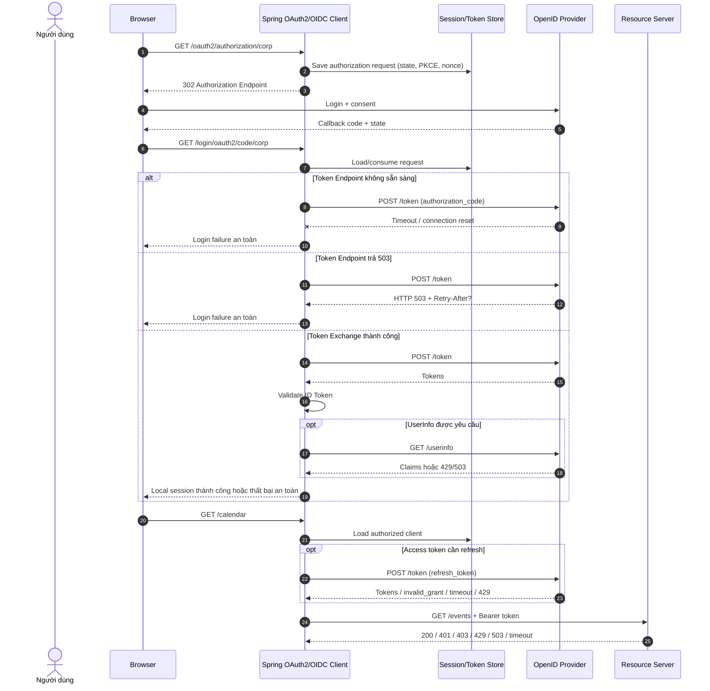
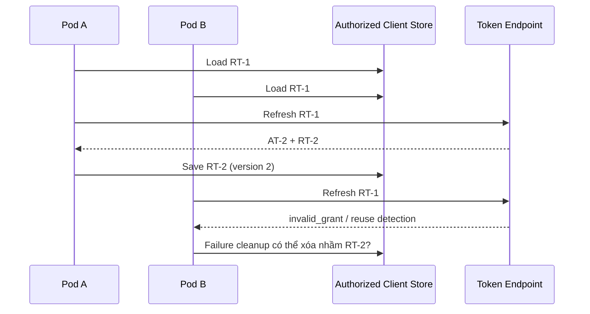
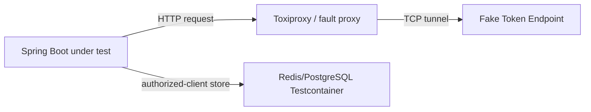

# 31.11. Kiểm thử mất kết nối, rate limit và provider không sẵn sàng

Một ứng dụng **Spring Security OAuth 2.0/OIDC Client** có thể chạy ổn định trong môi trường phát triển nhưng lại gặp sự cố khi phụ thuộc vào nhà cung cấp danh tính hoặc API bên ngoài: đường mạng bị cắt, DNS lỗi, chứng thư TLS hết hạn, Authorization Server trả **HTTP 429 Too Many Requests**, Token Endpoint trả **503 Service Unavailable**, UserInfo không phản hồi, hoặc JWKS chưa cập nhật kịp thời sau khi OP quay vòng khóa.

Những sự cố ấy không chỉ tạo lỗi kỹ thuật. Chúng ảnh hưởng đến **session người dùng, authorization code, refresh token rotation, chính sách retry, tải lên provider, và bảo mật của toàn bộ quá trình đăng nhập**. Một cách “khắc phục nhanh” như tắt xác minh `state`, bỏ TLS verification, thử lại mã authorization code vô hạn hoặc tự xóa token khi gặp timeout có thể biến outage tạm thời thành lỗ hổng bảo mật hoặc sự cố phải kết nối lại hàng loạt.

Bài học này tập trung vào **kiểm thử tích hợp (integration testing)**: triển khai ứng dụng thật với các thành phần Spring Security được cấu hình, nhưng thay các hệ thống bên ngoài bằng fake Authorization Server/OpenID Provider, Resource Server và công cụ gây lỗi mạng. Chúng ta không chỉ kiểm tra HTTP status, mà còn kiểm tra **tài nguyên được bảo vệ, side effects trong token store, số lần retry, thời gian chờ, failure handler, khả năng phục hồi và quan sát vận hành**.

> **Nguyên tắc:** Phân biệt rõ **lỗi mạng không có response**, **HTTP 429/503 từ provider**, **OAuth2 error response có mã giao thức**, **OIDC token validation failure** và **Bearer 401/403 từ Resource Server**. Không được dùng cùng một retry/cleanup policy cho tất cả.

## 1. Mục tiêu học tập

Sau khi học, bạn có thể:

1. Xác định các ranh giới bên ngoài của một Spring Security OAuth2/OIDC Client và cách lỗi lan truyền qua chúng.
2. Tạo test harness dùng **MockWebServer**, **WireMock** hoặc proxy gây lỗi để giả lập provider bị chậm, trả 429, 500/503, đóng kết nối và khôi phục.
3. Phân biệt **connect timeout, TLS handshake failure, response timeout và overall timeout**.
4. Kiểm tra header **`Retry-After`**, backoff, jitter, giới hạn retry và ngân sách thời gian.
5. Kiểm tra Authorization Code Flow khi OP không thể truy cập hoặc Token Endpoint không sẵn sàng mà **không replay authorization code tùy tiện**.
6. Kiểm tra lỗi trong Refresh Token Grant, bao gồm `invalid_grant`, rotation, timeout và nhiều yêu cầu refresh đồng thời.
7. Phân biệt Token Endpoint `invalid_grant` với Resource Server `invalid_token`/`insufficient_scope`.
8. Kiểm tra sự cố UserInfo/JWKS mà không bỏ xác minh `iss`, `aud`, signature, nonce hoặc `sub`.
9. Dùng **MockMvc**, **WebTestClient** và **Reactor StepVerifier** đúng phạm vi, không nhầm mock authentication với kiểm thử giao thức thật.
10. Thiết lập test assertions cho failure handler, token persistence/cleanup, metrics và trạng thái UX khi provider phục hồi.

## 2. Một kiến trúc mẫu và các điểm có thể bị gián đoạn

Giả sử Portal sử dụng Corp OIDC để đăng nhập, Calendar API được cấp quyền riêng, và Reports service chạy nền:

```text
Browser
   |
   v
Reverse Proxy / Spring Boot Portal (Servlet hoặc WebFlux)
   |                |
   |                +--> Session Store / Authorized Client Store
   |
   +--> Corp OpenID Provider
   |     |- Discovery / .well-known/openid-configuration
   |     |- Authorization Endpoint (qua browser)
   |     |- Token Endpoint
   |     |- JWKS Endpoint
   |     |- UserInfo Endpoint (nếu dùng)
   |
   +--> Calendar Authorization Server / API
   |     |- Token Endpoint (refresh)
   |     +- Resource Server (events)
   |
   +--> Reports API (service account)
```

Mỗi mũi tên là một **đường phụ thuộc** có thể bị lỗi độc lập. Chẳng hạn, Corp OP có thể mất UserInfo nhưng Token Endpoint vẫn trả token; Calendar Token Endpoint có thể bị rate limit dù API dữ liệu vẫn hoạt động.

### 2.1. Sơ đồ hành vi có lỗi



**Hai bước dễ bị nhầm:**

- **Authorization Endpoint là hành trình qua browser.** Một HTTP client ở backend thường không thể “retry” việc browser đã rời Portal rồi gặp trang OP không truy cập được. Cần UX/flow phục hồi phù hợp.
- **Token Endpoint và Resource Server được gọi server-to-server.** Timeout và 429 tại đây có thể xử lý bằng chính sách HTTP client, nhưng **token grants không luôn có tính idempotent**.

## 3. Thiết kế fault taxonomy trước khi viết test

Một bộ integration tests có khả năng chẩn đoán cần ghi ít nhất:

| Trục | Giá trị ví dụ | Tại sao cần |
|---|---|---|
| **Stage** | discovery, authorize, callback, token, JWKS, UserInfo, refresh, API | Xác định chỗ xảy ra lỗi |
| **Source** | browser, RP, OP, token store, Resource Server, network | Xác định bên chịu trách nhiệm |
| **Transport outcome** | DNS failure, connect refused, connection reset, timeout | Có hoặc không có HTTP response |
| **HTTP status** | 429, 500, 502, 503, 504, 401, 403 | Không đủ để quyết định root cause |
| **Protocol error** | `invalid_client`, `invalid_grant`, `invalid_token` | Phân biệt OAuth2 errors |
| **Grant type** | authorization_code, refresh_token, client_credentials | Ảnh hưởng độ an toàn khi retry |
| **Token state** | valid, expired, revoked, rotated, unknown | Ảnh hưởng cleanup và reauthorize |
| **Outcome** | success, degraded, failure, security rejection | Chọn trạng thái UI |
| **Retry count** | 0, 1, 2… bounded | Phát hiện retry storm |
| **Recovery** | backoff, reconnect, manual retry, alert | Không giải quyết mọi lỗi bằng login lại |

Một nhãn `provider_down` quá rộng không thể phân biệt Token Endpoint `invalid_grant` do user revoke với DNS outage khiến JWKS không tải được.

### 3.1. Ma trận lỗi cần có trong test plan

| Mã test | Failure injection | Stage | Kỳ vọng tối thiểu |
|---|---|---|---|
| F01 | DNS không resolve | Provider discovery/token | Không bypass TLS/issuer; lỗi được phân loại |
| F02 | TCP connection refused | Token/UserInfo/API | Deadline, không retry vô hạn |
| F03 | Socket đóng giữa request/response | Token refresh | Kết quả có thể chưa biết; không giả định revoke |
| F04 | Headers chậm hơn timeout | Token/API | Bị timeout/cancel; trả lỗi an toàn |
| F05 | HTTP 429 + `Retry-After` | Token/API | Đúng backoff/budget, không tăng traffic |
| F06 | HTTP 503 | OP/API | Fallback, cảnh báo, retry theo thao tác |
| F07 | OAuth2 `invalid_client` | Token Endpoint | Lỗi cấu hình/credential, không user retry loop |
| F08 | OAuth2 `invalid_grant` | Refresh Token Grant | Cleanup connection đúng, yêu cầu reauthorize |
| F09 | 401 `invalid_token` | Resource Server | Phân biệt với refresh; handler xử lý phù hợp |
| F10 | 403 `insufficient_scope` | Resource Server | Không tự tăng quyền hoặc thử registration khác |
| F11 | JWKS unavailable | ID Token validation | Không chấp nhận ID Token chưa xác minh |
| F12 | UserInfo `sub` mismatch | OIDC UserInfo | Từ chối identity response |
| F13 | OP phục hồi sau outage | Nhiều stage | Requests mới hoạt động, không retry storm |
| F14 | Hai pods refresh cùng token | Refresh/persistence | Không ghi đè hoặc xóa token mới sai cách |
| F15 | Redis/token store outage | Local persistence | Fail closed, không đổi token/principal của user khác |

Bảng là **test plan gợi ý**; không phải toàn bộ hệ thống đều có đủ endpoints hay token refresh.

## 4. Integration test khác unit test ở đâu?

**Unit test** thường kiểm tra một hàm phân loại lỗi hoặc `Mono.timeout` bằng fake Publisher. **Integration test** kết nối nhiều thành phần thật, ví dụ:

```text
Spring WebClient
  -> OAuth2 filter
  -> Reactive/Servlet authorized-client manager
  -> authorized-client store
  -> HTTP client
  -> Fake Token Endpoint/Resource Server
```

Hoặc:

```text
MockMvc / WebTestClient
  -> Spring Security login filters
  -> AuthorizationRequestRepository
  -> Browser callback simulation
  -> Fake Token Endpoint / JWKS / UserInfo
  -> Authentication / session
```

Một test dùng `oidcLogin()` hoặc `mockOAuth2Login()` trong Spring Security Test để giả lập principal **không** kiểm tra HTTP redirect, `state`, PKCE, Token Endpoint hoặc JWKS. Rất hữu ích cho business authorization, nhưng không đủ cho bài này.

### 4.1. Một bộ công cụ thực tế

| Công cụ | Dùng để kiểm thử |
|---|---|
| **JUnit 5** | Tổ chức test/lifecycle/assertion |
| **Spring Boot Test** | Load context và wiring Spring Security |
| **MockMvc** | Servlet security filter chain, callback, session |
| **WebTestClient** | Reactive HTTP contract/handlers |
| **Reactor StepVerifier** | Mono/Flux error, retry, timeout, cancellation |
| **MockWebServer (OkHttp)** | HTTP status, headers delay, disconnect, body và request count |
| **WireMock** | Stub endpoints, fault/latency injection, request journal |
| **Toxiproxy** | Tạo network proxy để cắt kết nối, latency, bandwidth, reset |
| **Testcontainers** | Khởi tạo Redis/DB/proxy khi cần kiểm tra persistence |
| **Virtual time / Clock** | Test deadline/backoff không đợi thật ở operator-level |
| **Fake OIDC OP** | Token/JWKS/Discovery/UserInfo có response theo từng kịch bản |

Không cần dùng toàn bộ công cụ cho một test. Chọn **tầng phù hợp với hành vi bạn muốn chứng minh**.

## 5. Dựng provider giả: tránh phụ thuộc OP production

Không nên làm integration test bằng Client ID/secret thật và thao tác trên production identity tenant. Test cần:

- Dùng **ClientRegistration test-only**.
- Endpoint trỏ về `127.0.0.1` với cổng do fake server cung cấp.
- Tạo JWT test được ký bằng private key chỉ dùng trong test, nếu cần OIDC validation.
- Dùng fake users và grants, không dùng PII thật.
- Có timeout/retry budgets thấp để CI ổn định.
- Có teardown đóng fake servers, connections và containers.
- Đảm bảo không ghi raw tokens/codes/secrets vào reports.

### 5.1. Fixture cho token và API endpoint bằng MockWebServer

```java
import okhttp3.mockwebserver.MockWebServer;
import org.junit.jupiter.api.AfterEach;
import org.junit.jupiter.api.BeforeEach;

class ProviderFaultHarness {

    MockWebServer tokenServer;
    MockWebServer resourceServer;

    @BeforeEach
    void startServers() throws Exception {
        tokenServer = new MockWebServer();
        resourceServer = new MockWebServer();

        tokenServer.start();
        resourceServer.start();
    }

    @AfterEach
    void stopServers() throws Exception {
        tokenServer.shutdown();
        resourceServer.shutdown();
    }
}
```

Đoạn này chỉ minh họa lifecycle. Để dùng trong Spring Boot integration test, cần đưa các URI từ `tokenServer.url("/token")` và `resourceServer.url("/")` vào test configuration **trước khi ClientRegistration/WebClient bean được tạo**, chẳng hạn qua test configuration hoặc `@DynamicPropertySource` với lifecycle phù hợp.

### 5.2. Vì sao dùng cổng động?

Cổng cứng như `8081` dễ va chạm khi CI chạy song song. MockWebServer tự chọn cổng khả dụng; tests lấy URL thực do server trả thay vì đoán port.

### 5.3. Dùng cùng một provider fake cho mọi thứ có ổn không?

Có thể, nhưng khi cần kiểm tra ranh giới Token Endpoint vs Resource Server nên dùng **hai fake servers** hoặc ít nhất tách rõ route và logs. Nếu cùng server, test phải assert được request nào là `/token` và request nào là `/events`.

## 6. Tạo ClientRegistration test-only

Nếu chỉ kiểm thử Token Endpoint và downstream API, không nhất thiết phải chạy toàn bộ OIDC Discovery. Có thể dựng registration thủ công:

```java
import org.springframework.security.oauth2.client.registration.ClientRegistration;
import org.springframework.security.oauth2.core.AuthorizationGrantType;
import org.springframework.security.oauth2.core.ClientAuthenticationMethod;

ClientRegistration calendarRegistration(String tokenUri) {
    return ClientRegistration.withRegistrationId("calendar-test")
        .clientId("test-calendar-client")
        .clientSecret("test-only-not-production")
        .clientAuthenticationMethod(
            ClientAuthenticationMethod.CLIENT_SECRET_BASIC
        )
        .authorizationGrantType(
            AuthorizationGrantType.AUTHORIZATION_CODE
        )
        .redirectUri(
            "{baseUrl}/login/oauth2/code/{registrationId}"
        )
        .authorizationUri("https://authorization.example.test/authorize")
        .tokenUri(tokenUri)
        .scope("calendar.read")
        .build();
}
```

Giả lập **user-delegated authorized client** có thể chứa refresh token, dù registration dùng authorization code ở thời điểm user cấp quyền. Không phải tạo một registration tên “refresh_token” riêng chỉ để test làm mới token.

### 6.1. Tạo authorized client hết hạn

```java
import java.time.Instant;
import java.util.Set;

import org.springframework.security.oauth2.client.OAuth2AuthorizedClient;
import org.springframework.security.oauth2.core.OAuth2AccessToken;
import org.springframework.security.oauth2.core.OAuth2RefreshToken;

OAuth2AuthorizedClient expiredClient(
        ClientRegistration registration,
        String principalName) {

    Instant now = Instant.now();

    var access = new OAuth2AccessToken(
        OAuth2AccessToken.TokenType.BEARER,
        "FAKE_EXPIRED_AT",
        now.minusSeconds(3600),
        now.minusSeconds(1800),
        Set.of("calendar.read")
    );

    var refresh = new OAuth2RefreshToken(
        "FAKE_RT_1",
        now.minusSeconds(3600)
    );

    return new OAuth2AuthorizedClient(
        registration, principalName, access, refresh
    );
}
```

Access token hết hạn giúp manager đi vào đường refresh, **nếu đã cấu hình provider `refreshToken()`**. PrincipalName trong fixture phải khớp khóa lưu authorized client.

## 7. Phân biệt năm kiểu mất kết nối

Không nên gộp mọi lỗi mạng vào một test `networkError`:

| Kiểu lỗi | Ví dụ | Có HTTP response? | Phản ứng có thể phù hợp |
|---|---|---|---|
| DNS lookup failure | Tên miền Token Endpoint không resolve | Không | Kiểm tra DNS, egress, provider config |
| TCP connect failure | `Connection refused`, no route | Không | Bounded retry nếu thao tác cho phép |
| TLS handshake failure | CA/hostname/certificate sai | Không | Sửa trust/cert, không tắt verification |
| Connection reset mid-flight | Socket bị đóng sau khi gửi request | Có thể không | Kết quả chưa biết; xét idempotency |
| Read/response timeout | Server giữ request quá lâu | Có thể chưa nhận status | Deadline/cancellation, retry theo policy |

Đặc biệt, **connection reset sau khi gửi Refresh Token Grant** không chứng minh provider chưa tiêu thụ refresh token. Nếu dùng rotation, một lần retry vô điều kiện có thể trở thành token reuse.

### 7.1. Kết quả không xác định (ambiguous outcome)

Ví dụ:

```text
Client gửi POST /token refresh_token=RT-1
  -> OP nhận RT-1, phát AT-2/RT-2
  -> socket reset trước khi Client nhận response
  -> Client còn RT-1 và không biết RT-2
```

Đừng phân loại tình huống này thành `invalid_grant` chỉ vì không có token mới. **Không có response OAuth2 thì không có mã OAuth2 `invalid_grant` đáng tin.**

### 7.2. TLS không được “khắc phục” bằng trust-all

Một test cố tình dùng certificate sai cần xác nhận client **từ chối** kết nối. Không sửa lỗi chứng thư bằng cách vô hiệu hóa hostname verification hoặc bỏ qua chứng chỉ trong production WebClient/RestClient.

## 8. Cấu hình HTTP timeout cho WebClient

Ví dụ Reactor Netty khi gọi API đã tin cậy:

```java
import java.time.Duration;

import io.netty.channel.ChannelOption;
import reactor.netty.http.client.HttpClient;

import org.springframework.http.client.reactive.ReactorClientHttpConnector;
import org.springframework.web.reactive.function.client.WebClient;

WebClient timedClient(String trustedBaseUrl) {
    HttpClient http = HttpClient.create()
        .option(ChannelOption.CONNECT_TIMEOUT_MILLIS, 1000)
        .responseTimeout(Duration.ofSeconds(2));

    return WebClient.builder()
        .baseUrl(trustedBaseUrl)
        .clientConnector(
            new ReactorClientHttpConnector(http)
        )
        .build();
}
```

**Phạm vi cấu hình:**

- `CONNECT_TIMEOUT_MILLIS` áp cho TCP connect.
- `responseTimeout` áp cho HTTP response/đọc response theo semantics Reactor Netty.
- Connection pool acquire timeout, TLS handshake timeout và overall operation timeout là các cơ chế khác.
- Các giá trị 1–2 giây chỉ để minh họa, không phải giá trị đúng cho mọi OP.

### 8.1. Overall timeout trong ứng dụng

```java
Mono<String> call = calendarWebClient.get()
    .uri("/v1/events")
    .retrieve()
    .bodyToMono(String.class)
    .timeout(Duration.ofSeconds(3));
```

`Mono.timeout` giới hạn tổng thời gian từ subscribe tới signal tại vị trí operator. Nó có thể bao gồm chờ authorization manager, refresh, request API và parse body tùy vị trí đặt. **Timeout phía client không đảm bảo server từ xa đã hủy thao tác**.

### 8.2. Không đặt timeout quá chồng chéo

Nếu mỗi Token Endpoint, UserInfo và API call cho phép 10 giây nhưng inbound request chỉ có budget 5 giây, tổng workflow sẽ không đạt SLO. Thiết kế **deadline hierarchy** và test thời gian ở cấp integration.

## 9. Test HTTP response timeout thật với MockWebServer

```java
import java.time.Duration;
import java.util.concurrent.TimeUnit;

import io.netty.channel.ChannelOption;
import okhttp3.mockwebserver.MockResponse;
import okhttp3.mockwebserver.MockWebServer;

import org.junit.jupiter.api.Test;
import org.springframework.http.client.reactive.ReactorClientHttpConnector;
import org.springframework.web.reactive.function.client.WebClient;

import reactor.netty.http.client.HttpClient;
import reactor.test.StepVerifier;

class ProviderTimeoutIT {

    @Test
    void delayedHeadersCauseResponseTimeout() throws Exception {
        try (MockWebServer provider = new MockWebServer()) {
            provider.start();
            provider.enqueue(
                new MockResponse()
                    .setHeadersDelay(2, TimeUnit.SECONDS)
                    .setBody("{\"status\":\"ok\"}")
            );

            HttpClient http = HttpClient.create()
                .option(ChannelOption.CONNECT_TIMEOUT_MILLIS, 1000)
                .responseTimeout(Duration.ofMillis(150));

            WebClient client = WebClient.builder()
                .clientConnector(
                    new ReactorClientHttpConnector(http)
                )
                .build();

            StepVerifier.create(
                    client.get()
                        .uri(provider.url("/slow").toString())
                        .retrieve()
                        .bodyToMono(String.class)
                )
                .expectError()
                .verify(Duration.ofSeconds(5));
        }
    }
}
```

Test dùng **real local HTTP socket**. Nó chứng minh response bị chậm hơn deadline, không chứng minh connect timeout. Không phụ thuộc Internet public hoặc một hostname OP thật.

### 9.1. Cẩn trọng với loại exception

WebClient có thể wrap Netty timeout dưới `WebClientRequestException`. Integration tests nên assert:

- Pipeline kết thúc bằng lỗi, không body thành công.
- Request đi tới đúng fake server.
- Không có retry vô hạn.
- Domain error mapping đúng.
- Resource/connection không bị bỏ lại sai cách.

Nếu ứng dụng định nghĩa một stable domain exception như `ProviderUnavailableException`, có thể assert vào loại đó. Không phụ thuộc exact English message của Netty.

### 9.2. Không dùng virtual time để tua nhanh socket

`StepVerifier.withVirtualTime` giúp kiểm thử Reactor timers/backoff. Nó **không làm MockWebServer `setHeadersDelay` hoặc TCP socket chạy nhanh hơn**. Tách hai loại tests để tránh flaky.

## 10. Test lỗi socket reset

MockWebServer hỗ trợ chính sách đóng kết nối:

```java
import okhttp3.mockwebserver.MockResponse;
import okhttp3.mockwebserver.SocketPolicy;

provider.enqueue(
    new MockResponse()
        .setSocketPolicy(SocketPolicy.DISCONNECT_AFTER_REQUEST)
);
```

Với `DISCONNECT_AFTER_REQUEST`, server nhận request rồi ngắt kết nối trước khi gửi một response thông thường. Nó mô phỏng trường hợp **không biết server đã xử lý nghiệp vụ tới đâu**.

### 10.1. Kỳ vọng theo HTTP method

| Request | Sau reset, có nên retry? |
|---|---|
| GET Resource Server idempotent | Có thể retry giới hạn, nếu API contract cho phép |
| POST tạo giao dịch | Cần idempotency key/reconciliation |
| POST Token Endpoint authorization code | Không retry mù vì code dùng một lần |
| POST Token Endpoint refresh token | Không retry mù vì rotation/reuse risk |
| Client Credentials Grant | Có thể cân nhắc theo AS contract và rate budget |

**Không viết interceptor “retry mọi IOException 3 lần” cho tất cả OAuth2 grant requests.**

## 11. Kiểm thử HTTP 429 và ý nghĩa của `Retry-After`

HTTP **429 Too Many Requests** báo phía server đang áp dụng rate limit. Server có thể trả `Retry-After`, biểu diễn bằng **số giây** hoặc **HTTP-date**.

```http
HTTP/1.1 429 Too Many Requests
Retry-After: 3
Content-Type: application/json

{"error":"rate_limited"}
```

Mã HTTP 429 là transport/application throttling signal; `rate_limited` trong JSON chỉ là ví dụ provider-specific, **không phải OAuth2 core error code bắt buộc**.

### 11.1. Những điều test cần assert

1. Client phát hiện đúng `429` và đọc `Retry-After` nếu có.
2. Chỉ áp retry khi thao tác **được policy cho phép**.
3. Có giới hạn tổng attempts.
4. Có backoff/jitter để tránh đồng bộ tải.
5. Có cap tối đa thời gian chờ và inbound request deadline.
6. Khi retry không phù hợp, trả lỗi domain có thể phục hồi sau.
7. Không xóa token chỉ vì HTTP 429.
8. Không làm mất `state`/PKCE/nonce của login flow.
9. Sau khi provider phục hồi, requests mới có thể thành công.
10. Metrics không ghi user ID/token vào labels.

### 11.2. Parser `Retry-After` minh họa

```java
import java.time.Duration;
import java.time.Instant;
import java.time.ZonedDateTime;
import java.time.format.DateTimeFormatter;

public final class RetryAfterPolicy {

    private RetryAfterPolicy() {}

    public static Duration parse(
            String header, Instant now, Duration maxDelay) {

        if (header == null || header.isBlank()) {
            return Duration.ZERO; // Caller chọn default backoff.
        }

        Duration delay;

        try {
            long seconds = Long.parseLong(header.trim());
            delay = Duration.ofSeconds(Math.max(0L, seconds));
        } catch (NumberFormatException notSeconds) {
            try {
                Instant until = ZonedDateTime.parse(
                    header.trim(),
                    DateTimeFormatter.RFC_1123_DATE_TIME
                ).toInstant();
                delay = Duration.between(now, until);
            } catch (RuntimeException malformedDate) {
                return Duration.ZERO; // Fallback do caller quyết định.
            }
        }

        if (delay.isNegative()) {
            return Duration.ZERO;
        }

        return delay.compareTo(maxDelay) > 0 ? maxDelay : delay;
    }
}
```

Parser hỗ trợ hai hình thức phổ biến và **clamp delay** theo budget. Khi header sai/thiếu, ví dụ trả zero để policy bên ngoài chọn backoff mặc định; **không hiểu zero là phải retry ngay vô điều kiện**.

### 11.3. Test parser bằng clock cố định

```java
import static org.assertj.core.api.Assertions.assertThat;
import org.junit.jupiter.api.Test;

import java.time.Duration;
import java.time.Instant;

class RetryAfterPolicyTest {

    @Test
    void capsLargeDeltaSeconds() {
        Duration delay = RetryAfterPolicy.parse(
            "120",
            Instant.parse("2026-01-01T00:00:00Z"),
            Duration.ofSeconds(10)
        );

        assertThat(delay).isEqualTo(Duration.ofSeconds(10));
    }

    @Test
    void malformedHeaderUsesCallerFallback() {
        Duration delay = RetryAfterPolicy.parse(
            "not-an-http-date",
            Instant.EPOCH,
            Duration.ofSeconds(10)
        );

        assertThat(delay).isZero();
    }
}
```

Không dùng thời gian hệ thống thật khi kiểm tra HTTP-date gần ranh giới, vì tests dễ flaky theo clock.

## 12. Test 429 HTTP response qua WebClient

Ví dụ đơn giản dùng `ExchangeFunction` giả để kiểm tra HTTP classification, không cần socket:

```java
import org.junit.jupiter.api.Test;
import org.springframework.http.HttpHeaders;
import org.springframework.http.HttpStatus;
import org.springframework.web.reactive.function.client.ClientResponse;
import org.springframework.web.reactive.function.client.WebClient;
import org.springframework.web.reactive.function.client.WebClientResponseException;

import reactor.core.publisher.Mono;
import reactor.test.StepVerifier;

class WebClientRateLimitTest {

    @Test
    void tooManyRequestsIsNotASuccessBody() {
        WebClient client = WebClient.builder()
            .exchangeFunction(request -> Mono.just(
                ClientResponse.create(HttpStatus.TOO_MANY_REQUESTS)
                    .header(HttpHeaders.RETRY_AFTER, "3")
                    .body("test-only rate limit")
                    .build()
            ))
            .build();

        StepVerifier.create(
                client.get()
                    .uri("https://api.example.test/events")
                    .retrieve()
                    .bodyToMono(String.class)
            )
            .expectError(
                WebClientResponseException.TooManyRequests.class
            )
            .verify();
    }
}
```

**Phạm vi:** test này chứng minh `retrieve()` coi 429 là lỗi HTTP. Nó chưa kiểm tra Netty, timeout, `Retry-After` policy, OAuth2 authorized-client manager hoặc cleanup. Với integration test thật, dùng fake server và filter chain thực.

### 12.1. Fake server trả 429 rồi 200

```java
provider.enqueue(
    new MockResponse()
        .setResponseCode(429)
        .addHeader("Retry-After", "1")
        .setBody("rate limited")
);

provider.enqueue(
    new MockResponse()
        .setResponseCode(200)
        .setBody("{\"items\":[]}")
);
```

Nếu request là **GET API idempotent** và client có retry policy, test có thể assert response cuối thành công và fake server nhận **hai requests**. Nếu request là Refresh Token Grant, **không mặc định** retry bằng cùng token chỉ vì có 429.

## 13. Viết retry policy có phạm vi rõ

Ví dụ chỉ retry **GET Resource Server** trước 429/503; không áp vào Token Endpoint:

```java
import java.time.Duration;

import org.springframework.web.reactive.function.client.WebClientResponseException;

import reactor.core.publisher.Mono;
import reactor.util.retry.Retry;

boolean transientApiStatus(Throwable error) {
    if (error instanceof WebClientResponseException response) {
        int status = response.getStatusCode().value();
        return status == 429 || status == 503;
    }
    return false;
}

Mono<String> loadCalendarWithLimitedRetry(WebClient calendarClient) {
    return calendarClient.get()
        .uri("/events")
        .retrieve()
        .bodyToMono(String.class)
        .retryWhen(
            Retry.backoff(2, Duration.ofMillis(100))
                .filter(this::transientApiStatus)
        )
        .timeout(Duration.ofSeconds(3));
}
```

Snippet là method trong một class chứa `transientApiStatus`. Nó minh họa bounded retries, **chưa áp dụng `Retry-After`**. Reactor `Retry.backoff` không tự diễn giải HTTP header. Nếu policy yêu cầu tôn trọng `Retry-After`, cần đọc header và lập lịch chờ trong một retry strategy riêng, đồng thời áp dụng deadline/cap.

### 13.1. Số lần gọi cần đo

`Retry.backoff(2, …)` có nghĩa **2 retries sau lần đầu** → tối đa **3 HTTP attempts**. Tests nên assert request count, không chỉ assert kết quả cuối.

### 13.2. Lỗi không được retry trong ví dụ

- HTTP 400/401/403.
- `invalid_grant` hoặc `invalid_client` của Token Endpoint.
- ID Token signature/issuer/audience validation error.
- Từ chối account ownership/authorization.
- Lỗi TLS certificate chưa được khắc phục.
- Lỗi serialize token store.
- API POST có side effects nếu chưa có idempotency contract.

### 13.3. Thêm jitter và tránh retry storm

Khi nhiều pods cùng nhận 429, retry với cùng delay chính xác tạo **thundering herd**. Jitter/backoff phân tán tải. Trong test deterministic có thể đặt jitter zero hoặc dùng scheduler giả, nhưng production cần policy phù hợp.

### 13.4. Rate limit không chỉ là HTTP 429

Một OP có thể dùng 503 khi quá tải, đôi khi gửi `Retry-After`. Ngược lại, 429 có thể không có header. Không hard-code “mọi 503 retry ngay” hoặc “mọi 429 luôn retry” mà không xét operation, grant type và SLO.

## 14. Kiểm thử retry bằng Reactor virtual time

```java
import java.time.Duration;
import java.util.concurrent.atomic.AtomicInteger;

import org.junit.jupiter.api.Test;
import org.springframework.web.reactive.function.client.WebClientResponseException;
import org.springframework.http.HttpStatus;
import reactor.core.publisher.Mono;
import reactor.test.StepVerifier;
import reactor.util.retry.Retry;

import static org.assertj.core.api.Assertions.assertThat;

class BackoffPolicyTest {

    @Test
    void stopsAfterTwoRetries() {
        AtomicInteger calls = new AtomicInteger();

        StepVerifier.withVirtualTime(() ->
                Mono.defer(() -> {
                    calls.incrementAndGet();
                    return Mono.<String>error(
                        WebClientResponseException.create(
                            503, "Unavailable", null,
                            new byte[0], null
                        )
                    );
                })
                .retryWhen(
                    Retry.backoff(2, Duration.ofMillis(100))
                        .jitter(0.0)
                )
            )
            .expectSubscription()
            .thenAwait(Duration.ofSeconds(3))
            .expectError()
            .verify();

        assertThat(calls.get()).isEqualTo(3);
    }
}
```

Trong một test chỉ có lỗi giả, virtual time có thể kiểm tra budget mà không gọi mạng. Error sau khi hết retry có thể bị wrap thành **retry exhaustion**, nên tránh assert chính xác type của cause nếu không phải contract.

### 14.1. Đặt Publisher trong supplier

`StepVerifier.withVirtualTime(() -> ...)` cần tạo pipeline bên trong supplier để các Reactor Scheduler được điều khiển đúng. Đừng tạo `Mono.delay`/`Flux.interval` với scheduler thật trước rồi kỳ vọng time được tua.

### 14.2. Virtual time không kiểm thử real TCP

Cần một integration test HTTP riêng với MockWebServer/WireMock để kiểm tra request counts, headers và body. Kết hợp cả hai loại tests nhưng không đánh đồng phạm vi của chúng.

## 15. Authorization Endpoint không sẵn sàng: UX và bảo mật

Trong OAuth2 Login, browser được redirect từ RP tới OP. Nếu OP trả 503 hoặc domain OP không truy cập được, một số trường hợp **browser chưa quay lại RP**, nên `oauth2Login().failureHandler(...)` của RP có thể **không được gọi**.

### 15.1. Cần test điều gì?

- Initiation ở RP tạo đúng authorization URL và `state`, lưu authorization request.
- OP unavailable trước khi callback không làm RP tự tạo authenticated session.
- Authorization request hết hạn/được cleanup theo TTL.
- User có cách chủ động thử lại sau khi OP phục hồi.
- Không có auto-redirect loop từ trang lỗi.
- Không lưu pending state vô thời hạn.
- Nếu có nhiều OPs, việc fallback sang OP khác là **quyết định sản phẩm/identity**, không tự coi cùng một user hoặc Client tương đương.

### 15.2. Không tự “login local” khi OP down

Một anti-pattern:

```java
// Không làm để bypass outage:
// if (providerUnavailable) {
//     return createAuthenticatedPrincipalFromEmail(request);
// }
```

Khi không có OIDC ID Token đã xác minh hoặc local authentication mechanism đáng tin được thiết kế riêng, hệ thống không thể tạo user identity chỉ từ email/header.

### 15.3. Session người dùng đã đăng nhập trước đó

OP outage **không nhất thiết** làm mọi local RP sessions ngay lập tức mất hiệu lực. Chính sách session timeout, reauthentication và logout cần được định nghĩa trước. Test không được tùy tiện logout mọi sessions chỉ vì OP mất mạng ngắn.

## 16. Callback tồn tại nhưng Token Endpoint 503/timeout

Sau khi OP xác thực user và redirect `code + state` về RP, RP gọi Token Endpoint để đổi code.

```text
Browser -> RP callback code=CODE-1, state=STATE-1
RP kiểm tra saved authorization request/state/PKCE
RP -> POST /token authorization_code
Token Endpoint -> 503 / timeout
```

### 16.1. Kiểm thử quan trọng

1. Callback có saved request/session/state hợp lệ.
2. Token Endpoint fake bị gây lỗi.
3. RP không tạo Authentication thành công từ một response lỗi.
4. RP không lấy email/claims chưa xác minh làm authenticated principal.
5. Failure handler hiển thị thông điệp an toàn/correlation ID.
6. Không log code, verifier, state, Client secret hoặc token body.
7. Không tự gửi code sang Token Endpoint của provider khác.
8. Không retry cùng authorization code vô hạn.
9. Khi user chủ động thử lại, khởi tạo **flow mới với state/code mới**.
10. Nếu OP đã tiêu thụ code rồi response mất, test policy “outcome unknown” thay vì giả định retry an toàn.

### 16.2. Tại sao không retry code tùy tiện?

Authorization code được thiết kế dùng **một lần**. Khi Token Endpoint timeout, server có thể đã nhận và tiêu thụ code. Retry cùng code có thể trả `invalid_grant`, hoặc làm nhiễu giám sát. Phục hồi đáng tin thường là một Authorization Code Flow mới, không phải retry mù.

### 16.3. `invalid_client` khác 503

Nếu Token Endpoint trả:

```json
{"error":"invalid_client"}
```

đây thường là lỗi **Client authentication/config** (secret/key/mTLS/client ID), không phải outage tạm thời cần user retry. Test phải phân loại khác `503` và cảnh báo owner tích hợp.

## 17. Spring Security Servlet và Reactive: integration harness

Một hệ thống có thể sử dụng một trong hai security stacks:

| Servlet MVC | Reactive WebFlux |
|---|---|
| `HttpSecurity` | `ServerHttpSecurity` |
| `SecurityFilterChain` | `SecurityWebFilterChain` |
| `MockMvc` | `WebTestClient` |
| `ClientRegistrationRepository` | `ReactiveClientRegistrationRepository` |
| `OAuth2AuthorizedClientRepository` | `ServerOAuth2AuthorizedClientRepository` |
| `DefaultOAuth2AuthorizedClientManager` | `DefaultReactiveOAuth2AuthorizedClientManager` |
| `OidcUserService` | Reactive OIDC user service |
| `AuthenticationFailureHandler` | `ServerAuthenticationFailureHandler` |

### 17.1. Phạm vi của MockMvc

`MockMvc` có thể gọi:

```java
mvc.perform(get("/oauth2/authorization/corp"))
   .andExpect(status().is3xxRedirection());
```

Sau đó kiểm tra `Location` và session có authorization request. Nhưng **chỉ 302 chưa kiểm tra Token Endpoint outage**. Muốn test callback, phải tạo saved authorization request và fake OP/token/JWKS response phù hợp.

### 17.2. Phạm vi của WebTestClient

`WebTestClient` có thể kiểm tra handler trả 503 khi downstream OP/API unavailable:

```java
webTestClient.get()
    .uri("/api/calendar")
    .exchange()
    .expectStatus().is5xxServerError();
```

Nếu test dùng mock `CalendarService` phát exception mà không có WebClient/authorized-client manager thật, nó chỉ kiểm tra **controller exception mapping**, không phải OAuth2 integration.

### 17.3. Không mock mất điều cần test

Nếu mục tiêu là kiểm tra `invalid_grant` cleanup trong manager, không được mock manager trả sẵn `Mono.error` rồi khẳng định cleanup hoạt động. Phải giữ manager và store thật/fake có state, gây lỗi từ **provider/Token Endpoint dependency** và quan sát side effect.

## 18. Refresh Token Grant khi provider không sẵn sàng

Sau login, Portal có thể giữ `OAuth2AuthorizedClient`:

```text
registrationId=calendar
principalName=user-42
accessToken=AT-1 (đã hết hạn)
refreshToken=RT-1 (còn lưu)
```

Manager có thể gửi:

```http
POST /token HTTP/1.1
Host: fake-provider.test
Content-Type: application/x-www-form-urlencoded

grant_type=refresh_token&refresh_token=EXAMPLE_RT
```

Client authentication được áp dụng riêng theo registration và provider policy.

### 18.1. Phân biệt ba tình huống

| Phản hồi | Có bằng chứng token bị thu hồi? | Hành động |
|---|---|---|
| HTTP 429 | **Không** | Giảm tốc, tôn trọng rate budget, không xóa token mặc định |
| HTTP 503/timeout | **Không** | Retry/đợi theo policy, giữ trạng thái chưa xác định |
| Token Endpoint `invalid_grant` | **Có bằng chứng grant không hợp lệ** | Cleanup/reauthorize đúng connection |
| Token Endpoint `invalid_client` | Client authentication lỗi | Sửa config/credentials, không bắt user đổi password |

Không biến mọi timeout thành `invalid_grant`, vì điều đó gây yêu cầu reconnect hàng loạt khi nhà cung cấp chỉ mất mạng.

### 18.2. Test failure handler mặc định

Với một số manager implementations, Spring Security có default failure handler loại authorized client đã lưu khi reauthorization trả `invalid_grant`. Khi tự gọi `setAuthorizationFailureHandler(...)` hoặc `setAuthorizationFailureHandler` trên reactive manager, behavior có thể thay đổi.

Test phải kiểm tra:

- `invalid_grant` làm loại đúng authorized client theo policy.
- 503/timeout không tự xóa refresh token như token revoked.
- Cleanup chỉ áp vào **registration + principal/connection đúng**.
- Authorized client của provider khác không bị động tới.
- Storage failure không bị nuốt khiến app tin đã cleanup.
- Sau reconnect, grant mới được lưu đúng và API call có thể tiếp tục.

### 18.3. Phân biệt manager error và API 401

`invalid_grant` là response của **Token Endpoint**. Bearer `invalid_token` là response của **Resource Server**. Cả hai có thể dùng cùng một failure-handler abstraction theo integration, nhưng không cùng ngữ nghĩa hoặc nơi phát sinh.

## 19. Refresh token rotation và race condition

Với refresh token rotation:



Một nguy cơ thực tế: failure handler B xử lý `invalid_grant` và xóa record bằng khóa `(registrationId, principalName)` mà **không kiểm tra version**. Nếu A vừa lưu RT-2, B có thể xóa token tốt.

### 19.1. Test phải khống chế thứ tự

Không dùng `Thread.sleep` ngẫu nhiên. Dùng controlled `Mono`, `Sinks.One`, `CountDownLatch` trong test harness hoặc proxy có scripted responses để ép thứ tự:

1. A và B cùng đọc RT-1.
2. A nhận RT-2 và lưu version mới.
3. B nhận `invalid_grant` từ RT-1.
4. Assert chính sách **không xóa RT-2** nếu thiết kế dùng optimistic version/conditional cleanup.
5. Assert B không retry RT-1 vô hạn.
6. Assert token store không chứa principal/tenant của user khác.

### 19.2. Default cleanup không tự giải bài toán distributed race

Manager mặc định không thể suy ra database đã thay refresh token nếu persistence không có versioning/locking. Nếu nguy cơ này tồn tại, thiết kế **single-flight refresh**, optimistic locking, atomic compare-and-swap và conditional delete theo version/context.

### 19.3. Provider có thể revoke token family

Một số Authorization Servers phát hiện reuse RT-1 rồi vô hiệu hóa cả token family. Khi ấy RT-2 cũng có thể không còn hợp lệ. Hệ thống cần tuân theo provider policy và xử lý `RECONNECT_REQUIRED`; không được mặc định giữ RT-2 mãi bất kể reuse detection.

## 20. Rate limit budgets cho nhiều users và pods

HTTP 429 thường là tín hiệu hệ thống đã vượt quota. Nếu một request retry 3 lần và có 1000 concurrent requests, tổng tải lên OP có thể tăng rất lớn.

### 20.1. Các chiều quota thường gặp

- Per Client ID.
- Per tenant/organization.
- Per user/token.
- Per source IP/region.
- Per endpoint, ví dụ Token Endpoint khắt khe hơn UserInfo.
- Per time window và tổng concurrent connections.

Một pool/token bucket ở mỗi pod **không tự tạo global budget**. Nếu provider giới hạn Client ID trên toàn cluster, cần cân nhắc điều phối quota phân tán hoặc giới hạn egress đồng bộ.

### 20.2. Kiểm thử hiệu ứng thundering herd

Giả lập N concurrent requests khi fake OP bắt đầu trả 429:

- Không để mọi request retry ngay cùng lúc.
- Không khởi tạo hàng trăm refreshes cho cùng một principal.
- Có budget chờ/cancel trong inbound request.
- Có circuit breaker/bulkhead nếu kiến trúc dùng.
- User nhận thông báo tạm gián đoạn thay vì page spinning vô hạn.
- Metrics phân biệt throttling và credential invalid.

### 20.3. `Retry-After` không cấp phép vượt deadline

Nếu provider yêu cầu chờ 60 giây nhưng Portal request SLO chỉ 5 giây, không nên giữ user HTTP request 60 giây. Có thể trả thông báo retry later, queue retry background **chỉ với thao tác an toàn và có consent** hoặc hẹn user thực hiện lại.

## 21. Circuit breaker, bulkhead và health check

Một circuit breaker mở khi tỉ lệ lỗi cao có thể giảm tải lên OP, nhưng phải dùng theo đúng dependency. Không nên mở circuit cho **mọi provider** khi chỉ Calendar Token Endpoint bị lỗi.

### 21.1. States cần test

```text
CLOSED
  -> lỗi tạm thời tăng vượt threshold
  -> OPEN (fail fast, không gửi request mới)
  -> sau cooldown
  -> HALF_OPEN (cho một số probe)
  -> nếu probe thành công: CLOSED
     nếu probe thất bại: OPEN
```

### 21.2. Kiểm thử circuit breaker

- N lần 503 liên tiếp đạt threshold → breaker OPEN.
- Request tiếp theo bị chặn nhanh, fake server không nhận thêm request.
- Sau thời gian chờ, cho phép probe.
- Provider phục hồi → breaker CLOSED.
- 401/403 do quyền user **không nên** mặc định tính như outage của toàn OP.
- User hủy consent `access_denied` không nên làm breaker mở.
- Một provider down không làm providers khác fail vì chung breaker.
- Có metrics/alerts khi OPEN/HALF_OPEN.

Nếu dùng Resilience4j Reactor integration, kiểm tra dependency và cách wiring theo phiên bản thực tế. Đây là một **biện pháp tùy chọn**, không phải tính năng mặc định của `oauth2Login()`.

### 21.3. Health check không thay security validation

Một probe OP thành công không chứng minh token signature, issuer và audience hợp lệ. Ngược lại, health check thiếu quyền hoặc bị rate limit không nhất thiết đồng nghĩa toàn bộ user login không thể hoạt động. Phân biệt dependency reachability và protocol correctness.

## 22. UserInfo không sẵn sàng

Sau khi Token Endpoint trả token, OIDC RP **có thể** gọi UserInfo Endpoint để bổ sung claims. Không phải OIDC flow nào cũng gọi UserInfo.

### 22.1. Kịch bản test

- UserInfo timeout.
- UserInfo trả 503.
- UserInfo trả 429 kèm `Retry-After`.
- UserInfo trả HTTP 401 `invalid_token`.
- UserInfo trả HTML thay JSON.
- UserInfo trả JSON thiếu optional `email`.
- UserInfo trả `sub` khác verified ID Token.
- UserInfo không có trong OP metadata nhưng application cấu hình bắt buộc.

### 22.2. Không bỏ identity verification để “degrade”

Nếu UserInfo `sub` khác ID Token `sub`, RP phải **từ chối UserInfo response**. Không fallback bằng cách nhận email từ response không khớp. Nếu UserInfo unavailable nhưng ứng dụng chỉ dùng nó cho thông tin profile tùy chọn, có thể cân nhắc fallback **theo policy đã duyệt**, nhưng không được làm mất issuer/audience/signature/nonce validation của ID Token.

### 22.3. Test domain behavior thay vì chỉ HTTP 503

- Nếu UserInfo bắt buộc để xây principal: login thất bại an toàn.
- Nếu UserInfo optional theo thiết kế: login có thể thành công với claims đã được xác minh từ ID Token, nhưng không tự tạo claims chưa được kiểm chứng.
- Không tự biến `email_verified=false` thành true khi profile unavailable.
- Có telemetry `stage=userinfo`, `category=provider_unavailable`.
- Không log raw UserInfo profile JSON chứa PII.

## 23. JWKS và OIDC Discovery bị gián đoạn

Một OP có thể trả authorization code và token thành công nhưng RP **không lấy được JWKS** để xác minh chữ ký ID Token.

### 23.1. Các trường hợp

| Sự cố | Kỳ vọng |
|---|---|
| Discovery endpoint 503 lúc startup | App/configuration handling rõ, không dùng issuer tùy ý |
| JWKS timeout lần đầu | Không chấp nhận ID Token chưa xác minh |
| JWKS cache còn key hợp lệ | Hành vi theo cache policy được kiểm thử |
| OP rotate signing key | RP refresh JWKS an toàn, không bỏ signature |
| JWKS trả JSON sai/thiếu key | Validation fail, có alert |
| Token `iss`/`aud` không khớp | Luôn reject, dù JWKS đang hoạt động |
| `kid` lạ | Tìm key theo cơ chế an toàn, không fetch arbitrary URL từ token |

### 23.2. Không làm “best effort login” bằng unsigned claims

Khi không xác minh được JWT, không nên parse Base64 payload rồi coi email/`sub` là danh tính đáng tin. **Tính sẵn sàng không được đánh đổi bằng phá ranh giới xác thực.**

### 23.3. Test khóa quay vòng khác outage

- Key rotation bình thường: OP công bố key mới, RP lấy đúng JWKS và verify.
- JWKS outage: RP không có key phù hợp, phải fail nếu không thể verify.
- Wrong issuer/audience: không do outage, phải reject.
- Clock skew: xem `exp`/`iat`, không tăng skew quá lớn để bypass.

## 24. Resource Server trả 401/403, 429 và 503

Sau login, Client gọi API với access token:

```text
GET /calendar/events
Authorization: Bearer AT-2
```

Khi API trả:

```http
HTTP/1.1 401 Unauthorized
WWW-Authenticate: Bearer error="invalid_token"
```

thì đây là **Bearer token rejection** từ Resource Server, không phải `invalid_grant` của Token Endpoint. Khi API trả:

```http
HTTP/1.1 403 Forbidden
WWW-Authenticate: Bearer error="insufficient_scope"
```

thì thiếu quyền, không tự động sửa được bằng refresh.

### 24.1. Test bảng hành động

| Response | Cleanup token? | Retry? | UI |
|---|---|---|---|
| 401 Bearer `invalid_token` | Theo OAuth2 filter/failure policy | Tối đa theo cơ chế reacquire/reauthorize rõ | Token/connection có thể cần refresh/reconnect |
| 403 `insufficient_scope` | Theo policy; không tự tăng quyền | Không retry vô hạn | Thiếu quyền/consent |
| 429 | Không mặc định | Chỉ với request an toàn + Retry-After/budget | Tạm giới hạn |
| 503 | Không mặc định | Có thể retry idempotent GET | Dịch vụ tạm lỗi |
| Network timeout | Không mặc định | Theo idempotency/ambiguity | Không rõ kết quả; thử lại an toàn |

### 24.2. WebClient OAuth2 filter có handler riêng

Trên WebFlux, `ServerOAuth2AuthorizedClientExchangeFilterFunction` có thể nhận `ReactiveOAuth2AuthorizedClientManager` hoặc `ReactiveClientRegistrationRepository` + `ServerOAuth2AuthorizedClientRepository`. Hành vi failure handler mặc định có thể **khác theo constructor**.

Test phải kiểm tra **Resource Server HTTP 401/403** có thực sự kích hoạt handler cleanup theo cấu hình hay không. Một test `invalid_grant` của manager không chứng minh filter xử lý 401 đúng.

### 24.3. Không gửi token sang sai origin

Khi test provider unavailable, đừng thay một API URL đáng tin bằng arbitrary user-provided URL rồi giữ nguyên Bearer token. Nên cố định trusted base URLs và kiểm soát HTTP redirects/egress. **Một retry sang host khác có thể làm lộ token** dù token selection đúng registration.

## 25. Local session khi OP down

Một câu hỏi sản phẩm thường gặp: **“Nếu OP mất kết nối, người dùng đã đăng nhập Portal có bị logout không?”**

Không có đáp án chung:

- Local session có thể còn hợp lệ theo `HttpSession`/`WebSession` TTL.
- OP SSO session có thể tồn tại độc lập.
- Refresh token cho external API có lifecycle riêng.
- Policy có thể yêu cầu reauthentication cho thao tác nhạy cảm.
- Sự kiện disable/revoke account từ OP có thể cần xử lý theo yêu cầu bảo mật riêng.

Test cần mô tả **session continuity policy** và kiểm tra nó, không logout mọi user chỉ vì một integration API chậm.

### 25.1. Phân biệt reconnect và retry later

```text
CONNECTED
  -> token hợp lệ

TEMPORARILY_UNAVAILABLE
  -> 429 / 503 / timeout, chưa có bằng chứng revoke

RECONNECT_REQUIRED
  -> invalid_grant hoặc thông tin token/grant bị thu hồi

DISCONNECTED
  -> user ngắt kết nối / admin revoke theo policy
```

Một timeout không đủ để biến `CONNECTED` thành `RECONNECT_REQUIRED`. Một `invalid_grant` xác thực từ Token Endpoint thường là tín hiệu cần cleanup và reauthorize.

### 25.2. UX khi provider phục hồi

Sau outage, user có thể thử lại request mới; app nên:

- Không tự bắt đăng nhập lại Corp nếu local session còn hợp lệ và không có chính sách yêu cầu.
- Không dùng lại authorization code đã tiêu thụ.
- Chỉ refresh/reconnect external connection theo tình trạng thực.
- Tránh session/login redirect loop.
- Có message ngắn, an toàn, không tiết lộ raw provider errors.
- Có mã hỗ trợ độc lập với OAuth2 `state`.

## 26. MockMvc: kịch bản login Token Endpoint unavailable

Một integration test Servlet có thể dùng chuỗi sau:

```text
1. Start Spring Boot app with test-only ClientRegistration.
2. Start fake OIDC provider:
   - Authorization Endpoint
   - Token Endpoint
   - JWKS
   - UserInfo (nếu ứng dụng dùng)
3. MockMvc GET /oauth2/authorization/corp.
4. Đọc redirect URI và session đã lưu OAuth2AuthorizationRequest.
5. Fake OP phát authorization response code + state.
6. MockMvc GET /login/oauth2/code/corp với cùng session/state.
7. Fake Token Endpoint trả 503 hoặc disconnect.
8. Assert failure handler chạy, không tạo authenticated session.
9. Assert token store không lưu authorized client không hợp lệ.
10. Assert logs không chứa code/state/Client secret.
```

### 26.1. Test không được skip initiation

Không nên gửi callback với `code=fake` và `state=random` khi chưa có saved authorization request rồi kết luận lỗi do Token Endpoint. Spring Security sẽ từ chối callback **ở bước correlation trước Token Endpoint**.

### 26.2. Test đúng giai đoạn bằng fake request count

Nếu muốn chứng minh Token Endpoint 503, hãy assert fake Token Endpoint **đã nhận request**, đồng thời RP không authenticate. Nếu fake endpoint không nhận request, lỗi có thể nằm ở callback `state`/session/config.

### 26.3. Dùng MockMvc với OIDC Login mock có giới hạn

`SecurityMockMvcRequestPostProcessors.oidcLogin()` tạo mock authentication hữu ích cho controller security tests, nhưng **không thực hiện Authorization Code Flow/JWKS validation**. Không dùng nó để tuyên bố đã kiểm thử provider unavailable.

## 27. WebTestClient: kịch bản external API 503

Ví dụ với API controller giả định `/calendar/events`:

```java
import org.junit.jupiter.api.Test;
import org.springframework.beans.factory.annotation.Autowired;
import org.springframework.boot.test.autoconfigure.web.reactive.WebFluxTest;
import org.springframework.boot.test.mock.mockito.MockBean;
import org.springframework.test.web.reactive.server.WebTestClient;

import reactor.core.publisher.Mono;

import static org.mockito.Mockito.when;

@WebFluxTest(CalendarController.class)
class CalendarEndpointTest {

    @Autowired
    WebTestClient client;

    @MockBean
    CalendarService calendarService;

    @Test
    void unavailableCalendarIsReportedSafely() {
        when(calendarService.loadEvents())
            .thenReturn(Mono.error(
                new CalendarUnavailableException("test-only")
            ));

        client.get()
            .uri("/calendar/events")
            .exchange()
            .expectStatus().is5xxServerError();
    }
}
```

Đây là **controller slice test**, không phải full OAuth2 HTTP integration. `CalendarController`, `CalendarService`, `CalendarUnavailableException` và exception mapper cần tồn tại trong ứng dụng; nếu endpoint yêu cầu security, cấu hình mock authentication/filter phù hợp. Nhiều Spring Boot versions mới có `@MockitoBean` thay cho `@MockBean`.

### 27.1. Kiểm thử tích hợp thật cần giữ WebClient và manager

Để assert retry/cleanup, không mock toàn bộ CalendarService. Thay thế **Token Endpoint và Resource Server** bằng fake HTTP servers, giữ phần Spring Security filter/manager/store thật trong context và quan sát side effects.

## 28. Testcontainers và Toxiproxy: tiêm lỗi mạng có kiểm soát

Với hệ thống dùng DB/Redis hoặc microservices, MockWebServer chỉ mô phỏng HTTP server. Đôi khi cần test mạng ở mức thấp hơn:

- Cắt TCP connection giữa client và fake OP.
- Chèn latency trước/giữa packets.
- Hạn chế bandwidth.
- Drop packets hoặc reset connection.
- Phục hồi proxy sau một khoảng thời gian.

**Toxiproxy** (thường chạy với Testcontainers) có thể làm proxy giữa Spring app và fake provider. Chỉ proxy **hệ thống thử nghiệm**, tránh vô tình thay đổi routing production.

### 28.1. Sơ đồ setup



Test có thể:

1. Boot app và fake Token Endpoint.
2. Tạo proxy route đến fake server.
3. Đăng ký ClientRegistration `tokenUri` trỏ vào proxy.
4. Gọi refresh lần đầu thành công.
5. Bật toxic gây latency/disconnect.
6. Gọi lại và assert timeout/error category.
7. Tắt toxic và assert phục hồi.
8. Kiểm tra DB không lưu token bị hỏng/trùng principal.

### 28.2. Các lỗi cần tách

- Toxiproxy cắt kết nối **sau khi gửi** request khác cắt **trước khi kết nối**.
- Network fault khác HTTP 503 response có status/body.
- Redis outage khác Token Endpoint outage.
- Provider recovery không có nghĩa token cũ còn hợp lệ nếu refresh rotation đã diễn ra.

### 28.3. Giữ test reproducible

- Tạo proxy/container bằng lifecycle của test framework.
- Dùng cổng động và explicit routing.
- Đặt deadline cho mọi test; cleanup trong `finally` hoặc lifecycle hook.
- Không chạy parallel tests chia sẻ một proxy độc hại nếu không có isolation.
- Có thể ghi seed/schedule lỗi **không nhạy cảm** để tái hiện sự cố.
- Không dùng public OP endpoint để tạo outage/rate-limit giả bằng spam requests.

## 29. Kiểm thử outage khi ứng dụng khởi động

Provider discovery có thể được xử lý khi app khởi động. Nếu `issuer-uri` khiến Spring Boot tải metadata ngay, fake OP trả 503 có thể dẫn đến **ApplicationContext startup failure**, không phải login failure HTTP.

### 29.1. Các kịch bản

- Discovery không truy cập được lúc startup.
- Metadata trả 200 nhưng `issuer` không khớp.
- Metadata thiếu endpoint mà integration bắt buộc.
- DNS/TLS sai.
- Issuer trở lại online; khởi động lại hoặc refresh configuration theo policy.
- Nhiều providers, một provider down ảnh hưởng việc khởi động chung.

### 29.2. Lưu ý về fake OIDC metadata

Một OpenID Provider giả tối thiểu cho discovery/OIDC login có thể cần:

```json
{
  "issuer": "http://127.0.0.1:PORT",
  "authorization_endpoint": "http://127.0.0.1:PORT/authorize",
  "token_endpoint": "http://127.0.0.1:PORT/token",
  "jwks_uri": "http://127.0.0.1:PORT/jwks",
  "userinfo_endpoint": "http://127.0.0.1:PORT/userinfo",
  "response_types_supported": ["code"],
  "subject_types_supported": ["public"],
  "id_token_signing_alg_values_supported": ["RS256"]
}
```

`PORT` là placeholder do test thay thế bằng cổng động. Metadata chỉ là ví dụ cơ bản; fake OP hoàn chỉnh cần tuân thủ contract của Spring version và OIDC flow đang test. Dùng HTTP localhost cho fake server trong test là khác production: **production OIDC endpoints phải dùng TLS theo security policy**.

### 29.3. Đừng chỉ test startup luôn thành công

Một số kiến trúc chọn **fail fast** nếu issuer metadata không tải được. Kiến trúc khác dùng metadata định nghĩa tĩnh/cached theo chính sách. Test phải xác nhận behavior đã thiết kế, không tùy tiện bypass issuer validation để app luôn lên.

## 30. Nhiều providers: outage isolation

Giả sử Portal hỗ trợ:

```text
corp  -> Company OP
partner -> Partner OP
calendar -> Calendar OAuth2 provider
```

Nếu Calendar API rate limit, **Corp OIDC Login** có thể vẫn hoạt động bình thường. Nếu Partner Token Endpoint down, không được lấy authorization code Partner gửi tới Company Token Endpoint để thử may mắn.

### 30.1. Tests

- Company OP down, Partner OP vẫn hoạt động → hành vi fallback login theo policy và mapping rõ ràng.
- Calendar Token Endpoint 429 → không tăng số request tới Company Token Endpoint.
- Provider A JWKS invalid → không chấp nhận ID Token A bằng key của provider B.
- ClientRegistration ID/issuer giữ nguyên qua callback.
- Resource Server A 401 → không xóa authorized client của B.
- Global rate limiter không làm chặn nhầm traffic không cùng quota.
- Thông điệp lỗi có thể nêu provider ở mức an toàn nhưng không lộ nội bộ.

### 30.2. Không tự hợp nhất user giữa OPs

Nếu người dùng có cùng email ở hai issuers, không coi chúng là một identity chỉ vì một OP unavailable. Identity mapping cần dựa trên verified `(iss, sub)` và account linking policy.

## 31. Backpressure và bounded concurrency khi provider chậm

Reactive không có nghĩa mọi concurrency đều an toàn. Nếu 1000 requests đồng thời đều thấy access token sắp hết hạn, chúng có thể cùng kích hoạt refresh.

### 31.1. Cần giới hạn

- Số token refreshes đồng thời per principal/connection.
- Số calls đồng thời tới Token Endpoint per Client/tenant.
- HTTP connection pool.
- Queue length/bulkhead.
- Retry budget.
- Overall response deadline.
- Redis/database connection pool.

### 31.2. Test overload

Dùng fake server giữ requests đang mở và tăng bộ đếm:

1. Tạo N concurrent requests.
2. Fake Token Endpoint phản hồi chậm/429.
3. Assert không có vô hạn concurrent attempts.
4. Assert số retries được giới hạn.
5. Cancel inbound requests khi hết deadline.
6. Assert application trở lại trạng thái bình thường sau provider recovery.
7. Assert không có token refresh races làm stale writes.

### 31.3. Circuit breaker và backpressure không thay OAuth2 security

Không được “bảo toàn availability” bằng cách dùng access token sai audience, bỏ issuer verification hoặc gửi request không có auth mà giả định user hợp lệ.

## 32. Kịch bản phục hồi sau provider unavailable

Một integration test thường bị thiếu phần **recovery**: sau khi fake OP trở lại HTTP 200, hệ thống có phục hồi đúng không?

### 32.1. Test script mẫu

```text
T0: Fake Token Endpoint trả 503.
T1: Một user call API cần refresh.
T2: Application trả lỗi tạm thời, token store không bị xóa.
T3: Nhiều requests mới bị hạn chế retry/circuit breaker.
T4: Fake Token Endpoint chuyển 200 và phát AT-2/RT-2.
T5: Sau cooldown, một request hợp lệ refresh thành công.
T6: Authorized client store lưu AT-2/RT-2 đúng principal.
T7: Resource Server nhận AT-2 và trả 200.
T8: Metrics cho biết provider recovered; không lộ token.
```

### 32.2. Có cần tự retry request cũ không?

Tùy business operation. Với GET idempotent, có thể retry giới hạn. Với POST có side effects, kết quả trước đó không xác định; cần idempotency/reconciliation. Với Authorization Code/Refresh Token grants, không replay mù.

### 32.3. Có cần tự xóa cache/JWKS khi provider recovered?

Không xóa mọi signing keys/metadata không kiểm soát. Tuân theo cache/key rotation policy của JWT decoder; khi không có key phù hợp, cần reload JWKS an toàn trước khi xác minh.

## 33. Observability: phân biệt outage với credential invalid

Một structured event an toàn:

```json
{
  "event": "oauth2_provider_dependency_failure",
  "stage": "TOKEN_REFRESH",
  "dependency": "calendar-token-endpoint",
  "registration_id": "calendar",
  "grant_type": "refresh_token",
  "category": "HTTP_RATE_LIMIT",
  "http_status": 429,
  "retry_attempt": 0,
  "retry_after_seconds": 3,
  "correlation_id": "independent-random-id"
}
```

Khác:

```json
{
  "event": "oauth2_provider_dependency_failure",
  "stage": "TOKEN_REFRESH",
  "dependency": "calendar-token-endpoint",
  "registration_id": "calendar",
  "category": "PROTOCOL_INVALID_GRANT",
  "oauth_error_code": "invalid_grant",
  "connection_state": "RECONNECT_REQUIRED"
}
```

### 33.1. Tuyệt đối không log

```text
authorization code
state
nonce
PKCE code_verifier
access_token / refresh_token / id_token
Authorization header
client_secret / private key
Cookie / Set-Cookie
full callback or logout URL
raw UserInfo profile
untrusted provider error_description
```

Không lấy OAuth2 `state` hay raw session ID làm correlation ID. Dùng một ID nội bộ độc lập.

### 33.2. Metrics cần có

| Metric | Labels an toàn | Điều thể hiện |
|---|---|---|
| `oauth2_token_requests_total` | provider alias, grant, outcome | Lỗi token exchange/refresh |
| `oauth2_provider_http_errors_total` | dependency, status group | 429/503 theo endpoint |
| `oauth2_provider_timeouts_total` | dependency, timeout type | Transport/deadline |
| `oauth2_retry_attempts_total` | dependency, operation | Retry storm |
| `oauth2_authorized_client_cleanup_total` | registration, error category | Cleanup do invalid_grant/invalid_token |
| `oidc_login_failures_total` | registration, stage | OP/login reliability |
| `oauth2_circuit_breaker_state` | dependency, state | Open/half-open/closed |
| `oauth2_provider_latency` | dependency, operation | p95/p99 trend |

Tránh dùng user ID/email, token, full URL, dynamic exception message hoặc raw `error_description` làm metrics labels vì **PII + high cardinality**.

### 33.3. Alerts nên có ngữ cảnh

- `invalid_client` tăng sau secret rotation → alert integration owner.
- Nhiều Token Endpoint 429 → alert capacity/quota.
- 503/timeout toàn OP → dependency incident.
- State mismatch tăng sau deploy proxy/session → kiểm tra cookies/routing, không bypass state.
- JWKS validation failures → alert security/identity owner, không tắt signature.
- `invalid_grant` hàng loạt sau refresh rotation → kiểm tra concurrent refresh/storage/race.

## 34. Runbook điều tra sự cố

Khi nhận báo cáo “đăng nhập hoặc gọi API không được”, làm theo thứ tự:

1. **Khoanh vùng stage:** authorization redirect, callback, Token Endpoint, JWKS, UserInfo, refresh, hay Resource Server?
2. **Xác định provider/ClientRegistration** từ cấu hình tin cậy.
3. **Phân biệt có HTTP response hay không:** timeout/connection reset khác 429/503 JSON.
4. **Đọc grant type:** authorization_code, refresh_token hoặc client_credentials.
5. **Kiểm tra HTTP status và `Retry-After`** nếu provider đã trả response.
6. **Đọc OAuth2 error code** nếu response đúng protocol, không đoán từ timeout.
7. **Đối chiếu request counts/retry budget:** có tạo thundering herd không?
8. **Kiểm tra authorized client store:** token có còn, có bị xóa nhầm không?
9. **Kiểm tra race/concurrency** nếu refresh token rotation được bật.
10. **Kiểm tra session/authentication:** có logout ngoài policy không?
11. **Kiểm tra security assertions:** state/PKCE/nonce/issuer/audience không bị bypass.
12. **Đối chiếu provider health/OP audit** khi có quyền.
13. **Kiểm tra fake provider recovery testcase** để xác nhận fix.
14. **Ghi kết luận với correlation ID an toàn**, không đưa tokens vào ticket.

### 34.1. Bảng triệu chứng → nguyên nhân

| Triệu chứng | Nơi phát sinh | Việc kiểm tra |
|---|---|---|
| Browser không tới OP | DNS/network/browser | Authorization URL, OP availability |
| OP hiển thị 503 | Authorization Endpoint | Provider incident, user retry flow mới |
| Callback lỗi state | RP callback | Session/cookie/Redis, không bỏ validation |
| Token Endpoint `invalid_client` | OP/token | Client credentials/tenant/auth method |
| Code exchange timeout | RP → Token Endpoint | Ambiguous code consumption; không replay mù |
| Refresh `invalid_grant` | OP/token | Revoke/rotation, cleanup connection |
| Refresh timeout | Network | Không xóa token như revoked |
| HTTP 429 kéo dài | OP/API | Quota, Retry-After, budget/throttling |
| API 503 | Resource Server | Circuit breaker, idempotent retry |
| API 401 `invalid_token` | Resource Server | Bearer token lifecycle, handler |
| API 403 `insufficient_scope` | Resource Server | Scope/authorization, không retry |
| JWKS unavailable | RP/OP metadata | Cache, network, không bỏ signature |
| UserInfo `sub` mismatch | OP/UserInfo | Reject identity response |
| Token mới bị xóa sau race | Manager/storage | Stale invalid_grant cleanup |
| App không start khi OP down | Discovery/startup | Issuer-uri/discovery strategy |
| Local Portal logout sau Calendar 503 | Application policy | Tách external connection với login session |

## 35. Bài tập và đáp án gợi ý

### Bài 1. Fake OP trả 429

Fake Token Endpoint trả `Retry-After: 5`. Client đặt inbound deadline 2 giây. Có nên giữ request 5 giây?

**Gợi ý:** Không tự vượt deadline. Trả trạng thái tạm unavailable/retry later theo policy; chỉ retry background khi thao tác an toàn.

### Bài 2. Connect timeout khác response timeout

MockWebServer đã nhận request nhưng trì hoãn headers 3 giây.

**Gợi ý:** Đây là **response timeout**, không phải connect timeout.

### Bài 3. Socket reset sau refresh

Client gửi RT-1 rồi socket reset trước response. Có nên coi RT-1 bị revoke?

**Gợi ý:** Không có OAuth2 error đáng tin; kết quả có thể chưa biết. Cần recovery policy, không retry vô hạn.

### Bài 4. `invalid_grant`

Fake Token Endpoint trả HTTP 400 JSON `{"error":"invalid_grant"}` khi dùng RT-1.

**Gợi ý:** Phân loại Token Endpoint Refresh Token Grant, cleanup/reauthorize đúng connection; không dùng Token Endpoint khác để thử.

### Bài 5. 503 rồi 200

GET Calendar API có policy retry tối đa 2 lần; fake server trả 503 rồi 200.

**Gợi ý:** Assert đúng hai requests thực tế và response cuối thành công; không có unnecessary third request.

### Bài 6. POST không idempotent

Create Calendar Event timeout sau khi server nhận request.

**Gợi ý:** Không retry mù. Cần idempotency key/reconciliation theo API contract.

### Bài 7. OP authorization page down

Browser không quay về RP; login failure handler không chạy.

**Gợi ý:** Đây có thể là behavior bình thường. Test UX khi người dùng thử lại sau OP recovery; không bắt handler RP xử lý một callback chưa xảy ra.

### Bài 8. JWKS 503

ID Token có vẻ hợp lệ nhưng RP không tải được key mới.

**Gợi ý:** Không bỏ signature/issuer/audience validation. Fail closed hoặc dùng verified cached key theo policy.

### Bài 9. UserInfo trả HTTP 503

App bắt buộc UserInfo để tạo principal.

**Gợi ý:** Login fail an toàn và hiển thị thông báo. Nếu chỉ cần optional profile thì fallback phải theo policy rõ, không bỏ `sub` matching.

### Bài 10. API 403

Calendar API trả `insufficient_scope`.

**Gợi ý:** Không tự retry token cùng scope và không dùng provider khác; cần consent/permission.

### Bài 11. Retry storm

50 pods cùng nhận 429 và tất cả retry đúng sau 1 giây.

**Gợi ý:** Dùng jitter, global/per-provider budget, concurrency limiter/bulkhead.

### Bài 12. Circuit breaker tính 401 là outage

Sau khi 100 users có token expired, breaker OP mở.

**Gợi ý:** Phân biệt user-level authorization error với dependency availability. Không dùng mọi 4xx làm failure threshold.

### Bài 13. User A/B

Refresh user A lỗi và custom handler xóa mọi authorized clients của registration.

**Gợi ý:** Sai ownership. Cleanup đúng principal/connection, giữ token user B.

### Bài 14. Token rotation race

A lưu RT-2, B dùng RT-1 gặp `invalid_grant` rồi xóa token mới.

**Gợi ý:** Conditional cleanup theo version, optimistic locking/atomicity và race test.

### Bài 15. Mock principal rồi gọi là integration test

Test dùng `oidcLogin()` và service mock trả 503.

**Gợi ý:** Test controller UX, không kiểm thử OP/network/Token Endpoint thật. Cần fake OP/HTTP client integration.

### Bài 16. DNS failure trên CI

Team dùng một domain public ngẫu nhiên làm test timeout.

**Gợi ý:** Flaky và khó chẩn đoán. Dùng local fake server/Toxiproxy hoặc network harness quyết định được.

### Bài 17. `Retry-After` HTTP-date

Provider gửi một ngày giờ trong quá khứ.

**Gợi ý:** Parser không cho delay âm; áp default backoff/cap theo policy.

### Bài 18. Session sau outage

Corp OP down nhưng user đang có local Portal session hợp lệ, Calendar API còn hoạt động.

**Gợi ý:** Không tự logout toàn Portal nếu policy không yêu cầu. Test session continuity.

### Bài 19. Token logging

Để debug 429, HTTP interceptor ghi toàn bộ `Authorization` và refresh request body.

**Gợi ý:** Nguy cơ credential leak; chỉ log stage/status/grant/provider alias và correlation ID.

### Bài 20. Provider recovery

Fake OP từ 503 chuyển 200 nhưng circuit breaker vẫn OPEN mãi.

**Gợi ý:** Test cooldown → HALF_OPEN → CLOSED với controlled clock và probe.

## 36. Checklist kiểm thử tích hợp

- [ ] Tách lỗi DNS/connect/TLS/reset/read timeout/overall timeout.
- [ ] Fake provider dùng endpoint/cổng động, credentials test-only.
- [ ] Không gọi OP production để gây 429/outage.
- [ ] Với Servlet, test filter chain/callback/session bằng MockMvc khi cần.
- [ ] Với WebFlux, test HTTP contract bằng WebTestClient và reactive chains bằng StepVerifier.
- [ ] Không nhầm mock `oidcLogin()` với test OIDC protocol.
- [ ] Authorization request giữ `state`/PKCE/nonce, kể cả lúc OP down.
- [ ] Token Endpoint authorization-code 503/timeout không tạo local Authentication sai.
- [ ] Không retry authorization code vô hạn hoặc gửi code sang OP khác.
- [ ] Token Endpoint `invalid_client` và `invalid_grant` phân loại khác 503.
- [ ] HTTP 429 có test `Retry-After` delta-seconds/HTTP-date, malformed và cap.
- [ ] Retry có max attempts, jitter, overall deadline và đúng thao tác.
- [ ] Có test 503→200 recovery và request counts.
- [ ] Không retry POST non-idempotent nếu không có idempotency policy.
- [ ] Refresh 429/503/timeout không mặc định xóa token như revoke.
- [ ] Refresh `invalid_grant` cleanup đúng registration/principal.
- [ ] Có test concurrent refresh rotation và conditional cleanup tránh xóa token mới.
- [ ] Resource Server 401/403 được phân biệt với Token Endpoint lỗi.
- [ ] WebClient OAuth2 filter failure handler được cấu hình/test theo constructor dùng.
- [ ] 403 `insufficient_scope` không gây retry loop hoặc vượt quyền.
- [ ] JWKS/Discovery unavailable không làm tắt signature/issuer/audience validation.
- [ ] UserInfo `sub` mismatch luôn bị từ chối.
- [ ] Session continuity khi external provider down tuân theo policy.
- [ ] Có circuit breaker/bulkhead/rate-budget tests nếu triển khai.
- [ ] Test network faults dùng fake server/Toxiproxy thay vì Internet ngẫu nhiên.
- [ ] Có assert cleanup/side effects, không chỉ HTTP status.
- [ ] Logs/metrics không chứa tokens, codes, state, nonce, verifier hoặc Client secrets.
- [ ] Có phân biệt outage tạm thời với `RECONNECT_REQUIRED`.
- [ ] Runbook xác định stage, grant type, owner và action phục hồi.
- [ ] Test cleanup đóng fake servers, proxies, containers để CI không rò resources.
- [ ] Phạm vi test được mô tả trung thực: unit, HTTP integration, full OIDC contract.

## 37. Tài liệu tham khảo

1. [Spring Security Reference — OAuth2 Login (Servlet)](https://docs.spring.io/spring-security/reference/servlet/oauth2/login/index.html): authorization code, callback và Spring Security login flow.
2. [Spring Security Reference — OAuth2 Client (Servlet)](https://docs.spring.io/spring-security/reference/servlet/oauth2/client/index.html): ClientRegistration, authorized client manager, refresh và API integration.
3. [Spring Security Reference — Reactive OAuth2 Client](https://docs.spring.io/spring-security/reference/reactive/oauth2/client/index.html): reactive authorized-client infrastructure, token refresh.
4. [Spring Security API — ServerOAuth2AuthorizedClientExchangeFilterFunction](https://docs.spring.io/spring-security/reference/api/java/org/springframework/security/oauth2/client/web/reactive/function/client/ServerOAuth2AuthorizedClientExchangeFilterFunction.html): Bearer filter và failure handler.
5. [Spring Framework — WebClient](https://docs.spring.io/spring-framework/reference/web/webflux-webclient.html): reactive HTTP client.
6. [Spring Framework — WebTestClient](https://docs.spring.io/spring-framework/reference/testing/webtestclient.html): integration testing WebFlux.
7. [Project Reactor — Testing](https://projectreactor.io/docs/core/release/reference/testing.html): StepVerifier và virtual time.
8. [Reactor Netty Reference](https://projectreactor.io/docs/netty/release/reference/index.html): transport/HTTP client configuration và timeouts.
9. [WireMock Documentation](https://wiremock.org/docs/): HTTP stubbing, latency và faults.
10. [OkHttp MockWebServer](https://square.github.io/okhttp/): scriptable fake HTTP responses.
11. [Toxiproxy](https://github.com/Shopify/toxiproxy): mô phỏng lỗi network giữa các services.
12. [Testcontainers](https://java.testcontainers.org/): test database/Redis/proxy bằng containers.
13. [RFC 6749 — OAuth 2.0 Authorization Framework](https://www.rfc-editor.org/rfc/rfc6749): authorization code, token error semantics.
14. [RFC 6750 — Bearer Token Usage](https://www.rfc-editor.org/rfc/rfc6750): `invalid_token`, `insufficient_scope`.
15. [RFC 7636 — PKCE](https://www.rfc-editor.org/rfc/rfc7636): verifier/challenge.
16. [RFC 9700 — OAuth 2.0 Security Best Current Practice](https://www.rfc-editor.org/rfc/rfc9700): token protection, refresh rotation, mix-up defense.
17. [RFC 6585 — Additional HTTP Status Codes](https://www.rfc-editor.org/rfc/rfc6585): HTTP 429 Too Many Requests.
18. [RFC 9110 — HTTP Semantics](https://www.rfc-editor.org/rfc/rfc9110): HTTP status và `Retry-After`.
19. [OpenID Connect Core 1.0](https://openid.net/specs/openid-connect-core-1_0.html): ID Token/issuer/audience/nonce/UserInfo.
20. [OWASP Logging Cheat Sheet](https://cheatsheetseries.owasp.org/cheatsheets/Logging_Cheat_Sheet.html): tránh ghi secrets trong log/telemetry.

## 38. Tổng kết

**Kiểm thử mất kết nối, rate limit và provider không sẵn sàng** của Spring Security OAuth2/OIDC Client cần vượt khỏi một test HTTP 503 đơn lẻ. Hệ thống phải phân biệt lỗi xảy ra ở **Authorization Endpoint, callback, Token Endpoint, JWKS, UserInfo, Refresh Token Grant hay Resource Server**, đồng thời biết có **HTTP response đáng tin** hay chỉ mất kết nối.

Với 429, cần quan sát `Retry-After`, quota, backoff/jitter và deadline; với 503/timeout, không tự coi token đã bị revoke; với Token Endpoint `invalid_grant`, xử lý authorized client/reauthorization đúng principal; với 401/403 từ API, phân biệt credential invalid và thiếu quyền. **Authorization code và refresh token có tính một-lần/rotation**, nên retry mù có thể tạo lỗi mới nghiêm trọng hơn outage ban đầu.

Một bộ integration tests đáng tin sử dụng **provider giả, injected latency/disconnect, request count assertions, token-store side-effect checks và recovery scenarios**, kết hợp MockMvc/WebTestClient/StepVerifier đúng cấp. Khi thêm kiểm thử bảo mật (không bypass `state`, PKCE, signature, issuer, audience hoặc `sub`), cleanup có kiểm soát, logs được redact và runbook rõ ràng, ứng dụng sẽ phục hồi an toàn hơn mà không đánh đổi danh tính hoặc quyền truy cập của người dùng.
