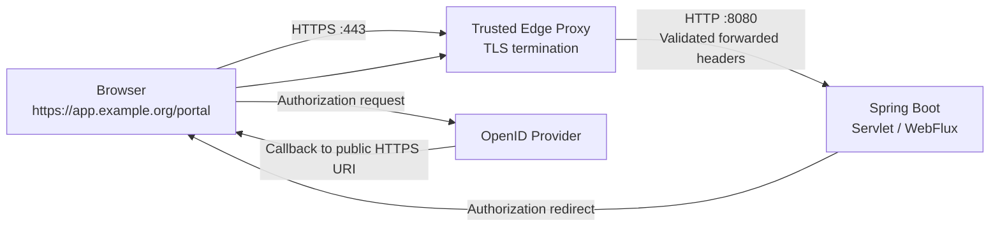
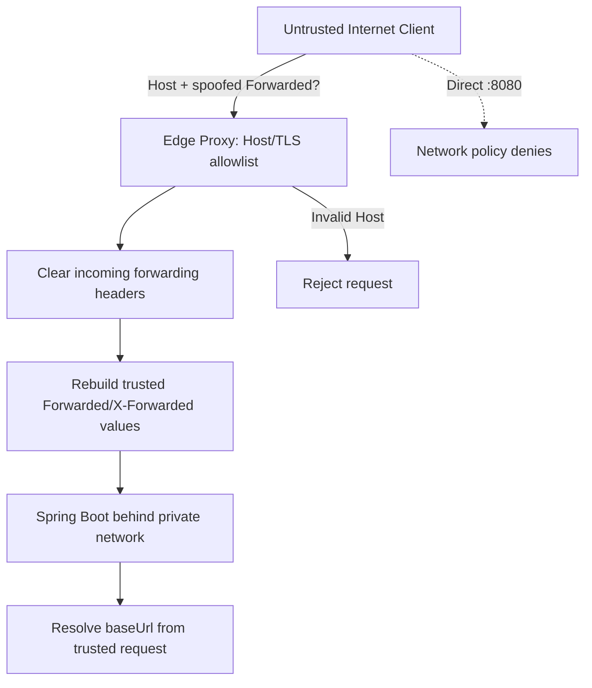
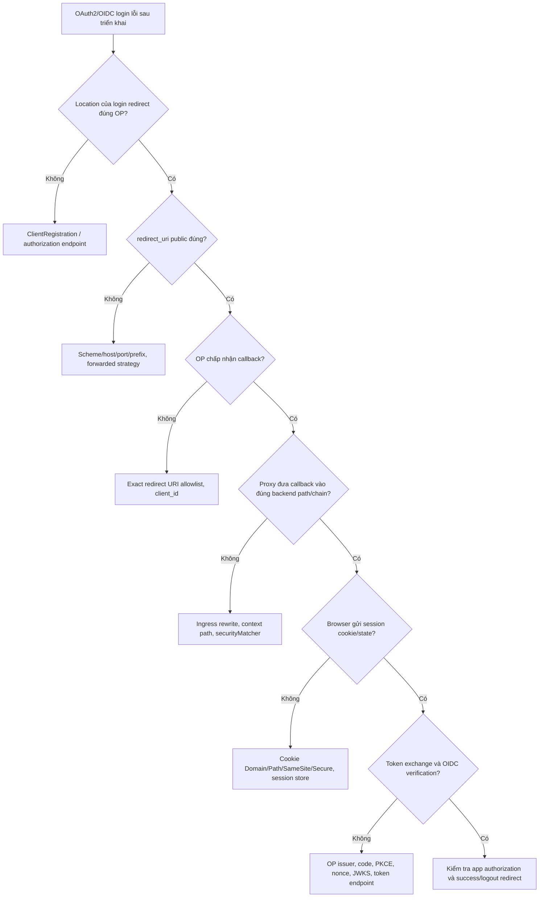

# 32.2. Forwarded headers, reverse proxy và base URL của ứng dụng

Khi triển khai **Spring Security OAuth 2.0 / OpenID Connect (OIDC) Client** lên production, ứng dụng thường không nhận HTTPS trực tiếp từ trình duyệt. Trước Spring Boot có thể là **load balancer**, **API gateway**, **Kubernetes Ingress**, **reverse proxy** hoặc một chuỗi nhiều proxy. Hệ thống bên ngoài dùng URL công khai như `https://login.example.org/portal` nhưng ứng dụng thực tế chỉ nhận request nội bộ tại `http://spring-app:8080`.

Chênh lệch này tác động trực tiếp tới các bước nhạy cảm của OAuth2/OIDC:

- Spring Security xây `redirect_uri` từ **base URL** mà nó suy ra từ request.
- OpenID Provider (OP) chỉ chấp nhận những callback URI đã đăng ký, thường theo quy tắc đối chiếu chính xác.
- Browser phải quay đúng public hostname/path để gửi session cookie và khôi phục `state` đã lưu.
- Logout OIDC có thể cần `post_logout_redirect_uri` thuộc public origin.
- Ứng dụng tạo absolute redirect, link hoặc response header dựa trên scheme, host, port và context path.
- Một attacker có thể cố **giả mạo `Host`/`Forwarded`/`X-Forwarded-*`** để tác động đến URL mà ứng dụng sinh ra nếu proxy không đặt ranh giới tin cậy rõ ràng.

Vì vậy, **forwarded headers không chỉ là cấu hình hạ tầng HTTP**: chúng nằm trên đường đi của **Authorization Code Flow, OIDC logout và bảo mật session**.

Bài này trình bày đầy đủ mô hình **public URL vs internal URL**, các header `Forwarded` và `X-Forwarded-*`, ba lựa chọn `server.forward-headers-strategy` của Spring Boot, Servlet `ForwardedHeaderFilter`, Reactive `ForwardedHeaderTransformer`, ví dụ Nginx và prefix routing, cách dùng `{baseUrl}` trong Spring Security, các tình huống multi-tenant, bảo vệ trước header spoofing và quy trình chẩn đoán production.

> **Nguyên tắc cốt lõi:** backend chỉ được tái dựng public base URL từ những headers mà **trusted edge proxy đã chủ động kiểm tra, xóa giá trị cũ và ghi lại**. Không coi `X-Forwarded-Host` hoặc `Forwarded` đến thẳng từ Internet là dữ liệu đáng tin.

## 1. Bài toán: public origin khác upstream origin

Xét một ứng dụng được xuất bản tại:

```text
Browser:
  https://app.example.org/portal

Load balancer / ingress:
  https://app.example.org:443

Spring Boot upstream:
  http://orders-oidc-client:8080
```

Đây là cùng một ứng dụng, nhưng có **hai góc nhìn** khác nhau:

| Thuộc tính | Browser thấy | Backend có thể thấy nếu không xử lý proxy |
|---|---|---|
| Scheme | `https` | `http` |
| Host | `app.example.org` | `orders-oidc-client` |
| Port | `443` (ẩn trong URL HTTPS mặc định) | `8080` |
| External path prefix | `/portal` | Có thể bị strip trước upstream |
| Login start URL | `/portal/oauth2/authorization/company` | `/oauth2/authorization/company` |
| OAuth2 callback | `/portal/login/oauth2/code/company` | `/login/oauth2/code/company` |

Spring Security cần biết **public-facing request URL** để tạo đúng `redirect_uri`, không phải lấy nguyên `http://orders-oidc-client:8080` đưa tới OP.

Ví dụ callback mong muốn:

```text
https://app.example.org/portal/login/oauth2/code/company
```

Nếu ứng dụng tự suy ra:

```text
http://orders-oidc-client:8080/login/oauth2/code/company
```

thì OP có thể trả lỗi `invalid_redirect_uri`, `redirect_uri_mismatch` hoặc lỗi tương đương, và browser cũng không thể dùng được địa chỉ nội bộ đó.

### 1.1. Sơ đồ request và trust boundary



Có hai luồng cần phân biệt:

1. **Inbound HTTP**: browser → proxy → RP. Public scheme/host/path cần được tái dựng đúng.
2. **Outbound OAuth2**: RP → OP token endpoint/JWKS/UserInfo. Các endpoint này lấy từ `ClientRegistration`/provider metadata được phê duyệt, **không được tự thay đổi theo `X-Forwarded-Host` của request**.

### 1.2. Reverse proxy có thể rewrite đường dẫn

Không phải proxy nào cũng giữ nguyên request path. Có hai cách triển khai:

- **Path-preserving**: browser gửi `/portal/orders`, backend vẫn nhận `/portal/orders`.
- **Prefix-stripping**: browser gửi `/portal/orders`, proxy bỏ `/portal`, backend chỉ nhận `/orders`.

Hai cách cần cấu hình Spring khác nhau. Đừng cùng lúc đặt context path `/portal` ở backend **và** thêm `X-Forwarded-Prefix: /portal` mà chưa kiểm tra, vì dễ tạo `/portal/portal`.

## 2. Base URL là gì?

Trong ngữ cảnh web và Spring Security, **base URL** của ứng dụng là phần public URL dùng làm nền để xây URL hoàn chỉnh:

```text
https://app.example.org/portal
|----| |-------------| |----|
scheme       host         base path
```

Có thể phân biệt:

- **Origin**: scheme + host + port, ví dụ `https://app.example.org`.
- **Application base URL**: origin + context path/public prefix, ví dụ `https://app.example.org/portal`.
- **Callback URI**: base URL + login processing path, ví dụ `https://app.example.org/portal/login/oauth2/code/company`.
- **Issuer URI**: định danh OP, ví dụ `https://id.example.net/realms/main`; **không phải** base URL của RP.
- **Resource Server URL**: đích API, có thể thuộc hostname hoàn toàn khác.

### 2.1. Vì sao base URL quan trọng trong OAuth2?

Spring Security thường cho phép cấu hình:

```yaml
spring:
  security:
    oauth2:
      client:
        registration:
          company:
            redirect-uri: "{baseUrl}/login/oauth2/code/{registrationId}"
```

Khi browser bắt đầu login cho `company`, Spring Security giải quyết template thành một URI thực:

```text
https://app.example.org/portal/login/oauth2/code/company
```

Sau đó URI được đưa vào authorization request (tham số `redirect_uri`). OP so khớp với callback URI đã đăng ký cho `client_id`.

Nếu base URL bị lấy từ request nội bộ, URL này có thể sai scheme/host/port/prefix.

### 2.2. `{baseUrl}` là placeholder framework, không phải Spring property

Hai cách viết khác nhau:

```yaml
redirect-uri: "{baseUrl}/login/oauth2/code/{registrationId}"
```

và:

```yaml
redirect-uri: "https://app.example.org/login/oauth2/code/company"
```

Cách thứ nhất dựa vào URL của request và forwarded-header handling; cách thứ hai là URI cố định.

Không hiểu `{baseUrl}` như biến môi trường `BASE_URL` tự động lấy từ một property riêng. Nó là placeholder trong cấu hình OAuth2 Client được Spring Security giải quyết theo request.

### 2.3. Khi nào cần public base URL cố định?

Các công việc **không có HTTP request hiện tại** như email invitation, scheduled jobs hoặc notification links không có đủ ngữ cảnh để suy ra base URL bằng request headers.

Với những trường hợp đó, một property do deployment quản lý như:

```yaml
app:
  public-base-url: https://app.example.org/portal
```

có thể hữu ích. Đây là **property do ứng dụng tự định nghĩa**, không phải property mặc định tự điều khiển toàn bộ `oauth2Login()`.

Đối với OAuth2 redirect, hãy chọn chính sách rõ ràng: template dựa trên request proxy đã tin cậy, hoặc URI public cố định/approved per registration. Không trộn hai nguồn một cách không nhất quán.

## 3. Các forwarded headers thường gặp

Reverse proxies thường thêm headers để backend biết thông tin request gốc.

| Header | Ví dụ | Diễn giải |
|---|---|---|
| `Forwarded` | `for=203.0.113.15;proto=https;host=app.example.org` | Format tiêu chuẩn RFC 7239 mô tả thông tin qua proxies. |
| `X-Forwarded-Proto` | `https` | Scheme gốc ở phía public/client. |
| `X-Forwarded-Host` | `app.example.org` | Host gốc/public của request. |
| `X-Forwarded-Port` | `443` | Port public. |
| `X-Forwarded-For` | `203.0.113.15` | Chuỗi địa chỉ client/proxies; không phải authority URL. |
| `X-Forwarded-Prefix` | `/portal` | External path prefix khi proxy strip/rewrite path, được một số frameworks hỗ trợ. |
| `X-Forwarded-Ssl` | `on` | Header legacy của một số proxies, không nên dùng làm hợp đồng chính nếu không có lý do. |
| `X-Real-IP` | `203.0.113.15` | Header de facto ghi remote IP, không đủ để dựng origin. |
| `Host` | `app.example.org` | HTTP authority của request; có thể do proxy chuyển tiếp hoặc thay thế. |

Các header bắt đầu bằng `X-Forwarded-` là **quy ước phổ biến**, không phải tất cả đều thuộc một chuẩn duy nhất. `Forwarded` có định dạng chuẩn riêng.

### 3.1. Ví dụ metadata chuyển qua proxy

Browser gửi:

```http
GET /portal/oauth2/authorization/company HTTP/1.1
Host: app.example.org
```

Proxy terminate HTTPS và chuyển vào backend:

```http
GET /oauth2/authorization/company HTTP/1.1
Host: orders-oidc-client:8080
X-Forwarded-Proto: https
X-Forwarded-Host: app.example.org
X-Forwarded-Port: 443
X-Forwarded-Prefix: /portal
X-Forwarded-For: 203.0.113.15
```

Đây là một thiết kế có **prefix-stripping**. Nếu Spring Boot **được phép tin đúng các headers do proxy tạo**, nó có thể tính public base URL là `https://app.example.org/portal`.

### 3.2. `Forwarded` theo RFC 7239

Ví dụ:

```http
Forwarded: for=203.0.113.15;proto=https;host=app.example.org
```

Khi nhiều proxies tham gia, header có thể chứa nhiều elements. Thứ tự và mức tin cậy phụ thuộc chuỗi proxies. Không lấy phần tử đầu/cuối theo cảm tính rồi coi đó là dữ liệu xác thực.

### 3.3. `X-Forwarded-For` không phải `X-Forwarded-Host`

- `X-Forwarded-For` cung cấp thông tin network peer/client IP.
- `X-Forwarded-Host` cung cấp hostname public mà browser đã dùng.
- `X-Forwarded-Proto` xác định public scheme.
- `X-Forwarded-Prefix` giúp khôi phục public base path.

Một hệ thống chỉ bật xử lý remote IP không chắc đã xử lý đúng **host, scheme và prefix**, vốn là phần quyết định OAuth2 `redirect_uri`.

### 3.4. Header names không phải bằng chứng đáng tin

Attacker có thể tự gửi:

```http
X-Forwarded-Host: arbitrary.example
X-Forwarded-Proto: https
```

Nếu ứng dụng hoặc proxy chuyển nguyên các giá trị đó vào backend, Spring có thể suy ra origin do attacker lựa chọn. Vì vậy **forwarded headers chỉ an toàn sau khi có trust boundary thực thi ở proxy**.

## 4. Quy tắc tin cậy: xóa trước, đặt lại sau

Một cách triển khai an toàn có ba lớp:

1. **Edge/ingress chỉ cho phép Hostnames đã cấu hình** và kết thúc TLS theo chính sách.
2. **Proxy loại bỏ các `Forwarded`/`X-Forwarded-*` inbound do browser gửi**, sau đó đặt lại values dựa trên request đã validate ở trusted edge.
3. **Backend chỉ có thể được truy cập từ proxy tin cậy**, nhận forwarded headers ở nguồn đã kiểm soát; ứng dụng không mở cổng nội bộ trực tiếp ra Internet.

### 4.1. Trust boundary mẫu



Quan trọng: `ForwardedHeaderFilter` và `ForwardedHeaderTransformer` giúp framework **sử dụng headers**, nhưng không tự quyết định xem headers có đến từ trusted proxy hay không. **Lọc nguồn trước khi backend nhận dữ liệu là trách nhiệm triển khai.**

### 4.2. Vì sao không chỉ kiểm tra giá trị `https`?

`X-Forwarded-Proto=https` không chứng minh browser thật sự kết nối HTTPS. Một client HTTP trực tiếp có thể tự thêm header đó nếu backend công khai và application tin header.

Cấu hình ứng dụng xử lý forwarded headers mà không chặn đường truy cập trực tiếp tới backend có thể khiến security decisions, redirects và cookie behavior dựa trên dữ liệu giả.

### 4.3. Vì sao không tin `X-Forwarded-Host` của tenant admin?

Một user có quyền quản trị tenant không mặc nhiên có quyền quyết định public origin của ứng dụng. Nếu hệ thống cho tạo custom domains, domain phải được xác minh/quản lý và ánh xạ tới tenant một cách đáng tin.

Không lấy `X-Forwarded-Host` tùy ý để:

- Tạo OAuth2 redirect URI.
- Chọn một OP issuer.
- Chọn tenant đang đăng nhập.
- Đặt cookie Domain.
- Gửi password-reset links.
- Tạo absolute callback links trong email.

Nếu cần custom-domain multi-tenant, phải có **approved host registry** và kiểm tra quyền sở hữu/định tuyến độc lập với header.

## 5. Spring Boot `server.forward-headers-strategy`

Spring Boot có property:

```yaml
server:
  forward-headers-strategy: framework
```

Các lựa chọn thông dụng:

| Giá trị | Ý nghĩa | Khi phù hợp |
|---|---|---|
| `none` | Không cấu hình xử lý forwarded headers thông qua chiến lược property này. | Không đứng sau proxy, hoặc tự kiểm soát origin bằng phương án khác. |
| `native` | Dùng khả năng xử lý forwarded headers của web server/container. | Hạ tầng/container hỗ trợ và semantics phù hợp. |
| `framework` | Dùng infrastructure của Spring Framework: Servlet filter hoặc Reactive transformer. | Cần xử lý scheme/host/prefix theo hành vi Spring Framework. |

Cú pháp có thể dùng dạng:

```properties
server.forward-headers-strategy=framework
```

**Không chọn `framework` chỉ để sửa một lỗi redirect mà chưa bảo đảm proxy sanitize headers.** Cấu hình ấy nói «ứng dụng sẽ hiểu headers», không nói «headers đã an toàn».

### 5.1. `framework` trên Servlet

Với stack Spring MVC/Servlet, Boot có thể dùng **`ForwardedHeaderFilter`** của Spring Framework để bao bọc request/response và làm cho những thành phần downstream nhìn thấy public origin được phản ánh từ headers.

### 5.2. `framework` trên WebFlux

Với stack Reactive/WebFlux, Boot có thể tích hợp **`ForwardedHeaderTransformer`** để điều chỉnh request URI/path theo forwarded headers trước khi reactive handlers nhận request.

### 5.3. `native` trên Servlet container

Tomcat và một số web servers có cơ chế native, chẳng hạn Tomcat `RemoteIpValve`. Nó có thể xử lý remote IP/proto/host/port theo cấu hình và danh sách proxy tin cậy.

Tuy nhiên, **native support có phạm vi khác nhau**, đặc biệt với `X-Forwarded-Prefix`. Nếu ứng dụng ở đường dẫn `/portal` bị strip ở proxy, phải xác minh native strategy có khôi phục đúng prefix hay không.

### 5.4. `none` không vô hiệu hóa mọi custom code

`none` chỉ tắt chiến lược Boot ở property này. Nếu ứng dụng đã tự đăng ký `ForwardedHeaderFilter` hoặc một gateway filter khác, headers vẫn có thể được xử lý. Vì vậy khi chẩn đoán cần xem **stack/beans và proxy thực tế**, không chỉ đọc một property.

### 5.5. Không đăng ký xử lý hai lần thiếu kiểm soát

Nếu Boot đã auto-configure xử lý theo `framework`, tự đăng ký thêm một `ForwardedHeaderFilter` khác có thể gây xử lý lặp, thay đổi URL hoặc khó chẩn đoán thứ tự filters.

Khi cần custom filter/transformer, hãy quyết định **ai là thành phần sở hữu** và kiểm tra chiến lược Boot thực tế, thay vì bật đồng thời nhiều cơ chế cho cùng mục đích.

## 6. Servlet: `ForwardedHeaderFilter`

`ForwardedHeaderFilter` là một Servlet filter trong Spring Framework hỗ trợ xử lý các forwarded headers tiêu chuẩn và de facto, để những phần xử lý request tiếp theo nhìn thấy đúng public URL.

Ví dụ dùng Boot property:

```yaml
server:
  forward-headers-strategy: framework
  servlet:
    session:
      cookie:
        secure: true
        http-only: true
        same-site: lax
```

Nếu chọn Boot auto-configuration, **thường không cần tự tạo một filter bean khác chỉ cho cùng chức năng**.

### 6.1. Trường hợp đăng ký filter bằng Java

Khi ứng dụng **không dùng** chiến lược Boot auto-configuration hoặc cần cấu hình tùy chỉnh hợp lý:

```java
import org.springframework.context.annotation.Bean;
import org.springframework.context.annotation.Configuration;
import org.springframework.web.filter.ForwardedHeaderFilter;

@Configuration
public class ForwardedHeadersConfiguration {

    @Bean
    ForwardedHeaderFilter forwardedHeaderFilter() {
        return new ForwardedHeaderFilter();
    }
}
```

Đây là lựa chọn thay thế cho cơ chế Boot đã cấu hình, không phải phần cần thêm vô điều kiện vào mọi application.

### 6.2. `removeOnly` là gì?

`ForwardedHeaderFilter` hỗ trợ chế độ **chỉ loại bỏ forwarded headers** mà không áp dụng giá trị của chúng lên request. Về ý tưởng:

```java
ForwardedHeaderFilter filter =
    new ForwardedHeaderFilter();

filter.setRemoveOnly(true);
```

Chế độ này hữu ích khi application **không muốn tin** forwarded headers nhưng vẫn muốn tránh những thành phần downstream vô tình đọc các giá trị đó.

**`removeOnly=true` không giúp Spring dựng public base URL từ proxy headers.** Nếu sử dụng chế độ này, cần một phương pháp khác để thiết lập đúng scheme/host/path hoặc cấu hình URI cố định.

### 6.3. Thứ tự filter và Spring Security

Forwarded-header handling nên được áp dụng trước khi OAuth2 request/redirect logic tính toán URL. Nếu tự đăng ký filter, cần xác nhận filter order và Servlet registration để security chain thực sự nhìn thấy request đã được xử lý.

Không chỉ đặt Bean rồi mặc định mọi request/context đều đi qua filter; test production-like chain và proxy thực tế.

### 6.4. API lấy URL khi đã xử lý forwarded headers

Trong Servlet, những API như:

```java
request.getScheme();
request.getServerName();
request.getServerPort();
request.getContextPath();
```

có thể phản ánh public origin/context path khi forwarded-header filter đã áp dụng.

Đó cũng là lý do cùng một controller tạo absolute redirect khác nhau khi có hoặc không có filter.

## 7. Tomcat `RemoteIpValve` và strategy `native`

Với embedded Tomcat, Spring Boot có thể sử dụng native remote IP/proxy configuration khi chọn:

```yaml
server:
  forward-headers-strategy: native
```

Một số properties Tomcat có thể điều chỉnh xử lý:

```yaml
server:
  tomcat:
    remoteip:
      protocol-header: x-forwarded-proto
      remote-ip-header: x-forwarded-for
```

Đây là **ví dụ giải thích**, chưa phải đầy đủ chính sách trusted proxies. Cần xem version Boot/Tomcat và các settings như internal proxies/trusted proxies theo hạ tầng thực tế.

### 7.1. Vì sao trusted proxy IP quan trọng?

Nếu container chấp nhận `X-Forwarded-Proto`/`X-Forwarded-For` từ mọi kết nối, một caller đến thẳng backend có thể giả mạo request origin hoặc client IP.

Native handler phải chỉ tin kết nối từ **proxy addresses/ranges đã biết** trong một network design được kiểm soát.

### 7.2. `native` không tự giải quyết tất cả URL prefix

Một Tomcat native handler có thể xử lý proto/remote address tốt nhưng không khôi phục `/portal` bị ingress strip theo semantics cần cho `{baseUrl}`.

Khi dùng native:

- Test scheme/host/port.
- Test external prefix/context path.
- Test OAuth2 authorization redirect.
- Test OP callback và post-logout redirect.
- Không giả định `X-Forwarded-Prefix` được hỗ trợ giống Spring Framework filter.

### 7.3. Nên chọn native hay framework?

Không có lựa chọn duy nhất đúng cho mọi tổ hợp container/proxy:

- Chọn `native` nếu container tích hợp đầy đủ và trusted-proxy controls phù hợp.
- Chọn `framework` nếu bạn cần behavior của Spring Framework, đặc biệt khi external prefix được truyền theo convention framework.
- Chọn `none` nếu không dùng forwarded headers hoặc có base URL/redirect strategy khác.

Dù chọn cách nào, **edge vẫn phải sanitize headers và backend không được bị truy cập trực tiếp ngoài trust boundary**.

## 8. Spring WebFlux: `ForwardedHeaderTransformer`

Trong WebFlux, không dùng Servlet filter để xử lý request. Spring Framework cung cấp **`ForwardedHeaderTransformer`**; nó biến đổi thông tin request trước khi `WebFilter`/handler nhận.

Với Spring Boot WebFlux:

```yaml
server:
  forward-headers-strategy: framework
```

là một lựa chọn phổ biến khi application chạy sau proxy.

### 8.1. Cấu hình qua Java nếu tự sở hữu transformer

Ví dụ conceptual khi không dựa vào Boot auto-configuration:

```java
import org.springframework.context.annotation.Bean;
import org.springframework.context.annotation.Configuration;
import org.springframework.web.server.adapter.ForwardedHeaderTransformer;

@Configuration
public class ReactiveForwardedHeadersConfiguration {

    @Bean
    ForwardedHeaderTransformer forwardedHeaderTransformer() {
        return new ForwardedHeaderTransformer();
    }
}
```

Nếu framework/container đã cấu hình transformer, tránh đăng ký bản thứ hai.

### 8.2. Reactive transformer vẫn cần trusted proxy

`ForwardedHeaderTransformer` không tự biết liệu `X-Forwarded-Host` đến từ edge gateway hay browser/attacker. Bảo vệ nguồn headers là yêu cầu hạ tầng tương tự Servlet.

### 8.3. `removeOnly` trong reactive

Các phiên bản Spring Framework có chế độ transformer chỉ loại bỏ forwarded headers thay vì tin chúng. Ý tưởng tương tự Servlet `removeOnly`: phù hợp khi không muốn request xử lý các giá trị do client cung cấp.

Không dùng chế độ remove-only rồi mong `{baseUrl}` tự phản ánh public HTTPS/prefix.

### 8.4. Cách xem request URL trong WebFlux

Trong một reactive handler có `ServerWebExchange`:

```java
URI requestUri = exchange.getRequest().getURI();
```

Khi transformer được áp dụng đúng trước handler, URI có thể phản ánh external scheme/host/path do trusted proxy truyền.

Nếu cần tạo absolute links trong backend jobs, không có request/exchange để đọc. Khi đó dùng **public base URL configuration đã phê duyệt**, không tự tìm một fake `ServerWebExchange`.

## 9. Nginx: cấu hình proxy ở public root path

Giả sử public URL là:

```text
https://app.example.org/
```

và backend lắng nghe:

```text
http://spring-app:8080/
```

Ví dụ Nginx **single-host**:

```nginx
server {
    listen 443 ssl;
    server_name app.example.org;

    ssl_certificate     /etc/tls/app.example.org.crt;
    ssl_certificate_key /etc/tls/app.example.org.key;

    location / {
        proxy_pass http://spring-app:8080;

        proxy_set_header Host app.example.org;

        # Ghi lại public URL do chính edge đã xác minh.
        proxy_set_header X-Forwarded-Host app.example.org;
        proxy_set_header X-Forwarded-Proto https;
        proxy_set_header X-Forwarded-Port 443;

        # Nếu đây là edge thực sự: không tin chain do client tự gửi.
        proxy_set_header X-Forwarded-For $remote_addr;

        # Không chuyển RFC Forwarded inbound chưa được kiểm soát.
        proxy_set_header Forwarded "";

        proxy_http_version 1.1;
    }
}
```

**Giới hạn của ví dụ:** đây là pattern của một edge **đứng đầu chuỗi tin cậy và phục vụ đúng một hostname**. Nếu Nginx nằm sau một load balancer khác, `$remote_addr` có thể là IP của LB, và cách tái dựng IP/scheme/host phải dựa trên trusted chain được cấu hình. Nếu có nhiều public hosts, không hardcode cùng host vào mọi server blocks.

### 9.1. Vì sao dùng giá trị cố định thay vì request input?

Trong single-domain server, giá trị:

```nginx
proxy_set_header X-Forwarded-Host app.example.org;
```

đến từ cấu hình operator, không từ một `X-Forwarded-Host` inbound của browser.

Cách này giảm nguy cơ host-header poisoning. Với multi-host server cần dùng một **server-side validated hostname mapping**, không chuyển bất kỳ `$http_x_forwarded_host` nào vào backend.

### 9.2. TLS không thể bỏ qua trong ví dụ production

`ssl_certificate` chỉ là minh họa vị trí certificate. Triển khai thực tế cần:

- Chứng chỉ hợp lệ, private key bảo vệ tốt.
- TLS versions/ciphers phù hợp.
- HTTP → HTTPS redirect tại edge.
- HSTS theo domain policy khi phù hợp.
- Không để public HTTP endpoint chuyển cookie session plaintext.
- Bảo vệ kết nối proxy → app theo network trust model; mTLS/nội bộ TLS khi yêu cầu.

### 9.3. Không dựa vào `$scheme` nếu proxy phía trước đã terminate TLS

Nếu Nginx nhận HTTP từ một load balancer đã terminate HTTPS, `$scheme` tại Nginx là `http`. Gửi:

```nginx
proxy_set_header X-Forwarded-Proto $scheme;
```

trong tình huống này sẽ làm backend nhìn thấy `http` dù browser dùng HTTPS.

Hãy xác định **điểm nào xác nhận public scheme**. Nếu Nginx nhận forwarded info từ LB tin cậy, phải cấu hình validation và trust chain; nếu Nginx là edge TLS, scheme public có thể được đặt cố định `https`.

## 10. Nginx: triển khai prefix-stripping `/portal`

Giả sử browser dùng:

```text
https://app.example.org/portal/
```

nhưng upstream Spring MVC/WebFlux dùng application path root:

```text
http://spring-app:8080/
```

Một cách cấu hình có thể là:

```nginx
server {
    listen 443 ssl;
    server_name app.example.org;

    ssl_certificate     /etc/tls/app.example.org.crt;
    ssl_certificate_key /etc/tls/app.example.org.key;

    location = /portal {
        return 301 /portal/;
    }

    location /portal/ {
        # Dấu "/" cuối upstream URI khiến Nginx strip /portal/
        # theo quy tắc proxy_pass URI replacement.
        proxy_pass http://spring-app:8080/;

        proxy_set_header Host app.example.org;
        proxy_set_header X-Forwarded-Host app.example.org;
        proxy_set_header X-Forwarded-Proto https;
        proxy_set_header X-Forwarded-Port 443;
        proxy_set_header X-Forwarded-Prefix /portal;
        proxy_set_header X-Forwarded-For $remote_addr;
        proxy_set_header Forwarded "";
    }
}
```

Ở đây:

| Browser URL | Upstream request path |
|---|---|
| `/portal/` | `/` |
| `/portal/oauth2/authorization/company` | `/oauth2/authorization/company` |
| `/portal/login/oauth2/code/company` | `/login/oauth2/code/company` |
| `/portal/signed-out` | `/signed-out` |

Nếu Spring Framework xử lý `X-Forwarded-Prefix` đúng, `{baseUrl}` có thể trở thành `https://app.example.org/portal`.

### 10.1. Giữ backend root path

Với thiết kế strip-prefix này, **không đồng thời** đặt:

```yaml
server:
  servlet:
    context-path: /portal
```

nếu backend thực tế đã nhận path sau khi strip. Làm vậy có thể khiến app mong đợi `/portal` thêm lần nữa hoặc tính sai callback.

### 10.2. Hãy kiểm tra dấu slash ở `proxy_pass`

Nginx có quy tắc khác nhau giữa:

```nginx
proxy_pass http://spring-app:8080;
```

và:

```nginx
proxy_pass http://spring-app:8080/;
```

khi dùng trong `location /portal/`. Dấu slash cuối có thể thay đổi path được chuyển vào upstream.

Đây là một nguồn lỗi **404 tại callback** dù OP đã redirect URI đúng.

### 10.3. Public prefix không chỉ ảnh hưởng `redirect_uri`

Nó còn ảnh hưởng:

- Login start URL.
- Callback processing URL.
- CSS/JS assets nếu app tạo absolute paths.
- SavedRequest và success redirect.
- Logout URL và `post_logout_redirect_uri`.
- Cookie Path (browser phân phối cookie theo public path).
- Absolute links trả về trong REST/HATEOAS.
- Reverse proxy location matching.

Một test chỉ xem `Location` của login start chưa đủ nếu browser callback không về đúng route.

## 11. Nginx: phương án path-preserving

Phương án khác là **không strip** `/portal`, để Spring Boot thực sự chạy với context path này:

```yaml
server:
  servlet:
    context-path: /portal
  forward-headers-strategy: framework
```

Nginx chuyển nguyên request path:

```nginx
location /portal/ {
    proxy_pass http://spring-app:8080;

    proxy_set_header Host app.example.org;
    proxy_set_header X-Forwarded-Host app.example.org;
    proxy_set_header X-Forwarded-Proto https;
    proxy_set_header X-Forwarded-Port 443;
    proxy_set_header X-Forwarded-For $remote_addr;
    proxy_set_header Forwarded "";
}
```

Ở đây **không cần tự thêm `X-Forwarded-Prefix=/portal`** nếu backend context path đã là `/portal` và mọi URLs được giữ nguyên.

### 11.1. Hai phương án không được trộn ngầm

| Thuộc tính | Prefix-stripping | Path-preserving |
|---|---|---|
| Public path | `/portal/orders` | `/portal/orders` |
| Upstream path | `/orders` | `/portal/orders` |
| Servlet context path | Thường `/` | `/portal` |
| Header `X-Forwarded-Prefix` | Có thể cần `/portal` | Thường không cần |
| `{baseUrl}` mong đợi | `https://app.example.org/portal` | `https://app.example.org/portal` |
| Rủi ro điển hình | Thiếu prefix khi không xử lý header | Lặp prefix nếu thêm X-Forwarded-Prefix không phù hợp |

Hai phương án có thể tạo **cùng public callback**, nhưng cách request được xử lý khác nhau. Khi vận hành, phải chọn một phương án và ghi rõ contract cho ingress, Spring context path và OP redirect URI.

## 12. Kubernetes Ingress và API Gateway

Trong Kubernetes, một request thường đi qua:

```text
Browser HTTPS
  |
  v
Cloud Load Balancer
  |
  v
Ingress Controller
  |
  v
Kubernetes Service
  |
  v
Spring Boot Pod
```

**Không có một cấu hình Ingress annotation duy nhất cho mọi controller.** NGINX Ingress, Traefik, HAProxy, Envoy/Gateway API hoặc cloud-specific gateways có cách rewrite path/forwarded headers riêng.

### 12.1. Những quyết định phải được thống nhất

- TLS terminate ở Load Balancer hay Ingress?
- Ingress nhận HTTP hay HTTPS từ LB?
- Ai là trusted source của client IP/public host/public proto?
- Có strip prefix hay preserve path?
- Header `Forwarded` có được giữ/ghi lại không?
- Header `X-Forwarded-Prefix` do ai phát?
- Kết nối trực tiếp từ Internet tới Pod/Service có bị chặn không?
- App dùng `framework` hay `native`?
- Cookies nên có public `Path` và `Secure` như thế nào?

### 12.2. Không copy annotation ngẫu nhiên

Ví dụ Ingress Controller A có annotation rewrite-target theo regex; Controller B không hỗ trợ cùng semantics. Copy cấu hình có thể khiến callback bị rewrite sai hoặc các path match không như mong đợi.

Hãy xác nhận **upstream path thực nhận** và headers bằng môi trường test, không dựa vào tên annotation.

### 12.3. Health check không phải OAuth2 login

Health checks có thể truy cập Pod từ nội bộ không mang forwarded headers và scheme HTTP. Điều này thường **không phải vấn đề** nếu health endpoint không tạo absolute login redirect.

Đừng yêu cầu mọi internal health check phải giả lập public HTTPS headers để app chạy. Tách health/monitoring endpoints khỏi URL generation/security flows đúng cách.

## 13. Spring Security tạo `redirect_uri` như thế nào?

Một registration mẫu:

```yaml
spring:
  security:
    oauth2:
      client:
        registration:
          company:
            provider: company-oidc
            client-id: ${OIDC_CLIENT_ID}
            client-secret: ${OIDC_CLIENT_SECRET}
            client-authentication-method: client_secret_basic
            authorization-grant-type: authorization_code
            redirect-uri: "{baseUrl}/login/oauth2/code/{registrationId}"
            scope:
              - openid
              - profile
        provider:
          company-oidc:
            issuer-uri: https://id.example.net/realms/main
```

Với public base URL:

```text
https://app.example.org/portal
```

Spring Security tính:

```text
registrationId = company

redirect_uri =
  https://app.example.org/portal/login/oauth2/code/company
```

Tham số `redirect_uri` được URL-encode khi gắn vào authorization request. Browser có thể thấy:

```text
https://id.example.net/realms/main/.../auth?
  response_type=code
  &client_id=...
  &redirect_uri=https%3A%2F%2Fapp.example.org%2Fportal%2Flogin%2Foauth2%2Fcode%2Fcompany
  &state=...
```

Đây là URL minh họa, không phải URL OP cụ thể có thể gọi ngay.

### 13.1. Đăng ký đúng URI ở OP

Trong OP client configuration, phải đăng ký callback URI tương ứng:

```text
https://app.example.org/portal/login/oauth2/code/company
```

Nếu OP cho phép wildcard redirect URIs, vẫn nên **ưu tiên exact URIs**, tránh wildcard hostname/path rộng và open redirect trong callback.

### 13.2. Sai scheme

Public URI yêu cầu:

```text
https://app.example.org/portal/login/oauth2/code/company
```

nhưng Spring tạo:

```text
http://app.example.org/portal/login/oauth2/code/company
```

Dấu hiệu thường là backend không hiểu TLS termination hoặc proxy không truyền/không được xử lý `X-Forwarded-Proto`.

### 13.3. Sai host

Spring tạo:

```text
https://spring-app:8080/login/oauth2/code/company
```

Điều tra `Host`/`X-Forwarded-Host`, proxy pass Host, trusted proxy handling và liệu backend đang dùng address nội bộ để tính absolute URL.

### 13.4. Sai port

Spring tạo:

```text
https://app.example.org:8080/login/oauth2/code/company
```

Điều tra `X-Forwarded-Port`, parsing host có port, container native handling và public 443. Dùng implicit 443 hay explicit `:443` trong callback có thể khác yêu cầu exact matching của provider; phải đăng ký và gửi URI đồng nhất.

### 13.5. Sai prefix

Spring tạo:

```text
https://app.example.org/login/oauth2/code/company
```

trong khi browser cần `/portal/login/oauth2/code/company`. Kiểm tra path stripping và `X-Forwarded-Prefix` hoặc `context-path` theo một trong hai kiến trúc ở trên.

## 14. Bảo vệ `redirect_uri` trước header spoofing

Nếu attacker có thể điều khiển public host mà Spring tin, họ có thể làm một authorization request được xây với:

```text
redirect_uri=https://attacker-chosen.example/login/oauth2/code/company
```

OP có cấu hình exact redirect URI nghiêm ngặt có thể từ chối, nhưng **không được coi OP validation là lớp bảo vệ duy nhất**. Một cấu hình wildcard/loose matching hoặc ứng dụng khác dùng public absolute URLs có thể làm tác động lớn hơn.

### 14.1. Defense-in-depth

- Proxy chỉ chấp nhận Host đã đăng ký.
- Loại bỏ và tái tạo forwarded headers từ nguồn tin cậy.
- Backend private, không public upstream port.
- `redirect_uri` của mỗi registration có public host/path được phê duyệt.
- OP đăng ký redirect URIs chính xác.
- Nếu multi-tenant custom domains, xác minh domain ownership và tenant mapping.
- Không tạo `redirect_uri` trực tiếp từ query parameter.
- Không dùng open redirect tại callback.
- Theo dõi sự khác biệt giữa actual generated `redirect_uri` và expected public URI.

### 14.2. Không để request tự chọn `registrationId` không kiểm soát

`/oauth2/authorization/{registrationId}` là routing key của Spring Security. Với ứng dụng nhiều OPs và tenants, người dùng chỉ được phép truy cập các registrations mà policy cho phép. Không suy luận issuer hoặc credential từ `Host` tự khai.

## 15. Spring Security Servlet SecurityFilterChain

Một cấu hình Servlet cơ bản:

```java
import org.springframework.context.annotation.Bean;
import org.springframework.context.annotation.Configuration;
import org.springframework.security.config.Customizer;
import org.springframework.security.config.annotation.web.builders.HttpSecurity;
import org.springframework.security.web.SecurityFilterChain;

@Configuration
public class SecurityConfiguration {

    @Bean
    SecurityFilterChain securityFilterChain(HttpSecurity http)
            throws Exception {

        return http
            .authorizeHttpRequests(auth -> auth
                .requestMatchers(
                    "/", "/login", "/signed-out",
                    "/assets/**"
                ).permitAll()
                .anyRequest().authenticated()
            )
            .oauth2Login(Customizer.withDefaults())
            .oauth2Client(Customizer.withDefaults())
            .build();
    }
}
```

Đoạn này không trực tiếp cấu hình forwarded headers; chúng được xử lý ở **proxy + Spring Boot/Framework HTTP infrastructure**. OAuth2 Login dùng request đã xử lý để xây redirect URL.

### 15.1. Không nhầm login start với callback

| Mục đích | Servlet path mặc định thông dụng |
|---|---|
| Bắt đầu Authorization Request | `/oauth2/authorization/{registrationId}` |
| Nhận Authorization Code callback | `/login/oauth2/code/{registrationId}` |

Nếu public prefix là `/portal`, browser dùng:

```text
/portal/oauth2/authorization/company
/portal/login/oauth2/code/company
```

Proxy có thể strip prefix để upstream Spring xử lý các default paths. Phải bảo đảm **cả hai đường** được route đúng, không chỉ login start.

### 15.2. Khi tự đổi redirection endpoint

Nếu dùng:

```java
.oauth2Login(oauth2 -> oauth2
    .redirectionEndpoint(redirection -> redirection
        .baseUri("/custom/callback/*")
    )
)
```

thì registration `redirect-uri` và OP callback allowlist cũng phải phù hợp. Không thay đổi servlet matcher và quên cập nhật `redirect-uri` tương ứng.

Một ví dụ URI khi dùng custom callback:

```yaml
redirect-uri: "{baseUrl}/custom/callback/{registrationId}"
```

### 15.3. Callback phải đi qua đúng filter chain

Với nhiều `SecurityFilterChain`, securityMatcher có thể vô tình loại callback hoặc login-start path khỏi chain có `oauth2Login()`. Khi ấy browser có thể nhận 404/401 hoặc redirect loop dù forwarded headers đúng.

Đừng mặc định mọi lỗi callback đều do proxy. Phải kiểm tra route → chain → OAuth2 filters đúng.

## 16. Spring WebFlux SecurityWebFilterChain

Trên WebFlux, security config tương ứng:

```java
import org.springframework.context.annotation.Bean;
import org.springframework.context.annotation.Configuration;
import org.springframework.security.config.Customizer;
import org.springframework.security.config.annotation.web.reactive.EnableWebFluxSecurity;
import org.springframework.security.config.web.server.ServerHttpSecurity;
import org.springframework.security.web.server.SecurityWebFilterChain;

@Configuration
@EnableWebFluxSecurity
public class ReactiveSecurityConfiguration {

    @Bean
    SecurityWebFilterChain springSecurityFilterChain(
            ServerHttpSecurity http) {

        return http
            .authorizeExchange(exchanges -> exchanges
                .pathMatchers(
                    "/", "/login", "/signed-out",
                    "/assets/**"
                ).permitAll()
                .anyExchange().authenticated()
            )
            .oauth2Login(Customizer.withDefaults())
            .oauth2Client(Customizer.withDefaults())
            .build();
    }
}
```

Nếu proxy strip `/portal`, `ForwardedHeaderTransformer` có thể giúp WebFlux nhìn thấy request public origin/prefix theo cách framework hỗ trợ.

### 16.1. Servlet và WebFlux khác nơi xử lý request

- Servlet dùng `HttpServletRequest` và `ForwardedHeaderFilter`.
- WebFlux dùng `ServerHttpRequest`/`ServerWebExchange` và `ForwardedHeaderTransformer`.
- Cả hai có thể dùng `server.forward-headers-strategy=framework` trong Boot, nhưng underlying implementation khác.
- Đừng thêm Servlet `ForwardedHeaderFilter` vào pure Netty/WebFlux server rồi mong nó xử lý request.

### 16.2. WebClient outbound không lấy Host từ inbound proxy

`WebClient` gọi token endpoint/JWKS/UserInfo/Resource Server bằng trusted URL của registration hoặc API config. Forwarded inbound headers dùng để dựng public-facing RP links, **không phải chỉ dẫn để chọn outbound credential destination**.

Không forward `X-Forwarded-Host` từ browser cho OP/token endpoint như một «fix» để login hoạt động.

## 17. OIDC logout và `post_logout_redirect_uri`

OIDC RP-Initiated Logout có thể đưa browser từ RP tới OP `end_session_endpoint`, sau đó OP đưa user về một **post-logout redirect URI** đã được đăng ký.

Ví dụ:

```text
Logout starts:
  https://app.example.org/portal/logout

OP logout endpoint:
  https://id.example.net/realms/main/.../logout

post_logout_redirect_uri:
  https://app.example.org/portal/signed-out
```

Giống login callback, `post_logout_redirect_uri` không được lấy từ internal backend URL.

### 17.1. Servlet logout success handler

Ví dụ:

```java
import org.springframework.context.annotation.Bean;
import org.springframework.context.annotation.Configuration;
import org.springframework.security.oauth2.client.registration.ClientRegistrationRepository;
import org.springframework.security.oauth2.client.oidc.web.logout.OidcClientInitiatedLogoutSuccessHandler;
import org.springframework.security.web.authentication.logout.LogoutSuccessHandler;

@Configuration
public class OidcLogoutConfiguration {

    @Bean
    LogoutSuccessHandler oidcLogoutSuccessHandler(
            ClientRegistrationRepository registrations) {

        OidcClientInitiatedLogoutSuccessHandler handler =
            new OidcClientInitiatedLogoutSuccessHandler(registrations);

        handler.setPostLogoutRedirectUri("{baseUrl}/signed-out");
        return handler;
    }
}
```

Gắn handler vào `HttpSecurity.logout(...)` trong cùng security chain:

```java
.logout(logout -> logout
    .logoutSuccessHandler(oidcLogoutSuccessHandler)
)
```

Đây là các fragments theo cấu hình; phải bảo đảm handler được inject vào SecurityFilterChain và OP có hỗ trợ logout endpoint. `/signed-out` nên là trang public.

### 17.2. WebFlux logout success handler

Trên Reactive stack, có class tương ứng:

```java
import org.springframework.security.oauth2.client.oidc.web.server.logout
    .OidcClientInitiatedServerLogoutSuccessHandler;
import org.springframework.security.oauth2.client.registration
    .ReactiveClientRegistrationRepository;

OidcClientInitiatedServerLogoutSuccessHandler handler =
    new OidcClientInitiatedServerLogoutSuccessHandler(registrations);

handler.setPostLogoutRedirectUri("{baseUrl}/signed-out");
```

Trong ví dụ này `registrations` là `ReactiveClientRegistrationRepository`. Gắn handler vào `ServerHttpSecurity.logout(...)` theo WebFlux configuration.

**Lưu ý về ví dụ:** hai declarations ở trên là fragments để minh họa API và dependency, không phải toàn bộ class Java ghép trực tiếp. Servlet handler và Reactive handler khác type.

### 17.3. OP đăng ký URI sau logout riêng

OP có thể yêu cầu danh sách `post_logout_redirect_uri` khác danh sách login `redirect_uri`.

Ví dụ:

```text
Login redirect:
  https://app.example.org/portal/login/oauth2/code/company

Post-logout redirect:
  https://app.example.org/portal/signed-out
```

Đừng kỳ vọng đăng ký login callback tự động cho phép post-logout URI.

### 17.4. Base URL đúng chưa đủ bảo đảm logout hoàn chỉnh

- RP local session có thể đã bị invalidated.
- OP SSO session có thể còn hoặc không.
- OAuth2 authorized client/Refresh Token có thể vẫn nằm trong store.
- Browser có thể không hoàn tất redirect tới OP.
- OP có thể không hỗ trợ RP-Initiated Logout.

Forwarded headers sửa public redirect URL, **không thay token revocation hoặc logout policy**.

## 18. Session cookie khi TLS terminate ở proxy

Giả sử browser dùng HTTPS nhưng backend nhìn thấy HTTP. Nếu cookie được phát dựa trên cảm nhận nội bộ sai, browser có thể không nhận đúng `Secure`/`SameSite`.

Ví dụ cookie nên có ở production:

```http
Set-Cookie: __Host-SESSION=<opaque>; Path=/; Secure; HttpOnly; SameSite=Lax
```

Đây là pattern cho một ứng dụng chạy trên public host ở root path. Nếu ứng dụng dùng `/portal`, việc chọn prefix `__Host-` vẫn yêu cầu `Path=/` và không có `Domain`; nếu muốn cookie `Path=/portal`, **không thể đồng thời tuân thủ điều kiện `__Host-`**.

### 18.1. `Secure` phải phản ánh HTTPS bên ngoài

Có thể đặt tường minh:

```yaml
server:
  servlet:
    session:
      cookie:
        secure: true
        http-only: true
        same-site: lax
```

Với Spring Session hoặc WebFlux, cookie writer/serializer/resolver có thể khác; hãy cấu hình đúng thành phần thực sự phát `Set-Cookie`.

### 18.2. `SameSite=Lax` và OIDC callback GET

Authorization Code Flow phổ biến trả về RP bằng top-level GET. `SameSite=Lax` thường phù hợp để browser gửi session cookie RP khi quay từ OP khác site.

`SameSite=Strict` có thể khiến session cookie vắng mặt ở callback cross-site, làm Spring Security không tìm được authorization request `state` đã lưu.

`SameSite=None; Secure` có thể cần với một số cross-site POST/iframe flow được hỗ trợ, nhưng tăng yêu cầu CSRF defenses và phải xem xét browser policies.

### 18.3. Cookie Domain không tự quyết định base URL

Một browser cookie có `Domain=example.org` không có nghĩa Spring Security sẽ dùng `https://example.org` làm public base URL; URL generation dựa trên request origin/context path hoặc cấu hình URI riêng.

Ngược lại, forwarded host được xử lý đúng không có nghĩa cookie domain/path đã đúng.

### 18.4. Tránh tự cấu hình cookie theo `X-Forwarded-Host`

Không làm:

```java
String domain = request.getHeader("X-Forwarded-Host");
// Tự đưa domain vào Set-Cookie khi chưa có validation.
```

Đặc biệt với multi-tenant custom domains, cookie nên được scoped theo public host được phép và không tự mở rộng `Domain` sang parent domain.

## 19. `state`, session và callback sau proxy

Khi khởi tạo OAuth2 login, Spring Security thường lưu `OAuth2AuthorizationRequest` cùng `state` trong session/WebSession. OP redirect browser về callback; RP cần lấy lại request gốc.

Nếu browser gửi tới callback nhưng **không gửi session cookie** hoặc callback vào node không đọc được session store, Spring Security có thể báo:

```text
authorization_request_not_found
invalid_state_parameter
```

Các nguyên nhân liên quan proxy:

- Public callback host khác host lúc bắt đầu login.
- HTTP/HTTPS chuyển đổi làm cookie `Secure` không được gửi.
- Cookie Path không bao phủ callback sau prefix rewrite.
- Cookie Domain không phù hợp public host.
- Backend nhiều instances nhưng session store không shared.
- Proxy/ingress route callback tới service khác.
- Forwarded prefix không nhất quán giữa start và callback.
- Session hết hạn khi user thực hiện MFA hoặc consent.
- Redirect giữa `www` và non-`www` thay đổi cookie host.

### 19.1. Không tắt `state` để chữa lỗi proxy

`state` là cơ chế bảo vệ liên kết authorization response với request gốc. Tắt/cố bỏ qua `state` vì callback mất session sẽ mở rủi ro login CSRF/callback injection.

Phải sửa **host/scheme/prefix/cookie/session routing**, không phá kiểm tra OAuth2.

### 19.2. Mọi bước nên về cùng public hostname

Nếu bắt đầu:

```text
https://app.example.org/portal/oauth2/authorization/company
```

nhưng callback được phát thành:

```text
https://api.example.org/portal/login/oauth2/code/company
```

thì session cookie host-only của `app.example.org` sẽ không được gửi đến `api.example.org`. Trừ khi ứng dụng có một thiết kế multi-host cookie/session rõ ràng, phải dùng **cùng host đã phê duyệt**.

### 19.3. Browser khác internal HTTP client

Một request nội bộ health check tới `http://spring-app:8080` không cần cookie session của browser. Khi debug OAuth2, phải xem public browser navigation và proxy processing, không chỉ gửi `curl` thẳng vào upstream rồi suy luận UI sẽ giống vậy.

## 20. Spring Session và nhiều instances

Khi deployment chạy:

```text
Browser
   |
Load Balancer
  / \
Pod A  Pod B
  \   /
 Redis / JDBC Spring Session
```

Một OAuth2 authorization request có thể được khởi tạo ở Pod A, nhưng callback tới Pod B. Nếu sessions chỉ nằm trong memory của Pod A, callback không tìm thấy saved request.

### 20.1. Forwarded headers không giải quyết session replication

Cấu hình `server.forward-headers-strategy=framework` chỉ xử lý public URL metadata. Nó **không tự chia sẻ `HttpSession`/`WebSession`** giữa nodes.

Một số giải pháp:

- Shared Spring Session store (Redis/JDBC) phù hợp stack.
- Sticky session khi được phép và hiểu giới hạn.
- Repository lưu authorization request ngoài session theo thiết kế bảo mật riêng.
- Stateless flow đặc thù với state/PKCE binding phù hợp nếu có kiến trúc rõ.

### 20.2. Cùng một public origin ở mọi replicas

Nếu Pod A và B khác nhau về forwarded strategy hoặc context path, browser có thể nhận một redirect URI thay đổi giữa login attempts.

Giữ thống nhất:

- Spring Boot version/configuration.
- ClientRegistration redirect URI.
- Proxy routes.
- Session cookie name/path/domain/flags.
- Session store namespace/secret.
- App public base URL/tenant catalog.
- Trusted headers policy.

### 20.3. Không log cookie để tìm session

Khi debug session mất, dùng correlation IDs/log metadata an toàn. Không in raw `Cookie`/`Set-Cookie` hoặc Access/Refresh Token; session ID chính là credential có thể bị replay.

## 21. Multi-tenant và custom domains

SaaS có thể cho mỗi tenant một public domain:

```text
https://alpha.customer-a.example
https://login.customer-b.example
```

Mỗi tenant có thể dùng một OP registration khác nhau. Một request đến public Host A không mặc nhiên chứng minh user có quyền tại tenant A.

### 21.1. Mapping an toàn

```text
Trusted public hostname
  -> approved tenant ID
  -> approved client registration
  -> approved issuer/redirect URIs
  -> tenant authorization policy
```

Không dùng:

```text
X-Forwarded-Host do client gửi
  -> biến thành tenant ID
  -> tự build issuer-uri
  -> tạo redirect_uri bất kỳ
```

### 21.2. Host allowlist cần ở edge và app

- Proxy nhận các domains đã cấu hình/được xác minh.
- App có approved hostname registry, phân biệt tenant.
- Chỉ tenant sở hữu domain được sử dụng domain đó.
- Callback URI tại OP được đăng ký cho đúng registration/domain.
- Cookie host-only khi phù hợp; tránh chia sẻ raw session cookie giữa tenants.
- Không dùng email/`sub` đơn lẻ làm bằng chứng hai tenant cùng một identity.

### 21.3. Số lượng redirect URIs có thể lớn

Nếu OP không hỗ trợ dynamic registered redirect URIs một cách an toàn, mỗi custom domain có thể cần cấu hình tại OP hoặc dùng **một canonical login domain** do ứng dụng sở hữu.

Ví dụ:

```text
Tenant custom domain:
  https://alpha.customer.example

Canonical login host:
  https://auth.saas.example

OP callback:
  https://auth.saas.example/login/oauth2/code/alpha
```

Thiết kế này cần session/tenant correlation và return URL allowlist rõ ràng; không chỉ thay `redirect_uri` rồi mong browser cookie của custom domain chia sẻ với canonical auth domain.

### 21.4. Không cho user chọn `redirect_uri` tự do

Nếu một API login nhận `?return_to=https://...`, URL sau đăng nhập phải nằm trong policy (relative paths hoặc absolute approved hosts). Nếu không, hệ thống có thể tạo **open redirect** và làm tăng rủi ro OAuth2 credential/token exposure.

`return_to` cho UX nội bộ không được nhầm với `redirect_uri` đã đăng ký ở OP.

## 22. Host header poisoning và absolute URL generation

Ngoài OAuth2 callback, nhiều phần ứng dụng có thể tạo absolute URL từ inbound request:

- Password reset.
- Email verification.
- Download links.
- HATEOAS `Location` headers.
- Self-service SSO setup links.
- OpenAPI server URLs.
- OIDC front-channel logout/post-logout redirects.
- Error pages hoặc saved-request redirects.

Nếu ứng dụng tin một `Host`/`X-Forwarded-Host` giả, URL có thể bị chuyển sang host attacker kiểm soát.

### 22.1. Relative redirect khi có thể

Trong ứng dụng chỉ cần chuyển trang nội bộ:

```text
Location: /dashboard
```

thường giảm phụ thuộc public scheme/host so với:

```text
Location: https://app.example.org/dashboard
```

Tuy nhiên, **OAuth2 `redirect_uri` và các callback đã đăng ký thường cần absolute URI**, nên không thể giải quyết mọi trường hợp bằng relative redirects.

### 22.2. Không dùng `getHeader("Host")` để tạo security-sensitive links

Một controller tự ghép:

```java
String host = request.getHeader("Host");
String url = "https://" + host + "/reset?token=...";
```

là nguy hiểm nếu Host không được validate từ nguồn tin cậy.

Đối với email/background links, dùng **public base URL đã được cấu hình/approved host registry**, không request Host tùy ý.

### 22.3. `Forwarded` và `X-Forwarded-*` cùng tồn tại

Một số proxies có thể đặt cả RFC `Forwarded` và các `X-Forwarded-*`. Nếu giá trị mâu thuẫn, behavior phụ thuộc filter/container/version.

**Không dựa vào precedence ngầm chưa được kiểm chứng.** Thiết kế một hợp đồng duy nhất: proxy loại bỏ headers chưa được tin, ghi lại tập headers nhất quán; app có một cơ chế xử lý được chọn.

## 23. Proxy chain nhiều hop

Một hệ thống thực tế có thể có:

```text
Browser
  -> CDN/WAF
  -> Cloud Load Balancer
  -> Ingress
  -> Service Mesh Sidecar
  -> Spring Boot
```

Không phải mọi hop đều nhìn thấy public HTTPS và client IP gốc. Vì vậy cần phân biệt:

- **Edge hợp lệ**: nơi public host, TLS và remote client connection được xác minh.
- **Trusted internal proxies**: nơi header context có thể được kế thừa theo policy.
- **Untrusted networks/clients**: nơi mọi forwarded headers có thể bị giả.

### 23.1. Hợp đồng giữa các proxies

Một design nên quy định:

1. Hop nào được phép tạo `Forwarded` hoặc `X-Forwarded-*`.
2. Hop nào được phép append client IP.
3. Hop nào phải xóa values từ Internet.
4. Hostnames nào được nhận.
5. Ports và protocols public được phê duyệt.
6. Prefix nào được thêm/strip tại hop nào.
7. Khi request bị reject vì header không nhất quán.
8. Backend chỉ cho phép kết nối từ proxies nào.

### 23.2. `X-Forwarded-For` có thể chứa danh sách

Ví dụ:

```http
X-Forwarded-For: 203.0.113.15, 10.1.2.3
```

Không coi giá trị bên trái luôn là client IP thật nếu proxy gần browser đã nhận một header bị giả và append mà không sanitize. Phải định nghĩa trusted hops và parse theo chính sách.

### 23.3. Không dùng IP từ header làm identity

Một user bị NAT/proxy có thể chia sẻ IP với hàng nghìn người. IP/Forwarded-For có thể phục vụ rate limiting và audit khi đã được validate, **không thay authentication/authorization OIDC**.

### 23.4. Backend chỉ reachable từ trusted proxies

Kể cả app filter đúng, vẫn nên giới hạn network:

```text
Internet -> 443 edge proxy
Internal proxy -> 8080 Spring Boot
Internet -X-> 8080 Spring Boot
```

Có thể thực thi bằng firewall/security groups/Kubernetes NetworkPolicy/VPC routing, tùy hạ tầng.

## 24. Hệ thống vừa HTTP vừa HTTPS

Một số deployment có HTTP listener port 80 để redirect sang HTTPS. **Không phát OAuth2 login/session cookie qua HTTP** nếu môi trường production yêu cầu HTTPS.

Ví dụ public flow:

```text
http://app.example.org/portal
  -> 301/308
https://app.example.org/portal
  -> start OIDC login
```

Chuyển HTTPS nên xảy ra **trước** khi khởi tạo login state và Set-Cookie nhạy cảm.

### 24.1. Redirect loops

Loop thường có dạng:

```text
Browser HTTPS
  -> Proxy HTTP upstream
  -> Spring nghĩ request HTTP
  -> Spring redirect HTTPS
  -> Browser HTTPS lần nữa
  -> Proxy HTTP upstream
  -> ...
```

Nguyên nhân có thể là `X-Forwarded-Proto` không được truyền/tin hoặc app tự ép HTTPS dựa trên upstream scheme. Cần kiểm tra public transport và proxy trust, không tắt HTTPS enforcement vô điều kiện.

### 24.2. HSTS phụ thuộc hostname

HSTS áp dụng theo hostname/site policy của browser. Với multi-tenant custom domains, không bật `includeSubDomains` hoặc preload trên shared parent domain nếu không kiểm soát được HTTPS cho mọi subdomain.

Forwarded headers không tự đặt HSTS; đây là một quyết định edge/application response header riêng.

### 24.3. Backend HTTP nội bộ có an toàn không?

Điều này phụ thuộc network threat model. Trong môi trường zero-trust/đa vùng/nhạy cảm, proxy → backend cũng có thể cần TLS hoặc mTLS.

Ngay cả khi nội bộ dùng HTTP, request Headers như session cookie có thể đi trên connection đó. Network isolation, encryption và quyền quan sát traffic phải được đánh giá, không mặc định «nội bộ là an toàn».

## 25. Đừng nhầm issuer URI của OP với RP base URL

Spring Boot có hai nhóm URL hoàn toàn khác:

```yaml
spring:
  security:
    oauth2:
      client:
        registration:
          company:
            provider: company-oidc
            redirect-uri: "{baseUrl}/login/oauth2/code/{registrationId}"
        provider:
          company-oidc:
            issuer-uri: https://id.example.net/realms/main
```

- `issuer-uri` = OP identity/trust root dùng discovery/OIDC verification.
- `redirect-uri` = callback tại RP, phải phản ánh **public base URL** của ứng dụng.
- `authorization-uri` và `token-uri` = endpoints do provider định nghĩa, không tính từ RP Host.
- `post_logout_redirect_uri` = callback after logout tại RP theo policy.

**Không thay `issuer-uri` bằng `https://app.example.org` để sửa redirect URI của RP**. Làm vậy sai identity boundary và có thể khiến OIDC discovery/token verification hỏng.

### 25.1. Khi OP đứng sau proxy riêng

Đôi khi chính OP cũng được đặt sau reverse proxy. Khi đó issuer/metadata của **OP** cũng cần đúng public URL và forwarded settings ở phía OP.

Nhưng đó là **cấu hình của OP**, tách khỏi RP Spring Boot. RP phải xác minh issuer OP theo giá trị đã được đăng ký, không tự đoán issuer từ RP public host.

### 25.2. Token endpoint có thể là hostname khác

Ngay cả khi OP issuer public là `https://id.example.net`, token endpoint có thể nằm ở origin khác do metadata đáng tin cậy cung cấp. Không tự sửa token endpoint theo inbound `X-Forwarded-Host` của RP.

## 26. Production profile và environment-specific URLs

Các môi trường thường khác nhau:

| Environment | Public base URL | Callback registration |
|---|---|---|
| Local | `http://localhost:8080` | `http://localhost:8080/login/oauth2/code/company` |
| Staging | `https://staging.example.org/portal` | `https://staging.example.org/portal/login/oauth2/code/company` |
| Production | `https://app.example.org/portal` | `https://app.example.org/portal/login/oauth2/code/company` |

Tùy OP, localhost HTTP có thể được chấp nhận cho dev, nhưng **production không nên dùng HTTP callback**.

### 26.1. Tách client registration theo môi trường

Nên dùng client IDs/secrets và redirect allowlists riêng cho dev/staging/prod khi provider và quy trình quản lý hỗ trợ. Không thêm wildcard rộng chỉ để một client registration chấp nhận mọi preview environment.

### 26.2. Một registration có thể có nhiều callback URIs?

Nhiều OP cho phép đăng ký nhiều exact callback URIs cho một client. Tuy nhiên, mỗi authorization request vẫn gửi **một** `redirect_uri` cụ thể và phải được phép.

Việc OP cho phép nhiều callback không sửa được ứng dụng đang sinh sai public scheme/host/prefix hoặc browser mất session cookie.

### 26.3. Preview deployments

Nếu mỗi Pull Request có preview hostname động, cần thiết kế:

- Login disabled trong preview, hoặc
- Dedicated test IdP/registration với quy trình quản lý callback, hoặc
- Canonical auth host/redirect proxy có security policy rõ.

Không mở wildcard `https://*.example.org/*` vô hạn nếu wildcard bao phủ tenants/subdomains không tin cậy.

## 27. Ứng dụng cần absolute base URL ngoài request

Một cách tạo link trong controller Servlet:

```java
import org.springframework.web.servlet.support.ServletUriComponentsBuilder;

String baseUrl = ServletUriComponentsBuilder
    .fromCurrentContextPath()
    .build()
    .toUriString();
```

Khi `ForwardedHeaderFilter` đã xử lý request, kết quả có thể phản ánh public scheme/host/context path.

Nhưng code này **không nên được dùng trực tiếp** để tạo các URL có security significance từ những requests chưa đi qua trusted proxy/Host validation.

### 27.1. Với background job

Ví dụ config:

```yaml
app:
  public-base-url: https://app.example.org/portal
```

Một service email có thể đọc property đã validate lúc startup, rồi ghép links với paths do server kiểm soát.

Không cố dùng `ServletUriComponentsBuilder.fromCurrentContextPath()` khi không có Servlet request; nó yêu cầu request context.

### 27.2. Multi-tenant email links

Nếu mỗi tenant có một custom public domain, email link nên dùng **approved tenant hostname mapping**, không `Host` từ request gốc và không giá trị `X-Forwarded-Host` lưu từ lần request bất kỳ.

### 27.3. Không ghép URL bằng string thiếu encoding

Thay vì:

```java
String url = baseUrl + "/reset?email=" + email;
```

dùng URI builder và encode path/query parameters phù hợp; không cho user input trở thành scheme/authority khi xây link.

## 28. Kiểm thử bằng MockMvc: forwarding và redirect URI

Một integration test Servlet có thể kiểm tra **authorization request redirect** sau khi Spring Boot xử lý forwarded headers.

Giả định test context có:

- `SecurityFilterChain` với `oauth2Login()`.
- Registration `company` với authorization endpoint test.
- `server.forward-headers-strategy=framework`.
- Không cần truy cập OP thật vì test chỉ kiểm tra redirect.

Ví dụ test:

```java
import static org.assertj.core.api.Assertions.assertThat;
import static org.springframework.test.web.servlet.request
    .MockMvcRequestBuilders.get;
import static org.springframework.test.web.servlet.result
    .MockMvcResultMatchers.status;

import java.net.URI;
import java.net.URLDecoder;
import java.nio.charset.StandardCharsets;

import org.junit.jupiter.api.Test;
import org.springframework.beans.factory.annotation.Autowired;
import org.springframework.boot.test.autoconfigure.web.servlet.AutoConfigureMockMvc;
import org.springframework.boot.test.context.SpringBootTest;
import org.springframework.test.web.servlet.MockMvc;
import org.springframework.test.web.servlet.MvcResult;
import org.springframework.web.util.UriComponentsBuilder;

@SpringBootTest(properties = {
    "server.forward-headers-strategy=framework"
})
@AutoConfigureMockMvc
class ForwardedOidcRedirectTest {

    @Autowired
    MockMvc mockMvc;

    @Test
    void usesPublicHttpsOriginForCallback() throws Exception {

        MvcResult result = mockMvc.perform(
                get("/oauth2/authorization/company")
                    .header("X-Forwarded-Proto", "https")
                    .header("X-Forwarded-Host", "app.example.org")
                    .header("X-Forwarded-Port", "443")
            )
            .andExpect(status().is3xxRedirection())
            .andReturn();

        URI location = URI.create(
            result.getResponse().getHeader("Location")
        );

        String encodedRedirect =
            UriComponentsBuilder.fromUri(location)
                .build()
                .getQueryParams()
                .getFirst("redirect_uri");

        assertThat(encodedRedirect).isNotBlank();

        String redirectUri = URLDecoder.decode(
            encodedRedirect,
            StandardCharsets.UTF_8
        );

        assertThat(redirectUri).isEqualTo(
            "https://app.example.org/login/oauth2/code/company"
        );
    }
}
```

**Điều kiện của ví dụ:** `company` phải được cấu hình trong test context với `authorization-uri` test cố định. Nếu app mặc định dùng `issuer-uri` và tự gọi discovery tại startup, tạo test profile hoặc test `ClientRegistrationRepository` tránh OP production.

### 28.1. Test này kiểm tra điều gì?

- Spring Security nhận request vào đúng login-start filter.
- Public HTTPS scheme/host/port được dùng khi tính `redirect_uri`.
- URI được gắn vào authorization redirect tới OP theo registration.
- Không cần OP/token endpoint trả response.

### 28.2. Test này chưa kiểm tra điều gì?

- Trusted edge proxy có xóa spoofed headers thật sự không.
- DNS/TLS/certificate của public host.
- Browser cookie/SameSite.
- Callback và `state` correlation.
- Token exchange/JWKS/ID Token validation.
- Spring Session trên cluster.
- Prefix-strip semantics nếu không có `X-Forwarded-Prefix` trong test.

Vì vậy, test phải được bổ sung bằng proxy integration/E2E trong môi trường triển khai.

### 28.3. Test prefix riêng

Với phương án prefix-stripping, có thể thêm:

```java
.header("X-Forwarded-Prefix", "/portal")
```

và kỳ vọng:

```text
https://app.example.org/portal/login/oauth2/code/company
```

Chỉ làm khi test context mô phỏng đúng việc upstream path đã được strip và framework/version hỗ trợ X-Forwarded-Prefix như dự kiến.

### 28.4. Đừng dùng mock headers để chứng minh chúng đáng tin

Trong MockMvc, bạn chủ động gửi giả `X-Forwarded-Host` từ test và filter có thể sử dụng nó. Điều này chứng minh **cơ chế dựng URL**, không chứng minh **proxy production đã sanitize header**.

Muốn kiểm tra chống spoofing, phải test **qua public edge endpoint** hoặc kiểm tra network configuration, Host allowlist và header rewriting ở đúng trust boundary.

## 29. Kiểm thử WebFlux với WebTestClient

Trong WebFlux, có thể kiểm tra login start bằng `WebTestClient` khi context đã có registration/security config:

```java
webTestClient
    .get()
    .uri("/oauth2/authorization/company")
    .header("X-Forwarded-Proto", "https")
    .header("X-Forwarded-Host", "app.example.org")
    .header("X-Forwarded-Port", "443")
    .exchange()
    .expectStatus().is3xxRedirection()
    .expectHeader().exists("Location");
```

Muốn kiểm tra `redirect_uri` cụ thể, parse `Location` từ response và so với approved callback.

### 29.1. Reactive `@WebFluxTest` có thể thiếu security config/registrations

Một WebFlux slice test không tự load mọi Bean và client registration của application. Nếu muốn kiểm tra **real login redirect wiring**, dùng test context/imports thích hợp hoặc `@SpringBootTest` với test OP registration.

### 29.2. `mockOidcLogin()` không kiểm tra base URL

`mockOidcLogin()` giả lập OIDC user đã authenticated để test endpoint authorization. Nó **bỏ qua Authorization Code redirect/callback**, do đó không chứng minh `{baseUrl}` được sinh đúng.

Để test forwarded headers và `redirect_uri`, phải thực sự gửi request tới **login start endpoint** qua security chain thích hợp.

### 29.3. WebTestClient không mô phỏng browser policy đầy đủ

Nó có thể kiểm tra headers/redirect responses, nhưng không thay browser về cookie `SameSite`/`Secure`, mixed content hoặc cross-site login flow thực.

## 30. Kiểm tra qua proxy bằng client HTTP

Khi test môi trường staging, nên phát request tới **public URL** chứ không tới upstream container port:

```bash
curl -I https://staging.example.org/portal/
```

Để xem login redirect:

```bash
curl -sS -D - -o /dev/null \
  "https://staging.example.org/portal/oauth2/authorization/company"
```

Quan sát `Location` (không cần follow redirect). URL OP authorization có thể chứa `client_id`, `redirect_uri`, `state` và `code_challenge`.

### 30.1. Không copy nguyên URL login vào ticket công khai

Authorization request URL có `state` và các thông số flow. Dù state không phải Access Token, vẫn là dữ liệu của một phiên login đang diễn ra; hạn chế chia sẻ, log an toàn và tránh paste vào kênh công khai.

### 30.2. Chỉ xác minh ở môi trường của bạn

Không dùng chức năng login/forwarding của một dịch vụ không thuộc quyền quản trị để quét hostname, headers hoặc endpoints. Thử nghiệm cần diễn ra trong staging/proxy do đội ngũ kiểm soát.

### 30.3. Chẩn đoán HTTPS redirect loop

```bash
curl -sS -I https://staging.example.org/portal/
```

Nếu nhận 302/301 trỏ tới chính URL đó lặp lại, hãy so sánh public scheme và upstream scheme qua cấu hình proxy/trusted forwarded handling. Không tự động follow vô hạn khi debug.

### 30.4. Quan sát `Set-Cookie`

```bash
curl -sS -D - -o /dev/null \
  "https://staging.example.org/portal/oauth2/authorization/company"
```

Tìm cookie flags trong headers, nhưng nhớ:

- `curl` không áp dụng đầy đủ browser SameSite policy.
- Cookie có thể chỉ được phát ở một số bước.
- Nếu cần kiểm tra session qua callback thật, dùng browser E2E/test OP.
- Không đưa raw cookie values vào logs hoặc báo cáo.

## 31. Các tình huống callback thất bại

| Triệu chứng | Khả năng liên quan proxy/base URL | Nên kiểm tra |
|---|---|---|
| OP báo `redirect_uri_mismatch` | URI do RP sinh không trùng đăng ký. | Scheme, host, port, prefix, exact callback. |
| Redirect tới `http://spring-app:8080` | Backend lấy internal request origin. | Forwarded strategy, Host/proto headers. |
| Redirect tới `http://app.example.org` | Mất public HTTPS scheme. | `X-Forwarded-Proto`, LB/TLS terminate, trust chain. |
| Redirect tới `https://app.example.org:8080` | Port nội bộ bị giữ lại. | `X-Forwarded-Port`, native handler, request host. |
| Callback thiếu `/portal` | Prefix bị strip nhưng không khôi phục. | `X-Forwarded-Prefix` hoặc context path strategy. |
| Callback có `/portal/portal` | Double prefix. | Cùng lúc context path và forwarded prefix. |
| OP redirect đúng nhưng RP trả 404 | Proxy rewrite path sai hoặc filter matcher không khớp. | Upstream request path, `SecurityFilterChain`. |
| `authorization_request_not_found` | Mất session/state. | Cookie host/path/SameSite, shared session, callback routing. |
| Login thành công rồi redirect về HTTP | Absolute success URL hoặc proxy scheme sai. | SavedRequest, redirect strategy, forwarded headers. |
| Endless HTTPS redirects | App thấy nội bộ HTTP dù browser đã HTTPS. | Trusted proto header, HTTPS enforcement. |
| Browser từ chối cookie | Cookie flags/scope không phù hợp URL public. | `Secure`, `Domain`, `Path`, `SameSite`. |
| Logout về `http://spring-app:8080` | `{baseUrl}` ở logout sai. | Logout handler/post-logout URI/proxy. |
| Logout không quay về RP | OP không cho phép `post_logout_redirect_uri`. | OP registration, exact URI. |
| Chỉ lỗi một tenant | Host mapping/registration/prefix riêng sai. | Approved host→tenant→registration catalog. |
| Chỉ lỗi khi qua Ingress | Ingress strip/rewrite/forwarded chain khác local. | Actual headers, ingress controller semantics. |
| Chỉ lỗi sau scale-out | Session store không chia sẻ, replicas khác config. | Session registry/Redis/JDBC, deployment config. |
| URL tạo ra dùng attacker host | Host-header poisoning/header spoof. | Ngừng nhận untrusted forwarded headers, kiểm tra logs. |
| JWT `iss` mismatch | OP issuer/trust config sai. | Không sửa bằng RP base URL; kiểm tra OP metadata. |
| API downstream trả 401 | Access Token audience/scope/expiry. | Không nhầm outbound OAuth2 với inbound proxy. |

### 31.1. Quy trình phân tích từng lớp



Không sửa lỗi nhiều lớp bằng một giải pháp chung như tắt CSRF, bỏ state validation hoặc chấp nhận wildcard callbacks quá rộng.

## 32. Quy trình xác minh cấu hình trước khi release

Một release có thể kiểm tra các điều sau:

**Proxy và URL contract**

- Public scheme/host/port và external prefix được tài liệu hóa.
- Upstream scheme/host/path được biết rõ.
- Chỉ một chiến lược prefix: path-preserving hoặc prefix-stripping.
- Edge Host allowlist và TLS routing chính xác.
- Edge xóa/rebuild forwarded headers từ untrusted clients.
- Upstream chỉ reachable từ trusted proxies.
- Spring Boot strategy `framework`/`native` được chọn có chủ đích.
- Không duplicate forwarded filters/transformers.

**OAuth2/OIDC**

- `ClientRegistration.redirectUri` phù hợp callback thực.
- OP đã đăng ký exact login callback URI.
- `/oauth2/authorization/{registrationId}` được route đúng.
- `/login/oauth2/code/{registrationId}` được route đúng.
- `state`/PKCE/nonce validation không bị bỏ qua.
- OP `issuer-uri` độc lập và được xác minh đúng.
- Post-logout URI được đăng ký riêng nếu dùng OIDC logout.

**Session/browser**

- Session cookie phù hợp public Host/Path.
- `Secure` và `HttpOnly` production.
- `SameSite` phù hợp GET/form-post flow.
- Không đặt `Domain` quá rộng giữa các tenants.
- Session store được chia sẻ giữa replicas nếu cần.
- Local logout invalidate session và không chỉ xóa cookie.

**An ninh/vận hành**

- Forwarded values không được dùng để chọn issuer/tenant ngoài policy.
- Không log raw Authorization/Cookie/Set-Cookie/code/token.
- Logs phân biệt upstream path với public path mà không lộ secrets.
- Monitoring có 3xx redirect loop, callback 4xx/5xx, state correlation errors.
- Có rollback plan khi thay Ingress, public hostname hoặc context path.

## 33. Logging và observability

Khi debug URL generation, nên có các metadata:

```text
event=oidc.authorization_request
registration=company
tenant=alpha
publicOriginAlias=app-prod
publicPrefix=/portal
proxyHop=ingress
redirectUriMatchesPolicy=true
responseStatus=302
correlationId=opaque-event-id
```

Tránh log:

```text
Cookie: JSESSIONID=...
Set-Cookie: SESSION=...
Authorization: Bearer ...
RefreshToken=...
Authorization Code=...
state=<raw-random-value>
id_token_hint=...
```

### 33.1. Log public URI như thế nào?

Một URI chứa `state` hoặc authorization code không nên được log nguyên vẹn. Nếu cần theo dõi lỗi redirect, có thể ghi **scheme, approved host alias, port, path, registration ID và boolean hợp lệ**, không ghi query nhạy cảm.

### 33.2. Metrics hữu ích

- Tỷ lệ `redirect_uri_mismatch` theo registration/environment.
- Số login start → callback success/failure.
- `authorization_request_not_found` theo proxy route.
- 302 redirect loops sau thay đổi gateway.
- Cookie rejection events nếu browser telemetry phù hợp.
- Login callback 404 do path rewrite.
- OP logout post-redirect failures.
- Tỷ lệ host/header-policy rejects.

Không đưa raw session ID, email hay Access Token thành metric labels.

### 33.3. Tránh debug endpoint công khai trả tất cả headers

Một endpoint `/debug/headers` trả raw `Forwarded`, `Host`, `Cookie` và Authorization headers có thể lộ credential/PII. Nếu cần dùng trong staging, giới hạn quyền, redact, xóa sau khi chẩn đoán.

## 34. Runbook thay đổi public hostname

Giả sử đổi:

```text
https://old.example.org/portal
  -> https://app.example.org/portal
```

Đây không phải chỉ thay một DNS record.

Các bước:

1. Phê duyệt public hostname mới và TLS certificate.
2. Đăng ký callback mới trong OP cho từng client registration liên quan.
3. Đăng ký post-logout URI mới nếu dùng.
4. Cập nhật proxy Host allowlist và forwarding contract.
5. Cập nhật canonical public-base-url/app config nếu dùng.
6. Kiểm tra login-start và callback paths/prefix.
7. Đánh giá cookie host-only: cookie cũ trên `old.example.org` không tự chuyển sang `app.example.org`.
8. Đánh giá session migration/reauthentication; không ép browser gửi cookie cross-host ngoài policy.
9. Kiểm tra tenant host mappings.
10. Triển khai từng bước và quan sát redirect failures.
11. Gỡ URI/hostname cũ khỏi allowlist khi không còn cần, theo kế hoạch rollback.
12. Không giữ wildcard broad callbacks chỉ để tránh lỗi migration.

### 34.1. Host chuyển, OP issuer không nhất thiết chuyển

Nếu RP đổi từ `old.example.org` sang `app.example.org` nhưng OP vẫn `https://id.example.net`, `issuer-uri` không cần đổi.

Không sửa issuer chỉ vì callback host thay.

### 34.2. Blue/green deployments

Trong rollout, Pod A có thể dùng config cũ, Pod B config mới. Nếu traffic được chia giữa hai versions, login start tạo callback mới nhưng callback tới pod cũ có thể không hiểu URL/path/session.

Cần đảm bảo **both versions agree on public URL contract** trong cửa sổ rollout, hoặc có routing/stickiness/versioned paths tương thích.

## 35. Runbook thay đổi ingress prefix

Giả sử trước đây app chạy ở:

```text
https://app.example.org/
```

và chuẩn bị chuyển sang:

```text
https://app.example.org/portal/
```

Những thành phần cần đồng bộ:

- `/portal` ở edge route.
- Strip vs preserve path.
- `X-Forwarded-Prefix` hoặc `context-path` strategy.
- Client registration callback URI.
- OP allowlist.
- Static asset URLs.
- Application success redirect links.
- Logout `post_logout_redirect_uri`.
- Cookie Path và session callback visibility.
- CSRF/session middleware nếu frontend dựa trên path.
- Monitoring/health endpoints.
- Docs và onboarding links.

### 35.1. Double prefix trong practice

Nếu backend context path đã là `/portal` và proxy còn set `X-Forwarded-Prefix=/portal` theo cách filter tính cả hai, có thể tạo:

```text
https://app.example.org/portal/portal/login/oauth2/code/company
```

Không sửa bằng việc đăng ký thêm URI này ở OP; hãy sửa **nguồn path duplication**.

### 35.2. Missing prefix

Nếu proxy strip `/portal` nhưng không đưa external prefix vào request context, có thể tạo:

```text
https://app.example.org/login/oauth2/code/company
```

Nếu app được publish chỉ dưới `/portal`, callback sẽ 404 hoặc đi vào service khác.

### 35.3. Cần thử login từ public start URL

Đừng chỉ test `/oauth2/authorization/company` trực tiếp vào upstream. Hãy kiểm tra:

```text
https://app.example.org/portal/oauth2/authorization/company
```

và xác nhận `redirect_uri` đúng **external URI**.

## 36. Khi nào nên dùng URI cố định thay cho `{baseUrl}`?

Một cách giảm phụ thuộc forwarded headers trong deployment **một hostname cố định** là khai báo:

```yaml
spring:
  security:
    oauth2:
      client:
        registration:
          company:
            redirect-uri: https://app.example.org/portal/login/oauth2/code/company
```

### 36.1. Ưu điểm

- Không lấy host/scheme từ request cho riêng login callback.
- Dễ đối chiếu với OP allowlist.
- Có thể rõ ràng trong môi trường production đơn domain.
- Giảm nguy cơ một header spoof làm thay callback được sinh ra.

### 36.2. Hạn chế

- Dev/staging/prod cần cấu hình khác.
- Multi-tenant custom domains không thể dùng một URI cố định nếu mỗi tenant có callback riêng.
- Login bắt đầu ở hostname A nhưng callback cố định hostname B có thể làm mất session/state nếu không có thiết kế xác thực liên host.
- Post-logout/base URL khác vẫn có thể phụ thuộc forwarded headers.
- Các absolute links khác trong app vẫn cần public origin đúng.

**URI cố định không thay thế proxy trust/security setup**, và không phải giải pháp tự động cho cookie/session routing.

### 36.3. Chọn một nguồn sự thật

Với mỗi OAuth2 registration, cần xác định public callback từ:

1. **Approved static URI**, hoặc
2. **Trusted request origin được dựng lại từ proxy**, gắn với approved host/tenant policy.

Không để client tự cung cấp URI bất kỳ qua query/header để override cả hai.

## 37. SSRF và forwarded headers: hai rủi ro khác nhau

Forwarded inbound headers phục vụ việc dựng URL public, còn SSRF xảy ra khi backend bị điều khiển gửi outbound HTTP tới một destination ngoài ý muốn.

Một anti-pattern:

```java
String issuer = "https://" + request.getHeader(
    "X-Forwarded-Host"
) + "/.well-known/openid-configuration";
```

vừa có nguy cơ **host spoofing**, vừa có thể dẫn tới **SSRF** nếu backend fetch URL đó.

**Đừng suy ra issuer từ public host của RP.** Định danh OP phải đến từ `ClientRegistration`/trusted provider catalog, tách khỏi request URL.

### 37.1. Không đổi token endpoint để sửa callback

Lỗi `redirect_uri_mismatch` không phải lý do thay `token-uri`, `jwk-set-uri` hoặc `issuer-uri`. Những endpoint ấy thuộc provider trust boundary khác.

### 37.2. Không forward browser credentials tới URL từ header

Một WebClient dùng Access Token không được chọn base URL từ `X-Forwarded-Host`; nếu không, Bearer Token có thể bị gửi tới host attacker kiểm soát.

## 38. Những anti-pattern quan trọng

### 38.1. Bật `framework` nhưng công khai cổng backend

Attacker có thể gửi forwarded headers trực tiếp. Bảo vệ edge/proxy và network isolation trước.

### 38.2. Copy nguyên `X-Forwarded-Host` do browser gửi

Không phân biệt client-provided với proxy-generated headers. Hãy xóa và tái tạo giá trị ở trusted edge.

### 38.3. Sử dụng `X-Forwarded-Proto=$scheme` sai tầng TLS

Nếu proxy nhận HTTP sau LB terminate HTTPS, `$scheme` không phản ánh public HTTPS. Cần trust chain rõ.

### 38.4. Dùng `server.forward-headers-strategy=none` khi callback cần public HTTPS

App có thể sinh `http://backend:8080`. Nếu không dùng headers, phải có static public URI strategy nhất quán.

### 38.5. Dùng `native` nhưng tưởng tự hiểu mọi `X-Forwarded-Prefix`

Container support khác nhau. Kiểm tra URI output qua real proxy.

### 38.6. Dùng context path và forwarded prefix cùng lúc không kiểm tra

Dễ tạo `/portal/portal` hoặc route mismatch.

### 38.7. Dùng wildcard redirect URI để chữa mismatch

Mở rộng bề mặt OAuth2 redirect abuse. Sửa base URL và OP exact registration.

### 38.8. Tắt `state` validation khi browser mất session

Mất session thường do cookie host/path/SameSite/cluster. Tắt state làm giảm an toàn login.

### 38.9. Cho attacker chọn Host để tạo absolute links

Nguy cơ password-reset poisoning, open redirect, phishing và callback confusion. Dùng approved public host registry.

### 38.10. Giữ raw session cookie trong proxy logs

Cookie là credential, có thể bị replay. Redact trước khi ghi log/tracing.

### 38.11. Cho mọi subdomains dùng cùng Domain cookie

Đặc biệt nguy hiểm với tenant-controlled subdomains. Ưu tiên host-only cookie hoặc SSO chuẩn qua OP.

### 38.12. Coi `mockOidcLogin()` pass là đã test forwarded headers

Mock login bỏ qua authorization redirect URI. Test login-start và proxy path riêng.

### 38.13. Coi `curl` tới backend nội bộ là test public callback

Request bỏ qua reverse proxy không phản ánh public headers/prefix/TLS/browser cookie.

### 38.14. Hardcode production base URL trong test/staging

Có thể khiến OP chuyển browser về production host. Tách registrations/callback URIs theo môi trường.

### 38.15. Để app tự append mọi forwarded headers theo request

Chỉ trusted edge/proxies nên quản lý header chain. Browser không được quyết định host/protocol/prefix policy.

## 39. Kiến trúc tham chiếu an toàn

```text
              Public browser: HTTPS
           https://app.example.org/portal
                        |
                        v
               Trusted Edge / WAF
           - validate Host/approved domain
           - TLS termination / HSTS policy
           - remove client Forwarded headers
           - build trusted proto/host/port
           - define prefix rewrite behavior
                        |
                        v
                 Ingress / Gateway
           - preserves trusted header contract
           - forwards /portal or strips prefix
           - no direct Internet -> app port
                        |
                        v
                 Spring Boot App
       server.forward-headers-strategy=framework
           / native when appropriate
                        |
          +-------------+-------------+
          |                           |
          v                           v
  Public URL reconstruction     Security filter chain
  scheme/host/port/prefix       OAuth2 Login / CSRF
          |                           |
          +-------------+-------------+
                        |
                        v
           ClientRegistration(company)
           redirect-uri = {baseUrl}/login/
                          oauth2/code/{registrationId}
                        |
                        v
            Authorization Code Flow
             OP verifies exact callback
                        |
                        v
                 Browser callback
            HTTPS approved host/path
                        |
                        v
              RP session cookie/state
              SecurityContext/authorized
                 client persistence
                        |
                        v
                Protected application

Other independent boundaries:
  - OP issuer trust, JWKS and token endpoints
  - OIDC logout post-redirect allowlist
  - Session storage on multiple replicas
  - Tenant hostname/registration authorization
  - Outbound token destination restrictions
  - Redacted logs and incident response
```

Mấu chốt của kiến trúc là **public host, prefix và OAuth2 callback được thống nhất xuyên suốt browser → edge → app → OP → browser**, còn provider issuer và token endpoints vẫn là một trust boundary khác.

## 40. Trình tự triển khai đề xuất

Khi đưa Spring Security OAuth2/OIDC Client ra production sau reverse proxy:

1. **Xác định public scheme, host, port và base path** theo hợp đồng triển khai.
2. **Xác định upstream scheme/host/path**, có strip prefix hay preserve path không.
3. **Chọn đúng một mô hình prefix** và tài liệu hóa cho ingress/ứng dụng.
4. **Đặt Host allowlist tại trusted edge**, reject hosts không được phê duyệt.
5. **Xóa inbound `Forwarded`/`X-Forwarded-*` từ client**, ghi lại các values đúng ở proxy tin cậy.
6. **Hạn chế cổng backend**, chỉ cho trusted proxies kết nối.
7. **Chọn Boot forwarded strategy** (`framework`/`native`/`none`) theo stack và container.
8. **Không duplicate ForwardedHeaderFilter/Transformer** khi Boot đã cấu hình.
9. **Nếu dùng native, kiểm tra prefix support thực tế**, không chỉ scheme/remote IP.
10. **Dùng `redirect-uri` rõ ràng** với `{baseUrl}` từ trusted context hoặc static URI đã duyệt.
11. **Đăng ký callback đúng tại OP** theo từng client registration/environment.
12. **Kiểm tra login start qua public URL** và parse `redirect_uri` được phát ra.
13. **Kiểm tra callback route qua proxy** và đúng security filter chain.
14. **Giữ `state`/PKCE/nonce validation**, không tắt để xử lý lỗi proxy.
15. **Kiểm tra session cookie Host/Domain/Path/Secure/SameSite** khi browser quay từ OP.
16. **Dùng shared session store nếu chạy nhiều replicas** khi mô hình yêu cầu.
17. **Đăng ký post-logout URI đúng** nếu có OIDC RP-Initiated Logout.
18. **Tách issuer/JWKS/token endpoints khỏi RP base URL**, không derive OP từ Host header.
19. **Nếu multi-tenant**, quản lý approved host → tenant → registration mapping.
20. **Redact logs/traces**, không ghi raw state, code, session ID hoặc token.
21. **Đặt monitoring** cho redirect mismatch, callback 404, state loss và redirect loops.
22. **Thử qua edge/proxy thật** bằng browser/E2E cho cookie và paths, không chỉ MockMvc.
23. **Chuẩn bị runbook thay hostname/prefix**, cập nhật OP registrations trước rollout.
24. **Kiểm tra blue/green consistency** để các pods không tạo callback URLs khác nhau.
25. **Giữ rollback và security review** khi thay proxy forwarding behavior.

## 41. Tài liệu tham khảo

- [Spring Boot Reference — Running Behind a Front-end Proxy Server](https://docs.spring.io/spring-boot/reference/how-to/webserver.html#howto.webserver.use-behind-a-proxy-server)
- [Spring Boot Reference — Embedded Web Servers](https://docs.spring.io/spring-boot/reference/web/servlet.html)
- [Spring Framework API — ForwardedHeaderFilter](https://docs.spring.io/spring-framework/docs/current/javadoc-api/org/springframework/web/filter/ForwardedHeaderFilter.html)
- [Spring Framework API — ForwardedHeaderTransformer](https://docs.spring.io/spring-framework/docs/current/javadoc-api/org/springframework/web/server/adapter/ForwardedHeaderTransformer.html)
- [Spring Framework Reference — Forwarded Headers](https://docs.spring.io/spring-framework/reference/web/webmvc/filters.html)
- [Spring Security Reference — OAuth2 Login (Servlet)](https://docs.spring.io/spring-security/reference/servlet/oauth2/login/index.html)
- [Spring Security Reference — OAuth2 Login (Reactive)](https://docs.spring.io/spring-security/reference/reactive/oauth2/login/index.html)
- [Spring Security Reference — OAuth2 Client](https://docs.spring.io/spring-security/reference/servlet/oauth2/client/index.html)
- [Spring Security Reference — OIDC Logout (Servlet)](https://docs.spring.io/spring-security/reference/servlet/oauth2/login/logout.html)
- [Spring Security API — OidcClientInitiatedLogoutSuccessHandler](https://docs.spring.io/spring-security/reference/api/java/org/springframework/security/oauth2/client/oidc/web/logout/OidcClientInitiatedLogoutSuccessHandler.html)
- [Spring Security API — OidcClientInitiatedServerLogoutSuccessHandler](https://docs.spring.io/spring-security/reference/api/java/org/springframework/security/oauth2/client/oidc/web/server/logout/OidcClientInitiatedServerLogoutSuccessHandler.html)
- [RFC 7239 — Forwarded HTTP Extension](https://www.rfc-editor.org/rfc/rfc7239)
- [RFC 9110 — HTTP Semantics](https://www.rfc-editor.org/rfc/rfc9110)
- [Nginx — proxy_pass](https://nginx.org/en/docs/http/ngx_http_proxy_module.html#proxy_pass)
- [Nginx — proxy_set_header](https://nginx.org/en/docs/http/ngx_http_proxy_module.html#proxy_set_header)
- [OpenID Connect Core 1.0](https://openid.net/specs/openid-connect-core-1_0.html)
- [OpenID Connect RP-Initiated Logout 1.0](https://openid.net/specs/openid-connect-rpinitiated-1_0.html)
- [OAuth 2.0 Authorization Framework — RFC 6749](https://www.rfc-editor.org/rfc/rfc6749)
- [OAuth 2.0 Security Best Current Practice — RFC 9700](https://www.rfc-editor.org/rfc/rfc9700)
- [OWASP Session Management Cheat Sheet](https://cheatsheetseries.owasp.org/cheatsheets/Session_Management_Cheat_Sheet.html)
- [OWASP Unvalidated Redirects and Forwards Cheat Sheet](https://cheatsheetseries.owasp.org/cheatsheets/Unvalidated_Redirects_and_Forwards_Cheat_Sheet.html)

**Kết luận:** Trong Spring Security OAuth2/OIDC Client, **reverse proxy quyết định public URL mà browser và OpenID Provider nhìn thấy**, trong khi Spring Boot có thể chỉ biết một HTTP upstream nội bộ. `Forwarded`/`X-Forwarded-Proto`/`X-Forwarded-Host`/`X-Forwarded-Port`/`X-Forwarded-Prefix` giúp tái dựng đúng scheme, host, port và prefix để `{baseUrl}` tạo chính xác `redirect_uri` và `post_logout_redirect_uri`. Nhưng chỉ được sử dụng những headers do **trusted edge đã xóa giá trị cũ, kiểm tra Host và ghi lại có kiểm soát**; đừng bật xử lý forwarded headers rồi để backend lộ trực tiếp ra Internet. Hãy chọn nhất quán **`framework`, `native` hoặc URI cố định**, phân biệt **prefix-stripping** với **path-preserving**, đăng ký callback chính xác ở OP, kiểm tra browser session cookie và `state` qua redirect thực, đồng thời bảo vệ multi-tenant host mappings. Khi các ranh giới đó đồng nhất xuyên suốt browser, proxy, Spring Security và OP, hệ thống mới tránh được redirect mismatch, callback 404, redirect loops, mất phiên và header spoofing trong production.
