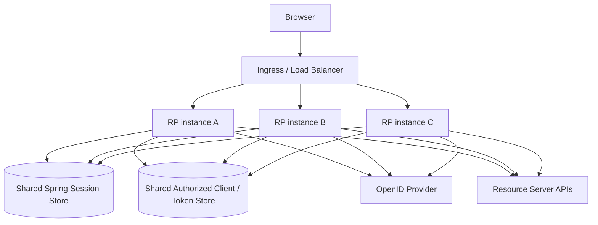
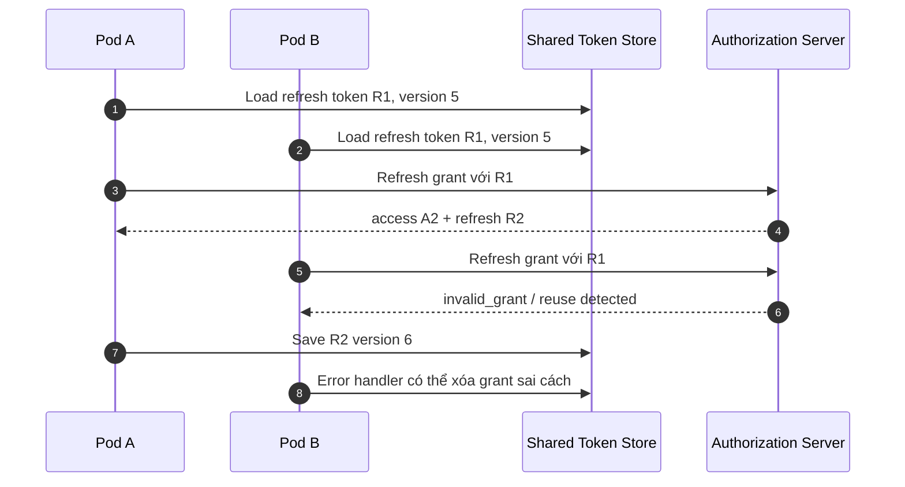

# 32.3. Triển khai nhiều instance với session và kho token dùng chung

> **Module:** Spring Security OAuth 2.0 OIDC Client  
> **Chương:** 32. Triển khai và vận hành  
> **Bối cảnh:** Ứng dụng Spring Boot/Spring Security đóng vai trò OAuth2 Client/OpenID Connect Relying Party (RP), triển khai từ hai instance trở lên sau load balancer. Nội dung phân biệt Servlet và Reactive/WebFlux, lưu trữ HTTP session, authorization request, SecurityContext, OAuth2 authorized client, access/refresh token và các vấn đề vận hành của cụm.

Khi chạy một ứng dụng OAuth2/OIDC Login trên một máy, nhiều cấu hình mặc định có vẻ hoạt động hoàn hảo: người dùng bấm Login, ứng dụng lưu `state` trong HTTP session, nhận callback với authorization code, đổi code lấy token, xây `SecurityContext` và giữ người dùng đăng nhập qua các request sau đó.

Nhưng khi tăng từ một instance lên ba instance sau load balancer, các request của cùng browser có thể tới **những máy khác nhau**:

```text
Request 1  -> instance A: bắt đầu OIDC Login, lưu state
Request 2  -> instance B: nhận callback code + state
Request 3  -> instance C: GET /dashboard sau login
Request 4  -> instance A: gọi API thay user bằng access token
```

Nếu A chỉ lưu session/state trong RAM của A thì B không đọc được transaction ban đầu. Nếu authorized client/tokens nằm trong memory của C, A không tìm được refresh token. Nếu hai instance cùng refresh một token có cơ chế rotation, chúng có thể khiến refresh token cũ mất hiệu lực hoặc ghi đè trạng thái mới. Nếu rollout phiên bản mới phá serialization của session cũ, người dùng có thể bị logout hàng loạt dù Redis vẫn còn dữ liệu.

Vì vậy, **triển khai nhiều instance không chỉ là tăng replicas**. Một hệ thống OIDC Client ổn định cần phân định rõ:

1. **Session dùng chung:** thông tin phiên browser, `SecurityContext`, authorization request/state và dữ liệu đăng nhập cần tồn tại qua nhiều request/instance.
2. **Kho token dùng chung:** `OAuth2AuthorizedClient`, access/refresh token, registration ID và principal identity được lưu trữ có kiểm soát để các instance đều dùng được khi cần.
3. **Đồng bộ làm mới token:** tránh nhiều instance cùng dùng một refresh token quay vòng.
4. **Cấu hình và danh tính nhất quán:** mọi instance hiểu cùng ClientRegistration, issuer, redirect URI, session serialization và tenant identity.
5. **Vận hành an toàn:** bảo vệ Redis/DB, cookie, secrets, TTL, logout/revocation, giám sát, rollout và khôi phục khi store gặp sự cố.

**Luận điểm chính:** `Spring Session` giải quyết phần quan trọng của **HTTP/WebSession sharing**, nhưng **không tự biến mọi `OAuth2AuthorizedClientService` in-memory thành kho token chung**, cũng không tự giải quyết distributed refresh race hay việc thu hồi token tại Authorization Server.

---

## 1. Mục tiêu học tập

Sau bài này, bạn có thể:

1. Giải thích vì sao OIDC login callback có thể thất bại khi request bắt đầu ở pod A và quay về pod B.
2. Phân biệt session, `SecurityContext`, authorization request/state, authorized client, access token và refresh token.
3. Xác định phạm vi của `HttpSessionOAuth2AuthorizationRequestRepository` và session-backed equivalents trên WebFlux.
4. Dùng Spring Session với Redis hoặc JDBC để chia sẻ sessions trong cụm Servlet.
5. Hiểu cách WebFlux dùng `WebSession` và reactive session repository thay vì Servlet `HttpSession`.
6. Phân biệt `OAuth2AuthorizedClientRepository` với `OAuth2AuthorizedClientService` và các biến thể Reactive.
7. Sử dụng JDBC-based authorized client service trên Servlet hoặc tự thiết kế persistent reactive token store khi cần.
8. Giải thích vì sao sticky sessions không phải sự thay thế đáng tin cho shared state.
9. Thiết kế khóa lưu authorized client theo registration, principal và tenant identity đáng tin.
10. Nhận diện nguy cơ ghi đè refresh token khi AS dùng refresh token rotation.
11. Đề xuất cơ chế single-flight/distributed lock/CAS để điều phối refresh.
12. Thiết kế cookie, HTTPS, reverse proxy, redirect URI và forwarded-header trust đúng khi chạy qua load balancer.
13. Phân biệt local RP logout, logout mọi RP sessions, OP SSO logout và token revocation.
14. Thiết kế session/token TTL, invalidation và cleanup không làm lộ credentials.
15. Đánh giá HA, failover, consistency, cache, encryption, Redis/JDBC security và disaster recovery.
16. Thực hiện rolling deployment mà không làm mất tất cả sessions do schema/serialization/config drift.
17. Lập ma trận kiểm thử tối thiểu hai instance với OAuth2/OIDC provider giả, token rotation và node failures.
18. Vận hành bằng metrics, traces và logs an toàn, không ghi raw access/refresh tokens, code hay session IDs.

## 2. Một ứng dụng một instance che giấu vấn đề gì?

Trong phát triển local:

```text
Browser
  |
  v
Spring Boot instance A
  |-- HttpSession/WebSession ở RAM
  |-- Authorization Request state ở session
  |-- SecurityContext ở session
  |-- InMemoryOAuth2AuthorizedClientService
  |-- Local cache refresh token
  +-- OIDC ClientRegistration từ application.yml
```

Toàn bộ request đi qua A nên dữ liệu in-memory thường vẫn còn.

Khi chạy Kubernetes hoặc autoscaling:



Load balancer có thể chuyển request tới bất kỳ pod khỏe nào. Nếu một pod restart, hệ thống phải quyết định **dữ liệu nào cần còn** và dữ liệu nào được phép mất.

### 2.1. Stateless pod không đồng nghĩa stateless ứng dụng

Một RP dùng browser session và lưu refresh token vẫn **có trạng thái**, kể cả pod là stateless về filesystem/RAM. Ý nghĩa thực tế của “stateless pod” là trạng thái quan trọng được chuyển sang backend dùng chung, không phụ thuộc một process tồn tại mãi.

### 2.2. Session và token store có thể cùng backend vật lý nhưng khác trách nhiệm

Redis có thể chứa session records và một custom token store, nhưng dữ liệu và lifecycle của chúng vẫn khác nhau:

- Session có TTL gắn browser login.
- Refresh token có expiry/rotation/revocation riêng.
- Session invalidation không mặc định revoke refresh token.
- Token store cần encryption/access control cao hơn nhiều dữ liệu session metadata.
- Token refresh cần concurrency control; session sharing không giải quyết việc đó.

## 3. Phân biệt các loại trạng thái

| Trạng thái | Sinh ra khi nào? | Dùng vào việc gì? | Nên lưu ở đâu khi nhiều instance? |
|---|---|---|---|
| `HttpSession` / `WebSession` | Browser truy cập ứng dụng có session | Cookie → session server-side | Spring Session Redis/JDBC hoặc shared session backend |
| `SecurityContext` | Login thành công | Principal, Authentication, authorities | Trong shared session/context repository phù hợp |
| Authorization Request và `state` | Trước redirect sang OP | Gắn callback với login attempt | Shared session/transaction store với cookie/correlation đúng |
| OIDC `nonce` / PKCE verifier | Trước redirect sang OP | Kiểm tra ID Token/code exchange | Transaction context được bảo vệ, truy cập được ở callback instance |
| `ClientRegistration` | Khởi tạo cấu hình/provision provider | Client ID, grant, issuer/endpoints, redirect | Config/registry nhất quán trên mọi instance |
| `OAuth2AuthorizedClient` | Sau token grant thành công | Token và registration/principal liên quan | Session chung hoặc persistent token store theo policy |
| Access token | Sau grant/refresh | Gọi Resource Server | Protected authorized-client store, không gửi vào logs |
| Refresh token | Khi AS cấp | Xin access token mới | Protected durable store nếu cần sống qua restart/khác pod |
| OP SSO session | OP quản lý | SSO của provider | Không thuộc quyền lưu/xóa trực tiếp của RP |
| Permission/tenant state | Business database/policy service | Authorization nghiệp vụ | Nguồn dữ liệu được chia sẻ, có freshness policy |
| Logout/revocation version | Khi khóa user, logout-all, đổi quyền | Chặn session/token cũ | Shared authoritative store/cache có invalidation |

Không đưa tất cả vào một `HttpSession` rồi mặc định mọi dữ liệu có cùng TTL và security policy.

## 4. Ba kiểu lỗi tiêu biểu sau khi scale-out

**Lỗi 1 — Callback state không tìm thấy:**

```text
Pod A nhận /oauth2/authorization/corporate
  -> lưu OAuth2AuthorizationRequest vào session RAM của A

Browser sang OP, quay về /login/oauth2/code/corporate
Pod B nhận callback
  -> session của B không có authorization request
  -> authorization_request_not_found / invalid_state
```

**Lỗi 2 — Request sau login mất Authentication:**

```text
Pod A xử lý callback thành công, lưu SecurityContext local
Pod C nhận /dashboard
  -> không thấy session/context
  -> redirect về Login
```

**Lỗi 3 — Không tìm thấy authorized client:**

```text
Pod B lưu access + refresh token trong InMemoryOAuth2AuthorizedClientService
Pod A xử lý request gọi API thay user
  -> loadAuthorizedClient(...) trả null
  -> không gọi được API/đòi reauthorization
```

Ba lỗi có triệu chứng tương tự “login lúc được lúc không” nhưng nằm ở **những lớp lưu trữ khác nhau**.

## 5. Luồng OIDC qua nhiều instance

```mermaid
sequenceDiagram
    autonumber
    participant B as Browser
    participant LB as Load Balancer
    participant A as RP pod A
    participant OP as OpenID Provider
    participant S as Shared Session Store
    participant T as Shared Token Store
    participant C as RP pod B

    B->>LB: GET /oauth2/authorization/corporate
    LB->>A: Route request
    A->>S: Save session + state/nonce/PKCE context
    A-->>B: 302 OP Authorization Endpoint
    B->>OP: Authorization Request
    OP-->>B: Redirect code + state
    B->>LB: GET callback + session cookie
    LB->>C: Route callback sang pod khác
    C->>S: Load authorization request; verify state
    C->>OP: Exchange code, validate OIDC tokens
    OP-->>C: Access Token / ID Token / refresh token
    C->>T: Save authorized client theo principal/registration
    C->>S: Save SecurityContext/session
    C-->>B: Redirect trang ứng dụng
    B->>LB: GET /dashboard
    LB->>A: Route sang A
    A->>S: Load SecurityContext
    A-->>B: Authenticated response
```

Cụm đạt yêu cầu cơ bản khi **pod nhận callback không cần là pod bắt đầu login**, và request sau login không cần đi lại đúng pod đã tạo Authentication.

## 6. Spring Session giải quyết vấn đề nào?

Spring Session thay session store của container/server bằng một abstraction có thể sử dụng backend chung.

Với Servlet:

```text
HttpSession API
   |
   v
Spring Session Filter / SessionRepository
   |
   +--> Redis
   +--> JDBC
   +--> backend phù hợp khác theo phiên bản
```

Với WebFlux:

```text
WebSession
   |
   v
Spring Session WebSession integration
   |
   +--> Reactive session repository/Redis hoặc backend phù hợp
```

Khi Spring Security dùng session để giữ `SecurityContext`, CSRF token hoặc OAuth2 authorization request, shared session repository cho phép nhiều instances đọc cùng session dựa trên cookie.

### 6.1. Spring Session không tự làm gì?

Nó không tự:

- Kết thúc SSO session ở OP.
- Revoke access/refresh token tại AS.
- Biến mọi service local-memory thành distributed service.
- Đồng bộ các `ClientRegistration` giữa pods.
- Ngăn duplicate refresh token requests.
- Đảm bảo account permissions trong session luôn mới.
- Mã hóa token stored ở nơi khác.
- Giải quyết lỗi cookie/forwarded host/redirect URI.
- Ngăn một in-flight request đã được authenticate hoàn tất sau khi session bị xóa.

Đó là những trách nhiệm cần thiết kế thêm.

## 7. Servlet: dùng Spring Session với Redis

Ví dụ dependency Gradle cho Spring Boot Servlet:

```kotlin
dependencies {
    implementation("org.springframework.boot:spring-boot-starter-web")
    implementation("org.springframework.boot:spring-boot-starter-security")
    implementation("org.springframework.boot:spring-boot-starter-oauth2-client")

    implementation("org.springframework.boot:spring-boot-starter-data-redis")
    implementation("org.springframework.session:spring-session-data-redis")
}
```

Khi auto-configuration của Spring Boot nhận diện Spring Session Redis và ứng dụng dùng Servlet stack, nó có thể cung cấp các beans/filter cần thiết để sessions được lưu ở Redis. Với version/thiết lập có custom SessionRepository, cần cấu hình tương ứng. **Không bật hai cơ chế session repository cạnh nhau mà không biết bean nào đang dùng.**

### 7.1. Ví dụ application-prod.yml

```yaml
spring:
  data:
    redis:
      host: ${REDIS_HOST}
      port: ${REDIS_PORT:6379}
      username: ${REDIS_USERNAME:}
      password: ${REDIS_PASSWORD}
      ssl:
        enabled: true
  session:
    redis:
      namespace: "spring:session:oidc-rp:prod"

server:
  servlet:
    session:
      timeout: 30m
      cookie:
        name: APP_SESSION
        http-only: true
        secure: true
        same-site: lax
```

Đây là baseline minh họa cho Spring Boot 3.x; property support và serializer/index settings phụ thuộc version và backend. Test actual `Set-Cookie`, TTL và session behavior trên bản đang chạy.

**Không đưa password Redis vào Git.** Dùng secret manager/Pod secret injection có giới hạn quyền. Redis chỉ được truy cập từ networks/identities được cho phép.

### 7.2. Namespace tách môi trường

Không dùng cùng namespace/cache database cho local, staging và production. Nếu hai ứng dụng/phiên bản cùng đọc session keys nhưng không tương thích serializer/classes, có thể gây lỗi deserialize hoặc nhầm phiên.

Ví dụ:

```text
spring:session:oidc-rp:staging
spring:session:oidc-rp:prod
```

Namespace không phải cơ chế bảo mật độc lập: vẫn phải tách Redis credentials, ACLs và network access theo môi trường.

### 7.3. Redis TLS và mật khẩu không thay network isolation

Dùng TLS, Redis ACL, private networking, firewall, resource quotas, backup và auditing. Không expose Redis trực tiếp ra Internet chỉ vì đã bật TLS.

## 8. Servlet: Spring Session JDBC

Nếu tổ chức đã vận hành một RDBMS HA và không muốn thêm Redis, Spring Session JDBC là lựa chọn có thể phù hợp.

```kotlin
dependencies {
    implementation("org.springframework.boot:spring-boot-starter-jdbc")
    implementation("org.springframework.session:spring-session-jdbc")
}
```

Ví dụ cấu hình:

```yaml
spring:
  datasource:
    url: jdbc:postgresql://session-db.internal:5432/oidc_session
    username: ${SESSION_DB_USER}
    password: ${SESSION_DB_PASSWORD}
  session:
    jdbc:
      table-name: SPRING_SESSION
      initialize-schema: never

server:
  servlet:
    session:
      timeout: 30m
```

Điều kiện: schema Spring Session chính thức tương ứng phiên bản đã được tạo bằng migration được quản lý (Flyway/Liquibase hoặc quy trình schema deployment). `initialize-schema: never` giả định schema đã tồn tại; không dùng khi chưa provision.

### 8.1. Redis hay JDBC cho session?

| Tiêu chí | Redis | JDBC |
|---|---|---|
| Latency thường thấy | Phù hợp truy cập session nhanh | Phụ thuộc DB/connection pool |
| TTL/expiration | Native key expiration và repository policy | Cleanup jobs/schema/queries |
| HA | Redis replication/failover/managed service | DB clustering/managed HA |
| Operational footprint | Thêm Redis nếu chưa có | Tận dụng RDBMS có sẵn |
| Storage model | Serialized/session attributes | Session tables/serialized attributes |
| Query/audit | Cần thiết kế ngoài session data | Có thể dùng DB tools, nhưng không khuyến khích truy vấn raw session payload |
| Scaling pressure | Bộ nhớ/công suất Redis | DB I/O, pool, transaction contention |
| Backup | Phải thiết kế theo SLA | Theo DB backup policy |

Không có backend mặc định “tốt nhất” cho mọi hệ thống. Chọn theo latency, HA, cost, compliance, số lượng sessions và khả năng vận hành.

## 9. Cookie vẫn là chìa khóa tìm session

Dù session nằm trong Redis/JDBC, browser vẫn thường mang một cookie chứa session identifier.

```text
Browser cookie: APP_SESSION=opaque-id
    |
    v
Load Balancer
    |
    +--> Pod A -> shared store lookup opaque-id
    +--> Pod B -> shared store lookup opaque-id
```

Cookie phải được browser gửi đúng khi bắt đầu login và callback từ OP.

### 9.1. Những thuộc tính cần kiểm soát

- `HttpOnly` để hạn chế JavaScript truy cập cookie.
- `Secure` với HTTPS.
- `SameSite` tương thích login/logout flow và CSRF policy.
- `Domain` đủ hẹp; không chia sẻ toàn miền không cần thiết.
- `Path` phù hợp với app context.
- TTL/session timeout nhất quán.
- HTTPS thật từ browser và trusted proxy headers.
- Session fixation protection khi authentication thành công.

### 9.2. SameSite=Lax không phải câu trả lời phổ quát

OIDC Authorization Code callback thông thường là top-level navigation dạng GET, thường tương thích với SameSite=Lax. Nhưng flows dùng `response_mode=form_post` hoặc iframe/front-channel có semantics khác; `SameSite=None; Secure` có thể cần trong một số trường hợp. Quyết định theo flow/OP/browser và phải test trên những browsers sản phẩm hỗ trợ.

**Không đổi SameSite sang None toàn ứng dụng để chữa một lỗi mà chưa điều tra CSRF và cookie exposure.**

## 10. Authorization Request Repository và callback

Trong Spring Security Servlet, repository thường dùng session:

```java
org.springframework.security.oauth2.client.web.HttpSessionOAuth2AuthorizationRequestRepository
```

Nó lưu authorization request để callback có `code`/`state` được đối chiếu. Khi Spring Session dùng chung `HttpSession`, pod B có thể tải request được pod A lưu, miễn cookie/session/shared-store hoạt động đúng.

### 10.1. Những dữ liệu cần giữ qua callback

- Selected `ClientRegistration` hoặc registration-related context.
- Random `state` và authorization request.
- PKCE `code_verifier` nếu flow có.
- OIDC `nonce` và các attributes liên quan.
- Redirect URI/scopes/provider-specific parameters.
- Tenant/login intent context nếu ứng dụng có multi-tenant.

Không tự thay state bằng `tenantId` dễ đoán; state vẫn phải bảo vệ correlation/CSRF. Không cho callback query `?tenant=...` ghi đè trusted transaction state.

### 10.2. Nhiều tabs và nhiều login attempts

Shared session store **không tự** bảo đảm repository hỗ trợ nhiều authorization requests song song trong cùng một browser session. Cần kiểm thử behavior của repository/version hoặc thiết kế state-keyed transaction store nếu sản phẩm cần multi-tab login đồng thời.

## 11. SecurityContext qua nhiều requests và pods

Sau login thành công, Spring Security lưu Authentication/SecurityContext theo cấu hình session/context repository.

```text
Pod B xử lý callback
  -> OIDC principal hợp lệ
  -> GrantedAuthorities được ánh xạ
  -> SecurityContext saved vào shared session
  -> Browser nhận/giữ session cookie

Pod C xử lý request kế tiếp
  -> session cookie lookup
  -> restore SecurityContext
  -> URL/method authorization
```

**Quan trọng:** session shared không có nghĩa authorities luôn cập nhật. Nếu role bị thu hồi tại OP/database, context đã được lưu có thể vẫn mang authorities cũ cho đến khi refresh/re-login/invalidate hoặc dynamic authorization check.

### 11.1. Session serialization

Session attributes cần tương thích với serializer/codec dùng bởi Spring Session. Nếu app đưa vào session custom object không serializable hoặc triển khai Jackson polymorphic typing tùy tiện, có thể gây:

- Lỗi serialize/deserialize trên pod khác.
- Session lớn hoặc thiếu class trong phiên bản mới.
- SecurityContext không đọc được sau rollout.
- Rủi ro deserialize dữ liệu không tin cậy nếu mở unsafe polymorphic typing.

Giữ session payload tối thiểu; sử dụng serialization configuration được Spring Session/Spring Security hỗ trợ và giới hạn trusted types. Không tùy ý bật default typing rộng để “fix” deserialize errors.

## 12. WebFlux: dùng WebSession và Spring Session Reactive

WebFlux không dùng Servlet `HttpSession`; nó dùng `WebSession` và `ServerSecurityContextRepository` phù hợp trong reactive request pipeline.

```text
WebFlux ServerWebExchange
  -> WebSessionManager
  -> Spring Session integration
  -> shared ReactiveSessionRepository
```

Với Redis, Spring Session cung cấp hỗ trợ reactive sessions theo phiên bản/starter phù hợp. Đừng trộn `@EnableRedisHttpSession` (Servlet) vào WebFlux thuần; nếu cấu hình thủ công, dùng cơ chế WebSession/Reactive repository tương ứng.

### 12.1. Điểm khác với Servlet

| Vấn đề | Servlet | WebFlux |
|---|---|---|
| Request/session | `HttpServletRequest` / `HttpSession` | `ServerWebExchange` / `WebSession` |
| Security configuration | `HttpSecurity` / `SecurityFilterChain` | `ServerHttpSecurity` / `SecurityWebFilterChain` |
| SecurityContext | Servlet session repository | Reactive `ServerSecurityContextRepository` |
| Session sharing | Spring Session servlet filter | Reactive WebSession integration |
| OAuth2 auth request repository | `OAuth2AuthorizationRequestRepository` | `ServerAuthorizationRequestRepository` implementation |
| Authorized client repository | `OAuth2AuthorizedClientRepository` | `ServerOAuth2AuthorizedClientRepository` |
| Token service | `OAuth2AuthorizedClientService` | `ReactiveOAuth2AuthorizedClientService` |
| Blocking calls | Servlet blocking model | Tránh blocking trên event loop |

### 12.2. Không kết nối JDBC blocking trực tiếp vào reactive event loop

Nếu custom WebFlux authorized-client store sử dụng JDBC blocking, cần mô hình offload/scheduler thích hợp hoặc dùng R2DBC/reactive Redis APIs. Blocking I/O bên trong reactive token refresh có thể gây latency spikes và nghẽn event loop.

### 12.3. WebSession cũng cần shared backing store

Nếu pod A giữ WebSession trong local memory, pod B nhận callback vẫn gặp lỗi state như Servlet. Reactive stack không tự biến ứng dụng thành stateless.

## 13. Session store và authorized-client store có quan hệ gì?

Một điểm dễ nhầm:

```text
Spring Session
    -> browser session / SecurityContext / state

OAuth2 Authorized Client Store
    -> ClientRegistration ID + principal
    -> access token + refresh token + metadata
```

Authorized client có thể được lưu trong session repository hoặc service riêng, tùy cấu hình.

### 13.1. Hai mô hình token persistence

**Mô hình A — Token theo session:**

```text
Browser session SESSION-123
  -> OAuth2AuthorizedClient for corporate
  -> access/refresh token
```

Ưu điểm: theo lifecycle của session, tương đối đơn giản cho web app nhỏ. Nếu Spring Session shared, những pod đọc cùng session có thể thấy authorized client.

Giới hạn: token không sống qua session; khó chia sẻ cho background jobs, lifecycle đồng bộ với browser, refresh race vẫn có thể xảy ra.

**Mô hình B — Token theo principal/registration trong service chung:**

```text
(registrationId, principalName)
  -> encrypted access token
  -> encrypted refresh token
  -> expiry/version
```

Ưu điểm: API integration có thể sống qua nhiều sessions/pods, phù hợp offline access/background jobs nếu policy cho phép.

Giới hạn: phải định nghĩa identity namespace/tenant, encryption, expiration, revocation, access control và refresh concurrency.

Không chọn mô hình B chỉ vì “dùng chung”; nó mang thêm trách nhiệm bảo mật và compliance.

## 14. Servlet: OAuth2AuthorizedClientRepository và OAuth2AuthorizedClientService

Các interface chính:

```java
org.springframework.security.oauth2.client.web.OAuth2AuthorizedClientRepository
org.springframework.security.oauth2.client.OAuth2AuthorizedClientService
```

**Repository** nhận request/response/Authentication trong môi trường Servlet để load/save/remove authorized client.

**Service** thao tác dựa trên `registrationId` và `principalName`, không gắn trực tiếp với một HTTP request.

Ví dụ những implementation thường gặp:

```java
HttpSessionOAuth2AuthorizedClientRepository
AuthenticatedPrincipalOAuth2AuthorizedClientRepository
InMemoryOAuth2AuthorizedClientService
JdbcOAuth2AuthorizedClientService
```

### 14.1. InMemoryOAuth2AuthorizedClientService không dùng chung giữa pods

Nếu A và B mỗi bên có một bean in-memory:

```text
Pod A: (corporate, user-1) -> refresh token R1
Pod B: (corporate, user-1) -> none
```

Pod B không thể đọc R1. Load balancer sticky session có thể làm lỗi ít xuất hiện, nhưng pod restart/failover vẫn làm mất dữ liệu local.

### 14.2. HttpSessionOAuth2AuthorizedClientRepository có thể dùng cùng Spring Session

Nếu authorized client được lưu **trong shared HTTP session**, dữ liệu có thể được đọc ở pod khác. Nhưng đây vẫn là token **theo phiên**. Nếu background job cần dùng token khi browser offline/session hết hạn, lựa chọn này không phù hợp.

## 15. Servlet: dùng JdbcOAuth2AuthorizedClientService

Spring Security cung cấp `JdbcOAuth2AuthorizedClientService` trên Servlet OAuth2 Client stack để lưu authorized clients qua JDBC.

Ví dụ bean:

```java
package example.config;

import org.springframework.context.annotation.Bean;
import org.springframework.context.annotation.Configuration;
import org.springframework.jdbc.core.JdbcOperations;
import org.springframework.security.oauth2.client.JdbcOAuth2AuthorizedClientService;
import org.springframework.security.oauth2.client.OAuth2AuthorizedClientService;
import org.springframework.security.oauth2.client.registration.ClientRegistrationRepository;
import org.springframework.security.oauth2.client.web.AuthenticatedPrincipalOAuth2AuthorizedClientRepository;
import org.springframework.security.oauth2.client.web.OAuth2AuthorizedClientRepository;

@Configuration
public class AuthorizedClientStoreConfiguration {

    @Bean
    OAuth2AuthorizedClientService authorizedClientService(
            JdbcOperations jdbc,
            ClientRegistrationRepository registrations) {

        return new JdbcOAuth2AuthorizedClientService(
            jdbc,
            registrations
        );
    }

    @Bean
    OAuth2AuthorizedClientRepository authorizedClientRepository(
            OAuth2AuthorizedClientService service) {

        return new AuthenticatedPrincipalOAuth2AuthorizedClientRepository(
            service
        );
    }
}
```

Trong một `SecurityFilterChain`, đảm bảo OAuth2 Login/OAuth2 Client/authorized client manager sử dụng repository/service **đã được chọn**, không vô tình tạo thêm in-memory store ở một nhánh. Wiring APIs và auto-configuration có thể khác theo Spring Security/Boot version; test bằng hai pods để xác nhận persistence thật.

### 15.1. Schema của authorized client khác Spring Session schema

Spring Session JDBC dùng tables như `SPRING_SESSION`/`SPRING_SESSION_ATTRIBUTES` theo schema riêng. `JdbcOAuth2AuthorizedClientService` dùng schema dành cho OAuth2 Authorized Client, thường có table `oauth2_authorized_client`.

**Không dùng một bảng session để ghi token theo thiết kế tùy tiện.** Áp các DDL/migration chính thức khớp phiên bản Spring Security; xét khóa, data types, encryption, index và cleanup riêng.

### 15.2. “JDBC” không tự có encryption cho raw token values

Access/refresh tokens phải được bảo vệ tại rest/in transit. Cần đánh giá liệu implementation mặc định có dùng DB encryption, volume encryption hay application-layer encryption hay không. Với yêu cầu compliance cao, thiết kế custom token service mã hóa trước khi ghi và quản lý key riêng.

Không coi “ở PostgreSQL” là đủ để các token an toàn trước DB dumps, backups, SQL query access hoặc operator accounts.

## 16. WebFlux: Reactive authorized-client repositories/services

Trên WebFlux, các contract tương ứng:

```java
org.springframework.security.oauth2.client.web.server.ServerOAuth2AuthorizedClientRepository
org.springframework.security.oauth2.client.ReactiveOAuth2AuthorizedClientService
```

Các implementation trong memory hoặc WebSession có thể phù hợp cho test/ứng dụng nhỏ. Nếu token cần dùng chung ngoài session, cần một **reactive durable token service** phù hợp với Redis/R2DBC hoặc backend được tổ chức hỗ trợ.

### 16.1. Không tự suy có JDBC service tương đương một-một

Một class Servlet như `JdbcOAuth2AuthorizedClientService` không thể được đem dùng trực tiếp làm `ReactiveOAuth2AuthorizedClientService` mà không xử lý contract/reactive execution. Xem các implementation chính thức đang có ở version sử dụng; nếu không có backend phù hợp, viết adapter/service được test kỹ, không block event loop.

### 16.2. Pseudocode reactive contract

```java
public interface TenantTokenStore {

    Mono<StoredAuthorizedClient> find(
        String tenantId,
        String registrationId,
        String principalKey
    );

    Mono<Void> saveIfVersion(
        StoredAuthorizedClient client,
        long expectedVersion
    );

    Mono<Void> delete(
        String tenantId,
        String registrationId,
        String principalKey
    );
}
```

Đây là **interface minh họa do ứng dụng tự thiết kế**, không phải Spring Security API. Khi tích hợp, cần chuyển đổi chính xác từ `OAuth2AuthorizedClient`, bảo vệ token values và xử lý các operations transactional/optimistic.

### 16.3. Service và repository không cùng semantics

`ServerOAuth2AuthorizedClientRepository` liên quan Web exchange/principal; `ReactiveOAuth2AuthorizedClientService` có thể được dùng bởi reactive authorized-client manager không có browser request. Thiết kế chọn service/repository theo nơi sử dụng token.

## 17. Chọn session-bound hay durable authorized client?

| Nhu cầu | Session-bound token | Shared persistent token store |
|---|---|---|
| Browser web app gọi API trong phiên | Thường phù hợp | Cũng phù hợp |
| User logout là xóa luôn local delegated connection | Đơn giản hơn | Cần cleanup riêng |
| Background job đồng bộ khi user offline | Thường không phù hợp | Phù hợp nếu grant/policy cho phép |
| Nhiều sessions cùng dùng một API integration | Có thể bị tách theo session | Có thể dùng chung theo principal/tenant |
| Pod restart mà user chưa logout | Có nếu session shared | Có |
| Token sống lâu hơn session | Không thuận tiện | Có thể |
| Refresh token rotation đồng thời | Vẫn có race nếu nhiều requests cùng phiên | Có race trên toàn cụm, cần coordination |
| Audit/revoke connection | Phụ thuộc session | Dễ theo connection record nhưng cần lifecycle rõ |
| Security risk của store | Token trong session backend | Kho có tập trung refresh tokens, cần bảo vệ nghiêm ngặt |

Sản phẩm có thể dùng **cả hai**: OIDC web login session cho identity và durable integration token store cho các API kết nối offline, với policies khác nhau.

## 18. Cấu trúc khóa authorized client phải đúng identity

Spring Security service API thường tra bằng:

```text
(registrationId, principalName)
```

Trong SaaS multi-tenant, không được đặt `principalName="123"` nếu `sub=123` có thể tồn tại ở hai issuers.

Ví dụ:

```text
Tenant Acme:  issuer A, sub=123
Tenant Globex: issuer B, sub=123
```

Nếu cùng registration/service key gây collision, pod có thể lấy nhầm token của người khác.

### 18.1. Identity key an toàn

Một ứng dụng có thể dùng:

```text
principalKey = internalUserId
```

khi account linking/membership đã được xác minh và token policies cho phép dùng chung.

Hoặc namespace theo:

```text
tenantId + issuer + subject
```

nếu delegated grants tách biệt theo tenant/issuer.

Không dùng email tự do làm primary token key; email có thể thay đổi hoặc được tái cấp. Tránh principal key xuất phát từ raw request query.

### 18.2. ClientRegistration ID phải có scope đúng

Cùng một AS có thể cấp nhiều Client IDs cho nhiều tenants. Nếu lưu dưới cùng `registrationId` nhưng token có audience/scope/resource khác, một authorized-client record có thể bị ghi đè sai. Có thể cần registrations riêng hoặc một storage key/model rộng hơn.

## 19. Token cache key và audience/resource

Một Client có thể gọi nhiều APIs:

```text
access token A -> audience reports-api
access token B -> audience billing-api
```

Nếu cache chỉ theo:

```text
client_id
```

thì có thể gửi token của reports-api sang billing-api. Ngay cả cache theo `registrationId,principalName` cũng cần đánh giá nếu cùng registration được dùng để xin tokens cho nhiều resources/scopes.

Cần định nghĩa:

- Issuer/AS và Client registration.
- Trusted principal/tenant.
- Grant type.
- Target resource/audience và scopes thực tế khi token grant thay đổi theo request.
- Token expiry và sender constraints.
- Trường hợp server-to-server Client Credentials khác delegated Authorization Code grant.

**Không tái dùng access token chỉ vì có cùng Client ID** nếu Resource Server audience không tương ứng.

## 20. Nguy cơ distributed refresh token rotation

Một số Authorization Servers dùng refresh token rotation: mỗi lần refresh thành công phát refresh token mới, token cũ hết hiệu lực hoặc bị coi là reused.

Kịch bản:



Nếu handler B diễn giải `invalid_grant` là “refresh token chắc chắn bị revoke” rồi xóa authorized client, nó có thể xóa bản mới R2 do A vừa lưu.

### 20.1. Shared store không tự giải quyết race

Việc cả A/B đều đọc chung DB làm token khả dụng, nhưng không ngăn chúng **đọc cùng R1 trước khi một bên update**. Đây là bài toán coordination.

### 20.2. Tác động thực tế

- User bị yêu cầu login/consent lại ngẫu nhiên.
- Background jobs mất delegated access.
- AS kích hoạt token-family reuse detection và revoke cả family.
- DB ghi đè token mới bằng token cũ.
- Nhiều pods tạo “refresh storm” làm tăng tải Token Endpoint.

## 21. Single-flight token refresh

**Single-flight** nghĩa là tại một thời điểm chỉ một tác nhân thực hiện refresh cho cùng logical authorized client.

Luồng khuyến nghị:

```text
Request cần access token
    |
    v
Load authorized client + expiry/version
    |
    +-- token còn hiệu lực --> dùng token
    |
    +-- gần hết hạn --> acquire coordination key
                         |
                         +-- thắng lock:
                         |      re-read record
                         |      nếu vẫn cần -> refresh
                         |      atomic persist token+version
                         |      release lock
                         |
                         +-- không thắng:
                                chờ/backoff có giới hạn
                                re-read token mới
                                không dùng lại R1 mù quáng
```

Coordination key có thể dựa trên:

```text
tenant + registration + principal + resource-context
```

Không dùng raw refresh token làm Redis key hoặc log label.

### 21.1. Re-read sau khi nhận lock

Giữa lần đầu phát hiện token hết hạn và lúc lấy lock, một pod khác có thể đã refresh xong. Pod nhận lock phải đọc lại record/version rồi quyết định có cần gọi Token Endpoint nữa không.

### 21.2. Phải có timeout và failure policy

Distributed lock không nên giữ vô hạn. Cần:

- TTL hợp lý cho lock.
- Unique owner token.
- Release an toàn chỉ bởi owner.
- Thời gian chờ có giới hạn.
- Graceful handling khi AS không phản hồi.
- Backoff/jitter để tránh thundering herd.
- Metrics lock contention/refresh failures.

Một lệnh Redis `SETNX` đơn giản rồi `DEL` vô điều kiện có thể xóa lock của pod khác sau khi lock cũ hết hạn và được cấp lại. Dùng owner-aware unlock/transactional primitives phù hợp.

## 22. Compare-and-set (CAS) cho bản ghi token

Với RDBMS, có thể dùng optimistic version:

```text
AuthorizedClient:
  tenantId=acme
  registrationId=corporate
  principalKey=usr-9001
  refreshTokenCiphertext=...
  version=7
```

Khi lưu refresh result:

```sql
UPDATE oauth_authorized_client_secure
SET access_token_ciphertext = :new_access,
    refresh_token_ciphertext = :new_refresh,
    version = version + 1,
    updated_at = CURRENT_TIMESTAMP
WHERE tenant_id = :tenant_id
  AND registration_id = :registration_id
  AND principal_key = :principal_key
  AND version = :expected_version;
```

Nếu affected rows = 0, có nghĩa record đã thay đổi hoặc không tồn tại; phải **re-read và phân loại**. Không overwrite vô điều kiện.

### 22.1. CAS và lock giải quyết hai góc khác nhau

- **Lock/single-flight:** hạn chế nhiều refresh requests đồng thời tới AS.
- **CAS:** ngăn ghi đè record mới bởi response lỗi/cũ.

Có thể cần cả hai, nhất là với refresh token rotation. SQL ở trên chỉ minh họa cho **custom token store**, không phải schema mặc định của `JdbcOAuth2AuthorizedClientService`.

### 22.2. Phản ứng với invalid_grant trong race

Nếu pod B nhận `invalid_grant` khi pod A đã lưu R2:

1. Đọc lại record/version.
2. Nếu đã có refresh token version mới, không xóa R2 vì lỗi của request cũ.
3. Nếu không có bản mới và AS xác nhận grant invalid, thực thi failure policy (remove/re-authorize).
4. Ghi audit event an toàn; không log refresh tokens.
5. Không retry vô hạn R1.

## 23. Redis distributed lock cũng cần giới hạn

Một ví dụ logic:

```text
Acquire:
  SET lock:key owner-random NX PX 5000

Release:
  chỉ DEL nếu GET lock:key == owner-random
  thực hiện atomic check/delete bằng script hoặc primitive phù hợp
```

Đây là **mô hình nguyên lý**, không phải copy-paste code production. Cần đánh giá failure khi network partition, lock TTL ngắn hơn Token Endpoint latency và fencing/record version để tránh stale writer.

### 23.1. Lock không phải bằng chứng transaction đã thành công

Một pod có thể refresh thành công tại AS rồi crash trước khi lưu R2. Khả năng phục hồi phụ thuộc AS rotation/reuse semantics; không thể “retry y nguyên” một refresh token đã bị AS vô hiệu hóa một cách an toàn trong mọi trường hợp. Cần graceful reauthorization và hợp đồng với provider.

## 24. Token expiry và session TTL khác nhau

Ví dụ:

```text
RP HTTP session TTL:       30 phút idle
Access token TTL:           5 phút
Refresh token TTL:         14 ngày
OP SSO session:            theo OP policy
```

Các vòng đời này độc lập.

- Access token hết hạn không nhất thiết hết RP session.
- RP session hết hạn không tự revoke refresh token lưu trong durable DB.
- Refresh token bị revoke không tự xóa RP session.
- OP SSO session còn có thể cho người dùng login lại nhanh.
- Một access token JWT có thể còn được Resource Server chấp nhận đến expiry dù RP xóa authorized-client record.

### 24.1. Retention policy phải có chủ đích

Một web-only app có thể xóa authorized client khi session kết thúc. Một offline synchronization app có thể giữ delegated refresh token sau browser logout theo consent/UX đã công bố.

Không mặc định “đăng xuất” nghĩa tất cả API grants đều đã bị revoke.

## 25. Logout trên cụm

Các khái niệm cần tách:

| Hành động | Ảnh hưởng trực tiếp |
|---|---|
| Local logout ở pod A | Invalidate session của request hiện tại trong shared store |
| Logout all RP devices | Xóa mọi RP sessions của internal account qua session index |
| RP-Initiated Logout | Yêu cầu OP kết thúc SSO session liên quan nếu OP hỗ trợ |
| OIDC Back-Channel Logout | OP gửi Logout Token tới RP, RP xác minh rồi xóa sessions được chỉ định |
| Remove authorized client | Xóa token record local/repository |
| RFC 7009 revocation | Yêu cầu AS thu hồi token/grant, không đồng nghĩa RP logout |
| Deactivate internal user | Chặn login/authorization theo application policy, có thể kèm invalidation/revocation |

### 25.1. Local logout khi session shared

Nếu pod A xóa session ID của browser trong Redis/JDBC, request sau gửi cookie cũ tới pod B sẽ không còn SecurityContext từ session đó.

Nhưng request đã được authenticate và đang chạy ở pod B trước thời điểm invalidation có thể vẫn tiếp tục. Với nghiệp vụ nhạy cảm, thêm account/session revocation version check gần điểm commit.

### 25.2. Logout-all cần session index

Spring Session có khả năng tìm sessions theo principal ở backend/config phù hợp, ví dụ abstraction `FindByIndexNameSessionRepository` (đối với implementations hỗ trợ). Với nhiều OIDC issuers, `principalName` có thể là `sub` khác nhau. Nếu logout-all theo internal user, cần index theo internal account ID đáng tin, không chỉ username/email.

## 26. Session index và multi-provider

Ví dụ:

```text
internalUserId=usr-9001
  RP session S1 -> issuer Corporate, sub corp-734
  RP session S2 -> issuer Partner,   sub partner-81
  RP session S3 -> issuer Corporate, sub corp-734
```

Logout-all RP phải tìm cả S1/S2/S3. Nếu index chỉ dùng `sub`, nó có thể bỏ sót identities khác hoặc xóa nhầm user ở issuer khác.

### 26.1. Index nên giữ metadata tối thiểu

Có thể cần:

- Internal user ID.
- RP session ID (bảo vệ như secret metadata).
- Issuer và subject.
- OIDC OP session ID `sid` nếu provider/logout protocol hỗ trợ.
- Client registration ID.
- Tenant ID.
- Created/last-seen/expiration.
- Revocation version.

Không lưu raw access/refresh tokens trong session index hoặc metric labels.

## 27. Multi-tenant token isolation

Giả sử hai tenants đều có `sub=123` ở hai OPs khác nhau. Nếu token store dùng khóa:

```text
(corporate, "123")
```

mà `corporate` được tái sử dụng hoặc identity namespace không rõ, có thể trả nhầm delegated token.

Cần ràng buộc:

1. Tenant được xác minh từ routing/account membership.
2. Issuer và subject của OIDC principal đã được OP xác thực.
3. Registration ID/Client ID tương ứng grant.
4. Principal storage key namespace theo identity nội bộ đã xác minh.
5. Resource/audience/scope của API target.
6. Authorization policy khi load token từ service/repository.

**Không** cho request query `?principal=someoneElse` quyết định authorized client được load.

### 27.1. Dùng chung kho vật lý vẫn cần phân vùng logic

Một RDBMS có thể lưu token của mọi tenant, nhưng mỗi truy vấn phải có tenant/identity constraints, row-level access controls theo thiết kế và audit. Encryption key per tenant có thể là lựa chọn nếu yêu cầu compliance. Không dùng table name động trực tiếp từ tenant input.

## 28. SecurityContext, role và phiên cũ

Spring Session shared làm SecurityContext nhất quán hơn giữa các pods, nhưng có thể **khuếch đại** vấn đề stale authority: mọi pod đều đọc cùng role cũ.

Ví dụ user bị gỡ `ROLE_ADMIN` từ OP:

```text
T0: Login -> SecurityContext ROLE_ADMIN lưu session
T1: Admin thu hồi role ở OP
T2: Pod B đọc session cũ -> ROLE_ADMIN vẫn có
```

Giải pháp tùy sản phẩm:

- Invalidate RP sessions khi deprovision/role change event.
- Dynamic authorization check với source of truth.
- Permission version/epoch trong session.
- Session age/re-authentication policy.
- Back-Channel Logout nếu OP hỗ trợ và event semantics phù hợp.

Không coi việc token refresh tự động làm cập nhật SecurityContext OIDC Login; token refresh và OIDC login Authentication là hai lifecycle khác nhau.

## 29. Reverse proxy, forwarded headers và redirect URI

Một cụm thường có:

```text
Browser HTTPS https://app.example.test
  -> TLS termination ở ingress
  -> HTTP nội bộ http://rp-service:8080
```

Spring Security cần tạo `redirect_uri` theo URL public đã đăng ký với OP:

```text
https://app.example.test/login/oauth2/code/corporate
```

Nếu tự sinh:

```text
http://rp-service:8080/login/oauth2/code/corporate
```

OP sẽ từ chối vì redirect URI mismatch.

### 29.1. Forwarded header trust boundary

Cần:

- Ingress xóa/ghi lại `Forwarded` và `X-Forwarded-*` từ client không tin cậy.
- Spring Boot/framework được cấu hình xử lý forwarded headers theo topology và version.
- Chỉ trust known proxies/networks.
- Xác thực public hostname theo allowlist.
- Dùng HTTPS cho browser và OP endpoints.
- Không cho query `redirect_uri` hoặc spoofed Host thay cấu hình trusted ClientRegistration.

### 29.2. Cookie Secure và backend HTTP

Dù upstream tới pod là HTTP, browser vẫn nhận `Secure` cookie vì external transport là HTTPS. Nếu app hiểu nhầm scheme do forwarded headers sai, nó có thể không set cookie/redirect đúng.

Kiểm tra **response thực tế ngoài ingress**, không chỉ internal curl vào pod.

## 30. Sticky sessions có thay shared store được không?

**Sticky sessions** cố giữ một browser đi cùng pod dựa trên cookie/IP của load balancer.

Ưu điểm:

- Có thể giảm session cache misses.
- Có thể hữu ích như tối ưu routing tạm thời.

Giới hạn:

- Pod chết/restart → mất session local.
- Autoscaling/rolling deployment → user bị chuyển pod.
- NAT/mobile networks/IP affinity không ổn định.
- Callback từ OP có thể vào node khác theo infrastructure.
- Background jobs, WebSockets hoặc API calls có routing khác.
- Một refresh token vẫn có thể bị nhiều pods dùng nếu lưu ở service shared.
- Không giải quyết multi-region failover.

**Sticky session có thể là optimization, không phải bảo đảm nhất quán/trạng thái bền vững.** Nếu sản phẩm yêu cầu failover không mất login, cần shared session state và test cross-pod flows.

## 31. Dữ liệu trong session: càng ít càng tốt

Không nên lưu:

- Entire ORM entity graphs.
- Large UserInfo responses không cần thiết.
- Long-lived Client secrets.
- Raw HTTP request/response.
- Mutable objects phụ thuộc class version.
- Internal caches không serializable.
- Dữ liệu có thể lấy lại dễ dàng từ database.
- Access token trong debug attributes hoặc custom session index.

Session cần chứa chính xác dữ liệu phục vụ authentication/session semantics. Cân nhắc memory pressure, network payload, latency và serialization compatibility.

### 31.1. OidcUser có claims: chú ý privacy

OIDC principal có thể chứa claims cá nhân và group membership. Spring Session backend được coi là kho chứa dữ liệu nhạy cảm, không chỉ một Redis cache “vô hại”. Bảo vệ ACL/encryption/retention và log redaction.

### 31.2. Không sửa object rồi quên persist

Tùy SessionRepository/flush mode/serialization, các thay đổi sâu bên trong mutable session attributes có thể không được ghi nếu framework không nhận biết attribute changed. Ưu tiên immutable snapshots hoặc set lại session attribute qua API phù hợp; test behavior khi pod khác đọc ngay sau update.

## 32. Serialization compatibility khi rolling deployment

Trong rollout:

```text
Pod A chạy version 1
Pod B chạy version 2
Cả hai đọc session của cùng user
```

Nếu version 2 đổi package/class, field types, serializer hoặc JWT principal structure, version 1 có thể không đọc lại session do version 2 ghi và ngược lại.

### 32.1. Chiến lược giảm rủi ro

- Giữ tương thích session serialization giữa hai versions chạy đồng thời.
- Không để arbitrary custom classes trong session.
- Chọn serializer/library được framework hỗ trợ.
- Thử snapshot session cũ → read bằng version mới và ngược lại nếu blue/green rollout.
- Có versioned session payload/migration policy khi cần.
- Chuẩn bị fallback nếu không thể bảo toàn session, thông báo re-login rõ ràng.
- Không bật untrusted deserialization chỉ để vượt qua lỗi class mapping.

### 32.2. Session ID/cookie name cũng là contract

Nếu deployment mới đổi cookie name, domain, path hoặc session namespace, user có thể bị logout dù backend cũ còn. Quản lý những thay đổi này như migration có chủ đích.

## 33. Cấu hình OAuth2 Client phải nhất quán trên mọi pod

Mọi pod xử lý cùng Client registration cần đồng ý về:

- Registration ID.
- Issuer/provider metadata.
- Client ID và Client authentication method.
- Client secret/private key/secret reference version.
- Redirect URI.
- Scopes và provider-specific parameters.
- Authorized-client storage implementation.
- JWT decoder/key cache/allowed signing algorithms.
- Authorization Request Repository policy.
- Tenant-to-registration mapping.

### 33.1. Lỗi config drift

```text
Pod A:
  registration corporate -> client-id portal-v1

Pod B:
  registration corporate -> client-id portal-v2
```

A bắt đầu Authorization Request, B nhận callback và dùng Client ID khác để đổi code. AS có thể từ chối `invalid_grant`/`invalid_client` hoặc ID Token audience validation thất bại.

### 33.2. Secret rotation cần dual-version strategy

Không đổi Client secret tại OP và chỉ cập nhật một nửa pods. Khi AS hỗ trợ overlap, lên lịch rotation theo giai đoạn; nếu không, có thể phải drain traffic/handle in-flight login gracefully. Theo dõi callback error rates và không log Client secrets khi điều tra.

## 34. Dynamic ClientRegistration và phiên bản cấu hình

Trong multi-tenant SaaS, registrations có thể nằm trong DB/config registry thay vì `application.yml`.

```text
Tenant onboarding control plane
   -> validate issuer/client/redirect
   -> publish versioned registration
   -> pods cache config
   -> OAuth2 authorization & token exchange
```

Lưu ý:

- Pod A và B cần thấy cùng registration version hoặc snapshot hợp lệ cho transaction.
- Có cache invalidation và expiry policy.
- Không fetch arbitrary issuer metadata từ browser query.
- Cần strategy khi tenant bị disable giữa login/callback.
- Đổi Client ID/issuer là thay đổi security boundary, không chỉ một cache refresh.
- Callback cần fail closed nếu registration không còn trusted.

## 35. Redis availability và failover

Nếu Redis session store tạm mất:

- Request có cookie nhưng không load được SecurityContext.
- Login callback không đọc được authorization request/state.
- Session save thất bại sau token exchange.
- Logout/invalidate có thể không hoàn tất đúng.
- Login storms có thể xuất hiện khi users thử lại.

Cần xác định SLA cho:

- Redis HA/failover/sentinel/cluster managed service.
- Connection timeout và pool.
- Retry/backoff có giới hạn.
- Network partitions.
- Persistence/backup thích hợp.
- Memory eviction policy và quotas.
- Monitoring p95/p99 latency/error rate.
- Fail-closed behavior với authentication data.

**Không** khi Redis lỗi thì tự cho phép anonymous request dùng quyền người đã login trước đó hoặc rơi về unauthenticated session nhưng cho truy cập tài nguyên nhạy cảm.

### 35.1. Eviction policy

Nếu Redis loại bỏ session keys vì thiếu memory, user có thể bị logout ngẫu nhiên. Giám sát memory/evictions và capacity; không dùng Redis shared cluster không có isolation/quotas cho session production có SLA cao.

## 36. JDBC availability và transaction pressure

Khi session/token store dùng JDBC:

- Connection pool exhaustion có thể làm login chậm/timeout.
- DB failover có thể làm mất transaction đang save token.
- Deadlock/lock contention khi nhiều threads refresh cùng principal.
- Cleanup expired sessions có thể tạo tải.
- Migration schema trong rollout có thể không tương thích.
- Replica reads chậm có thể không thấy state/token vừa ghi.

### 36.1. Read-after-write quan trọng với callback

Authorization Request được ghi khi bắt đầu login và đọc lại khi callback. Nếu backend dùng read replicas có replication lag, pod nhận callback có thể không thấy state vừa lưu, dù DB chính đã commit.

Token refresh cũng cần nhất quán để không dùng lại old refresh token. Chọn consistency/read routing theo workflow, không chỉ ưu tiên read replicas cho mọi query.

## 37. Multi-region deployments có thêm rủi ro

Một ứng dụng chạy ở hai regions có thể có:

```text
Region A: RP A + Redis A
Region B: RP B + Redis B
```

Nếu sessions/token records chỉ replicate eventually, callback chuyển vùng có thể không đọc thấy state, hoặc hai regions cùng refresh R1 trước khi replication hoàn tất.

Lựa chọn:

- Regional affinity + failover policy rõ, chấp nhận re-login khi failover.
- Shared globally consistent store phù hợp SLA/latency.
- Replication mechanism + fencing/versioning/conditional writes.
- Region-specific Client registrations/redirect URIs nếu kiến trúc yêu cầu.

Không giả định “Redis replication” mặc định tạo transactionally consistent sessions và refresh tokens across regions.

## 38. Availability của Authorization Server không nằm trong shared store

Ngay cả khi Redis/JDBC khỏe, OP/AS có thể bị outage:

- New logins không thể hoàn tất.
- Access token còn hạn có thể vẫn gọi API được.
- Refresh token grants có thể bị chặn vì Token Endpoint lỗi.
- OIDC logout remote có thể không hoàn tất.
- UserInfo/JWKS discovery có thể ảnh hưởng login.

Không retry vô hạn AS khi 429/503; áp timeout/backoff, metrics và UX rõ. Không tắt TLS/JWT signature validation để “cứu” login outage.

### 38.1. Graceful behavior

Tùy threat model:

- Giữ authenticated session đang còn hợp lệ nếu policy cho phép.
- Trả lỗi login rõ ràng cho new sessions.
- Không tự đổi provider sang issuer khác không được user/tenant cho phép.
- Dừng background jobs khi token không thể refresh.
- Không gửi access token tới API sai audience như fallback.

## 39. Encryption cho kho token dùng chung

Refresh token là credential có giá trị cao. Nếu DB dump/Redis snapshot bị lộ, attacker có thể cố dùng token để xin access token mới tùy AS policy.

Bảo vệ:

1. TLS giữa pods và store.
2. Private network/firewall.
3. DB/Redis ACL tối thiểu.
4. Encryption at rest (disk/managed DB).
5. Application-level encryption khi yêu cầu threat model.
6. KMS/vault-managed keys và rotation.
7. Không log raw token/Client secret/session cookie.
8. Restrict backup/export access.
9. Retention/cleanup.
10. Incident revocation/rotation playbook.

### 39.1. Token encryption key phải có ở mọi pod cần giải mã

Nếu pod A mã hóa bằng local key và pod B dùng key khác, B không đọc được token. Dùng key management nhất quán theo môi trường/tenant với versioned key identifiers và rotation policy.

### 39.2. Không dùng một key trong source code

`static final String KEY = "123456..."` nằm trong Git không phải secret management. Không log key material hoặc lưu trong container image.

## 40. Token metadata và logs

Cho phép observability mà không lộ credential:

```text
event=oauth2_authorized_client_load
registrationId=corporate
principalRef=opaque-hmac-or-internal-id
outcome=hit
store=jdbc
durationMs=12
traceId=...
```

```text
event=oauth2_token_refresh
registrationId=corporate
outcome=invalid_grant
retry=false
versionChanged=true
traceId=...
```

Tránh:

```text
refresh_token=...
access_token=...
id_token=...
authorization_code=...
code_verifier=...
Cookie: APP_SESSION=...
Authorization: Bearer ...
```

### 40.1. Labels phải có cardinality hợp lý

Metric như `oauth_refresh_failures{registration="corporate",error="invalid_grant"}` có ích. Đưa raw session IDs, token hashes hoặc email vào metric labels vừa nguy hiểm vừa làm tăng cardinality.

## 41. Những metrics cần theo dõi

| Metric gợi ý | Câu hỏi vận hành |
|---|---|
| `sessions.active` | Có bao nhiêu phiên RP hoạt động? |
| `session.store.load_latency` | Đọc session chậm ở Redis/JDBC? |
| `session.store.errors` | Backend session có lỗi? |
| `oauth.callback.state_mismatch` | Callback không khớp state/cookie? |
| `oauth.callback.cross_pod_success` | Cross-pod callback thành công? |
| `oauth.authorized_client.store_miss` | Token store thiếu record bất thường? |
| `oauth.token.refresh_attempts` | Refresh rate theo registration? |
| `oauth.token.refresh_invalid_grant` | Grant invalid/race? |
| `oauth.token.refresh_lock_wait` | Contention coordination? |
| `oauth.token.cas_conflicts` | Stale writer có bị phát hiện? |
| `oauth.login.success_rate` | Login chất lượng trên nhiều pods? |
| `oauth.login.duration` | Login latency end-to-end? |
| `authz.denied_by_tenant` | Có cross-tenant authorization denials? |
| `session.invalidations` | Logout/session expiry có ổn định? |

Các tên trên là **đề xuất instrumentation của ứng dụng**, không phải mặc định Spring Security phát hết. Cần thực sự đo, aggregate theo instance/registration và đặt alert thresholds phù hợp với baseline.

## 42. Distributed tracing trong login/refresh

Một OIDC login kéo dài qua browser redirect nên không thể kỳ vọng một server-side HTTP trace duy nhất luôn bao trùm trọn vẹn. Có thể dùng một transaction correlation ID server-side, được lưu/bảo vệ cùng authorization request, liên kết logs an toàn giữa các bước.

```text
attemptRef=login-opaque-42
  pod=A phase=authorization_start
  pod=B phase=callback_received
  pod=B phase=token_exchange_success
  pod=C phase=session_restored
```

Không dùng raw `state`, authorization code, `nonce` hoặc session ID làm log correlation ID. Giới hạn TTL/retention và tính riêng tư của event references.

### 42.1. Tránh log URL chứa code

```text
/login/oauth2/code/corporate?code=...&state=...
```

có thể lọt vào ingress/APM. Dùng normalized route `/login/oauth2/code/{registrationId}` trong tracing. Không chỉ sửa Spring logger mà quên CDN, WAF, access logs và HTTP client wiretap.

## 43. Test kỹ thuật tối thiểu cần hai instances thật

Không thể chứng minh shared session/token store bằng một `MockMvc` test chỉ chạy một instance.

Test harness:

```text
Fake OP/AS
  |
  +-- OAuth2 authorize/token/JWKS/UserInfo
  |
Browser with cookie jar
  |
  v
Load Balancer with forced routing
  |-- Pod A
  |-- Pod B
  |
  +-- Shared Redis/JDBC session store
  +-- Shared token store
```

Cần có khả năng **ép request đầu vào tới A và callback tới B**, sau đó request thứ ba lại tới A. Nếu chỉ may rủi load balancer tự phân phối, test có thể luôn đi A và bỏ sót lỗi.

### 43.1. Fake OP tốt phải kiểm tra protocol

Không để fake OP trả token cho mọi code:

- Check `state` correlation tại RP.
- Verify PKCE challenge/verifier khi áp dụng.
- Bind code với Client ID/redirect URI.
- Enforce one-time code use.
- Phát ID Token có chữ ký và public JWKS test.
- Có `iss`/`aud`/`nonce` đúng.
- Phát refresh token rotation theo kịch bản cần kiểm tra.

Mock OIDC Authentication có ích cho policy tests nhưng **không kiểm tra cross-pod callback/token exchange**.

## 44. Lab A — Callback A → B và session B → A

**Mục tiêu:** chứng minh Spring Session thực sự dùng chung.

1. Chạy Redis/JDBC session backend test.
2. Chạy hai RP instances A/B cùng cấu hình registration/serializer.
3. Browser khởi tạo `/oauth2/authorization/corporate` qua A.
4. Fake OP trả redirect callback.
5. Ép callback vào B, mang nguyên browser cookie.
6. B đọc authorization request, đối chiếu state và đổi code.
7. Sau login, browser gọi `/dashboard` qua A.
8. A đọc SecurityContext từ shared store và cho phép.
9. Restart B, tiếp tục request qua A và kiểm tra session còn theo policy.
10. Không log cookie/code/token thật.

**Kết quả mong đợi:** login flow và SecurityContext không phụ thuộc pod ban đầu.

## 45. Lab B — Mất shared session backend

**Mục tiêu:** xác định fail-closed behavior và UX.

1. Tạo session đăng nhập qua fake OP.
2. Dừng Redis/DB session backend trong test.
3. Gửi protected request từ browser cookie cũ.
4. Kiểm tra không có unauthenticated privilege escalation.
5. Quan sát HTTP status/UX theo policy.
6. Phục hồi session backend.
7. Kiểm tra session restore hoặc yêu cầu re-login theo persistence/failover behavior.
8. Theo dõi metrics store error/latency.
9. Tránh retry storm từ clients/pods.

**Kết quả mong đợi:** store outage được xử lý an toàn, có cảnh báo và không silently fallback thành authentication hợp lệ.

## 46. Lab C — InMemory token store vs JDBC shared token store

**Mục tiêu:** thấy session sharing không tự chia sẻ mọi authorized client.

1. Chạy pod A/B với shared Spring Session nhưng local `InMemoryOAuth2AuthorizedClientService`.
2. Tạo authorized client bằng API integration ở A.
3. Thử load cùng registration/principal từ B.
4. Quan sát thiếu record nếu service thực sự in-memory mỗi pod.
5. Chuyển sang shared JDBC authorized-client service được wiring đúng.
6. Save từ A, load từ B.
7. Kiểm tra token metadata/expiry/registration đúng.
8. Xóa authorized client ở B, đọc lại ở A thấy đã xóa.
9. Đảm bảo token raw không xuất hiện trong output.

**Kết quả mong đợi:** durable shared token store giải quyết cross-pod authorized-client persistence riêng với shared session.

## 47. Lab D — Hai pods cùng refresh một token

**Mục tiêu:** tái hiện refresh token rotation race.

1. Fake AS cấp R1 với access token gần hết hạn.
2. Lưu authorized client version 1 trong shared store.
3. Hai pods cùng nhận API requests cần refresh.
4. Không coordination: cho A/B cùng đọc R1; quan sát duplicate refresh/invalid_grant.
5. Bật single-flight per logical authorized client.
6. Pod thắng lock re-read, refresh và persist R2 qua CAS.
7. Pod còn lại chờ/backoff rồi re-read R2.
8. Kiểm tra chỉ một refresh request hợp lệ được gọi khi có thể.
9. Giả lập pod crash trước khi lưu và xác nhận fallback policy.
10. Không xóa R2 chỉ vì request cũ nhận invalid_grant.

**Kết quả mong đợi:** tránh reuse/race, stale writes không phá record mới.

## 48. Lab E — Rolling deployment và serialization

**Mục tiêu:** xác minh session compatibility giữa versions.

1. Deploy pod A version v1 và pod B version v2.
2. Tạo session OIDC trên v1.
3. Chuyển request có cookie sang v2.
4. Xác nhận SecurityContext deserialize đúng.
5. V2 cập nhật session attribute được chia sẻ.
6. Chuyển request về v1, xác nhận compatibility theo rollout design.
7. Thử custom session payload version mismatch trong môi trường test để thấy failure mode.
8. Khôi phục safe serializer/schema migration.
9. Kiểm tra cookie name, Redis namespace và ClientRegistration không đổi vô ý.

**Kết quả mong đợi:** rollout không làm users logout vì session serialization drift không được dự báo.

## 49. Lab F — Proxy, cookie và redirect URI

**Mục tiêu:** xác minh browser public URL qua load balancer.

1. Chạy RP A/B sau TLS-terminating ingress.
2. Đăng ký `https://app.example.test/login/oauth2/code/corporate` ở fake OP.
3. Bắt đầu login qua hostname public.
4. Kiểm tra Authorization Request `redirect_uri` khớp.
5. Quan sát `Set-Cookie` HttpOnly/Secure/SameSite/Domain/Path.
6. Test callback qua pod khác.
7. Thử untrusted `X-Forwarded-Host`; không làm đổi redirect target.
8. Test browser flow dùng GET callback hoặc `form_post` nếu OP hỗ trợ.
9. Ghi nhận policy cho custom tenant domain.

**Kết quả mong đợi:** URL/cookie chính xác cả ở Internet edge và backend.

## 50. Lab G — Logout tất cả RP sessions

**Mục tiêu:** xác minh session index qua nhiều pods.

1. Login cùng internal user từ browser laptop và mobile test.
2. Phân phối các requests qua A/B.
3. Kiểm tra hai sessions có identity/tenant mapping chính xác.
4. Gọi logout session hiện tại; chỉ session tương ứng bị invalidate.
5. Login lại và gọi logout-all đã được authorize.
6. Tìm/xóa mọi RP sessions theo internal user ID.
7. Kiểm tra requests mới từ cả browsers đều yêu cầu Authentication.
8. Kiểm tra OP SSO cookies/grants vẫn là vấn đề khác.
9. Thử same sub ở two issuers không xóa nhầm tài khoản khác.

**Kết quả mong đợi:** logout-all được thực hiện ở RP session store đúng phạm vi, không hứa remote global logout.

## 51. Lab H — Token encryption và key rotation

**Mục tiêu:** kiểm tra các pods đọc được token đã mã hóa.

1. Tạo test KMS/secret key version K1.
2. Pod A mã hóa authorized client khi save.
3. Pod B giải mã khi load và gọi fake API thành công.
4. Rotate sang K2 với policy decrypt K1/reencrypt K2.
5. Pod mới đọc record cũ và mới.
6. Kiểm tra pod không có quyền KMS bị từ chối an toàn.
7. Kiểm tra DB dump không chứa raw refresh token.
8. Kiểm tra logs/APM/backups đã được bảo vệ.
9. Không dùng production secrets trong test fixtures.

**Kết quả mong đợi:** encryption và rotation phối hợp được trên toàn cụm.

## 52. Lab I — Multi-tenant token isolation

**Mục tiêu:** không để token của tenant A được dùng cho tenant B.

1. Tạo issuer A/B có cùng `sub=123`.
2. Tạo two Client registrations hoặc namespace theo policy.
3. Login/authorize cả hai users.
4. Lưu token theo trusted identity keys.
5. Gọi load với tenant B từ identity A; phải từ chối/không tìm thấy.
6. Gọi fake reports-api với access token đúng audience.
7. Thử token từ billing-api đưa sang reports-api; phải từ chối.
8. Kiểm tra account linking không dựa vào email trùng.
9. Kiểm tra cache invalidation khi tenant bị disabled.

**Kết quả mong đợi:** shared store không phá trust boundary giữa tenants/providers.

## 53. Lab J — Chaos và failover

**Mục tiêu:** xác nhận resilience khi một pod/store instance gặp lỗi.

1. Chạy 3 pods và HA session/token backend test.
2. Tạo login/authorized client qua pod A.
3. Kill A sau khi redirect sang OP.
4. Callback đến B; kiểm tra login thành công nếu shared session còn.
5. Kill B khi C đang dùng access token còn hạn.
6. Giả lập Redis failover hoặc DB primary failover.
7. Quan sát session/token store latency, errors và circuit behavior.
8. Không có security downgrade/allow-all fallback.
9. Khi backend phục hồi, request behavior theo SLA được xác minh.
10. Ghi nhận RTO/RPO cho session và token state.

**Kết quả mong đợi:** tính khả dụng thực tế được đo, không chỉ khẳng định vì có hai pods nên đã HA.

## 54. Ma trận kiểm thử tối thiểu

| Kịch bản | Kỳ vọng |
|---|---|
| A bắt đầu login, B nhận callback | State/nonce/PKCE context được đọc đúng |
| B login thành công, C nhận request sau | SecurityContext được restore |
| A restart giữa login và callback | B xử lý callback theo shared session policy |
| Session cookie bị mất | Không login trái phép |
| Callback state sai | Từ chối |
| Client registration khác giữa A/B | Test phát hiện failure và config drift |
| Redis/JDBC outage | Fail closed, không leak quyền |
| Sticky session tắt | Login/session vẫn đúng |
| Session TTL hết | Yêu cầu authentication theo policy |
| Authorized client in-memory mỗi pod | Cross-pod load không có record |
| JDBC shared authorized client | Save A / Load B đúng identity |
| Refresh token rotation race | Single-flight/CAS tránh stale writes |
| B nhận invalid_grant cũ | Không xóa R2 mới do A lưu |
| Client secret rotation | In-flight login có policy rõ |
| Token audience sai | Không gọi API sai audience |
| Same sub ở issuers khác | Không dùng chung principal/token |
| Logout session S1 | S2 không bị xóa ngoài ý muốn |
| Logout-all internal user | Mọi RP sessions đúng user bị invalidated |
| OIDC back-channel sid | Chỉ sessions match issuer/client/sid |
| DB/Redis backup leak simulation | Tokens được mã hóa và access hạn chế |
| v1/v2 rollout mixed pods | Session serialization tương thích |
| Host spoof/X-Forwarded-Host | Không đổi redirect URI bất hợp lệ |
| Cookie Secure/SameSite | Browser callback đúng theo flow |
| Spring WebFlux event loop | Token store không blocking tùy tiện |
| Claims role bị revoke | SecurityContext freshness đáp ứng policy |
| 3 pod failover | Không phụ thuộc memory một pod |
| Metrics/logs | Không ghi raw code/token/cookie |

## 55. Triệu chứng và nguyên nhân thường gặp

| Triệu chứng | Nguyên nhân khả dĩ | Cách điều tra an toàn |
|---|---|---|
| OIDC callback lúc thành công, lúc `authorization_request_not_found` | Session local hoặc cookie missing | Force A→B routing, kiểm tra store lookup/Set-Cookie |
| Login xong lại về Login | SecurityContext không được persist/shared | Kiểm tra Spring Session, context repository |
| API call pod A có token, B không | `InMemoryOAuth2AuthorizedClientService` | Xác minh store/service bean và shared DB |
| invalid_grant tăng khi scale pods | Refresh rotation race | Ghi event version/lock contention, fake AS test |
| Refresh token mới mất sau lỗi | Stale error handler delete/overwrite | CAS/re-read version và failure policy |
| User bị logout sau deploy | Serialization/cookie/namespace drift | Cross-version session read test |
| Redirect URI là HTTP internal host | Proxy headers/base URL sai | Kiểm tra trusted forwarded headers và OP registration |
| Cookie không gửi ở callback | SameSite/Secure/Domain/Path | Browser network test |
| Không login được dù Redis khỏe | OP/AS outage hoặc Client config sai | Token Endpoint/discovery metrics |
| Redis evicts session keys | Memory/quota/eviction pressure | Redis capacity/eviction metrics |
| JDBC session chậm | DB pool/cleanup/replication lag | DB latency and connection metrics |
| Pod B đọc session mới chưa có | Read replica lag/flush mode | Read-after-write consistency review |
| User A dùng nhầm token user B | Principal key/tenant collision | Audit trusted identity namespace |
| User vẫn là admin sau role revoke | Stale SecurityContext | Permission freshness/session invalidation policy |
| Logout local nhưng OP vẫn SSO | Hai lifecycle khác nhau | RP-Initiated/Back-Channel support |
| WebFlux phản hồi chậm khi load token | Blocking JDBC trên event loop | Reactive store/R2DBC/offload |
| Một node log nhiều auth codes | Raw query logging | Proxy/APM redaction, incident handling |
| Session được đọc nhưng token không giải mã được | KMS/key version khác giữa pods | Key rollout/decrypt policy |

## 56. Những hiểu lầm cần tránh

| Hiểu lầm | Thực tế |
|---|---|
| “Có 3 pods thì ứng dụng đã HA.” | Phải có shared state, storage HA và failover tests. |
| “Sticky sessions thay cho Redis/JDBC.” | Pod restart/failover vẫn mất local session. |
| “Spring Session tự chia sẻ mọi OAuth2AuthorizedClient.” | Chỉ những dữ liệu nằm trong session; in-memory service riêng vẫn local. |
| “Một Redis giải quyết refresh race.” | Shared store không tự tạo single-flight/CAS. |
| “Xóa refresh token cũ khi invalid_grant luôn đúng.” | Có thể xóa nhầm record R2 vừa được pod khác cập nhật. |
| “Access token hết hạn nghĩa HTTP session hết hạn.” | Hai TTL độc lập. |
| “Session hết hạn thì AS đã revoke grant.” | Không mặc định. |
| “Dùng DB nghĩa tokens đã được encryption đầy đủ.” | Cần đánh giá encryption/ACL/backups. |
| “Cùng sub ở hai issuers là một user.” | Identity phải namespace theo issuer. |
| “Token cùng Client ID có thể gọi mọi API.” | Audience/resource/scope constraints vẫn áp dụng. |
| “Redis replication luôn bảo đảm read-after-write.” | Phụ thuộc topology/consistency model. |
| “Backend HTTP thì cookie không cần Secure.” | Browser-facing HTTPS và cookie Secure vẫn cần. |
| “X-Forwarded-Host luôn đáng tin.” | Header có thể bị spoof nếu proxy trust sai. |
| “Cùng codebase nghĩa mọi pod có cùng Client config.” | Secrets/env/cache/versions có thể drift. |
| “SecurityContext dùng chung nghĩa role revoke hiệu lực ngay.” | Context có thể stale. |
| “WebFlux không có session.” | WebFlux có WebSession và reactive session lifecycle. |
| “Servlet JDBC token service dùng thẳng cho WebFlux.” | Reactive API khác, không block event loop. |
| “Logout-all RP xóa OP SSO sessions ở mọi thiết bị.” | Cần provider support/contract riêng. |
| “MockOidcLogin test chứng minh callback qua hai pods.” | Mock bỏ qua authorization state/callback/token exchange. |
| “Một node read session thành công đủ chứng minh shared store.” | Phải ép cross-pod test A→B và restart. |

## 57. Câu hỏi tự kiểm tra

**1.** Pod A lưu OAuth2 authorization request, pod B nhận callback. Vì sao có thể lỗi state?

*Gợi ý:* authorization request nằm trong local session của A, B không đọc được.

**2.** Spring Session Redis có tự thay `InMemoryOAuth2AuthorizedClientService` bằng service chung không?

*Gợi ý:* không; hai trách nhiệm khác nhau.

**3.** Khi token nằm trong `HttpSessionOAuth2AuthorizedClientRepository` và session đã shared, pod khác có thể đọc không?

*Gợi ý:* có nếu cùng session/serialization và config phù hợp, nhưng token vẫn theo session lifecycle.

**4.** Khi nào nên dùng persistent authorized-client service?

*Gợi ý:* cần token qua nhiều browser sessions, pods hoặc background jobs theo consent.

**5.** Vì sao một refresh token rotation race thường xảy ra sau khi tăng replicas?

*Gợi ý:* hai pods cùng đọc R1 rồi cùng refresh.

**6.** CAS bảo vệ điều gì?

*Gợi ý:* stale writer không ghi đè record version mới.

**7.** Vì sao một pod nhận invalid_grant không nên xóa authorized client ngay lập tức?

*Gợi ý:* pod khác có thể đã cập nhật token mới.

**8.** Có cần shared session nếu ingress dùng sticky routing không?

*Gợi ý:* nếu cần failover/rolling deploy không mất phiên, có.

**9.** Vì sao user vẫn có role cũ sau khi OP thu hồi group?

*Gợi ý:* SecurityContext trong RP session không tự refresh.

**10.** `SameSite=Lax` có phù hợp với mọi OIDC callback không?

*Gợi ý:* không, response_mode/form_post và browser policies khác nhau.

**11.** Tại sao token key phải phân biệt issuer/tenant?

*Gợi ý:* cùng sub/email/registration có thể dẫn đến collision hoặc cross-tenant leakage.

**12.** Vì sao WebFlux không nên gọi JDBC blocking trên event loop?

*Gợi ý:* làm nghẽn xử lý nonblocking và tăng latency toàn ứng dụng.

**13.** Khi chuyển từ version 1 sang 2, điều gì có thể khiến shared session bị lỗi dù Redis còn dữ liệu?

*Gợi ý:* serializer/class compatibility hoặc cookie/namespace change.

**14.** Session backend mất kết nối, có được phép fallback allow-all để user tiếp tục làm việc không?

*Gợi ý:* tuyệt đối không.

**15.** Khi access token hết hạn nhưng refresh token còn, RP session có cần kết thúc không?

*Gợi ý:* không nhất thiết; do token refresh/session policy.

**16.** Logout current browser có tự revoke refresh token trong durable token store không?

*Gợi ý:* không mặc định.

**17.** Một test nào chứng minh callback thật sự chịu được pod switch?

*Gợi ý:* fake OP flow với browser cookie, start A, callback B, request tiếp A/C.

**18.** Có thể dùng raw session ID làm Prometheus label để correlate không?

*Gợi ý:* không; đó là sensitive identifier và high-cardinality.

## 58. Checklist trước khi triển khai production

1. **Session store:** Servlet/WebFlux đã dùng shared Spring Session backend đúng stack?
2. **Cross-pod callback:** Force A→B trong test, state/nonce/PKCE vẫn khớp?
3. **SecurityContext:** Login pod B rồi request pod A vẫn authenticated?
4. **Cookie:** Secure/HttpOnly/SameSite/Domain/Path đã kiểm tra từ browser ngoài ingress?
5. **Proxy:** Redirect URI dùng đúng public HTTPS host; forwarded headers được trusted?
6. **Authorized client:** Đã biết đang session-bound hay service-based? Có in-memory bean nào vô tình còn trong prod?
7. **Token store:** Có persistent shared backend, schema, encryption, ACL, backup policy?
8. **Principal key:** Registration/tenant/issuer/subject mapping không collision?
9. **Audience:** Token cache và API destinations đúng resource/scope?
10. **Refresh coordination:** Có single-flight, lock TTL/owner, re-read và CAS khi AS rotate refresh token?
11. **invalid_grant:** Error handler không xóa token version mới do request cũ lỗi?
12. **Redis/JDBC:** HA, monitoring, capacity, failover, TTL và read-after-write consistency được đánh giá?
13. **Multi-instance config:** Client ID/secret/issuer/registration mapping nhất quán?
14. **Dynamic tenant:** Registration cache versioning và in-flight callbacks có policy?
15. **Serialization:** Session cũ đọc được bởi mixed versions trong rolling update?
16. **Role freshness:** Quyền bị thu hồi có SLA và invalidation/checks phù hợp?
17. **Logout:** Local RP, logout-all, OP logout và revocation được phân biệt?
18. **Background jobs:** Dùng token sau browser logout đúng consent/retention policy?
19. **Observability:** Store errors/refresh contention/state mismatches có metrics và alerts?
20. **Logs:** Không raw token/code/verifier/cookie/ID Token trong proxy/APM/app logs?
21. **Incident:** Có runbook revoke/rotate, key compromise, DB dump và token leakage?
22. **Tests:** Hai pods, fake OP, refresh race, failover, rollout và cross-tenant denials đã được chạy?
23. **DR:** RTO/RPO đối với session và durable token store đã được xác định?
24. **Production rollout:** Canary/blue-green có rollback strategy mà không phá session serialization/ClientRegistration?

## 59. Tài liệu tham khảo

- [Spring Session Reference](https://docs.spring.io/spring-session/reference/): session abstraction và backing stores.
- [Spring Session — Redis](https://docs.spring.io/spring-session/reference/guides/boot-redis.html): tích hợp Spring Boot với Redis cho sessions.
- [Spring Session — JDBC](https://docs.spring.io/spring-session/reference/configuration/jdbc.html): Servlet sessions qua JDBC.
- [Spring Session — WebFlux](https://docs.spring.io/spring-session/reference/webflux.html): reactive WebSession integration (xem đường dẫn phù hợp phiên bản).
- [Spring Security — Servlet OAuth2 Client](https://docs.spring.io/spring-security/reference/servlet/oauth2/client/index.html): authorized clients, repository/service và token manager.
- [Spring Security — Servlet OAuth2 Login](https://docs.spring.io/spring-security/reference/servlet/oauth2/login/index.html): Authorization Code flow, sessions và redirect.
- [Spring Security — Reactive OAuth2 Client](https://docs.spring.io/spring-security/reference/reactive/oauth2/client/index.html): reactive authorized-client manager/service/repository.
- [Spring Security — Reactive OAuth2 Login](https://docs.spring.io/spring-security/reference/reactive/oauth2/login/index.html): WebFlux login flow.
- [Spring Security — Logout](https://docs.spring.io/spring-security/reference/servlet/authentication/logout.html): local session logout.
- [Spring Security — OIDC Logout](https://docs.spring.io/spring-security/reference/servlet/oauth2/login/logout.html): RP-Initiated/Back-Channel Logout.
- [Spring Security API — JdbcOAuth2AuthorizedClientService](https://docs.spring.io/spring-security/reference/api/java/org/springframework/security/oauth2/client/JdbcOAuth2AuthorizedClientService.html): JDBC persistence cho Servlet authorized clients.
- [Spring Security API — OAuth2AuthorizedClientService](https://docs.spring.io/spring-security/reference/api/java/org/springframework/security/oauth2/client/OAuth2AuthorizedClientService.html): load/save/remove contract.
- [Spring Security API — AuthenticatedPrincipalOAuth2AuthorizedClientRepository](https://docs.spring.io/spring-security/reference/api/java/org/springframework/security/oauth2/client/web/AuthenticatedPrincipalOAuth2AuthorizedClientRepository.html): Servlet repository dùng service.
- [Spring Security API — ReactiveOAuth2AuthorizedClientService](https://docs.spring.io/spring-security/reference/api/java/org/springframework/security/oauth2/client/ReactiveOAuth2AuthorizedClientService.html): Reactive authorized-client service contract.
- [Spring Security API — ServerOAuth2AuthorizedClientRepository](https://docs.spring.io/spring-security/reference/api/java/org/springframework/security/oauth2/client/web/server/ServerOAuth2AuthorizedClientRepository.html): Reactive web authorized-client repository.
- [Spring Security API — HttpSessionOAuth2AuthorizationRequestRepository](https://docs.spring.io/spring-security/reference/api/java/org/springframework/security/oauth2/client/web/HttpSessionOAuth2AuthorizationRequestRepository.html): lưu authorization request/state ở session.
- [Spring Boot Reference — Session](https://docs.spring.io/spring-boot/reference/web/spring-session.html): Spring Session auto-configuration và session options.
- [Spring Boot Reference — Reverse Proxy Support](https://docs.spring.io/spring-boot/reference/how-to/webserver.html): forwarded headers và server customization.
- [OpenID Connect Core 1.0](https://openid.net/specs/openid-connect-core-1_0.html): ID Token, issuer/audience/nonce và login.
- [RFC 6749 — OAuth2 Authorization Framework](https://www.rfc-editor.org/rfc/rfc6749): authorization code, token, refresh grant.
- [RFC 7636 — PKCE](https://www.rfc-editor.org/rfc/rfc7636): code verifier/challenge.
- [RFC 7009 — Token Revocation](https://www.rfc-editor.org/rfc/rfc7009): revoke token và grant.
- [RFC 9700 — OAuth2 Security BCP](https://www.rfc-editor.org/rfc/rfc9700): Client, token, refresh rotation, issuer và redirect security.
- [OWASP OAuth2 Cheat Sheet](https://cheatsheetseries.owasp.org/cheatsheets/OAuth2_Cheat_Sheet.html): OAuth2 Client security practices.
- [OWASP Session Management Cheat Sheet](https://cheatsheetseries.owasp.org/cheatsheets/Session_Management_Cheat_Sheet.html): cookie/session lifecycle và bảo vệ phiên.

**Kết luận:** Với Spring Security OAuth2/OIDC Client chạy nhiều instances, **Spring Session giải quyết việc chia sẻ browser session, SecurityContext và authorization request/state**, còn **kho authorized client/token dùng chung** phải được thiết kế theo nơi lưu token thực tế: session-bound repository hoặc persistent service, không vô tình để `InMemoryOAuth2AuthorizedClientService` chạy riêng ở mỗi pod. Khi token được dùng chung, refresh token rotation tạo bài toán concurrency thực sự; cần single-flight, re-read và atomic versioned updates để tránh ghi đè/xóa nhầm token mới. Bên cạnh đó, mọi pod phải có ClientRegistration/issuer/redirect URI nhất quán, cookie và proxy trust đúng, session serialization tương thích, storage HA/encryption và permission freshness rõ ràng. Chỉ khi **login bắt đầu ở A, callback sang B, request qua C, token refresh đồng thời và failover** đều được kiểm thử, ta mới có bằng chứng cụm RP hoạt động đúng — không phải chỉ vì Kubernetes báo đủ replicas.
