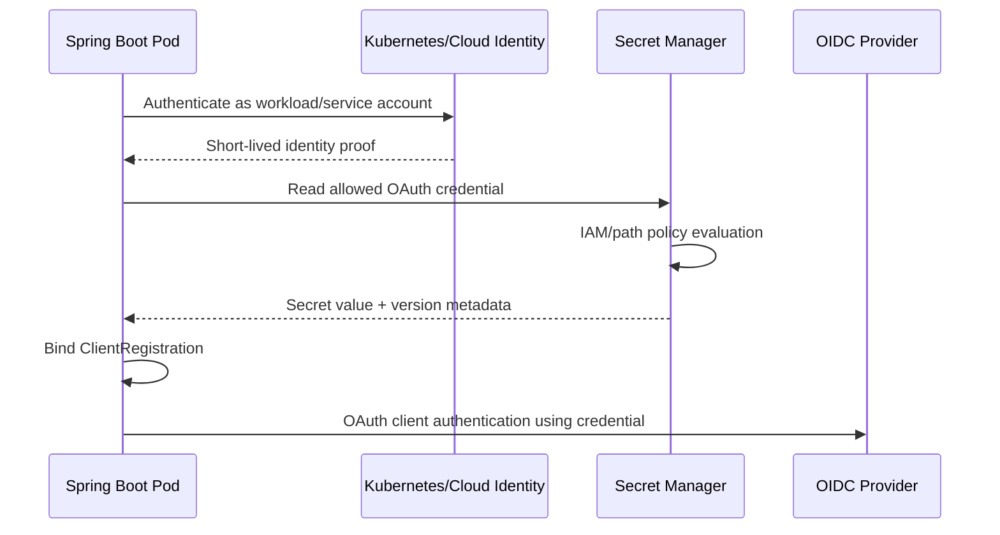
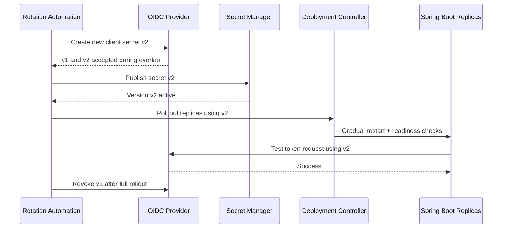

# 32.4. Cấp phát secrets và cấu hình từ secret manager

Một ứng dụng **Spring Security OAuth 2.0/OIDC Client** có thể chạy ổn trong môi trường phát triển khi `client-id`, `client-secret` và `issuer-uri` được ghi trực tiếp vào `application.yml`. Nhưng ở production, cách làm đó nhanh chóng tạo ra rủi ro: secrets lọt vào Git, file build, container image, CI logs, ticket hỗ trợ hoặc bản sao cấu hình trên nhiều máy chủ.

Khi triển khai thật, OAuth client credentials nên được quản lý bằng **secret manager** hoặc một cơ chế cấp phát bí mật có kiểm soát, ví dụ HashiCorp Vault, AWS Secrets Manager, Azure Key Vault, Google Cloud Secret Manager, hay một secret operator/volume được cấp quyền qua Kubernetes.

Bài toán không chỉ là “đọc một chuỗi từ nơi khác thay vì YAML”. Cần trả lời:

- Ứng dụng **xác thực với secret manager** bằng cách nào mà không phải cất thêm một long-lived bootstrap secret?
- Secret được đưa vào Spring `Environment`, `ClientRegistration` hoặc OAuth token client ở thời điểm nào?
- Khi **rotate client secret**, các replicas, authorization callbacks đang chờ và background refresh tasks có tiếp tục hoạt động không?
- Nếu secret manager mất kết nối, ứng dụng nên khởi động thất bại hay dùng một bản cache?
- Làm sao không vô tình gửi secrets, refresh tokens hoặc private keys vào logs, Actuator endpoints, heap dumps và diagnostics?
- Nếu có nhiều tenants/issuers, credential của tenant A có thể bị đọc hoặc dùng cho tenant B không?

Trong bài này, **secret manager** là nơi lưu trữ/cấp phát giá trị bí mật có chính sách authentication, authorization, audit và rotation. Nó khác với việc chỉ lưu chuỗi ở một biến môi trường hoặc một Kubernetes Secret, dù các hình thức đó có thể là **kênh phân phối** từ secret manager tới ứng dụng.

---

## 1. Mục tiêu học tập

Sau bài học, bạn có thể:

1. Phân loại những bí mật thực sự phải bảo vệ trong OAuth2/OIDC Client.
2. Phân biệt `client_id`, `client_secret`, issuer metadata, private key và access/refresh tokens.
3. Giải thích mô hình **bootstrap identity → secret manager → application configuration**.
4. Sử dụng Spring Boot externalized configuration để truyền secret mà không commit vào source.
5. So sánh cách cấp phát bằng environment variables, file mounts, `configtree:` và native secret-manager integration.
6. Hiểu cách dùng Spring Cloud Vault hoặc secret-manager client theo nguyên tắc least privilege.
7. Biết các giới hạn của Kubernetes Secrets, External Secrets Operator và CSI volume.
8. Thiết kế đường đọc secrets của multi-tenant OAuth registrations.
9. Xoay vòng client secret, `private_key_jwt` key và mTLS certificate mà không trộn các security domains.
10. Phân tích ảnh hưởng lên các flow `authorization_code`, `refresh_token` và `client_credentials`.
11. Thiết kế fail-closed, bootstrap readiness, retry/backoff và emergency rollback.
12. Thiết lập audit, redaction, test và runbook cho vận hành production.

## 2. Bối cảnh triển khai

Giả sử một ứng dụng BFF/Relying Party:

```text
Public app:
  https://portal.example.org

Issuer:
  https://login.example.org/realms/company

Registration ID:
  company

OAuth client ID:
  portal-prod

Client authentication:
  client_secret_basic

Redirect URI:
  https://portal.example.org/login/oauth2/code/company
```

Một cấu hình demo thường thấy:

```yaml
spring:
  security:
    oauth2:
      client:
        registration:
          company:
            provider: company
            client-id: portal-prod
            client-secret: hard-coded-secret-NOT-FOR-PRODUCTION
            client-authentication-method: client_secret_basic
            authorization-grant-type: authorization_code
            redirect-uri: "{baseUrl}/login/oauth2/code/{registrationId}"
            scope: openid,profile,email
        provider:
          company:
            issuer-uri: https://login.example.org/realms/company
```

Ở production, **giá trị `client-secret` không được ghi nguyên văn vào repository**. Nếu một secret đã từng được commit, chỉ xóa dòng đó khỏi Git hiện tại chưa đủ: secret còn có thể tồn tại trong Git history, build artifacts hoặc các bản sao. Cần **revoke/rotate** credential bị lộ theo quy trình.

### 2.1. Kiến trúc cấp phát hợp lý

```mermaid
flowchart LR
    Platform["Kubernetes / VM / Cloud platform"]
    Identity["Workload identity / service account"]
    SM["Secret manager"]
    Delivery["Config integration / env / mounted file"]
    App["Spring Boot OAuth2 Client"]
    OP["OIDC Provider / Token Endpoint"]

    Platform --> Identity
    Identity -->|"short-lived authenticated identity"| SM
    SM -->|"least-privilege secret values"| Delivery
    Delivery -->|"Spring Environment / ClientRegistration"| App
    App -->|"client authentication + OAuth grant"| OP
```



Điểm then chốt: ứng dụng lấy được OAuth credential nhờ **danh tính workload**, không phải vì bên trong image đã có sẵn một master secret đọc được mọi credential.

## 3. Secret nào cần đưa vào secret manager?

Không phải mọi thuộc tính trong một `ClientRegistration` đều bí mật.

| Dữ liệu | Thường là secret? | Nơi quản lý gợi ý |
|---|---|---|
| `registrationId` | Không | Cấu hình versioned |
| `client_id` | Thường không phải secret | Cấu hình, registry |
| `client_secret` | **Có** | Secret manager |
| `issuer-uri` | Không phải secret, nhưng **security-sensitive** | Trusted versioned config |
| `authorization-uri` | Không phải secret | Trusted provider metadata |
| `token-uri` | Không phải secret, nhưng cần trust | Trusted provider metadata |
| `jwk-set-uri` | Không phải secret | Trusted discovery/config |
| `redirect-uri` | Không phải secret, nhưng security-critical | Versioned config + OP registration |
| `scope` | Không | Versioned policy/config |
| Private key dùng `private_key_jwt` | **Có** | KMS/HSM/secret manager, policy hạn chế xuất khóa |
| mTLS client private key | **Có** | KMS/PKI/secret store |
| mTLS client certificate | Public hơn private key | Certificate lifecycle/PKI |
| Access token của user | **Có** | Protected authorized-client token store |
| Refresh token của user | **Có, mức nhạy cảm cao** | Encrypted authorized-client store |
| Authorization code | Credential ngắn hạn | Chỉ giữ trong protocol transaction; không log |
| PKCE code verifier | Bí mật cho mỗi transaction | Session/authorization request store |
| OIDC `state`/`nonce` | Giá trị correlation cần bảo vệ | Authorization transaction/session, không phải long-lived config |
| Token signing public JWKS | Không | OP-hosted public endpoint |
| Token signing private key của OP | **Có**, nhưng thuộc OP | OP/KMS/HSM, không nên đưa vào RP |

### 3.1. Client ID không đồng nghĩa client secret

`client_id` định danh OAuth client, thường xuất hiện trong browser authorization URL. Nó không phải một password.

`client_secret` là credential được OP dùng để xác thực **confidential client** ở Token Endpoint. Nếu bị lộ, kẻ tấn công có thể lợi dụng trong các điều kiện phù hợp với các grants/policies đang bật.

### 3.2. Issuer URI không bí mật nhưng phải tin cậy

Nếu một request tự chọn:

```text
issuer-uri=https://attacker.example
```

ứng dụng có thể thực hiện discovery không mong muốn, SSRF hoặc gửi client authentication tới token endpoint độc hại trong một thiết kế sai.

Vì vậy, đừng để `issuer-uri` lấy từ input tùy ý chỉ vì nó không phải secret. Nó phải nằm trong **trusted client registration configuration**.

### 3.3. Refresh token không phải client secret

`client-secret` xác thực OAuth client với OP.

`refresh_token` là grant credential được cấp cho client trong ngữ cảnh authorization cụ thể. Nó phải được bảo vệ bằng **authorized-client storage** thích hợp, không trộn vào một secret manager key dùng chung cho mọi users.

### 3.4. Public clients có thể không có client secret

Mobile, native và browser public clients không thể bảo vệ một static client secret chỉ bằng cách đưa nó vào app bundle. Public clients thường sử dụng Authorization Code + PKCE và `ClientAuthenticationMethod.NONE` theo provider policy.

Không “cấp phát secret” cho public client nếu mô hình bảo mật không hỗ trợ bí mật thực sự.

## 4. Bốn lớp cần thiết kế riêng

Một triển khai an toàn phải tách:

1. **Source of truth:** nơi lưu secret có version/policy/audit.
2. **Authentication:** workload chứng minh identity để đọc secret.
3. **Delivery:** secret được đưa tới app bằng API, environment, mounted volume hoặc Spring PropertySource.
4. **Consumption/lifecycle:** Spring Security dùng giá trị trong `ClientRegistration`/token client và đổi sang version mới khi rotation.

```text
Source of truth       Authentication       Delivery        Consumption
----------------     ----------------     -------------   ---------------------
Vault / cloud SM  <-  Workload identity ->  env/configtree -> ClientRegistration
                                                |
                                                +-> token endpoint client auth
```

Chỉ thay secret store mà bỏ qua bootstrap identity hoặc runtime rotation không tạo ra một giải pháp hoàn chỉnh.

### 4.1. Mô hình tin cậy

- Browser và user input: **không đáng tin để chọn secret path**.
- Reverse proxy: chỉ đáng tin sau khi có network/forwarded-header policy.
- CI/CD: chỉ được quyền deploy và đọc những secrets cần thiết, không phải đọc mọi tenant.
- Workload service account: identity được cấp quyền theo ứng dụng/môi trường.
- Secret manager: source of truth và audit.
- Spring `Environment`: chứa secrets **trong bộ nhớ process**, vẫn cần tránh introspection/log leakage.
- OAuth Token Endpoint: một network destination đáng tin từ registration/provider metadata.

## 5. Các mô hình cấp phát phổ biến

| Mô hình | Cách hoạt động | Ưu điểm | Giới hạn |
|---|---|---|---|
| Environment variable | Platform/sidecar cung cấp `CLIENT_SECRET` | Dễ tích hợp Spring Boot | Secret nằm trong process env; update thường cần restart |
| Mounted file | Secret agent/CSI ghi file vào read-only volume | Không phải env var, có thể update file | Spring thường không tự rebind `ClientRegistration` |
| Spring `configtree:` | Mỗi file dưới thư mục map thành property | Hợp với container secrets | Thường bind lúc startup; quản lý refresh riêng |
| Spring Cloud Vault | Vault PropertySource/ConfigData | Tích hợp lifecycle/config của Spring | Phụ thuộc versions/ACL/auth/bootstrap |
| Cloud SDK/PropertySource integration | App hoặc framework đọc AWS/Azure/GCP secrets | Có thể dùng cloud IAM | Cần kiểm soát cache/retry/SDK credentials |
| External Secrets Operator | Operator đồng bộ secret manager → Kubernetes Secret | App không phải gọi manager trực tiếp | Secret còn tồn tại trong Kubernetes API/etcd |
| Secrets Store CSI Driver | Mount secret từ provider vào Pod | File-based, có rotation support tùy provider | App phải reload; provider/driver behaviors khác nhau |
| Sidecar/agent | Agent xác thực và ghi secrets ra filesystem | Tách credential fetch khỏi app | Thêm vận hành agent, file perms, reload |

Không có một mô hình tốt nhất trong mọi môi trường. Hãy chọn dựa trên blast radius, rotation requirements, failure semantics và cách tổ chức IAM.

## 6. Cấu hình Spring Boot theo nguyên tắc “định danh trong YAML, secret từ bên ngoài”

Giữ các giá trị không bí mật trong `application.yml`:

```yaml
spring:
  security:
    oauth2:
      client:
        registration:
          company:
            provider: company
            client-id: portal-prod
            client-secret: ${OIDC_COMPANY_CLIENT_SECRET}
            client-authentication-method: client_secret_basic
            authorization-grant-type: authorization_code
            redirect-uri: "https://portal.example.org/login/oauth2/code/company"
            scope:
              - openid
              - profile
              - email
        provider:
          company:
            issuer-uri: "https://login.example.org/realms/company"
```

`${OIDC_COMPANY_CLIENT_SECRET}` là placeholder của Spring, được thay bằng property/environment value do runtime cung cấp. **Không đặt default secret** ngay trong placeholder.

Tránh:

```yaml
client-secret: ${OIDC_COMPANY_CLIENT_SECRET:dev-secret}
```

ở production, vì khi biến bị thiếu ứng dụng có thể khởi động với một credential mặc định không an toàn hoặc khó chẩn đoán.

### 6.1. Secret manager không nhất thiết cung cấp property cùng tên YAML

Bạn có thể dùng manager key:

```text
prod/portal/oauth/company/client-secret
```

rồi delivery layer map sang:

```text
OIDC_COMPANY_CLIENT_SECRET
```

Không cần buộc secret manager có cùng naming convention với Spring Boot. Map này phải được versioned và chỉ admin/automation đáng tin thay đổi.

### 6.2. Spring Boot relaxed binding

Một cách khác: platform cung cấp trực tiếp:

```text
SPRING_SECURITY_OAUTH2_CLIENT_REGISTRATION_COMPANY_CLIENT_SECRET
```

Spring Boot có thể bind biến môi trường vào property:

```text
spring.security.oauth2.client.registration.company.client-secret
```

Với registration IDs chứa dấu chấm, dấu gạch ngang hoặc tên động, cần kiểm tra cách relaxed binding xử lý map keys, chữ hoa/thường và dấu phân cách. Tên registration như `company` đơn giản hơn; với nhiều tenant dynamic IDs, ưu tiên registry và test mapping cụ thể.

### 6.3. Tránh secret trong command line arguments

Không truyền:

```bash
java -jar app.jar --spring.security.oauth2.client.registration.company.client-secret=REAL_SECRET
```

vì process arguments có thể hiển thị qua process listing, diagnostics hoặc CI logs. Chọn secure delivery channel thay vì command line.

## 7. Spring Boot PropertySources và thời điểm cấp phát

Spring Boot có nhiều cấu hình có thể cùng định nghĩa một property:

```text
application.yml
environment variables
configtree imports
external ConfigData sources
system properties
command-line arguments
custom PropertySources
```

Thứ tự ưu tiên thực tế phụ thuộc Spring Boot version, config-data import location và property source ordering.

### 7.1. Tránh tình trạng nguồn này vô tình ghi đè nguồn khác

Ví dụ:

```text
Vault:
  client-secret = secret-v2

Container environment:
  CLIENT_SECRET = secret-v1
```

Nếu code binding lấy giá trị cũ từ một property source có ưu tiên cao hơn, secret manager đã rotate nhưng app vẫn dùng v1.

Cần xác định rõ **một nguồn có thẩm quyền** cho mỗi credential và test property binding ở môi trường triển khai.

### 7.2. Khi nào ClientRegistration được tạo?

Spring Boot có thể bind `OAuth2ClientProperties` và tạo `ClientRegistrationRepository` trong giai đoạn application context startup.

Nếu secret chưa được cung cấp đúng lúc, có thể xuất hiện:

- Placeholder không resolve.
- ClientRegistration thiếu secret.
- OAuth2 login/refresh báo `invalid_client`.
- Context startup fail tùy binding/validation.

**Việc mount một file sau khi bean đã tạo không tự đảm bảo Spring Security sử dụng secret mới.**

### 7.3. Boot property là cấu hình runtime, không phải nơi lưu an toàn tuyệt đối

Sau khi bind, giá trị client secret có thể tồn tại trong heap/process memory. Secret manager giảm rủi ro lưu trữ/phân phối, nhưng không loại bỏ nguy cơ memory dump, debug endpoint hoặc in nhầm object.

## 8. Mô hình A: environment variable do platform cấp

Ví dụ môi trường runtime cấp:

```text
OIDC_COMPANY_CLIENT_SECRET=<redacted value>
```

Spring Boot đọc qua:

```yaml
client-secret: ${OIDC_COMPANY_CLIENT_SECRET}
```

Ưu điểm:

- Dễ áp dụng.
- Không cần app trực tiếp sử dụng secret manager SDK.
- Spring Boot startup/binding giữ nguyên.
- Secrets có thể được platform/CD pipeline injection.

### 8.1. Giới hạn bảo mật của environment variables

Environment variables không được mặc định coi là “mã hóa”. Giá trị có thể bị đọc bởi:

- Process có quyền debug/inspect tương ứng.
- Crash dump/heap dump.
- Endpoint xuất environment/config.
- CI/CD logs hoặc workflow steps in biến.
- Container orchestrator metadata hoặc host tooling có quyền cao.
- Child processes nhận môi trường kế thừa.

Nếu threat model yêu cầu giảm thời gian secrets tồn tại trong process environment, dùng file mounts, agent hoặc non-exportable key operations.

### 8.2. Update thường không tự có hiệu lực

Một process đang chạy thường không thấy environment variable mới chỉ vì secret manager đổi giá trị. Với env delivery, **rolling restart** hoặc một lifecycle refresh rõ ràng thường cần thiết.

### 8.3. Không dùng echo để debug secret

Tránh:

```bash
echo "$OIDC_COMPANY_CLIENT_SECRET"
```

trong CI logs hoặc production shell. Kiểm tra property có được cấp hay chưa bằng cơ chế **presence/metadata** không in giá trị.

## 9. Mô hình B: mounted file và configtree

Nếu platform mount secret dưới file:

```text
/run/secrets/oidc/
└── spring.security.oauth2.client.registration.company.client-secret
```

nội dung file là **giá trị secret** (không có JSON wrapper, trừ khi bạn tự parse).

Spring Boot có thể import một config tree:

```yaml
spring:
  config:
    import: "configtree:/run/secrets/oidc/"
```

Và registration chỉ khai báo các thuộc tính không bí mật:

```yaml
spring:
  security:
    oauth2:
      client:
        registration:
          company:
            provider: company
            client-id: portal-prod
            client-authentication-method: client_secret_basic
            authorization-grant-type: authorization_code
            redirect-uri: "https://portal.example.org/login/oauth2/code/company"
            scope: openid,profile,email
        provider:
          company:
            issuer-uri: "https://login.example.org/realms/company"
```

### 9.1. Vì sao tên file có dấu chấm?

Trong `configtree:`, tên file được đưa thành property key. File:

```text
spring.security.oauth2.client.registration.company.client-secret
```

đại diện property mà Spring OAuth2 client registration binding cần.

### 9.2. Mount read-only và quyền file

Trong production:

- Mount read-only nếu platform hỗ trợ.
- UID/GID của app chỉ có quyền cần thiết để đọc.
- Hạn chế quyền truy cập của sidecars và debug pods.
- Không mount toàn bộ secrets của nhiều ứng dụng/tenants trong một Pod.
- Không đưa volume này vào container image hoặc artifact upload.

### 9.3. Tránh secret xuất hiện dưới cả hai đường

Nếu YAML placeholder đọc environment **và** configtree đồng thời ghi cùng property, dễ gây tranh chấp độ ưu tiên. Chọn một mapping rõ.

### 9.4. Refresh file không đồng nghĩa refresh bean

Một CSI driver/agent có thể cập nhật file tại thời điểm rotation. Spring Boot `ConfigData`/`ClientRegistrationRepository` thường không tự thay object `ClientRegistration` đã bind.

Cần rolling restart hoặc cơ chế refresh có kiểm soát và được kiểm thử. Không tuyên bố “CSI rotation bật là OAuth client tự dùng secret mới”.

## 10. Kubernetes Secret là gì trong kiến trúc này?

Kubernetes `Secret` là một API resource để chuyển dữ liệu nhạy cảm tới Pods. Nó **không đồng nghĩa** với một managed secret manager có policies/version history/HSM operations.

Ví dụ secret có thể được ứng dụng đọc qua `secretKeyRef`:

```yaml
apiVersion: apps/v1
kind: Deployment
metadata:
  name: portal
spec:
  replicas: 3
  selector:
    matchLabels:
      app: portal
  template:
    metadata:
      labels:
        app: portal
    spec:
      serviceAccountName: portal-oidc
      containers:
        - name: app
          image: registry.example/portal:1.2.3
          env:
            - name: OIDC_COMPANY_CLIENT_SECRET
              valueFrom:
                secretKeyRef:
                  name: portal-oidc-client
                  key: client-secret
```

Đây chỉ là phần Deployment liên quan injection, chưa phải manifest production hoàn chỉnh.

### 10.1. Không commit Secret chứa dữ liệu thật

Một manifest `Secret` có `data:` base64 không phải được mã hóa an toàn chỉ vì không đọc được bằng mắt.

Không commit:

```yaml
data:
  client-secret: <base64-of-real-secret>
```

vào Git, kể cả repo private, trừ khi có giải pháp encryption/sops/sealed secret được áp dụng theo security policy.

### 10.2. RBAC và encryption at rest

Kubernetes Secrets cần:

- Namespace/RBAC hạn chế quyền `get/list/watch`.
- Encryption at rest cho etcd theo platform policy.
- Không chia sẻ service account có quyền đọc toàn bộ namespace.
- Kiểm tra admission policies và audit logs.
- Chặn debug/exec không cần thiết vào Pod chứa secrets.
- Cô lập network và workloads theo tenant/security boundary.

### 10.3. Secret cập nhật không tự sửa environment trong Pod

Nếu Kubernetes Secret được cập nhật, **environment variable đã inject vào một container đang chạy thường không đổi**. Cần rollout restart hoặc controller theo dõi thay đổi để restart Pods một cách có kiểm soát.

## 11. Mô hình C: External Secrets Operator

Một kiến trúc:

```text
AWS/Azure/GCP/Vault Secret Manager
    |
    v
External Secrets Operator
    |
    v
Kubernetes Secret
    |
    v
Pod env vars / volume
    |
    v
Spring Boot ClientRegistration
```

Operator dùng workload identity/credentials được cấp cho chính operator hoặc resource, đọc secret từ external manager rồi đồng bộ vào Kubernetes Secret theo policy.

### 11.1. Ưu điểm

- Ứng dụng không phải tích hợp SDK của từng provider.
- Secret manager vẫn là source of truth.
- Có thể đồng bộ versions/refresh intervals.
- Dễ dùng `secretKeyRef`/mounted volumes.
- App chỉ cần Spring Boot standard externalized configuration.

### 11.2. Giới hạn

- Secret tồn tại trong Kubernetes API/etcd sau đồng bộ.
- Operator có quyền đọc external secrets; phải bảo vệ identity/namespace isolation.
- Refresh interval không đảm bảo ứng dụng dùng secret mới ngay.
- Lỗi operator hoặc IAM có thể làm secret stale.
- CRD schemas/API versions thay đổi giữa các bản External Secrets Operator.

### 11.3. Pseudocode resource

```yaml
# PSEUDOCODE — API version, fields và secret-store references
# phải được đối chiếu với bản External Secrets Operator đang chạy.
apiVersion: external-secrets.io/v1
kind: ExternalSecret
metadata:
  name: portal-oidc-client
spec:
  refreshInterval: 1h
  secretStoreRef:
    name: production-secret-store
    kind: SecretStore
  target:
    name: portal-oidc-client
  data:
    - secretKey: client-secret
      remoteRef:
        key: prod/portal/oidc/company
        property: client-secret
```

Nếu API version ở cluster là `v1beta1` hoặc schema khác, phải điều chỉnh. Mẫu này minh họa **mapping**, không có credential thật.

### 11.4. Không cho tenant tự chọn arbitrary remoteRef

Một external secret resource được tạo theo user input không kiểm soát có thể cấp phát credentials của tenant khác. Hạn chế ai được tạo `ExternalSecret` và policy remote paths.

## 12. Mô hình D: Secrets Store CSI Driver

CSI driver có thể mount secrets trực tiếp dưới dạng filesystem vào container:

```text
External secret manager
   |
   v
Secrets Store CSI Provider
   |
   v
Pod volume: /run/secrets/oidc/client-secret
   |
   v
Spring configuration binding
```

Một số providers có rotation/reconciliation options, nhưng app phải hiểu khi file đổi.

### 12.1. Lợi ích

- Không nhất thiết tạo Kubernetes `Secret` nếu dùng trực tiếp mounted files.
- Dễ áp dụng `configtree:` hoặc đọc file riêng.
- Có thể áp dụng filesystem permissions.
- Có thể được cập nhật qua provider rotation.

### 12.2. Rủi ro

- Secret tồn tại dưới dạng plaintext bytes trong Pod filesystem/volume.
- Sidecar/container có quyền đọc volume có thể đọc secrets.
- Không có automatic Spring `ClientRegistration` rebind mặc định.
- Startup có thể race nếu mount/provider chưa sẵn sàng.
- Một số rotation mechanisms dùng atomic symlink update; file watchers có thể cần quan sát parent directory, không chỉ inode cũ.

### 12.3. Điều kiện vận hành

Phải test:

1. Volume ready trước app startup.
2. App đọc đúng key và file path.
3. Runtime user có permission.
4. File contents không bị thêm wrapper/encoding sai.
5. Secret update tới Pod.
6. App thực sự sử dụng new version sau restart/refresh.
7. Failure khi provider tạm mất có policy rõ.

## 13. Mô hình E: Spring Cloud Vault

Với HashiCorp Vault, Spring Cloud Vault có thể đóng vai trò ConfigData/PropertySource để đưa secret vào Spring Environment. Tùy Spring Boot/Spring Cloud versions, có thể sử dụng `spring.config.import`.

Một cấu hình **minh họa**:

```yaml
spring:
  application:
    name: portal-prod
  config:
    import: "vault://"
  cloud:
    vault:
      uri: "https://vault.internal.example"
      authentication: KUBERNETES
      kubernetes:
        role: portal-prod
      kv:
        enabled: true
        backend: secret
        application-name: portal-prod
```

Cấu hình này có ý nghĩa:

- App gọi Vault qua HTTPS.
- Vault dùng Kubernetes authentication để xác minh service account/workload.
- KV backend cung cấp properties được mapping vào Spring Environment.
- `spring.security.oauth2.client.registration.company.client-secret` có thể được cung cấp từ trusted Vault secret path/property.

### 13.1. Phiên bản và KV path

Spring Cloud Vault hỗ trợ KV version/path, contexts/application names, profiles và namespace settings tùy version.

Nếu dùng KV v2, API path thực tế và CLI path có thể khác:

```text
Logical KV mount:
  secret/

Application context:
  portal-prod

Value:
  spring.security.oauth2.client.registration.company.client-secret
```

Đừng copy một path cho mọi hệ thống rồi kết luận Vault “không tìm thấy secret”. Kiểm tra mount KV v1/v2, context resolution và profile-specific paths của Spring Cloud Vault version đang chạy.

### 13.2. Bootstrap chicken-and-egg

Ứng dụng phải xác thực vào Vault **trước khi lấy OAuth client secret**.

Đừng cấu hình:

```text
VAULT_TOKEN=<permanent root token embedded in image>
```

Một hướng tốt hơn là dùng Kubernetes ServiceAccount JWT, AWS IAM, Azure Managed Identity hoặc authentication method tương đương.

### 13.3. Vault policies

Ví dụ một ứng dụng chỉ cần:

```text
secret/data/portal-prod/*
```

không được đọc:

```text
secret/data/portal-other/*
secret/data/root/*
secret/data/all-tenants/*
```

Policy phải dựa path/capability thực tế của Vault KV version. Ví dụ path ở đây minh họa ranh giới, không thay policy engine configuration đầy đủ.

### 13.4. Không dùng Vault root token trong production app

Root/admin tokens có quyền quá rộng. Cấp token/identity short-lived theo service account và để Vault quản lý audit/expiration/revocation.

## 14. Cloud secret managers: mô hình chung

Ba ví dụ phổ biến:

- **AWS Secrets Manager** kết hợp IAM roles for workload identity, hoặc IRSA/EKS Pod Identity tùy EKS setup.
- **Azure Key Vault** kết hợp Managed Identity/Workload Identity.
- **Google Cloud Secret Manager** kết hợp workload identity/service account.

Các chi tiết SDK, ConfigData starters, Spring Cloud integration và Kubernetes operators khác nhau theo phiên bản, nhưng kiến trúc giống nhau:

```text
Workload identity
  -> cloud IAM evaluation
  -> get secret version
  -> secret value
  -> Spring property / ClientRegistration
```

### 14.1. Một secret nên chứa gì?

Có hai chiến lược:

**Một field riêng:**

```text
prod/portal/company/client-secret
  -> <secret value>
```

**Một JSON secret:**

```json
{
  "client_id": "portal-prod",
  "client_secret": "<redacted>",
  "version": "v7"
}
```

Nếu JSON chứa nhiều fields, delivery/PropertySource phải parse và map đúng. Tránh đặt secret manager key names do browser chỉ định.

### 14.2. Version pinning và alias

Một số secret managers cho phép tham chiếu:

```text
latest/current
specific immutable version
staged version such as AWSCURRENT / AWSPREVIOUS
```

Không dùng `latest` một cách mù quáng nếu rollout cần xác định version cố định. Ngược lại, pin vĩnh viễn một version cũ sẽ chặn rotation.

Chọn một chiến lược: versioned rollout, metadata alias có kiểm soát, và khả năng rollback.

### 14.3. IAM roles cần chi tiết đến resource

App Portal production nên chỉ có quyền đọc secret của Portal production. Không trao quyền `secretsmanager:GetSecretValue`/`Secret Manager Secret Accessor` hoặc tương đương trên toàn organization nếu không cần.

### 14.4. Không cấp write/delete nếu app chỉ cần read

OAuth client runtime thường chỉ **đọc** secret. Quyền rotate/create/delete thuộc automation/admin workflow khác, không nằm trong runtime role mặc định.

## 15. Bootstrap identity: không cất một master secret để lấy một secret khác

Một anti-pattern:

```text
application.yml:
  secret-manager-password: permanent-master-password

Secret manager:
  oauth-client-secret: ...
```

Bạn đã chuyển rủi ro từ một secret sang secret khác mà không cải thiện trust boundary.

### 15.1. Workload identity

Một hướng tốt:



### 15.2. Tính chất mong muốn

- Identity được cấp từ môi trường đáng tin.
- Token bootstrap ngắn hạn, có thể revoke.
- Không commit static cloud access keys.
- IAM policy có resource scope hẹp.
- Audit được workload nào đọc secret nào.
- Application có thể rotate secret mà không cần sửa source.
- Metadata như secret version/age được quan sát không tiết lộ value.

### 15.3. Kubernetes ServiceAccount không đủ nếu RBAC/IAM sai

Nếu nhiều Pods dùng cùng service account có quyền đọc mọi secret, một Pod bị compromise có thể có blast radius lớn. Dùng service account theo ứng dụng/môi trường, cùng cloud/Vault role mapping riêng.

## 16. Không cho caller chọn secret path

Sai:

```java
@GetMapping("/tenant/login")
String login(@RequestParam String tenant) {
    String path = "secrets/" + tenant + "/oidc/client-secret";
    String secret = secretManager.read(path);
    // ...
}
```

Nếu tenant là arbitrary input, caller có thể dò hoặc lạm dụng mapping, thậm chí đọc credential của tenant khác khi IAM role quá rộng.

### 16.1. Thiết kế đúng

```text
Untrusted tenant hint
   |
   v
Trusted tenant registry
   |
   v
Approved registration ID
   |
   v
Approved secret reference
   |
   v
IAM-authorized secret read
```

Mapping thay đổi qua admin/onboarding workflow đã xác thực. User không được truyền full secret path, issuer URL hoặc token endpoint vào runtime.

### 16.2. Secret reference không phải credential

Registry có thể lưu:

```text
registrationId=alpha-oidc
clientId=alpha-portal-prod
issuerUri=https://id.alpha.example
secretRef=secret://prod/portal/tenants/alpha/client-secret
```

`secretRef` chỉ là địa chỉ có policy; code vẫn cần IAM authorization để đọc value.

### 16.3. Multi-tenant blast radius

Với hàng trăm tenant registrations, cân nhắc identity/role per tenant hoặc ít nhất theo nhóm trust boundaries. Đừng để một bug lookup có thể lấy mọi tenant credentials.

## 17. ClientRegistration và secret rotation

Spring Security dùng `ClientRegistration` để lưu client ID, client authentication method, endpoints và thông tin client secret.

Ví dụ:

```java
ClientRegistration registration =
    ClientRegistration.withRegistrationId("company")
        .clientId("portal-prod")
        .clientSecret(secretFromTrustedSource)
        .clientAuthenticationMethod(
            ClientAuthenticationMethod.CLIENT_SECRET_BASIC)
        .authorizationGrantType(
            AuthorizationGrantType.AUTHORIZATION_CODE)
        .authorizationUri("https://login.example.org/authorize")
        .tokenUri("https://login.example.org/token")
        .redirectUri("https://portal.example.org/login/oauth2/code/company")
        .scope("openid", "profile", "email")
        .build();
```

`secretFromTrustedSource` là giá trị đã được secret delivery layer cấp, không lấy từ request.

### 17.1. Object đã bind không tự đổi

Nếu manager đổi value trong Vault từ v1 sang v2 nhưng application `ClientRegistrationRepository` vẫn giữ object v1, Token Endpoint tiếp tục nhận client authentication bằng v1.

### 17.2. Kiểm tra ứng dụng có thực sự dùng v2

Không chỉ kiểm tra “Vault đã có version v2”. Cần xác nhận:

- File/env/config source đã được cập nhật.
- Runtime đã refresh/restart theo chiến lược.
- `ClientRegistration` dùng đúng credential version.
- Token Endpoint chấp nhận version mới.
- Các Pods không còn dùng version cũ ngoài thời gian overlap.

### 17.3. Không log toàn bộ ClientRegistration

`ClientRegistration` có thể chứa client secret. Không in object bằng `toString()` hay serialize nó ra diagnostic endpoint.

## 18. Rotation client secret: luồng chuẩn có thời gian overlap

Kịch bản: provider hỗ trợ **hai client secrets cùng có hiệu lực** trong một giai đoạn ngắn.



### 18.1. Các bước triển khai

1. Kiểm tra OP có hỗ trợ credential overlap không.
2. Tạo secret mới bên OP.
3. Ghi version mới vào secret manager.
4. Kích hoạt delivery/sync cho runtime.
5. Rolling restart/refresh các application replicas.
6. Theo dõi `invalid_client`, token acquisition errors và readiness.
7. Xác nhận mọi replicas dùng version mới.
8. Revoke phiên bản cũ sau giai đoạn an toàn.
9. Audit và cập nhật lịch rotation.

### 18.2. Nếu OP không hỗ trợ overlap?

Có khả năng brief outage nếu đổi secret ở OP trước khi ứng dụng được cập nhật. Cần lên kế hoạch maintenance/blue-green/atomic cutover phù hợp khả năng của OP và deployment platform.

Không khẳng định zero-downtime rotation khi provider chỉ hỗ trợ một active client secret.

### 18.3. Authorization Code Flow đang chờ callback

Một browser đã bắt đầu login khi RP dùng v1, rồi quay lại callback sau khi OP đổi secret. Token Endpoint sẽ kiểm tra client authentication ở thời điểm callback.

Nếu v1 đã bị revoke và replica chưa có v2, có thể trả `invalid_client`. Overlap/rollout giúp giảm lỗi pending login transactions.

### 18.4. Refresh token flow cũng dùng client authentication

Khi access token hết hạn, RP gửi refresh token grant. Với confidential clients, Token Endpoint thường xác thực client. Secret rotation sai có thể làm refresh fail hàng loạt.

## 19. Multi-node consistency khi rotate

Một hệ thống có ba replicas:

```text
Node A -> client-secret v2
Node B -> client-secret v1
Node C -> client-secret v2
```

Nếu OP chỉ chấp nhận v2, requests qua Node B có thể thất bại ngẫu nhiên tùy load balancing.

### 19.1. Chỉ số nên theo dõi

- Số replicas ready.
- Credential version metadata của mỗi replica.
- Thời điểm last secret refresh/restart.
- `invalid_client` theo app instance/registration.
- Token Endpoint latency/status.
- Số pending authorization requests nếu có.
- Authorized-client refresh failure rate.

**Không đưa actual secret value vào metrics.** Có thể dùng version ID không nhạy cảm để quan sát deployment skew.

### 19.2. Config reload phải atomic

Đừng cập nhật client ID trước rồi secret sau, hoặc token endpoint trước rồi issuer sau trong hai bước có thể quan sát. Nếu registration cần nhiều fields thay đổi đồng thời, dùng **immutable versioned config snapshot**.

### 19.3. Rollback

Nếu v2 gây lỗi:

1. Đánh giá v1 còn được OP chấp nhận không.
2. Nếu có, quay lại last-known-good config version theo policy.
3. Nếu đã revoke v1, không giả định rollback vẫn khả thi.
4. Điều tra vì sao secret v2 không được chấp nhận.
5. Không phát tán lại credential đã bị lộ.

## 20. Rotation private_key_jwt và mTLS khác client_secret

Không phải OAuth client authentication nào cũng sử dụng `client_secret_basic`.

| Phương thức | Bí mật cần bảo vệ | Operation khi rotation |
|---|---|---|
| `client_secret_basic` | Shared client secret | Publish new secret, roll out, revoke old |
| `client_secret_post` | Shared client secret | Tương tự; chú ý body logging |
| `client_secret_jwt` | Shared HMAC secret | Rotate secret và assertion signing config |
| `private_key_jwt` | Client signing private key | Key rollover, `kid`, public JWK registration tại OP |
| mTLS client auth | TLS private key + certificate | Certificate/chain replacement, client mapping tại OP |
| `none` (public client) | Không có static confidential client credential | Dùng PKCE/appropriate client policy |

### 20.1. private_key_jwt

Một JWT client assertion có những claims quan trọng:

```json
{
  "iss": "portal-prod",
  "sub": "portal-prod",
  "aud": "https://login.example.org/token",
  "iat": 1794800000,
  "exp": 1794800300,
  "jti": "<unique-id>"
}
```

Nó được ký bằng private key của client và gửi đến Token Endpoint. OP xác minh public key/JWK đã được đăng ký.

Secret manager có thể giữ private key hoặc KMS/HSM hỗ trợ signing operation mà không export private key. Khi có thể, **non-exportable keys** giúp giảm rủi ro tiết lộ key material.

### 20.2. mTLS

Với mTLS, cần quản lý:

- Private key của client.
- Certificate chain và trusted roots.
- Certificate renewal.
- Mapping certificate với OAuth client registration.
- HTTP client TLS configuration.
- Đồng bộ key/cert pair khi rollout.
- Kết nối Token Endpoint thực sự sử dụng đúng client certificate.

Không chỉ thay file certificate mà quên thay private key hoặc keystore configuration.

### 20.3. Không để JWKS public key trong secret manager như thể đó là client secret

JWKS do OP công bố chứa public signing keys cho RP xác minh ID Tokens. Nó không phải confidential client secret của RP; OP private signing key thuộc OP và không được RP yêu cầu.

## 21. Auth method phải khớp với bí mật được cấp

Một registration:

```yaml
spring:
  security:
    oauth2:
      client:
        registration:
          company:
            client-authentication-method: client_secret_basic
```

sẽ dùng client secret khác với một registration yêu cầu `private_key_jwt`.

### 21.1. invalid_client sau rotation có thể không phải sai secret value

Nguyên nhân:

- Secret đúng nhưng `client-authentication-method` sai.
- Client ID thuộc realm khác.
- Token Endpoint URL sai.
- Key/`kid`/certificate chưa được OP đăng ký.
- Secret version chưa rollout đến một replica.
- Request bị proxy xóa HTTP Authorization header.
- Signature assertion có `aud` sai.
- Client bị disable ở OP.

Runbook phải xem **registration metadata, auth method và secret version** thay vì chỉ yêu cầu đội vận hành “paste lại secret”.

### 21.2. Không chuyển từ Basic sang POST để thử tùy tiện

Với `client_secret_post`, secret nằm trong request body và có thể bị log bởi gateway/HTTP debug. Chỉ đổi method theo OP contract và security requirements.

### 21.3. Không tự cấp secret cho client_credentials bằng test token

Client Credentials Grant vẫn phải được AS xác thực. Test fixtures không thay credential management production.

## 22. Access/refresh token storage là một vấn đề liên quan nhưng riêng

`OAuth2AuthorizedClient` chứa:

```text
ClientRegistration
principalName
accessToken
optional refreshToken
```

Spring Security thường lưu authorized clients qua:

- `OAuth2AuthorizedClientRepository` trong Servlet request/session.
- `OAuth2AuthorizedClientService`, có thể backed by memory/JDBC/custom storage.

### 22.1. Tại sao không đưa từng refresh token vào cùng client-secret key?

Client secret:

```text
prod/portal/company/client-secret
```

Refresh token của user:

```text
registrationId=company
principalName=user-725
refreshToken=RT-1
```

Chúng có lifecycle, ownership và revocation semantics khác nhau. Nếu mỗi refresh token được lưu vào secret manager chung, cần thiết kế concurrency, tenant isolation, throughput và cleanup cẩn thận; đây không phải lựa chọn mặc định của Spring Security.

### 22.2. Bảo vệ refresh token trong token store

- Encryption at rest/KMS theo policy.
- Least-privilege database permissions.
- Hạn chế log/serialize `OAuth2AuthorizedClient`.
- Phân vùng theo registration/principal/tenant.
- Hỗ trợ refresh token rotation và conditional update/delete.
- Quy trình revoke/delete khi logout, user disconnect hoặc tenant disable.

### 22.3. Secret manager outage và token store outage khác nhau

App có thể khởi động với client secret đã cấp nhưng token database tạm lỗi, hoặc ngược lại. Monitoring/runbook nên tách hai nguồn lỗi.

## 23. Startup fail-closed khi secret thiếu

Nếu một OAuth registration **bắt buộc** để ứng dụng hoạt động, không nên khởi động ở trạng thái “sẵn sàng” khi secret chưa được cấp.

Ví dụ sai:

```java
String clientSecret =
    env.getProperty("OIDC_COMPANY_CLIENT_SECRET", "default-secret");
```

Cách an toàn hơn về nguyên tắc:

```java
String clientSecret =
    env.getRequiredProperty("OIDC_COMPANY_CLIENT_SECRET");

if (clientSecret.isBlank()) {
    throw new IllegalStateException(
        "Required OIDC client credential is missing");
}
```

Đừng đưa secret value vào exception message.

### 23.1. Kiểm tra bằng Spring ConfigurationProperties

Nếu ứng dụng có custom configuration abstraction:

```java
import org.springframework.boot.context.properties.ConfigurationProperties;
import jakarta.validation.constraints.NotBlank;

@ConfigurationProperties(prefix = "app.oidc")
public record OidcSecrets(
    @NotBlank String clientSecret
) {}
```

Đây là một example custom property class. Để validation hoạt động, cần JSR/Jakarta Bean Validation dependency và `@Validated`/configuration binding setup tương ứng. Nó không tự thay thế Boot OAuth2 Client properties nếu bạn không có mapping code.

### 23.2. Không validate bằng cách log secret

Sai:

```java
log.info("Loaded OIDC secret: {}", clientSecret);
```

Đúng:

```java
log.info("Required OIDC credential loaded: registration={}",
         "company");
```

Nếu cần xác nhận rotation, ghi **non-secret version identifier** từ secret manager, không hash secret một cách ngây thơ rồi phát tán fingerprint ngoài phạm vi cần thiết.

### 23.3. Readiness khác liveness

- **Liveness:** process vẫn sống và event loop/HTTP server đang vận hành.
- **Readiness:** process có đủ cấu hình và những dependencies thiết yếu để nhận traffic đúng policy.

Nếu thiếu bắt buộc secret, startup fail hoặc readiness fail có thể hợp lý. Đừng đặt liveness probe phụ thuộc trực tiếp vào mọi external secret manager request, vì outage tạm thời có thể gây restart storm.

## 24. Nếu secret manager không khả dụng?

Có các khả năng:

1. Không đọc được secret lúc bootstrap.
2. Secret manager trả 403 do IAM.
3. Secret path không tồn tại.
4. Secret version bị revoked/deleted.
5. Network timeout/TLS trust failure.
6. Manager đang rate limit.
7. Manager trả dữ liệu sai định dạng.
8. Secret có nhưng không được OP chấp nhận.
9. Token rotation xảy ra trong khi manager unreachable.
10. Local cache có stale secret.

### 24.1. Fail-closed không có nghĩa retry vô hạn

Nếu bootstrap không có credential tin cậy, không nên tự dùng default secret hoặc tắt OAuth authentication. Tuy nhiên, retry có thể áp dụng cho lỗi transient với:

- Exponential backoff và jitter.
- Bounded attempts/deadline.
- Rate-limit awareness.
- Circuit breaker khi phù hợp.
- Clear readiness/error status.
- Không spam secret manager hoặc OP.

### 24.2. Lỗi 403 khác lỗi 503

**403/permission denied:** IAM/policy/identity sai. Retry không điều kiện không sửa được.

**503/network timeout:** có thể transient; bounded retry hợp lý trước khi fail/recover theo policy.

### 24.3. Last-known-good cache

Một ứng dụng có thể cache secret version đã được xác thực để giảm dependency runtime. Nhưng đây là quyết định bảo mật/vận hành:

- Cache nằm ở đâu và có encryption không?
- Secret đã bị revoked/compromised chưa?
- Cache TTL bao lâu?
- Ai có quyền đọc cache?
- Nếu secret manager trả “revoked”, app có được tiếp tục dùng cache không?
- Có vi phạm policy rotation không?

**Không mặc định fallback vô thời hạn sang một secret đã bị thu hồi.**

### 24.4. Bảo vệ nguồn cấu hình khỏi downgrade

Nếu Vault fetch lỗi rồi app dùng secret đặt sẵn trong image từ nhiều tháng trước, đó là một downgrade nguy hiểm. Tránh fallback secret mặc định/legacy không được phê duyệt.

## 25. Điều gì xảy ra khi secret manager mất sau startup?

Khi `ClientRegistration` đã được bind với một client secret hợp lệ, app có thể tiếp tục thực hiện OAuth token exchange mà không cần gọi manager trong mỗi request, tùy delivery/cache architecture.

Các kịch bản:

| Cơ chế | Manager outage sau startup | Ảnh hưởng |
|---|---|---|
| Env injection | App giữ value đã inject | Có thể tiếp tục cho đến rotation/restart |
| Configtree bound lúc startup | Bean giữ value đã đọc | App không tự reload |
| Direct API fetch mỗi token request | Mỗi lần phụ thuộc manager | Token calls có thể fail khi manager down |
| Cached SDK/PropertySource | Dùng cache theo policy | Chịu giới hạn TTL/revocation |
| Sidecar file delivery | File cũ có thể tồn tại | Cần chính sách stale secret |
| Runtime signing bằng KMS/HSM | Mỗi signature có thể phụ thuộc remote key service | Outage có thể chặn client assertions |

Không lựa chọn “đọc secret manager mỗi HTTP request” chỉ để cảm thấy bảo mật hơn; hãy cân nhắc latency, availability, rate limits và non-exportable key requirements.

## 26. Service accounts, IAM và phân vùng quyền

Một nguyên tắc:

```text
runtime role portal-prod:
  can READ only prod/portal/oidc/company/client-secret

runtime role analytics-prod:
  cannot READ prod/portal/oidc/company/client-secret
```

### 26.1. Quyền tối thiểu

- Chỉ đọc secrets cần cho workload.
- Không được list toàn bộ secret paths nếu không cần.
- Không cấp delete/rotate/write quyền runtime.
- Không chia sẻ một identity giữa staging và production.
- Không cấp quyền “*” để xử lý tạm `AccessDenied` rồi quên thu hồi.
- Audit service account identity theo namespace/project.

### 26.2. Tách môi trường

```text
dev/portal/oidc/company
staging/portal/oidc/company
prod/portal/oidc/company
```

Không cho staging role đọc production secret. Dùng client IDs/registrations riêng cho production và staging khi có thể.

### 26.3. Tách roles cho rotation

Một automation có quyền rotate secret không cần có quyền sửa tất cả application configs. Một application runtime có quyền đọc secret không cần quyền tạo phiên bản mới bên OP.

Separation of duties giúp giảm blast radius và cung cấp audit trail.

## 27. Multi-tenant: cấu hình và secrets theo registration

Một nền tảng SaaS có:

```text
tenant alpha
  registrationId: alpha-oidc
  issuer: https://id.alpha.example
  clientId: alpha-portal-prod
  secretRef: secret://prod/tenant/alpha/oidc/client-secret

tenant beta
  registrationId: beta-oidc
  issuer: https://id.beta.example
  clientId: beta-portal-prod
  secretRef: secret://prod/tenant/beta/oidc/client-secret
```

### 27.1. Một issuer có thể phục vụ nhiều tenants

Hai registrations có thể cùng issuer nhưng khác client ID/client secret. Không cache secret **theo issuer đơn lẻ**.

Sai:

```java
Map<String, String> clientSecretByIssuer;
```

vì có thể trộn client authentication credentials của nhiều registrations.

### 27.2. Một tenant có thể có nhiều IdPs

Tenant Alpha có registrations cho employees/partners. Mỗi registration có client authentication contract riêng; registry phải map đúng secret reference, issuer, redirect URI.

### 27.3. Không dùng tenant hint làm secret manager ACL

`?tenant=alpha` chỉ là routing hint trước login. App phải chọn từ trusted registry rồi authorize access to tenant theo policy sau khi OIDC login được xác minh.

### 27.4. Không log secret path quá chi tiết nếu nhạy cảm

Tên tenant/organization trong secret path có thể là metadata nội bộ cần hạn chế. Structured logging có thể dùng registration alias hoặc opaque ID thay vì toàn bộ path.

## 28. Rotation nhiều registrations: tránh “big bang”

Giả sử hàng nghìn tenants dùng credentials độc lập. Một migration thay mọi secrets cùng lúc có thể tạo outage lớn.

Lựa chọn tốt:

1. Version secret theo registration.
2. Canary một tenant/registration không nhạy cảm trước.
3. Rollout theo batch/tier.
4. Theo dõi `invalid_client` theo registration.
5. Chặn rollout khi error rate vượt ngưỡng.
6. Giữ rollback window theo OP support.
7. Ghi audit ai đổi mapping/secret reference.

### 28.1. Config snapshot nhất quán

Một record có thể gồm:

```text
registrationId = alpha-oidc
issuer = https://id.alpha.example
clientId = alpha-portal-prod
clientAuthMethod = client_secret_basic
secretRef = secret://.../v8
configVersion = 17
```

App nên áp dụng một snapshot nguyên tử. Không đổi clientId thành value mới trong khi secret vẫn version cũ.

### 28.2. Không tái sử dụng registrationId cho issuer khác mà không migration

Authorized clients/refresh tokens cũ có thể vẫn được lưu dưới registration ID đó. Nếu đổi issuer/client ID, cần migration/cleanup và bảo vệ pending login flows.

### 28.3. Revocation phải được định nghĩa rõ

Xóa secret manager entry không tự revoke credential ở OP. Đổi client secret ở OP cũng không đồng nghĩa mọi refresh token của user bị thu hồi; điều đó phụ thuộc OP policy. Các thao tác này phải được phân biệt.

## 29. Secret rotation và authorized-client refresh đồng thời

Một user đã đăng nhập có:

```text
Authorized client:
  clientRegistration = company
  accessToken = AT-1
  refreshToken = RT-1
```

Khi access token hết hạn, Spring Security có thể gửi:

```http
POST /token HTTP/1.1
Authorization: Basic <client-credential>
Content-Type: application/x-www-form-urlencoded

grant_type=refresh_token&
refresh_token=<RT-1>
```

Nếu client secret đã rotate nhưng một replica vẫn dùng version cũ, OP có thể trả `invalid_client`.

Nếu refresh token bị rotate và request khác dùng token cũ, OP có thể trả `invalid_grant`.

### 29.1. Không nhầm hai lỗi

| Lỗi | Cần điều tra |
|---|---|
| `invalid_client` | Client secret/key/mTLS/ClientAuthenticationMethod/issuer |
| `invalid_grant` | Authorization code/refresh token validity, reuse, rotation, binding |
| `invalid_scope` | Requested scope/client policy |
| `access_denied` | User/OP authorization policy ở Authorization Endpoint |

### 29.2. Không retry blind

Khi gặp `invalid_client`, retry refresh token một lần nữa cùng secret sai không giải quyết vấn đề. Cần sửa credential/config.

Khi gặp `invalid_grant` sau strict refresh rotation, retry RT cũ có thể kích hoạt reuse detection. Cần phối hợp token store/reauthorization theo policy.

### 29.3. Stale delete

Nếu một refresh request thất bại trong khi request khác đã lưu RT-2 thành công, failure handler không nên xóa record mới bằng một thao tác remove không điều kiện. Dùng version-aware/conditional update-delete nếu hệ thống có concurrency cao.

Đây là **vấn đề token-store lifecycle**, không được giải quyết chỉ bằng việc đặt client secret trong Vault.

## 30. Secrets trong CI/CD pipeline

Pipeline có thể cần:

- Deploy application image.
- Tạo/kiểm tra secret references.
- Thiết lập workload IAM.
- Rotate secret bằng automation riêng.
- Kiểm tra rằng production runtime lấy đúng version.

Nhưng pipeline không nhất thiết phải đọc **actual secret value**.

### 30.1. Build once, deploy many

Một hướng tốt:

```text
Build image:
  no environment-specific client secret

Deploy to dev:
  dev workload identity -> dev secret

Deploy to staging:
  staging workload identity -> staging secret

Deploy to prod:
  prod workload identity -> prod secret
```

Không rebuild image mỗi khi secret rotate, và không nhúng secret vào Docker layer.

### 30.2. Tránh Docker ARG/ENV chứa secret ở build

Sai:

```dockerfile
ARG OIDC_CLIENT_SECRET
ENV OIDC_CLIENT_SECRET=$OIDC_CLIENT_SECRET
```

Nếu build pipeline truyền production secret, giá trị có thể lọt vào image metadata/layers/build cache.

### 30.3. Dùng CI workload identity

Nếu CI cần thay secret/role, ưu tiên OIDC federation hoặc short-lived credentials của CI platform. Không lưu long-lived cloud keys trong repository variables nếu có phương án workload federation phù hợp.

### 30.4. Không in môi trường trên failure

Một script debug `env`, `printenv` hoặc xuất toàn bộ Spring properties có thể lộ secrets. Chỉ in keys/metadata đã redacted.

## 31. Docker và local development

Trong môi trường local, có thể dùng một secret test riêng:

```text
OIDC_COMPANY_CLIENT_SECRET=local-test-only-value
```

Đừng dùng production client secret trên laptop nếu có thể dùng một OAuth client dành cho dev.

### 31.1. .env không tự an toàn

Một file `.env` chứa secrets là plaintext. Nếu dùng local:

- Đưa `.env` vào `.gitignore`.
- Hạn chế quyền file.
- Không đồng bộ lên public cloud drive không được phê duyệt.
- Không chia sẻ screenshot/terminal history có giá trị.
- Xóa/rotate nếu bị commit hoặc leak.

### 31.2. Docker Compose secrets

Compose hỗ trợ các mô hình secret/file mount tùy cách chạy. Ứng dụng có thể dùng `configtree:/run/secrets/...` nếu mỗi file được mount với property name phù hợp.

Không mặc định mọi Compose secret đều được mã hóa trong một secure external manager. Cần biết source file và host permissions.

### 31.3. Test không dùng client secret production

Unit/MockMvc tests dùng synthetic fixtures. Integration test với OP giả dùng fake client credentials và RSA test key.

## 32. Không tiết lộ secrets qua Actuator

Spring Boot Actuator cung cấp endpoints để quan sát runtime, ví dụ `health`, `env`, `configprops`, `beans`, `heapdump` tùy cấu hình.

Một ứng dụng có client secret trong Spring Environment cần cẩn thận:

- Không expose `/actuator/env`/`configprops` công khai.
- Đừng tắt sanitization để debug trong production.
- Bảo vệ Actuator bằng network controls và authentication/authorization.
- Không cho tải heapdump từ endpoint không kiểm soát.
- Kiểm tra endpoints đang được expose qua `management.endpoints.web.exposure.include`.
- Không log startup binding values hoặc toàn bộ configuration properties.

### 32.1. Chỉ public health nếu chính sách cho phép

Một cấu hình tối giản:

```yaml
management:
  endpoints:
    web:
      exposure:
        include: health,info
```

Đây là ví dụ giới hạn exposure; `health`/`info` cũng cần kiểm tra dữ liệu chi tiết không chứa internals nhạy cảm. Nếu muốn xem env/configprops, chỉ thực hiện qua kênh operator được kiểm soát.

### 32.2. Heapdump có thể chứa secret

Dù secret không còn nằm trong environment, `ClientRegistration` hoặc HTTP clients có thể giữ secret value trong memory. Heap dump/core dump nên được xử lý như dữ liệu nhạy cảm, có encryption, access control và retention policy.

### 32.3. Java exceptions

Không đặt secret trong exception text:

```java
throw new IllegalStateException(
    "Invalid client secret: " + secretValue);
```

Thay bằng:

```java
throw new IllegalStateException(
    "OIDC client credential failed validation for registration company");
```

## 33. Logging và HTTP wire debugging

Nhiều lỗi OAuth2 xảy ra tại Token Endpoint. Bật raw HTTP wire logging có thể vô tình in:

```http
Authorization: Basic <base64-client-id-and-secret>
```

hoặc:

```text
client_secret=...
refresh_token=...
client_assertion=...
access_token=...
id_token=...
```

### 33.1. Structured logging đề xuất

```json
{
  "event": "oidc_client_authentication_failed",
  "registrationId": "company",
  "issuerAlias": "corporate-sso",
  "grantType": "refresh_token",
  "oauthErrorCode": "invalid_client",
  "credentialVersion": "v8",
  "appInstance": "portal-7d5f",
  "correlationId": "op-req-123"
}
```

Các giá trị chỉ minh họa và không chứa actual credential.

### 33.2. Error description cũng cần redaction

Đừng log raw Token Endpoint response body vô điều kiện. Một AS có thể chèn thông tin nhạy cảm trong `error_description` hoặc custom fields.

### 33.3. Alert khi lỗi tăng sau rotation

Ví dụ các tín hiệu:

- `invalid_client` tăng trên registration vừa rotate.
- Số Pods vẫn dùng credential version cũ.
- Secret fetch 403/404.
- Client assertions bị từ chối vì `kid`/`aud` sai.
- Token Endpoint timeout/rate limit.
- Readiness fail sau rolling deployment.

## 34. Audit: ai đọc secret, ai sửa secret?

Secret manager nên có audit logs cho:

- Identity/workload đọc secret.
- Secret ID/path hoặc resource ID.
- Secret version được trả.
- Thời điểm read/rotate/revoke.
- Policy outcome allow/deny.
- Admin/automation thay secret reference.
- Break-glass access.

Không log **secret value**.

### 34.1. Câu hỏi cần trả lời khi có incident

1. Credential nào có thể bị ảnh hưởng?
2. Workload nào từng đọc nó?
3. Có quyền đọc cross-tenant/cross-environment không?
4. Credential đã được rotate/revoke tại OP chưa?
5. Secret versions cũ còn ở cache, Pod, image hay logs không?
6. Authorized client tokens cũ có bị ảnh hưởng theo OP policy không?
7. Có cần invalidate sessions/refresh tokens không?
8. Tất cả replicas đã chuyển version mới chưa?

### 34.2. Rotation không làm mất dấu audit

Không overwrite một secret value rồi xóa mọi lịch sử nếu platform cung cấp immutable versions và audit metadata. Giữ version history theo retention/security policy để hỗ trợ investigation, nhưng không phơi secrets cũ cho runtime.

## 35. Testing cấu hình cấp phát secrets

Có ít nhất bốn tầng test.

| Tầng | Mục tiêu | Cách test |
|---|---|---|
| Unit/config binding | Property được map đúng | Test `ApplicationContextRunner` hoặc Spring Boot test properties |
| Integration secret delivery | Workload đọc đúng secret source | Test Vault/mock cloud manager/CSI/ESO sandbox |
| OAuth client integration | ClientRegistration dùng credential để gọi Token Endpoint | Fake OP/Token Endpoint trả success hoặc `invalid_client` |
| Deployment/rotation | Multi-node chuyển version đúng | Staging rollout/chaos/rotation drill |

### 35.1. Unit binding

Với test profile, cấp một synthetic secret:

```text
OIDC_COMPANY_CLIENT_SECRET=test-only-client-secret
```

Kiểm tra `ClientRegistrationRepository.findByRegistrationId("company")` có đúng client ID/auth method và secret được bind, nhưng **không in secret vào test logs**.

### 35.2. Test missing secret

Không cấp property bắt buộc. Application startup/readiness phải fail theo policy, không dùng default production credential.

### 35.3. Test wrong secret

Fake Token Endpoint từ chối client authentication bằng `invalid_client`. Ứng dụng phải báo lỗi rõ, không tự disable client auth hay retry vô hạn.

### 35.4. Test secret version change

Khởi động v1, update delivery sang v2, kiểm tra app có dùng v2 sau rollout/refresh như thiết kế. Đừng chỉ assert external manager đang trả v2.

### 35.5. Test separation

Cấp identity staging rồi thử đọc production secret path trong sandbox. Kỳ vọng `permission denied` từ manager/IAM.

### 35.6. Test logs

Xác minh synthetic secret không xuất hiện trong:

- Spring startup logs.
- Failed OAuth token request logs.
- HTTP tracing.
- Actuator responses được expose.
- Test failure diagnostics.
- CI artifacts.

## 36. Một runbook triển khai mẫu cho một confidential OIDC client

Giả sử dùng Kubernetes, external secret manager và Spring Boot.

### 36.1. Bước chuẩn bị OP

Đăng ký:

```text
client_id = portal-prod
client_authentication_method = client_secret_basic
redirect_uri = https://portal.example.org/login/oauth2/code/company
scopes = openid profile email
```

Đảm bảo Authorization Code Flow/PKCE policy phù hợp với Spring Security version và OP profile.

### 36.2. Bước tạo secret

Admin tạo credential tại OP và lưu vào secret manager resource:

```text
prod/portal/oidc/company/client-secret
```

Không sao chép vào Git, image, wiki hay ticket. Lưu metadata secret resource ID/version thay vì value trong audit/issue.

### 36.3. Bước cấp IAM

Gán workload identity `portal-prod` quyền read đúng secret resource. Tách staging/prod và không cấp write/delete.

### 36.4. Bước delivery

Chọn một phương thức:

- Env injection qua secretKeyRef.
- Configtree volume từ CSI.
- Spring Cloud Vault PropertySource.
- Cloud SDK/managed secret property integration.

Không bật nhiều đường ghi đè property mà không có precedence policy.

### 36.5. Bước Spring config

```yaml
spring:
  security:
    oauth2:
      client:
        registration:
          company:
            provider: company
            client-id: portal-prod
            client-secret: ${OIDC_COMPANY_CLIENT_SECRET}
            client-authentication-method: client_secret_basic
            authorization-grant-type: authorization_code
            redirect-uri: "https://portal.example.org/login/oauth2/code/company"
            scope: openid,profile,email
        provider:
          company:
            issuer-uri: "https://login.example.org/realms/company"
```

Nếu dùng `configtree:` binding trực tiếp, loại bỏ placeholder có thể ghi đè cùng property ngoài ý muốn.

### 36.6. Bước kiểm tra startup

Xác minh:

- Workload nhận identity.
- Secret source accessible.
- Credential key có value và đúng version.
- `ClientRegistration` bind đúng auth method và client ID.
- Issuer discovery/metadata kết nối tới provider được tin cậy.
- Readiness chỉ OK khi điều kiện bắt buộc được đáp ứng.
- Logs không chứa secret.

### 36.7. Bước kiểm tra authorization

Đăng nhập test user qua OP sandbox/staging. Quan sát Authorization Code Flow và token exchange thành công; không log authorization code/ID Token.

### 36.8. Bước kiểm tra refresh

Nếu OP cấp refresh token, kiểm tra authorized client service có thể refresh sau khi access token cần cấp lại, và Token Endpoint chấp nhận client credential mới.

### 36.9. Bước kiểm tra rollback/rotation

Thực hiện rotation drill trong staging, thử v1/v2 overlap và rollback trong phạm vi OP policy.

## 37. Vấn đề “khởi động nhanh” vs Secret Manager availability

Một ứng dụng có nhiều registrations có thể phải tải hàng trăm secrets lúc startup.

### 37.1. Không gọi từng secret theo chuỗi không kiểm soát

Ví dụ N tenants × network latency có thể làm startup chậm hoặc vượt manager rate limits. Cân nhắc:

- Batch retrieval nếu provider hỗ trợ và ACL phù hợp.
- Bounded concurrency.
- Cache/versioned snapshots.
- On-demand loading cho registrations chưa active.
- Backoff khi rate limit.
- Startup readiness policy theo critical registrations.

### 37.2. Lazy load cũng có rủi ro

Nếu client secret chỉ được fetch tại lần đăng nhập đầu tiên, user đầu tiên chịu lỗi/latency secret manager. Cần quyết định preload/circuit breaker và cảnh báo để không phát hiện outage lần đầu ở production traffic.

### 37.3. Không mở quyền IAM chỉ để batch dễ hơn

Batching không phải lý do một workload được đọc toàn bộ secrets của mọi business tenant. Nếu IAM boundaries quá rộng, cân nhắc phân chia services/roles.

## 38. Secret manager integration trực tiếp trong Java

Một số ứng dụng tự lấy secret bằng SDK ở startup rồi build `ClientRegistration`.

Interface minh họa:

```java
public interface TrustedSecretReader {

    SecretVersion read(String approvedSecretReference);
}

public record SecretVersion(
    String value,
    String versionId
) {}
```

Service:

```java
public final class OidcRegistrationFactory {

    private final TrustedSecretReader secrets;
    private final TrustedRegistrationRegistry registry;

    public OidcRegistrationFactory(
            TrustedSecretReader secrets,
            TrustedRegistrationRegistry registry) {
        this.secrets = secrets;
        this.registry = registry;
    }

    public ClientRegistration registration(String registrationId) {
        TrustedRegistrationConfig config =
            registry.requireApproved(registrationId);

        SecretVersion credential =
            secrets.read(config.clientSecretRef());

        return ClientRegistration
            .withRegistrationId(config.registrationId())
            .clientId(config.clientId())
            .clientSecret(credential.value())
            .clientAuthenticationMethod(
                ClientAuthenticationMethod.CLIENT_SECRET_BASIC)
            .authorizationGrantType(
                AuthorizationGrantType.AUTHORIZATION_CODE)
            .authorizationUri(config.authorizationUri())
            .tokenUri(config.tokenUri())
            .jwkSetUri(config.jwkSetUri())
            .redirectUri(config.redirectUri())
            .scope(config.scopes())
            .build();
    }
}
```

`TrustedRegistrationRegistry` và `TrustedRegistrationConfig` là abstractions **của ứng dụng**, không phải classes có sẵn trong Spring Security. Ví dụ nhấn mạnh secret reference phải đến từ trusted config.

### 38.1. Không in SecretVersion.value()

Metadata `versionId` có thể được log nếu không nhạy cảm, nhưng `value()` phải được redacted.

### 38.2. API call nên có timeout

Secret manager HTTP SDK/client cần timeouts, retry policies phù hợp và TLS validation. Không cho một request startup kẹt vô hạn vì secret service unreachable.

### 38.3. Secret snapshots cần atomic reload

Nếu implement dynamic registration repository, thay toàn bộ immutable snapshot bằng reference mới khi đã validate tất cả fields. Không mutate `ClientRegistration` partial trong một request.

### 38.4. Đừng đưa secret vào cache key

Cache theo stable secret reference/version, không theo secret value. Tránh logs/metrics chứa cache keys có secret.

## 39. Secret manager và private key không xuất được

Một số kiến trúc muốn client dùng `private_key_jwt` nhưng không cho app đọc private key bytes.

### 39.1. HSM/KMS signing

Thay vì:

```text
secret manager -> download PEM private key -> JVM signs
```

có thể dùng:

```text
Spring token client
  -> prepare JWT signing input
  -> remote KMS/HSM sign request
  -> signed client_assertion
  -> Token Endpoint
```

Cách này giảm exposure của private key material, nhưng cần tích hợp signing API, quản lý `kid`/algorithm, timeout và IAM permission.

### 39.2. Không tuyên bố mọi KMS tích hợp tự động với Spring Security

Spring Security có extension points cho token request client authentication và JWT assertion signing; tích hợp một remote signer có thể cần custom signer/encoder/token request customization tương thích phiên bản.

### 39.3. Hạn chế signing permissions

Workload chỉ được phép ký bằng key dùng cho OAuth client của nó, không ký thay các ứng dụng khác.

### 39.4. Signing outage

Nếu KMS/HSM không khả dụng, `private_key_jwt` client assertions có thể không được tạo. Cần readiness/retry/failure policy tương ứng, không fallback sang secret yếu không được OP cho phép.

## 40. Threat model: những đường rò rỉ phải xem xét

| Đường rò rỉ | Ví dụ | Biện pháp |
|---|---|---|
| Git history | `client-secret` từng được commit | Secret scanning, revoke/rotate |
| Container image | Docker `ARG`/`ENV` chứa value | Build once, runtime injection |
| CI logs | `env`/`set -x`/debug output | Mask/redact, least-privilege pipeline |
| Pod spec/etcd | Kubernetes Secret access rộng | RBAC, encryption at rest, namespace isolation |
| Process environment | Operator/host inspection | Restrict access, prefer file/KMS khi cần |
| File volume | Secret mount đọc được bởi container khác | Permissions, read-only mount, pod isolation |
| Actuator | `env`/`configprops` exposure | Limit endpoints, sanitization |
| HTTP wire log | Basic auth/refresh token request | Disable/redact sensitive logging |
| Exception | Message in ra raw secret | Generic error + correlation ID |
| Heap/core dump | JVM objects chứa secrets | Access control, encryption, retention |
| Metrics tags | Secret hoặc user ID làm label | Low-cardinality approved metadata |
| Multi-tenant lookup | User chọn arbitrary secret path | Trusted registry + IAM partition |
| Secret manager outage | Fail-open/default secret | Fail-closed, bounded retry |
| Rotation race | Node v1, node v2 | Overlap, rolling rollout, version observability |
| Incorrect token endpoint | Secret gửi sang endpoint độc hại | Trusted issuer/provider configuration |
| Admin mistake | Xóa/revoke secret quá sớm | Runbook, approvals, rollback window |

## 41. Lỗi thường gặp và cách phân tích

### 41.1. Placeholder không resolve

Triệu chứng:

```text
Could not resolve placeholder OIDC_COMPANY_CLIENT_SECRET
```

Hướng kiểm tra:

- Env/ConfigData/volume đã cấp đúng key?
- Profile/environment được áp dụng?
- Typo property name?
- Secret manager ACL có cho read?
- File đã mount trước Spring startup?
- Property source nào có quyền ưu tiên?

Không sửa bằng cách đặt một default secret trong production YAML.

### 41.2. invalid_client ngay sau rollout

Kiểm tra:

- OP đã chấp nhận secret mới chưa?
- Client ID/realm/token endpoint có đúng?
- Auth method có khớp?
- Replica nào còn v1?
- Secret manager version alias đã chuyển?
- App đã restart/rebind?
- Header Basic có bị proxy thay đổi?

### 41.3. Chỉ một Pod gặp lỗi

Khả năng:

- Stale env variable trên Pod cũ.
- CSI sync/mount khác version.
- Workload identity/permissions không nhất quán.
- Secret manager cache stale.
- Config drift.
- Clock skew với private_key_jwt.

### 41.4. Toàn bộ Pods fail khi Vault down

Nếu tất cả Pods tự restart và không đọc được Vault lúc bootstrap, có thể tạo cascading outage. Kiểm tra restart policies, liveness/readiness, rate limits và last-known-good policy.

### 41.5. Refresh token errors sau rotate

Phân biệt client authentication `invalid_client` với refresh grant `invalid_grant`. Cả hai có thể cùng tăng trong rotation incident nhưng có nguyên nhân riêng.

### 41.6. Secret manager báo 403

IAM/workload identity/role policy. Không “fix” bằng root token hoặc quyền wildcard.

### 41.7. Secret mounted nhưng Spring vẫn dùng giá trị cũ

Ứng dụng đã bind config lúc startup. Cần rollout hoặc explicit reload architecture. Không cho rằng file update đồng nghĩa client registration update.

## 42. Những anti-pattern cần tránh

### 42.1. Commit client secret trong application.yml

Có thể rò rỉ qua Git history và artifacts.

### 42.2. Dùng production secret trong local tests

Tăng blast radius và rủi ro vô tình gọi OP thật.

### 42.3. Cấp root/admin secret-manager token cho app

Vi phạm least privilege.

### 42.4. Dùng static cloud access keys trong container image

Tạo vòng đời secrets khó kiểm soát.

### 42.5. Dùng fallback secret mặc định khi fetch lỗi

Có thể fail-open hoặc che lỗi cấu hình.

### 42.6. In ClientRegistration đầy đủ ra logs

Có thể chứa client secret.

### 42.7. Cho user chọn secret path

Rủi ro cross-tenant credential access.

### 42.8. Coi Kubernetes base64 là encryption

Base64 chỉ là encoding.

### 42.9. Coi CSI/ESO rotation là live bean rotation

Spring client registration thường không tự cập nhật object.

### 42.10. Revoke secret cũ trước khi tất cả Pods nhận secret mới

Gây `invalid_client` hoặc outage.

### 42.11. Dùng issuer làm cache key secret

Một issuer có thể có nhiều client registrations.

### 42.12. Gửi client secret đến token endpoint lấy từ untrusted discovery URL

Rủi ro exfiltration/SSRF; config phải trusted.

### 42.13. Dùng refresh token store thay secret manager

Hai loại credential có owners/lifecycle khác.

### 42.14. Rotation chỉ trong secret manager, quên OP

Secret mới chưa chắc được Token Endpoint chấp nhận.

### 42.15. Rotation chỉ ở OP, quên applications

Old replicas tiếp tục gửi credential bị revoke.

### 42.16. Cho CI in toàn bộ environment khi debug

Có thể rò rỉ nhiều secrets.

### 42.17. Coi 403 của secret manager là transient bất kể policy

Không retry vô hạn một permissions error.

### 42.18. Tắt TLS validation để đọc Vault/KMS

Secret delivery cần transport trust. Test certificates phải được quản lý đúng, không disable SSL verification ở production.

### 42.19. Dùng client secret của tenant A làm fallback cho tenant B

Rủi ro tenant isolation và client authentication confusion.

### 42.20. Coi file permission là đủ khi container có nhiều untrusted processes

Cần pod/container isolation, OS restrictions, network policy và workload trust.

## 43. Checklist đưa vào production

1. **Đã phân loại secret nào phải bảo vệ chưa?** Client secret, signing key, mTLS private key, refresh tokens?
2. **Client ID và issuer metadata có tách khỏi secret value không?**
3. **Secret có bị commit vào Git history/image/CI logs không?**
4. **Secret manager là source of truth rõ ràng không?**
5. **App bootstrap bằng workload identity thay static root token chưa?**
6. **IAM chỉ cho read đúng resource và environment chưa?**
7. **Secret path/ref có được chọn từ trusted registry không?**
8. **TLS/endpoint trust khi đọc secret manager đã cấu hình đúng chưa?**
9. **Delivery model env/file/ConfigData/SDK có được xác định rõ không?**
10. **Property source precedence có thể ghi đè secret mới bằng secret cũ không?**
11. **Missing/blank secret có fail-closed không?**
12. **Readiness/liveness có chính sách riêng khi manager outage không?**
13. **Có bounded retries và phân biệt 403 vs 503 không?**
14. **ClientRegistration được bind lúc nào, reload thế nào?**
15. **Có version metadata để quan sát config skew giữa replicas không?**
16. **Rotation có OP credential overlap hoặc maintenance plan không?**
17. **Pending authorization callbacks và refresh tasks có được tính tới không?**
18. **Có phân biệt `invalid_client` với `invalid_grant` không?**
19. **Có hỗ trợ private_key_jwt/mTLS key/certificate lifecycle khi dùng không?**
20. **Có bảo vệ access/refresh tokens trong authorized-client store riêng không?**
21. **Kubernetes Secrets có RBAC/encryption at rest và network isolation không?**
22. **CSI/ESO update có thực sự khiến app nhận new version không?**
23. **Actuator env/configprops/heapdump có bị public không?**
24. **HTTP logging/tracing có redaction Basic/Bearer/client_assertion không?**
25. **Audit cho secret reads/rotations/revocations có đầy đủ không?**
26. **Có test negative cho missing secret, wrong version và IAM deny không?**
27. **Có test rolling rotation nhiều replicas trong staging không?**
28. **Có runbook rollback nếu OP không hỗ trợ overlap không?**
29. **Có quyền hạn riêng cho runtime và rotation automation không?**
30. **Multi-tenant secret reference có cô lập theo registration/tenant không?**

## 44. Tổng kết

Cấp phát OAuth2/OIDC client credentials qua secret manager là một **chuỗi thiết kế**, không chỉ là di chuyển `client-secret` khỏi `application.yml`:

```text
Trusted workload identity
    |
    v
Secret manager IAM / audit
    |
    v
Versioned secret
    |
    v
Approved delivery mechanism
    |
    v
Spring Environment / ClientRegistration
    |
    v
Token Endpoint client authentication
    |
    v
Rotation monitoring and rollback policy
```

Các nguyên tắc quan trọng nhất:

1. **Không hard-code client secrets** trong source, image hoặc CI command line.
2. **Dùng workload identity và least privilege** để đọc đúng secret, không dùng root/master credential.
3. **Định danh OAuth client và issuer bằng trusted configuration**; chỉ giá trị bí mật lấy từ secret manager, không để browser chọn secret path.
4. **Hiểu thời điểm Spring bind ClientRegistration**: thay secret ở Vault/CSI/Kubernetes không nhất thiết làm runtime dùng ngay giá trị mới.
5. **Rotation phải phối hợp cả OP và ứng dụng**, xử lý multi-node skew, pending callbacks và refresh token calls.
6. **Client secrets khác user refresh tokens**; mỗi loại có storage/rotation/revocation riêng.
7. **Fail closed và quan sát bằng metadata**, không tiết lộ token, client secret, private key hoặc session state trong logs và Actuator.

Một giải pháp tốt cho phép ứng dụng Spring Security OAuth2/OIDC Client triển khai lặp lại được, mở rộng nhiều environments/tenants, rotate credentials có kiểm soát và điều tra incident mà không phải lấy secret value ra khỏi vùng bảo vệ.

## 45. Tài liệu tham khảo

- [Spring Security — OAuth 2.0 Client (Servlet)](https://docs.spring.io/spring-security/reference/servlet/oauth2/client/index.html): `ClientRegistration`, `OAuth2AuthorizedClientManager` và token lifecycle.
- [Spring Security — OAuth 2.0 Login](https://docs.spring.io/spring-security/reference/servlet/oauth2/login/index.html): Authorization Code Flow và OIDC Login.
- [Spring Boot — Externalized Configuration](https://docs.spring.io/spring-boot/reference/features/external-config.html): property sources, placeholders, `configtree:` và configuration imports.
- [Spring Boot — Actuator Endpoints](https://docs.spring.io/spring-boot/reference/actuator/endpoints.html): endpoint exposure và management security.
- [Spring Cloud Vault — Reference](https://docs.spring.io/spring-cloud-vault/reference/): ConfigData, authentication và Vault KV integration.
- [HashiCorp Vault — Documentation](https://developer.hashicorp.com/vault/docs): Vault auth, policies, KV versioning và audit devices.
- [Kubernetes — Secrets](https://kubernetes.io/docs/concepts/configuration/secret/): Secret objects, env/volume injection và bảo mật.
- [Kubernetes — Encrypting Confidential Data at Rest](https://kubernetes.io/docs/tasks/administer-cluster/encrypt-data/): encryption at rest.
- [External Secrets Operator — Documentation](https://external-secrets.io/latest/): external secret stores và Kubernetes reconciliation.
- [Secrets Store CSI Driver](https://secrets-store-csi-driver.sigs.k8s.io/): secrets volumes và rotation behavior.
- [AWS Secrets Manager](https://docs.aws.amazon.com/secretsmanager/latest/userguide/intro.html): AWS secret versions, IAM và rotation.
- [Azure Key Vault](https://learn.microsoft.com/en-us/azure/key-vault/general/overview): Azure secrets, keys, certificates và identities.
- [Google Cloud Secret Manager](https://cloud.google.com/secret-manager/docs): Google Cloud secret versions và IAM.
- [RFC 6749 — OAuth 2.0 Authorization Framework](https://www.rfc-editor.org/rfc/rfc6749): confidential clients, token endpoint authentication và grants.
- [RFC 7523 — JWT Profile for OAuth 2.0 Client Authentication](https://www.rfc-editor.org/rfc/rfc7523): JWT client assertions và token requests.
- [RFC 8705 — OAuth 2.0 Mutual-TLS Client Authentication](https://www.rfc-editor.org/rfc/rfc8705): mTLS client authentication và certificate-bound tokens.
- [RFC 9700 — Best Current Practice for OAuth 2.0 Security](https://www.rfc-editor.org/rfc/rfc9700): OAuth2 security, token protection và client protections.
- [OWASP — Secrets Management Cheat Sheet](https://cheatsheetseries.owasp.org/cheatsheets/Secrets_Management_Cheat_Sheet.html): secrets lifecycle, provisioning, rotation và storage.
- [OWASP — Logging Cheat Sheet](https://cheatsheetseries.owasp.org/cheatsheets/Logging_Cheat_Sheet.html): redaction và bảo vệ thông tin nhạy cảm trong logs.
