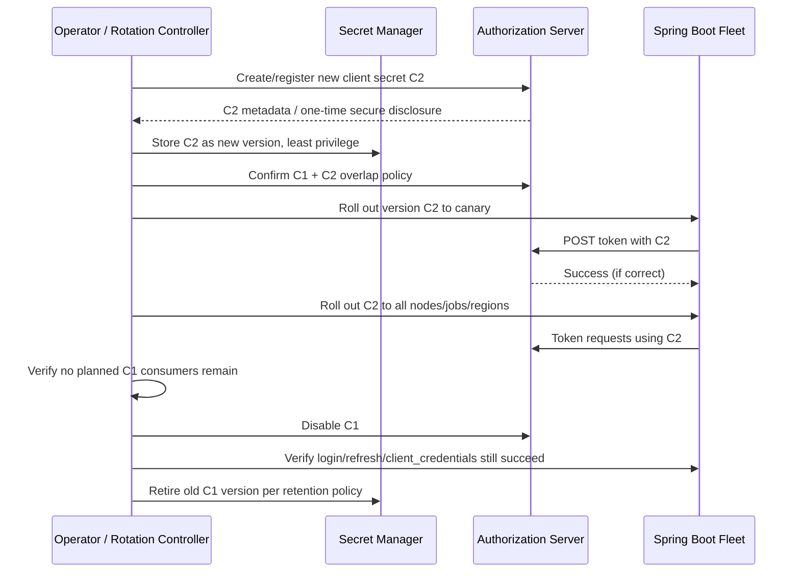

# 32.5. Luân chuyển client secret, chứng thư và khóa client

## 1. Bối cảnh: credential của OAuth2 Client cũng có vòng đời

Trong một hệ thống **Spring Security OAuth 2.0 / OpenID Connect (OIDC) Client**, ứng dụng thường đăng ký một hoặc nhiều `ClientRegistration` với OpenID Provider (OP) / Authorization Server (AS). Để đổi authorization code, refresh token hoặc thực hiện các tác vụ OAuth khác, ứng dụng có thể phải **xác thực chính nó** với AS.

Ví dụ, một ứng dụng Employee Portal sử dụng Authorization Code Flow:

```text
Browser                         Employee Portal                    OIDC Provider
   |                                  |                                   |
   |--- Đăng nhập ------------------->|                                   |
   |                                  |--- Authorization Request ------->|
   |<--------------------- Redirect / consent --------------------------|
   |--- Callback code + state ------>|                                   |
   |                                  |--- POST /token ------------------>|
   |                                  |    client_id + client_secret      |
   |                                  |    code + redirect_uri            |
   |                                  |<-- ID Token, Access Token -------|
   |<-- Authenticated session --------|                                   |
```

Một thời gian sau, AS yêu cầu thay `client_secret` vì chính sách an toàn, hoặc chứng thư mTLS hết hạn, hoặc private key dùng ký `private_key_jwt` cần được thay. Nếu cập nhật vội, các node đang chạy có thể vẫn dùng credential cũ; login, refresh token hoặc outbound API calls bắt đầu lỗi. Nếu giữ credential cũ quá lâu, nguy cơ bị lộ tiếp tục tồn tại.

**Luân chuyển credential (*credential rotation*)** là quy trình thay thế credential của **OAuth client** một cách có kiểm soát, xác nhận credential mới hoạt động, loại bỏ credential cũ và bảo đảm các bản sao ứng dụng/secret stores không còn phụ thuộc vào credential đã hết quyền sử dụng.

Điểm cốt lõi: **thay secret không chỉ là sửa một dòng YAML**. Nó liên quan tới cấu hình phía AS, phân phối secrets, phiên bản runtime, token endpoint client authentication, refresh token lifecycle, rollback, audit và nhiều thành phần khác.

> **Nguyên tắc:** Phải biết **credential nào đang dùng để xác thực client, được AS nào chấp nhận, node nào đang giữ phiên bản nào và khi nào được phép thu hồi credential cũ**. Không tự cho rằng mọi AS đều hỗ trợ hai credential hoạt động đồng thời; khả năng rotation không gián đoạn phụ thuộc nhà cung cấp và cơ chế client authentication.

Bài thuộc chương **32. Triển khai và vận hành** của module **Spring Security OAuth 2.0 OIDC Client**, tập trung vào Java 17+, Spring Boot 3.x và Spring Security 6.x với Servlet/WebFlux. Các đường dẫn, secrets, chứng thư, domain và client IDs trong ví dụ đều giả lập; code/config có thể cần điều chỉnh theo phiên bản và hợp đồng của provider.

### Mục tiêu học tập

Sau bài này, bạn có thể:

1. Phân biệt client secret, private key, public JWK, X.509 certificate, truststore và OP signing key.
2. Hiểu `client_secret_basic`, `client_secret_post`, `client_secret_jwt`, `private_key_jwt` và OAuth mTLS client authentication.
3. Lập kế hoạch rotation có overlap/grace period hoặc changeover phối hợp khi AS chỉ cho phép một credential.
4. Tổ chức Spring Boot configuration để secret không bị commit vào repository/artifact.
5. Biết khi nào phải reload/rebuild `ClientRegistrationRepository` và khi nào restart/rolling deployment đủ.
6. Thiết kế quy trình thay private key/JWK và chứng thư mTLS gồm `kid`, key alias, public key registration và chứng thư hết hạn.
7. Đánh giá tác động lên Authorization Code, refresh token, token revocation, logout và sender-constrained access tokens.
8. Triển khai observability, kiểm thử và runbook incident response mà không tiết lộ secrets.
9. Tránh nhầm khóa **OAuth Client** với khóa **OP ký ID Token** hoặc khóa **Resource Server**.
10. Áp dụng rotation an toàn cho nhiều clients, tenants, regions và clusters.

---

## 2. Bảng thuật ngữ: bí mật, khóa và chứng thư không phải một thứ

| Thành phần | Ai giữ / công bố? | Mục đích | Có được public? |
| --- | --- | --- | --- |
| **OAuth `client_id`** | AS cấp, client dùng | Định danh OAuth application trong AS | Thường có |
| **`client_secret`** | RP confidential client và AS/verification service | Xác thực client theo `client_secret_basic/post`, hoặc vật liệu cho `client_secret_jwt` | **Không** |
| **Client private key** | OAuth client giữ | Ký JWT client assertion (`private_key_jwt`), hoặc TLS private-key operation | **Không** |
| **Client public JWK/JWKS** | Client đăng ký với AS | AS xác minh chữ ký `private_key_jwt` | Có |
| **Client X.509 certificate** | Client/PKI, công bố phần certificate tương ứng | Danh tính TLS client theo mTLS hoặc xác thực khóa công khai | Certificate public, private key **không** |
| **Truststore** | Client runtime | Tin tưởng server TLS certificate/CA, có thể thêm mTLS trust policy | Thường chỉ chứa trust anchors/public cert |
| **Keystore** | Client runtime/KMS/HSM | Lưu private key và certificate chain/aliases theo ứng dụng | Phải kiểm soát truy cập |
| **OP signing private key** | **OpenID Provider** | Ký ID Token/đôi khi access token | **Không**; OAuth client không sở hữu |
| **OP JWKS public keys** | OP công bố qua `jwks_uri` | RP/Resource Server xác minh token của OP | Có |
| **TLS server certificate** | OP/token endpoint hoặc API server | Server chứng minh TLS identity | Certificate public; private key tại server |
| **Access/refresh token** | AS cấp, OAuth client lưu/sử dụng | Truy cập tài nguyên/xin token mới | **Không**, bearer hoặc sender-constrained credential |

Hai cặp dễ nhầm:

- **Client private key ↔ client public JWK**: AS dùng để kiểm chứng `private_key_jwt` của **client**.
- **OP private signing key ↔ OP public JWKS**: RP dùng để xác minh **ID Token do OP phát hành**.

Thay client private key **không tự thay đổi** OP ID Token signing key; ngược lại, OP rotate ID Token signing keys **không tự yêu cầu** client đổi `client_secret`. Đây là hai trust relationships khác nhau.

### 2.1. Client secret không phải refresh token

`client_secret` là credential ứng dụng dùng xác thực **chính ứng dụng** tại AS. `refresh_token` là credential AS cấp cho một grant, dùng xin access token mới. Hai giá trị có thể cùng xuất hiện trong một request:

```http
POST /oauth2/token HTTP/1.1
Host: identity.example.test
Content-Type: application/x-www-form-urlencoded
Authorization: Basic <redacted-client-authentication>

grant_type=refresh_token&refresh_token=<redacted>
```

Đổi client secret có thể ảnh hưởng request này nếu AS yêu cầu credential mới; **nhưng đổi secret không nhất thiết làm refresh tokens đã cấp bị thu hồi**. Điều đó phụ thuộc AS, cùng `client_id` hay client registration mới, token binding và provider policy.

### 2.2. Chứng thư TLS server và chứng thư TLS client

Một kết nối HTTPS có thể chỉ xác thực **server**:

```text
OAuth Client -- HTTPS --> Token Endpoint
                 |
                 +-- Server presents its TLS certificate
                 +-- Client verifies hostname/CA/chain
```

Khi dùng **mutual TLS (mTLS)**:

```text
OAuth Client -- mTLS --> Token Endpoint
          |
          +-- Server verifies Client X.509 certificate
          +-- Client verifies Server TLS certificate
```

Sự kiện thay chứng thư server TLS ở OP không tự là “OAuth Client key rotation”. Client có thể chỉ cần truststore cập nhật nếu CA thay đổi. Với mTLS, thay **client cert/private key** phải được AS tin/cập nhật theo profile.

### 2.3. `kid` và alias có phạm vi riêng

- `kid` trong client JWK là gợi ý để AS chọn public key xác minh client assertion.
- `kid` trong ID Token header giúp RP chọn **OP signing public key**.
- `alias` trong Java Keystore chọn một entry/private key tại runtime.
- `client_id` xác định OAuth client trong Authorization Server.
- `registrationId` xác định `ClientRegistration` bên Spring.

Một chuỗi `kid` có thể trùng giữa hai JWKS không liên quan; nó **không phải định danh client/tenant toàn cục**.

---

## 3. Các cách xác thực OAuth Client và vật liệu phải rotate

### 3.1. `client_secret_basic`

Với confidential client, ứng dụng gửi client ID/secret qua HTTP Basic authentication tại Token Endpoint:

```http
POST /oauth2/token
Authorization: Basic <base64-of-form-encoded-client-id-and-secret>
Content-Type: application/x-www-form-urlencoded

grant_type=authorization_code&code=<redacted>&redirect_uri=<registered-uri>
```

Nội dung Basic là **cách đóng gói credential, không phải mã hóa**. Bảo vệ bằng HTTPS/TLS, không gửi qua proxy/log không tin cậy. RFC 6749 `2.3.1 quy định form-URL-encode client ID và secret trước khi tạo Basic credential.

Credential cần rotate: **`client_secret`** của AS client.

### 3.2. `client_secret_post`

Credential nằm trong body form:

```http
POST /oauth2/token
Content-Type: application/x-www-form-urlencoded

grant_type=authorization_code
&code=<redacted>
&client_id=employee-portal
&client_secret=<redacted>
```

Nhà cung cấp có thể hỗ trợ nhưng cần tuân thủ phương thức đã đăng ký. Khi rotate, chú ý proxy/HTTP body logging và redaction. Không chuyển từ Basic sang POST chỉ để “thử” nếu AS không chấp nhận.

### 3.3. `client_secret_jwt`

OAuth client ký một **JWT client assertion bằng HMAC** với vật liệu secret được AS và client chia sẻ, rồi gửi tới Token Endpoint theo JWT Bearer Client Authentication (RFC 7523 / OIDC profile).

Credential cần rotate vẫn là **shared secret**. Một số AS giới hạn thuật toán HMAC, chiều dài secret và replay/`jti`; không dùng một client secret quá ngắn cho thuật toán ký yêu cầu entropy phù hợp.

### 3.4. `private_key_jwt`

OAuth client ký **JWT client assertion bằng private key bất đối xứng**. AS xác minh chữ ký bằng public key/JWKS đã đăng ký cho đúng `client_id`.

```text
Client registration:
  client_id = employee-portal
  token_endpoint_auth_method = private_key_jwt
  jwks_uri / registered public jwks = client's PUBLIC keys

Runtime:
  client PRIVATE signing key (KMS/HSM/keystore)

Token request:
  client_assertion_type =
    urn:ietf:params:oauth:client-assertion-type:jwt-bearer
  client_assertion = signed JWT
```

JWT assertion thường có:

```json
{
  "iss": "employee-portal",
  "sub": "employee-portal",
  "aud": "https://identity.example.test/oauth2/token",
  "iat": 1780000000,
  "exp": 1780000060,
  "jti": "random-unique-one-time-identifier"
}
```

Các thời điểm chỉ minh họa. Theo hợp đồng profile/AS, `aud` có thể là Token Endpoint URL hoặc một audience identifier được AS quy định; **không tự hardcode giống nhau cho mọi OP**. `jti` phải đủ ngẫu nhiên/unique; assertion nên có lifetime ngắn, đồng hồ hệ thống đồng bộ và replay controls phù hợp.

Credential cần rotate: **client private signing key**, **public JWKS đăng ký tại AS** và có thể các key IDs/aliases. Đổi `kid` nhưng vẫn giữ private key bị lộ không phải rotation thật.

### 3.5. OAuth mTLS: `tls_client_auth` và `self_signed_tls_client_auth`

RFC 8705 mô tả OAuth 2.0 Mutual-TLS Client Authentication và Certificate-Bound Access Tokens. Hai nhóm:

- `tls_client_auth`: AS gắn client với danh tính chứng thư theo profile PKI/subject fields đã đăng ký.
- `self_signed_tls_client_auth`: AS dùng chứng thư tự ký/khóa được đăng ký theo metadata/JWKS tùy profile.

Credential cần rotate: **client TLS private key + X.509 certificate**, cập nhật identity/cert registration tại AS, key manager/HTTP connector ở client và có thể token binding.

Không nhầm chứng thư mTLS OAuth client với chứng thư **HTTPS server** của OP.

### 3.6. Public clients và PKCE

SPA/native clients thường là **public clients**, không thể giữ shared secret an toàn trong binary/browser. Với Authorization Code + PKCE, client có thể dùng `client-authentication-method: none` theo cấu hình AS và yêu cầu security profile.

Không “rotate client secret” bằng cách nhúng secret mới vào JavaScript bundle hoặc mobile binary: đó không còn là bí mật. Public-client security cần PKCE, redirect URI restrictions, platform protections và policy riêng.

### 3.7. Bảng lựa chọn

| Phương thức | Credential phía client | Bước phối hợp phía AS | Cạm bẫy rotation |
| --- | --- | --- | --- |
| `client_secret_basic` | Shared client secret | Thêm/thay secret cho `client_id` | Không có overlap, rollout nodes lỗi |
| `client_secret_post` | Shared client secret | Như trên | Secret lộ qua body logging |
| `client_secret_jwt` | HMAC shared secret | Thêm/thay secret và alg policy | `jti`/clock/alg/replay |
| `private_key_jwt` | Private signing key | Đăng ký public JWK/JWKS mới | AS chưa biết key/`kid` |
| `tls_client_auth` | TLS private key + cert | Đăng ký identity/cert profile mới | TLS handshake, subject mismatch |
| `self_signed_tls_client_auth` | Private key + self-signed cert | Đăng ký certificate/thumbprint/profile | Thiếu thời gian overlap |
| Public + PKCE | Không có client secret | Redirect/PKCE registration | Cố lưu secret trong browser |
| M2M `client_credentials` | Một trong các credential hợp lệ | AS client config | Tất cả scheduled jobs dùng credential cũ |

---

## 4. Phạm vi và mục tiêu của một lần rotation

### 4.1. Các lý do

Rotation có thể được kích hoạt bởi:

- Secret/key đến hạn theo security policy.
- Chứng thư sắp hết hạn.
- Credential xuất hiện trong source control, log hoặc ticket.
- Nhân sự hoặc vendor thay đổi quyền quản trị.
- Chuyển từ secret-based authentication sang key-based/mTLS.
- Hệ thống chuyển môi trường/region/tenant.
- Incident compromise hoặc nghi ngờ compromise.
- Provider thay thuật toán/certificate authority/registration policy.
- Tái cấu trúc client registrations hoặc nâng cấp hạ tầng.

**Scheduled rotation** có thể dùng overlap có thời gian. **Emergency rotation** sau compromise ưu tiên giảm thời gian attacker dùng credential, có thể phải chấp nhận gián đoạn.

### 4.2. Mục tiêu thực tế

Một kế hoạch được coi là đủ cần xác định:

1. Credential mới được tạo bằng nguồn ngẫu nhiên/HSM/KMS đủ mạnh.
2. AS nhận đúng credential mới dưới đúng `client_id`/tenant.
3. Spring Security runtime sử dụng credential mới khi gửi token/refresh/revocation requests.
4. Không phải node nào vẫn phụ thuộc credential cũ ngoài thời gian overlap.
5. Credential cũ được vô hiệu ở AS và xóa khỏi secret store/versions theo retention policy.
6. Không có plaintext secret trong Git, CI logs, image, heap dump hoặc hệ thống quan sát.
7. Metrics, audit và rollback/failure response được chuẩn bị trước.

### 4.3. Zero downtime không phải mặc định

Để rotation không gián đoạn khi AS chỉ hỗ trợ **một secret hoạt động**, mỗi node phải chuyển rất chính xác giữa thời điểm AS thay secret; rolling deployment trong khoảng chuyển tiếp có thể gây lỗi. Với overlap:

```text
T0  Old credential C1 active
T1  Register/add C2; AS accepts C1 and C2
T2  Rollout client configuration to C2
T3  Confirm all nodes, jobs, regions use C2
T4  Disable C1; verify C1 rejected
T5  Remove old secret versions and close change
```

Nếu nhà cung cấp không hỗ trợ dual secrets/public keys/cert overlap, cần **coordinated cutover**, hạn chế request/token refresh trong khoảng thay đổi hoặc kiến trúc proxy/secret broker phù hợp. Không hứa zero downtime chỉ dựa vào rolling restart.

### 4.4. Phân biệt “create”, “activate”, “retire”, “destroy”

| Trạng thái | Ý nghĩa | Cần xác minh |
| --- | --- | --- |
| Generated | Credential mới đã tạo nhưng chưa được AS tin | Không gửi runtime request bằng nó |
| Registered/standby | AS biết credential mới, chưa sử dụng để ký/xác thực | Có thể thử trong staging/controlled probe |
| Active | Runtime đã dùng credential mới, AS chấp nhận | Token request/refresh thực tế pass |
| Overlap | Cũ và mới cùng hoạt động | Có deadline, quan sát credential usage |
| Retired | AS không còn chấp nhận credential cũ | Test rejection; không quay lại tùy tiện |
| Destroyed | Secret/private key bị xóa khỏi stores theo chính sách | Audit/retention hoàn tất |

Không chỉ xóa secret ở Kubernetes rồi cho rằng AS đã vô hiệu hóa nó.

---

## 5. Inventory trước khi thay bất kỳ credential nào

Với mỗi OAuth Client, ghi lại **metadata không bí mật**:

| Trường | Ví dụ | Mục đích |
| --- | --- | --- |
| Environment | `production` | Tránh đổi nhầm staging/prod |
| Tenant / issuer alias | `north-workforce` | Tách trust domain |
| Spring registration ID | `north-employee-web` | Mapping nội bộ |
| OAuth client ID | `portal-north` | Mapping với AS |
| AS/token endpoint alias | `north-op` | Biết bên xác thực client |
| Client auth method | `client_secret_basic` | Biết loại credential cần rotate |
| Secret/key version ID | `v2` / `key-2026-11` | Đo adoption, không ghi secret value |
| Secret manager reference | `secret://.../client-secret` | Nguồn phân phối |
| Deployments/regions | `web-eu, web-apac` | Danh sách rollout |
| Workloads | `login-web, sync-worker` | Không bỏ sót background clients |
| Client registration/JWKS refs | Public key IDs/cert metadata | Thực hiện thay đúng nơi |
| Rotation owner/approver | Team/role | Thay có phân quyền |
| Certificate expiry | Ngày hết hạn | Cảnh báo/chuyển đổi trước hạn |
| Credential disable deadline | UTC timestamp | Không giữ overlap vô hạn |

Không đưa `client_secret` hoặc PEM private key vào bảng inventory, issue tracker hay tài liệu công khai.

### 5.1. Một ứng dụng có thể dùng nhiều registrations

```text
employee-portal:
  corporate-oidc-web -> authorization_code, user login
  calendar-delegated -> authorization_code, delegated API
  internal-reporting -> client_credentials, M2M batch
  hr-mtls -> client_credentials + mTLS, external HR API
```

Mỗi registration có thể có credential owner, token endpoint và lịch rotate khác nhau. Việc thay `corporate-oidc-web` không có nghĩa nên cập nhật cả `hr-mtls`.

### 5.2. Một credential có thể bị dùng ở nhiều nơi

Một secret hiện tại có thể tồn tại trong:

- Spring Boot web pods.
- Scheduled batch jobs.
- WebFlux service.
- Blue/green deployment cũ.
- Disaster-recovery region.
- Canaries.
- Sidecars/proxies.
- CI integration tests.
- Secret copies tại một cluster chưa được đồng bộ.
- Rolling workers/long-running JVM processes.

Nếu credential C1 bị retire trong khi một job chạy mỗi đêm chưa chuyển C2, lỗi chỉ xuất hiện sau vài giờ, không nhất thiết ngay sau deploy.

### 5.3. Xác định các endpoint cần client authentication

Không chỉ Token Endpoint trong login:

- Authorization Code → Token Endpoint.
- Refresh Token → Token Endpoint.
- Client Credentials → Token Endpoint.
- Token Revocation (RFC 7009) nếu AS yêu cầu client authentication.
- Token Introspection (RFC 7662) nếu client đóng vai authorized introspection caller.
- Pushed Authorization Requests (PAR) hoặc profile khác nếu có client authentication.
- Backchannel/token exchange endpoints hoặc extension contracts tùy provider.

OP logout redirect/ID Token JWKS verification không mặc định dùng client secret. Không áp dụng credential một cách tùy tiện tới mọi endpoint chỉ vì cùng issuer.

---

## 6. Spring Boot configuration: đừng nhúng client secret vào code

### 6.1. Cấu hình Authorization Code/OIDC Login bằng biến môi trường

Với một confidential client dùng `client_secret_basic`:

```yaml
spring:
  security:
    oauth2:
      client:
        registration:
          workforce:
            provider: workforce-provider
            client-id: ${OIDC_CLIENT_ID}
            client-secret: ${OIDC_CLIENT_SECRET}
            client-authentication-method: client_secret_basic
            authorization-grant-type: authorization_code
            redirect-uri: "{baseUrl}/login/oauth2/code/{registrationId}"
            scope:
              - openid
              - profile
              - email

        provider:
          workforce-provider:
            issuer-uri: https://identity.example.test/realms/workforce
```

Các bí mật **không xuất hiện dưới dạng giá trị literal** trong file. Spring Boot resolve `${OIDC_CLIENT_SECRET}` tại runtime từ Environment hoặc nguồn PropertySource phù hợp.

Nhưng **biến môi trường cũng có rủi ro**:

- Có thể bị lộ qua diagnostic dumps, process environment, cấu hình orchestrator hoặc quyền quản trị container.
- Nếu đưa nguyên secret vào command line argument, shell history/process listing có thể lộ.
- Nếu log Spring Environment/actuator/config properties mà không masking, bí mật có thể xuất hiện.
- Cập nhật biến môi trường ở deployment thường **không tự cập nhật environment của JVM đã chạy**.

Với production, nên dùng secret manager và secret delivery có chính sách least privilege, encryption, audit, rotation và revocation; có thể kết hợp workload identity/mount/CSI/config integration tùy platform.

### 6.2. Phân biệt secret reference và secret value

Một bản khai báo tốt chỉ lưu **reference**:

```text
registrationId = workforce
clientId = portal-workforce
credentialRef = secret-manager://prod/oauth/portal-workforce/current
credentialVersion = v17
```

Runtime được cấp quyền đọc `credentialRef` qua identity của workload, rồi dùng secret value trong bộ nhớ/process khi phải gửi request tới AS. Tránh:

```yaml
# PHẢN MẪU:
client-secret: very-real-production-secret
```

Và tránh file `.env` chứa secret được commit vào Git, image layers hoặc CI artifacts.

### 6.3. Kiểm soát startup và fail-fast

Một ứng dụng có thể fail ở startup nếu property bắt buộc không tồn tại. Điều này thường tốt hơn việc vô tình bật một cấu hình rỗng/placeholder:

```text
OIDC_CLIENT_SECRET missing
    -> block deployment readiness / configuration error
    -> do not silently switch to "none"
```

Không khắc phục startup failure bằng cách đặt `client-authentication-method: none` nếu client thực tế là confidential và AS yêu cầu client authentication.

Với `client_secret_basic`/`client_secret_post`, phải kiểm tra:

- `client-id` đúng environment/tenant.
- `client-secret` đúng version của `client_id` đó.
- Authentication method được AS chấp nhận.
- `issuer-uri`/`token-uri` trỏ đúng AS.
- Runtime có quyền đọc secret, không bị lỗi KMS/secret manager.
- HTTPS TLS và proxy hoạt động.

### 6.4. `ClientRegistration` thường được tạo tại thời điểm ứng dụng khởi động

Spring Boot có thể bind `spring.security.oauth2.client.registration.*` thành `ClientRegistration`, sau đó tạo `ClientRegistrationRepository` hoặc `ReactiveClientRegistrationRepository` tùy stack.

Điều này có nghĩa:

```text
Secret Manager:
  current = C2

Old JVM instance:
  ClientRegistration created with C1 at startup

Result:
  JVM may keep using C1 even after current secret points to C2
```

**Không mặc định** sửa secret store là Spring Security tự reload secret đang nằm trong object đã được tạo. Nếu dùng Kubernetes environment variables, rolling restart/redeployment là cách phổ biến để JVM đọc giá trị mới.

Với secret volume được cập nhật động, **file bytes mới cũng không bảo đảm client authentication flow tự nạp lại file**. Cần có integration đọc lại/kiểm tra key và thay runtime clients một cách có kiểm soát.

### 6.5. Một cấu hình `SecurityFilterChain` không cần biết secret trực tiếp

```java
package com.example.portal.security;

import org.springframework.context.annotation.Bean;
import org.springframework.context.annotation.Configuration;
import org.springframework.security.config.Customizer;
import org.springframework.security.config.annotation.web.builders.HttpSecurity;
import org.springframework.security.web.SecurityFilterChain;

@Configuration
public class OAuth2WebSecurityConfig {

    @Bean
    SecurityFilterChain filterChain(HttpSecurity http)
            throws Exception {

        return http
                .authorizeHttpRequests(authorize -> authorize
                        .requestMatchers("/", "/login", "/error").permitAll()
                        .anyRequest().authenticated())
                .oauth2Login(Customizer.withDefaults())
                .build();
    }
}
```

`oauth2Login()` dùng registration/authorized-client infrastructure được cấu hình; không nên hardcode `client-secret` trực tiếp trong `SecurityFilterChain` hoặc controller.

Với ứng dụng WebFlux, sử dụng `SecurityWebFilterChain` và `ServerHttpSecurity`; nguyên tắc bí mật và rotation tương tự, dù HTTP client/token response APIs khác.

---

## 7. Quy trình luân chuyển client secret có overlap

### 7.1. Điều kiện tiên quyết

Một lần thay client secret không gián đoạn cần AS hỗ trợ **hai credential/version cùng hợp lệ** trong một khoảng thời gian. Provider có thể cung cấp:

- Two active secrets.
- “Primary/secondary” secrets.
- New secret + grace window.
- Client key versions.
- Secret rotation API với `not-before`/expiration.
- Chỉ một secret đang hoạt động (không overlap).

Không giả định nhà cung cấp có dual-secret support nếu chưa xác minh bằng tài liệu/test.

### 7.2. Trình tự chuẩn



**Không gửi secret C2 vào console logs, chat messages hoặc issue tracker** khi tạo/đăng ký secret. AS có thể chỉ hiển thị secret một lần; cần xử lý qua kênh bí mật có bảo vệ.

### 7.3. Giai đoạn A — Chuẩn bị

1. Xác định registration ID và AS client ID đúng environment.
2. Xác minh tất cả workloads dùng cùng credential, gồm batch/DR/canary.
3. Kiểm tra AS cho phép overlap bao lâu và cách tạo credential mới.
4. Xác định timeout/retry/token endpoint volume và thời điểm lưu lượng thấp.
5. Thiết lập metrics 401/`invalid_client`/`invalid_grant` và latency.
6. Ghi nhận credential version IDs (không có values).
7. Chuẩn bị kế hoạch rollback trong cửa sổ còn C1; chuẩn bị kế hoạch không-rollback sau khi retire.
8. Bảo đảm người triển khai có quyền hẹp cần thiết, có phê duyệt/đối soát.

### 7.4. Giai đoạn B — Đăng ký credential mới

AS có thể:

- Tạo C2 rồi tự kích hoạt song song với C1.
- Yêu cầu xác nhận C2 active.
- Tự vô hiệu C1 ngay khi tạo C2.
- Áp dụng khác nhau theo tenant/client type.

Nếu tạo C2 làm C1 ngừng hợp lệ, **không đi tiếp theo kế hoạch overlap**; phải chuyển sang coordinated cutover hoặc dừng change để điều chỉnh.

### 7.5. Giai đoạn C — Thử C2 trước khi triển khai toàn bộ

Có thể dùng một **canary app node** với cấu hình C2 để chạy một OAuth flow phù hợp:

- Authorization Code login thật trong staging/test tenant hoặc controlled production account nếu chính sách cho phép.
- Token request qua `client_credentials` đối với M2M registration.
- Refresh token bằng authorized client **mà canary sở hữu và được phép kiểm tra** khi OP policy cho phép.
- Token revocation/introspection nếu client dùng các endpoint đó.

Không test bằng cách gọi Token Endpoint với một refresh token của user ngẫu nhiên. Không log secret, access token hay refresh token khi test.

Khi canary thành công, xác nhận `issuer`, `client_id`, đúng secret version và endpoint. Một HTTP 200 từ một proxy không có OAuth test thực chất chưa đủ chứng minh client auth thành công.

### 7.6. Giai đoạn D — Phân phối trên toàn bộ runtime

Khi dùng environment variable/Boot config, thực hiện controlled rolling deployment:

```text
old pods: C1
new pods: C2
AS accepts: C1 and C2 during overlap
```

Kiểm tra:

- Các pods mới thực sự lấy C2.
- Không có deployment cũ bị quên.
- Không có worker paused còn C1 khi restart về sau.
- DR region và cronjobs cũng đã đổi.
- Không có JVM cache/keystore/snapshot chứa C1 như active credential.
- Không có Secret Manager alias `current` trỏ lại C1 vì race giữa automation jobs.

**Đừng log C2 để chứng minh đang dùng đúng version**; log một version ID nội bộ đã được kiểm soát hoặc key alias, không log hash của secret bằng thuật toán yếu.

### 7.7. Giai đoạn E — Thu hồi C1

Khi đã xác nhận toàn bộ known consumers dùng C2:

1. Disable C1 tại AS.
2. Kiểm tra AS thực sự từ chối C1 theo policy test.
3. Theo dõi trong khoảng đủ qua các scheduled jobs/canaries.
4. Loại bỏ C1 khỏi runtime config/secret manager theo retention/recovery policy.
5. Rà soát backups, pipeline artifacts và permissions.
6. Hoàn tất change record với thời gian/owner/outcome, không kèm raw credential.

Nếu xuất hiện `invalid_client` ở một batch job sau khi C1 bị retire, ưu tiên xác định job đang dùng stale secret thay vì bật lại C1 vô hạn.

### 7.8. Khi AS chỉ hỗ trợ một active secret

Mô hình:

```text
AS recognizes only C1
  |
  | rotate at time T
  v
AS recognizes only C2
```

Ở thời điểm T:

- Các node còn C1 có thể bị `invalid_client`.
- Các node chuẩn bị C2 trước T sẽ fail nếu cố dùng C2 quá sớm.
- Authorization Code callbacks/tokens đang chờ có thể lỗi.
- Background job refresh/client_credentials có thể lỗi.

Biện pháp: coordinated cutover, cấu hình refresh đồng bộ, giảm tạm lưu lượng/token grants trong cửa sổ và kiểm tra nhanh. Với availability yêu cầu rất cao, làm việc với provider về hỗ trợ multiple credentials hoặc phương thức auth cho phép key overlap. Không xây “thử lại bằng mọi secret cũ” vô hạn vì làm tăng nguy cơ lộ và kéo dài thời gian compromise.

---

## 8. Spring Security runtime: reload secret đúng nơi

### 8.1. Cập nhật secret manager khác với cập nhật in-memory registration

Nếu application sử dụng mặc định:

```java
ClientRegistrationRepository registrations;
```

và một `ClientRegistration` đã được tạo từ cấu hình C1, việc Secret Manager thay `current=C2` không có nghĩa object đang hoạt động đổi thành C2.

Một chiến lược an toàn, dễ vận hành:

```text
Rotate C2 in AS and Secret Manager
     -> Launch new application deployment with C2
     -> Validate canary/rollout
     -> Retire C1 when no old consumers remain
```

Nó phù hợp với **immutable deployments**. Không cần viết custom hot reload nếu provider có overlap đủ dài.

### 8.2. Khi cần dynamic reloading

Với ứng dụng long-lived/multi-tenant, có thể cần repository động. Một ví dụ chỉ cho thấy ý tưởng **atomic snapshot** của các registrations:

```java
package com.example.portal.security;

import java.util.Map;
import java.util.Objects;
import java.util.concurrent.atomic.AtomicReference;

import org.springframework.security.oauth2.client.registration.ClientRegistration;
import org.springframework.security.oauth2.client.registration.ClientRegistrationRepository;

public final class VersionedClientRegistrationRepository
        implements ClientRegistrationRepository {

    private final AtomicReference<Map<String, ClientRegistration>> snapshot;

    public VersionedClientRegistrationRepository(
            Map<String, ClientRegistration> initialRegistrations) {

        snapshot = new AtomicReference<>(
                Map.copyOf(initialRegistrations));
    }

    @Override
    public ClientRegistration findByRegistrationId(String registrationId) {
        return snapshot.get().get(registrationId);
    }

    public void replaceAllValidated(
            Map<String, ClientRegistration> newRegistrations) {

        Objects.requireNonNull(newRegistrations);

        // Caller must validate trusted issuer, client IDs, endpoints,
        // secret versions, permissions and deployment coordination.
        snapshot.set(Map.copyOf(newRegistrations));
    }
}
```

Đây là **fragment thiết kế**, không phải giải pháp rotation hoàn chỉnh. Nó chỉ đảm bảo một request tra repository nhìn thấy một map nhất quán. Nó **không** đảm bảo:

- Đã reload các token response clients/HTTP request factories.
- Đã thay private-key JWT signing source hoặc TLS SSLContext.
- Authorized clients được lưu từ C1 không còn giữ `ClientRegistration` cũ.
- Request đang bay không dùng snapshot C1.
- Cache của OIDC decoder/authorization code manager được reset đúng.
- AS hiện chấp nhận C2 hoặc không còn chấp nhận C1.
- Một request không bị mix-up khi issuer/client ID thay đổi.
- Multiple nodes đồng thời dùng cùng generation.

Với dynamic changes, cần toàn bộ **versioned configuration + credential source + authorized client + HTTP token request path** nhất quán. Không coi `AtomicReference` là bằng chứng zero downtime.

### 8.3. Existing authorized clients và stale ClientRegistration

Một `OAuth2AuthorizedClient` thường giữ `ClientRegistration` liên quan. Nếu bản ghi/manager có token được xây từ registration C1, thao tác refresh sau rotation có thể vẫn sử dụng client metadata cũ tùy implementation/storage path.

Cần đánh giá:

- `OAuth2AuthorizedClientService` là InMemory, JDBC hay custom?
- Khi load, service trả registration object cũ hay resolve theo repository mới?
- AuthorizedClientManager lấy registration nào cho refresh?
- Cache key `(registrationId, principalName)` có phân biệt credential generation không?
- Có bị refresh token của AS/client cũ gửi tới Token Endpoint mới không?
- Nếu đổi `client_id` hoặc issuer, có bắt buộc reauthorization không?

Đổi **secret cho cùng `client_id`/issuer** thường khác với đổi **client registration identity**. Không tái dùng registration ID cho một issuer/client hoàn toàn khác mà không xử lý authorized client store.

### 8.4. Secret read failures phải có chính sách rõ

Nếu ứng dụng không thể lấy C2 từ secret manager:

- Với deployment mới: fail startup/readiness theo policy nếu credential cần thiết.
- Với runtime đang phục vụ: chỉ dùng C1 trong cửa sổ overlap **nếu C1 vẫn được AS chấp nhận và được phép theo security policy**.
- Nếu C1 đã compromise hoặc bị retire: không fallback sang C1.
- Không log secret contents hoặc exception có thể chứa payloads.
- Alert owner và ngăn automation đánh dấu rotation successful.

### 8.5. Spring Cloud refresh hoặc dynamic property sources

Một số hệ thống dùng refresh scope/config refresh events; mức độ cập nhật phụ thuộc **bean lifecycle, OAuth2 client infrastructure, token HTTP clients và custom caches**.

Không thể đảm bảo toàn bộ OAuth2 Login/refresh flow đã dùng C2 chỉ vì một endpoint “refresh configuration” trả 200. Phải có integration test đo **credential version thực dùng trong Token Endpoint request**, cùng rollback/roll-forward policy.

---

## 9. Chuyển từ client secret sang `private_key_jwt`

### 9.1. Ưu và nhược điểm

Với `private_key_jwt`, client **không gửi shared secret cố định** trong mỗi Token Endpoint request. Thay vào đó gửi JWT assertion ký bằng private key:

```text
OAuth Client signing private key (not exported)
    |
    v
Sign client_assertion JWT
    |
    v
POST token request with client_assertion
    |
    v
AS selects client's registered public JWK
    |
    v
Verify signature + iss/sub/aud/exp/jti
    |
    v
Authenticate OAuth client
```

Ưu điểm có thể gồm:

- Private key ở KMS/HSM hoặc keystore, không cần chia sẻ secret giữa client và AS.
- Có thể đăng ký nhiều public keys và rotate signing key bằng `kid`.
- AS có thể áp chính sách mạnh cho key types/algorithms.
- Signed assertions có lifetime ngắn, làm giảm thời gian reuse của một assertion cụ thể.

Nhưng **private_key_jwt cũng có rủi ro**: private key bị lộ, JWT replay nếu `jti/exp` policy kém, sai audience, AS thiếu public key, cluster còn dùng key cũ, key rotation không overlap.

### 9.2. Phân biệt signing key và TLS certificate

Với private_key_jwt, private signing key có thể nằm trong HSM/KMS hoặc keystore. Một số provider đăng ký **public JWK** trực tiếp; số khác yêu cầu X.509 certificate/JWK `x5c`.

Chứng thư X.509 có thể biểu diễn public key, nhưng **không đồng nghĩa** token endpoint sử dụng mTLS. Nếu token endpoint authentication method là `private_key_jwt`, bản chất xác thực client là **JWT assertion signature**, dù key có thể gắn certificate.

### 9.3. Đăng ký public JWK mới trước khi sử dụng private key mới

Ví dụ:

```json
{
  "keys": [
    {
      "kty": "RSA",
      "use": "sig",
      "alg": "RS256",
      "kid": "portal-signing-2026-10",
      "n": "<old-public-modulus>",
      "e": "AQAB"
    },
    {
      "kty": "RSA",
      "use": "sig",
      "alg": "RS256",
      "kid": "portal-signing-2026-11",
      "n": "<new-public-modulus>",
      "e": "AQAB"
    }
  ]
}
```

Hai `n` là placeholders, không phải JWK có thể chạy. AS phải có public key mới trước khi client bắt đầu ký bằng private key mới.

Nếu provider dùng `jwks_uri` trỏ tới JWKS do client quản trị:

- URL phải HTTPS và đáng tin.
- AS phải fetch/refresh được JWKS theo policy.
- Không xóa public key cũ trước khi hết thời gian các assertions cũ còn hiệu lực + cache window phù hợp.
- Giữ client `kid`/private key match.
- Bảo vệ host và cache/CDN của public JWKS; không bao giờ publish private JWK fields.

### 9.4. Cấu trúc một client assertion JWT bằng Nimbus — ví dụ độc lập

Phần dưới minh họa việc **tạo assertion bằng private key RSA**. Nó không tự cấu hình Spring Security token response client; phần wiring phụ thuộc Spring Security version và provider profile.

```java
package com.example.portal.security;

import java.security.interfaces.RSAPrivateKey;
import java.time.Instant;
import java.util.Date;
import java.util.UUID;

import com.nimbusds.jose.JOSEObjectType;
import com.nimbusds.jose.JWSAlgorithm;
import com.nimbusds.jose.JWSHeader;
import com.nimbusds.jose.crypto.RSASSASigner;
import com.nimbusds.jwt.JWTClaimsSet;
import com.nimbusds.jwt.SignedJWT;

public final class PrivateKeyJwtAssertions {

    public static String create(
            String clientId,
            String expectedAudience,
            String keyId,
            RSAPrivateKey privateKey) throws Exception {

        Instant now = Instant.now();

        JWTClaimsSet claims = new JWTClaimsSet.Builder()
                .issuer(clientId)
                .subject(clientId)
                .audience(expectedAudience)
                .issueTime(Date.from(now))
                .expirationTime(Date.from(now.plusSeconds(60)))
                .jwtID(UUID.randomUUID().toString())
                .build();

        SignedJWT signed = new SignedJWT(
                new JWSHeader.Builder(JWSAlgorithm.RS256)
                        .keyID(keyId)
                        .type(JOSEObjectType.JWT)
                        .build(),
                claims);

        signed.sign(new RSASSASigner(privateKey));
        return signed.serialize();
    }

    private PrivateKeyJwtAssertions() {
    }
}
```

**Điều kiện khi tích hợp thật:**

- `expectedAudience` phải lấy từ **hợp đồng client authentication của AS**, không từ browser/token payload chưa xác minh.
- `clientId` phải là client đang đăng ký tại AS.
- Private key lấy từ secure source, không hardcode PEM trong class hoặc log.
- `keyId` phải gắn đúng public JWK đã đăng ký.
- `iat/exp` phải phù hợp clock skew/OP policy; assertions có TTL ngắn.
- `jti` phải đủ unique và AS phải áp replay protection theo khả năng/profile.
- Algorithm phải được AS cho phép; không dùng `alg=none`/downgrade.
- JWT assertion là credential nhạy cảm, **không log raw serialized value**.
- Token request phải gửi đúng `client_assertion_type` và `client_assertion` theo RFC 7523; HTTP client không được gửi nhầm assertion tới AS khác.

### 9.5. Tích hợp với Spring Security OAuth2 Client

Spring Security có các extension points cho **token response clients** và **client authentication parameter converters**, bao gồm các cơ chế JWT client authentication trong những phiên bản tương ứng.

Do API có thể khác giữa Spring Security 6.x minor releases (RestTemplate-based token clients và RestClient-based token clients, Servlet vs Reactive), không nên copy một converter class từ tài liệu phiên bản khác mà bỏ qua wiring.

Mô hình triển khai:

```text
ClientRegistration:
  clientAuthenticationMethod = private_key_jwt
        |
        v
AccessTokenResponseClient for authorization_code/refresh_token/client_credentials
        |
        v
Client assertion signing component
  -> private key for current key version
  -> client_id, aud, iat, exp, jti, kid
        |
        v
Token Endpoint
        |
        v
AS verifies registered public key & assertion claims
```

Cần kiểm tra **mọi grant path** sử dụng token response client nào: login authorization code, refresh token và client credentials có thể cần cấu hình riêng theo Spring Security version/manager.

### 9.6. Xoay vòng `private_key_jwt`

```text
1. Generate new private key K2 in secure key store/HSM.
2. Export only public JWK P2, set new kid.
3. Register P2/JWKS at AS alongside P1.
4. Verify AS can see P2.
5. Deploy signer using K2/kid2 to canary.
6. Exercise token/refresh requests.
7. Roll out K2 to all clients/workers.
8. Observe assertions signed with K1 no longer in normal use.
9. Retire public P1 from AS after overlap/replay window.
10. Disable/destroy private K1 per policy.
```

**Không bỏ K1 khỏi AS ngay sau khi mới bắt đầu rollout** nếu một số nodes vẫn ký bằng K1, trừ khi đây là emergency compromise và ưu tiên phải vô hiệu hóa ngay.

---

## 10. Xoay vòng X.509 client certificate và khóa mTLS

### 10.1. Khi OAuth Client dùng mTLS

Với mTLS, ứng dụng có thể sử dụng certificate/private key để xác thực mình với AS tại Token Endpoint, hoặc để truy cập Resource Server bằng certificate-bound access token theo RFC 8705.

Một bộ credential gồm:

```text
OAuth Client TLS identity:
  private key K1         <- secret, trong keystore/HSM
  public certificate C1 <- public certificate/chain
  key alias              <- chọn entry runtime
  trust anchors          <- kiểm chứng server certificate
```

Trong trường hợp certificate hết hạn hoặc sắp hết hạn, cần **thay certificate** đúng thời điểm. Với rotation an toàn, thường nên thay cả key pair khi quy trình cho phép; gia hạn certificate trên **cùng private key** không tương đương key rotation.

### 10.2. Phân biệt renewal và key rotation

| Thao tác | Certificate thay? | Private key thay? | Hệ quả |
| --- | --- | --- | --- |
| Renew certificate, reuse key | Có | Không | Certificate lifetime thay, key compromise risk giữ nguyên |
| Key rotation + new certificate | Có | Có | AS/clients phải nhận public identity mới |
| Change CA/trust chain | Có thể | Có thể không | Truststore/PKI policy cần cập nhật |
| Server TLS certificate renewal | Phía OP/API server | Không phải OAuth client key | Client kiểm tra trust/hostname; không tự thay client auth |
| Certificate-bound token rotation | Thay mTLS cert của client | Thường có | Tokens bound to old cert có thể không dùng với cert mới |

Với private key bị compromise, chỉ renew certificate trên cùng key **không khắc phục** sự cố.

### 10.3. Xác định chính xác mTLS profile

Trước khi thay C1 bằng C2, kiểm tra với provider:

- `tls_client_auth` hay `self_signed_tls_client_auth`?
- AS tin CA nào, subject DN/SAN nào hoặc certificate thumbprint/JWK nào?
- Có thể đăng ký nhiều certs/keys cùng client ID không?
- Token Endpoint có mTLS-specific endpoint alias không?
- HTTP connection có đi qua proxy/service mesh TLS termination không?
- AS kiểm tra client certificate ngay tại TLS handshake hay application layer?
- Resource Server có yêu cầu certificate-bound tokens không?
- Có cần cập nhật truststore của server và client không?
- Certificate đã cấp có Extended Key Usage `clientAuth` phù hợp profile không?
- SNI/hostname validation đối với server TLS certificate có hoạt động đúng không?

Không nhầm **certificate trust** (tin CA/subject) với **certificate-bound token** (access token bị ràng buộc tới fingerprint/khóa của certificate).

### 10.4. Spring Boot SSL Bundle minh họa

Spring Boot 3.1+ cung cấp **SSL bundles** cho các thành phần hỗ trợ. Một cấu hình JKS/PKCS12 dạng file-based:

```yaml
spring:
  ssl:
    bundle:
      jks:
        oauth-client:
          keystore:
            location: file:/run/secrets/oauth-client-keystore.p12
            password: ${OAUTH_CLIENT_KEYSTORE_PASSWORD}
            type: PKCS12
          key:
            alias: oauth-client-2026
```

Bản thân block `spring.ssl.bundle.*` **chỉ định nghĩa SSL material**. Nó **không tự buộc OAuth2 Token Endpoint calls** sử dụng certificate này trong mọi version/cấu hình Spring Security. Phải kết nối bundle tới HTTP transport **thực sự được OAuth2 token response client sử dụng**.

Không commit file `.p12` chứa private key. K8s secret volume cũng cần RBAC/namespace restrictions, secret encryption và policies cho pod mount.

### 10.5. Ví dụ RestClient với TLS client certificate

Với Spring Framework 6.1+ và JDK HTTP client, có thể tạo một REST client dùng SSLContext từ bundle:

```java
package com.example.portal.security;

import java.net.http.HttpClient;

import org.springframework.boot.ssl.SslBundles;
import org.springframework.context.annotation.Bean;
import org.springframework.context.annotation.Configuration;
import org.springframework.http.client.JdkClientHttpRequestFactory;
import org.springframework.web.client.RestClient;

@Configuration
public class MtlsHttpConfiguration {

    @Bean
    RestClient clientCertificateRestClient(
            RestClient.Builder builder,
            SslBundles sslBundles) {

        var bundle = sslBundles.getBundle("oauth-client");

        var javaHttpClient = HttpClient.newBuilder()
                .sslContext(bundle.createSslContext())
                .followRedirects(HttpClient.Redirect.NEVER)
                .build();

        return builder.clone()
                .requestFactory(
                        new JdkClientHttpRequestFactory(javaHttpClient))
                .build();
    }
}
```

Giới hạn quan trọng:

- Đây là **HTTP transport demo**, không phải cấu hình hoàn chỉnh cho OAuth2 Client credentials.
- Phải cấu hình OAuth2 **AccessTokenResponseClient/client authentication** tương ứng sử dụng HTTP transport này tại Token Endpoint; API wiring phụ thuộc Spring Security minor version và Servlet/Reactive stack.
- Với certificate-bound access tokens, cả outbound Resource Server HTTP client có thể cần đúng client certificate tương ứng.
- Phải kiểm tra alias/key password/cert chain, TLS versions/ciphers và truststore policy.
- Không cho RestClient gắn client certificate/Authorization sang arbitrary user-supplied URL.
- Việc `HttpClient`/`SSLContext` được tạo một lần có thể giữ old key material; update file `.p12` không làm tự thay nó.

### 10.6. Rotation mTLS theo overlap

Một quy trình mẫu:

```text
1. Generate K2 in secure key store/HSM.
2. Obtain X.509 C2 with correct subject/SAN/EKU/chain.
3. Register/approve C2 at AS, keep C1 accepted if possible.
4. Deploy key material K2/C2 to canary.
5. Build new SSLContext / HTTP client using K2/C2.
6. Test token endpoint mTLS handshake + client auth.
7. Test API with certificate-bound token minted under C2.
8. Roll out to all nodes, workers, regions.
9. Stop new requests using C1.
10. Retire C1 at AS after token/connection overlap policy.
11. Remove K1/C1 from old runtime/keystores per retention policy.
```

Nếu provider **chỉ chấp nhận một certificate**, cần coordinated changeover và outage-risk planning như secret-only rotation.

### 10.7. Certificate-bound access tokens làm rollover phức tạp hơn

Với RFC 8705 certificate-bound tokens, AS có thể phát token chứa confirmation binding dạng:

```json
{
  "cnf": {
    "x5t#S256": "<base64url-cert-sha256-thumbprint>"
  }
}
```

Nếu access token T1 bị ràng buộc với certificate C1:

```text
Token T1 bound to certificate C1
    |
    +-- API call presenting C1 -> may be accepted if all checks pass
    |
    +-- API call presenting C2 -> must fail token/certificate binding
```

**Không mặc định** token T1 còn dùng được khi HTTP connector đã chuyển sang C2. Có thể cần:

- Giữ C1/K1 trong một thời gian an toàn để hoàn tất in-flight calls hoặc token TTL, nếu chưa compromise và provider policy cho phép.
- Xin mới tokens bound với C2 trước khi chuyển API traffic.
- Tách connection pools/HTTP clients theo certificate version trong overlap.
- Đảm bảo refresh/token requests có client authentication phù hợp và xử lý token binding mới.
- Với compromise, thu hồi C1/T1 ngay thay vì duy trì fallback bất chấp nguy cơ.

Đây là lý do rotation mTLS cần phối hợp **AS, OAuth Client và Resource Server**, không chỉ một deployment.

### 10.8. Long-lived TLS connections và connection pools

Một mTLS connection đã được thiết lập có thể tiếp tục sống trong connection pool, tùy endpoint/proxy policy. Khi chứng thư C1 bị thu hồi:

- Một số established connections có thể không tự handshake lại ngay.
- Connection reuse có thể làm kết quả test rotation không phản ánh kết nối mới.
- Certificate expiry/OCSP/CRL handling tùy TLS stack/PKI policy.
- Có thể cần drain old connections và khởi tạo HTTP client/SSLContext mới.
- Không kill toàn bộ connections nếu việc đó làm mất in-flight requests không cần thiết; theo kế hoạch zero-downtime/incident response.

Đoạn `curl` kiểm tra mTLS trên một máy không thay thế kiểm thử transport của JVM/container đang chạy.

### 10.9. Bảo mật keystore/truststore

- Mật khẩu keystore/key password là secrets cần quản trị, không để trong Git.
- Private key nên non-exportable trong HSM/KMS nếu platform/provider hỗ trợ.
- Kiểm soát quyền đọc mount file/alias.
- Không log PEM, keystore bytes, passwords hoặc TLS handshake secrets.
- Truststore chứa CA tin cậy; không bật “trust all” để sửa lỗi server certificate.
- Thay truststore khi CA server thay, nhưng luôn giữ hostname/cert path validation.
- Audit certificate issuance và revoke old certificates khi appropriate.

---

## 11. Tác động rotation lên Authorization Code, Refresh Token và Token Store

### 11.1. Client secret đổi nhưng `client_id` giữ nguyên

Thường gặp:

```text
Before:
  client_id = employee-portal
  secret = C1

After:
  client_id = employee-portal
  secret = C2
```

Khi cùng client registration identity, AS có thể tiếp tục cho phép dùng refresh tokens đã cấp nếu request được xác thực bằng C2 và không có thay đổi token/grant policy.

**Nhưng không có bảo đảm portable giữa mọi providers.** AS có thể có security rules:

- Invalidate old refresh tokens khi đổi secret.
- Rotate/revoke token family khi client compromise.
- Yêu cầu user reauthorize sau thay client auth method.
- Đổi scopes/consent/audience trong quá trình rotation.
- Buộc grant bound với certificate/key version cụ thể.

Hãy thử bằng **authorized client của account test có quyền**, không suy từ status “secret updated” trong console.

### 11.2. Đổi `client_id` thường là tạo một OAuth client mới

```text
Old:
  client_id = employee-portal-A
  registrationId = workforce

New:
  client_id = employee-portal-B
  registrationId = workforce-v2
```

Đổi client ID không chỉ là rotate một secret. Các authorization codes/refresh tokens/consents thường **gắn với client cũ** và có thể không dùng được với client mới. Cần:

- Đăng ký redirect URIs và scopes cho client B.
- Tạo `ClientRegistration` mới với registration ID riêng/versioned.
- Di chuyển login traffic có kiểm soát.
- Đánh giá lại consent/reauthorization.
- Chuyển authorized client store/key namespace và revoke old grants theo policy.
- Không gửi refresh token của client A tới Token Endpoint như token thuộc client B.

### 11.3. Authorization Code đang in-flight trong thời gian thay secret

Giả sử user bắt đầu OIDC Login bằng C1 trước khi rollout nhưng callback đến sau khi AS chuyển sang C2.

Bản thân authorization request trên browser có client ID, redirect URI, state, PKCE tùy flow; khi **redeem code** tại Token Endpoint, client có thể phải dùng credential **đang được AS chấp nhận lúc đó**.

Nếu AS chỉ chấp nhận C2 nhưng node callback vẫn dùng C1, token request có thể trả `invalid_client`. Với overlap, cả C1/C2 có thể hợp lệ trong cửa sổ grace.

Không giải quyết bằng cách gửi cùng authorization code tới nhiều Token Endpoints, vì code có thể single-use và bound với AS/client/redirect URI/PKCE.

### 11.4. Refresh token rotation không đồng nghĩa client credential rotation

Hai loại rotation:

| Loại | Ai tạo mới? | Mục tiêu | Token Endpoint yêu cầu gì? |
| --- | --- | --- | --- |
| **Client secret rotation** | AS/client administration | Thay credential xác thực OAuth client | C2 được AS chấp nhận |
| **Client signing key rotation** | Client KMS/AS registration | Thay khóa ký client assertion | Assertion ký K2 được AS verify |
| **Client mTLS certificate rotation** | Client PKI + AS registration | Thay TLS identity | TLS cert C2 được chấp nhận |
| **Refresh token rotation** | Authorization Server | Thay refresh token theo từng refresh grant | Client auth đúng + refresh token hiện hành |
| **OP signing key rotation** | OpenID Provider | Thay khóa ký ID Token | Client verifier refresh OP JWKS |

Nếu logout/refresh gặp `invalid_grant`, nguyên nhân có thể là refresh token revoked/reused, wrong client, expiry hoặc concurrent rotation. Nếu gặp `invalid_client`, ưu tiên client authentication method/secret/key/certificate/registration trước.

### 11.5. Authorized client store có thể giữ token, không phải client secret

Trong Spring Security, `OAuth2AuthorizedClient` bao gồm `ClientRegistration`, access token và optional refresh token. Token store như JDBC/InMemory lưu authorized client theo key thường liên quan `registrationId` và `principalName`.

Khi thay secret:

- Không cần mặc định xóa mọi authorized client nếu AS vẫn cho phép refresh đúng client.
- Không mặc định giữ tất cả nếu sự kiện là credential compromise.
- Cần xác định cách implementation đang load/bind `ClientRegistration` trước refresh.
- Nếu đổi issuer/client ID, cần migration/re-auth rõ.
- DB backups/caches chứa refresh tokens là secrets khác, có retention/incident policy riêng.

### 11.6. Logout và revocation

`OidcClientInitiatedLogoutSuccessHandler` làm OIDC RP-Initiated Logout, **không tự là client credential rotation**.

Nếu ứng dụng có RFC 7009 revocation:

- Endpoint có thể yêu cầu client authentication bằng C2/K2/cert mới.
- Revocation không nên gửi old C1 sau khi retire.
- Failure to revoke old tokens khi credential thay phải được theo dõi riêng.
- Không tuyên bố logout đã thu hồi mọi access/refresh token nếu request revocation thất bại.

Nếu credential bị compromise, kế hoạch incident có thể cần **revoke tokens/grants** ngoài việc disable client secret/private key.

### 11.7. Refresh race sau khi một node đổi credential

```text
Node A -> has C2
Node B -> still has C1
AS -> accepts C2 only

Node A refreshes R1 -> succeeds; R2 issued
Node B concurrently attempts refresh R1 -> invalid_client/invalid_grant
```

Có thể là hai vấn đề đồng thời: credential migration mismatch và refresh-token rotation concurrency. Cần observability theo **credential version + registration + node**, không log raw refresh tokens.

Nếu token store shared, refresh coordination/optimistic versioning có thể cần thiết độc lập rotation.

---

## 12. Multi-tenant, đa region và nhiều credentials

### 12.1. Mỗi tenant có thể có credential riêng

Một ứng dụng SaaS:

```text
Tenant north:
  issuer = https://id.north.example.test
  client_id = portal-north
  secret_ref = secret-manager://oauth/north/v3

Tenant south:
  issuer = https://id.south.example.test
  client_id = portal-south
  key_ref = kms://oauth/south/private-key-k2
```

Không dùng key/secret của South khi gọi Token Endpoint North, kể cả hai accounts cùng `sub` hoặc client IDs trùng chuỗi.

Một rotation job phải chỉ cập nhật **đúng tenant + issuer + client registration + credential version**.

### 12.2. Không lấy secret từ tenant do browser tùy ý chỉ định

Phản mẫu:

```java
// PHẢN MẪU tư duy:
String tenantId = request.getParameter("tenant");
String clientSecret = secretManager.get("/oauth/" + tenantId + "/secret");
String tokenEndpoint = request.getParameter("tokenUri");
```

Tại đây browser có thể điều khiển cả credential selection và destination. Nếu attacker có thể gửi credential North tới tokenUri bất kỳ, đó là **credential exfiltration/SSRF**.

Cần:

1. Trusted tenant registry.
2. Membership/authorization cho user hoặc workload.
3. Registration ID unique và issuer binding.
4. AS/token endpoint allowlist.
5. Credential reference chỉ do backend quản trị.
6. Outbound HTTP restrictions.
7. Audit when config/secret version changes.

### 12.3. Không cho một tenant rotation phá tenant khác

Khi South rotate signing key K2:

- North client secret không thay.
- North authorized clients không bị xóa.
- North Token Endpoint không nhận assertion signed bằng South key.
- OP JWKS của North dùng verify ID Tokens không liên quan tới client JWKS của South.
- Alert/rollback phải rõ tenant/registration scope, không làm global restart/secret swap thiếu kiểm soát.

### 12.4. Đồng bộ credential generation giữa các regions

Giả sử:

```text
region A -> secret C2 active
region B -> secret C1 active
region C -> disaster recovery standby with C1
```

Trước khi AS retire C1, cần biết:

- Region C khi failover sẽ khởi động với version nào?
- Region B có long-lived workers hoặc stale JVM registrations?
- Secret manager replication có hoàn tất chưa?
- Canary/blue-green deployments có đang phục vụ requests?
- Một cached HTTP token response client có lưu client auth headers cũ không?
- Lịch cron/DR exercise có thể dùng C1 vào ngày hôm sau không?

Cần inventory/canary/metrics theo vùng. Không dùng mỗi “deployment succeeded” ở region A làm điều kiện thu hồi credential toàn cục.

### 12.5. Credential version namespace và pinning

Một số đội vận hành pin **immutable version ID** trong deployment:

```text
Deployment release 2026.11.16-1
  OIDC_SECRET_VERSION = v17
```

Cách này dễ trace adoption hơn alias `current` có thể đổi ngoài kiểm soát.

Trade-off:

- Pin version ổn định, rollback rõ nhưng cần redeploy để thay.
- Dynamic `current` giúp cập nhật nhanh nhưng khó bảo đảm atomic giữa AS/secret manager/JVM caches.

Chọn chính sách nhất quán, không ghép hai cơ chế khiến Node A load v17, Node B load latest và AS retire v17 mà không có signal.

---

## 13. Secret manager, KMS/HSM và quy tắc vận hành

### 13.1. Vì sao dùng secret manager?

Một secret manager phù hợp giúp:

- Lưu secret encrypted at rest.
- Workload được identity-based access thay vì credential hardcoded.
- Versioning và optional rotation hooks.
- Audit read/update access.
- Least privilege cho environments/tenants.
- Giảm nhu cầu copy secret qua Git, email, ticket.
- Controlled expiration/deletion.
- Có thể hỗ trợ dynamic secrets hoặc cert issuance tùy nhà cung cấp.

Nhưng secret manager **không thể tự bảo đảm** AS đã chấp nhận credential mới, token client đã reload hoặc các pods đã rollout xong. Hệ thống rotation orchestration phải phối hợp tất cả.

### 13.2. Giới hạn quyền

Phân biệt:

- Runtime workload: **read current credential only**.
- Rotation controller: generate/write new version, activate/retire theo phê duyệt.
- AS client administrator: cập nhật client auth credentials.
- Security ops: audit/incident access, không cần raw secret cho mọi nhân viên.
- CI pipeline: deploy references/versions, tránh in plaintext secret ra logs.
- Developer workstation: dùng test credentials, không copy production private key.

Tránh cấp quyền mọi pod đọc toàn bộ tenant secrets.

### 13.3. KMS/HSM signing

Với `private_key_jwt`, private key có thể non-exportable; app yêu cầu KMS/HSM ký digest/message theo API và nhận signature, thay vì đọc raw PEM.

Cần cân nhắc:

- RSA/EC algorithm và JOSE signature format tương thích.
- KMS key version/alias và key ID mapping với public JWK.
- Latency, QPS quota và retry budget tại Token Endpoint.
- Key creation/activation/disable/destroy lifecycle.
- KMS outage: fail client authentication, không fallback sang hardcoded private key.
- Audit signing operations, nhưng không log raw client assertions.
- Multi-region signing/key replication policy.

Nếu chuyển từ local RSA private key sang KMS signing, đây là một thay đổi crypto adapter và cần integration tests, không chỉ cập nhật `client-secret`.

### 13.4. Secret zeroization có giới hạn trong JVM

Java `String` và nhiều Spring configuration objects có thể giữ credential trong heap cho đến GC; không dễ zeroize mọi bản sao. Vì vậy:

- Giảm số bản sao secret trong memory.
- Không truyền secret qua application events/logging.
- Không để secret trong HTTP query parameters.
- Bảo vệ heap dumps, crash reports và diagnostic endpoints.
- Chỉ enable heap dump trong quy trình có retention/access control.
- Nếu yêu cầu non-exportable key, dùng HSM/KMS.
- Khi hoàn tất rotation, restart/recycle các processes còn giữ old secret nếu cần theo threat model.

Không hứa “đã xóa secret khỏi JVM” chỉ vì gọi `System.getenv` hoặc đổi một giá trị Map.

### 13.5. Secret trong CI/CD

Phản mẫu:

```bash
# PHẢN MẪU: có thể lộ trong shell history / CI log.
echo "real-client-secret-value"
```

Thay vào đó:

- Inject secret qua secret manager/workload identity.
- Chỉ truyền version/reference nếu pipeline không cần raw value.
- Mask env vars trong build logs.
- Không chạy `env` / dump full config trong CI.
- Không đưa secret vào Docker `ARG`/image layers.
- Không commit keystore private keys vào repository.
- Không để test snapshots chứa HTTP Basic credentials/client assertion.

CI “masking” có thể không bắt mọi biến thể encoded/base64; **không log credential từ đầu** là chính sách tốt hơn.

### 13.6. Incident response khác scheduled rotation

Nếu client secret/private key bị lộ:

1. Xác định client/tenant/issuer bị ảnh hưởng.
2. Đánh giá mức độ lộ và khả năng attacker đã dùng credential.
3. Tạo credential mới qua kênh an toàn và đưa vào các trusted workloads.
4. **Disable compromised credential sớm** theo incident policy, chấp nhận giảm availability nếu cần.
5. Xem xét revoke/rotate refresh tokens, access tokens hoặc grants theo AS profile.
6. Điều tra Token Endpoint audit logs và anomalous `client_credentials` use.
7. Xóa credential khỏi nơi đã lộ, tránh tái xuất hiện từ Git history/backup/image.
8. Cập nhật detection, access control, retention, CI secrets governance.
9. Nếu dùng mTLS, đánh giá certificate-bound tokens và revoke compromised certificate.
10. Lưu postmortem/rotation outcome không chứa raw secrets.

Không giữ compromised C1 hoạt động thêm vài ngày chỉ vì rollout C2 chưa xong nếu điều đó vi phạm security risk acceptance; incident commander/security owner phải quyết định ưu tiên có cơ sở.

---

## 14. Observability cho credential rotation

### 14.1. Không thể đánh giá rotation chỉ bằng “pod healthy”

Một pod có thể trả `GET /health = 200` nhưng Token Endpoint authentication vẫn thất bại sau khi AS retire C1.

Readiness/startup probes thường không tự gửi token requests. Do đó cần quan sát **theo đúng client registration, grant, credential version và phase của rollout**.

Một số câu hỏi:

- Login callback có nhận `invalid_client` không?
- M2M jobs có xin access token thành công không?
- Refresh token requests có tăng `invalid_grant` hoặc `invalid_client` không?
- Nodes nào còn sử dụng credential version cũ?
- Có sự khác biệt giữa canary, old deployment, DR region không?
- AS audit logs có xác nhận credential C1 đã ngừng được dùng không?
- Chứng thư client nào được trình bày ở mTLS handshake?
- `private_key_jwt` có `kid` mới được AS chấp nhận?
- Có token bị bound với C1 nhưng outbound client đã chuyển C2 không?

### 14.2. Metrics gợi ý

Tên dưới đây là **đề xuất thiết kế**, không phải Spring Security tự tạo mặc định tất cả:

| Metric | Ý nghĩa | Nhãn an toàn có ích |
| --- | --- | --- |
| `oauth2.client_auth.attempts` | Tổng số lần xác thực OAuth Client | registration alias, grant, result |
| `oauth2.client_auth.failures` | Tần suất `invalid_client`/failure | reason category, AS alias |
| `oauth2.token_endpoint.duration` | Latency POST /token | endpoint alias, grant, status family |
| `oauth2.token_endpoint.errors` | HTTP/transport errors | status group, reason |
| `oauth2.refresh.failures` | Lỗi refresh token | `invalid_grant`/`invalid_client`/timeout |
| `oauth2.credential.version_active` | Credential generation đang được runtime dùng | immutable version ID, instance |
| `oauth2.credential.version_stale` | Runtime còn phiên bản không mong muốn | registration alias, region |
| `oauth2.credential.rotation_stage` | Tiến độ rollout (gauge/event) | planned/active/retired |
| `oauth2.client_assertion.failures` | Lỗi ký hoặc xác thực JWT client assertion | `kid_alias`, reason |
| `oauth2.mtls.handshake.failures` | Lỗi TLS client certificate/chain | AS alias, TLS error category |
| `oauth2.mtls.cert_expiry_days` | Ngày còn lại của client certificate | certificate alias |
| `oauth2.bound_token.failures` | Certificate-bound token rejected | client/Resource Server alias |
| `oauth2.secret_manager.read_failures` | Không đọc được current credential | environment, secret alias |
| `oauth2.client_auth.method_mismatch` | Config khác AS policy | method alias |
| `oauth2.credential.old_version_used` | Old credential vẫn được dùng sau kế hoạch | registration alias, deployment |

Tránh metric labels chứa raw client secret, private key material, access/refresh token, raw JWT assertion, arbitrary issuer URLs hoặc user email. Với lượng tenants lớn, nên giới hạn cardinality của tenant/registration labels và tuân thủ chính sách dữ liệu nội bộ.

### 14.3. Logging đúng thông tin, không lộ credential

Một log event an toàn:

```text
INFO event=oauth2_client_credential_selected
     registration=workforce
     issuer_alias=workforce-prod
     auth_method=client_secret_basic
     credential_version=v17
     deployment=web-2026-11-16
     result=ready

WARN event=oauth2_token_request_failed
     registration=workforce
     grant=refresh_token
     phase=client_authentication
     reason=invalid_client
     credential_version=v16
     region=apac
     correlation_id=oauth2-93c2
```

Không log:

```text
client_secret=...
Authorization: Basic ...
client_assertion=<JWT>
private_key_pem=...
refresh_token=...
access_token=...
token_response_body=...
```

**Lưu ý:** credential version cũng là metadata vận hành, cần giới hạn quyền truy cập và không lấy trực tiếp từ dữ liệu chưa tin cậy. Không dùng checksum không có khóa của một low-entropy secret để “ẩn” nó rồi log công khai.

### 14.4. Bộ lọc HTTP logs cần bảo vệ

Các nơi dễ lộ credential:

- `RestClient`/`WebClient` request tracing.
- Reverse proxy/ingress logs.
- Service mesh sidecar access logs.
- HTTP request/response body logging ở debug mode.
- APM spans có headers/body.
- Failed request exception dump.
- CI test snapshots và WireMock recorded traffic.
- Heap dumps/thread dumps khi credential bị đưa vào metadata.
- Application diagnostics/actuator endpoints.

Thiết lập redaction ít nhất cho:

```text
Authorization
Proxy-Authorization
Cookie / Set-Cookie
client_secret
client_assertion
refresh_token
access_token
id_token
code
password
private_key
```

Không mặc định công cụ observability sẽ tự mask field trong body form hoặc Basic header encoded.

### 14.5. Phân loại lỗi theo thời điểm

| Giai đoạn | Dấu hiệu | Ý nghĩa |
| --- | --- | --- |
| Đọc secret | Secret manager denied/timeout | Runtime chưa có C2 |
| Tạo ClientRegistration | Missing/invalid property | Client cấu hình chưa hợp lệ |
| Tạo JWT assertion | KMS signer unavailable | Chưa gửi request tới AS |
| Kết nối mTLS | TLS handshake failure | Client certificate/key/chain/trust problem |
| Token Endpoint | OAuth `invalid_client` | AS không chấp nhận client auth |
| Token Endpoint | OAuth `invalid_grant` | Grant/refresh token/code không hợp lệ hoặc không dùng được với client hiện tại |
| Resource Server | `invalid_token` | Access token không hợp lệ/tương thích |
| Resource Server | `insufficient_scope` / HTTP 403 | Permission/scope/authorization |
| OIDC ID Token validation | JWKS/`invalid_signature` | OP signing key/verifier, không mặc định client credential |
| Logout/revocation | Failed revocation client authentication | Rotation chưa bao phủ revocation endpoint |

### 14.6. Mục tiêu theo dõi thực tế

Một dashboard rotation nên cho thấy:

- Credential generation dự kiến và thực tế theo node/region.
- New credential acceptance rate tại AS/token endpoint.
- Old credential use giảm về 0 theo một cửa sổ đủ bao gồm batch/DR.
- Login/refresh/M2M success rates không giảm quá SLO.
- Certificate expiry và thời điểm retire.
- Lỗi client auth được phân loại khác network/AS outage.
- Lịch sử disabled credential và audit event tương ứng.

Một deployment chỉ được đánh dấu hoàn tất khi **AS đã từ chối credential cũ theo policy và tất cả known consumers đều hoạt động với credential mới**, hoặc owner đã ghi nhận rõ exception/risk acceptance.

---

## 15. Kiểm thử rotation bằng fake AS và synthetic credentials

### 15.1. Không cần dùng production secret trong tests

Chuẩn bị dữ liệu synthetic:

```text
client_id = portal-test
old_secret = synthetic-C1
new_secret = synthetic-C2
issuer = https://issuer.example.test
token_endpoint = https://issuer.example.test/oauth2/token
kid_old = signing-test-1
kid_new = signing-test-2
```

Với `private_key_jwt`, sinh key pairs riêng trong test; với mTLS, tạo CA/cert chain test trong môi trường kiểm thử. **Không copy production private key hoặc refresh token** vào fixtures.

### 15.2. Unit test logic chọn credential version

Nếu ứng dụng có một component trả credential theo registration:

```java
public interface ClientCredentialSource {
    ClientCredential currentFor(String registrationId);
}
```

Đây là **interface ứng dụng minh họa**, không phải API Spring Security chuẩn.

Unit test nên kiểm tra:

- `workforce` lấy đúng credential version được allowlist.
- `reporting-m2m` không vô tình lấy secret workforce.
- Unknown registration bị từ chối, không fallback sang một global default secret.
- Stale version bị chặn sau retire.
- Secret read failure không trả empty string hoặc `clientAuthenticationMethod=none`.
- Hai threads đọc một atomic snapshot nhất quán khi rotation event xảy ra.
- Credential value không bị đưa vào debug/toString.

Nếu component có caching, phải test cache invalidation/TTL của **client authentication source**, không chỉ secret manager API.

### 15.3. Integration test secret overlap

Fake Authorization Server có hai active secrets:

```text
AS accepts:
  C1 = true
  C2 = true

Client with C1:
  POST /token -> success

Client with C2:
  POST /token -> success

AS retires C1:
  C1 -> invalid_client
  C2 -> success
```

Các assertions cần tách:

1. New runtime thực sự sử dụng C2, không phải do fake AS luôn trả 200.
2. C1 bị từ chối sau disable.
3. Các grants liên quan vẫn hoạt động theo policy.
4. HTTP client không gửi credentials tới host sai.
5. Logs/traces không chứa secrets.
6. Exception handling không làm client tự chuyển sang phương thức yếu hơn.

### 15.4. Test không có overlap

Fake AS:

```text
T0: C1 accepted, C2 rejected.
T1: AS switches to C2.
T2: C1 rejected, C2 accepted.
```

Cần mô phỏng:

- Old and new pods cùng gửi requests gần T1.
- Login callback đang in-flight.
- Batch job đang refresh token.
- Retry khi nhận `invalid_client`.
- Roll-forward/rollback trong cửa sổ AS policy.

Nếu test yêu cầu 100% request success mà AS chỉ cho phép một secret và không có coordination, thiết kế có thể không đáp ứng zero-downtime requirement. Không “fix” bằng cách bắt fake AS chấp nhận cả hai khi production AS không hỗ trợ.

### 15.5. Test `private_key_jwt` rotation

Một fake AS có key registry:

```text
Registered:
  kid1 -> public key P1
  kid2 -> public key P2

Client:
  assertion signed K2 with kid2

Expected:
  AS verifies signature with P2
  valid iss/sub/aud/iat/exp/jti
  grant succeeds
```

Negative cases:

- Client ký K2 nhưng header `kid=kid1`.
- AS chưa publish/register P2.
- `aud` trỏ Token Endpoint của issuer khác.
- `iss`/`sub` khác client ID.
- Assertion expired hoặc clock skew lớn.
- Reused `jti` khi AS có replay detection.
- Wrong `alg`/`kty` hoặc signature invalid.
- Client dùng key của tenant khác.
- Assertion bị log raw hoặc gửi tới arbitrary URL.

Test cryptographic verification cần dùng **key pairs test thật**; không chỉ fake verifier luôn pass.

### 15.6. Test mTLS certificate rotation

Các trường hợp:

| Case | Dữ liệu | Kỳ vọng |
| --- | --- | --- |
| Old C1 valid | Certificate/client registration trùng policy | Handshake/client auth thành công |
| New C2 registered | Cert mới đúng subject/chain | Thành công |
| C2 chưa registered | Không được AS tin | TLS/client auth từ chối theo profile |
| Cert expired | `notAfter` đã qua | TLS/client auth thất bại |
| Wrong key alias | Keystore chọn private key khác | Handshake/signing lỗi |
| Wrong certificate chain | CA/issuer không được tin | TLS/client auth thất bại |
| No client certificate | HTTP client không trình cert | AS từ chối khi mTLS required |
| Bound token T1 + C1 | Matching confirmation binding | Resource Server có thể chấp nhận khi token hợp lệ |
| Bound token T1 + C2 | Mismatched binding | Resource Server từ chối |
| Old connection pool | SSLContext/connection reuse C1 | Detect, drain/rebuild đúng policy |
| Wrong AS host | Cert được đưa tới destination không được phép | Client egress policy chặn |

Đây là **test contract**, không phải kết quả chạy test. Cần thiết lập fake HTTPS server thực và TLS handshake checks, không chỉ unit mock `RestClient`.

### 15.7. Spring Security token client integration tests

Tùy ứng dụng, token requests có thể đi qua:

- Authorization Code token exchange client.
- Refresh Token token response client/provider.
- Client Credentials authorized-client manager.
- Revocation/introspection custom clients.
- Servlet `RestClient` hoặc reactive `WebClient` based transport.

Một smoke test chỉ bao phủ `grant_type=client_credentials` không đủ chứng minh OIDC login authorization code đang dùng credential C2 nếu hai flows có client instances/config riêng.

Đặt integration tests riêng hoặc dùng fake OP hỗ trợ đầy đủ grants mà dự án dùng.

### 15.8. Kiểm thử trước và sau retirement

```text
Before retirement:
  C2 works.
  C1 works only during intended overlap.

After retirement:
  C2 works on all nodes/flows.
  C1 fails client authentication.
  Logs report failures without credential contents.
  Runtime no longer selects C1 for new requests.
```

Không test old credential rejection bằng một client đang vô tình cache access token chưa hết hạn: nếu không có Token Endpoint request mới, test chưa chứng minh C1 bị vô hiệu.

### 15.9. Checklist kiểm thử âm tính

Test cần có:

- Unknown client ID.
- Wrong secret for correct client ID.
- Correct secret but wrong Authorization Server.
- Wrong client auth method.
- Expired/disabled credential.
- Secret manager unavailable.
- Stale registration in a long-running JVM.
- Logout/revocation using old client auth.
- Cross-tenant credential selection.
- Non-overlap switchover.
- Runtime fallback to compromised old secret bị cấm.
- Logs/trace redaction.

---

## 16. Các tình huống thực hành

Các tình huống sau mô tả **kết quả mong đợi theo kiến trúc**, không phải đã chạy live OAuth provider.

### 16.1. Case A — Secret C2 đã tạo nhưng app vẫn C1

```text
AS:
  accepts C1 + C2

Secret Manager:
  current -> C2

Spring Boot JVM:
  ClientRegistration from startup, clientSecret = C1

Expected:
  Node vẫn có thể dùng C1.
  Cần controlled reload/restart hoặc dynamic repository đã tích hợp đúng.
  Không retire C1 trước khi xác nhận node đã chuyển.
```

### 16.2. Case B — AS retire C1 quá sớm

```text
AS:
  C1 disabled

App region A:
  uses C2

App region B:
  uses C1

Expected:
  Region B token requests -> invalid_client.
  Local browser sessions không nhất thiết hết ngay.
  Có thể xuất hiện lỗi khi refresh/token exchange sau đó.
```

### 16.3. Case C — AS hỗ trợ overlap

```text
T0 C1 active.
T1 C1+C2 accepted.
T2 app fleet rolls to C2.
T3 verified all jobs/regions use C2.
T4 C1 disabled.

Expected:
  Không mất login/M2M tokens chỉ vì một số nodes
  chuyển sớm hơn nodes khác trong overlap.
```

### 16.4. Case D — Thay client ID thay vì secret

```text
Old client_id:
  portal-A

New client_id:
  portal-B

Old refresh token:
  issued to portal-A

Expected:
  Không dùng refresh token của A như token của B.
  Có reauthorization/migration policy riêng.
```

### 16.5. Case E — Client secret đổi nhưng ID Token JWKS không đổi

```text
AS OAuth client:
  secret C1 -> C2

OP signing key:
  same key kid=op-signing-A

Expected:
  ID Token signature verification vẫn dùng OP JWKS.
  Không thay OP JWKS chỉ vì client secret thay.
```

### 16.6. Case F — OP rotate signing key nhưng client secret không đổi

```text
OP:
  signing kid OP-A -> OP-B

Client:
  client-secret remains C2

Expected:
  RP cần refresh OP JWKS theo policy.
  Client authentication secret rotation không bắt buộc.
```

### 16.7. Case G — `private_key_jwt` dùng key chưa đăng ký

```text
Client:
  signs assertion K2, kid=signing-2

AS:
  knows only public P1

Expected:
  invalid_client/signature/key-selection error.
  Đăng ký P2 trước khi dùng K2.
```

### 16.8. Case H — Client assertion sai audience

```text
Client:
  aud = South Token Endpoint

Request:
  sent to North Token Endpoint

Expected:
  North AS rejects assertion theo profile.
  Không gửi assertion tới random endpoints.
```

### 16.9. Case I — Clock skew làm assertion hết hạn

```text
Client:
  iat/exp computed with wrong system clock

AS:
  verifies JWT time claims

Expected:
  Client authentication fails.
  Sửa NTP/time sync và lifetime policy,
  không mở rộng expiration vô hạn.
```

### 16.10. Case J — mTLS cert mới chưa được OP chấp nhận

```text
Client:
  presents C2

AS:
  only trusts C1 identity

Expected:
  TLS handshake hoặc client auth fails.
  Cần coordinated cert registration/trust update.
```

### 16.11. Case K — Certificate-bound access token còn dùng C1

```text
Access token T1:
  cnf fingerprint of C1

HTTP client:
  now presents C2

Expected:
  API rejects T1 if it correctly enforces certificate binding.
  Reacquire token bound to C2; do not disable binding.
```

### 16.12. Case L — Token Endpoint chạy qua proxy không dùng client cert

```text
App:
  SSL Bundle defined with C2

Actual OAuth2 token HTTP client:
  default transport, no mTLS configured

Expected:
  AS rejects mTLS client authentication.
  SSL Bundle configuration alone does not guarantee wiring.
```

### 16.13. Case M — Keystore file đổi nhưng JVM vẫn dùng C1

```text
Mounted file:
  new PKCS12 containing C2

Existing RestClient/SSLContext:
  built from C1

Expected:
  New file does not automatically replace old SSLContext.
  Rebuild transport/rollout and confirm handshake.
```

### 16.14. Case N — Secret manager read denied

```text
Secret reference:
  /oauth/workforce/current

Workload identity:
  no permission to read version C2

Expected:
  Fail configuration/credential load according to policy.
  Alert, fix RBAC; no hardcoded-secret fallback.
```

### 16.15. Case O — Scheduled job dùng C1 sau nhiều ngày

```text
Web fleet:
  C2 active

Nightly batch:
  old image with C1

AS:
  C1 retired

Expected:
  Nightly job invalid_client.
  Inventory/rotation verification phải bao gồm scheduled workloads.
```

### 16.16. Case P — Tenant North dùng nhầm secret South

```text
Registration:
  north-oidc

Credential source:
  south-client-secret

Expected:
  Refuse wrong mapping.
  Do not send South secret to North AS.
  Audit tenant-registry/secret-reference validation.
```

### 16.17. Case Q — Retry bằng C1 sau khi C1 compromise

```text
C2 request fails due to transient AS outage.
Code attempts fallback to C1.

C1:
  compromised and disabled.

Expected:
  Fallback C1 prohibited.
  Fail closed and investigate AS outage.
```

### 16.18. Case R — Browser login vẫn thành công nhờ session

```text
Already authenticated user:
  existing HttpSession

Client secret C1:
  retired

User:
  GET /home -> 200

Expected:
  Điều này không chứng minh Token Endpoint client auth dùng C2.
  Test cần tạo new login/token exchange hoặc refresh call.
```

### 16.19. Case S — Refresh token bị AS thu hồi khi đổi auth method

```text
Old:
  client_secret_basic

New:
  private_key_jwt

AS policy:
  previous grants need reauthorization

Expected:
  Some refresh tokens return invalid_grant.
  App handles reauthorization; no unauthorized token reuse.
```

### 16.20. Case T — Không có khóa dự phòng khi compromise

```text
Private key K1:
  suspected leaked

K2:
  not yet registered

Expected:
  Security owner chooses emergency response
  (disable K1, re-register K2, potential outage)
  rather than silently continuing compromised K1.
```

---

## 17. Troubleshooting theo triệu chứng

| Triệu chứng | Nguyên nhân khả dĩ | Hành động |
| --- | --- | --- |
| Token Endpoint `invalid_client` ngay sau rotate | AS chưa active C2, app còn C1 | Kiểm tra client ID/secret version/overlap |
| Chỉ một region lỗi `invalid_client` | Region chưa rollout, stale secret reference | Audit region/pod version, rollout |
| Login cũ vẫn xem trang, login mới lỗi | HTTP session còn sống, token exchange fail | Test new login, client auth status |
| Refresh mới lỗi sau vài giờ | Old registration/secret cached, cron schedule | Kiểm tra manager/store/workload |
| `invalid_grant` sau đổi client ID | Refresh token thuộc old client | Reauthorization/migration |
| `invalid_grant` với cùng client ID | Token rotation/reuse/revocation/expiry | Điều tra grant lifecycle và concurrency |
| `private_key_jwt` rejected | Wrong kid/key/aud/jti/alg/time | Đối chiếu AS public key registry và assertion policy |
| AS không thấy public JWK mới | JWKS cache/registration stale | Publish P2, verify AS fetch/refresh |
| TLS `bad_certificate` / handshake failure | mTLS cert/chain/key/CA/subject mismatch | Đối chiếu C2 và AS trust policy |
| TLS hostname mismatch | Server TLS certificate/URL sai | Sửa hostname/cert/truststore, không trust-all |
| Certificate-bound API token 401 | Token bound C1 nhưng client trình C2 | Reacquire C2-bound token |
| Cert C2 đã mount, handshake vẫn C1 | Existing SSLContext/connection pool | Rebuild/dain old connection đúng policy |
| PKCS12 parse/key alias error | Password, key type, alias hoặc file hỏng | Kiểm tra keystore metadata/permissions |
| Secret Manager 403 | Workload identity/RBAC không đủ | Cấp quyền scoped đúng |
| Secret Manager outage | Runtime không đọc được C2 | Recovery theo policy; không raw fallback |
| OAuth auth method mismatch | AS dùng private_key_jwt, client vẫn Basic | Thống nhất registration và token request client |
| `client_secret_post` bị từ chối | AS chỉ chấp nhận Basic hoặc policy khác | Theo provider contract |
| New login fail nhưng M2M success | Chỉ một grant's token client được cập nhật | Kiểm tra authorization code token response path |
| M2M fail nhưng browser login success | Client Credentials manager/registration khác | Kiểm tra job token path |
| Revocation fail sau rotate | Revocation client còn credential cũ | Cập nhật revocation HTTP client |
| App dùng cert của tenant khác | SSLContext/ClientRegistration cache global | Scope credential source per tenant/AS |
| Quên DR region | Standby image/secret replica cũ | DR inventory/test failover |
| Thay secret nhưng ID Token signature fail | OP JWKS/issuer issue độc lập | Chẩn đoán ID Token validation, không đổi client secret bừa |
| Audit thấy C1 vẫn hoạt động | Một node/job chưa đổi hoặc AS chưa disable | Tìm owner, retire đúng hạn |
| C1 đã disabled, C2 vẫn lỗi | Sai deployment/AS registration/method | Recheck rollout, controlled cutover |
| Nhiều HTTP 429 sau rollout | Retry storm/Token Endpoint quota | Backoff, jitter, rate limiting |
| Lộ credentials trong APM trace | HTTP header/body instrumentation | Stop logging, rotate compromised secret, incident |
| Client secret mới bị ghi vào Git | Human process leak | Remove access, rotate, history remediation, audit |

### 17.1. Phân biệt `invalid_client` và `invalid_grant`

**`invalid_client`** thường liên quan xác thực client:

```text
client_id + authentication method + secret/key/cert
                                  |
                                  v
                             Authorization Server
                                  |
                                  +-- invalid_client
```

**`invalid_grant`** thường liên quan chính authorization code, refresh token hoặc grant:

```text
Authenticated client + code/refresh token
                           |
                           v
                     Authorization Server
                           |
                           +-- invalid_grant
```

Một hệ thống có thể trả error codes khác nhau theo AS/gateway implementation. Tuy vậy, phân loại client authentication trước giúp tránh “xóa mọi authorized clients” một cách thiếu cơ sở chỉ vì một vài `invalid_client` sau đổi secret.

### 17.2. HTTP status không phải toàn bộ câu chuyện

Một AS có thể trả OAuth error JSON cùng HTTP 400 hoặc 401, trong khi mTLS handshake failure xảy ra **trước HTTP**. Vì vậy:

- HTTP 401/400 `invalid_client` → xem OAuth response/client auth.
- TLS handshake exception → xem keystore/chain/cert/trust/transport.
- HTTP 503/timeout → xem AS/network availability.
- HTTP 429 → xem provider quota/retry storm.
- `invalid_grant` → xem grant/refresh lifecycle.
- API 401 with `invalid_token` → xem access token binding/audience/expiry.
- Login failed after successful token exchange → xem ID Token claims/JWKS/UserInfo/application mapping.

Không sửa mọi vấn đề bằng “đổi client secret lại lần nữa”.

---

## 18. Runbook vận hành: từ chuẩn bị đến thu hồi credential

### 18.1. Luồng quyết định trước khi lên lịch

```text
Yêu cầu rotate OAuth client credential
           |
           v
Đã xác định exact AS + client_id + registrationId + tenant?
           |
           +-- Không -> inventory trước, không thay tùy tiện
           |
           v
Loại credential?
           |
           +-- Shared secret
           |      -> Basic/Post/HMAC secret policy
           |
           +-- Private signing key
           |      -> public JWKS/client assertion policy
           |
           +-- mTLS X.509 cert/key
           |      -> certificate trust + token binding policy
           |
           v
AS có hỗ trợ old/new overlap?
           |
           +-- Có -> register C2, canary, rolling rollout,
           |          verify fleet, retire C1
           |
           +-- Không -> coordinated cutover,
           |            document possible interruption
           |
           v
Credential cũ bị compromise?
           |
           +-- Có -> incident response:
           |          prioritize disabling C1,
           |          review grants/tokens/logs
           |
           v
Ứng dụng có đúng runtime reload behavior?
           |
           +-- Không chắc -> test canary, use controlled redeploy
           |
           v
Token/refresh/revocation/cert-bound paths tested?
           |
           +-- Không -> add tests before retirement
           |
           v
All nodes/jobs/regions on new version?
           |
           +-- Không -> hold C1 retirement only if policy permits,
           |            escalate stale consumers
           |
           v
Disable C1 in AS and verify old credential rejected
           |
           v
Monitor new login/refresh/M2M + certificate bound APIs
           |
           v
Retire old secret/key material and close audit record
```

### 18.2. Trước giờ chuyển đổi

Một change ticket/runbook nên có:

| Nội dung | Ví dụ dữ liệu không nhạy cảm |
| --- | --- |
| Change ID | `OAUTH-ROTATION-2026-11` |
| Owner/approver | Team/role, không phải credential |
| Scope | `prod / workforce / employee-portal` |
| Client identity | `registrationId=workforce`, `clientId=employee-portal` |
| Credential type | `client_secret_basic` / `private_key_jwt` / `mTLS` |
| Old version alias | `v16` |
| New version alias | `v17` |
| AS overlap support | `dual-secret yes/no` |
| Grace-window deadline | Timestamp chính xác, múi giờ UTC rõ |
| Nodes/jobs | Web fleet, batch, DR, canary |
| Synthetic smoke-test identities | Account test được phép |
| Rollback | Chỉ trong overlap hoặc roll-forward |
| Alert owners | Identity ops, security, platform |
| Success criteria | New auth passes + old retired + no stale consumers |

Không đưa client secret C1/C2, private key, keystore password hoặc raw client assertion vào ticket.

### 18.3. Trong thời gian overlap

Quan sát:

```text
AS accepts C1 and C2.

Canary:
  C2 -> Token Endpoint success.

Full fleet:
  credential version by node/region.
  authorization code / refresh / M2M success.

No unexplained client-auth failures.
No unknown old credential consumers.
```

Nếu một node cũ còn C1, cần xác định nó là:

- Đúng một old deployment đang drain.
- Batch/cron/DR đã bị quên.
- Long-lived process chưa reload.
- Cache HTTP auth settings/ClientRegistration.
- Race giữa secret manager alias và runtime reload.

Không vô thời hạn kéo dài overlap vì một consumer không rõ owner. Nếu quá deadline, cần escalation và risk decision cụ thể.

### 18.4. Sau khi retire credential cũ

Thực hiện một phép thử có kiểm soát **đảm bảo C1 không được AS chấp nhận**, nhưng không vô tình dùng credential production bị lộ trong log hoặc không xác thực ở sai endpoint.

Tiếp đó:

- Exercise new login flow.
- Exercise refresh token flow bằng account test.
- Exercise M2M job.
- Exercise optional revocation endpoint client auth.
- Exercise mTLS Resource Server bound token nếu áp dụng.
- Theo dõi scheduled job cycle đủ dài.
- Xác nhận rollback không tự bật lại C1 đã bị retire/compromise.

### 18.5. Khi có lỗi giữa change window

Một quy trình phản ứng:

1. **Phân loại**: secret read failure, wrong version, invalid_client, invalid_grant, mTLS handshake, wrong key/aud hay AS outage.
2. **Khoanh vùng**: registration/tenant/region/node/grant, không rollback toàn hệ thống thiếu kiểm soát.
3. **Kiểm tra AS state**: C2 đã active, C1 vẫn active hay đã disabled?
4. **Kiểm tra runtime**: credential generation thực, token response client/SSLContext/authorized-client cache.
5. **Quyết định**: rollout C2, retry có giới hạn, phối hợp AS hoặc rollback **chỉ nếu C1 chưa compromise và còn được phép dùng**.
6. **Duy trì fail closed**: không tắt TLS verification, client authentication, JWT signatures hoặc tenant routing để “vượt” lỗi.
7. **Ghi sự kiện**: audit với metadata redacted và owner.
8. **Kết thúc**: verify new credential success và old credential status, bổ sung runbook.

### 18.6. Khi nào rollback không còn an toàn?

Rollback sang C1 có thể **không được phép** khi:

- C1 đã bị compromise.
- AS đã xóa hoàn toàn C1 và không cho reactivation.
- Client auth method đã chuyển và C1 không còn hợp lệ.
- Có access tokens bound C2 và rollback sang C1 gây mismatch.
- Rollback sẽ gửi credential tới AS/tenant sai.
- Security incident yêu cầu vô hiệu toàn bộ old grants.

Khi đó cần **roll-forward**: sửa C2 registration/permissions/transport/keys hoặc đăng ký C3 an toàn, không cố khôi phục C1.

---

## 19. Câu hỏi thường gặp

### 19.1. Đổi client secret có làm toàn bộ user phải đăng nhập lại không?

**Không mặc định.** Nếu `client_id`/issuer giữ nguyên và AS cho phép refresh tokens cũ với client secret mới, các sessions/grants có thể tiếp tục hoạt động. Nhưng AS có thể revoke grants trong security incident hoặc khi thay authentication method/client identity. Cần kiểm tra provider policy và test account.

### 19.2. Đổi secret có làm ID Token chữ ký không hợp lệ không?

Không phải quan hệ trực tiếp. ID Token do **OP signing private key** ký và client verify bằng OP JWKS. Client secret xác thực **OAuth client** tại Token Endpoint. Lỗi signature sau rotation cần chẩn đoán riêng issuer/JWKS/OP keys, không tự đổi client secret tiếp.

### 19.3. `client_id` có cần rotate cùng `client_secret` không?

Không nhất thiết. Scheduled secret rotation thường giữ nguyên client ID. Đổi client ID thường tạo một OAuth client mới và có thể đòi đăng ký redirect URIs, consent và reauthorization.

### 19.4. Có thể dùng cùng secret cho mọi tenants không?

Không nên. Mỗi AS/client/tenant trust domain cần credential policy/ownership riêng. Một shared global secret tăng blast radius và nguy cơ gửi nhầm credential tới issuer không thuộc quyền.

### 19.5. Vì sao cập nhật secret trong Secret Manager mà ứng dụng vẫn báo `invalid_client`?

Có thể JVM đã khởi động với credential cũ, `ClientRegistration`/HTTP token client vẫn giữ C1 hoặc client auth method không khớp AS. Cần controlled reload/redeploy và xác nhận token request sử dụng đúng version.

### 19.6. Có thể chỉ dùng Spring `@RefreshScope` để rotate secret nóng không?

Không thể hứa chỉ một annotation sẽ reload toàn bộ OAuth2 Client infrastructure. Phải đánh giá ClientRegistrationRepository, authorized-client manager, token response clients, private signing source, SSLContext và caches theo version. Controlled restart thường đơn giản hơn khi AS hỗ trợ overlap.

### 19.7. Nếu AS không cho hai secrets hoạt động đồng thời thì sao?

Dùng coordinated cutover, điều phối deployment và AS switch; xác định trước downtime/failed-token-request risk. Không giả định rolling restart đơn thuần là zero-downtime.

### 19.8. Secret mới có cần được thử trước khi retire secret cũ không?

**Có**, nếu provider cho phép và security policy không buộc disable khẩn cấp. Cần canary/token exchange thật qua AS đúng client. Chỉ nhìn trạng thái “new credential created” trong console chưa đủ.

### 19.9. `private_key_jwt` có nghĩa là private key được gửi tới AS không?

Không. Client **ký JWT assertion bằng private key**, AS dùng public key đã đăng ký để xác minh. Private key phải ở client KMS/HSM/keystore và không xuất hiện trong HTTP request.

### 19.10. `kid` trong client JWT có giống `kid` trong ID Token không?

Không phải cùng key domain. Client assertion `kid` chọn **client public key ở AS**; ID Token `kid` chọn **OP public signing key ở RP**.

### 19.11. Đổi `kid` nhưng không đổi private key có được xem là key rotation không?

Không. `kid` chỉ là identifier/key-selection metadata. Nếu private key K1 bị lộ, đặt `kid=K2` nhưng vẫn ký bằng K1 không loại bỏ nguy cơ compromise.

### 19.12. Cần công bố public JWK mới trước hay sau khi bắt đầu ký bằng private key mới?

**Trước**, nếu muốn rotation có overlap. AS cần biết public key mới trước khi xác minh được các assertions ký K2. Khi key compromise emergency, phải ưu tiên an toàn và phối hợp outage recovery nếu overlap không khả thi.

### 19.13. JWT client assertion nên sống bao lâu?

Thông thường rất ngắn (ví dụ khoảng 60 giây trong sample), nhưng đúng TTL/clock skew/`jti` policy do AS/profile quy định. Tránh assertions sống lâu hoặc dùng lại nhiều lần. Hạn mức cụ thể phải đối chiếu provider.

### 19.14. Chứng thư mTLS nào phải rotate: server cert hay client cert?

Phụ thuộc scope. **Server TLS cert** thuộc AS/API server và phía client cần trust validation. **Client cert/private key** của OAuth client dùng mTLS authentication và có thể gắn token binding. Hai loại không thay thế nhau.

### 19.15. Gia hạn certificate mà giữ private key có đủ không?

Đủ cho một số bài toán **certificate expiry renewal**, nhưng không phải **private key rotation**. Nếu key bị compromise hoặc policy yêu cầu key renewal, phải tạo key pair mới.

### 19.16. Tại sao API trả 401 sau khi đổi mTLS client cert dù Token Endpoint cấp token?

Nếu access token bound với certificate C1 nhưng outbound API client trình C2, Resource Server đúng chuẩn sẽ từ chối vì confirmation binding không khớp. Cần token mới bound C2 hoặc kế hoạch overlap phù hợp.

### 19.17. Chỉ đổi file PKCS12 trong Kubernetes có đủ không?

Không mặc định. SSLContext/HTTP clients có thể đã load C1 và giữ connection pools cũ. Cần reload/rebuild transport hoặc controlled restart và xác nhận TLS handshake thực sự dùng C2.

### 19.18. Có nên dùng `TrustAllStrategy` hoặc disable TLS hostname verification khi rotate certificate?

**Không.** Điều đó làm mất xác minh server và có thể khiến client gửi credential tới endpoint giả. Sửa CA chain, certificate, hostname hoặc truststore theo quy trình an toàn.

### 19.19. Nếu nhận `invalid_client` sau rotation, có nên xóa hết refresh tokens không?

Không làm ngay theo phản xạ. `invalid_client` thường liên quan OAuth client authentication. Chẩn đoán secret/key/cert/AS method trước. Xóa tokens có thể khiến user phải reauthorize mà không sửa nguyên nhân.

### 19.20. Nếu nhận `invalid_grant` sau rotation thì sao?

Xem grant binding, client ID, refresh token rotation/revocation, expiry, concurrent refresh và AS policy. Nếu đổi client identity, có thể phải reauthorize. Đừng dùng refresh token thuộc client/issuer khác làm fallback.

### 19.21. Client Credentials job có cần rotate cùng OIDC Login không?

Chỉ khi nó dùng **cùng credential/client registration** hoặc cùng chính sách AS. M2M registrations thường tách khỏi browser login và cần inventory/smoke test riêng.

### 19.22. Rotation có ảnh hưởng logout không?

Có thể, nếu app gọi RFC 7009 revocation hoặc endpoint khác yêu cầu client authentication. OIDC RP-Initiated Logout redirect và RFC 7009 revocation là hai cơ chế khác nhau. Cần test đúng client credentials ở từng path.

### 19.23. Cần đổi secret thường xuyên bao lâu?

Không có một chu kỳ duy nhất phù hợp mọi sản phẩm. Tuân thủ chính sách tổ chức, nguy cơ, năng lực AS, tuổi thọ credential/certificate, regulatory requirements và khả năng automation. **Emergency rotate ngay khi compromise** theo incident policy, không đợi đến lịch.

### 19.24. Có thể lưu production private key trong `application.yml` không?

Không nên. Dùng KMS/HSM hoặc keystore/secret manager được kiểm soát, giới hạn quyền đọc và tránh Git/CI logs. Khi key non-exportable là yêu cầu, KMS/HSM signing adapter phù hợp hơn một PEM plaintext trong config.

### 19.25. Có thể đưa credential vào Docker image rồi rotate bằng rebuild image không?

Làm vậy có thể để secret tồn tại trong image layers, registry caches và artifacts. Nên tách credential khỏi image, phân phối runtime qua secret manager và version references. Rebuild image không xóa hết bản sao secret cũ đã từng được publish.

### 19.26. Có nên tự fallback từ C2 sang C1 nếu Token Endpoint trả lỗi?

Chỉ khi đã **quy định rõ trong overlap policy**, C1 chưa compromise và fallback không làm lộ secret hoặc kéo dài vòng đời ngoài dự kiến. Thường đơn giản hơn là rollback deployment có kiểm soát trong cửa sổ overlap; **không fallback tự động vô hạn** trong production.

### 19.27. Một credential đã retire có thể vẫn nằm trong heap dump không?

Có thể. Runtime objects, `String`, config properties hoặc HTTP clients có thể còn dữ liệu cũ trong bộ nhớ/process snapshots. Bảo vệ diagnostics, hạn chế bản sao và recycle processes theo threat model; đừng hứa zeroization hoàn toàn chỉ bằng đổi config reference.

### 19.28. Secret Manager tự động rotate thì Spring Boot tự động dùng mới không?

Không đảm bảo. Rotation API/secret version alias chỉ xử lý một phần. Cần kiểm tra runtime propagation, bean reload, client auth method, Token Endpoint acceptance và token store compatibility.

### 19.29. Làm sao biết chắc credential C1 đã bị thu hồi?

Cần xác nhận **AS không còn chấp nhận C1**, theo cách thử an toàn/metadata/audit được hỗ trợ; đồng thời kiểm tra fleet không còn dùng C1. Xóa C1 ở local secret store mà AS vẫn chấp nhận chưa phải revoke.

### 19.30. Có nên log client secret hash để nhận diện version?

Không nên log hash của một secret có thể yếu/đoán được. Dùng opaque credential **version ID**, KMS key alias hoặc deployment generation do hệ thống quản lý. Không biến hash thành credential fingerprint công khai.

### 19.31. Một private key phục vụ hai OAuth clients có an toàn không?

Nên tách key material theo client/trust boundary khi khả thi để giảm blast radius. Nếu AS/PKI có legitimate shared-key profile, cần quản trị quyền/kid/audience riêng và incident plan. Không suy rằng private key chung làm hai `client_id` tương đương.

### 19.32. Có cần revoke access/refresh tokens khi client private key bị lộ không?

Cần đánh giá với AS/security incident owner. Key bị lộ có thể cho phép attacker xác thực là client và xin tokens theo grants/phạm vi quyền hiện có. Tùy mức độ và provider, có thể phải revoke grants/tokens và rotate client identity, không chỉ thay key.

### 19.33. Vì sao một blue/green deployment dễ có stale credentials?

Blue và green có thể cùng hoạt động trong overlap. Khi old blue chưa tắt, token requests của blue có thể tiếp tục dùng C1. DR/canary cũng vậy. Credential retirement phải dựa trên **runtime inventory** thực, không chỉ trạng thái release mới.

### 19.34. Nếu một provider đổi TLS server CA thì có phải rotate OAuth client secret?

Không trực tiếp. Cập nhật trusted CA chain/truststore của client khi cần, không vô hiệu TLS verify. OAuth client secret vẫn có lifecycle riêng. Nếu cả hai diễn ra đồng thời, nên phân loại để tránh thay credential không cần thiết.

### 19.35. Thứ gì là bằng chứng tối thiểu của rotation thành công?

Tối thiểu:

- Credential mới được AS chấp nhận.
- Các grant paths quan trọng thành công.
- Các nodes/jobs/regions dùng đúng version mới.
- Credential cũ bị AS từ chối hoặc được retire theo approved policy.
- Không có credential leak trong logs/artifacts.
- Token/refresh/mTLS downstream behavior phù hợp.
- Audit/owner/sign-off hoàn tất.

---

## 20. Tổng kết

**Luân chuyển client secret, chứng thư và khóa client** trong Spring Security OAuth2/OIDC không phải thao tác đổi một string. Nó là **thay đổi mối quan hệ tin cậy giữa OAuth Client và Authorization Server**.

Những điểm cần nhớ:

1. **Xác định đúng loại credential:** `client_secret_basic/post` dùng shared secret; `client_secret_jwt` dùng HMAC secret; `private_key_jwt` dùng private signing key và public JWKS đăng ký; mTLS dùng client certificate/private key.
2. **Không nhầm khóa:** Client signing key/cert khác OP private signing key/JWKS dùng verify ID Token; server TLS cert cũng khác client mTLS cert.
3. **Kiểm tra overlap của AS:** Zero-downtime chỉ khả thi khi phương thức auth, runtime update và AS grace policy đáp ứng; nếu không, coordinated cutover có thể gây gián đoạn.
4. **Giữ bí mật bên ngoài code:** Dùng secret manager/KMS/HSM/keystore với versioning/RBAC; không commit secret, PEM private key hoặc keystore credentials vào Git.
5. **Hiểu runtime lifecycle:** Cập nhật secret store không tự reload `ClientRegistration`, token response client, `SSLContext` hay authorized client cache.
6. **Canary theo grant thực tế:** Test Authorization Code, refresh token, Client Credentials và revocation/introspection nếu có — không chỉ nhìn `GET /health`.
7. **Key/JWKS rotation có thứ tự:** Public key P2 phải được AS biết trước khi client ký assertions bằng private key K2; cân bằng overlap và emergency compromise.
8. **mTLS cần quan tâm token binding:** Access token bound C1 có thể bị từ chối khi HTTP client trình certificate C2; cần token reacquisition và connection pool policy.
9. **Refresh token không phải client secret:** Đổi secret cùng client ID có thể không làm grants cũ vô hiệu; đổi client ID/issuer hoặc incident compromise có thể yêu cầu reauthorization/revocation.
10. **Tách tenants/regions/jobs:** Không gửi credential của client này tới Token Endpoint client khác; rà soát DR, cron, blue/green và old pods.
11. **Quan sát không lộ secrets:** Log version ID/registration/AS alias/status, không log credential, client assertion, tokens hoặc Basic headers.
12. **Retire hoàn chỉnh:** AS từ chối credential cũ; known consumers chuyển sang mới; old versions được gỡ theo chính sách; audit được đóng.

### Sơ đồ vòng đời cần nhớ

```text
INVENTORY
   |
   v
GENERATE C2 / K2 / CERT2
   |
   v
REGISTER OR APPROVE AT AS
   |
   v
VALIDATE NEW CREDENTIAL IN CANARY
   |
   v
ROLLOUT TO APP + WORKERS + REGIONS
   |
   v
VERIFY REAL TOKEN/REFRESH/M2M REQUESTS
   |
   v
RETIRE OLD C1 / K1 / CERT1 AT AS
   |
   v
VERIFY OLD CREDENTIAL REJECTED
   |
   v
DELETE/RESTRICT OLD MATERIAL + AUDIT
```

**Kết luận:** Rotation thành công khi **credential mới được dùng đúng chỗ, credential cũ không còn được chấp nhận theo chính sách và hệ thống vẫn bảo toàn client identity, token binding, issuer/tenant isolation cùng các ràng buộc bảo mật**, chứ không chỉ khi một Secret Manager hiển thị version mới.

### Tài liệu tham khảo

- [Spring Security — OAuth 2.0 Client (Servlet)](https://docs.spring.io/spring-security/reference/servlet/oauth2/client/index.html)
- [Spring Security — OAuth 2.0 Client Core Interfaces (Servlet)](https://docs.spring.io/spring-security/reference/servlet/oauth2/client/core.html)
- [Spring Security — Authorization Grants for OAuth 2.0 Client (Servlet)](https://docs.spring.io/spring-security/reference/servlet/oauth2/client/authorization-grants.html)
- [Spring Security — OAuth 2.0 Login (Servlet)](https://docs.spring.io/spring-security/reference/servlet/oauth2/login/index.html)
- [Spring Security — OAuth 2.0 Client (Reactive)](https://docs.spring.io/spring-security/reference/reactive/oauth2/client/index.html)
- [Spring Security — OAuth 2.0 Login (Reactive)](https://docs.spring.io/spring-security/reference/reactive/oauth2/login/index.html)
- [Spring Security API — ClientRegistration](https://docs.spring.io/spring-security/reference/api/java/org/springframework/security/oauth2/client/registration/ClientRegistration.html)
- [Spring Security API — OAuth2AuthorizedClient](https://docs.spring.io/spring-security/reference/api/java/org/springframework/security/oauth2/client/OAuth2AuthorizedClient.html)
- [Spring Boot — SSL Bundles](https://docs.spring.io/spring-boot/reference/features/ssl.html)
- [Spring Boot — Spring Security OAuth2 Client Configuration](https://docs.spring.io/spring-boot/reference/web/spring-security.html)
- [RFC 6749 — OAuth 2.0 Authorization Framework](https://www.rfc-editor.org/rfc/rfc6749)
- [RFC 7523 — JWT Profile for OAuth 2.0 Client Authentication and Authorization Grants](https://www.rfc-editor.org/rfc/rfc7523)
- [RFC 8705 — OAuth 2.0 Mutual-TLS Client Authentication and Certificate-Bound Access Tokens](https://www.rfc-editor.org/rfc/rfc8705)
- [RFC 7591 — OAuth 2.0 Dynamic Client Registration Protocol](https://www.rfc-editor.org/rfc/rfc7591)
- [RFC 7592 — OAuth 2.0 Dynamic Client Registration Management Protocol](https://www.rfc-editor.org/rfc/rfc7592)
- [RFC 7009 — OAuth 2.0 Token Revocation](https://www.rfc-editor.org/rfc/rfc7009)
- [RFC 7636 — Proof Key for Code Exchange](https://www.rfc-editor.org/rfc/rfc7636)
- [RFC 8414 — OAuth 2.0 Authorization Server Metadata](https://www.rfc-editor.org/rfc/rfc8414)
- [RFC 9700 — OAuth 2.0 Security Best Current Practice](https://www.rfc-editor.org/rfc/rfc9700)
- [RFC 7515 — JSON Web Signature](https://www.rfc-editor.org/rfc/rfc7515)
- [RFC 7517 — JSON Web Key](https://www.rfc-editor.org/rfc/rfc7517)
- [OpenID Connect Core 1.0 — Client Authentication / ID Token](https://openid.net/specs/openid-connect-core-1_0.html)
- [OWASP — Secrets Management Cheat Sheet](https://cheatsheetseries.owasp.org/cheatsheets/Secrets_Management_Cheat_Sheet.html)
- [OWASP — Transport Layer Security Cheat Sheet](https://cheatsheetseries.owasp.org/cheatsheets/Transport_Layer_Security_Cheat_Sheet.html)
