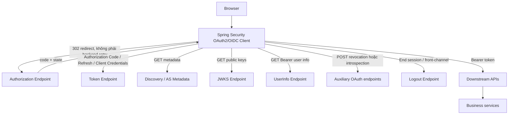
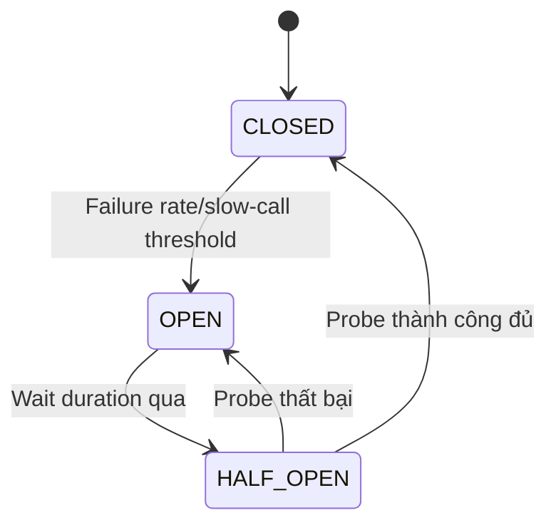

# 32.7. Retry, backoff và circuit breaker theo đặc tính từng endpoint

## 1. Vì sao không thể áp dụng một chính sách retry cho mọi lời gọi OAuth2/OIDC?

Ứng dụng **Spring Security OAuth 2.0/OIDC Client** không chỉ gọi một HTTP API. Trong vòng đời đăng nhập, làm mới token và truy cập tài nguyên, ứng dụng có thể giao tiếp với:

- **Authorization Endpoint**: điều hướng trình duyệt để người dùng xác thực.
- **Token Endpoint**: đổi authorization code, refresh token, lấy token bằng `client_credentials` hoặc các grant khác.
- **OpenID Provider Discovery / Authorization Server Metadata**: tải thông tin issuer và endpoints.
- **JWKS Endpoint**: tải public keys để xác minh chữ ký JWT/ID Token.
- **UserInfo Endpoint**: lấy claims người dùng bằng access token.
- **Introspection / Revocation Endpoint**: kiểm tra hoặc thu hồi token, tùy kiến trúc.
- **End Session / Logout Endpoint**: điều phối logout giữa RP và OP.
- **Downstream Resource Servers**: các API Inventory, Billing, Reports... nhận access token.

Các request này có đặc tính hoàn toàn khác nhau. Một `GET /jwks` thường có thể thử lại có giới hạn khi gặp `503`; nhưng một `POST /token` dùng **authorization code chỉ dùng một lần** không thể tùy tiện thử lại khi bị timeout vì chưa biết Authorization Server đã tiêu thụ code hay chưa. Một refresh token có **rotation** lại càng dễ gây vấn đề nếu retry làm sử dụng lại refresh token cũ.

**Retry là một quyết định về ngữ nghĩa nghiệp vụ và bảo mật, không phải chỉ là một phương án xử lý mọi HTTP 5xx.**

> Chính sách mặc định an toàn: **không tự động retry** một lời gọi OAuth2/OIDC có tác động đến trạng thái hoặc sử dụng thông tin một lần, trừ khi đã có hợp đồng idempotency/replay rõ ràng với provider. Chỉ retry những lời gọi có thể thực hiện lại an toàn, theo lỗi được phân loại, với timeout, backoff, jitter, budget và circuit breaker riêng.

### 1.1. Mục tiêu học tập

Sau bài học, bạn có thể:

1. Phân biệt **transient failure**, lỗi giao thức, lỗi cấu hình, rate limiting và lỗi bảo mật.
2. Quyết định endpoint nào được retry và endpoint nào không nên retry.
3. Hiểu vì sao `authorization_code` và rotating refresh token không thể retry mù quáng.
4. Đặt timeout cho connect, TLS handshake, response và toàn bộ request.
5. Tính tổng thời gian bị giữ bởi retries/backoff so với latency budget của login hoặc API.
6. Thiết kế exponential backoff với jitter và giới hạn số lần thử.
7. Hiểu `Retry-After` trong response `429`/`503` và khi nào không nên sử dụng nó để replay request.
8. Thiết kế circuit breaker theo **provider/issuer + endpoint + loại tác vụ**.
9. Phân biệt circuit breaker, rate limiter, bulkhead, cache và retry.
10. Tách retry của **downstream GET** khỏi logic OAuth2 token acquisition.
11. Dùng Reactor `Retry.backoff(...)` trong một WebFlux/WebClient client cụ thể.
12. Dùng Resilience4j với Spring `RestClient` hoặc WebClient một cách có kiểm soát.
13. Xử lý `401 invalid_token`, `400 invalid_grant`, `403` mà không tạo login loop hay retry storm.
14. Quản lý JWKS/metadata cache và key rotation mà không bỏ qua xác minh chữ ký.
15. Giảm refresh stampede khi nhiều threads/instances cần token mới.
16. Quan sát retry, breaker state, timeout và token errors mà không log secrets.
17. Kiểm thử fault injection và xác minh các request không được replay.
18. Xây dựng runbook khi Authorization Server hoặc downstream API gặp sự cố.

## 2. Bản đồ endpoint và điểm có thể lỗi



Nếu đưa một retry filter chung vào mọi outbound HTTP request:

```text
allRequests
    .retry(3)
```

thì bạn có thể vô tình:

- Gửi **authorization code hai lần** đến Token Endpoint.
- Dùng lại **refresh token đã rotate**.
- Làm tăng số token được phát cho `client_credentials`.
- Gửi lại một HTTP `POST /payments`, tạo giao dịch trùng.
- Biến một outage ngắn thành **retry storm**.
- Giữ browser login request chờ quá lâu.
- Gửi lại bearer token đến host không còn được tin sau redirect/fallback.
- Che giấu lỗi `invalid_client`, `invalid_grant`, sai issuer hoặc TLS certificate.

Do đó **không đặt retry vào `WebClient.Builder` hoặc `RestClient.Builder` dùng chung** nếu builder còn được dùng cho token client, UserInfo, revocation và nhiều downstream services.

## 3. Phân loại lỗi trước khi quyết định retry

### 3.1. Lỗi tạm thời có thể khôi phục

Ví dụ:

- TCP connection refused do pod vừa rolling restart.
- Kết nối tới một JWKS/read-only API bị reset.
- `502 Bad Gateway` khi upstream chuyển node.
- `503 Service Unavailable` có giới hạn thời gian.
- `504 Gateway Timeout` ở read-only operation.
- `429 Too Many Requests` có `Retry-After` và operation đủ an toàn để lặp lại.
- DNS resolution tạm thời không thành công (chỉ với host đã được cấu hình/approved).

Ngay cả khi lỗi thuộc nhóm transient, **chỉ retry khi request có thể phát lại an toàn** và còn retry budget.

### 3.2. Lỗi giao thức/credentials — không retry ngay

| HTTP/OAuth2 error | Ý nghĩa thường gặp | Xử lý |
| --- | --- | --- |
| `400 invalid_grant` | Code hết hạn/đã dùng, sai verifier, redirect URI hoặc refresh token không hợp lệ | Dừng; không replay grant |
| `400 invalid_request` | Tham số không đúng hợp đồng | Sửa code/config |
| `400 unsupported_grant_type` | Provider không hỗ trợ grant | Sửa registration |
| `400 invalid_scope` | Scope không được phép | Sửa scope/consent |
| `401 invalid_client` | Client authentication không hợp lệ | Sửa secret, cert hoặc client assertion |
| `401 invalid_token` ở API | Token hết hạn/issuer/audience/signature/revocation sai | Kiểm tra token lifecycle và API; không retry request vô hạn |
| `403 insufficient_scope` | Thiếu quyền/scope | Quy trình cấp quyền; không lặp request |
| OIDC `login_required` | Cần tương tác người dùng | Khởi động luồng phù hợp, không retry background |
| OIDC `interaction_required` | Cần prompt/consent/MFA | Đưa về user interaction |
| Issuer/audience/nonce mismatch | Trust boundary hoặc token validation sai | **Fail closed**, điều tra bảo mật |
| TLS certificate/hostname failure | Không xác minh được endpoint | **Không** tự hạ TLS, không đổi host |

`400`, `401`, `403` nhìn chung **không phải tín hiệu tự động retry**. Một số downstream API có semantics riêng nhưng phải được định nghĩa trong hợp đồng.

### 3.3. Kết quả không rõ do timeout

Đây là trường hợp nguy hiểm nhất.

```text
RP gửi POST /token(code=C1)
       |
       +-- AS đã nhận, tiêu thụ code, tạo token
       |
       +-- Network timeout trước khi RP đọc response
```

RP chỉ biết **response không đến**, không biết AS đã xử lý hay chưa. Gửi lại `code=C1` có thể gặp `invalid_grant`; với rotating refresh token, request thứ hai còn có thể kích hoạt **replay detection/revoke token family** tùy provider.

**Timeout không chứng minh thao tác ở server chưa xảy ra.**

## 4. Retry phải dựa trên ngữ nghĩa idempotency

Một operation là **idempotent** nếu lặp lại với cùng dữ liệu dẫn đến trạng thái cuối tương đương một lần thực hiện. Nhưng “HTTP GET” không tự đảm bảo downstream service thực hiện đúng hợp đồng, và “HTTP POST” không phải lúc nào cũng non-idempotent; cần xem **ngữ nghĩa thực tế**.

| Tiêu chí | Câu hỏi |
| --- | --- |
| Safe/read-only? | Gọi lại có thể tạo/cập nhật dữ liệu không? |
| Idempotent? | N lần gọi có trạng thái cuối giống 1 lần không? |
| One-time credential? | Có sử dụng code/refresh token/nonce/assertion chỉ dùng một lần không? |
| Replay semantics? | Provider có chấp nhận request lặp theo idempotency key không? |
| Delivery certainty? | Khi timeout, có biết AS/API đã xử lý chưa? |
| Rate limit? | Replay có làm khóa client/tenant hoặc tăng chi phí không? |
| Security binding? | Retry có còn dùng đúng issuer, registration, audience và endpoint không? |
| Deadline? | Còn thời gian chờ của browser/người dùng không? |

**Quy tắc:** HTTP method chỉ là tín hiệu ban đầu; **contract của endpoint** và **security token lifecycle** mới quyết định.

### 4.1. “At least once” không phù hợp với mọi OAuth2 operation

Automatic retry về bản chất có thể tạo **at-least-once delivery**. Với:

- Authorization Code Token Exchange: authorization code **one-time**.
- Rotating Refresh Token: refresh token có thể **one-time**.
- Payments/side-effecting downstream POST: nghiệp vụ có thể tạo giao dịch lặp.

Nếu không có idempotency guarantee, ưu tiên **at-most-one automatic attempt** và chuyển sang recovery flow được định nghĩa.

## 5. Bảng chính sách theo từng endpoint

| Endpoint / operation | Tính chất | Retry gợi ý | Circuit breaker? | Recovery |
| --- | --- | --- | --- | --- |
| Authorization Endpoint qua browser | Tương tác user, redirect | **Không tự động server-side retry** | Không CB kiểu backend POST; giám sát availability | Hiển thị login error/restart flow |
| Authorization Code → Token Endpoint | One-time code, có thể đã consume | **Không tự động retry** | Có thể fail fast theo availability, nhưng không đổi AS | Restart login flow |
| Refresh Token (rotation) | Có thể là one-time, unknown outcome | **Không retry mù quáng** | Có thể bảo vệ Token Endpoint; policy riêng | Reauthorize/relogin theo provider |
| `client_credentials` Token Endpoint | Cấp token, có side effects/quota | Chỉ retry có giới hạn **nếu provider contract cho phép** | Có | Cache token, fail fast, phục hồi sau outage |
| Token Exchange RFC 8693 | Phát hành token mới, delegation/context | Không tự động nếu chưa rõ replay semantics | Có thể | Recovery theo contract |
| Discovery/AS Metadata `GET` | Đọc cấu hình | Retry ngắn khi transient | Có | Cache metadata đã xác minh; fail closed |
| JWKS `GET` | Đọc public keys | Retry ngắn khi transient | Có | Cache keys theo policy, không bỏ signature |
| UserInfo `GET` | Đọc user claims với bearer token | Retry ngắn nếu approved và safe | Có | Chỉ fallback optional claims theo policy |
| Introspection `POST` | Read-like protocol operation, có rate limit | Conditional theo AS contract | Có | Fail authentication/authorization closed |
| Revocation `POST` | Token state change / security-sensitive | Conditional/best-effort, không mù quáng | Có thể | Queue/record theo policy, local session invalidation |
| RP-Initiated Logout/End Session | Browser redirect / user interaction | Không backend replay login/logout | Giám sát riêng | Local logout + hướng dẫn user |
| Downstream API `GET` | Thường read-only | Có thể retry bounded/transient | Có, per API | 503/cached non-security data theo policy |
| Downstream `PUT`/`DELETE` | Có thể idempotent theo hợp đồng | Chỉ nếu downstream bảo đảm | Có | Xác minh trạng thái |
| Downstream `POST` tạo tài nguyên | Thường side-effecting | Không, trừ idempotency key/hợp đồng | Có | Idempotency workflow |
| Webhook/event publish | Có thể at-least-once | Dedupe/idempotency contract | Có | Queue/DLQ/replay có kiểm soát |

**Đây là chính sách khuyến nghị khởi đầu**, không phải giá trị cố định của Spring Security. Mỗi AS/provider và downstream service có thể có các giới hạn hoặc idempotency mechanisms riêng.

## 6. Authorization Endpoint: đừng biến điều hướng thành background retry

Một login bắt đầu tại:

```text
GET /oauth2/authorization/corporate
```

Spring Security tạo authorization request với `state`, có thể kèm PKCE `code_challenge` và OIDC `nonce`, lưu request rồi trả `302 Location` tới OP.

Nếu OP tạm thời lỗi:

- Browser có thể hiển thị trang lỗi hoặc người dùng thử lại.
- Ứng dụng **không nên phát đi nhiều authorization requests bằng background retries** với state/nonce mới mà người dùng không biết.
- Không tự động đổi provider/issuer nếu OP không phản hồi.
- Không “thử nhiều login endpoints” với cùng flow.
- Đảm bảo flow restart sinh **state/nonce/PKCE verifier mới**, không reuse transaction đã timeout.

Một circuit breaker đặt vào HTTP client gọi Token Endpoint **không kiểm soát được** redirect browser tới Authorization Endpoint theo cách tương đương. Hãy phân biệt **front channel** với **back channel**.

### 6.1. Khi OP login page trả 503

Cách xử lý có thể là:

```text
Người dùng thấy:
“Dịch vụ đăng nhập hiện không khả dụng.
 Vui lòng thử đăng nhập lại sau.”

Ứng dụng:
Không tạo authenticated session.
Không thay đổi issuer/tokenUri.
Không bỏ qua state/PKCE/nonce.
```

Có thể cung cấp nút **“Thử đăng nhập lại”** do người dùng chủ động bấm, không tự liên tục điều hướng.

## 7. Authorization Code Token Exchange: no automatic retry

Lời gọi:

```http
POST /token
Content-Type: application/x-www-form-urlencoded

grant_type=authorization_code&
code=ONE_TIME_CODE&
redirect_uri=https%3A%2F%2Fportal.example.com%2Flogin%2Foauth2%2Fcode%2Fcorporate&
code_verifier=...
```

Một authorization code:

- Có thời hạn ngắn.
- Được cấp cho đúng client ID/redirect URI.
- Có thể bị ràng buộc PKCE verifier.
- **Chỉ được sử dụng một lần**.

Nếu mất response sau khi AS tiêu thụ code, request thứ hai thường không thể lấy lại cùng token response.

### 7.1. Không làm điều này

```java
// SAI: dùng chung retry cho mọi HTTP method.
webClient.post()
    .uri(tokenUri)
    .bodyValue(tokenRequest)
    .retrieve()
    .bodyToMono(TokenResponse.class)
    .retry(3);
```

`retry(3)` có thể gửi cùng authorization code nhiều lần mà không xét lỗi.

### 7.2. Khi token exchange thất bại

Quy trình hợp lý:

1. Phân loại error: OAuth2 `invalid_grant`, `invalid_client`, timeout, HTTP 5xx, TLS, network.
2. Ghi sanitized event kèm registration ID/issuer alias, không ghi code/verifier/secret.
3. Không tự động replay authorization code.
4. Không tạo `OAuth2AuthorizedClient`/authenticated session nếu token validation chưa thành công.
5. Cho người dùng khởi động **một authorization flow mới** nếu phù hợp.
6. Điều tra Token Endpoint availability nếu nhiều flows cùng lỗi.

`invalid_grant` **không chắc là outage**: có thể do wrong PKCE verifier, redirect URI mismatch, code đã dùng hoặc expired. Retry thường không sửa được lỗi này.

### 7.3. Circuit breaker ở Token Endpoint có nghĩa gì?

Có thể dùng breaker để **fail fast trước khi bắt đầu một token request mới**, giảm áp lực khi AS đang lỗi. Nhưng:

- CB **không làm replay code trở nên an toàn**.
- Nếu breaker mở, **không gửi code**, nhưng phải fail/restart flow có kiểm soát.
- Breaker không được tự chuyển sang Token Endpoint thuộc issuer khác.
- Một số Spring Security versions không cung cấp hook thống nhất để bọc toàn bộ token client; cần xác định extension point của `OAuth2AccessTokenResponseClient` hoặc reactive counterpart đúng phiên bản.

## 8. Refresh Token Rotation: rủi ro lớn hơn timeout thông thường

Giả sử RP đang giữ refresh token `R1`:

```text
RP                 Authorization Server
 | POST /token(R1)         |
 |------------------------>|
 |                  consume R1
 |                  issue R2 + A2
 |<--- response lost -------|
 | timeout
```

Nếu RP retry `R1`:

```text
POST /token(R1) lần 2
```

AS có thể:

- Trả `invalid_grant` vì R1 đã bị consume.
- Coi đây là refresh token replay.
- Thu hồi token family hoặc kích hoạt incident controls.
- Có cơ chế grace window đặc thù, nhưng **không được giả định**.

### 8.1. Vì sao “refresh token là HTTP POST” chưa đủ để suy luận?

Vấn đề không nằm ở POST thuần túy mà ở **token lifecycle** và **khả năng biết trạng thái đã commit**. Nếu response thất lạc, RP không có R2, không thể tự suy ra R2 từ R1.

**Mặc định:** không tự động retry refresh request có rotation khi outcome không rõ.

### 8.2. Recovery policy nên dựa vào provider

Các lựa chọn:

- Nếu provider trả `invalid_grant` khi refresh: xóa/đánh dấu authorized client không còn hợp lệ và yêu cầu reauthorization, theo policy.
- Nếu provider có explicit grace/idempotency contract: có thể thực hiện logic đặc thù đã được kiểm thử.
- Nếu refresh chưa thực hiện vì circuit breaker **chặn trước send**: có thể thử lại sau theo lịch khi còn valid token, nhưng không coi việc đó là replay cùng request đã gửi.
- Nếu access token cũ còn hạn, có thể tiếp tục sử dụng **tới expiry** trong phạm vi audience/scopes cho phép; không sử dụng access token đã hết hạn.
- Nếu cần high availability, xem xét provider token rotation design, clock skew và concurrency coordination.

### 8.3. Đừng phục hồi bằng cách ghi đè authorized client của user khác

`OAuth2AuthorizedClient` cần ràng buộc đúng:

```text
registrationId
principalName
tenant/issuer context nếu ứng dụng có multi-tenant
```

Refresh failure của user A không được xóa hoặc thay token của user B. Với service principals, cũng cần account/workload-specific keys.

## 9. `client_credentials`: có thể thử lại, nhưng không mặc nhiên

Grant:

```http
POST /token
grant_type=client_credentials
scope=inventory.read
```

Thường không dùng một token một lần như authorization code hoặc rotating refresh token. Do đó **một số hệ thống** chấp nhận retry ngắn khi `502/503/504`, timeout hoặc connection error.

Tuy nhiên, Token Endpoint có thể:

- Phát một token mới mỗi request.
- Ghi nhận audit/rate-limit/quota.
- Có chi phí ký JWT hoặc external client authentication.
- Áp dụng mTLS/private_key_jwt với assertions ngắn hạn.
- Giới hạn số token active đồng thời.

Vì vậy cần **provider contract**, không suy ra POST này luôn idempotent.

### 9.1. Chính sách thận trọng

Nếu provider cho phép replay an toàn:

```text
maxAttempts = 2 (bao gồm lần đầu)
retryOn     = network transient được định nghĩa, 502/503/504
retryOn429  = chỉ khi Retry-After và budget cho phép
neverRetry  = 400 invalid_scope, 401 invalid_client,
              TLS trust failure, issuer mismatch
backoff     = 150–400ms + jitter, giới hạn chặt
```

Các con số là **ví dụ thiết kế để điều chỉnh theo SLO/provider quota**, không phải defaults của Spring Security.

### 9.2. Cache token mới là hàng phòng vệ đầu

Nếu một token `client_credentials` có hạn 5–15 phút, việc gọi Token Endpoint **mỗi request API** là một anti-pattern. Sử dụng `OAuth2AuthorizedClientManager` hoặc `ReactiveOAuth2AuthorizedClientManager`, caching và expiry skew đúng để:

- Tái sử dụng access token còn hạn.
- Giảm token endpoint load.
- Tránh retry storm khi có traffic spike.
- Không gửi token đã hết hạn.
- Phân tách tokens theo registration/resource/tenant.

Chỉ nên bật retry sau khi đã giảm nhu cầu cấp token không cần thiết.

## 10. Token Exchange và các grant khác

OAuth 2.0 Token Exchange (RFC 8693), Device Authorization Grant, JWT bearer assertions hoặc những extension grants khác có semantics riêng. Không gộp tất cả dưới điều kiện:

```text
POST /token -> retryable
```

Đặc biệt:

- Token exchange có thể gắn subject token, actor token và audience mới.
- JWT client assertion có `jti`/`exp`; AS có thể kiểm tra replay.
- Device flow có **polling interval** và các lỗi `authorization_pending`, `slow_down` theo chuẩn — đây là **protocol polling**, không phải automatic retry tùy ý.
- Với refresh rotation, duplicate request có thể gây bảo mật incident.
- Với authorization code, duplicate request vi phạm one-time-use expectation.

Thiết kế **per-grant policy**, thậm chí khi tất cả dùng cùng Token Endpoint URL.

## 11. Discovery và Authorization Server Metadata: `GET` có thể retry có giới hạn

Ví dụ OIDC Discovery:

```text
GET https://sso.example.com/realms/staff/.well-known/openid-configuration
```

Hoặc OAuth Authorization Server Metadata theo RFC 8414.

Thông thường đây là thao tác đọc metadata; có thể retry ngắn nếu:

- Host/issuer đã được **approved**.
- Lỗi thuộc nhóm transient.
- Còn startup/request budget.
- Retry không chạy vòng lặp vô hạn.
- Cùng trusted HTTPS URL, không tự chuyển sang endpoint lạ.

### 11.1. Các lỗi không nên retry

- Metadata `issuer` không khớp expected issuer.
- URL chỉ tới private IP/metadata service vì SSRF.
- TLS hostname/certificate validation thất bại.
- Metadata không phải JSON hợp lệ hoặc thiếu trường bắt buộc.
- Provider công bố Token Endpoint ngoài approved trust policy.
- Hai AS khác nhau cố dùng chung issuer identifier.

Những lỗi này là **configuration/trust failures**, không phải availability failures.

### 11.2. Boot startup vs runtime discovery

Nếu ứng dụng gọi discovery lúc startup:

```text
App startup -> OP metadata endpoint unavailable
```

có thể gặp startup failure. Không nên đặt **retry vô hạn** trong bean constructor hoặc dependency initialization vì:

- Giữ deployment không hoàn tất vô thời hạn.
- Làm health/readiness khó hiểu.
- Khi nhiều pods cùng start sẽ tạo thác requests tới OP.
- Không giải quyết TLS/issuer mismatch.

Các lựa chọn:

- Sử dụng approved static provider endpoints nếu phù hợp trust và rotation policy.
- Warm-up/refresh metadata có TTL theo vận hành.
- Readiness báo đúng tình trạng dependency.
- Retry ngắn với budget trong control-plane component, không block vô hạn.
- Cân nhắc cache metadata **đã xác minh issuer** theo thời hạn được phê duyệt.

**Không cho phép metadata cache trở thành cách bỏ qua kiểm tra issuer.**

## 12. JWKS Endpoint: read-only nhưng là security-critical dependency

Một JWK Set thường được lấy bằng:

```http
GET /.well-known/jwks.json
```

hoặc URL `jwks_uri` trong metadata của OP.

JWKS chứa **public keys**, nhưng chính sách tải/refresh key ảnh hưởng trực tiếp đến tính đúng đắn của **JWT signature validation**.

### 12.1. Khi nào retry?

Có thể retry giới hạn khi:

- `502`, `503`, `504`.
- Temporary I/O error.
- Temporary DNS failure với trusted host.
- Có ngân sách latency.
- Cache không đủ hoặc cần refresh `kid` chưa thấy.

Nhưng:

- Không retry `401/403` vô tận.
- Không retry vô hạn khi OP công bố key set bị sai định dạng.
- Không đổi sang JWKS URI do token header chỉ định (`jku`/`x5u`) nếu không approved.
- Không bỏ kiểm tra chữ ký khi JWKS tạm thời không tải được.
- Không tự chấp nhận thuật toán JWT bất kỳ hoặc `alg=none`.

### 12.2. Cache, rotation và unknown `kid`

Một trường hợp:

```text
Cached JWKS:
  kid=old-key

Incoming ID Token:
  kid=new-key
```

Ứng dụng có thể refresh JWKS theo policy để tìm `new-key`. Nếu refresh thất bại:

- Với **unknown kid**: không thể xác minh chữ ký → **reject**, không “tin vì issuer đúng”.
- Với **known kid còn được tin**: có thể dùng cached key trong TTL được phê duyệt nếu validator vẫn kiểm tra signature/issuer/audience/expiry.
- Không giữ cache vô hạn để né sự cố OP hoặc key revocation.
- Không cache một JWKS chung cho các issuers/tenants khác nhau chỉ vì hostname giống nhau.

### 12.3. Cache không thay circuit breaker

Cache giảm số request đi tới OP. Circuit breaker giảm tải khi dependency đã lỗi. Retry xử lý lỗi transient của **một request cụ thể**. Ba công cụ phục vụ các mục tiêu khác nhau.

```text
JWT validation
   -> cached trusted JWKS?
      -> yes: verify signature
      -> no/new kid: allowed fetch (short timeout, bounded retry, CB)
           -> validated keys: verify signature
           -> cannot fetch/verify: fail closed
```

Không trả `authenticated=true` chỉ vì cached token claims có vẻ hợp lý.

## 13. UserInfo Endpoint: GET tương đối an toàn nhưng có bearer token

OIDC UserInfo thường là:

```http
GET /userinfo
Authorization: Bearer <access_token>
```

Theo hợp đồng OIDC, đây là thao tác lấy claims người dùng. Retry có thể phù hợp khi:

- Endpoint hỗ trợ read-only semantics.
- Request được gửi lại tới **cùng trusted OP**.
- Bearer token còn hiệu lực.
- Lỗi là `429`, `502`, `503`, `504` hoặc transient I/O.
- Tổng login budget còn đủ.

**Không** tự retry khi:

- `401 invalid_token`: token bị từ chối, không lặp cùng token nhiều lần.
- `403`: scopes/consent/policy không cho.
- `400` malformed request.
- `iss`/`sub`/TLS/trust mismatch.
- Có redirect sang host không được phê duyệt.

### 13.1. UserInfo timeout không nhất thiết được phép bỏ qua

Có ứng dụng chỉ dùng UserInfo để bổ sung **avatar/display name**; nhưng có ứng dụng dùng claims từ UserInfo để xác định **membership** hoặc một thuộc tính bắt buộc.

Quy tắc:

- Nếu claims được yêu cầu cho authentication/authorization → **fail closed** hoặc xử lý theo policy đã định.
- Nếu claims chỉ là UI enrichment → có thể degrade bằng **claims đã xác minh trong ID Token** hoặc bỏ trường không bắt buộc.
- Luôn kiểm tra **UserInfo `sub` khớp ID Token `sub`** theo OIDC requirements.
- Không dùng profile data cache của user khác chỉ để login “nhanh hơn”.

### 13.2. Retry và redirects

Một HTTP client có auto-follow redirects có thể mang Bearer token qua host lạ nếu thiết kế sai. Với UserInfo:

- Chỉ tin HTTPS endpoint trong approved metadata.
- Không cho arbitrary redirect host.
- Bảo đảm Authorization header không bị forward sang origin không tin.
- Nếu OP thay endpoint, cập nhật metadata theo trust process, không tự đoán URL khác.

## 14. Introspection Endpoint: POST nhưng thiên về đọc trạng thái

OAuth2 Token Introspection (RFC 7662) thường dùng:

```http
POST /introspect
Content-Type: application/x-www-form-urlencoded

token=...
```

Nó trả token active hay không cùng metadata theo provider.

Về ngữ nghĩa, introspection **thường là đọc trạng thái**, nên một số deployments cho phép retry hạn chế trên outage transient. Tuy nhiên:

- Endpoint là HTTP POST.
- Có thể có rate limits và audit.
- Chứa token nhạy cảm.
- Có client authentication riêng.
- Có thể được gọi ở **mọi API request** khi dùng opaque token.

Do đó cần policy riêng cho `introspection`, **không reuse Token Endpoint policy**.

### 14.1. Fail closed khi không thể kiểm tra token

Nếu Resource Server không thể introspect và không có một cached introspection result **đang còn hợp lệ theo policy**, không được coi token là active.

```text
Introspection timeout
    ≠
token valid
```

Tùy system SLO, API có thể trả `503 Service Unavailable` thay vì `401` để phản ánh dependency unavailable, nhưng **không cấp quyền** khi chưa kiểm chứng token.

### 14.2. Caching introspection response

Có thể cache trong TTL ngắn nếu provider contract và security policy cho phép. Khi đó cần cân bằng:

- Availability.
- Token revocation propagation.
- `exp` của token.
- Revocation requirements.
- Cache isolation theo issuer/client/audience/tenant.
- Không cache “active=true” lâu hơn bảo mật cho phép.

Không có một TTL đúng cho mọi hệ thống.

## 15. Revocation Endpoint: best effort không đồng nghĩa retry vô hạn

OAuth2 Token Revocation (RFC 7009) có thể được gọi khi user logout hoặc client thu hồi token:

```http
POST /revoke
Content-Type: application/x-www-form-urlencoded

token=...
token_type_hint=refresh_token
```

Việc thu hồi token có thể có semantics cho phép lặp lại ở AS theo chuẩn/provider, nhưng vẫn cần lưu ý:

- Request chứa token bí mật.
- Provider có rate limiting.
- Timeout có thể xảy ra **sau khi token đã bị thu hồi**.
- Không biết token nào/chuỗi token family nào đã bị tác động.
- Client authentication có thể thay đổi.
- Không nên giữ browser logout chờ một loạt retries dài.

### 15.1. Chính sách logout/revocation khuyến nghị

1. **Xóa local session** và local authorized-client state theo policy ngay, không đợi remote revocation thành công.
2. Gọi revocation với timeout ngắn.
3. Nếu remote revocation lỗi, ghi sanitized event và thực hiện recovery phù hợp.
4. Nếu provider cam kết idempotent revocation và token handling an toàn, có thể retry bounded hoặc queue với TTL.
5. Không lưu raw refresh token lâu dài trong queue ít bảo vệ chỉ để retry sau.
6. Không tuyên bố “token đã được thu hồi ở OP” nếu request chưa xác nhận.

**Quan trọng:** logout local và revocation remote là hai kết quả riêng. Nếu remote revocation fail, phải thông báo/giám sát tùy security requirements.

## 16. End Session / OIDC Logout: tương tác trình duyệt không phải backend retry

RP-Initiated Logout thường điều hướng browser tới OP End Session Endpoint:

```text
RP -> 302 browser -> OP end_session_endpoint
```

Endpoint có thể yêu cầu:

- `id_token_hint`.
- `post_logout_redirect_uri`.
- `state`.
- OP session cookie.
- User interaction.

Không làm:

```text
Nếu browser chưa quay lại:
  backend gửi 5 lần request logout tới OP
```

vì browser/OP session context không nhất thiết tồn tại ở backend.

### 16.1. Khi OP logout không khả dụng

- Kết thúc local application session đúng policy.
- Không coi remote SSO session đã chắc chắn bị xóa nếu chưa có xác nhận.
- Có thể hiển thị thông báo rõ user nên đóng phiên browser hoặc thử logout SSO lại.
- Giữ CSRF protection cho logout initiation theo security configuration.
- Tránh redirect user đến URL không được đăng ký hoặc OP khác.

## 17. Downstream APIs: chọn retry theo method **và** nghiệp vụ

Ví dụ Portal gọi:

```text
GET /inventory/items/{id}
GET /reports/{id}
POST /billing/charges
PUT /preferences/{id}
DELETE /sessions/{id}
```

### 17.1. GET không thay đổi trạng thái

Một GET đúng semantics thường có thể retry với:

- Connect/read timeout transient.
- `502`, `503`, `504`.
- `429` nếu xử lý `Retry-After` và rate budget.
- Số lần thử nhỏ, backoff + jitter.

**Không** retry:

- `401`/`403`.
- `404` cho resource không tồn tại.
- `400` validation errors.
- Wrong issuer/audience/token.
- TLS certificate failure.
- Host thuộc redirect/SSRF không approved.

### 17.2. PUT và DELETE

Theo HTTP semantics, PUT/DELETE thường **idempotent về trạng thái cuối** nhưng implementation có thể kích hoạt side effects như event publishing hoặc charging. Phải xác nhận downstream contract.

Ví dụ `DELETE /session/42` có thể an toàn khi gọi lại và trả `404` ở lần hai; nhưng nếu event side effects không dedupe, retry vẫn gây vấn đề.

### 17.3. POST có idempotency key

Khi downstream hỗ trợ:

```http
POST /payments
Idempotency-Key: checkout-req-abc123
```

nó có thể bảo đảm cùng key/same payload chỉ thực thi nghiệp vụ một lần.

Khi đó retry có thể được cho phép **nếu hợp đồng nêu rõ**:

- Key được sinh **một lần cho một business operation**.
- Key không đổi giữa các attempts.
- Body, principal, tenant, audience không đổi.
- Key scope và TTL được mô tả.
- Downstream trả kết quả nhất quán hoặc truy vấn trạng thái.

**Không tự thêm header `Idempotency-Key` rồi cho rằng API đã có dedupe**. Server phải triển khai, kiểm thử và tài liệu hóa semantics.

## 18. Timeout: không có retry an toàn nếu không có deadline

Mỗi HTTP request nên có giới hạn rõ ràng:

- DNS resolution timeout.
- TCP connect timeout.
- TLS handshake timeout.
- Response header/read timeout.
- Idle timeout nếu streaming.
- Overall operation deadline.

Ví dụ một login callback có budget 5 giây cho dependencies. Nếu mỗi request retry 3 lần, mỗi lần timeout 3 giây và backoff 2 giây, **tổng thời gian có thể vượt xa 5 giây**.

### 18.1. Công thức ước lượng

Với tối đa \(n\) attempts:

\[
T_{\text{worst}} \approx
\sum_{i=1}^{n} T_{\text{attempt},i}
+
\sum_{i=1}^{n-1} D_i
\]

Trong đó:

- \(T_{\text{attempt},i}\): timeout tối đa mỗi lần thử.
- \(D_i\): delay/backoff trước lần thử tiếp theo.

Ví dụ:

```text
maxAttempts = 3 (1 initial + 2 retries)
perAttemptTimeout = 1.0 s
backoff delays = 0.2 s, 0.4 s

Worst approximate = 3.0 + 0.6 = 3.6 s
```

Còn phải tính thời gian xử lý controller, token acquisition, JWT verification, DB, network scheduling và browser redirect. Các timeout của hệ điều hành/proxy có thể làm độ trễ thực tế khác.

### 18.2. Timeout theo endpoint

| Endpoint | Budget thường ưu tiên | Ghi chú |
| --- | --- | --- |
| Authorization Code Token | Ngắn, không retry | Browser đang chờ login |
| Refresh Token | Ngắn, unknown outcome cần recovery | Không replay rotating token |
| Client Credentials Token | Ngắn + bounded conditional retry | Cache/single-flight ưu tiên |
| JWKS/Discovery | Bounded network retries | Có thể preload/cache trusted metadata |
| UserInfo | Giới hạn chặt trong login budget | Tùy essential vs optional claims |
| Introspection | Rất nhạy API latency | Cache có TTL/policy nếu được phép |
| Revocation | Best effort ngắn | Không trì hoãn local logout |
| Downstream GET | Theo API SLO | Budget riêng và breaker/bulkhead |
| Downstream payment POST | Không retry mặc định | Idempotency key nếu hỗ trợ |

**Các con số phải dựa vào p95/p99 SLO, provider limits và dependency topology**, không lấy nguyên một timeout dùng cho mọi request.

## 19. Exponential backoff và jitter

Một chuỗi backoff đơn giản:

\[
D_k = \min(D_{\max}, D_0 \times 2^{k-1})
\]

Trong đó:

- \(D_0\) là base delay.
- \(D_{\max}\) là maximum delay.
- \(k=1\) ứng với retry đầu tiên.

Ví dụ:

```text
Retry 1: 200 ms
Retry 2: 400 ms
Retry 3: 800 ms
Retry 4: 1.6 s
```

Nếu 10.000 pods đều retry đúng các thời điểm này, chúng có thể tạo **thundering herd** vào AS khi service hồi phục.

### 19.1. Thêm jitter

Một full-jitter variant:

\[
D_k = U(0, \min(D_{\max}, D_0 \times 2^{k-1}))
\]

Một equal-jitter variant giữ nửa base delay và random phần còn lại.

Mục tiêu: các clients **phân tán thời điểm retry**, giảm đồng loạt spike.

Không dùng jitter để biện minh cho 20 retries. Jitter giảm đồng bộ nhưng không tự giới hạn tổng tải.

### 19.2. `maxAttempts` hay `maxRetries`?

Các libraries có thể đặt tên khác:

```text
maxAttempts = 3 -> 1 lần đầu + 2 retries
retry(3)    -> thường 3 retries sau lần đầu (tổng có thể 4)
```

Trong Reactor:

```java
Retry.backoff(2, Duration.ofMillis(200))
```

nghĩa là tối đa **2 retries** sau attempt ban đầu, không phải tổng 2 attempts.

Trong Resilience4j:

```java
maxAttempts(3)
```

nghĩa là **tối đa 3 attempts tổng cộng**.

Việc nhầm hai khái niệm có thể tăng tải không mong muốn gấp đôi ở production.

## 20. `Retry-After` và HTTP 429/503

Một server có thể trả:

```http
HTTP/1.1 429 Too Many Requests
Retry-After: 3
```

hoặc:

```http
HTTP/1.1 503 Service Unavailable
Retry-After: Wed, 18 Nov 2026 10:00:00 GMT
```

`Retry-After` có thể là **số giây** hoặc **HTTP-date** theo HTTP semantics.

### 20.1. Cách xử lý

1. **Chỉ xét retry nếu operation được phép replay.**
2. Parse `Retry-After` đúng hai dạng.
3. Clamp vào maximum wait và overall budget.
4. Áp dụng per-provider rate limiter nếu cần.
5. Không vô hiệu hóa deadline chỉ để chờ `Retry-After`.
6. Khi header sai định dạng/âm/quá lớn, dùng fallback bounded policy hoặc fail.
7. Không replay `authorization_code`/rotating refresh chỉ vì provider trả 429.
8. Cân nhắc jitter khi nhiều clients cùng thấy delay, nhưng không vi phạm minimum wait provider yêu cầu.

**`Retry-After` không phải giấy phép vượt qua idempotency/one-time constraints.**

### 20.2. Khi 429 đến từ Token Endpoint

Nếu `client_credentials` provider cho phép retry, cân nhắc wait phù hợp. Nếu Authorization Code exchange bị 429 sau khi code đã được gửi, việc replay code có thể vẫn không an toàn nếu outcome không rõ. Cần làm việc với provider để biết semantics thay vì tự cho 429 là luôn retryable.

### 20.3. 429 là rate limiting, không phải lúc nào cũng là CB failure

Nếu chỉ một client bị rate limit do quota, mở circuit breaker cho **toàn bộ issuer** có thể làm gián đoạn các clients/tenants khác vốn đang khỏe.

Hãy tách:

- **Rate limiter:** giới hạn số request.
- **Retry:** xử lý tạm thời, khi replay được phép.
- **Circuit breaker:** phát hiện dependency failure để fail fast.
- **Bulkhead:** giới hạn số concurrent requests.
- **Cache/single-flight:** giảm số lần gọi không cần thiết.

## 21. Circuit breaker: ba trạng thái và mục tiêu

Circuit breaker có những trạng thái phổ biến:



- **CLOSED:** requests được phép; breaker ghi nhận outcome.
- **OPEN:** không gọi dependency; fail fast bằng lỗi như `CallNotPermittedException`.
- **HALF_OPEN:** cho một số requests thăm dò; quyết định đóng/mở lại.

Nó **không** làm request an toàn để retry, không sửa OAuth2 credentials, không xác thực issuer và không thay thế timeout.

### 21.1. Phân biệt retry và breaker

| Cơ chế | Trả lời câu hỏi |
| --- | --- |
| Timeout | “Một attempt được chờ lâu tối đa bao nhiêu?” |
| Retry | “Sau lỗi, có thử lại cùng operation không, bao nhiêu lần?” |
| Backoff/jitter | “Đợi bao lâu trước attempt tiếp theo?” |
| Circuit breaker | “Có nên gửi request mới đến dependency đang lỗi không?” |
| Bulkhead | “Bao nhiêu requests được phép dùng tài nguyên cùng lúc?” |
| Rate limiter | “Trong một khoảng thời gian, được gửi bao nhiêu requests?” |
| Cache | “Có cần gọi dependency không?” |
| Single-flight | “Nhiều callers đồng thời có thể dùng chung một token/refresh operation không?” |

Không lạm dụng một công cụ để làm tất cả.

## 22. Thiết kế breaker theo endpoint, không chỉ theo hostname

Một issuer có thể có:

```text
https://sso.example.com/authorize
https://sso.example.com/token
https://sso.example.com/jwks
https://sso.example.com/userinfo
```

Nếu JWKS endpoint lỗi `503`, không có nghĩa Token Endpoint cũng lỗi. Nếu Token Endpoint trả `invalid_client`, đó là **config failure** của một client, không nhất thiết AS đang outage.

### 22.1. Breaker names gợi ý

```text
oidc.corporate.discovery.get
oidc.corporate.jwks.get
oidc.corporate.userinfo.get
oidc.corporate.token.authorization_code
oidc.corporate.token.refresh_token
oidc.corporate.token.client_credentials

downstream.inventory.get
downstream.billing.post
downstream.reports.get
```

Không nhất thiết tạo breaker riêng cho **mỗi user** vì cardinality/memory explosion. Dùng registry names ổn định theo approved provider/issuer alias và endpoint operation category.

### 22.2. Phân loại exceptions cho breaker

Nên record availability failures như:

- Connect/read timeout.
- TCP reset/connect failures.
- `502`, `503`, `504`.
- Một số `500` nếu provider contract coi là transient.
- Slow calls vượt threshold theo SLA.

Thường **không** record breaker failure cho:

- `400 invalid_grant`.
- `401 invalid_client`.
- `403 insufficient_scope`.
- Authorization `access_denied` do user.
- ID Token issuer/audience mismatch.
- Cấu hình sai TLS trust, mặc dù cần alert.
- `404` nếu endpoint không tồn tại do config sai.
- Client cancellation tự nhiên theo user action.

Nếu tính `invalid_grant` vào failure rate, một tập browser sessions dùng code hết hạn có thể mở breaker Token Endpoint dù OP hoàn toàn khỏe.

### 22.3. Khi breaker OPEN, fallback nào hợp lệ?

| Operation | Fallback có thể chấp nhận |
| --- | --- |
| JWKS | Cached trusted keys còn phù hợp validation/TTL |
| Discovery | Trusted cached metadata theo TTL, không bỏ issuer check |
| Client Credentials | Access token cũ **còn hạn** và đúng audience/scope |
| UserInfo optional profile | Chỉ trả claims đã xác minh từ ID Token hoặc bỏ UI enrichment |
| UserInfo essential security claims | **Không** cấp quyền nếu thiếu kiểm chứng |
| Introspection | Chỉ cached validation trong TTL/policy, không accept unknown token |
| Authorization Code Token | Fail login/restart, không fake successful login |
| Refresh token | Không replay; reauthorization khi cần |
| Downstream GET | Cached non-security response nếu policy cho phép |
| Payment POST | Không tự coi payment thành công |
| OP Logout | Local logout; không khẳng định SSO logout remote thành công |

Fallback không được đánh đổi bảo mật lấy availability.

## 23. Resilience4j: tổ chức policies trong Spring Boot

Một cách phổ biến là dùng **Resilience4j** cho circuit breaker, retry, rate limiter và bulkhead.

Gradle minh họa:

```gradle
dependencies {
    implementation 'org.springframework.boot:spring-boot-starter-webflux'
    implementation 'org.springframework.boot:spring-boot-starter-security'
    implementation 'org.springframework.boot:spring-boot-starter-oauth2-client'

    implementation 'io.github.resilience4j:resilience4j-circuitbreaker'
    implementation 'io.github.resilience4j:resilience4j-retry'
    implementation 'io.github.resilience4j:resilience4j-reactor'

    // Tùy stack/Resilience4j version, có thể dùng starter:
    // implementation 'io.github.resilience4j:resilience4j-spring-boot3'
}
```

**Không chọn version Resilience4j bằng cách copy từ bài cũ.** Chọn major version tương thích Spring Boot 3/4 và Spring Security đang dùng; kiểm tra JDK/Actuator/Micrometer dependencies theo tài liệu chính thức. Một số Resilience4j starter versions hỗ trợ Spring Boot 3 nhưng không đảm bảo tự tương thích Boot 4.

### 23.1. Không dùng một global `Retry` cho mọi operations

Thay vì:

```text
oauth2AllEndpoints:
  retryOnException: any
  attempts: 5
```

hãy dùng:

```text
corporate-jwks-read: retryable, bounded
corporate-userinfo-read: retryable, bounded
corporate-auth-code-token: NO_RETRY
corporate-refresh: NO_RETRY_UNLESS_PROVIDER_CONTRACT
corporate-client-credentials: CONDITIONAL_RETRY
reports-get: retryable, bounded
billing-post: NO_RETRY_UNLESS_IDEMPOTENCY
```

Các policy có thể chia sẻ một số default về timeout/telemetry nhưng **không chia sẻ replay permissions**.

## 24. WebClient: retry GET downstream có giới hạn

Một ví dụ cho **read-only Reports API GET**, không phải Token Endpoint:

```java
import io.github.resilience4j.circuitbreaker.CircuitBreaker;
import io.github.resilience4j.reactor.circuitbreaker.operator
    .CircuitBreakerOperator;
import org.springframework.web.reactive.function.client.WebClient;
import org.springframework.web.reactive.function.client
    .WebClientRequestException;
import org.springframework.web.reactive.function.client
    .WebClientResponseException;
import reactor.core.publisher.Mono;
import reactor.util.retry.Retry;

import javax.net.ssl.SSLException;
import java.time.Duration;

final class ReportsReadClient {

    private final WebClient reportsClient;
    private final CircuitBreaker reportsGetBreaker;

    ReportsReadClient(
            WebClient reportsClient,
            CircuitBreaker reportsGetBreaker) {

        this.reportsClient = reportsClient;
        this.reportsGetBreaker = reportsGetBreaker;
    }

    Mono<ReportDto> getReport(String reportId) {
        return reportsClient.get()
            .uri("/reports/{id}", reportId)
            .retrieve()
            .bodyToMono(ReportDto.class)

            // Timeout cho mỗi attempt; nằm trước retryWhen.
            .timeout(Duration.ofSeconds(1))

            // 2 retries + 1 original request = tối đa 3 attempts.
            .retryWhen(Retry
                .backoff(2, Duration.ofMillis(200))
                .maxBackoff(Duration.ofMillis(800))
                .jitter(0.5)
                .filter(ReportsReadClient::retryableGet)
                .onRetryExhaustedThrow(
                    (spec, signal) -> signal.failure()))

            // Breaker ngoài retry => quan sát một logical call.
            .transformDeferred(
                CircuitBreakerOperator.of(reportsGetBreaker))

            // Deadline cho toàn bộ logical call.
            .timeout(Duration.ofSeconds(4));
    }

    private static boolean retryableGet(Throwable error) {
        if (error instanceof WebClientResponseException http) {
            int status = http.getStatusCode().value();
            return status == 429
                || status == 502
                || status == 503
                || status == 504;
        }

        if (error instanceof WebClientRequestException requestError) {
            // Không retry lỗi TLS trust / certificate.
            for (Throwable cause = requestError;
                    cause != null;
                    cause = cause.getCause()) {

                if (cause instanceof SSLException) {
                    return false;
                }
            }

            // Các I/O errors cần xem xét cụ thể theo provider.
            return true;
        }

        // java.util.concurrent.TimeoutException từ .timeout()
        return error instanceof java.util.concurrent.TimeoutException;
    }
}
```

`ReportDto` là DTO nội bộ do ứng dụng định nghĩa. Để class compile cần đầy đủ imports và các bean cấu hình tương ứng.

### 24.1. Giới hạn cố ý của ví dụ

- Chỉ dành cho một **GET** đã được downstream contract xác nhận safe/read-only.
- `reportsClient` có **trusted base URL**, không lấy absolute URL từ user input.
- `retryableGet` là predicate **minh họa**; production nên tách DNS, connect timeout, TLS, cancellation, proxy errors theo policy.
- Nếu `429` có `Retry-After`, nên xử lý header bằng retry strategy chuyên biệt; ví dụ này **chưa parse header**.
- Một outer timeout có thể cancel reactive operation; metrics của breaker/cancellation cần được kiểm tra theo version.
- Nếu response là streaming/Flux, retry sau khi đã phát một phần dữ liệu có thể lặp items; cần thiết kế riêng.
- Circuit breaker đếm **logical operation** khi đặt ngoài retry, không nhất thiết từng physical attempt. Nếu muốn metrics attempt-level, ghi nhận riêng.
- Không dùng ví dụ cho `POST /token` hoặc `POST /payments`.

### 24.2. Vì sao chỉ retry 429/502/503/504, không mọi 5xx?

Đây là chính sách bảo thủ. Một `500 Internal Server Error` có thể transient, nhưng cũng có thể là lỗi deterministic do request data. Nếu provider contracts/metrics cho thấy `500` an toàn để retry với GET, có thể bổ sung **sau khi kiểm chứng**.

Không retry `401` chỉ vì có thể access token expired; refresh token lifecycle và request replay cần logic riêng.

### 24.3. `.retryWhen(...)` ở vị trí nào?

Nếu chuỗi là:

```text
HTTP GET
  -> per-attempt timeout
  -> retryWhen
  -> breaker
  -> total deadline
```

thì retry tạo **resubscription**, nghĩa là HTTP GET có thể được gửi nhiều lần. Nếu chuỗi được đặt bao quanh một Publisher khác có side effects như token refresh, **chính side effects đó cũng có thể lặp**.

Do đó phải xác định chính xác operator boundary: retry **chỉ cho phép** tái thực hiện operation đã được duyệt.

## 25. Tách OAuth2 token acquisition khỏi retry API GET

Khi dùng `WebClient` tích hợp Spring Security OAuth2, bearer token có thể được lấy/refresh bởi OAuth2 exchange filter. Nếu retry được đặt bên ngoài **toàn bộ WebClient exchange chain**, request có thể kéo theo token authorization logic ở mỗi attempt.

Ví dụ:

```text
WebClient request
   -> OAuth2 authorized client lookup/refresh
   -> downstream GET
   -> retry entire publisher
```

Phải xác minh framework version/filter behavior để biết retries có gọi lại manager hay không. **Không đặt chung retry filter cho mọi outbound clients**, nhất là những clients dùng Token Endpoint.

### 25.1. Chiến lược an toàn hơn

1. Chọn đúng `OAuth2AuthorizedClient` cho registration/principal/resource.
2. Đảm bảo token còn hạn hoặc yêu cầu manager xử lý acquisition/refresh theo policy.
3. Tạo outbound request tới **trusted downstream API**.
4. Chỉ retry **business GET** nếu network/API trả transient error và replay-safe.
5. Không coi downstream 401 là tín hiệu retry mãi: xác định token invalid/expired và xử lý **một vòng** reauthorization có kiểm soát nếu được hỗ trợ.

Nếu một request đã gửi bearer access token tới API, retry GET bằng cùng token **chỉ an toàn khi** token còn valid và API method thực sự safe. Không đổi token audience/issuer theo response lỗi của API.

### 25.2. Không gắn token vào mọi URL

Với `WebClient`, nên có **client riêng cho từng downstream**:

```java
@Bean
WebClient reportsWebClient(WebClient.Builder builder) {
    return builder
        .clone()
        .baseUrl("https://reports-api.example.com")
        .build();
}
```

Nếu dùng OAuth2 filter, cấu hình registration/authorized client context cho Reports thay vì default bearer cho mọi requests.

**Tuyệt đối tránh** để URL từ request param ghi đè trusted base URL rồi gửi bearer token hoặc retry sang external host lạ.

## 26. Blocking RestClient: Resilience4j policy cho GET

Ở Servlet app, nhiều downstream calls sử dụng `RestClient` hoặc `RestTemplate`. Ví dụ `RestClient` GET với một retry/circuit breaker riêng:

```java
import io.github.resilience4j.circuitbreaker.CircuitBreaker;
import io.github.resilience4j.retry.Retry;
import io.github.resilience4j.retry.RetryConfig;
import io.github.resilience4j.core.IntervalFunction;
import java.util.function.Supplier;

final class InventoryClient {

    private final RestClient inventoryRestClient;
    private final Retry getRetry;
    private final CircuitBreaker getBreaker;

    InventoryClient(
            RestClient inventoryRestClient,
            CircuitBreaker getBreaker) {

        this.inventoryRestClient = inventoryRestClient;
        this.getBreaker = getBreaker;

        RetryConfig config = RetryConfig.custom()
            .maxAttempts(3) // 1 initial + 2 retries
            .intervalFunction(
                IntervalFunction.ofExponentialRandomBackoff(
                    200L, 2.0, 0.5))
            .retryOnException(RemoteErrors::retryableGet)
            .build();

        this.getRetry =
            Retry.of("inventory-get", config);
    }

    InventoryDto getInventory(String id) {

        Supplier<InventoryDto> read = () ->
            inventoryRestClient.get()
                .uri("/inventory/{id}", id)
                .retrieve()
                .body(InventoryDto.class);

        Supplier<InventoryDto> retried =
            Retry.decorateSupplier(getRetry, read);

        Supplier<InventoryDto> protectedCall =
            CircuitBreaker.decorateSupplier(
                getBreaker, retried);

        return protectedCall.get();
    }
}
```

Ở ví dụ:

- `InventoryDto` là DTO do dự án định nghĩa.
- `RemoteErrors.retryableGet(Throwable)` là predicate ứng dụng tự viết, **không có sẵn** trong Resilience4j.
- API `IntervalFunction`/builder có thể khác giữa Resilience4j versions; kiểm tra phiên bản.
- `inventoryRestClient` phải có trusted base URL và request-factory timeouts.
- Breaker **ngoài** retry để mỗi logical call có một outcome tại CB; ghi retry attempt metrics riêng.
- Không dùng cấu trúc này cho OAuth2 Authorization Code/rotating Refresh Token.

### 26.1. Predicate blocking minh họa

```java
static boolean retryableGet(Throwable error) {
    if (error instanceof RestClientResponseException http) {
        int status = http.getStatusCode().value();

        return status == 429
            || status == 502
            || status == 503
            || status == 504;
    }

    if (error instanceof ResourceAccessException access) {
        for (Throwable cause = access;
                cause != null;
                cause = cause.getCause()) {

            if (cause instanceof SSLException) {
                return false;
            }
        }

        return true;
    }

    return false;
}
```

Đây là minh họa classifier; production cần xem xét thêm `SocketTimeoutException`, DNS, connection reset, proxy, cancellation và exception wrapping. **Không xem mọi `ResourceAccessException` là chắc chắn transient**; phân loại theo root cause và trust policy.

### 26.2. `RestClient` phải cấu hình connect/read timeout

Retry policy không thay HTTP client timeout.

Ví dụ với JDK `HttpClient`:

```java
HttpClient httpClient = HttpClient.newBuilder()
    .connectTimeout(Duration.ofSeconds(1))
    .followRedirects(HttpClient.Redirect.NEVER)
    .build();

JdkClientHttpRequestFactory requestFactory =
    new JdkClientHttpRequestFactory(httpClient);

requestFactory.setReadTimeout(Duration.ofSeconds(2));

RestClient restClient = RestClient.builder()
    .requestFactory(requestFactory)
    .baseUrl("https://inventory-api.example.com")
    .build();
```

Các class thuộc `java.net.http` và Spring Web. `Redirect.NEVER` giúp giữ quyền kiểm soát bearer token và endpoint, nhưng callback/browser redirects là flow khác, không được xử lý bằng RestClient này.

## 27. Circuit breaker config với Resilience4j

Một `CircuitBreaker` cho Reports GET có thể cấu hình:

```java
CircuitBreakerConfig config =
    CircuitBreakerConfig.custom()
        .slidingWindowSize(50)
        .minimumNumberOfCalls(20)
        .failureRateThreshold(50.0f)
        .slowCallRateThreshold(60.0f)
        .slowCallDurationThreshold(
            Duration.ofSeconds(2))
        .waitDurationInOpenState(
            Duration.ofSeconds(30))
        .permittedNumberOfCallsInHalfOpenState(3)
        .recordException(
            RemoteErrors::countsAsAvailabilityFailure)
        .build();

CircuitBreakerRegistry registry =
    CircuitBreakerRegistry.of(config);

CircuitBreaker reportsBreaker =
    registry.circuitBreaker("reports.get");
```

Tất cả thông số là **ví dụ**, phải hiệu chỉnh theo SLO, traffic và provider quotas.

### 27.1. `minimumNumberOfCalls` giúp tránh nhiễu

Nếu breaker có 50% failure threshold nhưng chỉ có một request, một lỗi duy nhất có thể mở breaker nếu không đặt minimum count thích hợp.

Với issuer ít traffic, lựa chọn:

- Count-based sliding window có minimum calls hợp lý.
- Time-based sliding window và alert.
- Manual operational override.
- Health probes riêng.
- Không mở breaker toàn bộ tenant chỉ từ vài lỗi isolated.

### 27.2. Circuit breaker không tự dùng Retry-After

`waitDurationInOpenState` là thời gian breaker chờ trước khi half-open, **không phải** thời gian chờ do server cung cấp trong HTTP `Retry-After`.

Nếu muốn kết hợp rate limiting/server throttling, cần một policy bổ sung. Không tự động đổi breaker `waitDuration` dựa vào untrusted response header mà không giới hạn.

## 28. Thứ tự timeout, retry, breaker và bulkhead

Thứ tự decorator/operator ảnh hưởng hành vi.

### 28.1. Breaker ngoài retry

```text
CircuitBreaker
    └── Retry
         └── HTTP Request
```

Ưu điểm:

- CB thường ghi nhận **một logical operation**.
- Nếu retry cuối cùng thành công, logical operation được xem thành công.
- CB OPEN chặn operation **trước** khi retry layer phát request.

Hạn chế:

- Retry attempts có thể tạo tải lớn nhưng CB metrics chỉ thấy logical result.
- Cần ghi số physical attempts và retry-after durations riêng.
- Nếu timeout/cancellation ở lớp ngoài, CB metrics có thể cần hiệu chỉnh.

### 28.2. Breaker trong retry

```text
Retry
    └── CircuitBreaker
         └── HTTP Request
```

Ưu điểm:

- CB có thể ghi nhận từng physical attempt.
- Thất bại nhanh khiến breaker mở sớm hơn khi dependency thật sự lỗi.

Hạn chế:

- Khi CB OPEN, retry có thể lặp `CallNotPermittedException` nếu classifier sai.
- Một user request có thể đóng góp nhiều failure samples và nhanh mở breaker.
- Không thể suy ra semantics chỉ từ số attempts.

**Không retry `CallNotPermittedException`.** Một breaker đã mở là tín hiệu fail fast, không phải lỗi nên thử ngay 5 lần.

### 28.3. Bulkhead và total deadline

Một mô hình:

```text
Ingress request deadline
   └── Bulkhead (giới hạn in-flight)
       └── CircuitBreaker
           └── Retry (chỉ replay-safe)
               └── Per-attempt timeout
                   └── HTTP client
```

Mục tiêu:

- Không làm tràn HTTP connection pool khi downstream lỗi.
- Không để retry dùng hết thread pool Servlet.
- Không chặn Reactor event loop bằng sleep/backoff blocking.
- Không giữ browser login vô thời hạn.
- Có policy cho queued requests khi bulkhead đầy (fail fast hoặc backpressure).

## 29. Rate limiting và retry budget khi nhiều instances

Giả sử có 100 pods, mỗi pod nhận 100 req/s tới JWKS/UserInfo. Nếu mỗi request được retry 3 lần, khi OP lỗi có thể thành 30.000 outbound attempts/s.

Một **retry budget** giới hạn tỷ lệ retries tương đối với original requests hoặc một quota tuyệt đối:

```text
Original outbound calls: 1000/s
Retry budget: at most 100/s
Maximum retries per logical call: 2
```

Đây là ví dụ thiết kế, không phải Spring Security default.

### 29.1. Centralized vs local policy

- Local per-instance limiter dễ triển khai nhưng tổng traffic tăng theo số pods.
- Distributed limiter có thể bảo vệ quota cấp provider/tenant.
- Discovery/JWKS có thể dùng shared cache hoặc coordinated refresh.
- Token acquisition cần **single-flight**, không chỉ retry budget.
- Downstream API có rate limits riêng.

Nếu provider trả 429, cần điều phối giảm tải, không để mọi pods tăng retry cùng lúc.

## 30. Token refresh thundering herd và single-flight

Một access token được cache, gần hết hạn:

```text
Request 1..1000:
  thấy access token sắp expired
  đồng thời gọi refresh_token grant
```

Nếu tất cả dùng **cùng refresh token có rotation**, nhiều refresh requests có thể:

- Dùng token cũ đồng thời.
- Trigger refresh-token reuse detection.
- Làm mất newly issued refresh token.
- Gây inconsistent authorized-client storage.
- Tạo login failures dù OP bình thường.

### 30.1. Giải pháp

1. Thống nhất token cache key theo `(registrationId, principalName, resource/tenant context)` khi phù hợp.
2. Refresh sớm với clock skew hợp lý, nhưng không quá sớm cho mọi request.
3. Chỉ **một refresh in flight cho cùng authorized client key** ở một thời điểm.
4. Đồng bộ cập nhật authorized-client state bằng optimistic lock/CAS nếu multi-instance.
5. Chỉ lưu token mới khi refresh response hợp lệ.
6. Khi refresh outcome unknown, áp dụng provider-specific recovery, **không blind retry R1**.
7. Không chia sẻ refresh token giữa unrelated users hoặc tenants.
8. Thử nghiệm concurrent refresh và crash/timeout scenarios trong integration tests.

### 30.2. Single-flight khác distributed lock

In-process single-flight:

```text
Map<TokenKey, Mono<TokenResponse>> inFlight
```

có thể tránh duplicate calls trong **một JVM**. Nhưng khi ứng dụng có nhiều pods, cần distributed coordination hoặc data-store compare-and-swap để tránh concurrency xuyên nodes.

Một `Mono.cache()` đặt sai scope có thể giữ lỗi/token quá lâu; không dùng một Publisher cached toàn cục cho mọi principal. Cache phải có key, TTL, cleanup, token confidentiality và invalidation rõ ràng.

### 30.3. Không tưởng tượng framework tự loại bỏ mọi race

`OAuth2AuthorizedClientManager` giúp quản lý acquisition/refresh/persistence, nhưng mức độ single-flight, lock và cross-pod safety phụ thuộc version, repository và cấu hình. Cần **concurrency integration test** thay vì mặc định “manager đã lo hết”.

## 31. `OAuth2AuthorizedClientManager` và retry boundaries (Servlet)

Trong Servlet OAuth2 Client:

```java
OAuth2AuthorizedClientProvider provider =
    OAuth2AuthorizedClientProviderBuilder.builder()
        .authorizationCode()
        .refreshToken()
        .clientCredentials()
        .build();
```

Sau đó tùy ứng dụng có thể dùng:

```java
DefaultOAuth2AuthorizedClientManager manager =
    new DefaultOAuth2AuthorizedClientManager(
        registrations,
        authorizedClientRepository);

manager.setAuthorizedClientProvider(provider);
```

`registrations` và `authorizedClientRepository` là dependencies của Spring Security do application cung cấp.

**Lưu ý:** Servlet `DefaultOAuth2AuthorizedClientManager` gắn với request/response context, còn `AuthorizedClientServiceOAuth2AuthorizedClientManager` phù hợp hơn cho service/background contexts. Đừng chuyển manager vào worker thread rồi giả định Servlet request attributes luôn tồn tại.

### 31.1. Vì sao không bọc toàn bộ `authorize(...)` bằng Retry chung?

Một lệnh:

```java
OAuth2AuthorizedClient client = manager.authorize(request);
```

có thể:

- Trả token đã cache.
- Lấy token bằng `client_credentials`.
- Refresh token.
- Hoặc cần reauthorization tùy grant.

Nếu bạn bọc:

```java
retryTemplate.execute(context ->
    manager.authorize(request));
```

thì một `retryTemplate` không biết grant đang chạy **có thể replay rotating refresh request** hoặc một operation không an toàn.

Nên:

- Đặt error/retry policy ở **đúng grant/token client** khi framework cho extension point.
- Tách client_credentials manager/service riêng nếu cần.
- Dùng no-retry cho authorization_code và rotating refresh.
- Giữ fail-closed failure handler rõ ràng.
- Không retry một manager call chỉ vì nó trả `null` (có thể grant chưa đủ điều kiện).

## 32. Reactive AuthorizedClientManager và WebClient

Trong WebFlux, có:

```java
ReactiveOAuth2AuthorizedClientManager
```

và một số configurations dùng:

```java
ServerOAuth2AuthorizedClientExchangeFilterFunction
```

trên `WebClient`.

Cần hiểu hai lớp:

1. **Token lifecycle:** manager/authorized-client provider gọi AS nếu cần token.
2. **Business HTTP:** WebClient dùng access token để gọi API.

Một retry gắn vào **toàn bộ request publisher** có thể làm lặp cả lifecycle token tùy filter/order.

### 32.1. Thiết kế khuyến nghị

- Sử dụng token manager đúng grant và registration.
- Gọi riêng downstream `WebClient` với fixed approved base URL.
- Nếu business GET safe, dùng retry ở service/API client cụ thể.
- Nếu API trả 401, không tự retry 10 lần với cùng token.
- Nếu manager có refresh theo 401/expired policy, chỉ thực hiện **một recovery path** có giới hạn, tránh recursion.
- Không gửi bearer token cho redirect đến host khác.
- Với `client_credentials`, không dùng end-user principal giả khi cache token.

### 32.2. Biên giới transaction quan trọng

Nếu `getReport()` gồm:

```text
authorize() → get token → GET /reports
```

thì việc retry toàn bộ method có thể gọi `authorize()` nhiều lần. Nếu token gần hết hạn, một trong những attempts có thể trigger refresh rotation. Hãy đặt retry **chỉ quanh GET** hoặc thiết kế rõ vì sao authorization có thể lặp an toàn.

## 33. OIDC Login SLO và mức suy giảm chấp nhận được

Trong login, các bước có thể gồm:

```text
Callback received
  -> validate state/issuer
  -> token exchange (one-time)
  -> ID Token validation/JWKS lookup
  -> optional UserInfo
  -> authorized-client persistence
  -> create session
```

Nếu bạn áp dụng retry không giới hạn cho JWKS và UserInfo, browser có thể chờ tới khi reverse proxy đóng kết nối. Khi đó authorization code đã được tiêu thụ; user bấm refresh trang callback có thể replay code và gặp `invalid_grant`.

### 33.1. Budget theo toàn bộ flow

Một ví dụ policy:

```text
Callback RP deadline: 6 seconds

Token Exchange: 2 seconds, no auto retry
JWKS: cached hoặc tối đa 1 short retry
UserInfo: 1 second + optional short retry nếu safe
Persistence + response: reserve remaining budget
```

Đây là ví dụ, không phải recommendation universal. Cần đo p95/p99 provider latency, TLS handshake, JWKS cache hit và service SLO.

### 33.2. Không “thành công một nửa” với token chưa xác minh

Nếu ID Token signature/issuer/audience/nonce verification fail hoặc không thể tải key để xác minh:

```text
Authentication = not established.
```

Không được tạo `OidcUser` từ JWT decoded payload chưa verify để login không bị gián đoạn.

### 33.3. Graceful degradation chỉ cho dữ liệu không bảo mật

Một avatar service lỗi có thể làm profile UI mất avatar. Nhưng một group-membership source lỗi **không được** ngầm biến mọi user thành admin hoặc giữ quyền cũ vô thời hạn.

## 34. Multi-tenant: issuer nào đang lỗi?

Với SaaS, ví dụ:

```text
Tenant Acme:
  issuer=https://sso.example.com/realms/acme
  token endpoint=/realms/acme/token

Tenant Beta:
  issuer=https://sso.example.com/realms/beta
  token endpoint=/realms/beta/token
```

Cùng một hostname nhưng có thể khác realm, route, quota và key rotation.

Thiết kế circuit breaker/caches/metrics cần:

- Nhận diện **full issuer**, không chỉ hostname.
- Tách token acquisition theo tenant registration.
- Không để lỗi `invalid_client` của Acme làm mở breaker của Beta.
- Không thay Token Endpoint của Acme bằng Beta.
- Không dùng access token có issuer/audience của tenant khác.
- Không share refresh-token single-flight lock của tất cả users.
- Có metric labels ổn định, tránh cardinality quá lớn.

### 34.1. Cardinality trade-off

Nếu có hàng triệu tenants, không tạo hàng triệu breaker names vô điều kiện. Có thể nhóm theo **approved provider group + endpoint** nhưng phải chứng minh các tenants có cùng availability boundary/quota, và vẫn giữ token cache/credentials **tách tenant**.

Mục tiêu là cân bằng isolation với memory/observability cost, không hy sinh security boundaries.

## 35. TLS, proxy, redirect và SSRF: retry không được đổi trust boundary

Một lỗi kết nối đến:

```text
https://login.corporate.example/token
```

không cho phép:

```text
Retry to http://login.corporate.example/token
Retry to https://random-backup.example/token
Retry to issuer URL from untrusted callback
```

Các thao tác trên có thể làm lộ authorization code, client secret hoặc refresh token.

### 35.1. Không retry certificate errors

Khi TLS certificate bị invalid/expired/hostname mismatch:

- Fail closed.
- Alert vận hành.
- Không disable hostname verification/trust manager.
- Không tự retry sang HTTP.
- Không tự accept self-signed key trong production.
- Không tin proxy/forwarded headers do client cung cấp.

Một certificate lỗi có thể được nhà cung cấp sửa sau, nhưng retry liên tục **không thay thế việc xác minh trust**.

### 35.2. DNS và host pinning

Nếu trusted OP domain có DNS thay đổi, HTTP client có thể tự resolve lại khi connect. Không để attacker-controlled issuer/redirect URL làm endpoint retry trỏ đến private IP/metadata service. Với dynamic providers cần approve issuer, network egress policy và SSRF protection trước khi publish registration.

### 35.3. Cấm bearer propagation khi redirect

Auto-follow `302` trên một downstream API có thể đưa access token tới host không được approved nếu HTTP client/filter code forward Authorization header sai.

Nên:

- Tắt auto-follow redirects ở security-sensitive HTTP clients hoặc kiểm soát destinations.
- Xác định trusted base URL.
- Không retry redirected requests sang issuer/API khác theo response chưa xác minh.
- Chỉ mang token có audience đúng đến resource tương ứng.

## 36. Observability: đo physical attempts và logical operations

Để biết retry có đang cứu availability hay làm tăng outage, cần phân biệt:

- **Logical call**: một yêu cầu từ application.
- **Physical attempt**: mỗi HTTP request thực sự gửi đi.
- **Retry**: attempt thứ 2 trở đi.
- **Circuit breaker rejection**: request bị chặn, **không có HTTP attempt**.
- **Timeout**: xảy ra ở connect/read/per-attempt hay whole-operation?
- **Backoff wait**: độ trễ chờ giữa attempts.

### 36.1. Metrics gợi ý

```text
oauth2_endpoint_requests_total{
    issuer_alias="corporate",
    operation="jwks_get",
    result="success"
}

oauth2_endpoint_attempts_total{
    issuer_alias="corporate",
    operation="jwks_get",
    status_family="5xx"
}

oauth2_endpoint_retries_total{
    issuer_alias="corporate",
    operation="jwks_get",
    reason="503"
}

oauth2_circuit_breaker_state{
    issuer_alias="corporate",
    operation="userinfo_get",
    state="open"
}

oauth2_token_grant_failures_total{
    issuer_alias="corporate",
    grant="refresh_token",
    error_category="invalid_grant"
}

downstream_retry_exhausted_total{
    service="reports",
    operation="get"
}
```

Đây là **metrics names minh họa**, không phải Spring Security defaults. Một số Resilience4j/Micrometer integrations có metrics riêng; tránh ghi đè hoặc tạo cardinality explosion.

### 36.2. Không log secrets

Không log:

```text
authorization code
code_verifier
refresh_token
access_token
id_token
client_secret
Authorization: Basic/Bearer
Cookie/Set-Cookie
full Location header chứa state/code
raw UserInfo claims/PII
```

Thay bằng:

```text
event=oauth2_endpoint_failure
registrationId=corporate
issuerAlias=corp-staff
operation=token_refresh
attempt=1
retriable=false
httpStatus=503
outcome=reauthorization_required
```

Nếu cần correlation, dùng **trace ID không chứa token** hoặc một random opaque request ID do app sinh. Không lấy raw `state` làm metric label.

### 36.3. Alert cần phân biệt hai loại failure

| Symptom | Điều tra |
| --- | --- |
| UserInfo p99 tăng | Network/OP outage, read timeout/backoff |
| JWKS cache miss tăng đột ngột | Key rotation/unknown kid/metadata |
| Token Endpoint `invalid_client` tăng | Credentials rotation/client config |
| Refresh `invalid_grant` tăng | Reuse detection, concurrency, expiry |
| Breaker OPEN toàn bộ issuers | Shared network/proxy/DNS outage |
| Retry attempts tăng nhưng logical success không tăng | Retry storm, classifier quá rộng |
| 429 tăng | AS quota/rate limiting |
| API 401 sau login | Wrong token audience/issuer/expiry |
| Browser login timeouts tăng | Tổng deadline, Token/JWKS/UserInfo latency |
| SSL handshake failures tăng | Cert rotation/truststore/proxy |
| Revocation error tăng | Remote logout/revocation availability |

## 37. Fault injection: kiểm thử policy thay vì giả định nó hoạt động

Một bộ integration tests nên dùng fake OP/downstream với capabilities:

```text
Return 200 / success.
Return 429 + Retry-After.
Return 502/503/504.
Delay headers/read response.
Close connection before request arrives.
Close connection after request was accepted.
Return OAuth2 error JSON.
Return invalid issuer/audience/signature.
Count every incoming request.
Record request method/path without logging secrets.
```

MockWebServer hoặc WireMock có thể giả lập các lỗi này. Cần phân biệt **request chưa đến server** với **request đã đến nhưng response bị mất**.

### 37.1. Kiểm thử `GET /jwks`

Given:

```text
1st GET /jwks -> 503
2nd GET /jwks -> 200 trusted JWK Set
```

When: client cần refresh JWKS.

Then:

- Chỉ retry theo policy.
- Backoff có giới hạn.
- Dùng đúng issuer/jwks_uri.
- Public key được tải và dùng xác minh chữ ký.
- Không accept unknown `kid` nếu cả hai attempts đều fail.
- Total latency dưới budget.

### 37.2. Kiểm thử `POST /token` authorization_code

Given:

```text
Fake Token Endpoint:
    nhận request, consume code,
    rồi drop connection trước response
```

Then:

```text
Token Endpoint call count = 1.
No automatic second POST with same code.
No authenticated session created.
No successful authorized client saved.
User có thể restart login flow với new state/code.
```

Một test chỉ trả `500` trước khi code được consume chưa bao phủ **unknown-outcome case** nguy hiểm nhất.

### 37.3. Kiểm thử rotating refresh token

Given:

```text
R1 được consume.
AS phát R2 nhưng response bị mất.
```

Then:

```text
No automatic replay R1.
No unauthorized reuse of old refresh token.
No cross-user token overwrite.
Recovery follows provider policy.
```

Đồng thời test hai requests đồng thời cần refresh cùng authorized client:

```text
At most one refresh in flight per token key
```

nếu hệ thống đã thiết kế single-flight/distributed coordination.

### 37.4. Kiểm thử `client_credentials`

Nếu provider đã cho phép replay:

```text
GET token? thực tế POST /token(client_credentials)
1st attempt -> temporary 503
2nd attempt -> valid token
```

Assert:

- Tối đa số attempts được cấu hình.
- Delay/backoff đúng phạm vi.
- Client credentials không bị lộ trong logs.
- Không retry khi `invalid_client`/invalid_scope.
- Không lặp token issuance cho mỗi API request khi cache còn hạn.

### 37.5. Kiểm thử UserInfo

Given:

```text
First GET /userinfo -> 503
Next GET -> 200
```

Expected: retry có giới hạn nếu UserInfo read-safe theo contract.

Given:

```text
GET /userinfo -> 401 invalid_token
```

Expected: **không retry vô hạn** với cùng access token. Nếu user info claim bắt buộc, login fail closed theo policy.

### 37.6. Kiểm thử Downstream GET và POST

```text
GET /reports/42:
    502, then 200
    -> bounded retry, one logical success

POST /billing/charge:
    response timeout after body received
    -> no automatic retry without idempotency key contract
```

Với downstream POST có idempotency key, test:

- Same key qua retries.
- Same payload/tenant/principal.
- Server chỉ tạo một charge.
- Nếu key reused với payload khác → reject.

## 38. JUnit và WebClient retry test minh họa

Một test dùng fake HTTP server có thể kiểm tra số attempts của GET. Ví dụ sau chỉ biểu diễn **cách kết nối test fixture**; cần bổ sung import, fake server setup và `CircuitBreaker` bean.

```java
@Test
void retriesReportsGetOnceAfter503() {
    fakeReports.enqueue(
        new MockResponse().setResponseCode(503));

    fakeReports.enqueue(
        new MockResponse()
            .setResponseCode(200)
            .setHeader(
                "Content-Type", "application/json")
            .setBody("""
                {"id":"report-42","status":"ready"}
                """));

    ReportDto report = reportsReadClient
        .getReport("report-42")
        .block(Duration.ofSeconds(5));

    assertThat(report.id()).isEqualTo("report-42");

    assertThat(fakeReports.getRequestCount())
        .isEqualTo(2);
}
```

`fakeReports` là OkHttp `MockWebServer` fixture và `ReportDto` do ứng dụng định nghĩa. `.block()` ở **test method** là chấp nhận được để lấy kết quả test, nhưng **không đưa `.block()` vào production WebFlux handler**.

### 38.1. Test không retry 401

```java
@Test
void doesNotRetryUnauthorizedReportsGet() {
    fakeReports.enqueue(
        new MockResponse().setResponseCode(401));

    StepVerifier.create(
            reportsReadClient.getReport("report-42"))
        .expectError(
            WebClientResponseException.Unauthorized.class)
        .verify(Duration.ofSeconds(5));

    assertThat(fakeReports.getRequestCount())
        .isEqualTo(1);
}
```

### 38.2. Test breaker OPEN

Test cấu hình breaker có threshold thấp **chỉ trong test**:

```text
First N logical calls -> 503
Breaker transitions CLOSED -> OPEN
Next logical call:
    no new HTTP attempt
    error CallNotPermittedException
```

Kiểm tra **request count không tăng** khi breaker OPEN. Nếu retry layer lại retry `CallNotPermittedException`, policy đang sai.

### 38.3. Test deadline

Fake Reports server trả response sau 5 giây. Client total deadline 4 giây.

Assert:

- Logical call fails within bounded duration.
- Không retry vô hạn.
- Không giữ event loop blocked.
- Timeout được phân loại đúng trong metrics.
- Cancellation/connection release behavior phù hợp client stack.

**Không tạo test với timing quá sát ranh giới**, ví dụ assert đúng 200 ms trong CI; sử dụng khoảng dung sai để tránh flaky.

## 39. Ma trận kiểm thử endpoint policies

| ID | Endpoint/operation | Lỗi | Kỳ vọng |
| --- | --- | --- | --- |
| R01 | JWKS GET | 503 rồi 200 | Bounded retry, verify signature |
| R02 | JWKS GET | Unknown `kid`, fetch fail | Reject JWT, không skip signature |
| R03 | Discovery GET | 502 transient | Bounded retry/cache trusted metadata |
| R04 | Discovery GET | Metadata issuer sai | Reject, không retry như outage |
| R05 | Authorization Endpoint | Browser page unavailable | Không backend replay; user restart flow |
| R06 | Authorization Code Token | Response lost after code consumed | Exactly one token POST |
| R07 | Authorization Code Token | `invalid_grant` | No retry |
| R08 | Authorization Code Token | wrong PKCE verifier | No retry, login fail |
| R09 | Refresh Token rotating | Lost response after R1 consume | No R1 replay |
| R10 | Refresh Token rotating | 2 concurrent refresh attempts | Single-flight/CAS policy |
| R11 | Client Credentials Token | Approved transient 503 | Bounded conditional retry |
| R12 | Client Credentials Token | `invalid_client` | No retry |
| R13 | Client Credentials Token | 429 | Respect quota/Retry-After only if safe |
| R14 | UserInfo GET | 503 then 200 | Bounded retry if safe |
| R15 | UserInfo GET | 401 invalid_token | No blind retry |
| R16 | UserInfo GET | Redirect to foreign host | No bearer propagation |
| R17 | Introspection POST | Timeout | Fail closed, policy-specific retry |
| R18 | Revocation POST | 503 | Local logout, remote status tracked |
| R19 | Logout front-channel | OP not available | No silent remote success claim |
| R20 | Downstream GET | 502 then 200 | Bounded retry |
| R21 | Downstream GET | 401/403 | No retry |
| R22 | Downstream POST | Connection drops after commit | No retry unless idempotency contract |
| R23 | Downstream POST | Same idempotency key | Server dedupes |
| R24 | Downstream PUT | Safe/replayable by contract | Bounded conditional retry |
| R25 | Any token endpoint | TLS hostname mismatch | Fail closed, no HTTP fallback |
| R26 | Any OAuth endpoint | Issuer mismatch | Fail closed, no endpoint switching |
| R27 | Any OAuth endpoint | Client secret invalid | No retry; alert config |
| R28 | Breaker | OPEN | No outbound request |
| R29 | Breaker | HALF_OPEN probe | Limited permits |
| R30 | Retry | Max attempts exhausted | Return bounded failure |
| R31 | Retry | `Retry-After` exceeds deadline | Stop/wait outside call only if appropriate |
| R32 | Retry | Many pods hit 503 | Jitter/budget reduces herd |
| R33 | JWKS cache | Known key and cache valid | Local verify |
| R34 | JWKS cache | Key expired/unknown and fetch fails | Reject |
| R35 | Token cache | Access token still valid | Reuse per correct audience/tenant |
| R36 | Token cache | Access token expired | Never send stale token |
| R37 | Multi-tenant | Acme invalid_client | Beta breaker remains healthy |
| R38 | WebClient | Retry wrapper includes refresh | Test detects unintended token requests |
| R39 | Observability | Error event | No raw tokens, codes, secrets |
| R40 | Login | Callback total deadline exceeded | Fail/restart safely, no replay code |

## 40. Một runbook khi Authorization Server gặp outage

### Bước 1 — Xác định endpoint nào lỗi

Không nói chung chung “OIDC down”. Tách:

```text
Authorization Endpoint / browser login
Token Endpoint authorization_code
Token Endpoint refresh_token
Token Endpoint client_credentials
JWKS GET
Discovery GET
UserInfo GET
Revocation / logout
```

Vì các endpoints có thể độc lập về availability và retry semantics.

### Bước 2 — Phân loại response và phạm vi

- `429` hay `503`?
- HTTP 5xx hay TLS/hostname error?
- `invalid_client`/`invalid_grant`?
- Một tenant/registration hay tất cả?
- Một pod/region hay toàn hệ thống?
- Callback/code hay API read?
- Có replay/duplicate token requests không?

### Bước 3 — Kiểm tra blast radius

- Circuit breakers theo endpoint có mở không?
- Retry attempt ratio có tăng đột biến không?
- Token cache hit ratio và JWKS cache behavior thế nào?
- Có refresh stampede không?
- User login p95/p99 và API availability?
- Provider rate limits có bị vượt?

### Bước 4 — Chọn recovery đúng lớp

| Vấn đề | Hành động |
| --- | --- |
| JWKS transient outage | Dùng trusted cache trong TTL, bounded refresh |
| Token Endpoint outage | Fail fast/new login flow sau khi phục hồi |
| Rotating refresh unknown outcome | Provider-specific reauthorization, không replay |
| Client Credentials outage | Cache valid token/controlled retry nếu contract cho phép |
| UserInfo optional field lỗi | Omit UI enrichment nếu policy |
| UserInfo security claim lỗi | Fail closed |
| Reports GET outage | Breaker/limited retry/cached non-sensitive response |
| Billing POST uncertain | Idempotency/transaction reconciliation |
| TLS cert invalid | Sửa trust/cert, không disable verification |
| Invalid client secret | Rotate/update secret, không retry storm |

### Bước 5 — Khôi phục và xác minh

- Kiểm tra OP healthy bằng probe/known endpoint phù hợp.
- Kiểm tra breaker HALF_OPEN rồi CLOSED theo policy.
- Xác minh new authorization_code flow thành công, không replay old code.
- Xác minh refresh semantics và token cache.
- Kiểm tra JWT signature/issuer/audience/nonce vẫn được validate.
- Quan sát attempts/logical calls và rate limit.
- Hạ incident metrics sau khi SLO ổn định.

### Bước 6 — Postmortem

Ghi:

- Endpoint/grant bị ảnh hưởng.
- Phạm vi users/tenants.
- Timeout/retry budget thực tế.
- Breaker thresholds và state transitions.
- Token issuance/refresh concurrency.
- Các trường hợp stale cache/unknown kid.
- Có credential leakage hoặc duplicate side effects không.
- Policy changes/tests cần bổ sung.

Không đưa raw tokens/client secrets/authorization codes vào incident report.

## 41. Checklist thiết kế production

### 41.1. Phân loại endpoint

- [ ] Có inventory các OAuth2/OIDC endpoints theo issuer/registration.
- [ ] Mỗi endpoint/grant có replay-safety policy.
- [ ] Authorization Code Token Exchange mặc định **no retry**.
- [ ] Refresh rotation mặc định **no blind retry**.
- [ ] Client Credentials retry chỉ theo provider contract.
- [ ] JWKS/Discovery GET dùng bounded retries và trusted cache.
- [ ] UserInfo retry chỉ khi safe và phù hợp login budget.
- [ ] Introspection failure không tự cấp quyền.
- [ ] Revocation/logout phân biệt local với remote outcome.
- [ ] Downstream POST không retry khi thiếu idempotency guarantee.

### 41.2. Timeout, backoff và breaker

- [ ] Có connect/read/per-attempt/overall timeout.
- [ ] Tổng retries + backoff nằm trong SLO/deadline.
- [ ] `maxAttempts` được hiểu đúng theo library.
- [ ] Backoff có jitter và max cap.
- [ ] `Retry-After` được parse/clamp đúng.
- [ ] Có retry budget/rate limiter cho nhiều pods.
- [ ] CB không record `invalid_grant`/`invalid_client` như outage.
- [ ] CB không mở lẫn giữa unrelated issuers/operations.
- [ ] `CallNotPermittedException` không bị retry.
- [ ] Metrics phân biệt physical attempts và logical calls.
- [ ] Có bulkhead/connection pool limits khi cần.

### 41.3. Token và trust boundary

- [ ] Không bao giờ dùng expired token làm fallback.
- [ ] Caching authorized client theo đúng registration/principal/resource.
- [ ] Refresh single-flight/CAS theo concurrency requirements.
- [ ] JWKS cache có TTL và key rotation policy.
- [ ] Unknown signing key → fail closed nếu không tải/xác minh được.
- [ ] `iss`, `aud`, `nonce`, signature validation không bị bỏ.
- [ ] Không đổi issuer/Token Endpoint theo callback hoặc token input.
- [ ] Không disable TLS hostname/certificate validation.
- [ ] Không gửi Bearer/Basic credentials tới untrusted redirect host.
- [ ] Không lấy arbitrary URL từ user để dựng token/JWKS endpoint.

### 41.4. Kiểm thử và vận hành

- [ ] Fault injection test 502/503/504/429/timeout.
- [ ] Test response lost after code/refresh token consumed.
- [ ] Test 0 extra POST cho authorization_code/rotating refresh.
- [ ] Test retries đúng giới hạn và duration.
- [ ] Test breaker OPEN không phát outbound HTTP.
- [ ] Test cache/unknown kid/issuer mismatch.
- [ ] Test GET retries vs POST idempotency keys.
- [ ] Test multi-instance thundering herd/refresh races.
- [ ] Test logs không chứa secrets.
- [ ] Có dashboard OP/downstream endpoints và runbook.
- [ ] Test downgrade/upgrade Spring Security/Resilience4j không đổi policy ngoài ý muốn.

## 42. Bài tập thực hành

### Bài tập A — Phân loại 12 endpoints

Lập policy cho:

```text
/authorize
/token grant=authorization_code
/token grant=refresh_token
/token grant=client_credentials
/token grant=token-exchange
/.well-known/openid-configuration
/jwks
/userinfo
/introspect
/revoke
/logout
GET /reports/{id}
```

Với mỗi operation, ghi:

```text
safeToReplay
retryOn
maxAttempts
perAttemptTimeout
totalDeadline
backoff/jitter
breakerName
fallbackPolicy
```

Giải thích vì sao ba Token Endpoint grants không dùng cùng retry policy.

### Bài tập B — Retry JWKS GET

Tạo fake JWKS server trả `503`, `503`, `200` và một valid JWK Set. Dùng bounded backoff + jitter. Test:

- Tổng attempts trong giới hạn.
- Key được tải từ trusted URI.
- JWT signature vẫn được verify.
- Nếu tất cả attempts fail và không có key phù hợp → reject JWT.

### Bài tập C — No retry authorization code

Fake Token Endpoint consume code rồi drop response. Assert RP gửi **đúng một** token request. Sau đó bắt đầu **flow mới** với code/state/PKCE mới và xác minh login có thể thành công.

### Bài tập D — Rotating refresh concurrency

Dựng `R1 → R2` ở fake OP. Cho 20 concurrent callers cần refresh cùng authorized client. Triển khai single-flight/CAS và assert không có duplicate R1 usage.

### Bài tập E — Client Credentials rate limit

Fake Token Endpoint trả `429 Retry-After: 2`. Nếu provider policy cho phép replay, kiểm tra timeout budget: request API có thể fail fast thay vì chờ vượt deadline. Đo retry attempts và cache hits.

### Bài tập F — Circuit breaker cho Reports GET

Fake Reports API trả `503` nhiều lần để mở breaker. Assert request kế tiếp không tới server. Khi half-open, cho một số probe hợp lệ và xác minh breaker đóng lại theo policy.

### Bài tập G — Không retry 401/403

Cấu hình Reports GET trả `401` và `403`. Assert mỗi logical call chỉ tạo **một** HTTP attempt, không xin token lại liên tục và không gọi API khác.

### Bài tập H — Idempotency cho Billing POST

Fake Billing API nhận `Idempotency-Key`. Lần đầu commit charge rồi drop connection, lần hai dùng cùng key. Assert chỉ một charge được tạo và provider trả kết quả nhất quán.

### Bài tập I — Multi-tenant isolation

Tạo Acme và Beta cùng host khác realm. Gây `invalid_client` cho Acme. Assert:

- Không retry Acme theo availability policy.
- Beta token requests không bị breaker Acme chặn.
- Không dùng token/issuer/keys của Beta cho Acme.

### Bài tập J — Tracing không lộ bí mật

Bật test HTTP instrumentation. Phát authorization_code, refresh token, UserInfo và API calls. Xác minh logs/traces được sanitize và không chứa raw code, `code_verifier`, token, secret, Cookie.

## 43. Câu hỏi ôn tập

**1. Vì sao không nên retry mọi HTTP 5xx?**

Vì operation có thể đã được xử lý trước khi response bị mất. Với one-time grants/side-effecting POST, retry có thể tạo lỗi replay hoặc tác dụng phụ trùng.

**2. Authorization Code Token Exchange có được auto retry mặc định không?**

Không. Code có thể đã bị consume; cần restart login flow khi thất bại.

**3. Vì sao rotating refresh token nguy hiểm khi retry?**

Request đầu có thể đã rotate R1 → R2 nhưng response bị mất; lặp R1 có thể bị coi là reuse attack.

**4. Client Credentials Grant có thể retry không?**

Chỉ khi provider contract cho phép, có giới hạn attempts, backoff, timeout và rate limiting.

**5. Vì sao nên cache access token?**

Để tránh gọi Token Endpoint ở mỗi API request, giảm tải và retry storm.

**6. Discovery GET có thể retry trong điều kiện gì?**

Trusted issuer/endpoint, transient network/5xx, bounded deadline và không có trust mismatch.

**7. JWKS GET bị lỗi có được bỏ signature validation không?**

Không. Nếu không có trusted key phù hợp thì phải fail closed.

**8. Unknown `kid` nhưng cached JWKS chỉ có old key nên làm gì?**

Có thể refresh trusted JWKS; nếu không lấy/xác minh được key phù hợp thì reject token.

**9. UserInfo 401 có nên retry cùng bearer token nhiều lần không?**

Không. Cần xử lý invalid token/scope/authorization theo policy.

**10. Revocation POST fail có được nói OP logout thành công không?**

Không. Local logout và remote revocation là hai outcomes khác nhau.

**11. Vì sao `Retry-After` không cho phép replay authorization code?**

Nó chỉ hướng dẫn thời điểm retry HTTP nếu retry đã được phép; không thay one-time code semantics.

**12. Exponential backoff có tác dụng gì?**

Tăng khoảng chờ giữa retries để giảm áp lực lên dependency.

**13. Jitter có tác dụng gì?**

Phân tán thời điểm retry giữa nhiều callers, giảm thundering herd.

**14. `Retry.backoff(2, ...)` nghĩa là mấy attempts tối đa?**

Thông thường tối đa 3 attempts: 1 initial và 2 retries.

**15. `Resilience4j maxAttempts(3)` nghĩa là gì?**

Tối đa 3 attempts tổng cộng.

**16. Circuit breaker có làm operation non-idempotent trở nên retryable không?**

Không. CB chỉ cho phép/chặn requests dựa trên availability signals.

**17. Circuit breaker OPEN nên retry `CallNotPermittedException` không?**

Không; phải fail fast.

**18. Tại sao nên có breaker riêng cho JWKS và Token Endpoint?**

Vì availability và error semantics có thể khác nhau; JWKS lỗi không đồng nghĩa Token Endpoint lỗi.

**19. Có nên record `invalid_grant` thành breaker failure không?**

Thông thường không; đó có thể là lỗi code/PKCE/refresh credential, không chứng minh AS outage.

**20. Bulkhead khác breaker thế nào?**

Bulkhead giới hạn concurrency/tài nguyên; breaker chặn requests khi dependency lỗi theo ngưỡng.

**21. Vì sao retry budget cần cho nhiều pods?**

Để tránh n lần khuếch đại traffic gây retry storm khi provider outage.

**22. Single-flight giúp gì trong token refresh?**

Cho nhiều requests cùng token key chia sẻ một refresh in-flight thay vì dùng một refresh token đồng thời.

**23. In-process single-flight có đủ cho multi-pod không?**

Không chắc; cần distributed coordination/CAS hoặc thiết kế khác phù hợp.

**24. Vì sao không bọc toàn bộ `OAuth2AuthorizedClientManager.authorize()` bằng generic retry?**

Manager có thể thực hiện grant khác nhau, kể cả refresh rotation; retry không biết semantics từng grant.

**25. Timeout xảy ra sau khi POST request được server nhận có nghĩa gì?**

Outcome unknown: server có thể đã commit dù client chưa nhận response.

**26. Downstream GET có thể retry khi 403 không?**

Không thông thường. 403 là authorization/policy failure, không phải transient availability.

**27. Downstream payment POST có thể retry khi nào?**

Khi downstream có idempotency contract/key thật và caller tuân thủ key, payload, tenant và deadline.

**28. Cache JWKS có được dùng vô hạn khi OP down không?**

Không. Phải theo TTL/key rotation/revocation/security policy.

**29. Có thể đổi Token Endpoint sang issuer khác khi AS lỗi không?**

Không. Điều này phá trust boundary và có thể làm lộ code/client credentials.

**30. Một runbook tốt cần tách những nhóm lỗi nào?**

Theo endpoint/grant, transient vs protocol vs credentials vs TLS, tenant/region, retry/breaker/caching và token lifecycle.

## 44. Tài liệu tham khảo

- [RFC 6749 — The OAuth 2.0 Authorization Framework](https://www.rfc-editor.org/rfc/rfc6749)
- [RFC 9700 — Best Current Practice for OAuth 2.0 Security](https://www.rfc-editor.org/rfc/rfc9700)
- [RFC 7636 — Proof Key for Code Exchange](https://www.rfc-editor.org/rfc/rfc7636)
- [RFC 7009 — OAuth 2.0 Token Revocation](https://www.rfc-editor.org/rfc/rfc7009)
- [RFC 7662 — OAuth 2.0 Token Introspection](https://www.rfc-editor.org/rfc/rfc7662)
- [RFC 8693 — OAuth 2.0 Token Exchange](https://www.rfc-editor.org/rfc/rfc8693)
- [RFC 8414 — OAuth 2.0 Authorization Server Metadata](https://www.rfc-editor.org/rfc/rfc8414)
- [RFC 9207 — OAuth 2.0 Authorization Server Issuer Identification](https://www.rfc-editor.org/rfc/rfc9207)
- [RFC 9110 — HTTP Semantics (including Retry-After)](https://www.rfc-editor.org/rfc/rfc9110)
- [OpenID Connect Core 1.0](https://openid.net/specs/openid-connect-core-1_0.html)
- [OpenID Connect Discovery 1.0](https://openid.net/specs/openid-connect-discovery-1_0.html)
- [OpenID Connect RP-Initiated Logout 1.0](https://openid.net/specs/openid-connect-rpinitiated-1_0.html)
- [Spring Security — OAuth2 Client Core, Servlet](https://docs.spring.io/spring-security/reference/servlet/oauth2/client/core.html)
- [Spring Security — OAuth2 Client Authorization Grants, Servlet](https://docs.spring.io/spring-security/reference/servlet/oauth2/client/authorization-grants.html)
- [Spring Security — OAuth2 Client Core, Reactive](https://docs.spring.io/spring-security/reference/reactive/oauth2/client/core.html)
- [Spring Security — OAuth2 Client Authorization Grants, Reactive](https://docs.spring.io/spring-security/reference/reactive/oauth2/client/authorization-grants.html)
- [Spring Security — OAuth2 Login, Servlet](https://docs.spring.io/spring-security/reference/servlet/oauth2/login/index.html)
- [Spring Security — OAuth2 Login, Reactive](https://docs.spring.io/spring-security/reference/reactive/oauth2/login/index.html)
- [Spring Framework — WebClient](https://docs.spring.io/spring-framework/reference/web/webflux-webclient.html)
- [Spring Framework — RestClient](https://docs.spring.io/spring-framework/reference/integration/rest-clients.html#rest-restclient)
- [Project Reactor — Retry Specification](https://projectreactor.io/docs/core/release/reference/coreFeatures/error-handling.html#_retrying)
- [Resilience4j — CircuitBreaker](https://resilience4j.readme.io/docs/circuitbreaker)
- [Resilience4j — Retry](https://resilience4j.readme.io/docs/retry)
- [Resilience4j — RateLimiter](https://resilience4j.readme.io/docs/ratelimiter)
- [Resilience4j — Bulkhead](https://resilience4j.readme.io/docs/bulkhead)
- [OWASP OAuth 2.0 Cheat Sheet](https://cheatsheetseries.owasp.org/cheatsheets/OAuth2_Cheat_Sheet.html)

**Ghi nhớ:** **Retry/backoff/circuit breaker phải được thiết kế theo từng endpoint và grant**, không theo một filter HTTP chung. `GET` Discovery/JWKS và downstream GET có thể retry bounded khi lỗi transient và còn budget; UserInfo có thể retry nếu read-safe theo policy. **Authorization Code Token Exchange và rotating Refresh Token không được blind retry** vì một request timeout có thể đã tiêu thụ code/token. `client_credentials` chỉ retry có điều kiện theo provider contract; revocation, introspection, logout và business POST có chính sách riêng. Backoff + jitter + retry budget giảm retry storm; circuit breaker và bulkhead giới hạn blast radius nhưng **không làm operation non-idempotent trở thành an toàn để replay**. Trong Spring Security, giữ token lifecycle, issuer/audience/PKCE/nonce/TLS validation, trusted endpoints và tenant isolation; không dùng expired token hoặc bỏ signature validation làm fallback. Kiểm thử cả **unknown-outcome timeout, refresh rotation concurrency, breaker OPEN, số physical attempts và log sanitization** trước khi triển khai production.
