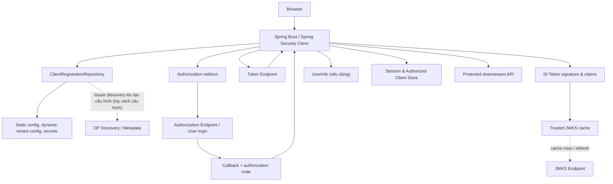

# 32.8. Readiness, startup và phụ thuộc vào discovery hoặc JWKS

## 1. Bài toán: ứng dụng khỏe nhưng người dùng không đăng nhập được

Một ứng dụng **Spring Security OAuth 2.0/OIDC Client** có thể gặp hai tình huống trái ngược:

**Tình huống A — Không khởi động được:**

```text
09:00  Kubernetes tạo pod Spring Boot mới
09:00  ApplicationContext bắt đầu tạo OAuth2 ClientRegistration
09:00  Cấu hình issuer-uri yêu cầu tải metadata từ IdP
09:00  Discovery endpoint timeout hoặc DNS thất bại
09:00  Context initialization lỗi -> container không phục vụ request
09:01  Pod restart, lại gọi discovery
09:02  Nhiều pods cùng restart, làm đợt triển khai bị kẹt
```

**Tình huống B — Khởi động và readiness đều xanh, nhưng login lỗi:**

```text
09:00  Pod khởi động với provider metadata đã có
09:01  Kubernetes readiness = UP
09:10  IdP JWKS endpoint gặp sự cố
09:11  User bắt đầu OIDC login, OP phát ID Token với kid mới
09:11  Decoder không tìm được public key tương ứng trong cache
09:11  OIDC Login thất bại, dù /actuator/health/readiness vẫn UP
```

Hai tình huống đều có thể đúng về mặt kỹ thuật. Readiness của ứng dụng, khả năng khởi động và **khả năng hoàn thành một luồng OIDC Login cụ thể** là những khái niệm có liên hệ nhưng không đồng nhất.

Bài này trả lời:

- Khi nào việc cấu hình `issuer-uri` thực hiện OIDC discovery?
- Khi nào Spring Security cần tải JWKS?
- Có nên chặn pod nhận traffic nếu một IdP/JWKS endpoint bị lỗi?
- Kubernetes nên cấu hình `startupProbe`, `readinessProbe`, `livenessProbe` thế nào?
- Có thể giảm phụ thuộc mạng khi startup mà không bỏ validation bảo mật không?
- Khi IdP hoặc JWKS outage, hệ thống nên suy giảm dịch vụ, thử lại và phục hồi ra sao?
- Làm sao chứng minh các chính sách đó bằng kiểm thử và quan sát vận hành?

**Phạm vi:** Spring Boot với Spring Security OAuth2/OIDC **Client**, đặc biệt là Servlet/MVC. Một số điểm cũng áp dụng cho WebFlux; phần cuối đối chiếu. Các đoạn code minh họa Spring Boot 3.x/Spring Security 6.x; API và hành vi cache phải đối chiếu phiên bản thực của dự án.

---

## 2. Phân biệt bốn trạng thái thường bị gộp nhầm

| Khái niệm | Câu hỏi cần trả lời | Cơ chế điển hình |
|---|---|---|
| **Startup** | Tiến trình Spring Boot đã khởi tạo đủ thành phần để bắt đầu phục vụ chưa? | ApplicationContext, bean initialization, startup checks |
| **Liveness** | Tiến trình còn hoạt động hay bị kẹt/hỏng đến mức cần restart? | Kubernetes liveness probe |
| **Readiness** | Instance này có nên nhận traffic mới ngay lúc này không? | Kubernetes readiness probe, Spring Boot `ReadinessState` |
| **Functional/dependency availability** | Một chức năng như `Login with Corporate IdP` hiện có chạy được không? | Dependency monitoring, canary login, synthetic checks |

Ví dụ:

```text
Application process running             = true
HTTP server serving /api/health         = true
Kubernetes liveness                     = true
Kubernetes readiness                    = true
Corporate OIDC Login                    = temporarily unavailable
Existing authenticated user API traffic = still working
```

Không có mâu thuẫn: ứng dụng vẫn phục vụ được nhiều chức năng trong khi IdP gặp sự cố.

### 2.1. Startup failure khác runtime outage

- **Startup failure:** không tạo được `ClientRegistration` vì discovery được gọi ngay trong quá trình tạo bean.
- **Runtime outage:** `ClientRegistration` đã được tạo; về sau Token Endpoint, JWKS, UserInfo hoặc authorization endpoint không còn khả dụng.

Chúng cần **hai kiểu khắc phục** khác nhau. Retry ở HTTP request không sửa được bean initialization đã thất bại.

### 2.2. Liveness không phải một phép thử toàn bộ hệ thống

Nếu liveness gọi trực tiếp đến một IdP trên Internet và trả `DOWN` khi IdP outage, Kubernetes sẽ restart **mọi application pods**, dù bản thân chúng vẫn chạy tốt.

Restart có thể:

- Làm mất cache JWKS đang còn hữu ích.
- Tăng cold-start và discovery traffic lên IdP đang lỗi.
- Tăng mất session nếu session store không bền vững.
- Kéo dài outage và cản các tác vụ khác.
- Tạo restart loop thay vì khôi phục.

**Nguyên tắc:** không đưa sự sống còn của dependency bên ngoài vào liveness probe.

### 2.3. Readiness phải trả lời câu hỏi về traffic

Readiness khác liveness: trả `DOWN` có thể khiến pod bị loại khỏi các endpoints phục vụ traffic. Nhưng nếu **tất cả pods** đều báo không ready do một IdP chung bị lỗi, workload có thể mất tất cả endpoints và khiến cả chức năng không cần IdP cũng mất khả dụng.

Quyết định readiness phải gắn với **khả năng nhận traffic thiết yếu của instance** và chiến lược suy giảm dịch vụ, không phải “mọi dịch vụ bên ngoài đều UP”.

---

## 3. Các phụ thuộc của một luồng OIDC Client

Một OIDC login thường dùng:



Các dependency này có **thời điểm cần thiết khác nhau**:

| Dependency | Có thể cần lúc startup? | Có thể cần lúc runtime? |
|---|---|---|
| Local `application.yml`/env | Có | Khi reload/config change |
| Secrets manager | Có, nếu load credentials khi tạo config | Rotation/token requests |
| IdP discovery metadata | Có, nếu registration được xây bằng issuer discovery lúc khởi tạo | Khi registration động được tạo/cập nhật |
| Authorization Endpoint | Thường không cần để JVM khởi động | Khi browser bắt đầu login |
| Token Endpoint | Không nhất thiết cần lúc startup | Đổi code, refresh token, client credentials |
| JWKS Endpoint | Tùy prewarming/decoder initialization | Khi xác minh ID Token cần tải/refresh keys |
| UserInfo Endpoint | Thường không cần startup | Login/profile flow nếu yêu cầu |
| Session store | Tùy initialization/config | Mọi request cần session/auth-request state |
| Authorized client store | Tùy startup/migrations | Load/save access/refresh token |
| Resource Server API | Thường không cần startup | Business API calls |
| DNS/TLS/proxy | Tùy dependency được gọi | Mọi outbound call liên quan |

Không nên tự kết luận “JWKS luôn tải lúc startup” hoặc “discovery luôn lazy”. Hành vi thực phụ thuộc cách tạo registration/decoder, cấu hình, Spring Security version và customization.

---

## 4. `issuer-uri` và discovery có thể làm startup phụ thuộc IdP

Spring Boot thường cho phép khai báo:

```yaml
spring:
  security:
    oauth2:
      client:
        registration:
          corporate:
            client-id: ${OIDC_CLIENT_ID}
            client-secret: ${OIDC_CLIENT_SECRET}
            authorization-grant-type: authorization_code
            redirect-uri: "{baseUrl}/login/oauth2/code/{registrationId}"
            scope:
              - openid
              - profile
              - email
        provider:
          corporate:
            issuer-uri: https://login.example-idp.com/realms/workforce
```

Khi tạo `ClientRegistration` từ `issuer-uri`, Spring Security/Boot có thể dùng provider metadata discovery để điền:

```text
authorization_endpoint
token_endpoint
jwks_uri
userinfo_endpoint
issuer
supported provider capabilities
```

Trong cách cấu hình auto-registration thông dụng, việc xây registration có thể thực hiện **network request ngay trong startup**. Nếu discovery endpoint không khả dụng, khởi tạo bean hoặc ApplicationContext có thể thất bại.

### 4.1. Phân biệt hai đường đi

**Đường đi A — Tạo registration qua discovery:**

```java
ClientRegistrations.fromIssuerLocation(issuer)
```

API này tra metadata provider từ issuer location. Khi gọi để tạo registration ở startup, nó gây network dependency **tại thời điểm gọi**.

**Đường đi B — Tạo registration từ metadata đã biết:**

```java
ClientRegistration.withRegistrationId("corporate")
    .authorizationUri(...)
    .tokenUri(...)
    .jwkSetUri(...)
    .issuerUri(...)
    // ...
    .build();
```

Có thể tránh **discovery network call lúc tạo registration**, vì endpoint fields được cung cấp sẵn. Nhưng điều đó không đồng nghĩa ID Token validation hoặc Token Endpoint không còn phụ thuộc mạng về sau.

### 4.2. Không đánh đồng với Resource Server `issuer-uri`

Một ứng dụng cũng có thể cấu hình:

```yaml
spring:
  security:
    oauth2:
      resourceserver:
        jwt:
          issuer-uri: https://login.example-idp.com
```

Đây là cấu hình **JWT Resource Server**. Decoder startup/discovery/cache behavior của Resource Server khác với `ClientRegistrationRepository` và OIDC ID Token decoder của OAuth2 Client.

Bài học này tập trung **OAuth2/OIDC Client**; khi ứng dụng vừa là Client vừa là Resource Server, hãy kiểm tra **cả hai** dependency paths.

### 4.3. Discovery endpoint không chỉ có một URL tùy ý

OIDC Discovery và OAuth2 Authorization Server Metadata xác định các vị trí metadata theo issuer/protocol. Các API như `ClientRegistrations.fromIssuerLocation(...)` có thể thử những endpoint discovery được hỗ trợ.

Không hardcode một URL metadata đoán mò nếu provider công bố endpoint khác; đồng thời phải đối chiếu `issuer` trong metadata với issuer đã được trust.

---

## 5. JWKS có nhất thiết được tải ngay khi startup?

**Không thể khẳng định chung.**

Trong nhiều triển khai, metadata/ClientRegistration được biết khi startup, nhưng bộ public keys được lấy **khi decoder cần xác minh một ID Token**, thường sau Token Endpoint response ở callback đầu tiên.

Trong các triển khai khác, ứng dụng chủ động:

- Prewarm JWKS.
- Khởi tạo decoder/JWKSource có network I/O.
- Thực hiện synthetic validation.
- Dùng shared cache hoặc custom HTTP client.
- Lấy metadata và key sets cùng một workflow khởi tạo.

Vì vậy cần **đo hành vi thực của ứng dụng** thay vì suy từ tên property.

### 5.1. Tình huống first-login failure

```text
T0 App starts successfully with known metadata
T1 /actuator/health/readiness = UP
T2 JWKS Endpoint unavailable
T3 First user login receives signed ID Token
T4 Decoder has no cached public key
T5 Signature cannot be verified -> login fails
```

Readiness xanh không chứng minh hệ thống đã thử tải JWKS.

### 5.2. Prewarm không làm provider luôn khả dụng

```text
T0 Prewarm JWKS succeeds
T1 Readiness = UP
T2 OP rotates signing key
T3 JWKS endpoint down
T4 New ID Token signed by K2 unknown to local cache
```

Một successful startup prewarm không đảm bảo các login về sau luôn thành công. Prewarm chỉ giảm rủi ro cold-cache và giúp phát hiện một số lỗi cấu hình sớm.

### 5.3. Cache keys chỉ là dữ liệu xác minh

JWKS gồm **public keys**; không dùng JWKS cache như nơi lưu client secrets hay private keys. Không tự coi một cached key là trusted mãi mãi mà không xét issuer, algorithm, TTL và key retirement policy.

---

## 6. Chọn chiến lược startup: fail-fast hay resilient startup?

Không có một đáp án duy nhất cho mọi ứng dụng.

### 6.1. Fail-fast khi IdP cấu hình bắt buộc

```text
Startup
    -> resolve issuer metadata
    -> verify required registration
    -> if cannot obtain required config:
           application startup fails
```

**Ưu điểm:**

- Sai issuer/metadata được phát hiện trước khi pod nhận traffic.
- Ứng dụng không chạy với cấu hình đăng nhập chưa xác minh.
- Đơn giản khi workload **chỉ** phục vụ một flow yêu cầu IdP.

**Nhược điểm:**

- Một outage ngắn của discovery chặn scale-out/rolling deploy.
- Mọi pod mới đều cần dependency có mặt đúng lúc startup.
- Nếu restart tất cả pods cùng lúc, service có thể tự tạo full outage.
- Startup có thể lâu/khó dự đoán vì network timeout/retry.

### 6.2. Resilient startup với metadata được phê duyệt

```text
Startup
    -> load previously validated provider metadata from local/config store
    -> construct ClientRegistration
    -> mark local application ready
    -> perform IdP operations when feature needs them
```

**Ưu điểm:**

- Không bắt buộc gọi discovery trong mỗi cold start.
- Pod có thể phục vụ các chức năng không phụ thuộc IdP.
- Scale-out ít bị khóa bởi một IdP outage.

**Nhược điểm:**

- Metadata có thể đã cũ, endpoint/issuer/key policy có thể đổi.
- Thêm gánh nặng versioning, validation và rollback.
- Token/JWKS/UserInfo interactions vẫn cần remote provider.
- Nếu lưu metadata bị sửa sai hoặc không được trust, rủi ro bảo mật tăng.

### 6.3. Khác biệt giữa “offline startup” và “bỏ validation”

**Offline startup hợp lệ** vẫn phải có cấu hình provider đã được tin cậy, JWT signature/issuer/audience/nonce checks và endpoint trust.

**Sai:**

```text
Discovery unavailable -> disable issuer validation.
JWKS unavailable -> accept unsigned ID Token.
```

**Đúng:**

```text
Discovery unavailable -> use approved snapshot if policy permits.
JWKS unavailable -> validate only with trusted cached keys
                    if still permitted; otherwise reject login.
```

### 6.4. Chính sách kết hợp

Một SaaS có thể quy định:

```text
Core application:
    Startup phụ thuộc local config + database/session store.

Optional social IdP:
    Discovery outage không ngăn pod phục vụ traffic.

Mandatory corporate IdP:
    Không bật login nếu metadata/trust chưa được phê duyệt;
    readiness của cả pod chỉ hạ nếu toàn bộ service thực sự không còn
    khả năng phục vụ traffic có ý nghĩa.
```

Chính sách phải được tài liệu hóa theo business criticality và SLO, thay vì dùng một `if (idpDown) readinessDown` cho tất cả tenants.

---

## 7. Spring Boot Actuator và Application Availability

Spring Boot có khái niệm application availability gồm:

- `LivenessState`: ứng dụng có ở trạng thái hoạt động hay không.
- `ReadinessState`: ứng dụng đã sẵn sàng nhận traffic hay chưa.

Với Spring Boot Actuator, Kubernetes probes có thể truy cập các health groups như:

```text
/actuator/health/liveness
/actuator/health/readiness
```

Tính khả dụng và cấu hình của các paths phụ thuộc phiên bản Spring Boot, deployment environment và properties. Spring Boot có khả năng phát hiện môi trường Kubernetes và cấu hình probes phù hợp; với môi trường local/test có thể bật chủ động.

### 7.1. Ví dụ application.yml

```yaml
management:
  endpoints:
    web:
      exposure:
        include: health,info
  endpoint:
    health:
      probes:
        enabled: true
      show-details: never
```

`show-details: never` là lựa chọn an toàn cho endpoint health công khai. Thông tin chi tiết về dependency status nếu cần nên được bảo vệ ở kênh nội bộ riêng.

### 7.2. Đừng giả định Actuator tự probe IdP

`/actuator/health/readiness` không tự thực hiện OIDC login, token exchange hay JWKS signature validation chỉ vì ứng dụng có `spring-boot-starter-oauth2-client`.

Nếu muốn đo IdP availability cần viết dependency monitor/health indicator theo policy, nhưng **không nhất thiết phải gắn nó vào readiness group**.

### 7.3. Health trên cổng management riêng

Nếu management endpoints chạy trên port riêng, probe có thể trả UP khi cổng ứng dụng chính không còn xử lý traffic bình thường.

Spring Boot hỗ trợ cấu hình thêm các probe paths trên main server port ở những phiên bản hỗ trợ. Hãy kiểm tra version/deployment và **test cổng thực tế**.

### 7.4. Bảo vệ Actuator

Không mở bừa toàn bộ:

```text
/actuator/**
```

ra Internet. Chỉ expose probes cần thiết và kiểm soát ingress/network policies. Metrics, env, configprops, heapdump hoặc loggers có thể lộ thông tin nhạy cảm nếu được mở không đúng cách.

---

## 8. Kubernetes: startupProbe, readinessProbe, livenessProbe

Một Deployment có thể dùng:

```yaml
apiVersion: apps/v1
kind: Deployment
metadata:
  name: portal-bff
spec:
  replicas: 3
  selector:
    matchLabels:
      app: portal-bff
  template:
    metadata:
      labels:
        app: portal-bff
    spec:
      containers:
        - name: portal
          image: registry.example/portal-bff:1.4.0
          ports:
            - name: http
              containerPort: 8080
          startupProbe:
            httpGet:
              path: /actuator/health/liveness
              port: http
            periodSeconds: 5
            failureThreshold: 24
          livenessProbe:
            httpGet:
              path: /actuator/health/liveness
              port: http
            periodSeconds: 10
            failureThreshold: 3
          readinessProbe:
            httpGet:
              path: /actuator/health/readiness
              port: http
            periodSeconds: 5
            failureThreshold: 3
```

Các con số chỉ minh họa. Phải điều chỉnh theo startup time thực, CPU/memory limits và rollout SLO.

### 8.1. Vai trò từng probe

**startupProbe**

- Cho phép ứng dụng có đủ thời gian khởi động.
- Trong khi startup probe chưa success, Kubernetes chưa chạy liveness/readiness probes theo semantics của startup probe.
- Nếu liên tục fail quá ngưỡng, container có thể bị restart.
- Không thể cứu một application context **liên tục khởi tạo thất bại vì discovery**; cần sửa dependency/config/startup strategy.

**livenessProbe**

- Phát hiện process bị kẹt hoặc trạng thái hỏng cần restart.
- Không chứa IdP/JWKS remote checks.

**readinessProbe**

- Điều khiển việc pod có nằm trong Service endpoints nhận traffic không.
- Có thể phụ thuộc critical local initialization/session/database policy.
- Tránh biến outage của một provider chung thành mọi pods Unready nếu ứng dụng vẫn có thể phục vụ traffic.

### 8.2. Thời gian `failureThreshold × periodSeconds`

Cấu hình:

```text
startupProbe:
    periodSeconds=5
    failureThreshold=24
```

tạo khoảng budget khoảng **120 giây** theo lịch probe, chưa tính chính xác thời gian mỗi request, scheduling và timeout. Đây không phải SLA tự động hoặc bảo đảm startup không bị kill trong chính xác 120 giây.

### 8.3. Không dùng cùng remote IDP check cho cả ba probes

Sai về vận hành:

```text
startupProbe -> GET IdP /jwks
readinessProbe -> GET IdP /jwks
livenessProbe -> GET IdP /jwks
```

Một JWKS outage có thể làm tất cả pods restart, không cải thiện IdP availability và xóa cache keys đang còn hợp lệ.

### 8.4. Rolling update và minimum availability

Để giảm rủi ro, cân nhắc:

- Nhiều replicas.
- Rolling update với `maxUnavailable`/`maxSurge` phù hợp.
- PodDisruptionBudget nếu có.
- Không khởi động lại toàn bộ fleet khi discovery lỗi.
- Graceful shutdown.
- Hạn chế restart storm/thundering herd.
- Cảnh báo khi pods mới không ready nhưng pods cũ vẫn phục vụ.

Các thông số này phải phù hợp capacity và scheduling thực tế; không một YAML mẫu nào bảo đảm zero downtime cho mọi cluster.

---

## 9. Thời điểm pod readiness nên phụ thuộc gì?

Một cách phân loại dependency:

| Dependency | Nên đưa vào liveness? | Có nên đưa vào readiness? | Lý do |
|---|---|---|---|
| JVM/application process health | Có, theo health state | Có thể | Kiểm tra instance |
| Local configuration load/validation | Không trực tiếp | **Có nếu bắt buộc** | App chưa có config để xử lý traffic |
| Session store bắt buộc cho mọi request | Không | Có thể, theo SLO | Không có session thì BFF có thể không phục vụ được |
| Local DB thiết yếu cho mọi API | Không | Có thể | Điều kiện phục vụ nghiệp vụ |
| Optional analytics service | Không | Thường không | Có thể degrade |
| Một trong nhiều OIDC providers | **Không** | Thường **không** cho toàn pod | Provider-specific outage |
| OIDC discovery endpoint | **Không** | Tùy startup policy | Có thể chỉ cần tại config creation |
| JWKS endpoint | **Không** | Thường không như remote polling | Có cache và chỉ cần khi verify |
| Token Endpoint | **Không** | Tùy core-login-only architecture | Login có thể fail mà APIs khác vẫn chạy |
| Downstream API không thiết yếu | Không | Thường không | Degrade feature |
| Trust-critical local metadata không có | Không | **Có, nếu không thể xử lý an toàn** | Không thể phục vụ requests thuộc contract |

### 9.1. Quyết định dựa trên “traffic có ý nghĩa”

Nếu ứng dụng chỉ cung cấp endpoint đăng nhập và **100% request luôn cần IdP**, một outage IdP có thể khiến instance không còn thực hiện mục đích chính. Khi đó cần quyết định **readiness vs global availability** dựa trên routing, fallback, capacity và SLO.

Nhưng nếu **mọi replicas cùng phụ thuộc một IdP**, làm tất cả Unready có thể biến lỗi login thành toàn hệ thống `503` ngay cả với logout, trang lỗi và các API còn hoạt động. Một quyết định readiness mang tính sản phẩm/vận hành, không phải mặc định “safety tuyệt đối”.

### 9.2. Không dùng readiness để lách authentication

Nếu Identity Provider lỗi, giữ readiness UP **không có nghĩa** cho phép request chưa authenticated vào protected API. Các SecurityFilterChain và OIDC token validations vẫn hoạt động **fail closed**.

### 9.3. Multi-tenant không có một trạng thái đăng nhập duy nhất

Nếu 1 tenant trong 500 tenants mất IdP:

```text
Corporate IdP Alpha = DOWN
Corporate IdP Beta  = UP
Social login         = UP
Existing sessions    = SERVING
```

Đánh dấu cả pod `Unready` vì Alpha thường là quyết định có tác động lớn không cần thiết. Cần **provider/tenant-specific availability monitoring** tách với pod readiness.

---

## 10. Health group cho các thành phần nội bộ thiết yếu

Có thể viết `HealthIndicator` cho việc **local config đã nạp và xác minh**.

Ví dụ ứng dụng có `LocalClientConfigState` (interface **do ứng dụng tự định nghĩa**):

```java
public interface LocalClientConfigState {

    boolean hasValidatedRequiredRegistrations();

    long activeConfigVersion();
}
```

Spring Boot Actuator indicator:

```java
import org.springframework.boot.actuate.health.Health;
import org.springframework.boot.actuate.health.HealthIndicator;
import org.springframework.stereotype.Component;

@Component("requiredClientConfig")
public final class RequiredClientConfigHealthIndicator
        implements HealthIndicator {

    private final LocalClientConfigState config;

    public RequiredClientConfigHealthIndicator(
            LocalClientConfigState config) {
        this.config = config;
    }

    @Override
    public Health health() {
        if (!config.hasValidatedRequiredRegistrations()) {
            return Health.down()
                .withDetail("reason", "REQUIRED_CONFIG_NOT_READY")
                .build();
        }

        return Health.up()
            .withDetail(
                "configVersion", config.activeConfigVersion()
            )
            .build();
    }
}
```

**Quan trọng:** `health()` chỉ đọc **local state đã được cập nhật**. Nó không thực hiện OIDC Discovery, JWKS GET hoặc token exchange trực tiếp trên mỗi probe request.

### 10.1. Chỉ định readiness group

Ví dụ:

```yaml
management:
  endpoint:
    health:
      probes:
        enabled: true
      group:
        readiness:
          include: readinessState,requiredClientConfig
      show-details: never
```

Trong một số phiên bản Spring Boot, việc cấu hình health groups và tên indicator cần đối chiếu properties/API thực của dependency management. Test rằng `/actuator/health/readiness` phản ánh đúng group sau deployment.

### 10.2. Không hiển thị bí mật trong health details

Health report không được có:

```text
clientSecret
accessToken
refreshToken
privateKey
full provider metadata with internal secrets
```

Kể cả `configVersion` có thể là metadata nội bộ; chỉ công bố những fields phù hợp với mức truy cập endpoint. `show-details: never` giảm khả năng lộ ra client ngoài.

### 10.3. Khi local config chưa có

Nếu thiếu registration bắt buộc để phục vụ toàn bộ application, indicator trả `DOWN` để readiness chưa cho pod nhận traffic. Liveness vẫn có thể `UP` vì process không bị kẹt.

Nếu thiếu một provider optional, trạng thái nên được theo dõi ở dependency monitor riêng, không nhất thiết làm indicator critical config `DOWN`.

---

## 11. Không gọi IdP từ HealthIndicator mỗi 5 giây

Một cách dễ viết nhưng có thể gây hại:

```java
@Override
public Health health() {
    // Phản ví dụ: không dùng cho mọi kube probe.
    String jwks = restClient.get()
        .uri("https://idp.example/jwks")
        .retrieve()
        .body(String.class);

    return Health.up().build();
}
```

Giả sử:

```text
200 pods
readinessProbe mỗi 5 giây
```

chỉ probe này có thể tạo đến khoảng 40 JWKS requests/giây liên tục, chưa kể retries, deployments và provider outage.

### 11.1. Rủi ro

- IdP bị tăng tải ngay khi đang outage.
- Probe timeout làm application pods Unready.
- Retry bùng nổ khi mạng bị chậm.
- Kube có thể hiểu sai: IdP lỗi ⇒ app không healthy.
- JWKS endpoint thành dependency bắt buộc của mọi route.

### 11.2. Cách tốt hơn: monitor ngoài đường probe

Một **background dependency observer** có thể định kỳ thực hiện kiểm tra có giới hạn:

```text
ProviderAvailability:
    providerAlias
    lastMetadataSuccessAt
    lastJwksSuccessAt
    lastTokenExchangeSuccessAt (synthetic flow riêng)
    recentFailureCategory
    currentCircuitState
```

Thành phần này gửi metrics/alerts hoặc cập nhật availability map cho UX, **không chặn Kubernetes probe bởi một GET trực tiếp**.

Không nên coi một successful GET `/jwks` là chứng minh Token Endpoint, authorization flow, consent hoặc ID Token validation đang hoạt động. Synthetic login có thể cần để kiểm tra end-to-end và phải dùng test identity/credentials.

---

## 12. Dependency health không phải functional login health

Xem ba phép kiểm tra:

```text
HEAD /jwks -> 200
GET /.well-known/openid-configuration -> 200
Synthetic Authorization Code Login -> success
```

Chúng có giá trị khác nhau.

| Kiểm tra | Chứng minh | Không chứng minh |
|---|---|---|
| JWKS HTTP reachable | Có thể tải keyset từ URL đó | Key ký token mới, Token Endpoint, login UX |
| Discovery metadata reachable | Có thể đọc metadata | Client secret đúng, scopes được cấp, callback ổn |
| Token Endpoint reachable | Endpoint phản hồi | Authorization code flow/nonce/session đầy đủ |
| Synthetic OIDC login | Một transaction kiểm thử thành công | Mọi tenants/users/providers không lỗi |
| Existing user API works | Session/token hiện có dùng được | New login vẫn khả dụng |
| Readiness UP | Pod được phép nhận traffic theo local policy | Toàn bộ IdP ecosystem đều khỏe |

### 12.1. Synthetic login cần identity riêng

Không dùng tài khoản production của người dùng thật hoặc không kiểm soát. Nếu synthetic monitor chạy thường xuyên, cần:

- Test account/tenant riêng.
- Quản lý test client secret trong vault.
- Rate limit và scheduling.
- Không cấp scopes nhạy cảm ngoài nhu cầu.
- Không tạo session/token tồn tại vô hạn.
- Không log authorization codes/tokens.
- Đảm bảo provider cho phép synthetic automation.

### 12.2. Synthetic login không phải readiness probe

Một full browser Authorization Code Flow có nhiều redirect và network dependencies; không phù hợp là endpoint được Kubernetes gọi liên tục để quyết định instance có nhận traffic hay không.

---

## 13. Discovery ở startup: fail-fast cần kiểm soát thời gian

Nếu startup phải gọi metadata endpoint, cần tránh indefinite blocking.

Các thành phần nên có:

```text
DNS lookup
TLS handshake
TCP connect timeout
HTTP response read timeout
Total startup deadline
Bounded retry
Backoff + jitter
```

### 13.1. Mục tiêu

```text
Startup time budget = 90s
Local config init   = 3s
Database ready      = 10s
Discovery           = bounded within remaining budget
```

Con số chỉ là ví dụ. Startup deadline phải lớn hơn realistic p95/p99 startup time nhưng không nên vô hạn.

### 13.2. Không có một property timeout chung cho mọi Spring OAuth2 Client HTTP calls

Cần phân biệt HTTP clients được dùng bởi:

- Provider discovery (`ClientRegistrations.fromIssuerLocation` hoặc Boot binding).
- Authorization Code Token Response Client.
- Refresh Token Response Client.
- JWKS/JWKSource.
- OIDC UserInfo Client.
- Application `RestClient`/`WebClient`.

Việc cấu hình timeout cho **một** `RestClient` bean không tự bảo đảm mọi HTTP call nội bộ Spring Security đều dùng cùng bean.

Muốn bảo đảm timeouts, phải xác định **extension point và phiên bản thư viện**, rồi cấu hình HTTP client cho từng dependency path phù hợp.

### 13.3. Retry quá nhiều không giải quyết host sai

Nếu issuer URI sai hoặc certificate không được trust, retry liên tục chỉ kéo dài startup. Phân loại:

- DNS temporary failure.
- Connect timeout.
- HTTP 429/503.
- HTTP 404/invalid metadata.
- Issuer mismatch.
- TLS hostname/certificate validation error.

Một số transient errors có thể retry giới hạn; configuration/trust errors nên fail nhanh và báo rõ nội bộ, không chờ hết nhiều phút.

---

## 14. Mô hình cache metadata được phê duyệt

Để giảm hard dependency lúc startup, một ứng dụng nhiều tenants có thể dùng **versioned provider metadata snapshot**.

Ví dụ:

```json
{
  "registrationId": "tenant-a__corporate",
  "issuer": "https://login.tenant-a.example",
  "authorizationUri": "https://login.tenant-a.example/oauth2/authorize",
  "tokenUri": "https://login.tenant-a.example/oauth2/token",
  "jwkSetUri": "https://login.tenant-a.example/keys",
  "userInfoUri": "https://login.tenant-a.example/userinfo",
  "metadataVersion": 17,
  "approvedAt": "2026-11-01T10:00:00Z"
}
```

Đây là **application-specific metadata store**, không phải JSON mà Spring Security tự tạo để làm persistent registry.

### 14.1. Tính chất cần có

- **Issuer được pin/approved**, không tự tin URL từ user.
- Endpoints và redirect URIs được validate.
- Phiên bản/signer/audit được theo dõi.
- Có rollback và TTL/revalidation policy.
- Secret material nằm riêng trong secret manager.
- Không cho untrusted tenant config sửa `jwkSetUri` tùy ý.
- Snapshot được cập nhật bằng control-plane workflow, không phải live mutable object dùng chung.
- Runtime tạo `ClientRegistration` từ **trusted snapshot**.

### 14.2. Snapshot giải quyết điều gì?

Nếu discovery endpoint tạm outage nhưng snapshot còn hợp lệ:

```text
Application startup
    -> read approved metadata snapshot v17
    -> initialize registration
    -> readiness based on required local state
```

Điều này tránh phải gọi remote discovery **ngay lúc đó**.

### 14.3. Snapshot không giải quyết điều gì?

- Token Endpoint vẫn cần remote AS khi exchange/refresh.
- JWKS endpoint vẫn có thể cần khi unknown signing key.
- Authorization Endpoint vẫn phải phục vụ browser.
- Metadata có thể đổi hoặc bị thu hồi.
- Provider có thể revoke OAuth client.
- UserInfo Endpoint có thể down.

Snapshot là một **availability trade-off**, không phải giải pháp loại bỏ dependency IdP.

---

## 15. Tạo ClientRegistration không phụ thuộc discovery trong hot path

Ví dụ Java minh họa:

```java
import org.springframework.security.oauth2.client.registration.ClientRegistration;
import org.springframework.security.oauth2.core.AuthorizationGrantType;
import org.springframework.security.oauth2.core.ClientAuthenticationMethod;

public ClientRegistration registrationFromApprovedSnapshot(
        ApprovedOidcConfig cfg,
        String resolvedClientSecret) {

    return ClientRegistration
        .withRegistrationId(cfg.registrationId())
        .clientId(cfg.clientId())
        .clientSecret(resolvedClientSecret)
        .clientAuthenticationMethod(
            ClientAuthenticationMethod.CLIENT_SECRET_BASIC
        )
        .authorizationGrantType(
            AuthorizationGrantType.AUTHORIZATION_CODE
        )
        .redirectUri(
            "{baseUrl}/login/oauth2/code/{registrationId}"
        )
        .scope("openid", "profile")
        .issuerUri(cfg.issuer())
        .authorizationUri(cfg.authorizationUri())
        .tokenUri(cfg.tokenUri())
        .jwkSetUri(cfg.jwkSetUri())
        .userInfoUri(cfg.userInfoUri())
        .userNameAttributeName("sub")
        .clientName("Corporate OIDC")
        .build();
}
```

`ApprovedOidcConfig` là **kiểu dữ liệu của ứng dụng** cần tự định nghĩa, validate và version. Đây là cấu hình minh họa, không phải một cơ chế discovery mặc định.

### 15.1. Tại sao tránh `fromIssuerLocation()` mỗi request?

Nếu `findByRegistrationId()` gọi:

```java
ClientRegistrations.fromIssuerLocation(issuer).build();
```

trong mỗi login request, application:

- Lặp lại metadata HTTP requests.
- Tăng latency và phụ thuộc mạng.
- Dễ gây thundering herd.
- Có nguy cơ SSRF nếu issuer chưa được approve.
- Khó kiểm soát thời điểm cập nhật metadata.

Tốt hơn là dùng cache immutable registration theo version và một **background/control-plane revalidation** được kiểm soát.

### 15.2. Không cố xây registration nửa đủ rồi bypass validation

Nếu `issuer`, `jwkSetUri` hoặc Token Endpoint thiếu, có thể không tạo OIDC login hợp lệ. Không đưa placeholder attacker-controlled hoặc rỗng vào security-critical config chỉ để readiness xanh.

### 15.3. Authentication method theo provider

`client_secret_basic` chỉ là ví dụ. Provider có thể yêu cầu `client_secret_post`, `private_key_jwt` hoặc mTLS. Snapshot và runtime HTTP token client cần phù hợp cả provider contract lẫn Spring Security version.

---

## 16. Lazy initialization: con dao hai lưỡi

Một số kỹ thuật trì hoãn tạo bean/registration đến request đầu tiên có thể giúp startup ngắn hơn.

Nhưng:

```text
Startup success
    ->
Readiness UP
    ->
First login request blocks while discovery/JWKS loads
```

có thể chuyển lỗi từ startup sang người dùng đầu tiên, làm tăng tail latency và gây tải cao khi nhiều requests đồng thời.

### 16.1. Lazy không phải graceful degradation

Để vận hành tốt, cần:

- Timeout hợp lý.
- Concurrency control/singleflight.
- Safe error UX.
- Health/metrics riêng.
- Cache và revalidation policy.
- Circuit breaker hoặc rate limiting nơi phù hợp.
- Không bỏ signature/issuer validation.

### 16.2. Khi nào prewarm hữu ích?

Nếu provider bắt buộc và dự kiến có nhiều login ngay sau deployment, prewarm trusted metadata/JWKS có thể:

- Giảm cold-cache latency.
- Phát hiện JWKS DNS/TLS/certificate errors sớm.
- Giảm unknown-kid failure trong một khoảng ngắn.

Nhưng prewarm phải có giới hạn và không trở thành một vòng lặp fail readiness không cần thiết.

### 16.3. Prewarm không được làm lộ private keys

JWKS chỉ cần **public keys**. Không dùng chức năng prewarm để tải raw client secret hoặc private keys từ network host chưa được trust.

---

## 17. JWKS cache: availability gắn liền với tính đúng đắn chữ ký

Một decoder có thể lưu tập public keys:

```text
Trusted issuer: https://login.example-idp.com
JWKS cache:
    K1 (kid=2026-10)
    K2 (kid=2026-11)
```

Khi nhận ID Token:

```text
JWS header: alg=RS256, kid=2026-11
```

decoder phải chọn key phù hợp từ trusted set và verify signature, sau đó xác minh OIDC claims.

### 17.1. JWKS outage nhưng cache có key phù hợp

Nếu cache còn public K1 tin cậy và nhận một token hợp lệ ký K1, decoder **có thể** xác minh được mà không gọi network, tùy cache and trust policy.

Đừng tuyên bố mọi JWKS outage đều gây login outage ngay tức thì.

### 17.2. JWKS outage và `kid` mới

```text
Cache=[K1]
IdP begins signing K2
JWKS endpoint=503
```

Nếu không có trusted K2 public key, client **không được chấp nhận** ID Token K2. Đây là hành vi bảo mật đúng, dù làm login tạm thất bại.

### 17.3. Không fallback về decode payload không chữ ký

Sai:

```text
JWKS GET failed
    -> parse JWT header/payload
    -> trust sub/email/roles without signature
```

Đó là authentication bypass.

### 17.4. Cache refresh khi `kid` lạ phụ thuộc implementation

Một số Nimbus/JWKSource configurations có thể làm mới JWKS khi gặp `kid` không có trong cache; một số custom caches cần TTL hoặc manual refresh.

Không mặc định rằng **Spring Security ở mọi version** đều refetch ngay mỗi unknown `kid`. Phải test behavior thực của `OidcIdTokenDecoderFactory`/configured decoder trong ứng dụng.

### 17.5. K1 bị remove trên remote JWKS không xóa local cache tức thì

Remote:

```text
JWKS=[K2]
```

Pod có thể còn cache:

```text
JWKS=[K1,K2]
```

trong một thời gian, tùy TTL/invalidation. Với emergency key compromise cần thêm incident measures; không chỉ sửa remote JSON rồi coi mọi sessions đã an toàn.

---

## 18. Cache TTL, HTTP headers và key rotation

JWKS endpoint có thể trả:

```http
Cache-Control: public, max-age=300
ETag: "jwks-v21"
```

Nhưng **effective JWKS cache TTL** không nhất thiết bằng `Cache-Control` nếu client library sử dụng cache riêng và không tôn trọng HTTP cache semantics.

Những câu hỏi cần kiểm tra:

1. Cache do Nimbus, Spring hay custom adapter quản lý?
2. Cache TTL thực là bao lâu?
3. Có unknown-kid refresh không?
4. Có negative caching hoặc refresh cooldown không?
5. Có hỗ trợ conditional GET (`ETag`, `304`) không?
6. Nếu JWKS endpoint timeout, cache cũ có được sử dụng không?
7. Cache scope theo issuer, registration hay toàn bộ application?
8. Reusing `kid` với key material mới có được xử lý đúng không?
9. Khi endpoint bị đổi trong registration v2, cache v1 có còn bị dùng không?
10. Khi nhiều pods đồng thời rotate, GET JWKS có bị bùng nổ không?

### 18.1. Không xây SLO dựa trên TTL đoán

Nếu operator nói:

> “JWKS Cache-Control là 5 phút nên Spring chắc chắn refresh sau 5 phút.”

đó là một suy luận cần kiểm chứng bằng tests và telemetry, không phải bảo đảm chung.

### 18.2. Pre-publish signing keys

Quy trình rotation thường tốt:

```text
T0: JWKS=[K1], signing=K1
T1: JWKS=[K1,K2], signing=K1
T2: Sau một overlap phù hợp, signing=K2
T3: Giữ K1 trong JWKS đủ lâu theo policy
T4: JWKS=[K2], retire K1
```

Đây là trách nhiệm phối hợp giữa IdP và clients. Một cached JWKS không thể tự dự đoán K2 nếu provider chưa công bố nó.

---

## 19. Khi một IdP down, UX phải phản ánh đúng phạm vi lỗi

Một ứng dụng có thể vẫn hoạt động cho những người dùng đã có session hợp lệ:

```text
Already authenticated Alice:
    /api/dashboard -> OK
    /api/orders -> OK nếu downstream không cần IdP

New user Bob:
    /oauth2/authorization/corporate
    -> IdP unavailable
    -> cannot sign in
```

Không nên:

- Logout mọi user chỉ vì discovery health check fail.
- Cho anonymous users vào protected API.
- Lặp OAuth2 redirects vô hạn.
- Hiển thị stack trace hoặc raw issuer/JWKS URL.
- Nói “sai mật khẩu” khi Token Endpoint/JWKS lỗi.

Thông báo hợp lý:

> Hiện không thể kết nối dịch vụ đăng nhập của tổ chức. Vui lòng thử lại sau. Nếu lỗi tiếp diễn, cung cấp mã hỗ trợ cho bộ phận quản trị.

### 19.1. Đăng nhập bằng provider khác

Nếu ứng dụng hỗ trợ nhiều methods, có thể hiển thị phương thức đăng nhập khác **chỉ khi business/security policy cho phép**.

Không tự fallback từ corporate MFA-required IdP sang social login assurance thấp hơn cho tài khoản có yêu cầu mạnh.

### 19.2. Đã login nhưng cần refresh token

Một session còn hợp lệ không bảo đảm mọi downstream integrations vẫn hoạt động nếu Token Endpoint down.

Có thể:

```text
BFF session authenticated
Access token expired
Refresh endpoint timeout
API integration unavailable
```

Trong trường hợp đó nên báo **kết nối tài nguyên tạm lỗi** thay vì gọi đó là BFF session hết hạn.

---

## 20. Readiness và security fail-closed không mâu thuẫn

Một hệ thống có thể giữ readiness UP trong lúc OP down, đồng thời:

```text
New OIDC login without verified ID Token -> DENY

Protected API without valid session -> DENY

Downstream call without valid access token -> DENY

Existing authenticated session with valid app policy -> ALLOW
```

Điều này khác “fail open”.

### 20.1. Phân biệt availability degradation và authorization bypass

**Availability degradation:** một chức năng không dùng được vì dependency lỗi nhưng không nới lỏng bảo mật.

**Authorization bypass:** bỏ xác thực/authorization để chức năng có vẻ vẫn hoạt động.

Readiness là điều phối traffic; không phải lệnh cho Spring Security bỏ kiểm tra.

### 20.2. Chính sách nên rõ theo chức năng

| Chức năng | IdP down | Quyết định điển hình |
|---|---|---|
| New OIDC Login | Không xác minh được | Reject/degrade an toàn |
| User có session hợp lệ | Có thể tiếp tục | Theo session/local authorization policy |
| ID Token signature validation | Không có key tin cậy | Reject |
| Access token refresh | Token Endpoint down | Bounded retry/error |
| Service client_credentials | Token Endpoint down | Không tự tạo fake access token |
| Health/status page | Có thể phục vụ | Không cần login flow |
| Local-only business APIs | Có thể phục vụ | Nếu dependencies khác vẫn sẵn sàng |

---

## 21. Timeout, retry và circuit breaker: không dùng chung một policy

Các HTTP calls khác nhau có semantics khác nhau.

| Operation | Có thể retry? | Cần lưu ý |
|---|---|---|
| GET discovery metadata | Có thể, bounded khi transient error | Chặn SSRF, validate issuer |
| GET JWKS | Có thể, bounded | Bảo vệ refresh storm |
| GET UserInfo | Tùy HTTP/client semantics | Access token/PII và auth context |
| POST authorization code exchange | **Rất thận trọng** | Authorization code one-time-use, kết quả có thể đã được AS xử lý |
| POST refresh token grant | **Rất thận trọng** | Refresh token rotation/replay detection |
| POST client_credentials token request | Có thể retry theo provider policy | Rate limiting và cấp token trùng |
| Protected business POST | Theo idempotency contract | Không duplicate giao dịch |

### 21.1. Retry có jitter

Nếu 300 pods khởi động cùng lúc và đều mất discovery:

```text
Retry exactly at 1s, 2s, 4s, 8s...
```

mọi pods có thể đồng loạt tạo traffic spikes. Dùng bounded exponential backoff với jitter nếu workflow hỗ trợ.

### 21.2. Circuit breaker không là bằng chứng OIDC invalid

Circuit breaker `OPEN` có thể giúp tránh liên tục gọi một IdP đang lỗi. Nó chỉ cho biết outbound calls đang bị hạn chế theo operational policy, **không xác nhận** issuer/identity/tokens hợp lệ.

Khi circuit breaker cho phép lại, vẫn phải thực hiện đủ JWT signature/issuer/audience/nonce validation.

### 21.3. Không áp retry tự động vô hạn trong Servlet filter

Một request callback đến Token Endpoint phải có deadline. Nếu liên tục retry trong filter thread, có thể cạn servlet thread pool và tăng latency của mọi requests.

### 21.4. Log metadata, không log credentials

Khi retry token request, không log:

```text
client_secret
authorization_code
code_verifier
refresh_token
Authorization header
raw ID Token
```

Dùng `operation`, `stage`, `errorClass`, `providerAlias`, duration và correlation ID.

---

## 22. Kết nối mạng của container là một phần readiness thực tế

Khi application chạy trong Kubernetes, IdP/JWKS có thể nằm sau:

```text
Pod
    -> Cluster DNS
    -> NAT/Egress Gateway
    -> Corporate Proxy
    -> TLS trust store
    -> IdP / JWKS Endpoint
```

Các lỗi thực tế:

- DNS resolve thất bại.
- Egress NetworkPolicy chặn host/port.
- Corporate HTTP proxy chưa cấu hình cho discovery/JWKS HTTP client.
- TLS certificate chain mới không nằm trong JVM truststore.
- Clock drift làm ID Token `exp`, `iat`, `nbf` checks thất bại.
- Hostname/redirect URI mismatch khi có reverse proxy.
- Firewall rate limit trên egress.
- Service mesh mTLS/egress rules khác môi trường local.

### 22.1. Vì sao localhost test không đủ?

Một fake OP local có thể phản hồi tốt khi cả app và test server ở cùng JVM/máy, nhưng production lại phụ thuộc DNS, TLS chain, proxy, ingress và network policy.

Cần có deployment smoke/synthetic tests ở môi trường gần production mà không dùng credentials thật.

### 22.2. Network diagnostics có kiểm soát

Một diagnostic command trong pod (chạy bởi operator có quyền) có thể kiểm tra:

```text
DNS
TLS handshake
HTTP status
Response latency
Issuer metadata exact-match
JWK Set URI reachability
```

Không cần gửi client secret hoặc token khi chỉ kiểm tra discovery/JWKS public endpoints.

### 22.3. SSRF trong discovery động

Nếu ứng dụng cho tenant admin thêm issuer URL, không được gọi discovery tới arbitrary hosts/loopback/private network chỉ vì người dùng nhập. Các biện pháp: issuer approval, HTTPS, allowed hosts/IP ranges, redirect restrictions, egress policy và metadata verification.

---

## 23. Dynamic multi-tenant provider loading

Trong một SaaS, cấu hình có thể là:

```text
tenant-alpha -> issuer Alpha
tenant-beta  -> issuer Beta
tenant-gamma -> issuer Gamma
```

Nếu startup yêu cầu discovery **đồng thời cho toàn bộ tenants**, một issuer lỗi có thể chặn ứng dụng cho mọi tenants.

### 23.1. Không buộc mọi tenant IdPs trở thành global startup dependencies

Thay vì:

```text
Startup:
    for every tenant:
        fetch discovery
        fetch JWKS
    if one fails:
        fail whole app
```

có thể dùng:

```text
Startup:
    load approved registrations from trusted config store
    validate required local invariants
    start serving

Per tenant:
    availability state / background revalidation
    runtime OAuth2 flow fail closed if provider unavailable
```

Thiết kế này phù hợp khi có approved metadata snapshot và chính sách không cần mọi tenants đăng nhập được trước khi instance phục vụ.

### 23.2. Multi-tenant readiness không phải boolean “mọi IdP đều khỏe”

Một readiness bit trên pod không biểu diễn đủ:

```text
Alpha login OK
Beta login degraded
Gamma login OK
```

Cần provider-specific health/status và UX, trong khi pod readiness chủ yếu xét khả năng phục vụ traffic platform.

### 23.3. Không chia JWKS cache chỉ theo `kid`

Hai issuers có thể cùng `kid`:

```text
Alpha kid=current, key=AlphaK1
Beta  kid=current, key=BetaK1
```

Keys/cache phải gắn với trusted issuer/JWKS source. Nếu không, một provider có thể ảnh hưởng xác minh token của provider khác.

### 23.4. Config version thay đổi khi pod đang chạy

Với dynamic `ClientRegistrationRepository`, dùng immutable snapshots theo:

```text
(registrationId, activeVersion)
```

và policy invalidation. Nếu issuer/JWKS URI đổi, phải làm mới đúng decoder/cache/registration lifecycle theo triển khai thực; không để custom cache tiếp tục dùng issuer cũ.

---

## 24. Cache keys và secrets: hai vòng đời khác nhau

### 24.1. JWKS public keys

- Dùng để **verify** JWS/ID Token.
- Có thể cache để giảm network.
- Cần issuer/key/algorithm trust.
- Có thể rotate khi OP đổi signing key.

### 24.2. OAuth client credentials

- Dùng để **authenticate client** tại Token Endpoint.
- Có thể là client secret, private key JWT, mTLS certificate/key.
- Phải giữ trong secret manager/secure memory.
- Có lifecycle rotation/expiration riêng.

### 24.3. Refresh tokens

- Dùng để xin access token mới.
- Có thể bị rotate/revoke.
- Phải bảo vệ như credential.
- Không có liên quan trực tiếp đến cache public JWKS.

Một startup success có JWKS cache warm không có nghĩa `client_secret` còn hợp lệ. Ngược lại `client_secret` đúng không đảm bảo JWKS endpoint reachable.

---

## 25. Khi nào phải đưa dependency vào readiness một cách chủ động?

Có thể xét ba mức:

### Mức A — Local core readiness

```text
App initialized
Required configuration validated
Critical local stores available according to policy
```

Phù hợp khi đa số app vẫn dùng được trong lúc IdP outage.

### Mức B — Functional readiness theo route/service riêng

Một architecture có thể tách workloads:

```text
auth-bff-service:
    chỉ phục vụ login/token broker
business-api-service:
    phục vụ existing sessions/local APIs
```

Khi đó readiness của **auth-bff** có thể được định nghĩa chặt hơn so với **business-api**, vì chúng có traffic contracts khác nhau. Tuy nhiên, check remote IdP liên tục vẫn có nguy cơ làm toàn bộ auth tier Unready mà không tạo khả năng phục hồi.

### Mức C — Deployment gating thay vì pod readiness

Một rollout có thể yêu cầu:

```text
CI/release gate:
    required issuer discovery reachable
    test OIDC login succeeds
    JWKS validation success
```

trước khi promote version. **Đây là một lựa chọn khác** so với mỗi pod gọi IdP trên Kubernetes readiness probe liên tục.

### 25.1. Đưa remote dependencies vào release gate có giới hạn

Một provider outage tại thời điểm triển khai có thể cần giữ release trước đó/hoãn rollout. Nhưng không nên để một lần smoke test thành công thay thế runtime monitoring, vì provider có thể down ngay sau test.

---

## 26. Startup readiness và Spring Boot lifecycle

Spring Boot khởi tạo context, embedded web server, chạy `ApplicationRunner`/`CommandLineRunner` và phát application availability events theo lifecycle.

Một điểm cần lưu ý: **không nên đánh dấu `ReadinessState.ACCEPTING_TRAFFIC` quá sớm**, trước khi required local initialization hoàn tất.

### 26.1. Required local initialization

Ví dụ:

```text
Load tenant registrations from trusted DB/config snapshot
Validate local required fields
Prepare session/authorized-client stores
Register critical services
Only then mark local readiness
```

Nếu cần một bước bất đồng bộ kéo dài sau Spring Boot startup, hãy dùng dedicated readiness indicator hoặc quản lý `AvailabilityChangeEvent` theo lifecycle thực, thay vì giả định Spring Boot sẽ tự biết tiến trình custom của bạn còn chưa xong.

### 26.2. `AvailabilityChangeEvent`

Spring Boot hỗ trợ thay đổi availability state bằng events. Nhưng cần xem thứ tự lifecycle: Spring Boot có thể phát readiness transition sau runners. Nếu custom code publish `ACCEPTING_TRAFFIC` trước thời điểm đó, nó không chứng minh các bước sau hoàn tất.

Một thiết kế đơn giản hơn thường là health indicator đọc **local `criticalInitializationDone` state** và đưa nó vào readiness group. Chỉ khi state được xác minh mới báo UP.

### 26.3. StartupProbe không thay readiness

StartupProbe bảo vệ ứng dụng trong lúc khởi động khỏi liveness kills quá sớm; nó không quyết định traffic sau khi startup hoàn tất. ReadinessProbe mới điều khiển Endpoint membership cho Service.

---

## 27. Case study: tất cả pods restart vì IdP outage

**Thiết kế sai:**

```text
livenessProbe:
    GET /health
    /health:
        GET OIDC discovery
        GET JWKS
```

**Diễn biến:**

```text
1. IdP mất kết nối.
2. /health của tất cả pods trả DOWN.
3. Kubernetes restart các pods.
4. Các pods mới cố discovery, thất bại ở startup.
5. Service không còn pods phục vụ, kể cả existing user APIs.
6. Khi IdP trở lại, các pods cùng khởi tạo -> network spike.
```

**Thay đổi thiết kế:**

- Liveness chỉ phản ánh process/container.
- Readiness phản ánh khả năng phục vụ traffic thực của local instance.
- IdP/JWKS availability ở dependency monitor riêng.
- Static/approved metadata snapshot giúp startup khi discovery tạm lỗi nếu policy cho phép.
- Bounded retry/jitter và phù hợp rollout policy.
- Giữ các pods cũ khi rolling update chưa thành công.
- Login failure xử lý UX an toàn; không bypass JWT validation.

### 27.1. Không chữa triệu chứng bằng tăng `failureThreshold` vô hạn

Cho Kubernetes chờ 20 phút có thể che một lần timeout nhưng không giải quyết việc app **bắt buộc gọi issuer metadata remote** và luôn fail nếu IdP outage. Cần cân nhắc lại dependency ở startup.

---

## 28. Case study: readiness xanh nhưng first login thất bại vì JWKS

**Môi trường:**

```text
Spring ClientRegistration created from approved metadata.
No login since deployment.
JWK cache cold.
```

**Sự cố:**

```text
IdP JWKS endpoint returns 503.
First OIDC callback carries a valid signed ID Token.
Decoder has no trusted public key.
Validation fails.
```

**Đây có phải readiness bug?**

Không nhất thiết. Readiness chỉ nói pod có thể phục vụ traffic theo policy. Nếu app vẫn phục vụ routes khác, readiness UP có thể là lựa chọn đúng.

**Cần làm gì?**

- Monitor JWKS endpoint và ID Token validation error rate.
- Có bounded timeout và safe failure handler.
- Cân nhắc prewarm keys cho mandatory providers.
- Tách login availability khỏi app readiness.
- Không chấp nhận unsigned claims.
- Kiểm tra SLO cho first-login after deploy.

### 28.1. Có nên prewarm mọi provider?

Không chắc. Với hàng nghìn tenant IdPs, prewarm tất cả có thể gây startup latency lớn và network storm. Có thể ưu tiên active tenants/providers có traffic, bounded concurrency, metadata TTL và background warming theo policy.

---

## 29. Case study: issuer discovery thành công nhưng JWKS URI sai

Giả sử metadata:

```json
{
  "issuer": "https://login.example-idp.com",
  "authorization_endpoint": "https://login.example-idp.com/authorize",
  "token_endpoint": "https://login.example-idp.com/token",
  "jwks_uri": "https://keys.example-idp.com/jwks"
}
```

Discovery HTTP 200 và metadata parse thành công. Nhưng `keys.example-idp.com` bị DNS sai hoặc TLS certificate không hợp lệ.

Kết quả:

```text
Startup with discovery: success
OAuth2 authorization redirect: success
Authorization Code Token exchange: success
ID Token verification: failure
```

Một startup health check chỉ gọi discovery **không phát hiện** vấn đề JWKS.

### 29.1. Validation khi onboarding

Có thể kiểm tra trusted JWKS URI/certificate/reachability lúc onboarding, nhưng nó không bảo đảm endpoint luôn hoạt động.

### 29.2. Không tắt TLS

Nếu TLS certificate của JWKS endpoint lỗi, đừng cấu hình “trust all certificates” cho production. Điều đó có thể cho phép attacker thay public keys và ký tokens giả.

---

## 30. Case study: `kid` mới và JWKS cache cũ

```text
T0: Cache contains K1
T1: IdP publishes [K1,K2]
T2: IdP signs new ID Tokens with K2
T3: App receives K2 ID Token
```

Có hai khả năng tùy decoder/cache implementation:

- Unknown `kid` kích hoạt JWKS refresh → lấy K2 → verify thành công.
- Cache không refresh ngay → login tạm fail tới khi TTL/revalidation cập nhật.

### 30.1. Không tự khẳng định implementation

Bài kiểm thử integration phải chạy **đúng Spring Security/Nimbus versions** được deploy. Việc một blog nói “Nimbus tự refresh khi unknown kid” không đủ chứng minh mọi cache adapter hoạt động như vậy.

### 30.2. Test cần có

```text
Cold cache with K1.
Warm cache by successful K1 validation.
Remote JWKS becomes [K1,K2].
Token signed by K2 arrives.
Observe:
    acceptance/rejection,
    JWKS HTTP fetch delta,
    latency,
    recovery time,
    security invariants.
```

### 30.3. Không biến key rotation thành liveness failure

Một decoder nhận unknown `kid` không có nghĩa JVM chết hoặc ứng dụng bị kẹt. Liveness không được chuyển thành DOWN chỉ vì một ID Token chưa được verify.

---

## 31. Monitoring: theo dõi được startup và dependency riêng

Một hệ thống nên có ít nhất ba nhóm tín hiệu.

### 31.1. Startup metrics

```text
application_startup_duration_seconds
oauth2_registration_initialize_duration_seconds
oauth2_discovery_requests_total{outcome="success|failure"}
oauth2_discovery_duration_seconds
application_startup_failures_total{reason="DISCOVERY_TIMEOUT"}
```

Các tên là **metrics custom minh họa**, không mặc định Spring Boot xuất mọi metric với đúng tên/labels như vậy.

### 31.2. Runtime identity dependency metrics

```text
oidc_jwks_fetch_requests_total{provider="corporate",status_class="5xx"}
oidc_id_token_validation_total{provider="corporate",reason="UNKNOWN_KID"}
oauth2_token_endpoint_requests_total{grant="authorization_code",outcome="failure"}
oauth2_login_attempts_total{provider="corporate",outcome="success|failure"}
oauth2_refresh_failures_total{reason="INVALID_GRANT"}
```

### 31.3. Kubernetes readiness/liveness metrics

```text
Pod ready/unready transitions
Container restart count
Startup probe failures
Readiness probe failures
Deployment rollout progress
Available replicas
Time-to-ready after pod creation
```

### 31.4. Correlate deployments và rotations

Useful metadata:

```text
appVersion
Spring Security/Nimbus version
providerAlias
registrationConfigVersion
pod/region
JWKS cache age, nếu có
issuer configuration version
IdP incident/rotation window
```

Không log raw ID Token, access/refresh tokens, client secrets, authorization codes, code verifiers hay session cookies.

### 31.5. Cardinality

Tránh đưa raw tenant/user IDs, `kid` từ attacker input, trace IDs hay correlation IDs vào metric labels. Đưa correlation IDs vào structured logs/tracing, còn metrics dùng các category có giới hạn.

---

## 32. Alert khác cho startup và runtime login

| Tín hiệu | Ý nghĩa | Hành động |
|---|---|---|
| Pod CrashLoopBackOff khi rollout | Startup init/discovery failure có thể xảy ra | Kiểm tra logs stage, config, dependency |
| Ready replicas giảm | Pod không nhận traffic | Phân biệt app local failure và readiness dependency |
| `issuer_metadata` timeout tăng | Discovery/provider/network outage | Egress/DNS/TLS/proxy, retry policy |
| JWKS unknown-kid spike | Key rotation hoặc token giả | Kiểm tra trusted JWKS update/OP timeline |
| JWKS 503 nhưng login success | Cache có key phù hợp | Theo dõi nhưng không cần restart |
| Login failure tăng sau key rotation | Cache/OP key mismatch | Test known key transition |
| `invalid_client` tăng sau deploy | Client-secret/auth method mismatch | Credential/config version |
| `invalid_grant` refresh tăng | Token lifecycle/rotation | Không nhầm với JWKS |
| Token Endpoint latency tăng | OP/network saturation | Bounded timeouts, degraded UX |
| Existing sessions hoạt động, new login fail | OP dependency outage | Không tự invalidate session |
| All pods Unready cùng lúc | Shared dependency in readiness hoặc core DB | Xem health group và ingress |
| Readiness xanh nhưng 100% login fail | Missing functional monitor | Synthetic sign-in/dashboard riêng |

### 32.1. SLO: đo đúng user journey

Một startup SLO và OIDC login SLO có thể khác:

```text
Startup readiness within expected deadline
Login success rate for provider A
Login latency from initiation to callback completion
JWKS refresh recovery time after rotation
```

Không dùng “Pod readiness 100%” làm bằng chứng rằng “người dùng đăng nhập 100%”.

---

## 33. Logs an toàn cho discovery/JWKS

Một sự kiện chẩn đoán:

```json
{
  "event": "oidc.jwks.refresh.failure",
  "stage": "ID_TOKEN_VALIDATION",
  "providerAlias": "corporate",
  "registrationConfigVersion": 18,
  "podRef": "portal-7cd9",
  "networkErrorClass": "READ_TIMEOUT",
  "remoteStatusClass": "5xx",
  "correlationId": "c-80e3d",
  "retryable": true
}
```

Không nên ghi:

```text
Authorization: Basic ...
Authorization: Bearer ...
clientSecret
accessToken
refreshToken
idToken
raw session ID
authorizationCode
state
codeVerifier
private JWK
```

### 33.1. JWKS public JSON vẫn nên giới hạn logging

JWKS là public keys, nhưng dump cả HTTP response vào logs có thể làm tăng dung lượng, rò rỉ provider metadata và gây log injection nếu response bị giả mạo. Log key counts, safe error category và response status thay vì raw body.

### 33.2. OAuth2 Callback URL có secrets

Không log full request URI:

```text
/login/oauth2/code/corporate?code=...&state=...
```

vì authorization code/state nằm trong query. Reverse proxy, ingress và tracing instrumentation cũng phải mask chúng.

---

## 34. Runbook: ứng dụng không startup do discovery

**Triệu chứng:**

```text
Spring Boot context initialization fails
Unable to resolve provider configuration from issuer URI
TLS/connection/read timeout
Pod repeatedly restarts
```

**Các bước:**

1. Xác định startup stage thực: bean creation, discovery request, metadata parse hay TLS.
2. Xác định configured issuer từ trusted config (không log secrets).
3. Kiểm tra DNS/egress/proxy từ môi trường pod.
4. Kiểm tra TLS certificate/hostname và JVM truststore.
5. Kiểm tra metadata trả `issuer` khớp exact configured issuer.
6. Kiểm tra URL đã cho là OIDC issuer chứ không phải authorization endpoint.
7. Kiểm tra IdP có outage/rate limit đang diễn ra.
8. Kiểm tra cùng deployment version ở pods cũ có còn chạy.
9. Xem fail-fast startup policy có phải yêu cầu bắt buộc.
10. Nếu approved metadata snapshot có sẵn và policy cho phép, cân nhắc bootstrap từ snapshot.
11. Giữ rolling deployment an toàn; không restart toàn bộ pods cũ.
12. Chỉ khi nguồn gốc lỗi được xác định, áp mitigation có kiểm soát và theo dõi phục hồi.

**Không làm:** tắt issuer validation, thay issuer bằng host không được trust, chấp nhận TLS insecure hoặc nâng startup retry lên vô hạn mà không phân loại lỗi.

### 34.1. Cách hỏi hỗ trợ

Đội vận hành có thể cần:

```text
deployment version
timestamp
pod ID
safe error stage
issuer/provider alias
correlation ID
network error class
```

Không cần user gửi client secret hay token.

---

## 35. Runbook: JWKS outage nhưng app readiness vẫn UP

**Triệu chứng:**

```text
Readiness = UP
Existing sessions = OK
New OIDC Login = failures
JWKS fetch = timeout/503
```

**Các bước:**

1. Phân biệt ID Token signature validation vs issuer/audience/nonce errors.
2. Xem có phải OP vừa rotate signing key không.
3. Kiểm tra remote JWKS từ trusted endpoint (có egress policy).
4. Kiểm tra key ID được dùng và effective cache state nếu instrumentation hỗ trợ.
5. Xác minh Pod nào đang cache K1, Pod nào đã tải K2.
6. Kiểm tra unknown-kid refresh/TTL theo Spring/Nimbus phiên bản thực.
7. Kiểm tra timeout/retry, không gây JWKS fetch storm.
8. Giữ fail-closed login khi không có trusted key phù hợp.
9. Nếu outage kéo dài, hiển thị UX “login service temporarily unavailable”.
10. Khi phục hồi, kiểm tra successful signed ID Token validation và login latency.

**Không làm:** bỏ JWT signature check hoặc tái sử dụng key từ issuer khác chỉ vì cùng `kid`.

---

## 36. Runbook: liveness khiến toàn bộ pods restart

**Triệu chứng:**

```text
IdP outage starts
Kubernetes liveness probes fail
Pod restart counts increase
All replicas unavailable
```

**Hướng xử lý:**

1. Kiểm tra chính xác health groups được liveness endpoint sử dụng.
2. Tìm custom health indicator gọi IdP/JWKS Token Endpoint.
3. Tách external dependency check khỏi liveness.
4. Cấu hình readiness theo core traffic policy, không dùng cùng một deep check.
5. Khi rolling update, giữ pods cũ nếu pods mới không start được.
6. Xem lại startupProbe budget phù hợp.
7. Giới hạn discovery/JWKS retries khi pods mới đồng thời khởi động.
8. Bổ sung synthetic login alerts riêng.
9. Kiểm thử outage drill để xác nhận không lặp.

Một pod restart sau khi bị kẹt thật có thể là hành vi đúng; chỉ tránh restart do dependency bên ngoài mà restart không sửa được.

---

## 37. Kiểm thử tích hợp: mô phỏng discovery outage lúc khởi động

Cần phân biệt hai cấu hình.

### 37.1. Case A — Registration tạo từ issuer discovery

```yaml
spring:
  security:
    oauth2:
      client:
        registration:
          corporate:
            client-id: portal-test
            client-secret: test-secret
            scope: openid,profile
        provider:
          corporate:
            issuer-uri: http://127.0.0.1:9009
```

**Test setup:**

```text
Fake OP discovery server unavailable at context startup.
```

**Kỳ vọng:** nếu project thực gọi discovery khi xây ClientRegistration trong startup, context initialization có thể fail. Test nên ghi nhận failure category/time budget đúng, không giả định mọi Spring Boot version có identical exception message.

### 37.2. Case B — Registration build từ approved endpoints

```text
Fake OP offline
ClientRegistration constructed from trusted snapshot
ApplicationContext starts
Application readiness reflects local policy
First new login may fail when remote service needed
```

**Kỳ vọng:** app có thể startup nếu local config + critical stores đáp ứng policy; runtime OIDC flow vẫn fail closed nếu không xác minh được token.

### 37.3. Test dùng đúng application context

Không thể kiểm tra bean creation at startup bằng cách gọi `MockMvc` sau khi context đã khởi tạo thành công và config bị mock toàn bộ.

Sử dụng test context runner hoặc một process/application context khởi tạo mới với dynamic test properties và fake OP status được set **trước** context startup.

### 37.4. Không dựa vào TCP port có thể tình cờ được dùng

Trong integration test, fake OP nên dùng random port, expose actual base URI và truyền nó vào properties trước context initialization. Tránh viết test phụ thuộc cố định `:9009` khi có thể chạy song song.

---

## 38. Kiểm thử JWKS cache lúc runtime

Một suite riêng:

```text
Test OP:
    /.well-known/openid-configuration
    /authorize
    /token
    /jwks

Test keys:
    K1 private/public
    K2 private/public

Client:
    actual Spring Security OIDC Login pipeline
```

Kịch bản:

1. OP công bố `[K1]`, ký K1; login thành công.
2. Giữ cùng decoder/cache instance.
3. OP công bố `[K1,K2]`.
4. OP ký K2; xác minh behavior khi client đang cache `[K1]`.
5. Kích hoạt/đợi refresh theo **cache config đã biết**.
6. K2 login thành công khi decoder có K2.
7. OP retire K1, cache cập nhật `[K2]`.
8. ID Token K1 không được chấp nhận sau khi effective trusted cache không còn K1.
9. JWKS 503 với cache cold → fail closed.
10. JWKS 503 với cached key phù hợp → behavior theo trust/cache policy.
11. Unknown `kid` + wrong signature → reject.
12. Wrong issuer/audience/nonce → reject dù signature đúng.

### 38.1. Không dùng `oidcLogin()` để test JWKS

`MockMvc` post-processor:

```java
mockMvc.perform(
    get("/api/me").with(oidcLogin())
);
```

dựng authenticated principal giả. Nó **không** tạo authorization redirect/callback, không gọi Token Endpoint và không buộc decoder tải JWKS/verify signed ID Token.

Muốn kiểm tra JWKS, phải chạy actual decoder với signed JWT fixture; muốn kiểm tra full OIDC Client, phải chạy **authorization callback pipeline thật** với fake OP.

### 38.2. Cache expiration test nên deterministic

Không nên `Thread.sleep(300_000)` trong CI. Có thể:

- Dùng test-configured short TTL nếu được cache implementation hỗ trợ.
- Kiểm soát custom cache clock.
- Tạo cache adapter có invalidation hook.
- Tách cold cache và warm cache tests.
- Dùng Awaitility/bounded deadline.
- Chạy compatibility suite dài hơn ngoài PR checks nếu cần.

Không tự kết luận tạo decoder mới tương đương “cache TTL expired” của một decoder đã dùng lâu.

---

## 39. Kiểm thử Kubernetes probes khi dependency lỗi

Một test environment có Kubernetes/Kind có thể:

```text
T0 Deploy 3 healthy pods
T1 Fake IdP healthy
T2 Verify liveness & readiness UP
T3 Force JWKS endpoint 503
T4 Verify:
       pod liveness remains UP
       readiness follows documented policy
       login attempts fail safely if cannot verify
       existing session APIs remain available as designed
       restart count does not spike
T5 Restore JWKS
T6 Verify login recovery
```

### 39.1. Test separate startup outage

```text
T0 Fake discovery endpoint down
T1 Deploy new pods
T2 Observe startup behavior per configured bootstrap mode
T3 Ensure old pods remain available during rolling update
T4 Restore IdP, verify recovery without manual insecure changes
```

### 39.2. Nếu không có Kubernetes trong PR pipeline

Có thể unit/integration test health indicators + process startup separately; deployment outage drills chạy định kỳ ở staging. Ghi rõ mức độ bảo đảm của từng test, không tuyên bố MockMvc đã test đầy đủ Kubernetes routing.

---

## 40. Testing negative cases cho bảo mật

| Input/sự cố | Mong đợi |
|---|---|
| Discovery metadata issuer sai | Reject trusted registration / fail theo policy |
| Discovery URL tới private/loopback untrusted | Block theo SSRF policy |
| JWKS endpoint bị redirect tới untrusted host | Reject theo egress policy |
| JWKS malformed JSON | Không xác minh ID Token bằng dữ liệu sai |
| JWKS empty keys | Không có key phù hợp → fail closed |
| JWKS 503, cache cold | Reject ID Token |
| JWKS 503, K1 cached | Chỉ verify được nếu cached key vẫn trusted/valid |
| ID Token unknown `kid` | Refresh theo policy hoặc reject |
| ID Token header `kid=K2`, ký bằng private K3 | Reject |
| ID Token `alg=none` | Reject |
| ID Token ký đúng nhưng wrong `iss` | Reject |
| ID Token ký đúng nhưng wrong `aud` | Reject |
| ID Token ký đúng nhưng wrong nonce | Reject |
| Token key thuộc tenant Beta dùng tại Alpha | Reject |
| Client secret sai | Token Endpoint `invalid_client`, không blame user |
| Callback state mismatch | Reject, không tạo session |
| Source of JWKS thay đổi chưa được approve | Reject |
| IdP outage | Không bỏ authentication checks |
| Probe HTTP exposure | Không lộ secrets/stack trace |
| `X-Forwarded-Host` giả mạo | Không tạo arbitrary redirect_uri |

### 40.1. “Fail closed” áp tại authentication decision

Không có trusted public key thì không chấp nhận ID Token. Nhưng fail closed **không đòi hỏi restart toàn JVM hoặc làm mọi route trở thành 503**.

Đó là sự khác nhau giữa security decision và availability policy.

---

## 41. Đối chiếu với WebFlux

Trong Spring WebFlux:

| Servlet/MVC | WebFlux |
|---|---|
| `HttpSecurity` | `ServerHttpSecurity` |
| `SecurityFilterChain` | `SecurityWebFilterChain` |
| `ClientRegistrationRepository` | `ReactiveClientRegistrationRepository` |
| `OAuth2AuthorizedClientManager` | `ReactiveOAuth2AuthorizedClientManager` |
| Servlet HTTP clients | Reactive HTTP clients/WebClient |
| `HttpSession` | `WebSession` và reactive security context |
| Servlet filter thread pool | Reactor event loops và nonblocking pipelines |

Những nguyên tắc không đổi:

- Không để liveness phụ thuộc vào IdP.
- Readiness phản ánh khả năng phục vụ traffic.
- Discovery/JWKS có thể làm phụ thuộc mạng tại thời điểm được truy vấn.
- JWKS/signature validation luôn fail closed.
- Timeouts và cache policies phải áp đúng HTTP client/decoder thực.
- External dependency health tách khỏi platform readiness khi phù hợp.

### 41.1. Không block Reactor event loop

Nếu reactive startup/health indicator gọi HTTP blocking hoặc JDBC blocking trực tiếp trên event loop, bạn có thể gây latency cao hoặc deadlock. Dùng reactive API hoặc đưa blocking work sang scheduler phù hợp.

### 41.2. Cùng một provider nhưng cache có thể khác

Servlet OIDC decoder và reactive OAuth2 Client có thể dùng khác HTTP/JWK abstractions. Không lấy kết quả test cache Servlet làm bằng chứng cho một reactive deployment.

---

## 42. Anti-pattern cần tránh

### Anti-pattern 1 — Liveness GET OIDC discovery

**Hậu quả:** IdP outage ⇒ pod restart loop.

### Anti-pattern 2 — Readiness đòi mọi tenants IdPs đều UP

**Hậu quả:** một tenant lỗi ⇒ toàn bộ SaaS bị loại khỏi Service endpoints.

### Anti-pattern 3 — Chỉ test Actuator UP rồi tuyên bố login khỏe

**Hậu quả:** JWKS/Token Endpoint lỗi không được phát hiện.

### Anti-pattern 4 — Tắt JWT signature validation khi JWKS timeout

**Hậu quả:** authentication bypass.

### Anti-pattern 5 — Lazy discovery mọi login request

**Hậu quả:** latency, SSRF risk, thundering herd.

### Anti-pattern 6 — Hardcode `Thread.sleep` nhiều phút để test cache

**Hậu quả:** CI chậm và flaky.

### Anti-pattern 7 — Quên client secret/token endpoint vì JWKS check xanh

**Hậu quả:** token exchange fail dù JWKS fetch OK.

### Anti-pattern 8 — Đưa raw OAuth2 credentials vào health/log

**Hậu quả:** tiết lộ dữ liệu nhạy cảm.

### Anti-pattern 9 — Tin mọi URL `jku` trong token header

**Hậu quả:** SSRF/forged key trust.

### Anti-pattern 10 — Bật `management.endpoints.web.exposure.include: '*'` không bảo vệ

**Hậu quả:** lộ environment, config, metrics và admin control surface.

### Anti-pattern 11 — Restart tất cả pods để “refresh JWKS”

**Hậu quả:** cold-cache storm và mất availability; ưu tiên approved refresh/invalidation.

### Anti-pattern 12 — Assume JWKS HTTP Cache-Control chính là Nimbus TTL

**Hậu quả:** dự báo rotation sai.

### Anti-pattern 13 — Suy `idpDown` đồng nghĩa tất cả sessions invalid

**Hậu quả:** mất chức năng không cần thiết; cần policy session riêng.

### Anti-pattern 14 — Tái sử dụng `kid` không namespace theo issuer

**Hậu quả:** cross-provider key confusion.

### Anti-pattern 15 — Một shared timeout cho mọi OAuth2/JWKS clients

**Hậu quả:** những HTTP call nằm ngoài client đó vẫn treo; cần cấu hình từng integration path.

### Anti-pattern 16 — Remote failure ⇒ nới lỏng đăng nhập

**Hậu quả:** chấp nhận token không verify hoặc anonymous access.

---

## 43. Tình huống áp dụng

### A. OIDC Discovery outage đúng lúc rolling deployment

**Quyết định:** giữ pods cũ, kiểm tra startup hard dependency và khả năng bootstrap từ approved snapshot; không restart tất cả pods.

### B. JWKS endpoint outage nhưng K1 còn trong cache

**Quyết định:** có thể verify những ID Tokens hợp lệ ký K1 theo trusted cache policy; theo dõi outage và cảnh báo.

### C. JWKS endpoint outage, OP ký K2 chưa cached

**Quyết định:** từ chối xác thực ID Token K2; không bỏ signature validation.

### D. IdP A outage, B và C vẫn hoạt động

**Quyết định:** monitor provider A riêng, giữ app/pod readiness phù hợp; cho phép B/C theo security policy.

### E. ClientCredentials service cần token mới, Token Endpoint down

**Quyết định:** dùng token còn hạn nếu phù hợp grant/policy; khi hết hạn, fail bounded, không tự tạo token.

### F. Một pod bắt đầu fetch JWKS liên tục vì unknown-kid traffic

**Quyết định:** kiểm tra refresh policy/cooldown/concurrency, rate limit và safe telemetry.

### G. Readiness qua management port UP nhưng app port treo

**Quyết định:** kiểm tra main-port health path, networking và probe topology; test request path thực.

### H. Truststore thiếu CA certificate mới

**Quyết định:** sửa truststore/certificate chain; không dùng trust-all TLS.

### I. Tenant admin cập nhật issuer URI

**Quyết định:** kiểm tra approved metadata/trust domain, snapshot version, identity mapping; không coi là harmless URL change.

### J. ID Token ký K2 verify OK nhưng issuer sai

**Quyết định:** reject; chữ ký chỉ là một trong các điều kiện OIDC validation.

### K. Kube readiness trả DOWN do IdP, all service endpoints biến mất

**Quyết định:** review dependency criticality và tách external health khỏi pod readiness.

### L. App startup thành công nhưng phiên login cũ sau key compromise vẫn active

**Quyết định:** key rotation không tự invalidate `SecurityContext` sessions; cần incident/session revocation policy.

### M. JWKS prewarm hỏng cho provider tùy chọn

**Quyết định:** degrade provider đó theo policy, không nhất thiết chặn startup toàn platform.

### N. Provider metadata mới trả Token Endpoint ở host lạ

**Quyết định:** kiểm tra allowlist/approval và TLS/SSRF policy; không tự tin tất cả endpoints mới chỉ vì metadata HTTP 200.

### O. `max-age` của JWKS là 300 nhưng cache refresh sau thời gian khác

**Quyết định:** đo actual Nimbus/cache behavior và pin version/config; không suy từ HTTP header.

### P. Các pods cùng khởi động và đồng thời GET discovery

**Quyết định:** giảm startup hard dependency nếu phù hợp, cache approved metadata, bounded concurrency/jitter, rollout capacity.

---

## 44. Câu hỏi tự kiểm tra

**1. `startup`, `liveness`, `readiness` khác nhau thế nào?**  
Startup là quá trình khởi tạo; liveness hỏi process cần restart không; readiness hỏi instance có nên nhận traffic mới không.

**2. Discovery có thể gây startup fail không?**  
Có, nếu Spring Boot/Spring Security phải tải metadata khi xây ClientRegistration và IdP không khả dụng.

**3. JWKS luôn được tải lúc startup?**  
Không. Có thể tải khi decoder cần xác minh ID Token; tùy phiên bản/config/prewarm.

**4. Vì sao không đưa IdP/JWKS vào liveness?**  
Remote outage không được sửa bằng restart app, có thể tạo restart loop và mất caches.

**5. Readiness UP có chứng minh OIDC Login hoạt động không?**  
Không. Nó phản ánh chính sách readiness của instance, không phải end-to-end login.

**6. Nếu có 500 tenants và một IdP down, có nên làm pod Unready?**  
Thường không cho toàn platform; phải xét traffic contract và provider-specific degradation.

**7. Metadata snapshot có loại bỏ mọi IdP dependency?**  
Không. Token Endpoint, JWKS và authorization endpoint vẫn có thể cần runtime.

**8. JWKS outage khi cache có key phù hợp có luôn làm login fail?**  
Không nhất thiết, tùy cache/trust policy và signing key token sử dụng.

**9. JWKS outage khi token ký key mới chưa cached thì sao?**  
Không có trusted verification key thì phải reject ID Token.

**10. `kid` có tự chứng minh token hợp lệ không?**  
Không. Phải verify signature và claims.

**11. Liveness UP nhưng readiness DOWN có hợp lệ?**  
Có. Process còn sống nhưng chưa sẵn sàng nhận traffic.

**12. StartupProbe có sửa được issuer URI sai không?**  
Không. Nó chỉ cấp startup time budget; config/trust lỗi vẫn cần sửa.

**13. Có một timeout property chung cho mọi OIDC/JWKS HTTP calls không?**  
Không nên giả định. Cần xác định HTTP client/extension point thực.

**14. Tại sao không retry authorization code exchange vô hạn?**  
Code có thể one-time-use và Token Endpoint có thể đã xử lý request timeout.

**15. JWKS rotation có thể khiến chỉ một pod login lỗi không?**  
Có. Các pods có caches/lifecycle khác nhau.

**16. Làm sao test warm-cache key rotation?**  
Dùng cùng decoder/cache từ K1 sang K2, không tạo decoder mới ở mọi bước.

**17. `oidcLogin()` MockMvc có test JWKS fetch không?**  
Không. Cần signed JWT/fake OP/actual OIDC decoder.

**18. Endpoint discovery HTTP 200 chứng minh token endpoint còn hoạt động?**  
Không. Chúng là dependencies khác nhau.

**19. Nên đặt correlation ID vào metrics labels không?**  
Không, cardinality quá cao; dùng logs/traces.

**20. Khi JWT header chứa `jku` trỏ host lạ, app có được fetch không?**  
Không theo security policy thông thường; chỉ tin configured JWKS source.

**21. Existing sessions có cần verify lại ID Token mỗi request không?**  
Không nhất thiết. Spring Security có thể lưu SecurityContext trong session.

**22. Tại sao remote JWKS removal không tự logout mọi user?**  
Nó chỉ đổi công bố public keys, không tự invalidate local sessions.

**23. Có nên gắn một remote GET JWKS vào HealthIndicator được kube gọi liên tục?**  
Thường không, dễ tạo load, timeout và readiness coupling sai.

**24. SLO startup và SLO login có phải một?**  
Không. Pod sẵn sàng và người dùng đăng nhập thành công là hai user journeys khác nhau.

**25. Nguyên tắc quan trọng nhất là gì?**  
Tách availability của instance khỏi dependency/function health, đồng thời giữ xác minh OIDC/JWS fail closed.

---

## 45. Checklist triển khai và vận hành

| Hạng mục | Cách kiểm soát |
|---|---|
| `issuer-uri` startup behavior | Xác định có network discovery lúc tạo registration không |
| Metadata validation | Issuer exact-match, trusted endpoints/TLS |
| Required local config | Health indicator, readiness sau initialization |
| `startupProbe` | Budget đủ cho startup, không che config lỗi vô hạn |
| `livenessProbe` | Process-only health, không remote IdP/JWKS |
| `readinessProbe` | Core traffic capability, tránh shared external failure coupling |
| Actuator | Expose tối thiểu, details được bảo vệ |
| Proxy topology | Probe đúng app port, forwarded headers tin cậy |
| Metadata snapshot | Versioned, approved, audit, cache invalidation |
| JWKS fetch | Bounded timeout, trusted URL, safe retry |
| JWKS cache | Kiểm tra TTL, unknown-kid refresh, key rotation |
| OIDC ID Token | Signature, issuer, audience, nonce, time validation |
| Optional provider degradation | Provider-specific UX/metrics |
| Multi-tenant | Registration/issuer/key cache isolation |
| `client_secret` lifecycle | Secret manager, không nhầm JWKS |
| Token Endpoint errors | `invalid_client`, `invalid_grant` được phân loại |
| Refresh token errors | Concurrency/replay/backoff và reconnect policy |
| Synthetic login | Test account, bounded schedule, không chạy như kube probe |
| Rolling update | Giữ pods cũ khi pods mới không ready |
| Observability | Startup, discovery, JWKS, login metrics/traces/logs |
| Secrets redaction | Không log code, token, secret, cookies |
| Security outages | Fail closed, không bypass signature/TLS |
| Integration tests | Startup outage, warm cache K1→K2, JWKS 503 |
| Deployment drills | IdP outage, Kube probes, first login and recovery |
| Incident response | Key compromise cần session/authorization policy riêng |

### Kết luận

Trong **Spring Security OAuth 2.0/OIDC Client**, một hệ thống triển khai tốt không được đồng nhất ba điều:

1. **Ứng dụng khởi động thành công** — phụ thuộc bean/config initialization; `issuer-uri` discovery có thể là một network dependency ở startup.
2. **Pod sẵn sàng nhận traffic** — được định nghĩa bởi readiness policy, không tự bảo đảm mọi Identity Provider hay JWKS endpoint hoạt động.
3. **Luồng OAuth2/OIDC Login thành công** — cần Authorization Server, Token Endpoint, state/PKCE, ID Token signature validation, JWKS trust và session persistence tại runtime.

Các nguyên tắc thực hành:

- Không đưa lỗi IdP/JWKS bên ngoài vào **liveness** để tránh restart storm.
- Chỉ đưa những thành phần thật sự thiết yếu vào **readiness**, đồng thời tách provider-specific availability monitoring.
- Giảm startup dependency vào discovery bằng metadata snapshot **đã được phê duyệt** khi kiến trúc cho phép.
- Không nhầm startup prewarm JWKS với bảo đảm JWT validation về sau.
- Cache JWKS phải được kiểm thử theo **actual decoder, TTL và key-rotation policy**, gồm các trường hợp unknown `kid` và key retirement.
- Dùng timeouts, bounded retries, jitter, observability và safe error UX để xử lý outage.
- **Không bao giờ bỏ issuer/signature/audience/nonce/TLS validation để ứng dụng trông có vẻ healthy.**

**Một pod có thể ready trong khi một provider đang degraded; điều đó vẫn an toàn nếu mọi đường đi cần xác thực đều fail closed và các hoạt động không phụ thuộc provider tiếp tục được bảo vệ đúng chính sách.**

## Tài liệu tham khảo

- [Spring Boot — Kubernetes Probes](https://docs.spring.io/spring-boot/reference/actuator/endpoints.html#actuator.endpoints.kubernetes-probes) — liveness/readiness health groups và Kubernetes integration.
- [Spring Boot — Application Availability](https://docs.spring.io/spring-boot/reference/features/spring-application.html#features.spring-application.application-availability) — `LivenessState`, `ReadinessState` và lifecycle.
- [Spring Boot — Actuator Health](https://docs.spring.io/spring-boot/reference/actuator/endpoints.html) — HealthIndicator, health groups và endpoint exposure.
- [Spring Security — OAuth2 Client Core](https://docs.spring.io/spring-security/reference/servlet/oauth2/client/core.html) — `ClientRegistration`/provider metadata.
- [Spring Security — OAuth2 Login Core](https://docs.spring.io/spring-security/reference/servlet/oauth2/login/core.html) — OIDC Client registration và login flow.
- [Spring Security — OAuth2 Login Advanced](https://docs.spring.io/spring-security/reference/servlet/oauth2/login/advanced.html) — token response, OIDC user services, customizations.
- [Spring Security API — ClientRegistrations](https://docs.spring.io/spring-security/reference/api/java/org/springframework/security/oauth2/client/registration/ClientRegistrations.html) — `fromIssuerLocation(...)`.
- [Spring Security API — OidcIdTokenDecoderFactory](https://docs.spring.io/spring-security/reference/api/java/org/springframework/security/oauth2/client/oidc/authentication/OidcIdTokenDecoderFactory.html) — ID Token decoder path.
- [Spring Security — JWT Resource Server](https://docs.spring.io/spring-security/reference/servlet/oauth2/resource-server/jwt.html) — decoder/metadata dependency của Resource Server, phân biệt với OIDC Client.
- [OpenID Connect Discovery 1.0](https://openid.net/specs/openid-connect-discovery-1_0.html) — OP metadata, issuer và JWKS URI.
- [OpenID Connect Core 1.0](https://openid.net/specs/openid-connect-core-1_0.html) — ID Token verification.
- [RFC 8414 — OAuth2 Authorization Server Metadata](https://www.rfc-editor.org/rfc/rfc8414) — discovery metadata.
- [RFC 7517 — JSON Web Key](https://www.rfc-editor.org/rfc/rfc7517) — JWK/JWKS.
- [RFC 7515 — JSON Web Signature](https://www.rfc-editor.org/rfc/rfc7515) — JWS and key IDs.
- [RFC 9700 — OAuth 2.0 Security Best Current Practice](https://www.rfc-editor.org/rfc/rfc9700) — OAuth2 security principles.
- [Kubernetes — Configure Liveness, Readiness and Startup Probes](https://kubernetes.io/docs/tasks/configure-pod-container/configure-liveness-readiness-startup-probes/) — probe semantics.
- [Kubernetes — Deployments](https://kubernetes.io/docs/concepts/workloads/controllers/deployment/) — rolling updates, replica availability.
- [OWASP — SSRF Prevention Cheat Sheet](https://cheatsheetseries.owasp.org/cheatsheets/Server_Side_Request_Forgery_Prevention_Cheat_Sheet.html) — issuer/discovery URL validation.
