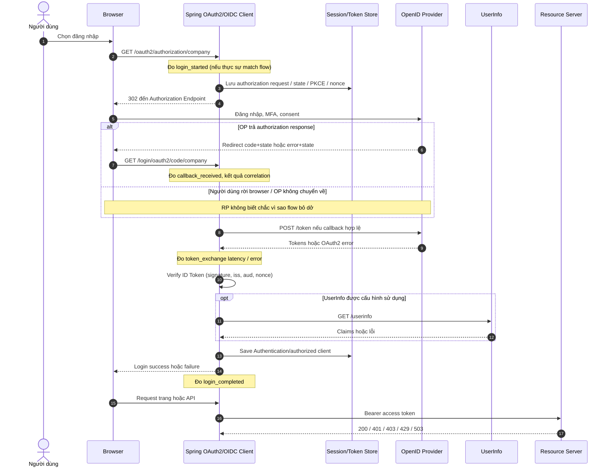
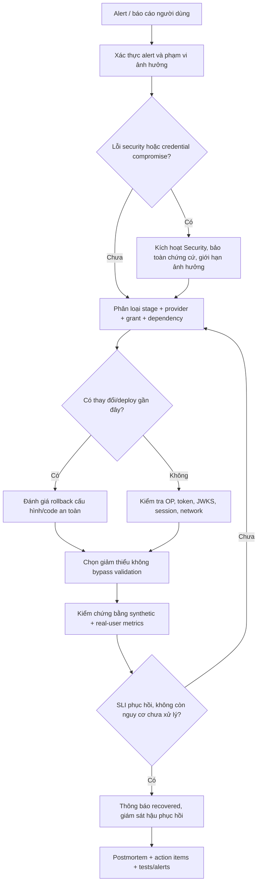

# 32.11. Dashboard, cảnh báo và quy trình ứng phó sự cố đăng nhập

Một hệ thống **Spring Security OAuth 2.0/OIDC Client** có thể được cấu hình hoàn chỉnh, đăng nhập thành công qua OpenID Provider (OP), cấp access token và gọi được API; nhưng khi triển khai thật, hệ thống vẫn có thể gặp những đợt **gián đoạn đăng nhập** do mạng, callback, session, sự cố Token Endpoint/JWKS, client secret hết hạn, provider áp dụng rate limit hoặc thay đổi chính sách xác thực. Những sự cố này thường vượt qua ranh giới một service và có thể ảnh hưởng hàng nghìn người dùng.

Vì vậy, “có log khi exception xảy ra” chưa đủ. Cần có **dashboard quan sát hành trình đăng nhập**, **SLI/SLO đo chất lượng đúng**, **cảnh báo có khả năng phân biệt lỗi người dùng và lỗi hệ thống**, và **runbook ứng phó sự cố có owner, mức độ nghiêm trọng, phương án giảm thiểu, tiêu chí kết thúc và hậu kiểm**.

Bài học này tập trung vào vận hành **Spring Security OAuth2 Client / OIDC Relying Party** cho ứng dụng **Servlet/Spring MVC** hoặc **Reactive WebFlux**, có thể dùng nhiều ClientRegistrations và có downstream Resource Servers. Ví dụ sử dụng **Micrometer**, **Prometheus/Grafana**, structured logs, tracing và một số hook Spring Security. Đây là **kiến trúc minh họa**: tên metrics do ta tự định nghĩa không có nghĩa Spring Security tự động xuất chúng; threshold và SLO cần điều chỉnh theo dữ liệu production, nghiệp vụ và khả năng quan sát thực tế.

> **Nguyên tắc số một:** Một login failure dashboard phải phân biệt **người dùng chủ động hủy**, **OP từ chối vì policy**, **callback bị chặn bởi kiểm tra bảo mật**, **Token Endpoint/JWKS/UserInfo thất bại**, **hạ tầng nội bộ lỗi** và **API ngoài lỗi sau đăng nhập**. Không dùng một biểu đồ tổng “OAuth errors” để kết luận nhà cung cấp đang down.

## 1. Mục tiêu học tập

Sau bài học, bạn có thể:

1. Vẽ data flow và xác định từng điểm cần đo trong OAuth2 Authorization Code + OIDC Login.
2. Phân biệt **đăng nhập bắt đầu**, **callback xuất hiện**, **login hoàn tất**, **session tiếp tục** và **token refresh/API call sau login**.
3. Thiết kế **SLI**, **SLO**, error budget và synthetic probes mà không đếm sai các lần người dùng hủy consent hoặc rời website OP.
4. Xây dashboard theo provider/registration, giai đoạn login, nguyên nhân lỗi, độ trễ và phụ thuộc hạ tầng.
5. Tạo metrics bằng Micrometer, xuất qua Prometheus và diễn giải PromQL theo đúng denominator.
6. Dùng Spring Security success/failure hooks cho Servlet và WebFlux nhưng không vô tình làm mất behavior mặc định.
7. Ghi structured logs/traces **không làm lộ code, state, nonce, access/refresh/ID tokens, Client secret hoặc session cookies**.
8. Thiết kế cảnh báo theo mức độ ảnh hưởng, ngưỡng lưu lượng tối thiểu, tỷ lệ lỗi, độ trễ, provider outage và các tín hiệu bảo mật.
9. Vận hành một incident từ **phát hiện → triage → giảm thiểu → khôi phục → xác minh → thông báo → postmortem**.
10. Chuẩn bị runbook chi tiết cho lỗi callback/session, `invalid_client`, `invalid_grant`, JWKS, UserInfo, OP 429/503, secret rotation, refresh token và sự cố multi-provider.

## 2. Quan sát cả hành trình, không chỉ trang /login

Một lần OIDC Login gồm nhiều HTTP exchanges và nhiều chủ thể:



### 2.1. Bảy điểm quan sát chính

| Điểm | Tín hiệu | Ý nghĩa | Giới hạn |
|---|---|---|---|
| **Authorization initiation** | `login_started` | RP bắt đầu tạo redirect | Không có nghĩa user đã tới OP |
| **Authorization response/callback** | `callback_received` | Browser đã quay lại RP | Thiếu callback có thể do user bỏ dở, OP outage hoặc cookie/browser |
| **Callback correlation** | `callback_validated` / `callback_rejected` | State/session/request đúng hay sai | Lỗi có thể là security rejection hợp lệ |
| **Token Endpoint** | request count, latency, `invalid_client`, `invalid_grant`, 429/5xx | Provider cấp token hoặc từ chối | Phải gắn `grant_type` |
| **OIDC validation/JWKS** | signature/issuer/audience/nonce errors, JWKS fetch | RP kiểm tra danh tính | Không được bypass khi provider down |
| **UserInfo/account mapping** | latency, subject mismatch, profile errors | Bổ sung claims / map internal account | UserInfo không bắt buộc trong mọi flow |
| **Login outcome** | success, failure, user_cancelled, security_rejected | Kết quả xử lý tại RP | Không bao phủ các flows rời đi không quay lại |

**Điểm mù quan trọng:** nếu user đến OP rồi đóng tab, hoặc OP hiển thị trang lỗi không redirect về RP, server RP có thể chỉ thấy `login_started`, không hề thấy callback. Không được gọi mọi flow không hoàn tất là “OP failure” nếu chưa có bằng chứng từ browser telemetry hoặc synthetic journey.

### 2.2. Vì sao không gom API 401 vào OAuth login failure?

Sau OIDC Login, user có thể truy cập Portal bình thường nhưng một external API trả **401 `invalid_token`**. Đây là lỗi **Resource Server / authorized client**, không phải RP không xác minh được OIDC Authentication.

Tương tự, Calendar refresh token bị thu hồi có thể cần user **reconnect Calendar**, không nhất thiết logout Portal. Dashboard phải có panel riêng cho **login** và **API/refresh token lifecycle**.

## 3. Định nghĩa một taxonomy sự kiện ổn định

Những nhãn sau là **định nghĩa vận hành của ứng dụng**, không phải error codes tiêu chuẩn OAuth2:

```text
Stage:
  AUTHORIZATION_INITIATION
  AUTHORIZATION_RESPONSE
  CALLBACK_CORRELATION
  TOKEN_EXCHANGE
  ID_TOKEN_VALIDATION
  JWKS_OR_DISCOVERY
  USERINFO
  ACCOUNT_MAPPING
  SESSION_PERSISTENCE
  TOKEN_REFRESH
  RESOURCE_SERVER_CALL
  LOGOUT

Outcome:
  success
  system_failure
  user_cancelled
  security_rejected
  unknown_or_abandoned

Error category:
  user_denied
  invalid_request
  invalid_client
  invalid_grant
  state_mismatch
  authorization_request_missing
  pkce_mismatch
  wrong_issuer_or_audience
  invalid_signature
  jwks_unavailable
  userinfo_invalid
  connection_timeout
  tls_failure
  rate_limited
  remote_5xx
  storage_unavailable
  business_mapping
  other
```

Một record ví dụ:

```json
{
  "event": "oauth2_login_failure",
  "registration_id": "company",
  "stage": "TOKEN_EXCHANGE",
  "outcome": "system_failure",
  "category": "invalid_client",
  "grant_type": "authorization_code",
  "dependency": "company_token_endpoint",
  "http_status": 401,
  "correlation_id": "random-internal-id"
}
```

**Điểm thiết yếu:** `invalid_grant` ở **authorization_code** và `invalid_grant` ở **refresh_token** có cùng protocol error code nhưng nguyên nhân và cách khôi phục khác nhau. Nếu chỉ lưu mã lỗi mà bỏ `grant_type`, biểu đồ vận hành sẽ dẫn tới xử lý sai.

### 3.1. Những mã lỗi nên phân biệt

| Protocol error/status | Nơi thường gặp | Ý nghĩa chính |
|---|---|---|
| `access_denied` | Authorization response | User/OP từ chối authorization |
| `invalid_request` | Authorization/Token Endpoint | Request thiếu/sai tham số |
| `invalid_client` | Token Endpoint | Client authentication hoặc cấu hình sai |
| `invalid_grant` | Token Endpoint | Grant hết hạn/sai/đã dùng/revoked |
| `temporarily_unavailable` | Authorization Endpoint | Provider tạm thời không sẵn sàng |
| `invalid_token` | UserInfo hoặc Resource Server | Bearer access token bị từ chối |
| `insufficient_scope` | UserInfo hoặc Resource Server | Thiếu quyền/scope |
| HTTP 429 | OP/Token/UserInfo/API | Rate limiting, có thể có `Retry-After` |
| HTTP 503 | OP/Token/UserInfo/API | Service unavailable |
| TLS/DNS/connect/read timeout | Transport layer | Không nhất thiết nhận HTTP hoặc OAuth error |

Không hiển thị nguyên văn `error_description` của OP cho người dùng hoặc đưa vào metric label; đây là dữ liệu từ bên ngoài, có thể chứa PII, URL hoặc thông tin không ổn định.

## 4. SLI: đo chất lượng của một hệ thống đăng nhập

**SLI (Service Level Indicator)** là phép đo cụ thể; **SLO (Service Level Objective)** là mục tiêu chấp nhận được theo thời gian. Chúng phải gắn với **định nghĩa population** và nguồn dữ liệu.

### 4.1. Các SLI đề xuất

| SLI | Tử số / mẫu số | Những gì đo được |
|---|---|---|
| **Resolved login completion ratio** | Login thành công / tất cả login đã có kết quả RP xử lý | Chất lượng phần flow nhìn thấy từ RP |
| **Technical login success ratio** | Thành công / (thành công + lỗi hệ thống) | Chất lượng kỹ thuật, loại các cancel theo policy |
| **Callback acceptance ratio** | Callback pass correlation / callbacks RP nhận | Bất thường state/session/multi-tab và tamper |
| **Token exchange success ratio** | Token requests thành công / tất cả token exchanges của grant tương ứng | OP/Client credential/PKCE |
| **Token Endpoint p95/p99 latency** | Histogram duration | Độ trễ cấp token/refresh |
| **JWKS/Discovery availability** | Metadata/key fetch thành công / tổng attempts | Health của validation dependencies |
| **UserInfo success ratio** | Thành công / requests tới UserInfo | Chỉ có ý nghĩa nếu flow thực sự gọi UserInfo |
| **Synthetic login success** | E2E canary journeys hoàn tất / journeys đã chạy | Nối browser, redirect, Token, OIDC và session |
| **Refresh success ratio** | Refresh thành công / refresh attempts | Vòng đời token, không phải login trực tiếp |
| **Downstream API success ratio** | Protected API success / attempted calls | Sau login, thuộc API dependency |

### 4.2. Bẫy denominator

Giả sử có:

```text
1000 login_started
700 callback_received
620 login_success
40 system_failure
40 user_cancelled
300 chưa có callback/không được quan sát
```

Đừng dùng `620 / 1000` rồi khẳng định OP chỉ có 62% availability. Các 300 còn lại có thể là người dùng rời flow, mở nhiều tabs, đi offline hoặc gặp lỗi OP/browser. Với chỉ server-side telemetry, không thể phân biệt tất cả.

**Một cách chia phù hợp:**

- Đo `technical login success` trên population đã có **resolved outcome**, loại user_cancelled khỏi mẫu số kỹ thuật theo chính sách công khai.
- Đo `completion funnel` riêng: started → callback → success, nêu rõ flow abandonment chưa phân loại.
- Dùng **synthetic browser login** hoặc client-side telemetry phù hợp privacy để quan sát end-to-end.
- Cần **minimum traffic gate** khi alert tỷ lệ, vì vài requests đơn lẻ dễ tạo spike giả.

### 4.3. Có nên loại security rejection khỏi SLO?

Tùy mục tiêu SLO. Một `state_mismatch` do attacker cố gửi callback không hợp lệ là **bảo vệ hoạt động đúng**, không nên coi là “system failed login”. Nhưng state mismatch tăng ngay sau một deploy có thể phản ánh lỗi session/cookie, là sự cố availability. Giải pháp là:

- Giữ nhóm `security_rejected` riêng.
- Quan sát sự tăng bất thường so với baseline.
- Dùng synthetic/canary để xác định flow hợp lệ có bị ảnh hưởng không.
- Không tắt state/PKCE/nonce validation chỉ để cải thiện SLO.

### 4.4. SLO minh họa

Một tổ chức có thể đặt mục tiêu theo cửa sổ 30 ngày:

```text
Technical login success ratio >= 99.9%
Token Endpoint p95 latency < 1.5 s
Synthetic OIDC login completion >= 99.5%
Callback state mismatch anomaly: không vượt baseline quá ngưỡng đã duyệt
```

Các số trên **chỉ là ví dụ thiết kế**, không phải mức bắt buộc cho mọi OP hoặc mặc định của Spring Security. SLO phải phản ánh client/provider contracts, quy mô người dùng, window và loại requests được đếm. Với login traffic thấp, synthetic journey và event-based alerts thường có giá trị hơn tỷ lệ 5 phút.

## 5. Error budget và burn rate

Nếu SLO kỹ thuật là 99,9% trong kỳ, error budget là **phần lỗi kỹ thuật tối đa được cho phép trong cùng population và window**. Burn rate diễn tả ngân sách lỗi đang bị tiêu nhanh hơn mức kỳ vọng.

### 5.1. Vì sao cần nhiều cửa sổ?

Một alert “failure rate trên 10% trong 1 phút” có thể báo sai khi chỉ có 2 attempts. Ngược lại, cửa sổ 24 giờ làm chậm phát hiện một outage hoàn toàn vừa bắt đầu.

Thiết kế phổ biến:

- **Short window** để phát hiện sự cố lan nhanh (vài phút).
- **Long window** để xác minh tác động bền vững (vài chục phút đến vài giờ).
- **Traffic gate** để không alert từ mẫu quá nhỏ.
- **Synthetic signal** để hỗ trợ hệ thống có ít người dùng hoặc callback không quay về.
- **Provider/stage segmentation** để chỉ đúng nhóm on-call.

### 5.2. Tách alerts availability và security

- Availability alert: technical login failed/latency/Token Endpoint 503.
- Security alert: `state_mismatch`, wrong issuer/audience/signature, suspicious account linking, abnormal token reuse.
- Operational warning: provider 429, redis saturation, signing key rotation, secret about to expire.
- User choice/UX: `access_denied` do người dùng hủy thường không cần on-call page.

Không biến mọi `access_denied` thành sự cố P1; ngược lại, không bỏ qua hàng loạt state mismatches chỉ vì chúng “không phải lỗi hệ thống”.

## 6. Thiết kế metrics: tên, đơn vị và tags

Dùng **Micrometer** với counters, timers và gauges có ngữ nghĩa rõ:

| Metric đề xuất | Loại | Tags có thể dùng |
|---|---|---|
| `oauth2.login.started` | Counter | registration, flow |
| `oauth2.login.callback` | Counter | registration, outcome |
| `oauth2.login.completed` | Counter | registration, outcome, stage/category |
| `oauth2.token.requests` | Timer/Counter | registration, grant, outcome, error |
| `oauth2.userinfo.requests` | Timer | provider alias, outcome |
| `oauth2.jwks.requests` | Timer | provider alias, outcome |
| `oauth2.authorized_client.refresh` | Counter | registration, outcome, error |
| `oauth2.authorized_client.cleanup` | Counter | registration, reason |
| `oauth2.session.store.errors` | Counter | storage kind, operation |
| `oauth2.login.synthetic` | Gauge/Counter | provider alias, outcome, region |
| `oauth2.provider.circuit.state` | Gauge | provider alias, state |
| `oauth2.provider.retries` | Counter | dependency, operation, outcome |

Đây là **tên custom ví dụ**. Tên Prometheus thường được exporter chuyển thành dạng có underscore và hậu tố phù hợp (`oauth2_login_completed_total` cho Counter tùy cấu hình). Không khẳng định những metrics này tự xuất hiện chỉ vì đã bật Spring Boot Actuator.

### 6.1. Tags phải có cardinality thấp

**Có thể dùng:** `registrationId` trong tập cố định, `providerAlias`, `grant_type`, `stage`, `outcome`, nhóm mã HTTP, mã OAuth2 đã map vào allowlist, region đã chuẩn hóa.

**Không dùng:** user ID, email, `sub`, tenant ID động nếu số tenant lớn, session ID, `state`, `nonce`, authorization code, access/refresh token, raw URL, IP đầy đủ hoặc `error_description`.

Nếu hỗ trợ hàng chục nghìn tenant registrations động, **`registrationId` cũng có thể thành high-cardinality**. Khi đó cần nhóm theo provider family, issuer alias hoặc dimension đã được cân nhắc thay vì đưa mọi registration ID vào time-series.

### 6.2. Events có thể bị đếm hai lần

Một browser redirect có thể bị retry, một callback có thể được gửi lại, một user có thể mở nhiều tabs. Đừng lấy số lượng filter invocations làm số “con người duy nhất đã thử đăng nhập”. Chọn đơn vị rõ: **authorization attempts**, **callback requests**, **resolved outcomes**, hay **unique sessions** (nếu việc thu thập phù hợp privacy).

### 6.3. Timer đo đúng dependency

`oauth2.token.requests` nên đo request tới Token Endpoint, không bao gồm toàn bộ thời gian user nhập mật khẩu trên OP. Một **end-to-end login latency** đo từ lúc RP tạo authorization request đến callback sẽ bao gồm **human think time**; không nên so trực tiếp với Token Endpoint p95.

## 7. Dựng dashboard tổng quan cho on-call

Dashboard đầu tiên nên trả lời bốn câu hỏi trong vài giây:

1. **Hiện có sự cố đáng kể không?**
2. **Ai bị ảnh hưởng: provider nào, registration nào, region nào?**
3. **Lỗi ở bước nào của login?**
4. **Đây là lỗi availability, config/secret, security rejection hay user choice?**

### 7.1. Bố cục dashboard gợi ý

```text
┌───────────────────────────────────────────────────────────────────────┐
│  LOGIN HEALTH  |  technical success  |  synthetic login  |  incidents │
├─────────────────────┬───────────────────────┬─────────────────────────┤
│ attempts / successes│ errors by stage        │ providers / regions     │
│ 1m, 5m, 1h, 24h      │ initiation/callback/...│ company/partner/region │
├─────────────────────┴───────────────────────┴─────────────────────────┤
│ LOGIN FUNNEL: started -> callback -> token -> OIDC validated -> success│
├──────────────────────┬──────────────────────┬─────────────────────────┤
│ Token endpoint p95/99 │ JWKS/UserInfo health │ Session/Redis failures  │
├──────────────────────┴──────────────────────┴─────────────────────────┤
│ 429/503/timeout/invalid_client/invalid_grant by provider and grant    │
├───────────────────────────────────────────────────────────────────────┤
│ Current deploys, credential rotation, provider incident annotations   │
├───────────────────────────────────────────────────────────────────────┤
│ Security anomalies: state mismatch, wrong issuer, nonce/signature     │
└───────────────────────────────────────────────────────────────────────┘
```

### 7.2. Panel “Golden signals”

| Signal | Dashboard cụ thể |
|---|---|
| **Traffic** | Login started/callbacks/completed per phút theo provider |
| **Errors** | Technical failures, user cancel, security reject tách biệt |
| **Latency** | Token Endpoint, UserInfo, JWKS, session store, refresh p50/p95/p99 |
| **Saturation** | HTTP connection pool, threads/event-loop, Redis/DB pool, queues, rate-limit budget |

Với **Servlet**, thread pool saturation và session store latency có thể làm callback lỗi. Với **WebFlux**, event-loop blocking/connection pool saturation có thể khiến latency tăng dù CPU tổng không cao. Dashboard phải có **hạ tầng nội bộ** bên cạnh OP metrics.

### 7.3. Panel funnel cần chú thích rõ

```text
Started at RP:      10,000
Callback received:   8,300
Token exchange tried: 8,100
ID Token validated:   7,940
Login success:        7,900
```

Không kết luận 1.700 callbacks thiếu là “lỗi OP” nếu không có browser telemetry. Phân tích thêm:

- User hủy/đóng tab.
- Consent/MFA time.
- OP trả error page chứ không redirect.
- Browser cookie/redirect policies.
- Callback route đến instance sai.
- Nhiều tabs gây flow superseded.

### 7.4. Panel chi tiết theo provider

Chọn `company`:

- 429/503 từ Authorization/Token/UserInfo endpoints.
- Token exchange `invalid_client`/`invalid_grant` theo grant.
- JWKS fetch errors/rotation.
- Callback state mismatches.
- Synthetic browser login.
- OAuth scopes/client credentials changes.
- Last deployment/change event.

Không tự lấy token của provider B để “fallback” cho provider A vì outage. Multi-provider có thể phục hồi độc lập nhưng danh tính không được hoán đổi tự động.

## 8. PromQL minh họa: tỷ lệ lỗi và lưu lượng

Giả sử metrics custom đã được export như:

```text
oauth2_login_completed_total{
  registration="company",
  outcome="success|system_failure|user_cancelled|security_rejected"
}
```

Để đo **technical system failure ratio** toàn hệ thống trong 15 phút:

```promql
sum(increase(oauth2_login_completed_total{outcome="system_failure"}[15m]))
/
clamp_min(
  sum(increase(oauth2_login_completed_total{outcome=~"success|system_failure"}[15m])),
  1
)
```

**Giải thích:** mẫu số chỉ gồm outcomes có thể quy về thành công hoặc lỗi kỹ thuật. Nếu không có requests, giá trị công thức có thể trở thành 0 do `clamp_min`; **không coi điều này là bằng chứng availability 100%**. Cần traffic gate và synthetic canary để phân biệt “không có lưu lượng”.

### 8.1. Số login thành công theo provider

```promql
sum by (registration) (
  increase(oauth2_login_completed_total{outcome="success"}[10m])
)
```

### 8.2. Lỗi kỹ thuật theo provider

```promql
sum by (registration) (
  increase(oauth2_login_completed_total{outcome="system_failure"}[10m])
)
```

### 8.3. Lỗi theo stage

Giả sử counter riêng `oauth2_login_errors_total` có labels `stage` và `category`:

```promql
sum by (stage, category) (
  increase(oauth2_login_errors_total[30m])
)
```

Không đưa token, user email hay unbounded error descriptions vào các labels này.

### 8.4. P95 Token Endpoint latency

Giả sử dùng histogram custom `oauth2_token_duration_seconds_bucket`:

```promql
histogram_quantile(
  0.95,
  sum by (le, registration, grant) (
    rate(oauth2_token_duration_seconds_bucket[5m])
  )
)
```

Nếu chỉ dùng Timer nhưng không publish histogram buckets, query này không thể chạy. Phải cấu hình histogram/SLO buckets trong Micrometer tương ứng rồi xác minh tên series thật trong Prometheus. Không khẳng định mọi Timer tự sinh `_bucket`.

### 8.5. Tỷ lệ lỗi thấp phải xem volume

Nếu 2 failures trên 3 attempts, tỷ lệ cao nhưng sample nhỏ; đừng page như một P0 toàn hệ thống. Tách alert theo volume, synthetic probes và thời gian kéo dài.

## 9. Cảnh báo: điều gì đủ để đánh thức on-call?

Alerts phải **hành động được**, có owner, runbook link, severity và cách giảm nhiễu.

### 9.1. Các nhóm alert gợi ý

| Alert | Điều kiện minh họa | Severity | Owner |
|---|---|---|---|
| Technical login failure spike | Tỷ lệ cao + đủ volume + kéo dài | P1/P2 tùy impact | Identity/App on-call |
| Synthetic OIDC login failed | Nhiều canary failures liên tiếp | P1/P2 | Identity/App + provider |
| Callback state mismatch anomaly | Vượt baseline sau deploy | P1/P2 security/availability | Identity/Security |
| Token Endpoint `invalid_client` spike | Nhiều users/registrations cùng lỗi | P1 | Secrets/Identity |
| Token Endpoint 429 rate limit | Quota consumed, retry storm | P2 | Identity/Platform |
| JWKS validation failures | Không xác minh được ID Token hợp lệ | P1/P2 | Identity/Security |
| Redis session store unavailable | Callback mất state hàng loạt | P1 | Platform |
| Refresh `invalid_grant` surge | Nhiều connections bị revoke/rotation race | P2/P1 | Integrations |
| Single provider degraded | Company down, Partner healthy | P2 | Provider owner |
| Provider planned maintenance | Có thông báo trước, tác động nhỏ | P3/notice | Operations |
| User denied consent tăng | Có thể UX/provider policy | Triage/analytics | Product/Identity |

**P1/P2 là nhãn minh họa**, không phải phân loại toàn cục. Severity thật cần dựa trên người dùng bị ảnh hưởng, dịch vụ trọng yếu, thời lượng, rủi ro bảo mật và khả năng workaround.

### 9.2. Ví dụ rule Prometheus với volume gate

```yaml
groups:
  - name: oauth2-login-example
    rules:
      - alert: OAuth2LoginSystemFailureSpike
        expr: |
          (
            sum(increase(oauth2_login_completed_total{outcome="system_failure"}[10m]))
            /
            clamp_min(
              sum(increase(oauth2_login_completed_total{outcome=~"success|system_failure"}[10m])),
              1
            )
          ) > 0.15
          and
          sum(increase(oauth2_login_completed_total{outcome=~"success|system_failure"}[10m])) >= 50
        for: 5m
        labels:
          severity: warning
          service: oauth2-client
        annotations:
          summary: "Login technical failure ratio elevated"
          description: "Check provider/stage dashboards and incident runbook"
```

**Đây là một rule minh họa, không phải rule production được xác minh.** Cần điều chỉnh counters/tags, traffic gate, baseline, SLO burn, “for” và routing. Nó chỉ hoạt động nếu app thực sự xuất `oauth2_login_completed_total` với labels đúng.

### 9.3. Multi-window burn-rate

Với SLO chặt, có thể kết hợp alert nhanh và alert chậm:

- Ngắn hạn: phát hiện spike lớn có impact ngay.
- Dài hạn: cảnh báo lỗi kỹ thuật âm ỉ nhưng tiêu tốn budget.
- Cả hai có điều kiện traffic và synthetic coverage.
- Không đếm user-cancelled như provider outage.
- Không tự bỏ security rejects khỏi giám sát; đưa chúng sang một alert riêng.

Không nên gửi 12 cảnh báo khác nhau về cùng một OP outage; Alertmanager/on-call system cần grouping/dedup theo provider/service và incident.

### 9.4. Alert khi không có dữ liệu

`up==1` của Prometheus target không chứng minh login đang hoạt động. Ngược lại, thiếu metric `login_completed` có thể do không có users hoặc instrumentation lỗi.

Cần kết hợp:

- Service/target up.
- Mức độ traffic kỳ vọng.
- Synthetic OIDC login.
- Token Endpoint/JWKS dependency probes.
- Dashboard data freshness.
- Collector/agent health.

Không gọi `rate(...)=0` là success nếu chính metric không còn được xuất.

## 10. Logging và tracing: quan sát đủ nhưng không rò credentials

Một request OAuth2/OIDC có nhiều dữ liệu nhạy cảm:

```text
authorization code
state
nonce
PKCE code_verifier
access_token / refresh_token / id_token
client_secret / private key assertion
Authorization header
Cookie / Set-Cookie
full callback URL ?code=...&state=...
raw UserInfo claims
id_token_hint trên logout URL
```

**Không log trực tiếp** các giá trị này, kể cả debug staging nếu log có thể được chia sẻ hoặc giữ lâu. Cần cấu hình redaction tại:

- Reverse proxy/load balancer.
- Spring Servlet access logs hoặc Reactor Netty HTTP logs.
- Application filters/interceptors.
- WebClient/RestClient exchange logging.
- OpenTelemetry spans và HTTP semantic attributes.
- APM/tracing agents có thể capture headers/query.
- Exception handling/logging frameworks.
- CI snapshots, support attachments và audit systems.

### 10.1. Structured log an toàn

```json
{
  "timestamp": "2026-11-16T02:00:00Z",
  "event": "oidc_login_failure",
  "stage": "CALLBACK_CORRELATION",
  "registration_id": "company",
  "outcome": "security_rejected",
  "category": "authorization_request_missing",
  "failure_family": "OAuth2AuthenticationException",
  "correlation_id": "random-independent-id",
  "deployment_version": "example-build"
}
```

Không lấy `error_description`, session cookie hoặc `state` làm `correlation_id`.

### 10.2. Có thể log `principalName` không?

Không nên đưa user ID/email/`sub` vào metric labels. Audit events có thể cần định danh người thao tác, nhưng phải tách kho audit có access control, retention, data minimization và hashing/pseudonymization policy rõ. Log vận hành thông thường ưu tiên **provider alias, stage, code category, timestamp, trace ID ngẫu nhiên**.

### 10.3. Trace qua browser redirect có giới hạn

Một lần OIDC Login rời RP sang OP rồi quay lại qua browser. Một server-side trace **không tự nối liền** toàn bộ browser/OP exchanges. Có thể dùng correlation lưu server-side trong authorization request/session; không đưa internal trace IDs bí mật vào OAuth `state` hoặc log full callback URL để “khôi phục trace”.

### 10.4. Span names có ích

```text
oauth2.authorization.initiate
oauth2.authorization.callback
oauth2.token.exchange
oidc.id_token.validate
oidc.jwks.fetch
oidc.userinfo.fetch
oauth2.authorized_client.save
oauth2.refresh
oauth2.resource_server.call
```

Đây là các **tên span do ứng dụng định nghĩa**. Không phải tất cả tự động xuất từ Spring Security Observability. Có thể dùng Micrometer Observation hoặc OpenTelemetry instrumentation để đo ở đúng boundary.

## 11. Instrumentation Servlet: đo login success/failure

Trong Spring MVC, `HttpSecurity.oauth2Login()` có thể được tùy biến `successHandler` và `failureHandler`. Khi thay handler, phải **giữ behavior điều hướng/session mong muốn** thay vì vô tình bỏ logic mặc định.

### 11.1. Ví dụ đo outcome bằng Micrometer

```java
import io.micrometer.core.instrument.MeterRegistry;

import org.springframework.context.annotation.Bean;
import org.springframework.context.annotation.Configuration;
import org.springframework.security.config.annotation.web.builders.HttpSecurity;
import org.springframework.security.core.Authentication;
import org.springframework.security.core.AuthenticationException;
import org.springframework.security.oauth2.client.authentication.OAuth2AuthenticationToken;
import org.springframework.security.oauth2.core.OAuth2AuthenticationException;
import org.springframework.security.web.SecurityFilterChain;
import org.springframework.security.web.authentication.AuthenticationFailureHandler;
import org.springframework.security.web.authentication.AuthenticationSuccessHandler;
import org.springframework.security.web.authentication.SavedRequestAwareAuthenticationSuccessHandler;
import org.springframework.security.web.authentication.SimpleUrlAuthenticationFailureHandler;

@Configuration
public class LoginTelemetrySecurityConfiguration {

    @Bean
    SecurityFilterChain chain(
            HttpSecurity http,
            MeterRegistry registry) throws Exception {

        var successDelegate =
            new SavedRequestAwareAuthenticationSuccessHandler();

        var failureDelegate =
            new SimpleUrlAuthenticationFailureHandler(
                "/login?error=oauth2"
            );

        AuthenticationSuccessHandler successHandler =
            (request, response, authentication) -> {

                String registration = safeRegistration(authentication);

                registry.counter(
                    "oauth2.login.completed",
                    "registration", registration,
                    "outcome", "success"
                ).increment();

                successDelegate.onAuthenticationSuccess(
                    request, response, authentication
                );
            };

        AuthenticationFailureHandler failureHandler =
            (request, response, exception) -> {

                String category = safeFailureCategory(exception);

                registry.counter(
                    "oauth2.login.completed",
                    "registration", "unknown",
                    "outcome", "system_failure",
                    "category", category
                ).increment();

                failureDelegate.onAuthenticationFailure(
                    request, response, exception
                );
            };

        return http
            .authorizeHttpRequests(authorize -> authorize
                .requestMatchers("/", "/login", "/error").permitAll()
                .anyRequest().authenticated()
            )
            .oauth2Login(login -> login
                .successHandler(successHandler)
                .failureHandler(failureHandler)
            )
            .build();
    }

    private static String safeRegistration(Authentication auth) {
        if (auth instanceof OAuth2AuthenticationToken oauth2) {
            String id = oauth2.getAuthorizedClientRegistrationId();
            // Production: đối chiếu allowlist trước khi dùng làm tag.
            if ("company".equals(id) || "partner".equals(id)) {
                return id;
            }
        }
        return "other";
    }

    private static String safeFailureCategory(
            AuthenticationException exception) {
        if (exception instanceof OAuth2AuthenticationException oauth2) {
            String code = oauth2.getError().getErrorCode();
            if ("access_denied".equals(code)) {
                return "user_denied";
            }
            if ("invalid_grant".equals(code)) {
                return "invalid_grant";
            }
            if ("invalid_client".equals(code)) {
                return "invalid_client";
            }
        }
        return "other";
    }
}
```

**Đây là ví dụ instrumentation tối giản**, chưa phải taxonomy production hoàn chỉnh. Nếu `access_denied` xuất hiện, mapper ở đây vẫn gắn `outcome=system_failure`; hệ thống thật nên ánh xạ **user_cancelled** hoặc OP policy-denied riêng khi có đủ bằng chứng. Một `invalid_grant` ở login failure handler chưa đủ xác định Token Endpoint là root cause nếu không instrument thêm token exchange.

### 11.2. Vì sao failure registration dùng “unknown”?

Trong một số failure paths, OAuth2 Authentication chưa được xây nên không có `OAuth2AuthenticationToken` đáng tin. Không lấy arbitrary query `registrationId` từ browser để làm high-cardinality tag; nếu cần per-provider error metrics, capture trusted registration context từ resolver/authorization request repository hoặc filter stage và map qua allowlist.

### 11.3. Khi hook này chưa đủ

Failure handler **không nhất thiết** thấy:

- Lỗi tạo authorization request trước redirect.
- OP hiển thị error page nhưng không redirect lại RP.
- Discovery failure lúc Spring context khởi động.
- Token refresh khi user đã đăng nhập.
- Resource Server 401/403 khi gọi downstream API.
- Một số session store failures xảy ra ngoài authentication filter.

Do đó phải instrument **từng điểm phụ thuộc** và dùng synthetic/browser signals phù hợp.

### 11.4. Success handler không thay business audit

Một sự kiện OAuth2 login thành công không chứng minh user có quyền truy cập mọi domain resource. Business authorization và account linking audit cần events riêng, không gộp vào `oauth2.login.completed`.

## 12. Reactive WebFlux: ghi metrics trong Publisher chain

Với WebFlux, dùng `ServerHttpSecurity.oauth2Login()` và reactive success/failure handlers:

```java
import io.micrometer.core.instrument.MeterRegistry;

import org.springframework.context.annotation.Bean;
import org.springframework.security.config.web.server.ServerHttpSecurity;
import org.springframework.security.web.server.SecurityWebFilterChain;
import org.springframework.security.web.server.authentication.RedirectServerAuthenticationSuccessHandler;
import org.springframework.security.web.server.authentication.RedirectServerAuthenticationFailureHandler;

@Bean
SecurityWebFilterChain reactiveChain(
        ServerHttpSecurity http,
        MeterRegistry registry) {

    var successDelegate =
        new RedirectServerAuthenticationSuccessHandler("/");

    var failureDelegate =
        new RedirectServerAuthenticationFailureHandler(
            "/login?error=oauth2"
        );

    return http
        .authorizeExchange(authorize -> authorize
            .pathMatchers("/", "/login", "/error").permitAll()
            .anyExchange().authenticated()
        )
        .oauth2Login(login -> login
            .authenticationSuccessHandler((exchange, auth) -> {
                registry.counter(
                    "oauth2.login.completed",
                    "outcome", "success",
                    "stack", "webflux"
                ).increment();

                return successDelegate.onAuthenticationSuccess(
                    exchange, auth
                );
            })
            .authenticationFailureHandler((exchange, error) -> {
                registry.counter(
                    "oauth2.login.completed",
                    "outcome", "system_failure",
                    "stack", "webflux"
                ).increment();

                return failureDelegate.onAuthenticationFailure(
                    exchange, error
                );
            })
        )
        .build();
}
```

**Điểm quan trọng:** trong Reactive, trả lại `Mono<Void>` từ delegate; không gọi `subscribe()` fire-and-forget. Với requirements production, metric nên phân loại outcome/error code giống Servlet và chỉ tăng khi sự kiện có semantics rõ; tránh đếm hai lần trong các retry/cancellation paths.

### 12.1. Không sử dụng Servlet ThreadLocal sai chỗ

Reactive Authentication được quản lý trong Reactor context/`ReactiveSecurityContextHolder`, không nên giả định `SecurityContextHolder.getContext()` luôn tồn tại trên mọi Netty event-loop. Background jobs cần trusted service principal/connection context riêng.

### 12.2. Không block event-loop chỉ để ghi audit

Nếu cần ghi sự kiện audit vào DB, dùng reactive repository hoặc boundary được quản lý. Một `block()` trong reactive failure handler có thể gây chậm dây chuyền và tạo thêm timeout/cạn connection pool.

## 13. Quan sát Token Endpoint và authorized-client lifecycle

Một login success handler không cho biết Token Endpoint p95, `invalid_client` hoặc refresh token rotation. Cần đo tại:

- OAuth2 token response client hoặc HTTP client gửi `/token`.
- `OAuth2AuthorizedClientManager`/`ReactiveOAuth2AuthorizedClientManager`.
- Authorized-client service/repository `load`, `save`, `remove`.
- WebClient OAuth2 filter khi Resource Server trả OAuth2 Bearer errors.
- Background jobs nếu dùng client_credentials hoặc user-delegated refresh.

### 13.1. Các trường nên đo

```text
stage=TOKEN_EXCHANGE or TOKEN_REFRESH
registration=company|calendar
grant=authorization_code|refresh_token|client_credentials
outcome=success|oauth_error|transport_error|timeout
oauth_error_code=invalid_client|invalid_grant|other
http_status=2xx|4xx|5xx
duration_seconds=...
```

Không đo/ghi refresh token string hoặc request body thật.

### 13.2. `invalid_grant` trong refresh cần xử lý khác login

| Ngữ cảnh | Ý nghĩa thường gặp | Runbook |
|---|---|---|
| Authorization Code exchange | Code expired/reused, PKCE hoặc redirect URI mismatch | Tạo login flow mới hoặc sửa cấu hình |
| Refresh Token Grant | Token revoked/expired/rotated, concurrent refresh | Kiểm tra token store, cleanup/reconnect đúng connection |
| Resource Server `invalid_token` | Bearer access token bị từ chối | Kiểm tra audience, expiry, token selection/RS |
| Resource Server `insufficient_scope` | Thiếu quyền | Không retry vô hạn, kiểm tra consent/scope |

### 13.3. Handler cleanup phải đo cả side effect

Một warning `invalid_grant` không đủ. Cần biết:

- Authorized client đã được loại đúng key chưa?
- Có để lại token sai khiến request sau tiếp tục fail?
- Có xóa nhầm token của user/provider khác không?
- Có race khiến request B xóa RT-2 mới do request A đã lưu không?
- Storage remove có lỗi không?
- User-facing connection state đã trở thành `RECONNECT_REQUIRED` nếu policy yêu cầu chưa?

Khi custom failure handler chỉ ghi log rồi trả thành công, có thể làm mất cleanup mặc định của manager. Test và dashboard cần kiểm tra **behavior**, không chỉ exception count.

## 14. Dashboard cho session và authorized-client store

Trong Spring MVC/Servlet, OAuth2 authorization request thường cần `HttpSession`; trong WebFlux là `WebSession` hoặc repository tương ứng. Nếu Redis/session store down, callback có thể mất `state` và OP login vẫn có vẻ thành công.

### 14.1. Metrics hạ tầng liên quan

| Dependency | Mục tiêu quan sát |
|---|---|
| Redis/Spring Session | Availability, latency, pool, TTL, evictions, connection errors |
| JDBC Authorized Client Service | Query/save/delete errors, latency, pool exhaustion |
| Reverse proxy | 5xx, wrong forwarded host, TLS errors, callback routing |
| Load balancer | Pod churn, unhealthy instances, sticky routing nếu có |
| JVM Servlet | Request threads, queue, saturation |
| Reactor Netty | Event-loop lag, pending connections, connection pool |
| System clock | Time sync/clock skew ảnh hưởng ID Token `exp` |
| KMS/Secret Manager | Credential retrieval/rotation availability |

### 14.2. Dấu hiệu của session lỗi

```text
authorization_request_not_found tăng
callback_state_mismatch tăng
token_endpoint_requests không tăng tương ứng
redis errors hoặc session TTL/evictions tăng
user mở login lại vẫn gặp vấn đề
```

Đây là mẫu giúp triage, **không phải bằng chứng chắc chắn**. Nếu callback state mismatch có thể là tampering, vẫn cần security review.

### 14.3. Không sửa bằng cách tắt state

Nếu callback mất session vì Redis lỗi, giải pháp là sửa Redis/session architecture, cookie policy, routing và TTL. **Không cho phép callback thiếu authorization request được xử lý thành login thành công**.

## 15. Synthetic login: tín hiệu đầu-cuối đáng tin hơn

Vì backend không nhìn thấy mọi browser abandonment, một **synthetic OIDC journey** có thể đo:

```text
Test browser
  -> Portal /oauth2/authorization/company
  -> Test OP/tenant login
  -> Consent/MFA test policy
  -> Portal callback
  -> Local authenticated session
  -> Trang protected trả expected response
  -> Logout/cleanup test account
```

### 15.1. Điều kiện để synthetic tests an toàn

- Sử dụng **test account và test client registration**.
- Không đưa username/password, Client secret, access token hoặc session cookie vào logs/screenshots.
- Test tenant/phạm vi đã được OP cho phép, có thể cần exclude quota/consent đặc biệt.
- Không spam provider production để tạo rate limit giả.
- Có timeout và cleanup, không tạo sessions/tokens vô hạn.
- Giám sát từ các region phù hợp nếu ứng dụng global.
- Phân biệt “test account bị lock/MFA policy đổi” với outage thật.
- Nếu bảo mật không cho phép browser automation trên OP production, dùng test OP/tenant hoặc probe được provider phê duyệt.

### 15.2. Synthetic kết quả nào đáng alert?

- Liên tiếp N lần không thể bắt đầu login.
- Browser không tới OP hoặc không quay lại Portal.
- Callback hợp lệ nhưng RP không tạo session.
- Token Endpoint trả 503/`invalid_client`.
- ID Token validation fail vì JWKS/key rotation.
- Protected page không nhận local authenticated session.

Đặt threshold theo **frequency và số location probes**, tránh page khi một lần test synthetic gặp lỗi mạng riêng của monitor.

### 15.3. Synthetic không chứng minh mọi user sẽ thành công

Canary dùng một provider, account, scope, region và flow. Nó không kiểm thử tất cả tenants, Conditional Access/MFA policies, consent decisions và WebView browsers. Cần kết hợp real-user metrics và provider admin telemetry.

## 16. Cảnh báo security: bảo vệ protocol không được hi sinh cho uptime

Các lỗi sau cần dashboard/security panel riêng:

- `state` mismatch hoặc authorization request missing bất thường.
- Code exchange `invalid_grant` có dấu hiệu replay/mix-up.
- OIDC `nonce` mismatch.
- ID Token wrong `iss`/`aud` hoặc signature invalid.
- UserInfo `sub` không khớp ID Token `sub`.
- Login provider khác API provider dẫn tới token gửi sai host.
- External identity tự liên kết sai `(iss, sub)`.
- Refresh token reuse detection hoặc token family revoke.
- Đột biến `invalid_client` sau secret rotation.

### 16.1. Đừng tắt kiểm tra bảo mật để làm dashboard “xanh”

Không chấp nhận:

```text
Disable state validation to lower callback errors
Disable issuer/audience validation if JWKS unavailable
Accept unsigned ID Token during OP outage
Send code to multiple Token Endpoints to find one working
Retry refresh token indefinitely after invalid_grant
Log code/state/token to debug quickly
```

Những lựa chọn này có thể biến sự cố availability thành account takeover, token leakage hoặc vi phạm quyền truy cập.

### 16.2. Phân loại alert security và availability

Một sai nonce đơn lẻ có thể là request giả bị từ chối (system functioning correctly). Nếu sự cố lan trên canary sau deployment, đó có thể là cấu hình mới làm vỡ OIDC flow. **Triage phải dùng context**, không tự coi mọi security rejection là attack hoặc incident availability.

## 17. Thiết kế Alert routing và ownership

Một alert không có owner/runbook là một tín hiệu dễ bị bỏ quên.

### 17.1. Ma trận ownership minh họa

| Tín hiệu | Primary owner | Secondary |
|---|---|---|
| Callback state/session errors | Identity application on-call | Platform/Redis |
| Token Endpoint `invalid_client` | Identity/Secrets team | OP administrator |
| JWKS/issuer/nonce validation | Identity security | Provider admin |
| OP Authorization Endpoint 503 | Provider integration owner | Vendor/Platform |
| UserInfo unavailable | Identity integration owner | OP admin |
| Redis/DB session outage | Platform/SRE | Identity application |
| Refresh `invalid_grant` surge | External integrations team | Security/OP admin |
| API 401/403 | API integration owner | Resource Server owner |
| Credential/token leak | Security incident response | Identity/Platform |
| Login UX abandonment increase | Product/Identity analytics | UX/support |

Với mô hình tổ chức nhỏ, một người có thể giữ nhiều vai trò; vẫn cần **named on-call rotation, escalation path và quyền tiếp cận provider support**.

### 17.2. Mỗi alert nên mang gì?

```text
name:
service:
environment:
provider_alias:
stage:
severity:
start_time:
current_rate:
affected_population_estimate:
dashboard_link:
runbook_link:
recent_changes:
owner:
escalation:
```

Không đưa raw OAuth tokens, user email, callback URL, secret hoặc `state` vào alert payload/Slack notifications.

### 17.3. Dedup và suppression

Khi Token Endpoint company trả 503, hệ thống có thể báo:

- Login failures tăng.
- Token exchange p95 tăng.
- OP dependency 503.
- Synthetic login failed.

Chúng có thể là **một incident**, không phải bốn. Nhóm alerts theo provider/incident fingerprint, vẫn giữ details phụ thuộc để triage. Không suppress riêng security alerts chỉ vì outage trùng thời điểm.

## 18. Incident severity và thời gian phản ứng

Một policy minh họa:

| Mức | Điều kiện điển hình | Quyết định |
|---|---|---|
| **SEV-1 / Critical** | Phần lớn người dùng không thể đăng nhập, không có workaround; hoặc nghi token/secret compromise ảnh hưởng lớn | Kích hoạt incident commander, Security khi cần, thông báo rộng |
| **SEV-2 / High** | Một OP/region lớn bị lỗi, login rate giảm đáng kể; nhiều users bị ảnh hưởng | On-call + owner provider, theo dõi liên tục |
| **SEV-3 / Medium** | Tỷ lệ lỗi tăng nhưng phạm vi hẹp; synthetic lỗi một region; workaround an toàn có sẵn | Triage ưu tiên, có action owner |
| **SEV-4 / Low** | Một số lỗi ngắt quãng hoặc bug dashboard chưa có tác động xác nhận | Ticket, theo dõi trend |

Mức này phải được hiệu chỉnh theo **quy định nội bộ của tổ chức** và risk appetite. Không dùng nguyên các ngưỡng minh họa để tuyên bố SLA production.

### 18.1. Khi nào phải triệu tập Security?

- Dấu hiệu authorization code/token leak.
- ID Token signature/issuer validation bất thường sau cấu hình provider.
- Nonce/state mismatch patterns đáng ngờ.
- Refresh token family reuse/compromise signal.
- Client secret/private key lộ.
- Account linking sai người/tenant.
- Log/APM chứa raw access/refresh tokens hoặc credentials.

Bảo toàn chứng cứ an toàn, không copy secrets vào chat/ticket và không thay đổi policy validation trước khi đánh giá rủi ro.

## 19. Quy trình ứng phó tổng thể



### 19.1. Vai trò trong một incident

- **Incident commander:** quyết định ưu tiên, phân công và cadence cập nhật.
- **Technical lead:** điều tra root cause, quyết định mitigation.
- **Communications owner:** status page, support, stakeholders.
- **Provider liaison:** trao đổi với OP vendor/admin, ticket và SLA.
- **Security lead:** tham gia khi credential/identity có nguy cơ bị ảnh hưởng.
- **Scribe:** ghi timeline, decisions, links và evidence an toàn.

Không cần sáu người khác nhau trong mọi sự cố, nhưng cần rõ **ai quyết định và ai thông báo**.

### 19.2. 15 phút triage đầu tiên: dữ liệu cần lấy

1. Lúc nào error bắt đầu, theo UTC và timezone hiển thị dashboard?
2. Provider, ClientRegistration, region, app version, user segment nào bị ảnh hưởng?
3. Tỷ lệ technical login failures, callback failures, synthetic login, Token Endpoint 429/503?
4. Lỗi có xảy ra trước redirect, tại callback, token, JWKS, UserInfo hay session persistence?
5. Có change về Client secret, redirect URI, issuer, scopes, reverse proxy, Redis/DB hoặc app deploy?
6. Có tín hiệu credential/identity compromise không?
7. Những local sessions hiện có vẫn hoạt động hay mọi user bị buộc đăng nhập lại?
8. Có workaround **an toàn**, không làm mất bảo vệ OAuth2/OIDC?
9. Ai giữ OP admin/support credentials và escalation channel?
10. Bằng chứng nào được lưu **không chứa tokens/codes/session IDs**?

### 19.3. Ghi timeline

```text
09:02  Alert: company login technical failure > baseline
09:04  Synthetic OIDC journey failed từ 2 regions
09:06  Token Endpoint 503 tăng, callback state mismatch ổn định
09:08  OP provider incident được xác nhận
09:11  Tắt retry mù/giảm tải bằng policy đã duyệt
09:15  Status page cập nhật "Sign-in via Company degraded"
09:24  Token Endpoint phục hồi
09:30  Synthetic login pass, traffic success ratio phục hồi
10:00  Incident resolved; tiếp tục giám sát hậu phục hồi
```

Đây là **timeline giả định**. Thời gian, hành động và câu status phải dựa trên incident thật.

## 20. Runbook A — Không redirect được tới OP

**Triệu chứng:** user bấm login nhưng vẫn ở Portal, nhận 404/500 hoặc URL sai.

### 20.1. Kiểm tra

- `/oauth2/authorization/{registrationId}` có match đúng security filter chain?
- `ClientRegistrationRepository` có registration ID đó?
- Provider metadata/`issuer-uri` có load được không?
- Reverse proxy có gửi forwarded headers đáng tin để tạo public HTTPS redirect URI?
- Browser có bị chặn do CSP, cookie hoặc redirect policy không?
- Session store có lưu được authorization request không?
- Có deployment thay đổi base URL/context path không?

### 20.2. Mitigation

- Rollback cấu hình routing/redirect nếu có thay đổi sai.
- Khôi phục Redis/session nếu không lưu request.
- Sửa ClientRegistration/OP redirect allowlist.
- Không ghép arbitrary redirect URI theo Host header từ Internet.
- Không tự chọn một OP khác khi chưa có mapping identity đáng tin.

### 20.3. Kết thúc runbook

Synthetic login đi qua authorization initiation và callback đúng; dashboard không còn lỗi initiation; session/request correlation vẫn hoạt động và không có open redirect.

## 21. Runbook B — Callback `state` mismatch / request missing

**Triệu chứng:** sau login tại OP, browser quay về Portal nhưng nhận `/login?error`, metrics `state_mismatch` hoặc `authorization_request_not_found` tăng.

### 21.1. Khả năng nguyên nhân

- Cookie `HttpSession`/`WebSession` không được gửi vì SameSite/Secure/Domain/Path.
- OP dùng `response_mode=form_post` nhưng cookie policy không tương thích.
- Reverse proxy đổi scheme/host/callback URL.
- Redis/Spring Session timeout, eviction, serializer mismatch.
- Callback đi tới pod không có session; thiếu shared store/affinity.
- Nhiều tabs tạo flows chồng nhau nếu repository chỉ lưu một pending request.
- OP/attacker gửi callback có state không hợp lệ.

### 21.2. Điều **không** được làm

```text
Không bỏ kiểm tra state.
Không dựng lại authorization request chỉ từ code+state callback.
Không nhận cookie/session ID từ header/query tùy ý để tra request.
Không tự gửi code sang nhiều Token Endpoints.
Không log state hoặc code thật để so sánh.
```

### 21.3. Mitigation an toàn

- Khôi phục shared session store/TTL/routing.
- Kiểm tra public callback origin và cookie config.
- Kiểm tra behavior multi-tab theo contract.
- Rà soát recent deployment thay serializer/session namespace.
- Giữ security rejection và yêu cầu user **bắt đầu flow mới** khi pending request đã mất.

### 21.4. Xác minh

Integration tests callback same session/same state thành công; wrong state/cross-session tiếp tục bị từ chối; tỷ lệ mismatch trở về baseline.

## 22. Runbook C — Token Endpoint `invalid_client` tăng đột biến

**Triệu chứng:** nhiều users login thất bại; callback hợp lệ, nhưng Token Endpoint trả `invalid_client`.

### 22.1. Kiểm tra

- Client secret vừa rotate/hết hạn chưa?
- Secret manager có version mới và app pods đã reload chưa?
- Client ID, issuer/tenant có bị đổi?
- `client_authentication_method` có khớp OP policy không?
- `private_key_jwt` dùng signing key/certificate đúng không?
- mTLS certificate/trust chain còn hợp lệ không?
- OP disable Client hoặc thay policy?
- Lỗi xuất hiện ở một registration hay toàn bộ?

### 22.2. Giảm thiểu

- Khôi phục credential version hợp lệ **qua secret manager**, không dán secret vào incident chat.
- Nếu cần rollback key/secret, phối hợp OP admin và tuân thủ rotation policy.
- Không cho end users đổi mật khẩu vì lỗi này thường không liên quan password của họ.
- Không bật HTTP basic với secret trong URL hoặc tắt client authentication.
- Không chuyển Token Endpoint sang một host không tin cậy.

### 22.3. Xác minh

Fake/approved test tenant hoặc synthetic login exchange trả tokens hợp lệ; `invalid_client` counter giảm; secret không xuất hiện trong logs; các pods cùng credential version.

## 23. Runbook D — Token Endpoint `invalid_grant`

**Triệu chứng:** login callback hoặc background refresh tăng `invalid_grant`.

### 23.1. Tách grant type ngay lập tức

| Grant | Nguyên nhân thường gặp | Xử lý |
|---|---|---|
| **authorization_code** | Code expired/reused, redirect URI sai, PKCE verifier không khớp | Bắt đầu login flow mới hoặc sửa config/PKCE |
| **refresh_token** | Refresh token expired/revoked/rotated, concurrent refresh | Cleanup/reauthorize connection, kiểm tra race |
| **client_credentials** | Không áp dụng `invalid_grant` như refresh user | Điều tra AS/provider-specific behavior nếu xuất hiện |

### 23.2. Với authorization code

- Xem duration từ callback tới Token Endpoint, retry behavior.
- Kiểm tra OP timeouts làm code bị tiêu thụ trước khi response tới RP.
- Kiểm tra đúng ClientRegistration/redirect URI/`code_verifier`.
- Không retry cùng authorization code vô hạn.
- Không bypass PKCE để tăng tỷ lệ thành công.

### 23.3. Với refresh token

- Kiểm tra token store theo `registrationId + principal/connection`.
- Xác định user revoke, expired, provider rotation/reuse detection hay race nhiều pods.
- Không tự xóa tất cả authorized clients của user khi chỉ Calendar lỗi.
- Nếu provider báo token family compromise, cân nhắc revoke/reconnect theo incident playbook.
- Dùng conditional cleanup/versioning nếu concurrent refresh có thể xóa token mới.

### 23.4. Không coi timeout là `invalid_grant`

Nếu network timeout trước khi nhận OAuth2 error body, không có bằng chứng token bị thu hồi. Không xóa refresh tokens hàng loạt sau OP outage chỉ để làm dashboard “sạch”.

## 24. Runbook E — JWKS/Discovery hoặc ID Token validation lỗi

**Triệu chứng:** Token Endpoint có thể trả HTTP 200 nhưng RP từ chối Authentication vì ID Token signature, `iss`, `aud`, `exp`, nonce hoặc JWKS.

### 24.1. Kiểm tra

- Expected issuer URI và metadata `issuer` có khớp không?
- ClientRegistration có đúng Client ID/audience?
- OP vừa quay vòng JWKs? `kid` mới có mặt trong JWKS không?
- JWKS fetch bị TLS/DNS/429/503?
- App cache JWKS và retry policy thế nào?
- Clock skew/NTP có lệch khiến `exp`/`iat` sai?
- OP trả ID Token cho Client/tenant khác?
- Nonce trong authorization request có được giữ qua session/custom repository?

### 24.2. Mitigation an toàn

- Khôi phục đúng trusted JWKS endpoint/issuer config.
- Cập nhật decoder cache theo documented behavior khi OP rotate key.
- Đồng bộ clock, sửa trust store/certificate.
- Rollback cấu hình issuer/ClientRegistration sai.
- Không bỏ signature, issuer, audience, nonce validation.
- Không tải arbitrary `jku`/`x5u` URL từ JWT chưa tin cậy.

### 24.3. Đánh giá Security

Nếu sự tăng wrong issuer/audience/signature không giải thích được bằng deployment/rotation, kích hoạt điều tra Security. Đừng mặc định coi mọi token validation failure là “OP hơi chậm”.

### 24.4. Xác minh

Signed ID Token từ test issuer hợp lệ được chấp nhận; wrong issuer/audience/nonce/signature vẫn bị từ chối; synthetic login ổn định và JWKS metrics trở về baseline.

## 25. Runbook F — UserInfo không sẵn sàng hoặc claims sai

**Triệu chứng:** ID Token đã được xác minh nhưng RP lỗi khi tải UserInfo/đồng bộ profile.

### 25.1. Tách lỗi

- UserInfo HTTP 429/503/timeout.
- UserInfo 401 `invalid_token`.
- UserInfo 403 `insufficient_scope`.
- Response không phải JSON hợp lệ.
- `sub` của UserInfo khác `sub` ID Token.
- Optional `email`/`name` không có.
- Internal account mapping/database lỗi.

### 25.2. Chính sách

- Không phải mọi OIDC Login đều cần gọi UserInfo.
- Nếu UserInfo là bắt buộc cho authentication mapping, fail an toàn khi unavailable.
- Nếu chỉ dùng optional profile, degradation có thể được phê duyệt nhưng **không được bỏ qua subject matching**.
- Không tự hợp nhất external accounts theo email; identity key cần verified `(iss, sub)`.
- Không coi thiếu optional email là ID Token signature error.

### 25.3. Xác minh

UserInfo 200 với `sub` đúng hoạt động; fake response `sub` mismatch tiếp tục bị reject; thiếu optional claims xử lý theo policy; user data không bị log.

## 26. Runbook G — OP 429/503 và rate-limit storm

**Triệu chứng:** Token Endpoint hoặc UserInfo trả 429/503, request count tăng mạnh, latency kéo dài.

### 26.1. Kiểm tra

- Header `Retry-After` có giá trị delta-seconds/HTTP-date?
- Rate limit theo Client ID, user, tenant, IP, API endpoint hay global quota?
- Nhiều pods có đồng thời refresh cùng token?
- Retry filter có áp vào tất cả Token Endpoint `POST` hay không?
- `client_credentials` grant có token caching/coalescing không?
- OP có status/maintenance notice?
- Có deployment làm tăng số calls/token fetch?

### 26.2. Mitigation

- Giảm concurrency và áp backoff/jitter, bounded retries.
- Không retry `authorization_code` hoặc rotating `refresh_token` mù chỉ vì timeout.
- Tách per-provider/token/API budgets.
- Dùng circuit breaker/bulkhead có kiểm soát khi phù hợp.
- Thông báo user tạm thời không thể đăng nhập nếu OP cần thiết.
- Khi `Retry-After` lớn hơn HTTP deadline, trả retry-later thay vì treo browser request.
- Phối hợp provider tăng quota hoặc sửa client behavior sau khi có bằng chứng.

### 26.3. Xác minh

429 giảm, Token Endpoint request rate về bình thường, success ratio hồi phục, retries nằm trong budget, không có token cleanup sai hoặc duplicate side effects.

## 27. Runbook H — Session store / proxy outage

**Triệu chứng:** callback không tìm thấy authorization request, session login không tồn tại sau redirect, state mismatches tăng; OP/token có vẻ hoạt động.

### 27.1. Kiểm tra hạ tầng

- Spring Session Redis health/TTL/namespace/serialization.
- Multiple instances có cùng session store và keyspace không?
- Reverse proxy gửi Cookie/Set-Cookie và forwarded headers đúng không?
- SameSite/Secure/Domain/Path có phù hợp response mode không?
- Server time và session expiration policy.
- Deployment thay đổi servlet context path hoặc proxy ingress route.
- Cookie size và browser restrictions.
- Thread/event-loop và connection pool saturation.

### 27.2. Recovery

- Khôi phục store/routing/cookie config.
- Không chuyển sang insecure stateless mode bằng cách bỏ OAuth2 authorization request.
- Nếu pending flow đã mất, user phải bắt đầu mới.
- Sessions cũ có thể mất theo mức độ sự cố; thông báo trung thực.
- Test callback đúng session trước khi chuyển incident sang resolved.

## 28. Runbook I — API 401/403 sau khi OIDC Login thành công

**Triệu chứng:** user vào Portal nhưng gọi Calendar/Reports API thất bại.

### 28.1. Tách login và API

- Local RP Authentication còn hợp lệ?
- Downstream access token thuộc registration nào?
- Access token đã hết hạn, bị revoke, sai audience/issuer, thiếu scopes?
- Resource Server trả `WWW-Authenticate: Bearer error="invalid_token"`?
- 403 do `insufficient_scope` hay policy/business ownership?
- Reactive/Servlet OAuth2 WebClient filter có failure handler phù hợp chưa?
- App có gắn Bearer token tới đúng trusted API origin?

### 28.2. Mitigation

- Nếu refresh token đã revoke `invalid_grant`, đánh dấu external connection cần reconnect.
- Nếu API 403 thiếu scope, không tự thử token khác để vượt quyền.
- Nếu API 503/429, dùng retry policy theo idempotency và rate budget.
- Không logout Portal vô điều kiện vì một external API từ chối token.
- Không dùng ID Token làm access token để gọi API.

### 28.3. Đo riêng

Dashboard `RESOURCE_SERVER_CALL`, token refresh success, API errors, 401/403/429/503; đừng cộng các events này vào mẫu số technical OIDC Login success.

## 29. Runbook J — Rò Client secret, refresh token hoặc ID Token

Đây không chỉ là availability incident mà có thể là **security incident**.

### 29.1. Dấu hiệu

- Reverse proxy/APM ghi raw `Authorization` header hoặc callback query.
- Token request body bị dump vào logs.
- Token store/backups bị đọc trái phép.
- Client secret xuất hiện trong CI artifact hoặc ticket.
- Refresh reuse detection tăng không giải thích được.
- Logs chứa `id_token_hint`, raw ID Token hoặc session cookie.

### 29.2. Trình tự phản ứng

1. Kích hoạt Security response và phân loại phạm vi.
2. Giới hạn quyền truy cập logs/artifacts, bảo toàn chứng cứ an toàn.
3. Xác định provider, Client, issuer và affected connections mà không chia sẻ raw secrets.
4. Thu hồi/rotate Client secret, private keys hoặc tokens tại OP khi hỗ trợ và được phê duyệt.
5. Xóa/invalid local authorized clients theo đúng phạm vi, không xóa toàn bộ vô cớ.
6. Kiểm tra Resource Server access audit, refresh token family và unusual actions.
7. Vá nguồn rò: log redaction, tracing capture, access policies, encryption, retention.
8. Phối hợp thông báo người dùng/quy định pháp lý nội bộ nếu bắt buộc.
9. Kiểm chứng replay/token revocation theo provider policy.
10. Postmortem để thêm tests và controls ngăn tái diễn.

**Không** đính kèm token/secret nguyên giá trị vào incident Slack/ticket. Một “hash” không có chính sách cũng có thể trở thành correlation artifact dễ lạm dụng; nên dùng connection IDs nội bộ hoặc audit references an toàn.

## 30. Thay đổi/canary/deployment: tránh tự tạo outage

Những thay đổi thường gây sự cố login:

- Nâng Spring Security/Boot phiên bản.
- Đổi Client secret/cert/mTLS key.
- Đổi `registrationId` hoặc `issuer-uri`.
- Thêm/lược scope, `prompt`, `login_hint`.
- Đổi redirect URI hoặc proxy host/scheme.
- Thay session store/cookie SameSite.
- Thay `OAuth2AuthorizationRequestResolver` hoặc repository.
- Thay OIDC user service, claim mapping, JWKS caching.
- Thay WebClient authorized-client filter/failure handler.
- Thay các cơ chế refresh token persistence/rotation.

### 30.1. Checklist trước deploy

- Có rollback plan code/config, nhưng không rollback credential sang secret đã bị thu hồi hoặc lộ.
- Đã kiểm tra OP redirect URI allowlist.
- Đã xác minh session/callback across pods.
- Có synthetic login với test tenant.
- Có metrics/alerts trước khi bật tính năng.
- Không log raw tokens và URL callback.
- Có thông tin owner/OP admin escalation.
- Canary phân theo region/provider/registration, không chỉ CPU.
- Có test failure handler cleanup khi invalid_grant.
- Có test ID Token signature/issuer/audience/nonce negative.

### 30.2. Canary release indicators

```text
Before deploy: baseline 24h + current 1h
During canary:
  - login starts / callbacks / success
  - callback state mismatch
  - token endpoint errors
  - JWKS/UserInfo errors
  - session store errors
  - synthetic browser login
After rollout:
  - verify all pods/regions/registrations
  - watch for secret rotation drift and refresh errors
```

Nếu canary fail, không cố cải thiện success bằng bypass validation. Rollback cấu hình/code gây lỗi nếu an toàn và có xác nhận.

## 31. Thông báo sự cố: truyền đạt rõ, không khẳng định quá mức

Trong outage login, thông báo hữu ích cần nêu **phạm vi ảnh hưởng, triệu chứng, hành động người dùng nên làm và thời điểm cập nhật tiếp theo**; tránh khẳng định nguyên nhân khi chưa có bằng chứng.

### 31.1. Mẫu thông báo đang điều tra

> Chúng tôi đang ghi nhận một số yêu cầu đăng nhập qua nhà cung cấp Company không hoàn tất. Các phiên đã đăng nhập có thể vẫn hoạt động, tùy trạng thái phiên của từng người dùng. Đội vận hành đang kiểm tra kết nối và quy trình callback; chúng tôi sẽ cập nhật sau khi có thêm thông tin.

Không đưa Client ID/secret, issuer nội bộ, token, callback query hoặc thông tin người dùng vào status page.

### 31.2. Mẫu đã xác định nguyên nhân

> Chúng tôi xác nhận Token Endpoint của nhà cung cấp Company đang trả lỗi tạm thời cho một phần yêu cầu đăng nhập mới. Chúng tôi đã giới hạn retry và phối hợp nhà cung cấp để khôi phục. Người dùng nên thử lại khi có cập nhật; các chức năng không phụ thuộc đăng nhập mới vẫn được theo dõi riêng.

Chỉ dùng mẫu này **khi đã có dữ liệu chứng minh** Token Endpoint lỗi.

### 31.3. Mẫu recovered

> Luồng đăng nhập qua Company đã phục hồi theo kết quả giám sát và kiểm thử tổng hợp. Chúng tôi tiếp tục theo dõi các yêu cầu đăng nhập, callback và Token Endpoint để phát hiện lỗi tái diễn.

Không nói “toàn bộ vấn đề đã được giải quyết” nếu vẫn còn sessions/tokens cần reconnect hoặc một tenant bị ảnh hưởng.

## 32. Incident timeline và postmortem không đổ lỗi

Sau khi sự cố được kiểm soát, cần postmortem tập trung vào hệ thống:

```text
Incident ID:
Start / detect / mitigate / recover / close times:
Severity / impact:
Affected providers, registrations, regions:
Customer-visible symptoms:
What we knew at each decision point:
Root cause / contributing factors:
Why alerting detected late or early:
What reduced blast radius:
What worsened it (retry storm, session drift...):
Security controls preserved:
Data/credential exposure assessment:
Corrective actions, owners and due dates:
Tests and dashboard/alert changes:
```

### 32.1. Các hành động thường có giá trị

- Thêm synthetic browser login cho registration chưa được canary.
- Thêm stage-specific `invalid_client`/`invalid_grant` metrics.
- Kiểm tra secrets rotation trên mọi pods.
- Thêm failure injection tests 429/503/TLS/JWKS.
- Tách local session và external connection error handling.
- Thêm auth request repository concurrency tests.
- Giảm high-cardinality metrics, khắc phục logs chứa query/token.
- Bổ sung owner/alert route chính xác.
- Thêm runbook cho `response_mode=form_post` và SameSite.
- Kiểm tra refresh token conditional cleanup để tránh race.

Không đóng incident chỉ vì rate lỗi về 0 trong một phút ít traffic; cần xác minh synthetic, real users, dependencies và token/session state.

## 33. Kịch bản kiểm thử dashboard và cảnh báo

Monitoring cũng là một hệ thống phần mềm có thể sai, nên phải kiểm thử.

### 33.1. Kiểm tra instrumentation

- Login success tăng đúng một event.
- User cancel được phân loại riêng.
- Callback state mismatch không làm tăng success.
- Token Endpoint 503 có stage và provider đúng.
- Refresh `invalid_grant` có `grant_type=refresh_token`.
- API 401 không bị tính như login failure.
- Một browser mở hai tabs không bị coi là hai unique users nếu metric chỉ đo attempts.
- Metrics không có raw state/token/user email.
- Counters không gắn unbounded exception messages.
- Khi exporter down, data freshness alert được kích hoạt.

### 33.2. Kiểm tra alert rules

- 1 lỗi trên 1 request không page P1 vì thiếu volume.
- 200 errors trên 1000 attempts đủ điều kiện alarm theo threshold demo.
- Synthetic fail liên tiếp được alert dù login traffic thấp.
- 429 từ Calendar không báo “Company OIDC is down”.
- 401 do permission không mở global OP circuit breaker.
- Prometheus target bị mất không hiển thị “0% failure” như availability success.
- Alertmanager nhóm những alerts có cùng provider/incident.
- Alerts có link dashboard, runbook, owner, escalation.

### 33.3. Chaos/fault injection trong staging

| Injection | Điều quan sát |
|---|---|
| OP authorization redirect unavailable | Synthetic user journey fail, không tạo local auth giả |
| Token Endpoint 503 | Login technical failure, không retry code vô hạn |
| Token Endpoint 429 + `Retry-After` | Rate-limit metrics/backoff, retry budget |
| JWKS timeout | ID Token validation fail closed |
| UserInfo `sub` mismatch | Security rejection, không map account sai |
| Redis/session outage | Callback request missing; không bypass state |
| Refresh `invalid_grant` | Connection cleanup/reconnect đúng |
| Resource Server 401 | WebClient failure handler đúng policy |
| Multi-provider outage một bên | Provider khác hoạt động độc lập |
| Secret rotation sai một pod | Metrics phân theo app version/pod cho triage |
| API connection reset | Không giả định POST chưa xử lý |
| Synthetic monitor mất mạng | Tách monitor failure khỏi OP-wide outage |

Staging tests dùng **fake secrets/test OP**. Không cố tạo sự cố trên OP production bằng request spam hoặc phá kết nối.

## 34. Bài tập thực hành

### Bài 1 — Tính đúng login success population

Có 500 `login_started`, 300 callbacks, 250 success, 25 system_failure, 25 user_cancelled. Có thể kết luận OP availability là 50% không?

**Gợi ý:** Không. Started gồm 200 flows không có outcome tại RP. Hãy tính resolved/technical ratio riêng, ghi rõ user abandonment là unknown, dùng synthetic/browser telemetry nếu cần đo end-to-end.

### Bài 2 — Alert với traffic thấp

Trong 5 phút có 1 error/2 attempts. Alert rule fail ratio trên 20% có nên page P1?

**Gợi ý:** Không nhất thiết. Thêm traffic gate, sustained window và synthetic signal.

### Bài 3 — User hủy consent

`access_denied` tăng vào ngày chiến dịch consent.

**Gợi ý:** Cần xem UX/user choice và OP policy, không mặc định Token Endpoint down.

### Bài 4 — Callback state mismatch sau deploy

Deploy mới đổi cookie SameSite và nhiều users gặp `authorization_request_not_found`.

**Gợi ý:** Triage session/cookie/response mode và rollback cấu hình sai. Không tắt state validation.

### Bài 5 — Secret rotation

Token Endpoint `invalid_client` tăng trên đúng một region.

**Gợi ý:** Kiểm tra secret/config version của pods tại region đó; không báo user đổi password.

### Bài 6 — JWKS unavailable

OP rotate signing key, RP không tải được JWKS do firewall.

**Gợi ý:** Chẩn đoán dependency JWKS và trust; không chấp nhận ID Token unsigned hoặc bỏ issuer/audience.

### Bài 7 — UserInfo lỗi 503

Đội sản phẩm đề xuất fallback sang UserInfo từ provider khác có email giống.

**Gợi ý:** Không an toàn. Identity gắn với verified issuer/subject; fallback profile phải tuân thủ contract, không mix-up providers.

### Bài 8 — Refresh invalid_grant tăng

Một job mới làm hai pods cùng refresh RT-1.

**Gợi ý:** Kiểm tra rotation race, single-flight refresh, optimistic versioning và cleanup stale record.

### Bài 9 — Calendar 401

Calendar API trả Bearer `invalid_token`; Corp login vẫn thành công.

**Gợi ý:** Tách `RESOURCE_SERVER_CALL` khỏi `LOGIN_COMPLETED`. Không logout portal tự động.

### Bài 10 — Rate limit storm

Provider trả 429, các pods retry mỗi 100 ms mà không jitter.

**Gợi ý:** Bounded backoff, jitter, per-provider budget, giảm concurrency; không retry code/refresh mù.

### Bài 11 — Trace ID bằng OAuth state

Team muốn gắn `state` vào mọi log để nối browser redirect.

**Gợi ý:** Không. `state` là tham số bảo mật; dùng internal correlation ID độc lập với retention và access controls.

### Bài 12 — Metrics high cardinality

`oauth2_login_completed_total{email="person@...",state="..."}`.

**Gợi ý:** Sai. Loại PII/state khỏi labels, chỉ giữ registration/stage/outcome/error allowlisted.

### Bài 13 — Alert nhầm provider

Company down nhưng Grafana chỉ có global login failure chart.

**Gợi ý:** Thêm segmented provider/region/stage panels và synthetic tests, alert routing theo owner.

### Bài 14 — Unknown flow

10.000 started nhưng callback rất thấp; Token Endpoint error cũng thấp.

**Gợi ý:** Có thể user abandonment, OP authorization errors, browser/network issue. Không khẳng định Token Endpoint outage nếu không có request.

### Bài 15 — Session store down

Redis lỗi; dashboard thấy callback failures tăng nhưng Token Endpoint vẫn khỏe.

**Gợi ý:** Kiểm tra session store/TTL/routing và cookie; không bypass authorization request repository.

### Bài 16 — 503 rồi hồi phục

Provider 503 trong 10 phút, sau đó 200 nhưng synthetic vẫn fail.

**Gợi ý:** Chưa resolved. Kiểm tra cache/JWKS/session/circuit breaker, flow end-to-end, không chỉ OP HTTP health.

### Bài 17 — Resource API 403

Team muốn retry với mọi ClientRegistration tới khi request trả 200.

**Gợi ý:** Không. Đây là authorization boundary, không được dò token/quyền.

### Bài 18 — Monitoring không có data

Prometheus scrape bị ngừng nhưng query technical failure ratio bằng 0.

**Gợi ý:** Thiếu dữ liệu không chứng minh login khỏe; cần target/data freshness alert và synthetic monitoring.

### Bài 19 — Incident message có token

Support đính kèm raw callback URL và ID Token vào ticket.

**Gợi ý:** Hạn chế truy cập ticket, xử lý như khả năng credential leak theo policy, redact/rotate/revoke khi cần; không tái chia sẻ secrets.

### Bài 20 — Postmortem

Incident resolved chỉ vì dashboard hết đỏ; không có owner cho action items.

**Gợi ý:** Cần recovery criteria, affected sessions/connections, mitigation evidence, corrective actions có owner/deadline và regression tests.

## 35. Checklist triển khai dashboard, alert và ứng phó

- [ ] Đã vẽ login data flow từ initiation đến callback, Token, ID Token, UserInfo và local session.
- [ ] Đã tách metrics login khỏi refresh/API downstream.
- [ ] Đã phân biệt success, system_failure, user_cancelled, security_rejected và unresolved.
- [ ] Đã định nghĩa denominator/SLI bằng văn bản.
- [ ] Không coi started không có callback là provider failure mặc định.
- [ ] Có synthetic OIDC journey ở môi trường/tenant được phê duyệt.
- [ ] Dashboard phân theo provider alias, stage, region và app version.
- [ ] Có login funnel và ghi rõ giới hạn browser/OP observability.
- [ ] Có Token Endpoint latency histogram nếu dùng p95/p99 PromQL.
- [ ] Có metrics `invalid_client`/`invalid_grant` kèm grant type.
- [ ] Có JWKS/Discovery/UserInfo availability và validation failure metrics.
- [ ] Có Redis/session store, proxy và HTTP client pool health.
- [ ] Có 429/503/rate-limit/retry/circuit breaker indicators.
- [ ] Metrics labels có cardinality thấp, không chứa PII.
- [ ] Logs/traces redact code, state, nonce, verifier, ID/access/refresh tokens, Client secrets/cookies.
- [ ] Correlation ID độc lập với OAuth state và session ID.
- [ ] Không phụ thuộc duy nhất vào `oauth2Login.failureHandler` để đo mọi lỗi.
- [ ] Reactivity/Servlet hooks giữ behavior mặc định cần thiết.
- [ ] Có alert traffic gate, sustained duration, provider ownership và runbook link.
- [ ] Có security alerts riêng cho state/issuer/nonce/signature/sub mismatches.
- [ ] Có routing/dedup để một outage không tạo hàng loạt pages trùng.
- [ ] Có incident severity, commander, technical owner, comms owner và escalation.
- [ ] Runbook cho callback/state, invalid_client, invalid_grant, JWKS, UserInfo, session store, 429/503 và API 401/403.
- [ ] Không bypass state/PKCE/TLS/ID Token validation trong mitigation.
- [ ] Không retry authorization code hoặc refresh token vô hạn.
- [ ] Có test concurrent refresh/conditional cleanup.
- [ ] Recovery được xác nhận bằng synthetic và real-user metrics, không chỉ provider status.
- [ ] Có deployment/change annotations và canary rollback plan.
- [ ] Có postmortem, owners, deadlines và regression tests.
- [ ] Có kiểm thử chính rules/alerts và data freshness.
- [ ] Có chính sách response khi credentials/tokens lộ.
- [ ] Có diễn tập sự cố để xác minh runbook hữu ích khi on-call thực sự cần.

## 36. Tài liệu tham khảo

1. [Spring Security Reference — OAuth2 Login (Servlet)](https://docs.spring.io/spring-security/reference/servlet/oauth2/login/index.html): cấu trúc Authorization Code/OIDC Login và customization.
2. [Spring Security Reference — OAuth2 Client (Servlet)](https://docs.spring.io/spring-security/reference/servlet/oauth2/client/index.html): authorized clients, Token/Refresh lifecycle.
3. [Spring Security Reference — Reactive OAuth2 Login](https://docs.spring.io/spring-security/reference/reactive/oauth2/login/index.html): WebFlux login/handlers.
4. [Spring Security Reference — Reactive OAuth2 Client](https://docs.spring.io/spring-security/reference/reactive/oauth2/client/index.html): reactive authorized-client management.
5. [Spring Security Reference — Observability](https://docs.spring.io/spring-security/reference/servlet/observability/index.html): instrumentation/observation của Spring Security theo phiên bản.
6. [Spring Boot — Production-ready Features (Actuator)](https://docs.spring.io/spring-boot/reference/actuator/index.html): metrics/health endpoints và observability.
7. [Micrometer Reference](https://docs.micrometer.io/micrometer/reference/): counters, timers, histograms và tagging.
8. [Prometheus Documentation — Querying](https://prometheus.io/docs/prometheus/latest/querying/basics/): PromQL, selectors và biểu thức.
9. [Prometheus — Alerting Rules](https://prometheus.io/docs/prometheus/latest/configuration/alerting_rules/): alert expressions, labels và annotations.
10. [Grafana Documentation](https://grafana.com/docs/grafana/latest/): dashboards và visualization.
11. [OpenTelemetry Documentation](https://opentelemetry.io/docs/): spans, metrics, traces và context.
12. [Google SRE Book — Service Level Objectives](https://sre.google/sre-book/service-level-objectives/): SLI/SLO và error budgets.
13. [Google SRE Workbook — Alerting on SLOs](https://sre.google/workbook/alerting-on-slos/): burn rates và multi-window alerts.
14. [Google SRE Book — Managing Incidents](https://sre.google/sre-book/managing-incidents/): incident command, communication và response.
15. [Google SRE Book — Postmortem Culture](https://sre.google/sre-book/postmortem-culture/): blameless postmortems và corrective actions.
16. [RFC 6749 — OAuth 2.0 Authorization Framework](https://www.rfc-editor.org/rfc/rfc6749): authorization flow và token errors.
17. [RFC 6750 — Bearer Token Usage](https://www.rfc-editor.org/rfc/rfc6750): Bearer `invalid_token`/`insufficient_scope`.
18. [RFC 7636 — PKCE](https://www.rfc-editor.org/rfc/rfc7636): bảo vệ Authorization Code.
19. [RFC 9700 — OAuth2 Security Best Current Practice](https://www.rfc-editor.org/rfc/rfc9700): mix-up, token handling, refresh rotation và OAuth2 security.
20. [OpenID Connect Core 1.0](https://openid.net/specs/openid-connect-core-1_0.html): ID Token, issuer/audience/nonce, UserInfo.
21. [OWASP Logging Cheat Sheet](https://cheatsheetseries.owasp.org/cheatsheets/Logging_Cheat_Sheet.html): log an toàn và tránh dữ liệu nhạy cảm.

## 37. Tổng kết

Vận hành **Spring Security OAuth 2.0/OIDC Client** đòi hỏi nhiều hơn việc bắt exception khi user không đăng nhập được. Dashboard cần cho thấy **đăng nhập bắt đầu ở đâu, callback nào quay về, token exchange/ID Token validation/UserInfo có thành công không, session được thiết lập hay không**, và lỗi xuất phát từ **OP, Token Endpoint, JWKS, Redis, reverse proxy hay chính application**.

Hãy thiết kế **SLI/SLO theo population đo được**, tách user_cancelled và security_rejected khỏi lỗi kỹ thuật, không đoán OP availability chỉ từ số callbacks còn thiếu. Kết hợp **Micrometer/Prometheus, structured logs, traces và synthetic OIDC journeys**; giới hạn cardinality, giữ tokens/secrets/state hoàn toàn ngoài telemetry. Cảnh báo cần có **threshold/volume gate, owner, escalation và runbook**, không chỉ một con số đỏ.

Khi incident xảy ra, quy trình đáng tin là **xác định stage → phạm vi/provider → bằng chứng → giảm thiểu an toàn → kiểm chứng recovery → thông báo → postmortem**. Không bao giờ bỏ `state`, PKCE, nonce, issuer/audience/signature validation hoặc TLS chỉ để làm login tạm thời chạy. Với dashboard và playbook đúng, tổ chức có thể giảm thời gian phát hiện, khoanh vùng và khôi phục dịch vụ **mà vẫn bảo vệ danh tính, phiên đăng nhập và quyền truy cập của người dùng**.
