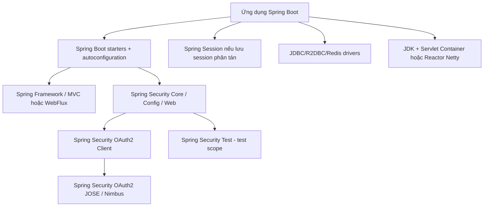
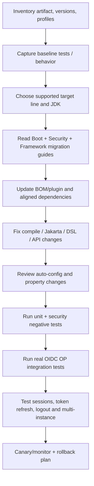
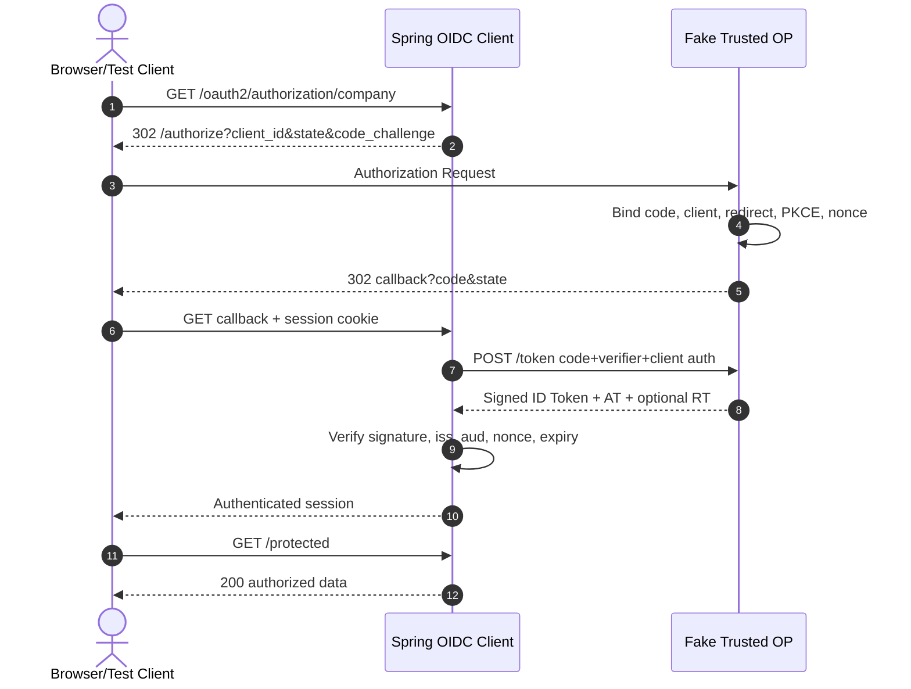

# 33.1. Đối chiếu tài liệu với phiên bản Spring Boot và Spring Security

**Spring Security OAuth 2.0 / OpenID Connect (OIDC) Client** được phát triển qua nhiều thế hệ Spring Boot, Spring Framework và Spring Security. Một ví dụ cấu hình `oauth2Login()` hoặc `OAuth2AuthorizedClientManager` được viết cho bản này có thể không biên dịch, chạy khác mặc định, hoặc sử dụng API đã bị deprecated/removed ở bản khác. Điều này đặc biệt dễ xảy ra khi đọc một bài blog cũ, sao chép snippet từ câu trả lời trực tuyến, hoặc mở tài liệu Spring Security “current” trong khi dự án vẫn dùng một maintenance line cũ.

Bài học **33.1. Đối chiếu tài liệu với phiên bản Spring Boot và Spring Security**, thuộc chương **33. Tương thích và nâng cấp**, giúp bạn xây một phương pháp kiểm chứng có thể lặp lại: **xác định chính xác artifact thực tế đang chạy → chọn tài liệu tương ứng → kiểm tra API/property/default behavior → chứng minh bằng compilation và integration tests → mới quyết định nâng cấp**.

Bài sử dụng các ví dụ chính với **Spring Boot 3.x / Spring Security 6.x, Java 17+**, đồng thời giải thích ranh giới khi gặp **Spring Boot 2.x / Security 5.x** và **Spring Boot 4.x / Security 7.x**. Những tên dòng phiên bản dùng để học cách đối chiếu, **không phải khẳng định bản minor/patch mới nhất tại thời điểm đọc**. Phải luôn kiểm tra release notes, tài liệu của **đúng phiên bản đã resolve** và tình trạng hỗ trợ/bản vá bảo mật trước khi triển khai.

> **Quy tắc số một:** Không quyết định API dựa trên tên “Spring Boot 3” trong tài liệu hoặc số version của một dependency duy nhất. Quyết định bằng **effective dependency graph của đúng application module, runtime classpath và test classpath**, đồng thời đối chiếu tài liệu và Javadoc gắn với đúng release line.

---

## 1. Mục tiêu học tập

Sau bài này, bạn có thể:

1. Phân biệt phiên bản **Spring Boot, Spring Framework, Spring Security, Spring Session, Spring Security Test, Reactor và Nimbus JOSE/JWT**.
2. Giải thích vai trò của **Spring Boot BOM**, starter dependencies và dependency management với versions được resolve.
3. Xác định versions thực tế bằng Maven/Gradle thay vì chỉ nhìn file `pom.xml` hoặc `build.gradle`.
4. Chọn **reference documentation, API Javadoc, migration guide, release notes và source code** đúng với artifacts đang dùng.
5. Lập **bảng đối chiếu** cho từng tính năng OAuth2 Client/OIDC: API, version có mặt, thay đổi hành vi và test cần thiết.
6. Hiểu các ranh giới lớn giữa Boot 2 / Security 5, Boot 3 / Security 6 và Boot 4 / Security 7 mà không khái quát sai mọi minor release.
7. Kiểm tra cú pháp `SecurityFilterChain`, `oauth2Login(...)`, `oauth2Client(...)`, `requestMatchers(...)`, `ClientRegistration` và repositories theo version.
8. Nhận biết sự khác biệt giữa **Servlet OAuth2 Client, Reactive OAuth2 Client và Resource Server**, tránh áp dụng nhầm ví dụ.
9. Phân biệt **Boot auto-configuration** với **Security core APIs** và quy trình xác minh properties.
10. Xây quy trình nâng cấp có baseline, dependency diff, compiler checks, negative/security tests và rollback.
11. Phát hiện những thay đổi âm thầm liên quan login callback, PKCE, nonce, issuer/audience validation, token refresh và logout.
12. Viết ghi chú kỹ thuật **có version, nguồn, ràng buộc và bằng chứng** để đồng đội có thể tái lập.

## 2. Vì sao “đúng tên API” chưa chắc “đúng phiên bản”?

Hãy xem một số câu thường nghe:

- “Tài liệu bảo dùng `HttpSecurity.oauth2Login()`.”
- “Blog dùng `WebSecurityConfigurerAdapter` nên tôi cũng dùng.”
- “Spring Security có class `RestClientAuthorizationCodeTokenResponseClient`, sao IDE tôi không thấy?”
- “Tôi nâng Spring Boot nhưng giữ `spring-security-oauth2-client` ở version cũ vì compile trước đây chạy.”
- “Một ví dụ dùng `ServerHttpSecurity`, còn ứng dụng tôi dùng `HttpSecurity`.”
- “Tài liệu mới dùng `jakarta.servlet`, code tôi vẫn import `javax.servlet`.”
- “Chỉ sửa BOM thôi mà callback OIDC hoặc logout bắt đầu lỗi.”
- “Security Test có `oauth2Login()` nhưng vì sao test qua OP vẫn chưa được kiểm tra?”

Mỗi câu có thể liên quan đến **một loại khác biệt** khác nhau:

| Loại khác biệt | Ví dụ | Hậu quả |
| --- | --- | --- |
| **API removed/deprecated** | `WebSecurityConfigurerAdapter` từ ví dụ cũ | Không biên dịch hoặc cảnh báo cần migration |
| **API introduced ở minor mới** | Một `RestClient`-based token client | IDE/classpath version cũ không có class |
| **Package namespace** | `javax.servlet.*` → `jakarta.servlet.*` | Type mismatch/compile errors |
| **Configuration DSL** | Cú pháp chained/no-arg cũ so với lambda DSL | Deprecated hoặc không tương thích major mới |
| **Auto-config behavior** | Đã khai báo custom repository bean | Boot có thể không sinh bean từ properties như trước |
| **Runtime default** | Session, CSRF, PKCE hoặc security matcher | App compile nhưng behavior đổi |
| **Wrong technology stack** | `HttpSecurity` vs `ServerHttpSecurity` | Config sai hoàn toàn |
| **Wrong security role** | OAuth2 Client vs JWT Resource Server | Token validation/client manager khác trách nhiệm |
| **Documentation drift** | Đọc “current” cho project chạy line cũ | Mẫu config tưởng đúng nhưng không đúng artifact |
| **Transitive dependency override** | Direct Security jar version khác BOM | `NoSuchMethodError`, `ClassNotFoundException`, test failures |

Vì vậy quá trình đối chiếu phải gồm **build-time API** và **runtime behavior**.

## 3. Bản đồ hệ sinh thái phiên bản

Trong một dự án OAuth2/OIDC Client, có nhiều lớp thư viện:



Một thay đổi ở Boot BOM có thể làm thay đổi đồng thời **nhiều dependencies**. Ngược lại, nếu bạn chỉ nâng một JAR Security, những JAR khác có thể không theo kịp.

### 3.1. Các lớp và nơi đọc tài liệu

| Lớp | Vấn đề liên quan OAuth2/OIDC | Nguồn tài liệu ưu tiên |
| --- | --- | --- |
| **Spring Boot** | Starter, `spring.security.oauth2.client.*`, auto-config, dependency versions, runtime server | Boot Reference/Configuration Metadata/Dependency Versions |
| **Spring Security** | `oauth2Login`, authorization requests, client managers, test helpers, logout, token clients | Security Reference + Javadoc đúng version |
| **Spring Framework** | `RestClient`, `WebClient`, MVC/WebFlux, HTTP, converters | Framework Reference/Javadoc |
| **Spring Session** | Redis/JDBC session replication, serializers | Session Reference/Javadoc |
| **Nimbus JOSE/JWT** | JOSE/JWK/ID Token signature handling | Nimbus API + Security integration docs |
| **Servlet container** | Session cookies, reverse proxy, HTTPS, filter invocation | Boot/container docs |
| **OAuth2/OIDC specs** | `state`, PKCE, ID Token, discovery, logout | RFC/OpenID specs |
| **Your project** | Override, custom beans, security policy, tests | Effective dependency graph, code, release records |

**Specifications** mô tả giao thức, không bảo đảm một **method Java cụ thể** xuất hiện trong mọi bản Spring Security.

### 3.2. Ba thế hệ lớn — bảng định hướng, không phải lockfile

| Hệ Spring Boot | Dòng Spring Framework/Security gắn với thế hệ | Namespace Servlet | Điểm chuyển đổi đáng chú ý |
| --- | --- | --- | --- |
| **Boot 2.x** (đặc biệt 2.7) | Framework 5.x / Security 5.x | `javax.servlet.*` | Nhiều ví dụ cũ, `WebSecurityConfigurerAdapter` từng phổ biến rồi được thay thế |
| **Boot 3.x** | Framework 6.x / Security 6.x | `jakarta.servlet.*` | Java 17 baseline, bean `SecurityFilterChain`, configuration DSL/Authorization API mới |
| **Boot 4.x** | Framework 7.x / Security 7.x | `jakarta.servlet.*` | Một số APIs/config deprecated ở line 6 có thể bị loại bỏ; cần đọc 7.x migration guide và Boot 4 guide |

Bảng này chỉ phân loại **major line**. **Không suy ra chính xác** “Boot 3.A.B luôn đi cùng Security 6.X.Y” từ bảng. Boot patch/minor có thể quản lý một phiên bản Security khác sau bản vá hoặc nâng cấp bảo trì; một dự án cũng có thể override versions.

**Java requirements** cũng phải đọc từ tài liệu Boot version chính xác; Boot 3.x yêu cầu Java 17 trở lên, nhưng JDK, Gradle và Maven hỗ trợ cụ thể có thể thay đổi theo release. Không coi “JDK mới nhất máy tôi” đương nhiên tương thích mọi Boot/Gradle plugin đang dùng.

## 4. Nguồn sự thật: dùng trình tự nào?

Khi một ví dụ hoặc API gây nghi ngờ, nên đi theo thứ tự:

1. **Application artifact/version thực chạy**: JAR/container image, Git commit, build profile.
2. **Build dependency management**: Boot parent/BOM hoặc Gradle plugin + BOM/platform.
3. **Resolved runtime classpath**: versions thực sự được chọn.
4. **Resolved test classpath**: `spring-security-test`, JUnit, mock libraries.
5. **Reference docs của đúng line** và Javadoc gắn artifact/version.
6. **Release notes, migration guide** của từng bước nâng cấp.
7. **Source code/tag** tương ứng nếu behavior chưa rõ.
8. **Compilation và integration tests** để xác minh feature ở dự án của bạn.
9. **Security advisories/support policy** để quyết định một line còn phù hợp production không.

Không đảo trình tự thành “thấy snippet trên Internet → thêm một dependency jar thủ công cho hết lỗi → deploy”.

### 4.1. Điều gì là bằng chứng mạnh, điều gì yếu?

| Quan sát | Giá trị |
| --- | --- |
| IDE auto-import thành công | Gợi ý API có trong classpath đang mở |
| Maven/Gradle dependencyInsight | Bằng chứng mạnh về version được resolve cho configuration cụ thể |
| Javadoc đúng artifact/version | Bằng chứng về signature/availability |
| Source ở tag đúng release | Bằng chứng thêm về implementation/default |
| Release notes/migration guide | Bằng chứng chính thức về thay đổi |
| Test compile với compiler plugin hiện hành | Bằng chứng API được project build hiểu |
| OIDC integration test với OP fixture | Bằng chứng behavior trong cấu hình ứng dụng |
| Blog không ghi version | Chỉ là tham khảo, **không đủ** |
| Tài liệu “current” của line mới | Không chứng minh line cũ có API |
| Một `MockMvc.oauth2Login()` test pass | Không chứng minh Authorization Code/OIDC callback production |

### 4.2. Đừng chỉ nhìn `pom.xml`

`pom.xml` có thể khai version Boot parent, nhưng module thực tế bị thay đổi bởi:

- Parent khác ở submodule.
- Imported BOM khác hoặc override properties.
- Direct dependency versions.
- Maven profiles.
- Transitive dependency mediation.
- Multi-module plugin/dependency management.
- Test-only dependencies khác runtime.

Cần **effective POM và dependency tree** của **đúng module**.

## 5. Maven: tìm version Spring Boot được quản lý

Ví dụ project dùng Boot parent:

```xml
<project xmlns="http://maven.apache.org/POM/4.0.0"
         xmlns:xsi="http://www.w3.org/2001/XMLSchema-instance"
         xsi:schemaLocation="http://maven.apache.org/POM/4.0.0
                             https://maven.apache.org/xsd/maven-4.0.0.xsd">
  <modelVersion>4.0.0</modelVersion>

  <parent>
    <groupId>org.springframework.boot</groupId>
    <artifactId>spring-boot-starter-parent</artifactId>
    <version>3.5.0</version>
    <relativePath/>
  </parent>

  <groupId>example</groupId>
  <artifactId>oidc-client-app</artifactId>
  <version>1.0.0-SNAPSHOT</version>

  <properties>
    <java.version>17</java.version>
  </properties>

  <dependencies>
    <dependency>
      <groupId>org.springframework.boot</groupId>
      <artifactId>spring-boot-starter-web</artifactId>
    </dependency>
    <dependency>
      <groupId>org.springframework.boot</groupId>
      <artifactId>spring-boot-starter-security</artifactId>
    </dependency>
    <dependency>
      <groupId>org.springframework.boot</groupId>
      <artifactId>spring-boot-starter-oauth2-client</artifactId>
    </dependency>
    <dependency>
      <groupId>org.springframework.security</groupId>
      <artifactId>spring-security-test</artifactId>
      <scope>test</scope>
    </dependency>
  </dependencies>
</project>
```

**`3.5.0` chỉ là phiên bản cụ thể dùng để minh họa cấu trúc POM**, không phải lời khuyên dùng bản này trên production hay khẳng định nó là patch mới nhất. Trong dự án thật, chọn maintenance/security-patched release phù hợp theo official support/release notes.

### 5.1. Maven commands

Ở thư mục chứa `pom.xml`:

```bash
./mvnw -version
./mvnw help:effective-pom -Doutput=target/effective-pom.xml
./mvnw dependency:tree -Dincludes=org.springframework.security
./mvnw dependency:tree -Dincludes=org.springframework.boot
./mvnw dependency:tree -Dincludes=org.springframework
```

Trên Windows PowerShell:

```powershell
.\mvnw.cmd -version
.\mvnw.cmd help:effective-pom -Doutput=target/effective-pom.xml
.\mvnw.cmd dependency:tree "-Dincludes=org.springframework.security"
```

Các lệnh này **chỉ là hướng dẫn học viên thực hiện ở dự án của họ**, không phải tác vụ được chạy trong lượt viết bài. Trong multi-module, chạy ở đúng module hoặc dùng Maven reactor options phù hợp (`-pl`, `-am` khi cần).

### 5.2. Cần tìm những artifacts nào?

```text
org.springframework.boot:spring-boot
org.springframework.boot:spring-boot-autoconfigure
org.springframework.security:spring-security-core
org.springframework.security:spring-security-config
org.springframework.security:spring-security-web
org.springframework.security:spring-security-oauth2-core
org.springframework.security:spring-security-oauth2-client
org.springframework.security:spring-security-oauth2-jose
org.springframework.security:spring-security-test (test)
org.springframework:spring-web / spring-webmvc / spring-webflux
org.springframework.session:spring-session-core (nếu dùng)
```

Ví dụ dependency graph minh họa:

```text
spring-boot-starter-oauth2-client:3.5.0
  +-- spring-security-oauth2-client:6.x.y
  +-- spring-security-oauth2-jose:6.x.y
  +-- spring-security-config:6.x.y
  +-- spring-security-core:6.x.y
```

**`6.x.y` là placeholder, không phải output có thể copy nguyên vào report**. Hãy điền versions thật từ dependency tree.

### 5.3. Phân biệt quản lý version với override

Khi dependency khai:

```xml
<dependency>
  <groupId>org.springframework.security</groupId>
  <artifactId>spring-security-oauth2-client</artifactId>
</dependency>
```

Maven có thể chọn version qua Boot BOM/parent. Nhưng nếu thêm:

```xml
<version>6.0.0</version>
```

thì đã yêu cầu một version cụ thể, có thể lệch với `spring-security-core` và `spring-security-config` do Boot quản lý.

**Đừng nâng một artifact Security đơn lẻ để lấy API mới** mà không kiểm tra cùng release train, compatibility và dependency management.

## 6. Maven: dùng Boot BOM mà không kế thừa parent

Một công ty có thể có parent POM riêng. Khi đó thường import Spring Boot BOM:

```xml
<dependencyManagement>
  <dependencies>
    <dependency>
      <groupId>org.springframework.boot</groupId>
      <artifactId>spring-boot-dependencies</artifactId>
      <version>3.5.0</version>
      <type>pom</type>
      <scope>import</scope>
    </dependency>
  </dependencies>
</dependencyManagement>
```

Lúc này:

- BOM quản lý nhiều dependency versions.
- Bạn có thể phải tự cấu hình Java compiler plugin, Spring Boot Maven plugin và các build conventions vì **import BOM không giống kế thừa `spring-boot-starter-parent`**.
- Version precedence của nhiều BOMs có thể ảnh hưởng result.
- Effective POM vẫn là bằng chứng cuối cùng của Maven resolution.

### 6.1. Multi-module không tự có một version chung

```text
root
  +-- web-app         -> Spring Boot 3.x / Security 6.x
  +-- auth-library    -> chỉ compile against Security API X
  +-- integration-it  -> test harness Security Test version Y
```

Có thể xảy ra tình huống library compile thành công nhưng khi web-app chạy với version khác, nó gọi method đã không còn và gây `NoSuchMethodError`.

Đối chiếu **classpath của artifact deploy**, không chỉ module library.

## 7. Gradle: xác định version được resolve

Một `build.gradle` Groovy điển hình:

```groovy
plugins {
    id 'java'
    id 'org.springframework.boot' version '3.5.0'
    id 'io.spring.dependency-management' version '1.1.7'
}

java {
    toolchain {
        languageVersion = JavaLanguageVersion.of(17)
    }
}

dependencies {
    implementation 'org.springframework.boot:spring-boot-starter-web'
    implementation 'org.springframework.boot:spring-boot-starter-security'
    implementation 'org.springframework.boot:spring-boot-starter-oauth2-client'
    testImplementation 'org.springframework.boot:spring-boot-starter-test'
    testImplementation 'org.springframework.security:spring-security-test'
}
```

Các version số **là ví dụ build**, không phải baseline bắt buộc cho mọi môi trường. Nếu sử dụng Gradle native platform thay `io.spring.dependency-management`, cách cấu hình có thể khác; tránh áp dụng cùng lúc hai chiến lược mà không hiểu precedence.

### 7.1. Gradle commands

```bash
./gradlew --version
./gradlew dependencies --configuration runtimeClasspath
./gradlew dependencyInsight --dependency spring-security-oauth2-client --configuration runtimeClasspath
./gradlew dependencyInsight --dependency spring-security-config --configuration runtimeClasspath
./gradlew dependencyInsight --dependency spring-security-test --configuration testRuntimeClasspath
./gradlew dependencyInsight --dependency spring-webflux --configuration runtimeClasspath
```

Windows PowerShell:

```powershell
.\gradlew.bat --version
.\gradlew.bat dependencyInsight --dependency spring-security-oauth2-client --configuration runtimeClasspath
.\gradlew.bat dependencyInsight --dependency spring-security-test --configuration testRuntimeClasspath
```

`dependencyInsight` đặc biệt hữu ích vì cho biết **vì sao** Gradle chọn một version, ví dụ constraint/BOM, direct dependency hoặc conflict resolution.

### 7.2. Đọc đúng configuration

`compileClasspath`, `runtimeClasspath`, `testCompileClasspath`, `testRuntimeClasspath` có thể khác nhau. Nếu Javadoc của `spring-security-test` quá mới so với test artifact thực tế, một builder method sẽ không có dù runtime app đã nâng.

Không chỉ chạy `dependencies` ở root Gradle project rồi bỏ qua subproject chạy ứng dụng.

### 7.3. Plugin version khác dependency version

`org.springframework.boot` Gradle plugin version thường là một thông tin quan trọng nhưng **không phải chứng cứ duy nhất** của Spring Security jar version. Các platform, constraints và overrides trong dependency graph vẫn quyết định resolved classpath.

`./gradlew --version` cho biết Gradle/JVM, **không in mọi Spring dependency version**.

## 8. Từ build artifact đến tài liệu chính thức tương ứng

Sau khi tìm thấy version thực tế, ví dụ:

```text
Build under investigation:
  Spring Boot:          3.5.0
  Spring Security Core: 6.5.x (điền exact resolved patch)
  Spring Security Web:  6.5.x
  OAuth2 Client:        6.5.x
  Spring Framework:     6.2.x (điền exact patch)
  Spring Security Test: 6.5.x
  Java runtime:         17
  Web stack:            Servlet
```

**Đây là biểu mẫu ví dụ**, không phải output máy thực. Việc versions cụ thể có tương thích hay không phải xác minh bằng dependency tree của phiên bản Boot đã chọn.

Bạn có thể tra các nguồn:

- **Spring Boot Reference:** `https://docs.spring.io/spring-boot/reference/`.
- **Spring Security Reference:** `https://docs.spring.io/spring-security/reference/`.
- **Spring Security Javadoc:** liên kết API trong tài liệu ở phiên bản tương ứng.
- **Spring Framework Reference:** `https://docs.spring.io/spring-framework/reference/`.
- **Spring Session Reference:** `https://docs.spring.io/spring-session/reference/`.
- **GitHub release/tag** của đúng artifact.
- **Maven Central hoặc repository metadata** để xác minh release có tồn tại.

### 8.1. Vì sao trang `/reference/` có thể đánh lừa?

Một URL không gắn version cụ thể thường trỏ tới **tài liệu của dòng hiện hành**; nội dung có thể thay đổi qua release. Nếu project chạy line cũ, cần chọn **version picker/archived docs** phù hợp, hoặc dùng tag/release branch trong repository chính thức.

Khi ghi tài liệu dự án, nên ghi rõ:

```text
Observed:
  Spring Security OAuth2 Client JAR: <exact version>

Documentation:
  Spring Security Reference: <matching release line>
  Javadoc: <matching class/version>
  Release notes: <from version> -> <to version>

Verified:
  Compiles: yes/no
  OIDC flow test: passed/failed/not run
```

### 8.2. Reference docs và Javadoc phục vụ hai câu hỏi khác nhau

**Reference docs** trả lời: “Cấu hình/tính năng nên dùng như thế nào?”

**Javadoc** trả lời: “Lớp, constructor, method, parameter type, annotations và deprecation tồn tại trong artifact/version nào?”

Nếu reference docs có code mẫu nhưng IDE không tìm thấy method, **kiểm tra Javadoc exact-version** rồi dependency tree, không vội tạo class cùng tên trong project.

### 8.3. Migration guide khác tutorial

Tutorial thường mô tả trạng thái mục tiêu. Migration guide nêu:

- API bị đổi/removed.
- Thay đổi default behavior.
- Thay đổi package, DSL và test utilities.
- Dependency/JDK/container yêu cầu.
- Cách nâng từng bước.

Khi đi từ Boot 2/Security 5 lên Boot 3/Security 6, **cần migration guide**, không chỉ xem một OAuth2 Login snippet mới.

## 9. Một bảng đối chiếu “phiên bản → tính năng” có thể tái sử dụng

Để review nhiều bài học OAuth2/OIDC, tạo một ledger:

| Thành phần/tính năng | Artifact/API cần xác nhận | Version hiện tại | Nguồn exact-version | Test bằng chứng |
| --- | --- | --- | --- | --- |
| Browser OAuth2 Login | `HttpSecurity.oauth2Login(...)` | Điền resolved version | Security Servlet Reference + Javadoc | /authorize + callback |
| OIDC ID Token | OIDC login decoder factory/validators | Điền version | Security OIDC Reference/API | Wrong `iss`/`aud`/`nonce` |
| Client registration | `ClientRegistrationRepository` | Điền version | Security Client API | Registration lookup |
| Servlet manager | `OAuth2AuthorizedClientManager` | Điền version | Security Client API | refresh/client_credentials |
| Reactive manager | `ReactiveOAuth2AuthorizedClientManager` | Điền version | Reactive Client API | Reactive refresh |
| Token response HTTP client | `OAuth2AccessTokenResponseClient` + implementation | Điền version | API/Javadoc/release notes | Token Endpoint fixture |
| OAuth2 Login test | `SecurityMockMvcRequestPostProcessors.oauth2Login` | Điền test version | Security Test docs | MockMvc |
| OIDC Login test | `oidcLogin()` / `mockOidcLogin()` | Điền version | Servlet/Reactive test docs | Principal assertions |
| OIDC logout | Servlet/Reactive logout success handlers | Điền version | OIDC Logout docs | OP `end_session_endpoint` |
| Shared sessions | Spring Session Redis/JDBC | Điền version | Spring Session docs | A→B session |
| JWT/JWKS cache | decoder/Nimbus integration | Điền version | Javadoc + tested behavior | K1→K2 rotation |
| Boot property keys | `spring.security.oauth2.client.*` | Điền Boot version | Boot properties appendix | Config binding |
| Native/AOT | Boot/Framework/Security AOT support | Điền versions | Boot Native/AOT docs | Native smoke test nếu dùng |

**Không điền “supported” chỉ vì một API xuất hiện trên website**. Ghi thêm constructor/method signature, deprecation notes và test evidence.

### 9.1. Một cách ghi bằng Markdown/YAML trong repository

```yaml
compatibility:
  observedBuild:
    gitCommit: "<commit>"
    springBoot: "<resolved>"
    springSecurityOAuth2Client: "<resolved>"
    springSecurityTest: "<resolved>"
    springFramework: "<resolved>"
    javaRuntime: "<version>"
    webStack: servlet
  feature:
    name: oidc-login
    documentationLine: "<matching Security line>"
    apiClass: "org.springframework.security.oauth2.client..."
    tested:
      compile: true
      loginCallback: true
      wrongIssuerRejected: true
    note: "Snapshot of verified dependencies, not a generic matrix"
```

Đây là **mô hình quản lý tri thức tùy chọn của dự án**, không phải file cấu hình Spring Boot sẽ tự parse.

## 10. Phân biệt Spring Boot auto-configuration và Spring Security API

Một lỗi khi đối chiếu tài liệu là hỏi:

> “Tại sao tôi đã cấu hình `spring.security.oauth2.client.registration.company` nhưng `ClientRegistrationRepository` không có bean như mong đợi?”

Có ít nhất hai tầng:

**Boot auto-configuration** đọc properties, cấu hình starters, tạo beans khi các điều kiện phù hợp.

**Security runtime/API** sử dụng `ClientRegistrationRepository`, OAuth2 login filters và managers. Spring Security core không tự biết mọi property `spring.security.oauth2.client.*` khi chạy ngoài Boot.

### 10.1. Bảng trách nhiệm

| Vấn đề | Boot | Spring Security |
| --- | --- | --- |
| Parse `application.yml` | Configuration binding/auto-config | Không phải nguồn property binding chính |
| Tạo default `ClientRegistrationRepository` | Có thể auto-configure khi đủ điều kiện | Định nghĩa interface và implementations |
| Bật endpoint login | Auto-config có thể thiết lập defaults theo app | `SecurityFilterChain`/`oauth2Login` trực tiếp |
| Customize authorization request | Không chỉ là một Boot property | `OAuth2AuthorizationRequestResolver`/DSL |
| Save authorized clients | Cung cấp defaults tùy topology | Repository/service/manager contracts |
| Verify OIDC ID Token | Dependency/bean setup | OIDC login authentication/decoder |
| Resource Server JWT | Starter/properties | JwtDecoder/Resource Server filter |
| Test OAuth2 principal | Test deps quản lý version | `spring-security-test` helpers |

### 10.2. Khi có custom beans, auto-config có thể “back off”

Ví dụ ứng dụng khai:

```java
@Bean
ClientRegistrationRepository registrationRepository() {
    return new InMemoryClientRegistrationRepository(
            myCustomRegistrations());
}
```

thì Boot có thể không tạo repository mặc định từ YAML nữa vì đã có bean do ứng dụng cung cấp. Khi ấy:

- Các registrations trong properties chưa chắc được thêm tự động.
- Một provider có thể biến mất khỏi login page.
- Test `oauth2Login()` vẫn pass do principal đã mock sẵn.
- Runtime `/oauth2/authorization/{registrationId}` mới phát hiện thiếu registration.

**Đối chiếu tài liệu Boot auto-config conditions và Security bean contract**, không chỉ sửa key YAML.

## 11. Cấu hình OAuth2/OIDC Client phổ biến trên Boot 3 / Security 6

Một ví dụ tối thiểu dùng hai providers giả:

```yaml
spring:
  security:
    oauth2:
      client:
        registration:
          company:
            provider: corporate-op
            client-id: ${COMPANY_OIDC_CLIENT_ID}
            client-secret: ${COMPANY_OIDC_CLIENT_SECRET}
            client-authentication-method: client_secret_basic
            authorization-grant-type: authorization_code
            redirect-uri: "{baseUrl}/login/oauth2/code/{registrationId}"
            scope:
              - openid
              - profile
              - email
          partner:
            provider: partner-op
            client-id: ${PARTNER_OIDC_CLIENT_ID}
            client-secret: ${PARTNER_OIDC_CLIENT_SECRET}
            client-authentication-method: client_secret_basic
            authorization-grant-type: authorization_code
            redirect-uri: "{baseUrl}/login/oauth2/code/{registrationId}"
            scope:
              - openid
              - profile
        provider:
          corporate-op:
            issuer-uri: https://sso.company.example/oidc
          partner-op:
            issuer-uri: https://login.partner.example/realms/partner
```

Đây là cú pháp thuộc nhóm properties Spring Boot hỗ trợ trong những line Boot 3 điển hình. **Issuer URI, client IDs và secret placeholders chỉ minh họa**. Đối chiếu property metadata/Boot version nếu chuyển sang Boot 4 hoặc provider cấu hình không qua discovery.

### 11.1. Ba tên không được nhầm

```text
registrationId = company
provider alias = corporate-op
client_id      = <OP-assigned-client-id>
issuer-uri     = https://sso.company.example/oidc
```

Browser bắt đầu login theo `registrationId`:

```text
GET /oauth2/authorization/company
```

Không mở `/oauth2/authorization/corporate-op` nếu registration ID thực là `company`.

### 11.2. Property existence không bảo đảm provider contract

Một property có thể bind thành công nhưng OP:

- Không có discovery metadata hợp lệ.
- Không cho redirect URI đó.
- Chỉ chấp nhận một authentication method khác.
- Không trả nonce hoặc ID Token đúng contract.
- Dùng signing algorithm không nằm trong accepted policy.
- Không cung cấp refresh token cho client/scope đó.

Tài liệu Boot xác nhận **key property**, còn behavior cần Security Reference, OP documentation và integration tests.

## 12. Cú pháp Servlet SecurityFilterChain: ví dụ nền tảng

Trên Spring Security 6, mẫu lambda DSL điển hình:

```java
import org.springframework.context.annotation.Bean;
import org.springframework.context.annotation.Configuration;
import org.springframework.security.config.Customizer;
import org.springframework.security.config.annotation.web.builders.HttpSecurity;
import org.springframework.security.web.SecurityFilterChain;

@Configuration
class WebSecurityConfig {

    @Bean
    SecurityFilterChain securityFilterChain(HttpSecurity http)
            throws Exception {

        return http
                .authorizeHttpRequests(auth -> auth
                        .requestMatchers(
                                "/", "/health", "/assets/**")
                            .permitAll()
                        .anyRequest()
                            .authenticated())
                .oauth2Login(Customizer.withDefaults())
                .oauth2Client(Customizer.withDefaults())
                .build();
    }
}
```

**`HttpSecurity` là Servlet API.** Đoạn này dùng `SecurityFilterChain`, phù hợp với cách cấu hình hiện đại của Security 6, và là điểm khởi đầu cho migration sang DSL mới hơn.

### 12.1. Vì sao có `oauth2Login` và `oauth2Client`?

- `oauth2Login(...)` xử lý user browser login qua Authorization Code/OIDC.
- `oauth2Client(...)` cung cấp integrations cho OAuth2 client authorization/token use.
- Một ứng dụng có thể dùng cả hai; không phải mọi project đều cần gọi cả hai explicit tùy mục tiêu và auto-config.
- `oauth2ResourceServer(...)` phục vụ **nhận Bearer tokens** của API, không thay `oauth2Login`.

**Phân biệt chức năng**, không tự thay DSL chỉ vì một tutorial API Resource Server trông giống.

### 12.2. Đừng copy ví dụ có `WebSecurityConfigurerAdapter`

Một snippet thế hệ Security 5 cũ:

```java
// VÍ DỤ CŨ, KHÔNG DÙNG TRỰC TIẾP TRONG SECURITY 6/7.
public class OldSecurityConfig
        extends WebSecurityConfigurerAdapter {

    @Override
    protected void configure(HttpSecurity http) throws Exception {
        http.authorizeRequests()
                .anyRequest().authenticated()
                .and()
                .oauth2Login();
    }
}
```

`WebSecurityConfigurerAdapter` đã bị loại khỏi Security 6. Khi nâng cấp, chuyển sang bean `SecurityFilterChain` và DSL phù hợp, đồng thời kiểm tra matcher/authorization semantics.

**Không chỉ “đổi tên class”**: thứ tự filter chains, matchers, request authorization và auto-config có thể thay đổi behavior.

### 12.3. Lambda DSL và nâng cấp 6 → 7

Trong các bản Security 6, một số no-argument/chaining APIs đã bị deprecated để hướng sang **lambda DSL**. Với Security 7, các API cũ có thể không còn. Mẫu:

```java
http.oauth2Login(Customizer.withDefaults());
http.authorizeHttpRequests(auth -> auth
        .anyRequest().authenticated());
```

thường rõ ràng hơn cách `http.oauth2Login().and()...` thế hệ cũ.

**Không mặc định mọi builder method trong 6.x vẫn hiện diện ở 7.x.** Với mỗi method, kiểm tra migration guide và Javadoc exact-version.

## 13. Di chuyển `javax.*` sang `jakarta.*` khi qua Spring Boot 3

Một ranh giới lớn giữa Boot 2 và Boot 3 là **Jakarta EE namespace migration**.

Cũ:

```java
import javax.servlet.http.HttpServletRequest;
import javax.servlet.http.HttpServletResponse;
```

Mới (Spring Framework 6 / Spring Security 6 Servlet):

```java
import jakarta.servlet.http.HttpServletRequest;
import jakarta.servlet.http.HttpServletResponse;
```

Điều này ảnh hưởng custom OAuth2 request resolvers, success/failure handlers, filters và session listeners.

### 13.1. Ví dụ một custom resolver

```java
import jakarta.servlet.http.HttpServletRequest;
import org.springframework.security.oauth2.client.web
        .OAuth2AuthorizationRequestResolver;
import org.springframework.security.oauth2.core.endpoint
        .OAuth2AuthorizationRequest;

final class DelegatingAuthorizationRequestResolver
        implements OAuth2AuthorizationRequestResolver {

    private final OAuth2AuthorizationRequestResolver delegate;

    DelegatingAuthorizationRequestResolver(
            OAuth2AuthorizationRequestResolver delegate) {
        this.delegate = delegate;
    }

    @Override
    public OAuth2AuthorizationRequest resolve(
            HttpServletRequest request) {
        return delegate.resolve(request);
    }

    @Override
    public OAuth2AuthorizationRequest resolve(
            HttpServletRequest request,
            String registrationId) {
        return delegate.resolve(request, registrationId);
    }
}
```

Mẫu này chỉ **delegate** cho resolver sẵn có để minh họa package/import. Nếu muốn thêm `login_hint`, `prompt` hay custom request attributes, phải áp dụng đúng API và giữ `state`/PKCE/nonce theo Security version.

### 13.2. Không thay namespace bằng search/replace mù

Trong một project cũ có thể có cả:

- `javax.servlet.*` → `jakarta.servlet.*`.
- `javax.validation.*` → `jakarta.validation.*`.
- `javax.persistence.*` → `jakarta.persistence.*`.
- Các packages `javax.*` thuộc Java SE vẫn có thể tồn tại và **không** đổi sang Jakarta.

Đối chiếu migration guide, dependency versions và compiler errors theo từng API.

### 13.3. Lỗi runtime có thể khác compile error

Một custom library build với Servlet `javax` trong khi app dùng `jakarta` có thể gây type mismatch, `ClassNotFoundException` hoặc `NoClassDefFoundError`. Nâng toàn bộ compatibility chain; không thêm cả hai servlet API jars vào runtime để “làm dịu lỗi”.

## 14. Servlet và Reactive: không chọn ví dụ chỉ theo tên method

Spring Security có hai web stacks:

| Chức năng | Servlet/MVC | Reactive/WebFlux |
| --- | --- | --- |
| Web security | `HttpSecurity` | `ServerHttpSecurity` |
| Chain | `SecurityFilterChain` | `SecurityWebFilterChain` |
| Registration repository | `ClientRegistrationRepository` | `ReactiveClientRegistrationRepository` |
| Request | `HttpServletRequest` | `ServerWebExchange` |
| Session | `HttpSession` | `WebSession` |
| Authorized client manager | `OAuth2AuthorizedClientManager` | `ReactiveOAuth2AuthorizedClientManager` |
| Authorized client repository | `OAuth2AuthorizedClientRepository` | `ServerOAuth2AuthorizedClientRepository` |
| HTTP client | `RestClient` và servlet-compatible clients | `WebClient` |
| Controller test | `MockMvc` | `WebTestClient` |
| OAuth2 test login | `oauth2Login()` | `mockOAuth2Login()` |
| OIDC test login | `oidcLogin()` | `mockOidcLogin()` |
| OIDC logout handler | `OidcClientInitiatedLogoutSuccessHandler` | `OidcClientInitiatedServerLogoutSuccessHandler` |

**Không áp dụng code Reactive vào Servlet vì method cùng tên `oauth2Login`.**

### 14.1. Ví dụ WebFlux

```java
import org.springframework.context.annotation.Bean;
import org.springframework.context.annotation.Configuration;
import org.springframework.security.config.Customizer;
import org.springframework.security.config.web.server.ServerHttpSecurity;
import org.springframework.security.web.server.SecurityWebFilterChain;

@Configuration
class ReactiveSecurityConfig {

    @Bean
    SecurityWebFilterChain reactiveChain(ServerHttpSecurity http) {
        return http
                .authorizeExchange(exchange -> exchange
                        .pathMatchers("/", "/public/**").permitAll()
                        .anyExchange().authenticated())
                .oauth2Login(Customizer.withDefaults())
                .oauth2Client(Customizer.withDefaults())
                .build();
    }
}
```

**Đây là cấu hình thay thế**, không khai đồng thời với Servlet chain trừ khi project có một kiến trúc web stack hỗn hợp được thiết kế và kiểm thử rõ ràng.

### 14.2. Dependency starter không kể hết câu chuyện

Nếu project có cả `spring-boot-starter-web` và `spring-boot-starter-webflux` để dùng `WebClient` trong app MVC, presence của WebFlux dependency **không tự chứng minh server đang chạy Reactive**. Kiểm tra application type, auto-config condition và active security chain.

## 15. Đối chiếu `OAuth2AuthorizedClientManager` và các providers

Một API quan trọng trong OAuth2 Client:

```java
OAuth2AuthorizedClientManager
```

Ví dụ Servlet user-request context:

```java
import org.springframework.context.annotation.Bean;
import org.springframework.security.oauth2.client.DefaultOAuth2AuthorizedClientManager;
import org.springframework.security.oauth2.client.OAuth2AuthorizedClientManager;
import org.springframework.security.oauth2.client.OAuth2AuthorizedClientProviderBuilder;
import org.springframework.security.oauth2.client.registration
        .ClientRegistrationRepository;
import org.springframework.security.oauth2.client.web
        .OAuth2AuthorizedClientRepository;

@Bean
OAuth2AuthorizedClientManager requestClientManager(
        ClientRegistrationRepository registrations,
        OAuth2AuthorizedClientRepository repository) {

    var manager = new DefaultOAuth2AuthorizedClientManager(
            registrations, repository);

    manager.setAuthorizedClientProvider(
            OAuth2AuthorizedClientProviderBuilder.builder()
                    .authorizationCode()
                    .refreshToken()
                    .build());
    return manager;
}
```

Ở request browser, manager có thể dùng repository gắn Servlet request. Trong scheduled/background context, thường dùng **`AuthorizedClientServiceOAuth2AuthorizedClientManager`** cùng `OAuth2AuthorizedClientService`.

### 15.1. Vì sao phải đối chiếu guide theo version?

Version khác nhau có thể thay đổi:

- Builder methods, provider behavior, default clock skew.
- Token response clients và HTTP client customization.
- Cache/authorized client failure handlers.
- Các grants/profile được hỗ trợ tích hợp sẵn.
- Integration với `RestClient` hay `WebClient`.
- Javadoc overloads hoặc các class deprecated.

Không khẳng định “tất cả Spring Security 6.x đều hỗ trợ cùng một converter constructor” nếu chưa kiểm exact minor.

### 15.2. Khi đọc ví dụ cần kiểm tra scope

Một sample cho `client_credentials` không thay thế được Authorization Code + refresh token của user. Một sample cho Servlet `DefaultOAuth2AuthorizedClientManager` không áp dụng nguyên xi trong WebFlux event-loop. Một example cho Resource Server `JwtDecoder` không phải cấu hình mặc định của OIDC Client ID Token decoder.

**Khớp scope nghiệp vụ trước, version sau**, rồi kiểm cả hai.

## 16. Tìm class/method được giới thiệu ở minor mới

Giả sử một blog dùng:

```java
RestClientAuthorizationCodeTokenResponseClient
```

nhưng project không compile. Đừng tự tin rằng thiếu dependency `spring-boot-starter-web` là nguyên nhân. Có thể:

- Class xuất hiện ở một **Security minor mới hơn**.
- Artifact version đang dùng cũ.
- Example thuộc Servlet stack trong khi code là Reactive.
- Package/class name khác trong line đang dùng.
- Custom token response client API đã thay đổi.
- IDE index chưa reload build metadata.

### 16.1. Quy trình xử lý

1. Tìm tên class trong **Javadoc đúng version** của `spring-security-oauth2-client`.
2. Dùng Maven/Gradle xác minh JAR được resolve.
3. Xác nhận import package.
4. Xem `@Since` và deprecation annotations trong Javadoc/source.
5. Nếu API không có, tìm implementation được hỗ trợ **trong chính version đó**.
6. Nếu thực sự cần version mới, lên kế hoạch **nâng release train tương thích**, không kéo từng jar ngẫu nhiên.
7. Chạy compile + Token Endpoint integration test theo grant.

### 16.2. Đừng đoán chữ “Default” luôn là hiện đại

Một số integrations được thay dần bằng implementations dựa trên `RestClient` hoặc `WebClient`. Một class `Default...` có thể vẫn tồn tại nhưng đã deprecated; một class mới có thể chỉ xuất hiện ở minor mới.

Đọc Javadoc exact-version để biết:

- Class đã deprecated chưa?
- Replacement chính thức là gì?
- Constructor nhận đối tượng nào?
- Cách cài converter/HTTP client?
- Có hỗ trợ Authorization Code/Refresh Token/Client Credentials?
- Có phiên bản Reactive tương đương không?

Không nên khẳng định mọi HTTP token client hỗ trợ mọi grant.

## 17. OIDC Login: cách kiểm tra version không làm mất security invariants

Bất kể version, một OIDC Client phải giữ các ràng buộc giao thức quan trọng:

| Bảo vệ | Câu hỏi kiểm chứng khi nâng cấp |
| --- | --- |
| `state` | Authorization response có liên kết đúng request đã lưu không? |
| PKCE | `code_challenge` và `code_verifier` có được gửi/verify theo policy không? |
| `nonce` | Nếu được dùng, ID Token nonce có khớp request không? |
| `iss` | ID Token issuer có khớp trusted provider không? |
| `aud` | Client ID có nằm trong audience như OIDC yêu cầu không? |
| `azp` | Authorized party claim được xử lý theo rules khi áp dụng không? |
| `exp`/`iat` | Expiry/issue-time và clock skew có được thực thi không? |
| Signature/JWKS | Key lấy từ approved issuer/JWKS endpoint không? |
| `redirect_uri` | OP đã đăng ký public callback URI và code binding đúng không? |
| `ClientRegistration` | Registration ID/client ID/provider không bị tráo khi callback không? |
| CSRF/session | Cookie/session/CSRF policy vẫn đúng môi trường không? |
| Authority mapping | Roles/claims của OP chỉ được map theo trust policy không? |

**Đừng giải quyết incompatibility bằng cách tắt signature, issuer/audience checks, state hoặc nonce.** Đó là biến lỗi nâng cấp thành lỗ hổng.

### 17.1. PKCE không nên được suy từ một câu trong docs

Các version/loại OAuth2 clients khác nhau có defaults/conditions đối với PKCE. Vì vậy:

- Đọc tài liệu **đúng version**.
- Kiểm tra `ClientRegistration`, authorization request resolver và client type.
- Test thực tế request có `code_challenge` khi profile yêu cầu.
- Fake OP phải từ chối `code_verifier` sai.
- Không khẳng định “PKCE luôn tự bật” nếu chỉ nhìn code sample.

### 17.2. Nonce là vấn đề OIDC, không phải mọi OAuth2 login

OIDC `openid` scope tạo semantics ID Token/nonce. Một OAuth2 Login với non-OIDC provider có thể chỉ lấy UserInfo. Không copy validator ID Token sang provider không OIDC; ngược lại không bỏ nonce khi ứng dụng là OIDC Client cần binding.

### 17.3. Mỗi OP có contract riêng

Version Security đúng chưa đủ nếu OP:

- Không hỗ trợ Discovery chuẩn.
- Đòi auth method khác.
- Thay allowed redirect URI.
- Rotate client secret/JWKS.
- Thay ID Token signature algorithm.
- Đòi PAR/JAR hoặc một profile security nâng cao.
- Có proprietary `prompt`/`login_hint`/`domain_hint` behavior.

Cần version + provider contract + integration tests.

## 18. OIDC Discovery và metadata: tránh hiểu sai “cache”

Boot `issuer-uri` thường giúp tạo provider details qua OIDC discovery. Tùy version/configuration, discovery có thể xảy ra **khi khởi tạo ClientRegistration**, không phải được refresh sau mỗi login.

### 18.1. Những điều cần đối chiếu

- API tạo registration từ issuer có thể gây HTTP I/O không?
- Boot bind `issuer-uri` hay manual endpoints nào?
- Metadata `issuer` có được kiểm khớp expected issuer?
- `jwks_uri` đến từ provider nào?
- ID Token decoder factory nào đang dùng?
- JWKS cache TTL/refetch policy do integration/library nào quyết định?
- Multi-tenant dynamic registrations có custom repository/cache không?
- WebFlux discovery có đang block event-loop không?

**Không mặc định Resource Server `NimbusJwtDecoder` configuration áp dụng cho OIDC Client decoder.** Đây là hai luồng xác thực khác nhau dù đều dùng JWT/JWKS.

### 18.2. Key rotation không đồng nghĩa nâng Spring Security

Nếu OP publish JWK K2 và giữ issuer/client ID, vấn đề có thể là cache refresh policy chứ không phải class API. Nâng Spring Security không phải phản ứng đầu tiên nếu lỗi bắt nguồn từ proxy/JWKS availability. Cần phân loại lỗi đúng tầng.

## 19. Properties Boot: xác minh tên key bằng configuration metadata

Đối với Boot, tài liệu reference có **application properties appendix** và auto-configuration metadata. Khi kiểm tra property:

```yaml
spring:
  security:
    oauth2:
      client:
        registration:
          company:
            client-id: ${OIDC_CLIENT_ID}
            client-secret: ${OIDC_CLIENT_SECRET}
            authorization-grant-type: authorization_code
            redirect-uri: "{baseUrl}/login/oauth2/code/{registrationId}"
        provider:
          company:
            issuer-uri: https://id.example.test/issuer
```

hãy đối chiếu:

1. Boot version trong build.
2. Property key được công bố trong **Boot Reference đúng version**.
3. Type/default binding của field.
4. Active profile/environment override.
5. Auto-config conditions và custom beans.
6. Runtime resolved `ClientRegistration` (không log client secret).
7. Integration flow với OP fixture.

### 19.1. Property thay tên có thể fail âm thầm

Một key sai hoặc không được bind trong một cấu hình phức tạp có thể khiến application:

- Dùng default khác.
- Không tạo registration.
- Sử dụng provider alias sai.
- Đọc environment override ngoài ý muốn.
- Khởi tạo security filter chain khác.

**Không dựa vào việc YAML parser không báo lỗi** để kết luận property được hỗ trợ.

### 19.2. Không log toàn bộ `ClientRegistration`

Nó có thể chứa client secret và endpoint details nhạy cảm. Khi kiểm tra runtime, chỉ log:

```text
registrationId=company
providerAlias=company-op
issuerAlias=company
grantType=authorization_code
authMethod=client_secret_basic
configRevision=42
```

Không in `clientSecret`, access/refresh token, authorization code hoặc raw ID Token.

## 20. Thay đổi configuration DSL: kiểm tra cả behavior và matcher

Giả sử chuyển từ:

```java
// Ví dụ lịch sử, không dùng cho project mới.
http.authorizeRequests()
        .antMatchers("/public/**").permitAll()
        .anyRequest().authenticated();
```

sang:

```java
http.authorizeHttpRequests(auth -> auth
        .requestMatchers("/public/**").permitAll()
        .anyRequest().authenticated());
```

**Không chỉ so Java compilation**. Matcher behavior còn phụ thuộc:

- Servlet path/context path.
- MVC vs non-MVC matchers.
- Trailing slash, path normalization, URL encoding.
- Multiple filter chains và `securityMatcher`.
- Dispatcher types, forwards/errors.
- Method security có bật không.
- Thứ tự rules và fallback `anyRequest`.
- GET authorization entry point khác POST CSRF handling.

Một major upgrade có thể thay các matcher implementations/recommendations. Đọc migration guide và **test cả negative cases** để tránh public endpoint bị mở rộng.

### 20.1. Hai security filter chains có thể thay nhau

```java
@Bean
@Order(1)
SecurityFilterChain apiChain(HttpSecurity http) ...;

@Bean
@Order(2)
SecurityFilterChain webChain(HttpSecurity http) ...;
```

Khi nâng version, một matcher quá rộng ở chain đầu có thể làm `oauth2Login` chain không chạy cho callback. Test phải kiểm tra **URL nào khớp chain nào**, không chỉ biết có bean OAuth2 Login.

## 21. OIDC Logout: chọn tài liệu theo stack và version

Spring Security có APIs khác cho Servlet và Reactive.

Servlet:

```java
OidcClientInitiatedLogoutSuccessHandler
```

Reactive:

```java
OidcClientInitiatedServerLogoutSuccessHandler
```

Một ví dụ Servlet (Boot 3 / Security 6 style):

```java
import org.springframework.security.oauth2.client.oidc.web.logout
        .OidcClientInitiatedLogoutSuccessHandler;
import org.springframework.security.oauth2.client.registration
        .ClientRegistrationRepository;

OidcClientInitiatedLogoutSuccessHandler logoutSuccess =
        new OidcClientInitiatedLogoutSuccessHandler(registrations);

logoutSuccess.setPostLogoutRedirectUri("{baseUrl}/signed-out");
```

`registrations` là `ClientRegistrationRepository` đã cấu hình, không phải biến Spring tự sinh trong đoạn code độc lập.

### 21.1. Các API tên gần giống không đồng nghĩa

- `logout()` của Security filter chain: local logout/session handling.
- RP-Initiated Logout success handler: redirect browser đến OP `end_session_endpoint`.
- Back-Channel Logout: OP gửi Logout Token để RP hủy sessions.
- OAuth2 revocation: revoke access/refresh token khi được hỗ trợ.
- Front-Channel Logout: một profile khác, tùy OP/app support.

**Đọc reference đúng version, đúng Servlet/Reactive và đúng kiểu logout**. Một handler thành công không tự revoke mọi tokens, mọi sessions hoặc OP SSO cookies.

### 21.2. Test sau upgrade

- POST `/logout` cần CSRF theo session policy.
- Local session bị invalidated.
- RP-Initiated redirect dùng đúng trusted OP end-session URI.
- `post_logout_redirect_uri` là public URI đã đăng ký.
- `id_token_hint` được dùng theo profile, không lộ qua logs.
- Back-channel Logout Token (nếu hỗ trợ) verify issuer/audience/signature/events.
- Các nodes dùng shared session thấy logout.
- Không tạo login loop khi tới `/signed-out`.

## 22. Spring Security Test: một version dependency riêng cần khóa

Ví dụ Servlet MockMvc:

```java
import static org.springframework.security.test.web.servlet.request
        .SecurityMockMvcRequestPostProcessors.oauth2Login;
import static org.springframework.security.test.web.servlet.request
        .SecurityMockMvcRequestPostProcessors.oidcLogin;
import static org.springframework.security.test.web.servlet.request
        .SecurityMockMvcRequestPostProcessors.csrf;
```

Sử dụng:

```java
mvc.perform(get("/api/me")
        .with(oauth2Login()))
        .andExpect(status().isOk());

mvc.perform(post("/api/preferences")
        .with(oidcLogin())
        .with(csrf()))
        .andExpect(status().isNoContent());
```

Các tests giả định handlers và security config tương ứng. `oauth2Login()` và `oidcLogin()` chỉ tạo **mock Authentication**; không chạy Authorization Code Flow thật.

### 22.1. Đối chiếu `spring-security-test` với runtime

Khi test gọi method không có, kiểm:

- `spring-security-test` resolved version trong `testRuntimeClasspath`.
- `spring-security-config`/`web` runtime versions.
- Static import namespace Servlet hay Reactive.
- Javadoc của `SecurityMockMvcRequestPostProcessors` đúng version.
- Mockito/JUnit/Spring Test compatibility.
- Test context có Spring Security filter chain thật không.

Không thêm một `spring-security-test` 7.x vào ứng dụng Security 6.x chỉ vì một helper mới hơn có feature tiện.

### 22.2. Reactive test khác

Trong WebFlux:

```java
import static org.springframework.security.test.web.reactive.server
        .SecurityMockServerConfigurers.mockOidcLogin;

webTestClient
        .mutateWith(mockOidcLogin())
        .get()
        .uri("/api/me")
        .exchange()
        .expectStatus().isOk();
```

`MockMvc` post-processors không phải WebFlux security context. Đọc **Reactive Test** documentation nếu project dùng `SecurityWebFilterChain`.

## 23. Kiểm thử thay đổi phiên bản không được chỉ dựa Mock Login

`oauth2Login()`/`oidcLogin()` của Spring Security Test thường bypass:

- Authorization endpoint redirect.
- `state` correlation.
- PKCE challenge/verifier.
- OIDC nonce.
- Token Endpoint client authentication.
- Authorization code exchange.
- JWT ID Token signature/issuer/audience validation.
- UserInfo HTTP client.
- OP session/consent/logout.

Do đó một upgrade có thể “test pass 100% MockMvc” nhưng production login thất bại.

### 23.1. Integration tests cần OP fixture

Một fake OIDC Provider có thể:

1. Công bố Discovery metadata cho trusted issuer.
2. Công bố JWKS có khóa công khai test.
3. Nhận Authorization Code requests, ràng buộc `client_id`, `redirect_uri`, PKCE và nonce.
4. Phát one-time authorization codes.
5. Đổi code tại Token Endpoint với đúng client auth method.
6. Trả signed ID Token có `iss`, `aud`, `sub`, `nonce`, `exp`.
7. Cấp/rotate refresh tokens theo provider contract.
8. Gửi OIDC logout redirect/back-channel khi áp dụng.
9. Trả lỗi có kiểm soát cho negative cases.

Test không nên dùng token chuỗi giả `"signed-token"` cho kiểm thử chữ ký. Sử dụng keypair fixture và JWT được ký thật trong test environment, không dùng private key production.

## 24. Phân biệt “có class” với “có default behavior”

Một API tồn tại trong JAR **không có nghĩa** tính năng tự động bật.

Ví dụ:

- `OAuth2AuthorizedClientManager` tồn tại nhưng app chưa khai báo/wiring manager phù hợp.
- `OidcClientInitiatedLogoutSuccessHandler` tồn tại nhưng logout chain vẫn dùng local default handler.
- `PKCE` được hỗ trợ nhưng registration/resolver cần policy đúng.
- `OAuth2UserService` có implementation nhưng app đang dùng custom service thay thế.
- `JwtDecoder` có thể cấu hình cho Resource Server, không làm OIDC Client ID Token validation tự thay theo.
- `spring-session-data-redis` hiện diện nhưng app có thể vẫn dùng local session do config sai.
- `RestClient` có trong Spring Framework nhưng token response client của Security line cũ chưa dùng nó.
- `private_key_jwt` có enum/client authentication method nhưng signer/key support cần token client config theo version.

Bởi vậy ledger cần hai cột riêng:

```text
API_AVAILABLE = yes/no
FEATURE_ENABLED_AND_TESTED = yes/no
```

### 24.1. Không dùng `@Since` làm toàn bộ compatibility proof

Javadoc `@Since` cho biết API có từ khi nào, không có nghĩa nó:

- Không đổi semantics.
- Không deprecated.
- Không có bug trong patch cụ thể.
- Tự được Boot auto-configure.
- Hoạt động với mọi OP.
- Hoạt động cả Servlet và Reactive.

Cần release notes + tests.

## 25. Kế hoạch nâng cấp có kiểm soát

Một upgrade nên chia nhỏ:



### 25.1. Phase A — Inventory

Ghi nhận:

- Git commit, build artifact hash.
- Spring Boot version, Security Core/OAuth2 Client/Config/Test versions.
- Spring Framework version.
- Java runtime/toolchain, Maven/Gradle wrapper versions.
- Servlet/WebFlux selection và container/Netty.
- Dependency/BOM overrides.
- ClientRegistration properties và custom repositories.
- Token response clients, authorized client managers/stores.
- OIDC provider list, issuer, scopes, client auth method (không ghi secret).
- Session store, logout mode, deployment topology.
- Tests đã có và còn thiếu.

### 25.2. Phase B — Baseline

Trước khi nâng, kiểm chứng ít nhất:

- Login qua một OP/registration thật trong sandbox.
- Login multi-provider.
- Negative state/issuer/audience/nonce.
- Token refresh và expired token.
- Local logout và OP logout nếu dùng.
- Sessions qua multiple nodes.
- Method/URL authorization.
- CSRF trên POST.
- Forwarded host/HTTPS redirect URI.
- Existing client secret/key rotation compatibility.

Baseline giúp phân biệt lỗi mới do nâng version với lỗi vốn đã tồn tại.

### 25.3. Phase C — Chọn target

Không chỉ chọn “bản mới nhất” theo số lớn nhất. Xác minh:

- Release line đang được hỗ trợ/bản vá.
- JDK requirements.
- Spring Framework/Security versions được Boot BOM quản lý.
- Servlet container, Gradle/Maven plugin compatibility.
- OP/client library customizations tương thích.
- Native/AOT/observability requirements nếu dùng.
- Security advisories/CVEs áp dụng.
- Test và rollback capacity.

### 25.4. Phase D — Build upgrade

Thay đổi **Boot parent/BOM/plugin** và để dependency management chọn Security/Framework versions tương thích, trừ khi chính thức có hướng dẫn override cho security patch.

Không nâng tất cả libraries bằng các versions độc lập chỉ để có số cao hơn.

### 25.5. Phase E — Verify

- Clean compile.
- Dependency graph diff.
- Test API imports/method signatures.
- Unit tests.
- MVC/WebFlux security integration tests.
- OIDC fake OP protocol tests.
- Database/session serialization compatibility.
- Multi-instance refresh/logout tests.
- Negative tests chống security regression.
- Observability/canary rollout plan.

**Không chỉ dựa vào green build**: compile thành công không chứng minh OIDC redirect/callback an toàn.

## 26. Nâng từ Boot 2 / Security 5 lên Boot 3 / Security 6

Đây là một **major migration**, không chỉ patch update.

### 26.1. Các nhóm việc thường gặp

| Nhóm | Việc phải kiểm tra |
| --- | --- |
| Java | Java 17 baseline cho Boot 3 |
| Jakarta | `javax.servlet` → `jakarta.servlet` và các APIs Jakarta liên quan |
| Security config | `WebSecurityConfigurerAdapter` → `SecurityFilterChain` |
| Authorization DSL | `authorizeRequests/antMatchers` cũ → `authorizeHttpRequests/requestMatchers` và behavior |
| Password/auth managers | Tùy custom configuration, xem migration guide |
| OAuth2 Client | ClientRegistration, token clients, converters, custom filters |
| OAuth2 Test | `spring-security-test` version alignment |
| Dependencies | Servlet container, Jackson, Reactor, Nimbus JOSE và Spring Session |
| Sessions | Serialization, CSRF/session fixation, reverse proxy |
| Provider | Redirect URI, issuer, PKCE/nonce, client auth profile |
| Actuator/observability | Config/metrics/tracing nếu dùng |

### 26.2. Đừng nhảy nhiều major mà không đọc intermediate migrations

Nếu project đang Boot 2.7 / Security 5.x và đích Boot 4 / Security 7, cần xem:

```text
Boot 2 / Security 5
    |
    v
Boot 3 / Security 6 migration concerns
    |
    v
Boot 4 / Security 7 migration concerns
```

Không nhất thiết deploy production qua từng major, nhưng phải **nghiên cứu các bước trung gian**, vì API/default đã bị deprecate ở 6 có thể bị loại ở 7.

### 26.3. Sao chép code từ 5.x sang 6.x cần kiểm tra compile và behavior

Một custom `OAuth2AuthorizationRequestResolver` dùng `javax.servlet.http.HttpServletRequest` phải đổi import; một filter cũ dùng DSL removed phải viết lại; một test dùng legacy `@EnableGlobalMethodSecurity` cần tham khảo method security mới.

Với OAuth2 Login, cần tập trung luồng callback, repository và token endpoint customization — những nơi có custom API references dễ bị ảnh hưởng.

## 27. Nâng từ Boot 3 / Security 6 lên Boot 4 / Security 7

Ở đây cần đặc biệt cảnh giác:

- APIs Security 6 từng deprecated có thể không còn.
- Spring Framework 7 có thay đổi API/runtime yêu cầu.
- Boot 4 có thể tổ chức lại một số auto-configuration modules/starter details.
- Configuration metadata, dependency management và test integrations cần kiểm lại.
- Third-party libraries cho Servlet/WebFlux/Jakarta có thể không tương thích ngay.
- Token client/converter replacement có thể được chính thức khuyến nghị.

**Không gán một danh sách “breaking changes” cố định cho mọi 7.x** mà không chỉ ra exact target. Hãy đọc **Spring Security 7 Migration Guide** và **Spring Boot 4 Migration Guide** ứng với release đang dùng.

### 27.1. Checklist nâng 6 → 7

- Thay các deprecated no-arg/chaining DSL bằng lambda DSL.
- Kiểm method signatures và imports của client managers, token response clients, logout handlers.
- Kiểm request matcher behavior/security filter order.
- Kiểm Boot starter/module/auto-configuration transitions.
- Kiểm Servlet container/JDK/Gradle/Maven compatibility.
- Kiểm `spring-security-test` helper versions.
- Kiểm framework HTTP client integration.
- Re-run complete OIDC protocol tests và negative cases.
- Kiểm multi-provider/tenant isolation.
- Kiểm JWKS rotation/refresh/session/logout.
- Có rollback plan dựa trên data/session/token compatibility, không chỉ quay lại JAR cũ.

### 27.2. Vì sao upgrade guides “current” cũng cần chọn version?

Một guide có thể nêu cách nâng từ release ngay trước đó tới current. Nếu project đi từ 6.0 → 7.x, vẫn phải xem **các migration notes của minor 6.x** vì những deprecations xảy ra nhiều năm trước có thể bị xóa ở 7.x.

## 28. Phân biệt breaking change và behavior drift

### 28.1. Breaking change rõ ràng

```text
cannot find symbol
package javax.servlet.http does not exist
method oauth2Login() cannot be applied
NoSuchMethodError
ClassNotFoundException
```

Những lỗi này thường chỉ ra API/JAR incompatibility.

### 28.2. Behavior drift âm thầm

Ứng dụng compile, nhưng:

- Unauthenticated API trả 302 thay vì 401 (entry point khác).
- POST bị 403 do CSRF.
- Logout redirect về OP sai hoặc URL không được chấp nhận.
- OAuth2 Login callback thiếu session state khi qua node khác.
- Token refresh không còn được manager thực hiện như trước.
- Method security rule không còn được áp dụng do cấu hình/proxy khác.
- A/B deployments có serializer khác nhau.
- Một provider scope/issuer validation khác.
- Authorization matcher công khai hóa route vốn được bảo vệ.

**Behavior drift nguy hiểm hơn compilation error vì có thể không phát hiện trước production**. Test phải assert kết quả bảo mật, không chỉ HTTP 200.

## 29. Test matrix bắt buộc cho một thay đổi phiên bản OAuth2 Client

| ID | Test | Điều phải chứng minh |
| --- | --- | --- |
| C01 | Compile production | Không dùng missing/removed APIs |
| C02 | Compile tests | `spring-security-test` và Spring Test aligned |
| C03 | Dependency tree | Không có mixed Security major versions |
| C04 | Boot config binding | Registrations/providers thực được tạo |
| L01 | OAuth2 login start | Redirect đúng AS, client ID, scopes, redirect URI |
| L02 | Callback success | `state`/code exchange và session thành công |
| L03 | Callback wrong state | Bị từ chối |
| L04 | PKCE wrong verifier | OP từ chối grant |
| L05 | OIDC wrong nonce | RP từ chối |
| L06 | OIDC wrong issuer | RP từ chối |
| L07 | OIDC wrong audience | RP từ chối |
| L08 | JWKS K1→K2 | Key rotation theo trusted source |
| L09 | Provider unavailable | Fail có kiểm soát |
| L10 | Login multi-provider | Không trộn issuer/registration |
| A01 | Authenticated controller | Đúng OAuth2User/OidcUser |
| A02 | Scope/role negative | Không bypass authorization |
| A03 | CSRF POST | Có token thành công, thiếu token bị từ chối |
| T01 | Access token expiry | Refresh đúng grant và policy |
| T02 | Refresh token rotation | RT2 được lưu, không reuse RT1 |
| T03 | Invalid client secret | `invalid_client` không retry vô hạn |
| T04 | Background client_credentials | Manager không phụ thuộc Servlet request |
| O01 | Local logout | Session bị invalidated |
| O02 | RP-Initiated logout | OP end-session redirect đúng |
| O03 | Back-channel nếu dùng | Logout Token verify, session cleanup |
| O04 | Token revocation nếu dùng | Authorized clients/job lifecycle đúng |
| D01 | Login A→B | Shared session/callback correlation |
| D02 | Concurrent refresh A/B | Không lost update |
| D03 | Logout A→B | Session cũ không được chấp nhận |
| S01 | SSRF/open redirect negative | Không nhận issuer/return URL từ input |
| S02 | Sensitive logs | Không lộ ID/access/refresh tokens hoặc secret |

Không cần mọi dự án làm tất cả testcase nếu feature không dùng, nhưng **phải phân loại N/A có lý do**. Một checklist chỉ đánh dấu “passed” mà không có environment/version/test artifact không thể tái lập.

## 30. Ví dụ MockMvc và giới hạn bằng chứng

Ví dụ dành cho **Servlet**:

```java
import static org.springframework.security.test.web.servlet.request
        .SecurityMockMvcRequestPostProcessors.oidcLogin;
import static org.springframework.test.web.servlet.request
        .MockMvcRequestBuilders.get;
import static org.springframework.test.web.servlet.result
        .MockMvcResultMatchers.status;

import org.junit.jupiter.api.Test;
import org.springframework.beans.factory.annotation.Autowired;
import org.springframework.boot.test.autoconfigure.web.servlet
        .AutoConfigureMockMvc;
import org.springframework.boot.test.context.SpringBootTest;
import org.springframework.test.web.servlet.MockMvc;

@SpringBootTest
@AutoConfigureMockMvc
class AuthenticatedControllerIT {

    @Autowired
    MockMvc mvc;

    @Test
    void oidcUserCanOpenProtectedPage() throws Exception {
        mvc.perform(get("/protected")
                .with(oidcLogin()))
                .andExpect(status().isOk());
    }
}
```

Giả định ứng dụng có handler `GET /protected`. Test dùng Spring Security Test `oidcLogin()` để inject **mock OIDC principal**, không gọi OP thật.

### 30.1. Khi upgrade test dependency

Kiểm tra:

- `@AutoConfigureMockMvc` package/availability trong Boot line đang dùng.
- `oidcLogin()` static import đúng.
- Test filter chain có active security setup.
- Mockito/JUnit versions do Boot BOM quản lý.
- Test properties không tự fetch issuer discovery ngoài test.
- Assertion meaningful (tài nguyên được bảo vệ đúng, negative cases).

Không chứng minh OIDC signature/nonce/PKCE/issuer validation bằng test trên.

## 31. Example integration test với OP fixture: yêu cầu tối thiểu

Một test đáng tin cậy cho upgrade:



Negative cases cần thay một yếu tố mỗi lần:

- Wrong `state`.
- Wrong `code_verifier`.
- Wrong ID Token nonce.
- Wrong issuer.
- Wrong audience.
- Expired token.
- Key ID không tồn tại.
- Code replay.
- Redirect URI mismatch.
- Client secret wrong.
- Authorized client refresh denied.

Một test suite fake OP phải dùng **test signing key thật để ký JWT** và behavior stateful, không chỉ stub Token Endpoint bằng HTTP 200 và chuỗi JSON có `id_token="fake"`.

## 32. Method security và upgrade

Nếu project dùng `@PreAuthorize`, cần xác định:

- `@EnableMethodSecurity` được bật ở context đúng không?
- Bean được Spring proxy thực sự quản lý không?
- SpEL expressions còn đúng authorities format không?
- `OAuth2AuthenticationToken` hoặc `OidcUser` được mapper xử lý như mong đợi không?
- Tenant membership nằm ở service hay chỉ principal claims?
- Controllers/Service tests có **negative cases** không?

Ví dụ:

```java
import org.springframework.security.access.prepost.PreAuthorize;
import org.springframework.stereotype.Service;

@Service
public class InvoiceService {

    @PreAuthorize("hasAuthority('SCOPE_invoice.read')")
    public String read() {
        return "invoice";
    }
}
```

Một test `@WithMockUser(roles="ADMIN")` không chứng minh OAuth2 authorities mapping. Chọn `oauth2Login()`/`oidcLogin()` khi kiểu principal là một phần contract; test mapper riêng nếu muốn kiểm logic thực.

### 32.1. Không chuyển roles bằng tên registration

`registrationId=employee` không tự chứng minh user là nhân viên. Sau OIDC login phải dùng verified issuer/subject và internal authorization policy. Upgrade không được vô tình biến routing hint thành role.

## 33. Multi-instance và compatibility giữa deployments

Trong rolling deployment:

```text
Node A: Boot/Security version cũ
Node B: Boot/Security version mới
Shared Redis session
Shared authorized client DB
Browser -> A login start -> B callback
```

Có thể phát sinh:

- Session serializer không tương thích.
- `SecurityContext` classes/version mismatch.
- OAuth2 authorization request state không deserialize.
- ClientRegistration có client ID/redirect URI khác.
- Authorized client token record schema khác.
- A và B có default CSRF/entry point khác.
- JWKS cache/clock skew behaviors khác.
- Logout từ B không invalidated session A.

### 33.1. Bản nâng cấp nên test A→B theo hai chiều

```text
Old A / New B:
  authorization start on old
  callback on new
  protected page on old

New B / Old A:
  authorization start on new
  callback on old
  protected page on new
```

Nếu session/authorization request format không tương thích, có thể phải:

- Sử dụng deployment strategy tránh hai versions phục vụ cùng session trong lúc chuyển.
- Migrating session serializer/data format có kiểm thử.
- Invalidate sessions có thông báo nếu policy chấp nhận.
- Giữ registrations versioned cho in-flight callbacks.
- Có dedicated canary endpoints/tenant.
- Không tắt session security validation.

**Một upgrade có thể cần “controlled re-login”**, thay vì cố ép format cũ/new chạy đồng thời.

### 33.2. Access/refresh tokens cũng có lifecycle khác phiên bản

Token đã cấp theo client ID/issuer cũ không tự chuyển sang registration mới chỉ vì deploy Boot mới. Versioning client registration và authorized client persistence cần được đánh giá riêng.

## 34. Security advisories và chính sách support

Một bản Security mới có thể có security fixes; một version cũ có thể có lỗ hổng dù API vẫn compile. Đối chiếu tài liệu phải bao gồm **tình trạng hỗ trợ và advisories**.

Các nguồn nên theo dõi:

- Spring Projects/Spring Security release notes và advisories.
- Spring Boot release/support policy.
- NVD/CVE và vendor advisories khi liên quan dependency.
- SBOM của artifact thực deploy.
- Maven/Gradle dependency scanning.
- OP security advisories và các cập nhật chuẩn OAuth2/OIDC.

### 34.1. Đừng suy vulnerability chỉ từ major version

Không phải mọi CVE ảnh hưởng mọi deployment. Cần xác minh:

```text
Affected artifact/version range
    +
Feature/configuration/preconditions
    +
Your actual runtime deployment
    +
Available fixed versions
```

Nếu cần override một Spring Security patch version để vá bảo mật trước khi Boot BOM nâng, làm theo **hướng dẫn chính thức và kiểm tra toàn bộ dependency set**. Không “nâng một jar bất kỳ” rồi kết luận an toàn.

### 34.2. “Latest” không phải một con số cố định trong tài liệu khóa học

Một bài viết tồn tại lâu hơn nhiều patch releases. Nên ghi:

> “Tại thời điểm triển khai, chọn bản bảo trì được hỗ trợ và có bản vá bảo mật phù hợp, xác nhận qua tài liệu/release notes chính thức và dependency graph của dự án.”

Tránh viết “Spring Security phiên bản mới nhất luôn là X.Y.Z” nếu không có cập nhật liên tục và ngày kiểm chứng cụ thể.

## 35. Troubleshooting khi tài liệu và code không khớp

| Triệu chứng | Nguyên nhân thường gặp | Cách kiểm chứng |
| --- | --- | --- |
| `cannot find symbol: WebSecurityConfigurerAdapter` | Dùng snippet Security 5 với Security 6+ | Migration guide, chuyển `SecurityFilterChain` |
| `javax.servlet` không tìm thấy | Project đã dùng Boot 3/Jakarta | Đổi đúng imports và libs sang Jakarta |
| `RestClientAuthorizationCodeTokenResponseClient` không tìm thấy | Security line cũ hoặc wrong artifact/import | Exact Javadoc + dependency tree |
| `NoSuchMethodError` | Mixed Security/Framework jars runtime | Resolve dependency conflicts/BOM |
| `ClassNotFoundException` của Security/OAuth2 class | Missing/excluded artifact | Dependency tree/runtime packaging |
| `oauth2Login()` test helper không tìm thấy | Thiếu/mismatch `spring-security-test` | TestRuntimeClasspath và import |
| Spring Boot không tạo ClientRegistrationRepository | Custom bean/back-off hoặc property sai | Auto-config report + binding |
| `/oauth2/authorization/company` 404 | Registration không tồn tại hoặc filter chain sai | Repository + Security matcher |
| OP báo invalid redirect URI | Public URL/proxy host/config không khớp | Redirect-uri + trusted forwarded headers |
| Callback invalid_state | Session/correlation mất, multi-node, browser cookie | Session repo + Redis + state flow |
| ID Token issuer mismatch | Sai provider alias/config | Validate exact issuer, không tắt check |
| `invalid_client` sau upgrade | Client auth/secret/token client config khác | Token Endpoint client auth |
| `invalid_grant` sau refresh | RT rotation, expiry hoặc callback code reuse | OP logs/grant semantics |
| OIDC login pass MockMvc nhưng fail sandbox | Mock bỏ qua protocol | Fake OP integration tests |
| POST 403 sau nâng | CSRF hoặc authorities changed | Security filter chain/CSRF tests |
| GET API trả 302 thay vì 401 | Browser login entry point | Entry point config, API vs web chain |
| Logout redirect không đến OP | Handler chưa cài/version khác | OIDC logout docs |
| WebFlux method signature không khớp | Copy Servlet example | Reactive Reference |
| JWKS key rotation thất bại | Cache/decoder/trust policy | Exact integration/Javadoc test |
| Redis session deserialize failure | Mixed versions/serializer | Rolling upgrade compatibility test |
| Security default thay đổi âm thầm | Behavior drift | Compare baseline/negative tests |
| IDE nhận class nhưng build CI không nhận | IDE/Gradle/Maven profile/classpath khác | Clean build + dependency graph |
| Bản vá Security chưa được áp dụng | BOM/overrides khóa version cũ | SBOM/advisory + effective classpath |

### 35.1. Cách điều tra không tạo thêm lỗ hổng

1. Ghi nhận exact Boot/Security/Test artifacts và JDK versions.
2. Xác định stack Servlet/Reactive và role OAuth2 Client/Resource Server.
3. Mở docs/Javadoc cùng version.
4. Xác định lỗi compile, configuration binding, token endpoint hay protocol validation.
5. Kiểm tra custom beans/overrides.
6. Dùng fake OP để phân biệt mạng/credentials/claims.
7. Chạy negative tests.
8. Không tắt CSRF, state, PKCE, nonce, signature, issuer/audience hoặc TLS.
9. Ghi lại resolution và version mapping.
10. Triển khai controlled rollout sau khi bằng chứng đầy đủ.

## 36. Một quy trình “đối chiếu ví dụ” trong 10 phút

Khi gặp một đoạn code mới muốn áp dụng, dùng checklist tuần tự:

**Bước 1 — Nêu nhu cầu chính xác:**

```text
Tôi cần customize Authorization Code Token Endpoint client
trong ứng dụng Servlet, không phải WebFlux hay Resource Server.
```

**Bước 2 — Trích resolved versions:**

```bash
./gradlew dependencyInsight --dependency spring-security-oauth2-client --configuration runtimeClasspath
./gradlew dependencyInsight --dependency spring-security-config --configuration runtimeClasspath
```

**Bước 3 — Mở đúng tài liệu:**

```text
Spring Security Reference
  -> matching release line
  -> Servlet
  -> OAuth2 Client / Authorization Code

Javadoc
  -> exact version of spring-security-oauth2-client
  -> class / method / constructor
```

**Bước 4 — Đánh dấu sự khác biệt:**

```text
Blog sample uses:
  API: RestClient...TokenResponseClient
  Introduced/available: must verify exact version
  My runtime: <resolved Security version>
  Migration guide: <exact version link>
```

**Bước 5 — Thử compile trong test branch:** không xóa các thư viện hiện hành tùy tiện.

**Bước 6 — Chạy một integration test Token Endpoint** với fake OP, client auth method đúng và authorization code/refresh grant nếu cần.

**Bước 7 — Chạy negative tests:** wrong client secret, wrong redirect URI, state mismatch.

**Bước 8 — Ghi rationale vào PR**: versions, API source, test results và rollback.

## 37. Mẫu phiếu review nâng cấp

Một PR quan trọng nên mô tả:

```markdown
# Upgrade assessment — OAuth2/OIDC Client

## Baseline
- Application artifact / Git commit:
- Spring Boot:
- Spring Security (core/config/web/oauth2-client/jose):
- Spring Framework:
- Spring Security Test:
- Java runtime/toolchain:
- Servlet or Reactive:
- Session/authorized client storage:

## Target
- Target Boot line/patch:
- Resolved Security/Framework artifacts:
- Dependency overrides removed/retained:
- Official release/migration references:
- CVE/support rationale:

## API impact
- SecurityFilterChain / request matchers:
- OAuth2 Login and authorization resolver:
- ClientRegistration and authorized client manager:
- Token response client/refresh:
- OIDC logout:
- Tests (MockMvc/WebTestClient):
- Session serializer / multi-instance:

## Behavior evidence
- Compilation:
- Positive login callback:
- State/PKCE/nonce/issuer/audience negative tests:
- Token refresh:
- Logout:
- Multi-provider/tenant isolation:
- Cross-node session:
- Observability/no-secret-logs:

## Rollout
- Canary/staging plan:
- Session/token compatibility:
- Rollback limits:
- Sign-off owner:
```

Template này giúp người đọc thấy **bằng chứng version-specific**, không chỉ câu “đã nâng dependency thành công”.

## 38. Thực hành: tự trả lời một số tình huống

**Bài 1 — Tài liệu hiện hành.** Project chạy Boot 3.x, blog dùng Security 7.x. Có thể copy API trực tiếp không?

> Không. Tra resolved Security version, Javadoc exact release và migration notes. Security 7 API không tự tồn tại trong Security 6 classpath.

**Bài 2 — BOM.** Trong Maven, project dùng Boot parent nhưng khai `spring-security-oauth2-client` với version riêng. Rủi ro?

> Có thể lệch Security core/config/web/JOSE versions được Boot quản lý. Kiểm tra effective dependency tree; dùng coordinated upgrade.

**Bài 3 — Gradle.** `plugins { id 'org.springframework.boot' version '...' }` đủ chứng minh version Security Test không?

> Chưa. Xem `testRuntimeClasspath` và `dependencyInsight` cho `spring-security-test`.

**Bài 4 — Jakarta.** Code cũ import `javax.servlet.http.HttpServletRequest` sau khi chuyển Boot 3.

> Kiểm tra chuyển sang `jakarta.servlet.http.HttpServletRequest` và cập nhật custom libraries tương ứng.

**Bài 5 — Legacy DSL.** Snippet dùng `WebSecurityConfigurerAdapter` trong app Security 6.

> Dùng bean `SecurityFilterChain` và cú pháp tương ứng; test matcher/authorization behavior.

**Bài 6 — Class mới.** IDE không thấy `RestClientAuthorizationCodeTokenResponseClient`.

> Kiểm exact Javadoc/version và dependency graph; có thể class thuộc minor mới hơn. Không tự nâng một JAR đơn lẻ để giải quyết.

**Bài 7 — Auto-config.** YAML có `company` registration nhưng browser `/oauth2/authorization/company` không hoạt động.

> Kiểm custom `ClientRegistrationRepository` bean, Boot binding, active profiles và SecurityFilterChain.

**Bài 8 — WebFlux.** Một ví dụ cấu hình `HttpSecurity` được dùng trong `SecurityWebFilterChain`.

> Sai stack. Dùng `ServerHttpSecurity` và reactive repositories/managers.

**Bài 9 — Resource Server.** Project có `NimbusJwtDecoder` config và cho rằng nó áp dụng trực tiếp cho OIDC ID Token validation.

> Không mặc định. OAuth2 Login ID Token decoder factory và Resource Server JWT decoder là integrations riêng.

**Bài 10 — PKCE.** Docs mới bảo helper tự thêm PKCE, nhưng ứng dụng đang chạy version cũ.

> Kiểm authorization request thực với fake OP và config/client type; không dựa vào mô tả “current” mà bỏ test.

**Bài 11 — Mock OIDC Login.** `oidcLogin()` test pass trong MockMvc, có chứng minh issuer/signature/nonce đúng không?

> Không. Nó inject principal giả. Cần OP integration test nhận signed ID Token.

**Bài 12 — Breaking vs drift.** Project compile sau upgrade nhưng API trả 302 thay 401.

> Đây là behavior drift do entry point/security chain. So baseline và cấu hình API/web chain.

**Bài 13 — Logout.** Một snippet `OidcClientInitiatedServerLogoutSuccessHandler` không compile trong Servlet app.

> Đây là reactive handler. Servlet dùng `OidcClientInitiatedLogoutSuccessHandler` theo exact-version docs.

**Bài 14 — Multiple instances.** Node A Security 6.x, B Security 7.x cùng Redis session. Có thể mặc định callback A→B được không?

> Không. Kiểm session serialization, registration/callback correlation, config drift và rolling upgrade plan.

**Bài 15 — CVE.** Có security fix trong phiên bản patch mới, nhóm chỉ nâng một dependency Security jar.

> Cần xác minh phạm vi advisory và align release train/BOM; kiểm runtime dependency graph và chạy security regression tests.

**Bài 16 — Session.** Đổi `spring-security-test` version khiến test compile nhưng production vẫn lỗi cross-node.

> Test dependency không kiểm chứng distributed sessions. Cần real HTTP integration với nhiều nodes/shared storage.

**Bài 17 — Custom token client.** API token response client bị deprecated. Có nên đổi ngay mà không chạy test?

> Không. Đọc replacement đúng version và kiểm token endpoint auth/code/refresh/failure semantics bằng OP fixture.

**Bài 18 — App khác release line.** Tài liệu SDK của vendor đề cập Boot 3.4, còn ứng dụng Boot 3.5.

> Không khẳng định tương thích chỉ vì cùng major. Xác minh APIs, dependency constraints, supported matrix và integration tests.

**Bài 19 — Java.** CI chạy JDK 17 còn local chạy JDK mới hơn. Test khác nhau.

> Kiểm toolchain, compiler release, Gradle/Maven plugin và runtime requirements đúng Boot line; tái lập môi trường.

**Bài 20 — Nâng 2→4.** Có thể bỏ qua Security 6 migration notes vì đích là 7 không?

> Không. Cần nghiên cứu từng giai đoạn có deprecations/removals và test tương thích xuyên version.

## 39. Checklist xác minh trước khi đưa tài liệu vào dự án

- [ ] Đã xác định **Boot/Security/Framework exact resolved versions**, không dựa vào ví dụ.
- [ ] Đã kiểm **runtimeClasspath** và **testRuntimeClasspath** của đúng module.
- [ ] Không có mixed Security core/config/web/oauth2-client/test major versions.
- [ ] Đã chọn **reference/Javadoc matching release**; không ngầm coi `/reference/` là bản cũ.
- [ ] Đã đọc migration guides cho mọi major/minor transition quan trọng.
- [ ] Phân biệt rõ **Boot auto-configuration** và **Spring Security runtime APIs**.
- [ ] Đã kiểm property names/conditions trong Boot metadata đúng version.
- [ ] Đã xác định **Servlet hay Reactive**, không dùng sai `HttpSecurity`/`ServerHttpSecurity`.
- [ ] Đã xác định chức năng **OAuth2 Client, OIDC Login hay Resource Server**.
- [ ] API classes/method signatures thực sự có trong Javadoc/classpath.
- [ ] Ví dụ không dùng `WebSecurityConfigurerAdapter` trong Security 6/7.
- [ ] Jakarta imports/dependencies đã khớp Boot/Framework generation.
- [ ] Test không chỉ mock login mà có OP protocol integration khi cần.
- [ ] Có negative checks cho `state`, PKCE, nonce, issuer/audience/signature.
- [ ] Có checks CSRF, URL/method security, session, authorized client, token refresh.
- [ ] Có logout tests đúng kiểu local/RP-Initiated/back-channel/revocation được dùng.
- [ ] Có multi-provider/tenant isolation tests.
- [ ] Có multi-instance/rolling deployment compatibility tests nếu production chạy cluster.
- [ ] Có bản ghi CVE/support status cho target release.
- [ ] Không log client secret, authorization code, access/refresh/ID tokens, PKCE verifier hoặc session cookie.
- [ ] Có rollback/canary plan tính đến sessions, tokens và dữ liệu đang tồn tại.
- [ ] Tài liệu kỹ thuật ghi chính xác **phiên bản, đường dẫn nguồn, ngày kiểm chứng và bằng chứng tests**.

## 40. Tổng kết

```text
     Bạn thấy một ví dụ Spring OAuth2/OIDC Client
                         |
                         v
          Nó áp dụng cho stack nào?
       Servlet / Reactive / Resource Server
                         |
                         v
        App hiện thực sự đang chạy bản nào?
       Maven effective POM / Gradle dependencies
                         |
                         v
       Boot BOM + Security/Framework/JDK versions
                         |
                         v
        Reference + Javadoc đúng release line
                         |
             +-----------+------------+
             |                        |
        API hiện diện             API không hiện diện
             |                        |
             v                        v
      Kiểm signature,        Tìm API thay thế của
      properties/default      chính version đó
             |                        |
             +-----------+------------+
                         |
                         v
          Compile + unit/security tests
                         |
                         v
      Real OIDC OP integration (state/PKCE/nonce,
      signature, issuer, audience, callback, tokens)
                         |
                         v
        Multi-provider/session/refresh/logout
                         |
                         v
      CVE/support review + canary + rollback
                         |
                         v
       Viết lại tài liệu/PR với version evidence
```

**Mười hai ý chính:**

1. **Bắt đầu từ resolved classpath**, không bắt đầu từ snippet hay marketing version.
2. **Spring Boot quản lý một dependency ecosystem**, không chỉ JAR Boot; đọc BOM/effective versions.
3. **Spring Security reference “current” không mặc định phù hợp dự án của bạn**. Dùng version picker/archived documentation và exact-version Javadoc.
4. **Reference, Javadoc, migration guide và release notes là các nguồn khác mục đích**; đọc phối hợp.
5. **Boot 2/Security 5, Boot 3/Security 6, Boot 4/Security 7** là các thế hệ khác nhau; minor/patch compatibility phải xác minh riêng.
6. **Boot 3 mang bước chuyển Jakarta và SecurityFilterChain**; không copy `WebSecurityConfigurerAdapter`/`javax.servlet` từ hướng dẫn cũ.
7. **Servlet, Reactive và Resource Server là các integration paths khác nhau** dù cùng xuất hiện từ “OAuth2”.
8. **API tồn tại không chứng minh feature được bật**; Boot auto-config, custom beans và OP contract quyết định behavior.
9. **Một test `oidcLogin()` giả không chứng minh Authorization Code Flow**. Cần fake OP phát signed ID Token và kiểm state/PKCE/nonce/issuer/audience.
10. **Nâng version phải kiểm cả behavior drift**, như matchers, entry points, CSRF, token refresh và logout.
11. **Version alignment là vấn đề vận hành và bảo mật**: dependency scanning, advisories, cluster/session compatibility và rollback.
12. **Tài liệu chất lượng phải tái lập được**: ghi exact dependency versions, Javadoc source, config/profile, ngày kiểm và kết quả tests.

### Tài liệu tham khảo chính thức

- [Spring Boot Reference Documentation](https://docs.spring.io/spring-boot/reference/).
- [Spring Boot — Dependency Versions](https://docs.spring.io/spring-boot/appendix/dependency-versions/coordinates.html).
- [Spring Boot — Application Properties](https://docs.spring.io/spring-boot/appendix/application-properties/index.html).
- [Spring Boot — Build Systems](https://docs.spring.io/spring-boot/reference/using/build-systems.html).
- [Spring Boot — Migration Guides](https://github.com/spring-projects/spring-boot/wiki).
- [Spring Security Reference Documentation](https://docs.spring.io/spring-security/reference/).
- [Spring Security — Preparing for Spring Security 7](https://docs.spring.io/spring-security/reference/migration-7/index.html).
- [Spring Security — OAuth2 Login, Servlet](https://docs.spring.io/spring-security/reference/servlet/oauth2/login/index.html).
- [Spring Security — OAuth2 Client, Servlet](https://docs.spring.io/spring-security/reference/servlet/oauth2/client/index.html).
- [Spring Security — OAuth2 Login, Reactive](https://docs.spring.io/spring-security/reference/reactive/oauth2/login/index.html).
- [Spring Security — OAuth2 Client, Reactive](https://docs.spring.io/spring-security/reference/reactive/oauth2/client/index.html).
- [Spring Security — OIDC Logout, Servlet](https://docs.spring.io/spring-security/reference/servlet/oauth2/login/logout.html).
- [Spring Security — Testing OAuth2 with MockMvc](https://docs.spring.io/spring-security/reference/servlet/test/mockmvc/oauth2.html).
- [Spring Security — Testing Reactive OAuth2](https://docs.spring.io/spring-security/reference/reactive/test/web/oauth2.html).
- [Spring Security — API Javadoc](https://docs.spring.io/spring-security/reference/api/java/).
- [Spring Framework Reference](https://docs.spring.io/spring-framework/reference/).
- [Spring Session Reference](https://docs.spring.io/spring-session/reference/).
- [Spring Security GitHub releases/tags](https://github.com/spring-projects/spring-security/releases).
- [Spring Boot GitHub releases/tags](https://github.com/spring-projects/spring-boot/releases).
- [Maven Dependency Plugin — dependency:tree](https://maven.apache.org/plugins/maven-dependency-plugin/tree-mojo.html).
- [Gradle — Dependency Insight](https://docs.gradle.org/current/userguide/viewing_debugging_dependencies.html).
- [OpenID Connect Core 1.0](https://openid.net/specs/openid-connect-core-1_0.html).
- [OpenID Connect Discovery 1.0](https://openid.net/specs/openid-connect-discovery-1_0.html).
- [RFC 6749 — OAuth 2.0 Authorization Framework](https://www.rfc-editor.org/rfc/rfc6749).
- [RFC 7636 — Proof Key for Code Exchange](https://www.rfc-editor.org/rfc/rfc7636).
- [RFC 9700 — OAuth 2.0 Security Best Current Practice](https://www.rfc-editor.org/rfc/rfc9700).
- [OWASP OAuth2 Cheat Sheet](https://cheatsheetseries.owasp.org/cheatsheets/OAuth2_Cheat_Sheet.html).

**Lưu ý cuối:** Những liên kết không khóa patch ở danh sách trên là **điểm xuất phát tìm tài liệu**. Khi đối chiếu một dự án cụ thể, phải chọn **đúng phiên bản** bằng phiên bản được resolve và lưu lại URL/tag/release notes tương ứng vào tài liệu của dự án.
