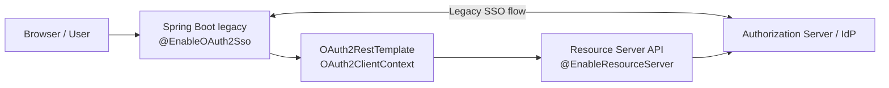
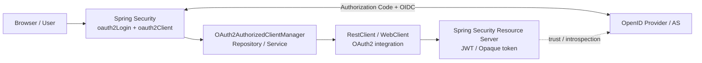

# 33.2. Chuyển từ Spring Security OAuth cũ sang OAuth2 Client hiện tại

## Mục tiêu bài học

Nhiều ứng dụng Spring Boot lâu năm vẫn sử dụng thư viện **Spring Security OAuth** đời cũ với các thành phần như `@EnableOAuth2Sso`, `@EnableOAuth2Client`, `OAuth2RestTemplate`, `OAuth2ClientContext`, `@EnableResourceServer` hoặc `@EnableAuthorizationServer`. Khi chuyển sang mô hình Spring Security OAuth2 Client hiện tại, việc thay dependency hoặc đổi vài method trong `HttpSecurity` là chưa đủ: bạn cần thay đổi **mô hình đăng nhập**, **cách đăng ký OAuth2 client**, **lưu token**, **gọi API**, **bảo vệ API** và **kiểm thử tích hợp**.

Sau bài này, bạn sẽ:

- Nhận diện các API của **Spring Security OAuth legacy** và phân biệt chúng với module **`spring-security-oauth2-client`** trong Spring Security hiện đại.
- Tách rõ **OAuth2 Client**, **OIDC Login**, **Resource Server** và **Authorization Server** thay vì coi chúng là cùng một tính năng.
- Ánh xạ `@EnableOAuth2Sso` sang `SecurityFilterChain` và `.oauth2Login(...)` trên Servlet; hiểu phiên bản Reactive dùng `SecurityWebFilterChain`.
- Thay `security.oauth2.client.*`/`security.oauth2.resource.*` cũ bằng cấu hình tương ứng trong namespace `spring.security.oauth2.*`, có kiểm tra grant, issuer, redirect URI và scope.
- Dùng `ClientRegistrationRepository`, `ClientRegistration`, `OAuth2AuthorizedClient`, `OAuth2AuthorizedClientRepository/Service` và `OAuth2AuthorizedClientManager` thay cách quản lý context/token cũ.
- Chuyển `OAuth2RestTemplate` sang `RestClient` kết hợp `OAuth2ClientHttpRequestInterceptor`, hoặc `WebClient` kết hợp OAuth2 filter phù hợp.
- Hiểu các điểm cần thiết kế lại: `OAuth2User`/`OidcUser`, authorities, endpoint callback, session, `state`, `nonce`, PKCE, refresh token và logout.
- Biết những thành phần **không thuộc OAuth2 Client**: `@EnableResourceServer` cần chuyển sang `oauth2ResourceServer(...)`; legacy Authorization Server thường cần thiết kế riêng với Spring Authorization Server hoặc nhà cung cấp IdP.
- Lập kế hoạch nâng cấp từ Spring Boot cũ sang Spring Boot 3.x/Spring Security 6.x, bao gồm Java, Jakarta Servlet, filter chains và các thay đổi API bảo mật.
- Tạo bộ regression tests để chứng minh đăng nhập, token exchange, HTTP API calls, 401/403, proxy/cookie và phân quyền vẫn đúng sau migration.
- Thực hiện rollout có thể rollback, quan sát lỗi và quản lý token/credentials mà không làm yếu kiểm tra bảo mật.

> **Phạm vi phiên bản:** Những ví dụ trong bài dùng **Spring Boot 3.x / Spring Security 6.x** và Spring Framework 6.x làm mốc minh họa. `RestClient` có từ Spring Framework 6.1, `OAuth2ClientHttpRequestInterceptor` được bổ sung trong dòng Spring Security 6.4. API, dependency, starter và cấu hình có thể thay đổi ở phiên bản tương lai; luôn đối chiếu tài liệu đúng phiên bản dự án đang triển khai.

---

## 1. Vì sao phải chuyển khỏi Spring Security OAuth cũ?

Trước khi Spring Security tích hợp OAuth2/OIDC trực tiếp, nhiều ứng dụng dùng thư viện legacy:

```text
org.springframework.security.oauth:spring-security-oauth2
```

cùng những tích hợp cũ như:

```text
spring-security-oauth2-autoconfigure
spring-security-jwt (legacy integrations)
Spring Boot security.oauth2.* properties
```

Những API này từng giúp triển khai SSO, OAuth2 Client, Resource Server và Authorization Server. Tuy nhiên, **Spring Security OAuth cũ đã kết thúc vòng đời hỗ trợ**, còn hệ sinh thái mới phân chia rõ vai trò:

```text
spring-security-oauth2-client
spring-security-oauth2-jose
spring-security-oauth2-resource-server
Spring Authorization Server (sản phẩm/dự án riêng)
```

### 1.1. Vấn đề không chỉ là "deprecated"

Khi giữ stack cũ quá lâu, hệ thống gặp khó với:

- Thư viện không còn nhận các bản sửa bảo mật/bugfix theo vòng đời hiện tại.
- OAuth2/OIDC best practices mới như Authorization Code + PKCE, kiểm tra issuer/audience và các client authentication methods hiện đại.
- Java/Jakarta Servlet namespace khi lên Spring Boot 3.
- Không tương thích với cách cấu hình `SecurityFilterChain`, Spring Security Test và Spring Framework mới.
- Nợ kỹ thuật do `OAuth2RestTemplate`, `OAuth2ClientContext` và các token services cũ.
- Khó phân biệt token dành cho API (`Access Token`) với token xác thực của OIDC (`ID Token`).

Migration nên được xem như **thay đổi security architecture**, không phải chỉ sửa lỗi compile.

### 1.2. Đừng coi mọi ứng dụng dùng OAuth2 là cùng một bài toán

Trước hết kiểm kê xem ứng dụng là:

```text
A. Web app có Login with Provider (OAuth2 Login/OIDC)
B. Service gọi API với Access Token (OAuth2 Client)
C. API xác minh Bearer token (Resource Server)
D. Hệ thống tự cấp token cho clients (Authorization Server)
```

Một ứng dụng có thể đồng thời đóng vai A, B và C. Nhưng mỗi vai trò có cơ chế migration khác nhau.

## 2. Kiến trúc cũ và mới

### 2.1. Ví dụ kiến trúc legacy



### 2.2. Kiến trúc hiện tại



Phân tách quan trọng:

- `oauth2Login()` giải quyết **browser login**.
- `oauth2Client()` và authorized-client manager giải quyết **quản lý OAuth2 authorized client/token cho outbound access**.
- `oauth2ResourceServer()` giải quyết **API xác minh incoming Bearer Access Token**.
- Authorization Server là thành phần phát code/tokens, **không được tạo tự động** khi bật OAuth2 Client.

## 3. Bảng ánh xạ API legacy sang hiện tại

| Thành phần legacy | Hướng thay thế | Lưu ý |
| --- | --- | --- |
| `@EnableOAuth2Sso` | `SecurityFilterChain` + `http.oauth2Login(...)` | Cần cấu hình ClientRegistration và session |
| `@EnableOAuth2Client` | `http.oauth2Client(...)`, authorized-client manager/repository | Không còn legacy client context |
| `OAuth2RestTemplate` | `RestClient` + `OAuth2ClientHttpRequestInterceptor` hoặc `WebClient` OAuth2 filter | Phải chọn registration/principal đúng |
| `OAuth2ClientContext` | `OAuth2AuthorizedClient` + repository/service/manager | Không thay một-một |
| `OAuth2ProtectedResourceDetails` | `ClientRegistration` | Cấu hình provider và grant riêng |
| `ClientCredentialsResourceDetails` | Registration với `client_credentials` | Dùng service manager cho background jobs |
| `AuthorizationCodeResourceDetails` | Registration với `authorization_code` | Dùng browser redirect, state, PKCE |
| `ResourceOwnerPasswordResourceDetails` | **Thiết kế lại flow** | ROPC/password grant không nên mang sang stack mới |
| `AccessTokenRequest` legacy | `OAuth2AuthorizeRequest` và provider/client integration | Bản chất ngữ cảnh khác |
| `OAuth2Authentication` legacy | `OAuth2AuthenticationToken`/`OidcUser`, hoặc `JwtAuthenticationToken` cho RS | Phân biệt login và API auth |
| `@EnableResourceServer` | `http.oauth2ResourceServer(...)` | Vai trò Resource Server, không phải OAuth2 Client |
| `RemoteTokenServices` | Opaque token introspection trong Resource Server | Cấu hình introspection URI/credentials |
| `JwtAccessTokenConverter` | JWT decoder/JWS validators ở RS, custom token ở AS | Không thay trực tiếp bằng một class |
| `@EnableAuthorizationServer` | Spring Authorization Server hoặc external IdP | Dự án/kiến trúc riêng |
| `WebSecurityConfigurerAdapter` | `SecurityFilterChain` bean | Adapter đã bị loại ở Spring Security 6 |
| `authorizeRequests().antMatchers(...)` | `authorizeHttpRequests().requestMatchers(...)` | Kiểm tra matcher semantics và order |
| `@EnableGlobalMethodSecurity` | `@EnableMethodSecurity` | Test lại authorities và pre/post annotations |
| `security.oauth2.client.*` | `spring.security.oauth2.client.registration.*` + `.provider.*` | Không đổi prefix máy móc |
| Legacy token store/context | `OAuth2AuthorizedClientService/Repository` | Thiết kế persistence/rotation lại |

**Chú ý:** Đây là **hướng migration**, không phải các thay thế API tương đương về mọi hành vi. Nhiều lớp legacy gộp các trách nhiệm mà stack mới đã tách.

## 4. Kiểm kê trước khi sửa code

Một cuộc migration nên bắt đầu bằng bản đồ dependency và security flows.

### 4.1. Kiểm kê dependency

Tìm trong `pom.xml` hoặc `build.gradle`:

```text
spring-security-oauth2
spring-security-oauth2-autoconfigure
spring-security-jwt
spring-cloud-security legacy modules
```

Nếu thấy `spring-security-oauth2-client`, kiểm tra **group ID**: artifact mới thuộc `org.springframework.security`, khác legacy `org.springframework.security.oauth`.

### 4.2. Kiểm kê annotation

Tìm những thành phần:

```java
@EnableOAuth2Sso
@EnableOAuth2Client
@EnableResourceServer
@EnableAuthorizationServer
@EnableGlobalMethodSecurity
```

Kiểm tra xem mỗi annotation bảo vệ **endpoint nào**, với **grant nào**, có custom filters hoặc custom `AuthenticationEntryPoint` không.

### 4.3. Kiểm kê token flow

Các câu hỏi cần trả lời:

1. Người dùng đăng nhập qua browser hay chỉ có service-to-service?
2. Provider là OIDC hay OAuth2 thuần?
3. Có sử dụng `openid` scope và ID Token không?
4. Provider có OIDC Discovery và JWKS không?
5. Ứng dụng lưu Access Token/Refresh Token ở đâu?
6. Có gọi API thay mặt user không?
7. Có scheduled jobs `client_credentials` không?
8. Có dùng Resource Owner Password Credentials Grant hoặc Implicit Grant không?
9. Ứng dụng tự phát token hay chỉ tiêu thụ token?
10. Có custom claims/roles, UserInfo mapping, tenant routing không?
11. Có proxy/TLS termination, callback hostname đặc biệt không?
12. Có bao nhiêu browser sessions/token records còn sống khi chuyển đổi?

### 4.4. Chốt acceptance criteria trước khi đổi dependency

Ví dụ:

```text
Browser OIDC login:
    Login redirects correctly
    state/nonce/PKCE validation intact
    Session survives OP callback

User API call:
    Correct registration and user principal
    Correct access token audience/scope
    API tenant permissions preserved

M2M job:
    Correct client_credentials registration
    No browser session required
    No user token leaked

Operations:
    No raw code/token/secret in logs
    Rollback plan and alerting ready
```

Đây là những hành vi phải giữ, không nhất thiết phải giữ nguyên các class cũ.

## 5. Dependency của OAuth2 Client mới

Một ứng dụng Spring Boot Maven:

```xml
<dependencies>
    <dependency>
        <groupId>org.springframework.boot</groupId>
        <artifactId>spring-boot-starter-web</artifactId>
    </dependency>

    <dependency>
        <groupId>org.springframework.boot</groupId>
        <artifactId>spring-boot-starter-security</artifactId>
    </dependency>

    <dependency>
        <groupId>org.springframework.boot</groupId>
        <artifactId>spring-boot-starter-oauth2-client</artifactId>
    </dependency>
</dependencies>
```

Nếu dùng Gradle:

```groovy
dependencies {
    implementation 'org.springframework.boot:spring-boot-starter-web'
    implementation 'org.springframework.boot:spring-boot-starter-security'
    implementation 'org.springframework.boot:spring-boot-starter-oauth2-client'
}
```

### 5.1. Không kéo lại legacy artifact qua transitive dependency

Khi dependency tree còn chứa legacy Spring Security OAuth, có thể có các classes và auto-configurations cũ va chạm. Cần xử lý nguồn kéo dependency, không chỉ thêm starter mới rồi để cả hai stacks hoạt động song song vô kiểm soát.

### 5.2. Chọn starter theo vai trò

```text
OAuth2 Login / outbound OAuth2 Client:
    spring-boot-starter-oauth2-client

Incoming API Bearer token validation:
    spring-boot-starter-oauth2-resource-server

Authorization Server:
    Spring Authorization Server integration hoặc IdP riêng
```

Đừng thêm Resource Server starter rồi kỳ vọng login tự hoạt động, hoặc thêm OAuth2 Client starter rồi kỳ vọng tự có `/oauth2/token` để cấp token cho các app khác.

### 5.3. Spring Boot quản lý versions

Với ứng dụng dùng Boot BOM/parent, ưu tiên để Boot quản lý version tương thích của Spring Security/Framework. Không tùy tiện pin một version mới cho `spring-security-oauth2-client` trên nền Boot cũ nếu chưa kiểm thử compatibility.

## 6. Đường nâng cấp Spring Boot và Jakarta

Có hai việc khác nhau:

```text
Migration A:
    Legacy OAuth2 API -> built-in Spring Security OAuth2 Client

Migration B:
    Spring Boot 2.x -> 3.x / Spring Security 5.x -> 6.x
```

Bạn có thể cần cả hai, nhưng nên tách thay đổi để dễ quan sát.

### 6.1. Spring Boot 3 chuyển sang Jakarta EE

Đối với Servlet:

```java
import javax.servlet.http.HttpServletRequest;
```

chuyển thành:

```java
import jakarta.servlet.http.HttpServletRequest;
```

Các thư viện Servlet filters, session extensions, tests và security handlers cũng phải tương thích với Jakarta namespace.

### 6.2. Java runtime

Spring Boot 3/Spring Framework 6 yêu cầu Java 17 làm baseline. Dự án ở Java 8/11 cần kế hoạch JDK, compiler flags và runtime image trước khi cố nâng toàn bộ.

### 6.3. `WebSecurityConfigurerAdapter` đã bị loại

Cấu hình:

```java
class SecurityConfig
        extends WebSecurityConfigurerAdapter {
    // configure(HttpSecurity http)
}
```

phải được chuyển sang bean `SecurityFilterChain`. Đây là thay đổi Spring Security chung, nhưng ảnh hưởng trực tiếp OAuth2 Login filter order.

### 6.4. Lộ trình ít rủi ro hơn

Có thể thực hiện theo các đợt:

```text
1. Xác định baseline legacy flow bằng tests
2. Cô lập interface auth/token trong application layer
3. Chuyển sang built-in OAuth2 Client trên version trung gian hỗ trợ
4. Kiểm tra login/API/roles/token persistence
5. Nâng Java, Boot, Jakarta và SecurityFilterChain
6. Chạy full integration/browser regressions
```

Không bắt buộc mọi dự án dùng trình tự này; điểm quan trọng là **tránh đổi quá nhiều biến bảo mật không có tests**.

## 7. Ví dụ cấu hình legacy OAuth2 SSO

Một cấu hình Boot cũ có thể trông như:

```yaml
security:
  oauth2:
    client:
      client-id: old-portal-client
      client-secret: ${OLD_CLIENT_SECRET}
      access-token-uri: https://idp.example.org/oauth/token
      user-authorization-uri: https://idp.example.org/oauth/authorize
      scope:
        - read
    resource:
      user-info-uri: https://idp.example.org/userinfo
```

Hoặc code:

```java
@EnableOAuth2Sso
@Configuration
class LegacySsoConfiguration
        extends WebSecurityConfigurerAdapter {
    // Legacy security config
}
```

Các ví dụ này chỉ minh họa **hình thức API cũ**. Không dùng chúng làm mục tiêu cho ứng dụng mới.

### 7.1. `security.oauth2.*` không còn là namespace chính của client mới

Từ stack hiện tại, cấu hình chuyển sang:

```text
spring.security.oauth2.client.registration.*
spring.security.oauth2.client.provider.*
```

### 7.2. Không copy `user-info-uri` vào `issuer-uri`

`user-info-uri` là endpoint profile; `issuer-uri` là **issuer identifier** dùng cho OIDC discovery/validation. Hai URI có vai trò khác nhau.

### 7.3. Đừng suy `client-id` cũ là `registrationId`

`clientId` là định danh OP cấp; `registrationId` là khóa do app đặt để chọn cấu hình, ví dụ `campus`.

## 8. Cấu hình OIDC Login mới bằng `ClientRegistration`

Ví dụ Spring Boot:

```yaml
spring:
  security:
    oauth2:
      client:
        registration:
          campus:
            provider: campus-op
            client-id: ${OIDC_CLIENT_ID}
            client-secret: ${OIDC_CLIENT_SECRET}
            client-authentication-method: client_secret_basic
            authorization-grant-type: authorization_code
            redirect-uri: "{baseUrl}/login/oauth2/code/{registrationId}"
            scope:
              - openid
              - profile
              - email

        provider:
          campus-op:
            issuer-uri: https://login.example.org/realms/campus
```

Một registration gồm:

```text
registrationId         = campus
clientId               = provider-issued client ID
clientAuthentication   = client_secret_basic
grantType              = authorization_code
redirectUri template   = {baseUrl}/login/oauth2/code/{registrationId}
scopes                 = openid, profile, email
issuerUri              = OP issuer
```

### 8.1. Vì sao dùng `issuer-uri`?

Khi OP hỗ trợ OpenID Connect Discovery, Spring Security có thể sử dụng metadata để tìm authorization/token/JWKS/UserInfo endpoints và kiểm tra issuer theo flow.

Nếu provider là OAuth2 thuần không hỗ trợ OIDC Discovery, cần khai báo các endpoints thích hợp theo contract, không thêm `openid` rồi giả định OIDC tự hoạt động.

### 8.2. Scope `openid` có ý nghĩa riêng

`openid` kích hoạt yêu cầu OIDC. `profile`/`email` là phạm vi yêu cầu thông tin profile theo chính sách OP. Chúng **không** tự cấp quyền quản trị tenant hoặc cho phép gọi mọi API.

### 8.3. Đăng ký callback với OP

Mặc định thường là:

```text
https://portal.example.org/login/oauth2/code/campus
```

URI này phải khớp chính sách redirect URI đã đăng ký tại OP, bao gồm scheme, host, port và path.

### 8.4. Token audience không được suy từ `registrationId`

`registrationId=campus` không tự chứng minh Access Token dành cho Course API. Audience/resource restrictions phải theo cấu hình AS và Resource Server contract.

## 9. `SecurityFilterChain` thay `@EnableOAuth2Sso`

Với Spring Security Servlet:

```java
@Configuration
@EnableWebSecurity
class ModernSecurityConfiguration {

    @Bean
    SecurityFilterChain securityFilterChain(
            HttpSecurity http) throws Exception {

        http
            .authorizeHttpRequests(authorize -> authorize
                .requestMatchers(
                    "/", "/assets/**", "/public/**"
                ).permitAll()
                .anyRequest().authenticated()
            )
            .oauth2Login(Customizer.withDefaults())
            .oauth2Client(Customizer.withDefaults());

        return http.build();
    }
}
```

Imports chính:

```java
import org.springframework.context.annotation.Bean;
import org.springframework.context.annotation.Configuration;
import org.springframework.security.config.Customizer;
import org.springframework.security.config.annotation.web.builders.HttpSecurity;
import org.springframework.security.config.annotation.web.configuration.EnableWebSecurity;
import org.springframework.security.web.SecurityFilterChain;
```

### 9.1. `.oauth2Login(...)` là login flow

Spring Security sẽ dùng `ClientRegistrationRepository` để điều hướng browser tới OP và nhận callback theo Authorization Code Flow.

Một URL bắt đầu login mặc định:

```text
GET /oauth2/authorization/campus
```

Callback mặc định:

```text
GET /login/oauth2/code/campus
```

### 9.2. `.oauth2Client(...)` là phần quản lý OAuth2 Client

Nó hỗ trợ OAuth2 authorized client infrastructure trong security flow; không có nghĩa mọi outbound HTTP call tự động được gắn token. Bạn vẫn phải dùng manager/interceptor/filter hoặc chọn authorized client rõ trong code gọi API.

### 9.3. Không tắt CSRF cho mọi ứng dụng chỉ vì migration

Một web app dùng cookie session và form POST vẫn cần CSRF protection. `OAuth2 state` không thay thế CSRF trên mọi endpoint nghiệp vụ.

Nếu project có stateless Bearer API riêng, cấu hình CSRF policy cần tách đúng SecurityFilterChain và authentication mechanism, không copy `csrf.disable()` toàn cục thiếu kiểm soát.

### 9.4. Login page mặc định có thể đổi

Spring Security có thể tạo login page với danh sách OAuth2 registrations. Nếu legacy app từng có custom login UI, test lại:

```text
/login
/oauth2/authorization/{registrationId}
AuthenticationEntryPoint
Login success/failure redirects
SavedRequest behavior
```

Không giả định UX/URL của `@EnableOAuth2Sso` được giữ nguyên hoàn toàn.

## 10. Đổi filter chain semantics và thứ tự matchers

Cấu hình cũ:

```java
@Override
protected void configure(HttpSecurity http)
        throws Exception {

    http.authorizeRequests()
        .antMatchers("/public/**").permitAll()
        .anyRequest().authenticated();
}
```

Hướng mới:

```java
@Bean
SecurityFilterChain webSecurity(
        HttpSecurity http) throws Exception {

    http
        .authorizeHttpRequests(auth -> auth
            .requestMatchers("/public/**").permitAll()
            .anyRequest().authenticated()
        )
        .oauth2Login(Customizer.withDefaults());

    return http.build();
}
```

### 10.1. Order quan trọng khi có nhiều chains

Một ứng dụng vừa có UI session vừa có stateless API có thể cần:

```text
Chain 1: /api/** -> Bearer/JWT Resource Server
Chain 2: các URL còn lại -> OIDC Login/session
```

Nếu matcher quá rộng ở Chain 1, OAuth2 callback có thể bị bắt bởi chain sai và trả 401. Nếu Chain 2 permitAll quá rộng, API có thể bị mở ngoài ý muốn.

### 10.2. Test lại các URLs đặc biệt

```text
/oauth2/authorization/{registrationId}
/login/oauth2/code/{registrationId}
/login
/login?error
/logout
/api/**
/actuator/**
```

Không để toàn bộ `/oauth2/**` mặc nhiên public nếu ứng dụng tự tạo endpoint khác trong path đó.

### 10.3. `requestMatchers` có thể dùng matcher implementations khác nhau

Trong Spring Security hiện đại, matcher selection có thể tùy classpath Spring MVC/Servlet/reactive. Các biểu thức cũ `antMatchers`, trailing slash và path variables nên được test theo routes thực, không giả định tất cả match giống 100%.

## 11. Trong Reactive, thay `@EnableOAuth2Sso` thế nào?

Một ứng dụng WebFlux dùng:

```java
@Configuration
@EnableWebFluxSecurity
class ReactiveSecurityConfiguration {

    @Bean
    SecurityWebFilterChain securityWebFilterChain(
            ServerHttpSecurity http) {

        return http
            .authorizeExchange(exchange -> exchange
                .pathMatchers(
                    "/", "/assets/**", "/public/**"
                ).permitAll()
                .anyExchange().authenticated()
            )
            .oauth2Login(Customizer.withDefaults())
            .oauth2Client(Customizer.withDefaults())
            .build();
    }
}
```

Các class trọng tâm:

```text
ServerHttpSecurity
SecurityWebFilterChain
ReactiveClientRegistrationRepository
ServerOAuth2AuthorizedClientRepository
ReactiveOAuth2AuthorizedClientManager
ReactiveSecurityContextHolder
```

Không đem `HttpSecurity`, `HttpServletRequest` hay `HttpSession` sang một project thuần WebFlux rồi mong OAuth2 callback hoạt động.

### 11.1. Servlet vs Reactive

| Servlet/MVC | Reactive/WebFlux |
| --- | --- |
| `SecurityFilterChain` | `SecurityWebFilterChain` |
| `HttpSecurity` | `ServerHttpSecurity` |
| `ClientRegistrationRepository` | `ReactiveClientRegistrationRepository` |
| `OAuth2AuthorizedClientRepository` | `ServerOAuth2AuthorizedClientRepository` |
| `OAuth2AuthorizedClientManager` | `ReactiveOAuth2AuthorizedClientManager` |
| `HttpSession` | `WebSession` |
| `RestClient` | `WebClient` thường dùng |
| `SecurityContextHolder` trong Servlet flow | `ReactiveSecurityContextHolder`/Reactor Context |

Không chỉ đổi class prefix `Reactive` rồi giữ nguyên cách quản lý thread-local state.

## 12. `ClientRegistrationRepository` thay resource details

Legacy code có thể khai báo:

```java
OAuth2ProtectedResourceDetails
ClientCredentialsResourceDetails
AuthorizationCodeResourceDetails
```

Stack mới mô tả client bằng:

```java
ClientRegistration
```

và repository tra theo:

```java
ClientRegistrationRepository
```

### 12.1. Cấu hình bằng properties

Ví dụ:

```yaml
spring:
  security:
    oauth2:
      client:
        registration:
          course-api:
            provider: campus-op
            client-id: ${COURSE_CLIENT_ID}
            client-secret: ${COURSE_CLIENT_SECRET}
            authorization-grant-type: client_credentials
            scope:
              - courses.read

        provider:
          campus-op:
            token-uri: https://login.example.org/oauth2/token
```

Khi không dùng OIDC discovery cho M2M, token endpoint có thể khai báo trực tiếp theo provider contract.

### 12.2. Cấu hình bằng Java

```java
ClientRegistration registration =
    ClientRegistration.withRegistrationId("course-api")
        .clientId("course-service-client")
        .clientSecret("test-only-secret")
        .clientAuthenticationMethod(
            ClientAuthenticationMethod.CLIENT_SECRET_BASIC
        )
        .authorizationGrantType(
            AuthorizationGrantType.CLIENT_CREDENTIALS
        )
        .tokenUri(
            "https://login.example.org/oauth2/token"
        )
        .scope("courses.read")
        .build();
```

Đoạn này chỉ minh họa API, không khuyến khích hard-code secret trong Java production.

### 12.3. Registration ID không được tùy tiện lấy từ browser

Một application có thể có registrations:

```text
course-api-tenant-a
course-api-tenant-b
admin-api
```

Không nhận thẳng:

```http
?registrationId=admin-api
```

từ browser rồi cấp token service account quản trị. Phải chọn registration từ mapping backend dựa trên nghiệp vụ và tenant permission đã kiểm tra.

## 13. `OAuth2AuthorizedClient` không phải `OAuth2ClientContext`

Legacy code thường truy cập:

```java
OAuth2ClientContext
OAuth2AccessToken
OAuth2RestTemplate
```

Stack mới có:

```java
OAuth2AuthorizedClient
```

chứa:

```text
ClientRegistration
principalName
OAuth2AccessToken
optional OAuth2RefreshToken
```

Một authorized client là kết quả một client/subject đã được cấp quyền theo grant cụ thể.

### 13.1. Cách hiểu mới

```text
ClientRegistration:
    OAuth Client nào, grant gì, provider nào

AuthorizedClient:
    ClientRegistration + principal + tokens

AuthorizedClientManager:
    Lấy/tái cấp token theo lifecycle

AuthorizedClientRepository/Service:
    Lưu/tải authorized client state
```

### 13.2. Không chuyển nguyên token store cũ bằng cách đổi tên class

Token persistence model, encryption, principal naming, refresh-token rotation và security boundaries có thể khác. Một record cũ không nhất thiết serialize/deserializable trực tiếp thành `OAuth2AuthorizedClient`.

### 13.3. Có thể yêu cầu user login lại khi migration

Nếu không thể chuyển token/authorization state an toàn, một rollout có thể chủ động yêu cầu reauthentication và xin grant mới. Điều đó rõ ràng hơn việc nhập raw Refresh Tokens cũ vào store mới không có kiểm soát.

## 14. Chọn `OAuth2AuthorizedClientManager` theo ngữ cảnh

Trong Servlet có hai loại manager phổ biến:

| Ngữ cảnh | Manager thường phù hợp | Store |
| --- | --- | --- |
| HTTP request của user | `DefaultOAuth2AuthorizedClientManager` | `OAuth2AuthorizedClientRepository` |
| Background job/service không có request | `AuthorizedClientServiceOAuth2AuthorizedClientManager` | `OAuth2AuthorizedClientService` |

Trong Reactive:

| Ngữ cảnh | Manager | Store |
| --- | --- | --- |
| WebFlux server request | `DefaultReactiveOAuth2AuthorizedClientManager` | `ServerOAuth2AuthorizedClientRepository` |
| Scheduled/reactive background job | `AuthorizedClientServiceReactiveOAuth2AuthorizedClientManager` | `ReactiveOAuth2AuthorizedClientService` |

### 14.1. Vì sao lựa chọn này quan trọng?

Một scheduled job không có `HttpServletRequest`/`ServerWebExchange` hoặc browser principal. Nếu dùng manager phụ thuộc request mà không có context thích hợp, ứng dụng có thể không tìm được authorized client.

### 14.2. Client Credentials khác user-delegated grant

- `authorization_code` thường ràng buộc user và browser login.
- `client_credentials` đại diện chính client/service identity.
- `refresh_token` làm mới token đã được cấp theo grant/policy, có thể liên quan user delegated authorization.

Không dùng service token để giả danh user bằng cách truyền header `X-User-Id`.

## 15. Servlet: manager cho browser-based authorized client

Một bean minh họa:

```java
@Configuration
class UserOAuth2ClientConfiguration {

    @Bean
    OAuth2AuthorizedClientManager userAuthorizedClientManager(
            ClientRegistrationRepository registrations,
            OAuth2AuthorizedClientRepository authorizedClients) {

        OAuth2AuthorizedClientProvider provider =
            OAuth2AuthorizedClientProviderBuilder.builder()
                .authorizationCode()
                .refreshToken()
                .build();

        DefaultOAuth2AuthorizedClientManager manager =
            new DefaultOAuth2AuthorizedClientManager(
                registrations,
                authorizedClients
            );

        manager.setAuthorizedClientProvider(provider);

        return manager;
    }
}
```

Các types tương ứng thuộc `org.springframework.security.oauth2.client.*`.

### 15.1. Phân biệt authenticated principal và OAuth client

Một user login OIDC có:

```text
Authenticated OIDC user:
    (iss, sub)

AuthorizedClient:
    registrationId=campus
    principalName=user identity trong app
    access/refresh tokens
```

Không mặc định `sub` toàn cục là user ID vì hai issuers có thể phát cùng `sub`; identity linking cần dùng `(iss, sub)` theo policy.

### 15.2. Repository ở request scope

`DefaultOAuth2AuthorizedClientManager` thường sử dụng `OAuth2AuthorizedClientRepository` để tải/lưu token theo HTTP request/response context. Nếu session/cookie mất trong browser callback, authorized-client persistence cũng có thể bị ảnh hưởng.

### 15.3. Cần fail closed

Nếu user chưa được phép dùng registration cho tenant hiện tại, không fallback sang OAuth Client có quyền rộng hơn.

## 16. Servlet: manager cho background `client_credentials`

Một manager dùng trong service/scheduled job:

```java
@Configuration
class MachineOAuth2ClientConfiguration {

    @Bean
    OAuth2AuthorizedClientManager machineAuthorizedClientManager(
            ClientRegistrationRepository registrations,
            OAuth2AuthorizedClientService authorizedClients) {

        OAuth2AuthorizedClientProvider provider =
            OAuth2AuthorizedClientProviderBuilder.builder()
                .clientCredentials()
                .build();

        AuthorizedClientServiceOAuth2AuthorizedClientManager manager =
            new AuthorizedClientServiceOAuth2AuthorizedClientManager(
                registrations,
                authorizedClients
            );

        manager.setAuthorizedClientProvider(provider);

        return manager;
    }
}
```

Request authorization:

```java
OAuth2AuthorizeRequest authorizeRequest =
    OAuth2AuthorizeRequest
        .withClientRegistrationId("course-api")
        .principal("course-sync-prod")
        .build();

OAuth2AuthorizedClient client =
    machineAuthorizedClientManager.authorize(
        authorizeRequest
    );

if (client == null) {
    throw new IllegalStateException(
        "No authorized client for course-api"
    );
}
```

### 16.1. Principal service là khóa kỹ thuật

Chuỗi `"course-sync-prod"` dùng để xác định authorized-client persistence context; không có nghĩa OP đã xác thực một End-User mang tên đó.

### 16.2. Dùng registration khác nhau theo workload

Không dùng một registration `platform-admin` cho mọi jobs. Hãy tách scopes, audiences và credential theo nhiệm vụ.

### 16.3. Không copy `AccessToken` vào static field

Token phải được quản lý bằng authorized-client manager/service với expiration và concurrency policy. `static String currentToken` có thể gây lẫn principal/tenant/registration.

## 17. Chuyển `OAuth2RestTemplate` sang `RestClient`

Legacy pattern:

```java
OAuth2RestTemplate restTemplate =
    new OAuth2RestTemplate(
        resourceDetails,
        oauth2ClientContext
    );

String body = restTemplate.getForObject(
    "https://api.example.org/reports",
    String.class
);
```

Cách mới với Spring Framework 6.1+ và Spring Security 6.4+:

```java
@Bean
RestClient reportingRestClient(
        OAuth2AuthorizedClientManager machineAuthorizedClientManager) {

    OAuth2ClientHttpRequestInterceptor oauth2 =
        new OAuth2ClientHttpRequestInterceptor(
            machineAuthorizedClientManager
        );

    return RestClient.builder()
        .baseUrl("https://reporting.example.org")
        .requestInterceptor(oauth2)
        .build();
}
```

Một call:

```java
String result = reportingRestClient.get()
    .uri("/api/reports")
    .attributes(
        RequestAttributeClientRegistrationIdResolver
            .clientRegistrationId("report-reader")
    )
    .attributes(
        RequestAttributePrincipalResolver
            .principal("report-reader-prod")
    )
    .retrieve()
    .body(String.class);
```

Các helper thuộc package/namespace OAuth2 Client HTTP interceptor tương ứng với Spring Security 6.4+; cần import theo version được dùng.

### 17.1. `RestClient` không tự cấp token chỉ nhờ được tạo

Phải thêm `OAuth2ClientHttpRequestInterceptor`, chọn registration/principal và có manager/store phù hợp.

### 17.2. Một RestClient cho một API

`baseUrl` cố định giúp giảm nguy cơ gửi Bearer Token đến host do user chỉ định. Không để client nhập arbitrary URL rồi gắn token không điều kiện.

### 17.3. Audience và scope vẫn phải đúng

Interceptor gắn Access Token đã được cấp, **không** xác minh rằng token đó được Resource Server chấp nhận. API đích vẫn phải validate issuer, audience, expiry và permissions.

### 17.4. Authorization failure handler

Một số trường hợp cần xóa authorized client cũ khi API trả `invalid_token`. Với interceptor, cấu hình failure handling theo repository/service và Spring Security version; đừng mặc định một HTTP 401 sẽ tự refresh/retry request hoặc mọi 403 đều làm token bị xóa.

### 17.5. Nếu dự án chưa dùng Spring Security 6.4+

Có thể tiếp tục dùng `WebClient` với OAuth2 filter hoặc cơ chế được hỗ trợ ở version hiện tại. Không copy API `OAuth2ClientHttpRequestInterceptor` vào một project chưa có class này rồi coi migration đã thất bại.

## 18. Servlet `WebClient`: một hướng thay OAuth2RestTemplate

Spring Security hỗ trợ:

```java
ServletOAuth2AuthorizedClientExchangeFilterFunction
```

cho `WebClient` trong ngữ cảnh Servlet.

Ví dụ cấu hình:

```java
@Bean
WebClient courseWebClient(
        OAuth2AuthorizedClientManager userAuthorizedClientManager) {

    ServletOAuth2AuthorizedClientExchangeFilterFunction oauth2 =
        new ServletOAuth2AuthorizedClientExchangeFilterFunction(
            userAuthorizedClientManager
        );

    return WebClient.builder()
        .baseUrl("https://course.example.org")
        .apply(oauth2.oauth2Configuration())
        .build();
}
```

Một request trong ngữ cảnh phù hợp có thể chọn:

```java
courseWebClient.get()
    .uri("/api/courses")
    .attributes(
        ServletOAuth2AuthorizedClientExchangeFilterFunction
            .clientRegistrationId("campus")
    )
    .retrieve()
    .bodyToMono(String.class);
```

### 18.1. Servlet ứng dụng có thể dùng WebClient

`WebClient` không chỉ dành cho WebFlux server. Tuy nhiên, khi gọi từ Spring MVC, phải quyết định cách bridge async/reactive với Servlet lifecycle và tránh blocking không kiểm soát.

### 18.2. Không tự dùng `setDefaultOAuth2AuthorizedClient(true)` ở mọi nơi

Nếu WebClient được dùng cho nhiều host, default current-user token có thể được gắn tới API không cần quyền hoặc domain không đáng tin. Explicit registration/authorized client thường dễ audit hơn.

### 18.3. Migration từ `OAuth2RestTemplate` không đồng nghĩa giữ nguyên timeout/retry

HTTP connection pool, timeout, redirect handling và error mapping khác nhau giữa `RestTemplate`, `RestClient` và `WebClient`. Cần test cùng business API contract.

## 19. WebFlux `WebClient` và OAuth2 filter

Với Reactive:

```java
@Bean
WebClient reactiveCourseWebClient(
        ReactiveOAuth2AuthorizedClientManager manager) {

    ServerOAuth2AuthorizedClientExchangeFilterFunction oauth2 =
        new ServerOAuth2AuthorizedClientExchangeFilterFunction(
            manager
        );

    return WebClient.builder()
        .baseUrl("https://course.example.org")
        .filter(oauth2)
        .build();
}
```

Request:

```java
Mono<String> result = reactiveCourseWebClient.get()
    .uri("/api/courses")
    .attributes(
        ServerOAuth2AuthorizedClientExchangeFilterFunction
            .clientRegistrationId("course-reader")
    )
    .retrieve()
    .bodyToMono(String.class);
```

### 19.1. Không `.block()` trong WebFlux request handler

Reactor pipeline cần được compose và trả `Mono`/`Flux`; chặn event-loop bằng `.block()` có thể gây starvation/performance issues.

### 19.2. Reactive SecurityContext

`ReactiveSecurityContextHolder` sử dụng Reactor Context, không phải Servlet thread local. Test identity propagation và nhiều concurrent requests để tránh token của user A bị dùng cho user B.

### 19.3. Dùng service manager cho background Reactive jobs

`AuthorizedClientServiceReactiveOAuth2AuthorizedClientManager` phù hợp cho job không có `ServerWebExchange`; không dùng manager phụ thuộc web exchange chỉ vì test Mock WebExchange có sẵn.

## 20. Thay cách truy cập token trong controller

Legacy code có thể đọc token từ context hoặc Principal kiểu cũ. Với Servlet mới, có thể inject:

```java
@RegisteredOAuth2AuthorizedClient("campus")
OAuth2AuthorizedClient client
```

Ví dụ:

```java
@RestController
class ProfileController {

    @GetMapping("/api/me/token-info")
    Map<String, Object> tokenInfo(
            @RegisteredOAuth2AuthorizedClient("campus")
            OAuth2AuthorizedClient client) {

        return Map.of(
            "registrationId",
            client.getClientRegistration()
                .getRegistrationId(),
            "expiresAt",
            client.getAccessToken()
                .getExpiresAt().toString()
        );
    }
}
```

Đây là ví dụ educational; **không trả token value**, refresh token hoặc thông tin nhạy cảm ra API browser.

### 20.1. `@RegisteredOAuth2AuthorizedClient` không phải UserInfo

Annotation cung cấp authorized-client context, không phải toàn bộ OIDC profile. Để lấy authenticated OIDC principal, dùng:

```java
@AuthenticationPrincipal OidcUser user
```

### 20.2. Tránh đưa Access Token ra frontend khi không cần

Một Backend-for-Frontend nên giữ tokens server-side khi kiến trúc cho phép. Đừng di chuyển token từ `OAuth2ClientContext` cũ sang JSON response cho browser chỉ để dễ migrate.

## 21. Chuyển cách lấy thông tin user và principal

Legacy có thể dùng:

```java
Principal principal
OAuth2Authentication authentication
Map<String, Object> userInfo
```

Trong OAuth2 Login hiện tại:

```java
OAuth2AuthenticationToken
OAuth2User
OidcUser
OidcIdToken
OidcUserInfo
```

### 21.1. OIDC principal

Ví dụ:

```java
@RestController
class MeController {

    @GetMapping("/api/me")
    Map<String, String> me(
            @AuthenticationPrincipal OidcUser user,
            OAuth2AuthenticationToken authentication) {

        return Map.of(
            "issuer",
            user.getIdToken().getIssuer().toString(),
            "subject",
            user.getSubject(),
            "registrationId",
            authentication
                .getAuthorizedClientRegistrationId()
        );
    }
}
```

Trong production, cân nhắc có cần trả issuer/sub ra frontend hay không, và áp dụng privacy policy.

### 21.2. OIDC không giống OAuth2 UserInfo thuần

- **OIDC Login** có ID Token với `iss`, `sub`, `aud`, expiry, nonce validation theo flow.
- **OAuth2 Login không OIDC** thường lấy user info theo configured user-info endpoint/attributes.

Không giả định mọi OAuth2 provider đều phát ID Token.

### 21.3. `(iss, sub)` là khóa external identity

Hai OP có thể phát cùng `sub`. Không dùng `sub` đơn lẻ như global unique ID nếu hỗ trợ nhiều issuers, và không tự gộp user theo email chưa được account linking xác minh.

## 22. Chuyển roles/authorities sang mô hình mới

Một legacy user-info mapper có thể tạo authorities từ:

```text
roles
groups
authorities
```

hoặc custom claims.

Trong stack mới, những extension points thường dùng:

```text
GrantedAuthoritiesMapper
OAuth2UserService<OAuth2UserRequest, OAuth2User>
OAuth2UserService<OidcUserRequest, OidcUser>
OidcUserService
```

### 22.1. `GrantedAuthoritiesMapper`

Ví dụ chỉ minh họa role mapping:

```java
@Bean
GrantedAuthoritiesMapper authoritiesMapper() {

    return authorities -> {
        Set<GrantedAuthority> result =
            new HashSet<>(authorities);

        // Chỉ thêm roles khi đã xác minh provider
        // và authorization mapping của ứng dụng.
        return result;
    };
}
```

Bài toán thật cần map verified claims/groups và tenant membership theo policy, không tự cấp `ROLE_ADMIN` cho mọi OIDC user.

### 22.2. Không copy role mapping máy móc

Nếu legacy có:

```text
Provider group "teachers" -> ROLE_ADMIN
```

cần xem group đó có ý nghĩa trên mọi tenant hay chỉ một tenant. Migration là dịp tách:

```text
authenticated identity
application user
tenant membership
tenant-specific permission
```

### 22.3. API scopes khác application roles

Access Token có `scope=courses.read` không tự chứng minh user có role `TEACHER` hoặc được đọc mọi khóa học.

### 22.4. Method security

Nếu trước đây:

```java
@EnableGlobalMethodSecurity(prePostEnabled = true)
```

thì Spring Security 6 thường dùng:

```java
@EnableMethodSecurity
```

Test lại `@PreAuthorize`, authority prefixes và business permission beans, đặc biệt khi Principal type thay đổi.

## 23. Tách Resource Server migration khỏi OAuth2 Client

Legacy:

```java
@EnableResourceServer
```

không được thay bằng:

```java
http.oauth2Login(...)
```

vì hai vai trò khác nhau.

Một API nhận:

```http
Authorization: Bearer <access-token>
```

cần **Resource Server** xác minh token.

### 23.1. Dependency mới

```groovy
dependencies {
    implementation 'org.springframework.boot:spring-boot-starter-oauth2-resource-server'
}
```

### 23.2. JWT Resource Server

Cấu hình:

```yaml
spring:
  security:
    oauth2:
      resourceserver:
        jwt:
          issuer-uri: https://login.example.org/realms/campus
```

Filter chain:

```java
@Bean
SecurityFilterChain apiSecurity(
        HttpSecurity http) throws Exception {

    return http
        .securityMatcher("/api/**")
        .authorizeHttpRequests(auth -> auth
            .requestMatchers(
                HttpMethod.GET, "/api/public/**"
            ).permitAll()
            .anyRequest().authenticated()
        )
        .oauth2ResourceServer(oauth2 -> oauth2
            .jwt(Customizer.withDefaults())
        )
        .build();
}
```

### 23.3. Audience validation cần thiết

`issuer-uri` không thay thế toàn bộ audience policy. API cần kiểm tra Access Token `aud` dành cho mình, scope/authority và resource ownership.

Một token có `aud=reporting-api` không được Course API chấp nhận chỉ vì cùng issuer và chữ ký hợp lệ.

### 23.4. Opaque Access Token

Nếu AS cấp opaque token, cấu hình introspection theo contract thay vì cố parse như JWT:

```yaml
spring:
  security:
    oauth2:
      resourceserver:
        opaquetoken:
          introspection-uri: https://login.example.org/oauth2/introspect
          client-id: ${INTROSPECTION_CLIENT_ID}
          client-secret: ${INTROSPECTION_CLIENT_SECRET}
```

Không lộ credentials của introspection trong logs.

### 23.5. Một app vừa OAuth2 Client vừa Resource Server

Có thể có:

```text
Browser pages -> oauth2Login/session
/api/**       -> oauth2ResourceServer/bearer
Outbound API  -> oauth2Client/authorized manager
```

Cần cấu hình SecurityFilterChains và session/CSRF boundaries có chủ đích, không trộn tất cả authorization decisions vào một `@EnableOAuth2Sso` tương đương cũ.

## 24. Nếu ứng dụng cũ là Authorization Server

Legacy:

```java
@EnableAuthorizationServer
```

đã từng cung cấp Token Endpoint và các cấu hình grant/client/token store theo stack cũ.

**Không có một phép thay thế một-một bằng `spring-security-oauth2-client`.**

### 24.1. Hướng lựa chọn

- Chuyển sang **Spring Authorization Server** nếu muốn tự vận hành OAuth2/OIDC AS trên Spring stack.
- Dùng **external identity provider** được quản trị như Keycloak, Entra ID, Okta hoặc nhà cung cấp phù hợp.
- Nếu hệ thống không còn nhu cầu phát token, cân nhắc loại bỏ Authorization Server role hoàn toàn.

### 24.2. Các quyết định cần làm lại

```text
Client registrations
Grants đang hỗ trợ
Redirect URIs
Token signing keys / JWKS
Refresh token policy
Scopes / audiences
Consent
User sessions / authentication methods
Token persistence
Revocation / introspection
OIDC discovery / UserInfo nếu cần
```

Không di chuyển `DefaultTokenServices`, `TokenStore`, `JwtAccessTokenConverter` thành OAuth2 Client beans rồi cho rằng AS mới đã tương đương.

### 24.3. Password/Implicit grants cần redesign

Legacy có thể dùng:

```text
grant_type=password
response_type=token
```

Những flows này không nên được giữ như con đường mặc định trong ứng dụng hiện đại. Xem xét Authorization Code + PKCE cho interactive apps, Client Credentials cho machine identities, và các grants khác chỉ khi threat model/provider hỗ trợ.

### 24.4. Spring Authorization Server là sản phẩm khác

Nó có domain objects và persistence/migration riêng. Khi bài toán chỉ là **ứng dụng đăng nhập/gọi API**, không cần tự xây AS.

## 25. Cân nhắc Authorization Code + PKCE

Legacy frontend từng dùng Implicit Grant hoặc custom password login flow. Khi nâng cấp:

```text
Browser interactive user
    -> Authorization Code Flow
    -> PKCE theo client type và policy
    -> state + nonce cho OIDC
```

### 25.1. `state`

Ràng buộc authorization response với authorization request, giúp bảo vệ chống CSRF/mix-up.

### 25.2. `nonce`

Ràng buộc ID Token với OIDC authentication request và hỗ trợ chống replay theo contract OIDC.

### 25.3. PKCE

`code_challenge` được gửi ở authorization request; `code_verifier` dùng khi đổi authorization code tại Token Endpoint.

Không log raw `state`, nonce, authorization code hoặc `code_verifier`.

### 25.4. Confidential vs public client

Một server-side confidential client có thể xác thực bằng client secret/private key/mTLS. SPA/mobile/public clients không nên giữ client secret như một bí mật lâu dài trong frontend. Kiểm tra mô hình client và flow phù hợp trước khi đổi dependencies.

## 26. Refresh Token: thay đổi vòng đời và persistence

Legacy `OAuth2RestTemplate` có thể tự lấy/refresh token bằng context cũ. Stack mới dùng authorized-client manager/provider.

Ví dụ provider:

```java
OAuth2AuthorizedClientProvider provider =
    OAuth2AuthorizedClientProviderBuilder.builder()
        .authorizationCode()
        .refreshToken()
        .clientCredentials()
        .build();
```

Điều đó không có nghĩa mọi registration có cả ba grants; provider xử lý theo grant và authorized client context phù hợp.

### 26.1. Refresh Token rotation

AS có thể cấp Refresh Token mới và thu hồi token cũ. Nếu store không cập nhật atomically, concurrent requests có thể:

```text
Request A: RT1 -> AT2, RT2
Request B: RT1 -> invalid_grant
```

Migration cần test race conditions, persistence và failure handlers.

### 26.2. Client Credentials thường không có Refresh Token

Theo OAuth2 core, refresh token thường không được cấp cho Client Credentials Grant. Khi Access Token hết hạn, client có thể xin token mới bằng Client Credentials.

### 26.3. `invalid_grant` không đồng nghĩa tất cả user tokens đã hỏng

Lỗi có thể do code expired, PKCE mismatch, refresh token rotated/revoked hoặc redirect URI mismatch. Log grant type/registration và safe error category, không log raw token.

### 26.4. Không tự gửi Refresh Token đến Resource Server

Refresh Token dành cho AS Token Endpoint; API downstream cần Access Token có audience/scope phù hợp.

## 27. Client Credentials và service accounts

Khi legacy app dùng:

```java
ClientCredentialsResourceDetails
```

có thể chuyển sang:

```yaml
spring:
  security:
    oauth2:
      client:
        registration:
          reports-reader:
            provider: campus-op
            client-id: ${REPORTS_CLIENT_ID}
            client-secret: ${REPORTS_CLIENT_SECRET}
            authorization-grant-type: client_credentials
            scope:
              - reports.read
        provider:
          campus-op:
            token-uri: https://login.example.org/oauth2/token
```

### 27.1. Least privilege

Một báo cáo chỉ đọc không cần:

```text
users.admin
tenants.manage
reports.delete
```

Do đó review scopes/audiences/service-account permissions là phần bắt buộc của migration.

### 27.2. Không lấy client credentials từ inbound request

Không cho browser chọn arbitrary `clientId`, `clientSecret`, issuer hoặc token URI. Mọi registrations phải được backend quản trị.

### 27.3. Token service không mang End-User identity

Nếu API yêu cầu thao tác thay mặt người dùng, không dùng service token + header `X-User-Id`. Cần delegated user grant/Token Exchange theo AS contract hoặc API riêng với business authorization rõ.

## 28. Migration JWT, issuer và audience

Legacy systems có thể dùng custom `JwtAccessTokenConverter` hoặc shared symmetric secrets. Stack hiện tại thường sử dụng JWT decoder/JWKS/introspection theo issuer.

### 28.1. ID Token khác Access Token

```text
ID Token:
    OIDC authentication của End-User
    aud thường là client ID của RP

Access Token:
    authorization để gọi Resource Server
    aud thường là API/resource target theo contract
```

Không dùng ID Token làm API Bearer Token chỉ vì cùng là JWT.

### 28.2. Issuer validation

Một token ký hợp lệ từ issuer A không tự được dùng ở application tin issuer B. Khi hỗ trợ nhiều IdPs/tenants, cần map registration/issuer theo trust policy.

### 28.3. Audience validation

Resource Server phải yêu cầu token có `aud` của mình. Không coi scope có tên đúng là đủ khi audience sai.

### 28.4. Signing algorithm/key rotation

Khi OP rotate signing keys, decoder cần tin JWKS của issuer được cấu hình. Không tìm signing key chỉ theo `kid` mà không ràng buộc issuer, và không tắt chữ ký khi gặp key mới.

### 28.5. Legacy JWT shape có thể khác

Một AS cũ có thể phát JWT với claims:

```text
authorities
user_name
client_id
scope
aud
```

Một AS mới có thể dùng các claim conventions khác. API must adapt `JwtAuthenticationConverter`/roles mapping theo contract, không tự giả định claim `user_name` luôn tồn tại.

## 29. Migration custom authentication success/failure handlers

Một app dùng `@EnableOAuth2Sso` có thể có:

```text
Custom login success redirect
AuthenticationFailureHandler
SavedRequestAwareAuthenticationSuccessHandler
Custom OAuth2UserService
SessionAuthenticationStrategy
```

Khi chuyển sang `.oauth2Login(...)`, cần giữ hành vi nghiệp vụ phù hợp mà không bỏ security state persistence.

### 29.1. Ví dụ custom success URL

```java
http.oauth2Login(oauth2 -> oauth2
    .defaultSuccessUrl("/dashboard", false)
);
```

Đối số `false` cho phép logic saved request theo cấu hình thay vì luôn ép `/dashboard`, nhưng behavior chi tiết cần test với Spring Security version hiện tại.

### 29.2. Custom failure handler

Một handler tùy biến có thể redirect tới trang lỗi an toàn và ghi log safe error category. Không in raw `state`, authorization code, ID Token hoặc Token Endpoint request body.

### 29.3. Không thay handler mặc định chỉ để log

Nếu custom success handler quên lưu SecurityContext/redirect hoặc bỏ authorized-client persistence, login có thể trả 302 thành công nhưng request tiếp theo lại anonymous.

### 29.4. Session fixation protection

Sau authentication, session ID có thể được rotate theo security policy. Test session/cookie behavior, đặc biệt khi legacy app dựa vào một session ID cố định trong URL hoặc custom store.

## 30. Migration URL, logout và reverse proxy

Legacy app có thể dùng một callback như:

```text
/login
```

trong khi modern default:

```text
/login/oauth2/code/{registrationId}
```

Khi migration:

1. Xác nhận OP đã đăng ký callback mới.
2. Cấu hình `redirect-uri` và redirection endpoint tương thích.
3. Kiểm tra HTTPS, host, port, path prefix sau proxy.
4. Test browser session cookie sau cross-site redirect.
5. Test OIDC logout/local session invalidation nếu ứng dụng dùng.

### 30.1. TLS termination

```text
Browser HTTPS -> Reverse Proxy -> Spring Boot HTTP
```

Nếu RP dùng scheme `http` nội bộ để tạo redirect URI, OP có thể từ chối hoặc browser đi tới callback sai.

Với trusted proxy, cấu hình forwarding theo Spring Boot version:

```yaml
server:
  forward-headers-strategy: framework
```

Nhưng proxy phải normalize/remove forged `Forwarded`/`X-Forwarded-*` headers. Property này **không** tự chứng minh header từ Internet là đáng tin.

### 30.2. Cookie SameSite

Trong cross-site OIDC callback dạng top-level GET, `SameSite=Lax` thường phù hợp. `Strict` có thể làm mất RP session; cross-site `form_post` có yêu cầu khác và cần browser testing.

Cookie Session nên có:

```text
Secure
HttpOnly
Path/Domain đúng
SameSite policy phù hợp
```

Không tắt `state` validation để sửa lỗi session cookie.

### 30.3. Logout khác login

RP-Initiated Logout có thể dùng OP end-session endpoint và `id_token_hint`, còn local logout xóa session. Không gửi ID Token đến sai provider và không log full logout Location header.

## 31. Cấu hình nhiều `ClientRegistration`

Một ứng dụng có thể dùng:

```yaml
spring:
  security:
    oauth2:
      client:
        registration:
          campus:
            provider: campus-op
            client-id: ${CAMPUS_CLIENT_ID}
            client-secret: ${CAMPUS_CLIENT_SECRET}
            authorization-grant-type: authorization_code
            redirect-uri: "{baseUrl}/login/oauth2/code/{registrationId}"
            scope: openid,profile

          partner:
            provider: partner-op
            client-id: ${PARTNER_CLIENT_ID}
            client-secret: ${PARTNER_CLIENT_SECRET}
            authorization-grant-type: authorization_code
            redirect-uri: "{baseUrl}/login/oauth2/code/{registrationId}"
            scope: openid,profile

        provider:
          campus-op:
            issuer-uri: https://login.example.org/realms/campus
          partner-op:
            issuer-uri: https://login.partner.example/oidc
```

### 31.1. Không gắn mọi provider vào một issuer

Hai issuers có thể phát `sub=123`. Chúng là hai external identities khác nhau nếu không có verified linking.

### 31.2. `registrationId` không phải app tenant ID

Một registration có thể phục vụ nhiều application tenants và một tenant có thể cho phép nhiều identity providers. Dùng server-side mapping để kiểm soát login routing và membership.

### 31.3. Login intent và state

Nếu browser chọn Tenant A rồi redirect OP, callback phải được liên kết với tenant lựa chọn **theo transaction/state đáng tin**, không đọc `tenant=A` từ callback query chưa xác minh.

### 31.4. Nhiều tab

Hai login attempts cần giữ state độc lập. Nếu legacy app có `session.currentTenant` hoặc `lastRegistration` duy nhất, migration phải sửa để tránh callback A bị gắn sang B.

## 32. Vấn đề session và token store khi chuyển đổi

Legacy app có thể lưu:

```text
HTTP session
OAuth2ClientContext
Legacy OAuth2AccessToken/RefreshToken
Redis/JDBC token records
```

Mô hình mới có:

```text
HttpSession/WebSession
OAuth2AuthorizedClientRepository
OAuth2AuthorizedClientService
Reactive OAuth2AuthorizedClientService
```

### 32.1. Không mong token store cũ tự tương thích

Cấu trúc records, encryption, serialization và keys có thể khác. Thiết kế migration dữ liệu hoặc cho phép người dùng login lại theo policy.

### 32.2. Session continuity khi rolling deployment

Nếu chạy song song bản cũ và mới:

```text
Request 1 -> old app instance
Request 2 -> new app instance
```

chúng có thể không đọc được session/security context của nhau. Cần traffic isolation, sticky routing theo phiên, triển khai song song với cutover có chủ đích, hoặc strategy tương thích được kiểm chứng.

### 32.3. Refresh-token migration

Không copy Refresh Tokens qua nhiều instances/stores mà không xử lý encryption, ownership, consent, rotation và token binding. Một lỗi double-refresh có thể revoke grant của user.

### 32.4. Database schema

Nếu dùng JDBC custom token store, đừng tự rename tables rồi kỳ vọng `JdbcOAuth2AuthorizedClientService` hiểu dữ liệu legacy. Cần schema design và tests riêng.

## 33. Test regression cho OAuth2 Login

Có thể chia:

```text
Unit:
    Registration mapping
    Authorities mapping
    Tenant membership

MockMvc:
    Controller/filter authorization

OIDC integration:
    Authorization Request
    State/nonce/PKCE
    Token Endpoint
    ID Token validation
    Session persistence

Browser E2E:
    Redirect + cookies + HTTPS proxy + MFA-style delay
```

### 33.1. MockMvc OIDC principal

Spring Security Test:

```java
mockMvc.perform(
        get("/api/me")
            .with(oidcLogin())
    )
    .andExpect(
        status().isOk()
    );
```

Đây là test authorization với principal mô phỏng. Nó **không** kiểm tra OP thực, `redirect_uri`, token signing, state/nonce/PKCE hoặc session cookie sau redirect.

### 33.2. Fake OP cho integration test

Một test OP cần hỗ trợ:

```text
/.well-known/openid-configuration
/authorize
/token
/jwks
/userinfo (nếu flow cần)
```

ID Token phải ký bằng test key hợp lệ và có `iss`, `aud`, `sub`, `exp`, nonce phù hợp. Không tắt signature/issuer validation chỉ để test pass.

### 33.3. Test browser login

Kiểm tra:

1. GET `/oauth2/authorization/campus`.
2. RP trả 302 tới OP.
3. `redirect_uri` chính xác HTTPS public.
4. Browser nhận RP session cookie.
5. OP trả `code/state`.
6. Browser gửi RP cookie khi callback.
7. RP match state và đổi code.
8. ID Token hợp lệ, Authentication được tạo.
9. Dashboard protected có authenticated session.
10. Logout cleanup theo policy.

### 33.4. Test lỗi

- State mismatch.
- Nonce mismatch.
- Invalid issuer.
- Invalid audience.
- Expired ID Token.
- Token Endpoint `invalid_grant`.
- Client authentication `invalid_client`.
- OP unavailable/timeout.
- Cookie missing/session expired.
- Multi-tab callback.
- Redirect URI mismatch.

## 34. Test regression cho outbound OAuth2 Client

Một client gọi Course API sau migration cần chứng minh:

```text
Registration selected correctly
Authorized client belongs to correct user/service
Access Token attached to intended request
Scope/audience correct
API 401/403 handling unchanged or improved
Token refresh correctly persisted
No token sent to attacker host
```

### 34.1. Test `RestClient` interceptor

Dùng fake OAuth2AuthorizedClientManager và fake HTTP exchange/backend. Assert:

```text
registrationId == expected
principalName == expected
Authorization == Bearer <test-token>
```

Nếu dùng `RequestAttributeClientRegistrationIdResolver`, test chính xác request attributes/registration lựa chọn, không chỉ HTTP 200.

### 34.2. Test `WebClient` filter

Với Reactive:

```text
Mocked ReactiveOAuth2AuthorizedClientManager
Fake ExchangeFunction
StepVerifier
```

Assert manager nhận `OAuth2AuthorizeRequest` với registration chính xác và outbound request mang Bearer token đúng.

### 34.3. Test Token Endpoint

Fake AS trả Access Token cho Client Credentials Grant; xác nhận:

```text
grant_type=client_credentials
client authentication method
requested scope
token issued for correct resource/audience
```

Nếu AS dùng opaque tokens, kiểm chứng qua contract/introspection tương ứng.

### 34.4. Test unauthorized response

API trả:

```http
401 Unauthorized
WWW-Authenticate: Bearer error="invalid_token"
```

Kiểm tra authorized-client failure handling/eviction theo cấu hình. Không mặc định mỗi 401 sẽ tự retry thành công.

### 34.5. 403 không phải lúc nào cũng cần refresh

`403 insufficient_scope` hoặc business 403 có thể do thiếu quyền; retry token refresh vô hạn không sửa được.

## 35. Test SecurityFilterChain và method authorization

Sau khi bỏ `WebSecurityConfigurerAdapter`, cần kiểm tra:

| Endpoint | Authentication | Kỳ vọng |
| --- | --- | --- |
| `/public/info` | Anonymous | 200 |
| `/dashboard` | Anonymous | Redirect login / response theo policy |
| `/dashboard` | OIDC authenticated | 200 |
| `/api/courses` | Missing Bearer | 401 hoặc policy phù hợp |
| `/api/courses` | Valid token, wrong audience | Reject |
| `/api/courses` | Valid scope, wrong tenant | Reject |
| `/admin/users` | User role thường | 403 |
| `/oauth2/authorization/campus` | Anonymous | Authorization redirect được phép |
| `/login/oauth2/code/campus` | Valid OAuth2 callback | Authentication flow |
| `/login/oauth2/code/campus` | Forged state | Reject |

### 35.1. Test JWT authority mapping

Một legacy API có thể đọc `authorities` claim, trong khi default JWT Resource Server chuyển `scope`/`scp` thành `SCOPE_...`. Test tất cả method security rules thay vì mặc định roles còn y hệt.

### 35.2. Test roles theo tenant

`ROLE_ADMIN` của Tenant A không tự cho quyền quản trị Tenant B. Migration không nên biến role mapper cũ thành global authority rộng hơn.

### 35.3. Test nhiều filter chains

Phải xác định `/api/**` được chain Bearer API bảo vệ, còn browser login callback được chain phù hợp xử lý. Một `securityMatcher` sai có thể làm authentication flow fail hoặc mở API.

## 36. Kiểm thử ngược với dữ liệu production-like

Một số bug chỉ xuất hiện với:

```text
User có nhiều OAuth2 registrations
Refresh Token gần hết hạn
Cùng browser nhiều login tabs
Nhiều tenants cùng issuer
App sau reverse proxy HTTPS
Token audience không giống clientId
Multiple service instances và session store
```

### 36.1. Dùng dữ liệu giả/đã ẩn danh

Không copy raw production Access Tokens, Refresh Tokens, client secrets hoặc session cookies vào CI test fixtures.

### 36.2. Không trộn test provider với production issuer

Test OP nên dùng issuer và JWKS độc lập. Không để test client credentials có quyền production.

### 36.3. Account linking

Nếu user có cùng email ở hai OPs, không auto-merge accounts trong migration chỉ vì legacy principal map từng dùng email làm key. Cần verified linking.

## 37. Nâng cấp Resource Server và token authority mapping

Một legacy Resource Server có thể dựa trên:

```java
OAuth2Authentication
OAuth2Request
ResourceServerTokenServices
```

Đối với JWT:

```java
JwtAuthenticationToken
Jwt
JwtGrantedAuthoritiesConverter
JwtAuthenticationConverter
```

Đối với opaque token:

```java
BearerTokenAuthentication
OpaqueTokenIntrospector
```

Các types cụ thể có thể khác theo Spring Security version và custom auth converter.

### 37.1. Không dùng raw JWT claims chưa validate

Một JWT Base64URL decode được không đồng nghĩa signature/issuer/audience hợp lệ. Resource Server phải xác thực trước khi map roles/user identity.

### 37.2. Khác biệt `scope`, `scp`, `authorities`

AS có thể thay claim names. Mapping phải phù hợp vendor contract và policy; không tự coi mọi string trong claim `roles` là global `ROLE_ADMIN`.

### 37.3. Nhiều issuers

Một Resource Server chấp nhận nhiều issuers cần multi-issuer trust resolver/validator được quản trị, không tự tải JWKS theo URL do attacker cung cấp trong token.

## 38. Các lỗi migration thường gặp

| Triệu chứng | Nguyên nhân có thể | Hướng xử lý |
| --- | --- | --- |
| `ClassNotFoundException: OAuth2RestTemplate` | Đã bỏ legacy lib nhưng code chưa migrate | Dùng manager + RestClient/WebClient |
| `@EnableOAuth2Sso` không còn | API legacy không có trong stack mới | `.oauth2Login(...)` |
| `WebSecurityConfigurerAdapter` missing | Spring Security 6 removed adapter | `SecurityFilterChain` |
| `javax.servlet` not found | Boot 3/Jakarta migration | Đổi imports/dependencies tương thích |
| Login redirect 404 | URL flow mới khác legacy | Test `/oauth2/authorization/{id}` |
| OP báo invalid redirect URI | Callback host/path/scheme khác | Cập nhật OP + proxy config |
| OIDC Login thành công nhưng user profile thiếu | Claims/UserInfo mapping khác | Custom OAuth2UserService/OidcUserService |
| Logout không kết thúc OP session | Local vs RP-Initiated Logout khác | Thiết kế logout rõ |
| API 401 sau migration | Sai Access Token/audience/issuer | Kiểm tra RS validation và outbound registration |
| API 403 sau migration | Scope/role mapping khác | Xem `SCOPE_...`, tenant permissions |
| Refresh `invalid_grant` | Rotation/session store/token migration | Kiểm tra token persistence/races |
| M2M scheduled job lỗi thiếu request | Dùng request manager cho background job | Service authorized-client manager |
| ID Token dùng làm Bearer API | Sai token purpose | Dùng Access Token |
| Một token dùng cho hai APIs khác `aud` | Cross-resource token | Resource-specific token |
| Browser callback `invalid_state` | Cookie/session/state repository | Kiểm tra SameSite, Secure, proxy, shared store |
| Multi-tab login sai tenant | Chỉ lưu `lastTenant` | State-bound login intent |
| Trace/log lộ code/token | Debug HTTP logging quá rộng | Redact Authorization/Location/query |
| Legacy auth server endpoints biến mất | OAuth2 Client không phát token | Tách Authorization Server migration |
| `spring.security.oauth2.client.*` bind không đúng | Property keys/provider thiếu | Cấu hình registration/provider chuẩn |
| JWT claim `user_name` missing | AS token format đổi | Custom converter theo contract |
| Test mock OIDC pass nhưng login thật fail | Mock principal không chạy OP flow | Fake OP integration/browser E2E |

## 39. Lộ trình migration từng bước

### Bước 1 — Kiểm kê

Tạo danh sách:

```text
Legacy dependencies
Login flows
Resource Server endpoints
Authorization Server role nếu có
Outbound API integrations
Tokens/refresh storage
Custom handlers and authorities
Sessions/proxies
```

### Bước 2 — Lập tương đương hành vi

Đối với mỗi legacy component, ghi:

```text
Current behavior
Security boundary
Replacement component
Data migration impact
Test coverage
Rollback path
```

Ví dụ:

```text
OAuth2RestTemplate course client
    -> RestClient + OAuth2 interceptor
    -> explicit course registration
    -> same API audience/scope contract
```

### Bước 3 — Tạo regression tests trước

Không chỉ assert HTTP 200; assert login state/nonce, correct registration, token audience/scope, user roles, API authorization và session lifecycle.

### Bước 4 — Cập nhật dependencies

Thêm đúng starters OAuth2 Client/Resource Server và xử lý legacy dependencies, Java/Jakarta compatibility theo kế hoạch.

### Bước 5 — Chuyển cấu hình ClientRegistration

Tách:

```text
registrationId
provider/issuer
clientId
grant
redirectUri
scopes
token/userinfo/jwks endpoints
client authentication method
```

Không copy secrets hard-coded.

### Bước 6 — Chuyển SecurityFilterChain

Cấu hình `.oauth2Login(...)`, `.oauth2Client(...)` và `.oauth2ResourceServer(...)` chỉ theo roles app thực sự sử dụng, tách browser/API chains.

### Bước 7 — Chuyển outbound clients

Thay `OAuth2RestTemplate`, legacy context/token services bằng manager + `RestClient`/`WebClient` filter, chọn registration và principal minh bạch.

### Bước 8 — Chuyển user mapping/roles

Rà soát `OidcUser`/`OAuth2User`, issuer+subject keys, memberships và custom authorities.

### Bước 9 — Chuyển token persistence

Quyết định reauthentication/token migration, refresh-token rotation, encryption, session compatibility và failure handling.

### Bước 10 — Kiểm thử triển khai thật

Tái hiện OP redirect qua HTTPS reverse proxy, cookies, SameSite, multiple instances và downstream Resource Server.

### Bước 11 — Canary rollout

Chạy với một nhóm clients/tenants nhỏ, so sánh:

```text
Login success/failure ratio
Invalid state errors
Token Endpoint errors
Refresh failures
API 401/403 changes
Redirect loops
Session persistence
Latency
```

### Bước 12 — Thu hồi legacy artifacts

Chỉ gỡ legacy code/dependencies/secrets/endpoints khi đã xác minh không còn traffic/consumer và rollback plan đủ an toàn.

## 40. Migration không thể chỉ dựa trên replace-all

Một phép sửa máy móc:

```text
@EnableOAuth2Sso -> oauth2Login
OAuth2RestTemplate -> RestClient
security.oauth2 -> spring.security.oauth2
```

có thể compile nhưng gây lỗi thiết kế.

### 40.1. Tại sao?

Vì stack cũ/new khác nhau về:

- Login default URLs.
- Token storage/session ownership.
- Principal/authentication types.
- UserInfo mapping.
- Refresh Token lifecycle.
- Audience/issuer validation.
- CSRF and browser session policies.
- Auth Server vs Client roles.
- Failure handling.
- Async/reactive behavior.
- Multi-provider registration selection.

### 40.2. Tách contract khỏi implementation

Một interface ứng dụng:

```java
public interface CourseApiGateway {
    Mono<CourseDto> getCourse(String courseId);
}
```

hoặc Servlet synchronous:

```java
public interface CourseApiGateway {
    CourseDto getCourse(String courseId);
}
```

cho phép thay legacy `OAuth2RestTemplate` trong adapter bằng `RestClient/WebClient` mà domain/service layer ít phụ thuộc Spring OAuth2 internals hơn.

### 40.3. Không trộn synchronous và Reactive signatures tùy tiện

Migration từ `RestTemplate` sang `WebClient` có thể thay đổi API từ `T` sang `Mono<T>`. Nếu toàn bộ ứng dụng là Servlet synchronous, `RestClient` có thể là lựa chọn ít thay đổi hơn; nếu đã dùng WebFlux, giữ reactive pipeline là tự nhiên hơn.

## 41. Rollback và tương thích phiên bản

Một rollout an toàn cần biết:

```text
Old client registrations still active?
Old redirect URIs still registered?
Old sessions/token records still readable?
Old and new versions sharing session cookie?
Can new app revert without breaking grants?
```

### 41.1. Bản cũ và mới không mặc nhiên chia sẻ session

Spring Security `SecurityContext` serialization có thể khác. Một rolling deploy load balancer xen kẽ requests giữa old/new có thể gây logout/invalid_state nếu session incompatible.

### 41.2. Giữ hai redirect URIs trong giai đoạn chuyển đổi?

Nếu OP cho phép và policy bảo mật chấp nhận, bạn có thể tạm đăng ký cả callback cũ và mới trong migration window. Tuy nhiên, cần loại bỏ callback legacy khi cutover xong; không mở wildcard rộng để thuận tiện.

### 41.3. Khi rollback có thể mất token hiện tại

Nếu new token store tạo records không đọc được bởi old release, rollback không bảo đảm giữ phiên đăng nhập. Plan có thể chấp nhận reauthentication; phải truyền thông và kiểm soát blast radius.

### 41.4. Không giữ legacy credentials vô thời hạn

Sau khi migration ổn định, rotate/disable unused client secrets và client registrations theo approval policy; kiểm tra token còn hiệu lực đến khi expiry/revocation.

## 42. Observability khi chuyển đổi

Nên ghi structured events an toàn:

```text
oauth2.login.started
oauth2.login.succeeded
oauth2.login.failed
oauth2.token_exchange.failed
oauth2.authorized_client.refresh.failed
oauth2.resource_call.denied
```

Fields:

```text
registrationId
providerAlias
grantType
errorCategory
HTTP status
traceId/requestId
version old/new
```

Không log:

```text
raw Authorization header
access_token
refresh_token
id_token
authorization_code
state
nonce
code_verifier
client_secret
full login callback Location
```

### 42.1. `invalid_state` có thể tăng sau upgrade

Nếu callback từ user bắt đầu trên old release nhưng quay về new release, authorization request store/schema/cookie policy có thể không tương thích. Canary traffic phải tính tới những login flows đang dang dở.

### 42.2. 401/403 nên phân loại theo tầng

```text
Token Endpoint 400 invalid_client
Resource Server 401 invalid_token
Business permission 403
Browser callback invalid_state
```

Đừng gom tất cả vào một metric `login_error`, vì chúng cần điều tra khác nhau.

### 42.3. Correlation qua redirect

Browser redirect tới OP không bảo đảm cùng trace ID. Dùng nonsecret login-flow correlation ID ràng buộc server-side với authorization state, không ghi raw state làm correlation key.

## 43. Ma trận kiểm thử trước khi phát hành

| # | Kịch bản | Kỳ vọng |
| --- | --- | --- |
| 1 | Anonymous truy cập protected page | Redirect login hợp lệ |
| 2 | Bắt đầu `/oauth2/authorization/campus` | OP authorization URI đúng |
| 3 | Callback `redirect_uri` | HTTPS public host/path |
| 4 | Valid state/nonce | OIDC login success |
| 5 | Invalid state | Fail closed |
| 6 | Invalid nonce | Reject ID Token |
| 7 | Wrong issuer | Reject |
| 8 | Wrong ID Token audience | Reject |
| 9 | OP Token Endpoint `invalid_client` | Safe failure, no token leak |
| 10 | OP Token Endpoint unavailable | Controlled failure |
| 11 | Missing session cookie | No state bypass |
| 12 | SameSite Lax top-level GET callback | Cookie/session continuity |
| 13 | Two concurrent login tabs | No cross-flow identity |
| 14 | Callback on different pod | Shared state/store works or fails closed |
| 15 | Login user role mapping | Correct authorities |
| 16 | App tenant not a membership | Deny |
| 17 | Authorized client token persistence | Saved/reloaded correctly |
| 18 | Refresh Token rotation | Correct store update |
| 19 | Client Credentials scheduled job | No browser context required |
| 20 | RestClient correct registration | Correct Bearer token |
| 21 | WebClient correct registration | Correct Bearer token |
| 22 | API token wrong audience | Resource Server rejects |
| 23 | API missing scope | 403 per contract |
| 24 | Resource Server wrong issuer | Reject |
| 25 | Opaque token introspection | Correct result |
| 26 | Unknown registration | No admin fallback |
| 27 | User A token called by User B | Deny/isolate |
| 28 | Client A token called for Tenant B | Deny/isolate |
| 29 | Logout local session | Cookie/session invalidated |
| 30 | RP-initiated OP logout | Correct provider/return URI |
| 31 | Reverse proxy forged headers | Edge rejects/normalizes |
| 32 | Public HTTPS with backend HTTP | No internal URL in redirects |
| 33 | Old/new instances during rollout | Sessions/flows behavior defined |
| 34 | SecurityFilterChain order | API and UI protected correctly |
| 35 | No secrets in logs | Redaction confirmed |
| 36 | Rollback | Controlled reauthentication if necessary |
| 37 | Legacy Authorization Server consumers | Migration path explicit |
| 38 | Invalid password/implicit legacy flows | Deprecated flows removed/redesigned |

## 44. Tình huống thực tế

### Tình huống A — `@EnableOAuth2Sso` không compile

**Nguyên nhân:** Bỏ legacy dependency nhưng vẫn dùng annotation của stack cũ.

**Hướng xử lý:** Đổi sang Spring Security `SecurityFilterChain` + `.oauth2Login(...)`, cấu hình `ClientRegistration`; test login redirect và session.

### Tình huống B — Đã thêm starter nhưng login không hiện provider

**Nguyên nhân có thể:** Thiếu `spring.security.oauth2.client.registration.*`, thiếu scope/issuer, registration chưa được cấu hình, security matcher/login entry point khác.

**Hướng xử lý:** Kiểm tra registration repository, default login page và `/oauth2/authorization/{registrationId}`.

### Tình huống C — `OAuth2RestTemplate` không còn

**Hướng xử lý:** Dùng authorized-client manager + `RestClient` interceptor hoặc `WebClient` filter. Test registration, token attachment, errors và timeouts.

### Tình huống D — Scheduled job lỗi HTTP request context

**Nguyên nhân:** Dùng request-based manager cho service job.

**Hướng xử lý:** Dùng `AuthorizedClientServiceOAuth2AuthorizedClientManager` hoặc reactive service manager với principal ổn định.

### Tình huống E — Login thành công, API trả 401

**Nguyên nhân có thể:** ID Token bị gửi nhầm tới API; Access Token sai audience; legacy RS config chưa chuyển; token expired.

**Hướng xử lý:** Kiểm tra Resource Server JWT/introspection policy, `aud`, scopes, correct token type.

### Tình huống F — User mất role admin sau nâng cấp

**Nguyên nhân có thể:** Claim roles mapping thay đổi hoặc migration đang làm tốt hơn bằng cách bỏ global role thiếu scope.

**Hướng xử lý:** Rà soát chính sách đã phê duyệt, `OidcUserService`, `GrantedAuthoritiesMapper`, membership và method security; không tự cấp admin cho mọi user.

### Tình huống G — Callback `invalid_state` sau rolling deployment

**Nguyên nhân có thể:** Old instance tạo authorization request; new instance không đọc state/session cũ hoặc cookie policy đổi.

**Hướng xử lý:** Traffic isolation, shared store compatible hoặc controlled cutover/re-login; không tắt state validation.

### Tình huống H — Legacy app từng cấp token

**Nguyên nhân:** Dự án vừa là OAuth2 Client vừa là Authorization Server cũ.

**Hướng xử lý:** Tách phần AS riêng, chọn Spring Authorization Server/IdP, lập kế hoạch token/client migration độc lập.

## 45. Bài tập thực hành

### Bài tập 1 — Phân loại vai trò

**Đề:** Một ứng dụng đăng nhập bằng Campus Identity, gọi Course API và có endpoint `/api/export` nhận Bearer JWT.

**Đáp án:** Ứng dụng đồng thời là OAuth2/OIDC Client và Resource Server. Cần `.oauth2Login`, OAuth2 outbound client manager và `.oauth2ResourceServer` theo filter chains/route policy phù hợp.

### Bài tập 2 — `OAuth2RestTemplate`

**Đề:** Một service dùng `OAuth2RestTemplate` với `ClientCredentialsResourceDetails`.

**Đáp án:** Dùng `ClientRegistration` grant `client_credentials` + service authorized-client manager + RestClient/WebClient, với principal và registration rõ.

### Bài tập 3 — Cấu hình legacy

**Đề:** Dữ liệu cũ có:

```yaml
security:
  oauth2:
    client:
      client-id: old-client
```

**Đáp án:** Khai báo `spring.security.oauth2.client.registration.<id>.client-id` cùng provider, grant, redirect/scopes thích hợp; không chỉ đổi prefix và bỏ context.

### Bài tập 4 — Boot 3 Jakarta

**Đề:** `javax.servlet.http.HttpServletRequest` không compile.

**Đáp án:** Cập nhật dependency/codes sang `jakarta.servlet...`, rà soát filters và tests.

### Bài tập 5 — Provider không hỗ trợ OIDC Discovery

**Đề:** App cấu hình `issuer-uri` nhưng OP chỉ có OAuth2 endpoints.

**Đáp án:** Xác định provider contract; dùng OAuth2 Login với endpoints/user-info cấu hình phù hợp hoặc chọn OIDC provider, không giả định ID Token tồn tại.

### Bài tập 6 — API Token vs ID Token

**Đề:** Developer gửi `OidcUser.getIdToken().getTokenValue()` tới Course API.

**Đáp án:** Sai token purpose/audience. Cần Access Token từ authorized client có audience/scope của Course API.

### Bài tập 7 — Resource Server

**Đề:** Legacy API dùng `@EnableResourceServer`.

**Đáp án:** Dùng `spring-boot-starter-oauth2-resource-server` và `.oauth2ResourceServer(jwt/opaqueToken)`, validate issuer/audience/scopes và business authorization.

### Bài tập 8 — Authorization Server

**Đề:** Legacy dự án dùng `@EnableAuthorizationServer` để phát JWT cho partners.

**Đáp án:** Không chuyển bằng OAuth2 Client starter. Thiết kế Spring Authorization Server hoặc IdP riêng, migration registrations/tokens/keys/endpoints.

### Bài tập 9 — Unknown registration

**Đề:** User gửi `registrationId=platform-admin`.

**Đáp án:** Backend không tin arbitrary input; mapping/allowlist đã kiểm tra tenant/workload permissions.

### Bài tập 10 — Token persistence

**Đề:** Redis chứa serialized `OAuth2ClientContext` cũ.

**Đáp án:** Không mặc định đọc trực tiếp thành `OAuth2AuthorizedClient`; cần migrator có kiểm soát hoặc reauthentication.

### Bài tập 11 — SameSite

**Đề:** OIDC callback GET từ cross-site OP không có session cookie do `SameSite=Strict`.

**Đáp án:** Chọn cookie policy phù hợp như Lax cho top-level GET, test browser, giữ state/nonce validation.

### Bài tập 12 — Refresh rotation

**Đề:** Hai requests đồng thời refresh RT1 và một request nhận `invalid_grant`.

**Đáp án:** Kiểm tra rotation, concurrency và authorized-client store; không retry vô hạn hoặc xóa nhầm bản RT2 mới.

### Bài tập 13 — `@EnableGlobalMethodSecurity`

**Đề:** Method `@PreAuthorize` không enforce như cũ.

**Đáp án:** Chuyển sang `@EnableMethodSecurity`, kiểm tra `GrantedAuthoritiesMapper`, JWT authorities và security test cases.

### Bài tập 14 — Rollback

**Đề:** Sau cutover new release, rollback old release khiến người dùng login lại.

**Đáp án:** Có thể do session serialization/token store incompatible; kế hoạch rollout phải tính khả năng reauthentication có kiểm soát.

### Bài tập 15 — Kiểm chứng thực

**Đề:** `MockMvc.with(oidcLogin())` pass nhưng login browser vẫn fail.

**Đáp án:** Mock principal không kiểm tra Authorization Code Flow, OP signature, redirect URI, state/nonce, session cookie. Cần integration/browser E2E.

## 46. Câu hỏi ôn tập

**1. Legacy Spring Security OAuth và `spring-security-oauth2-client` hiện tại là một thư viện không?**

> Không. Chúng thuộc các thế hệ API/dependency khác nhau; OAuth2 Client mới tích hợp trực tiếp trong Spring Security.

**2. `@EnableOAuth2Sso` thường chuyển theo hướng nào?**

> `SecurityFilterChain` + `.oauth2Login(...)` và `ClientRegistration`.

**3. `@EnableOAuth2Client` gợi ý vai trò nào?**

> OAuth2 Client quản lý authorized clients/token cho outbound access, không phải Authorization Server.

**4. `OAuth2RestTemplate` nên thay thế bằng gì?**

> `RestClient` + OAuth2 interceptor hoặc `WebClient` OAuth2 filter cùng authorized-client manager.

**5. `OAuth2ClientContext` có thay bằng một class tương đương không?**

> Không trực tiếp. Dùng authorized-client manager, client, repository/service theo trách nhiệm.

**6. `ClientRegistration` chứa gì?**

> Registration ID, clientId, grant, scopes, redirect URI, provider endpoints và client authentication settings.

**7. `ClientRegistration.registrationId` có phải OAuth2 clientId?**

> Không. Registration ID do ứng dụng đặt; clientId do AS cấp.

**8. `OAuth2AuthorizedClient` chứa gì?**

> ClientRegistration, principalName, Access Token và optional Refresh Token.

**9. Manager nào phù hợp scheduled jobs Servlet?**

> `AuthorizedClientServiceOAuth2AuthorizedClientManager`.

**10. Manager nào phù hợp HTTP Servlet user request?**

> `DefaultOAuth2AuthorizedClientManager`.

**11. `@EnableResourceServer` chuyển bằng `.oauth2Login()` được không?**

> Không. Cần `.oauth2ResourceServer(...)` và Resource Server dependency.

**12. `@EnableAuthorizationServer` chuyển bằng OAuth2 Client starter được không?**

> Không. Cần Spring Authorization Server hoặc external IdP migration riêng.

**13. Spring Boot 3 thay đổi Servlet namespace thế nào?**

> Từ `javax.servlet` sang `jakarta.servlet`, với Java 17 baseline.

**14. `WebSecurityConfigurerAdapter` còn dùng trong Spring Security 6 không?**

> Không. Dùng `SecurityFilterChain` bean.

**15. OIDC User principal khác Access Token như thế nào?**

> OIDC User/ID Token xác thực End-User; Access Token phục vụ Resource Server authorization.

**16. Có thể dùng ID Token để gọi API không?**

> Không nên; ID Token không phải credential dành cho API audience.

**17. Tại sao `issuer-uri` khác `user-info-uri`?**

> Issuer là định danh OP/trust; UserInfo URI là endpoint lấy profile.

**18. `state` và PKCE có thể bỏ để login qua proxy không?**

> Không. Phải sửa proxy/cookie/session mà vẫn giữ security checks.

**19. Có thể giữ nguyên token store cũ không?**

> Chỉ khi có migration/compatibility được thiết kế và kiểm thử; không mặc định.

**20. Scope đúng có đủ để gọi mọi API không?**

> Không. Cần audience, issuer, permissions và resource ownership.

**21. Có thể dùng một registration `admin` làm fallback khi không tìm được client không?**

> Không; phải fail closed theo policy.

**22. Vì sao cần test nhiều SecurityFilterChains?**

> Để UI login, callback và stateless Bearer APIs không bị match sai hoặc mở quyền ngoài ý muốn.

**23. Vì sao MockMvc `oidcLogin()` chưa đủ?**

> Nó không chạy OP authorization/token exchange hoặc validation thật.

**24. Khi nào cần cho user login lại?**

> Khi token/session migration không an toàn hoặc các grants cũ không tương thích, theo rollout policy rõ ràng.

**25. Thành công migration được đo bằng gì?**

> Bảo toàn các security contracts: login, token issuance/refresh, correct client/issuer/audience, roles, API authorization, cookies, logging và vận hành có thể rollback.

---

## Ghi nhớ

**Chuyển từ Spring Security OAuth cũ sang OAuth2 Client hiện tại** là cuộc migration **kiến trúc**, không phải replace-all. Hãy phân loại ứng dụng thành **OIDC/OAuth2 Login**, **OAuth2 Client gọi API**, **Resource Server** và **Authorization Server**. Thay `@EnableOAuth2Sso` bằng `SecurityFilterChain`/`.oauth2Login(...)`, thay resource details cũ bằng `ClientRegistration`, thay `OAuth2ClientContext`/`OAuth2RestTemplate` bằng `OAuth2AuthorizedClient`/manager/repository/service kết hợp `RestClient` hoặc `WebClient`. Resource Server cần `.oauth2ResourceServer(...)`; Authorization Server cần hướng chuyển riêng sang Spring Authorization Server hoặc IdP.

Khi lên Spring Boot 3/Spring Security 6, chú ý **Java 17, Jakarta Servlet, SecurityFilterChain, method security, OAuth2 login URLs, issuer/audience, state/nonce/PKCE, session/Refresh Token persistence và proxy HTTPS/SameSite**. Xây regression tests trước khi thay dependencies, kiểm thử Token Endpoint và Resource Server thật bằng test harness, phân quyền theo tenant và kiểm tra no-token-leak. Cuối cùng triển khai canary/rollback có chủ đích và thu hồi legacy credentials sau khi hoàn tất.

## Tài liệu tham khảo

- [Spring Security — OAuth2 Login (Servlet)](https://docs.spring.io/spring-security/reference/servlet/oauth2/login/index.html): OAuth2/OIDC Login và `ClientRegistration`.
- [Spring Security — OAuth2 Client (Servlet)](https://docs.spring.io/spring-security/reference/servlet/oauth2/client/index.html): authorized client manager và outbound token management.
- [Spring Security — Reactive OAuth2 Client](https://docs.spring.io/spring-security/reference/reactive/oauth2/client/index.html): reactive manager và WebClient filter.
- [Spring Security — OAuth2 Resource Server JWT](https://docs.spring.io/spring-security/reference/servlet/oauth2/resource-server/jwt.html): JWT verification, issuer và authorities.
- [Spring Security — OAuth2 Resource Server Opaque Tokens](https://docs.spring.io/spring-security/reference/servlet/oauth2/resource-server/opaque-token.html): introspection.
- [Spring Security — Migrate to Spring Security 6](https://docs.spring.io/spring-security/reference/migration/index.html): security config và migration concerns.
- [Spring Boot — Migration Guide 3.0](https://github.com/spring-projects/spring-boot/wiki/Spring-Boot-3.0-Migration-Guide): Java/Jakarta và Boot 3 changes.
- [Spring Authorization Server — Reference](https://docs.spring.io/spring-authorization-server/reference/): hiện đại hóa vai trò Authorization Server.
- [Spring Framework — RestClient](https://docs.spring.io/spring-framework/reference/integration/rest-clients.html): synchronous HTTP client.
- [Spring Framework — WebClient](https://docs.spring.io/spring-framework/reference/web/webflux-webclient.html): reactive HTTP client.
- [OpenID Connect Core 1.0](https://openid.net/specs/openid-connect-core-1_0.html): ID Token, nonce và issuer validation.
- [RFC 6749 — OAuth 2.0](https://www.rfc-editor.org/rfc/rfc6749): OAuth2 grants và client roles.
- [RFC 7636 — PKCE](https://www.rfc-editor.org/rfc/rfc7636): code challenge/verifier.
- [RFC 9700 — OAuth 2.0 Security Best Current Practice](https://www.rfc-editor.org/rfc/rfc9700): least privilege và security practices.
- [OWASP — Authorization Cheat Sheet](https://cheatsheetseries.owasp.org/cheatsheets/Authorization_Cheat_Sheet.html): permission boundaries và deny by default.
- [OWASP — Session Management Cheat Sheet](https://cheatsheetseries.owasp.org/cheatsheets/Session_Management_Cheat_Sheet.html): session, cookie và lifecycle.
