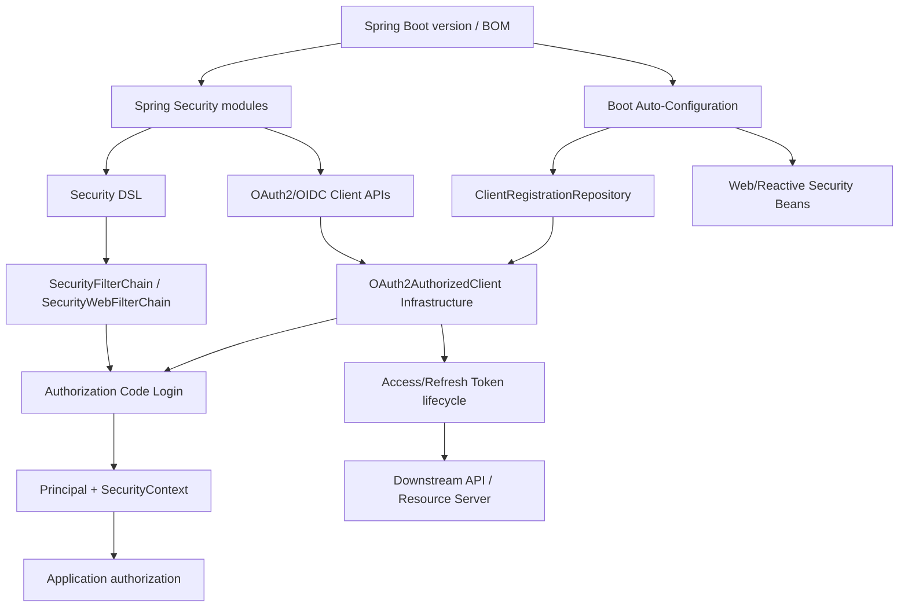
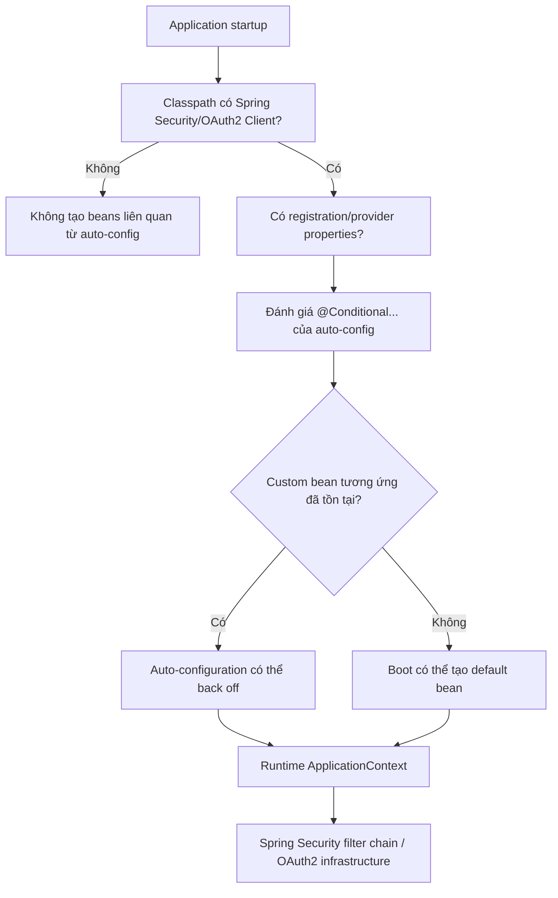
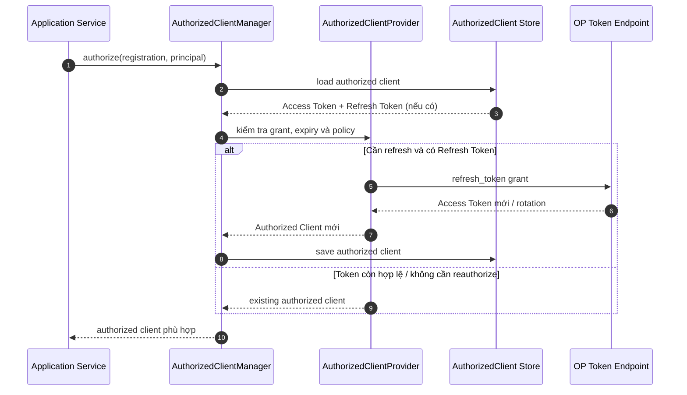
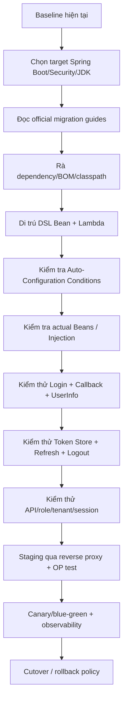

# 33.4. Rà soát thay đổi DSL, auto-configuration và bean mặc định

Khi nâng cấp ứng dụng **Spring Security OAuth 2.0 / OpenID Connect (OIDC) Client**, những lỗi khó nhận thấy không chỉ đến từ API bị xóa hoặc mã Java không còn biên dịch. Một bản nâng cấp có thể **compile thành công, khởi động bình thường, thậm chí đăng nhập được**, nhưng âm thầm thay đổi:

- `SecurityFilterChain` nào xử lý request.
- Quy tắc `requestMatchers` và thứ tự kiểm tra authorization.
- Việc cấu hình `oauth2Login()`, `oauth2Client()` và các DSL liên quan.
- Bean `ClientRegistrationRepository` nào được tạo từ properties.
- Nơi lưu `OAuth2AuthorizedClient`, Access Token và Refresh Token.
- `OAuth2AuthorizedClientManager` nào đang được chọn cho Servlet request hoặc background job.
- Cơ chế nhận `OidcUser`, ánh xạ authorities hoặc tải UserInfo.
- Chính sách CSRF, CORS, session, logout và public redirect URI.
- Điều kiện để Spring Boot tự tạo các bean bảo mật, cũng như thời điểm auto-configuration **back off** vì ứng dụng đã định nghĩa một bean tương ứng.

Ví dụ, ứng dụng đang dựa vào một default `SecurityFilterChain` của Spring Boot. Khi team thêm bean `SecurityFilterChain` tùy chỉnh để mở một endpoint, Boot có thể không còn tạo default security chain như trước. Nếu chain mới thiếu `oauth2Login()` hoặc sử dụng matcher quá rộng, luồng OIDC có thể bị hỏng hoặc một số endpoint không còn được bảo vệ đúng.

Bài này xây dựng phương pháp **rà soát thay đổi DSL, auto-configuration và bean mặc định** theo từng lớp, cho cả **Servlet/MVC** và **Reactive/WebFlux**. Mục tiêu là giúp nâng cấp Spring Boot/Spring Security một cách có kiểm soát: biết cấu hình nào do mình sở hữu, cấu hình nào do framework sinh ra, cách phát hiện thay đổi hành vi, và cách thiết kế kiểm thử hồi quy.

> **Nguyên tắc quan trọng:** «Không có lỗi biên dịch» không đồng nghĩa «không thay đổi bảo mật». Mỗi lần nâng cấp cần đối chiếu **security contract trước và sau**: route nào được phép, user nào được xác thực, registration/provider nào được dùng, token được lưu/gửi ở đâu, và những mặc định nào đã thay đổi.

## 1. Vì sao bài học này quan trọng đối với OAuth2/OIDC Client?

Một OAuth2/OIDC Client có nhiều thành phần phụ thuộc nhau:



Nếu một cạnh trong sơ đồ thay đổi, nhiều chức năng khác có thể bị ảnh hưởng. Chẳng hạn:

- `ClientRegistrationRepository` không còn Bean → login start không tìm được `registrationId`.
- `SecurityFilterChain` tự viết không bật `oauth2Login()` → callback không được xử lý.
- Manager mới không có `refreshToken()` provider → token hết hạn không được refresh theo kỳ vọng.
- Authorized client store chuyển từ session sang service khác → app không tìm thấy token sau restart hoặc qua replica.
- Request matcher thay đổi → endpoint API bị redirect tới OP thay vì trả 401, hoặc trang admin thành public.
- Custom `OidcUserService` không được gắn vào cấu hình sau refactor → user login được nhưng thiếu authorities nghiệp vụ.

Vì vậy, phải rà soát **hành vi runtime** cùng với **cú pháp và bean wiring**.

### 1.1. Phạm vi nâng cấp thường gặp

Trong thực tế, team có thể nâng cấp:

1. Spring Boot version hoặc Spring Security version.
2. JDK và nền tảng Jakarta Servlet.
3. Spring MVC hoặc WebFlux dependencies.
4. Spring Session, Redis/JDBC session store.
5. OAuth2 Client module, HTTP client, Jackson hoặc Reactor.
6. Cấu hình IdP/OIDC provider.
7. Deployment proxy/ingress và public base URL.
8. Test dependencies như `spring-security-test`.

Không phải mọi thay đổi đều là «Spring Security DSL migration». Bài này tập trung vào lớp **cấu hình, auto-configuration, bean defaults**, đồng thời chỉ ra các ranh giới giao thức/triển khai liên quan.

### 1.2. Phân biệt kiến thức ổn định với behavior theo phiên bản

Những ví dụ Java hiện đại trong bài dùng phong cách **bean-based + lambda DSL** phổ biến từ Spring Security 6. Các chi tiết về default beans, phương thức DSL, class path và deprecations tiếp tục phát triển qua Spring Security 6.x/7.x và Spring Boot 3.x/4.x.

Khi áp dụng vào một bản cụ thể, phải xem **reference documentation, API javadocs và migration guides đúng version**. Không tự suy luận một default của phiên bản A vẫn giữ nguyên ở B, hoặc một class từ Servlet tồn tại với cùng API bên WebFlux.

## 2. Ba lớp phải rà soát

| Lớp | Câu hỏi chính | Ví dụ |
|---|---|---|
| **DSL / API surface** | Mã cấu hình Java dùng API nào? API cũ có deprecated/removed? | `WebSecurityConfigurerAdapter` → `SecurityFilterChain`; `antMatchers` → `requestMatchers`. |
| **Auto-configuration** | Spring Boot tạo bean nào khi classpath/properties/conditions phù hợp? | Tạo `ClientRegistrationRepository` từ `spring.security.oauth2.client.registration.*`. |
| **Bean mặc định và resolution** | Khi có nhiều bean hoặc bean custom, framework sẽ chọn component nào? | In-memory vs persistent authorized client service; custom manager; nhiều filter chains. |

### 2.1. DSL migration không tự giải quyết auto-configuration

Việc đổi:

```java
http.authorizeRequests()
    .antMatchers("/admin/**").hasRole("ADMIN");
```

sang:

```java
http.authorizeHttpRequests(auth -> auth
    .requestMatchers("/admin/**").hasRole("ADMIN")
);
```

chỉ giải quyết **một phần cú pháp**. Cần kiểm tra matcher semantics, chain ordering, authorization defaults và login/callback filters.

### 2.2. Auto-configuration không luôn đồng nghĩa default security

Spring Boot có các lớp auto-configuration sử dụng điều kiện như `@ConditionalOnClass`, `@ConditionalOnBean`, `@ConditionalOnMissingBean` và property conditions. Khi thêm một custom bean, điều kiện có thể đổi kết quả.

Do đó, cùng một `application.yml` nhưng thêm một class `@Configuration` mới có thể làm runtime khác đi.

### 2.3. Bean resolution quyết định behavior

Một app có thể có nhiều `OAuth2AuthorizedClientManager` beans, nhưng controller/service chỉ inject một cái. Nếu dùng `@Primary`, `@Qualifier` hoặc bean name khác khi nâng cấp, service có thể nhận manager với grant providers/storage không phù hợp.

Nhiệm vụ rà soát không dừng ở «Bean có tồn tại» mà phải hỏi **Bean nào được inject, bởi ai và tại scope nào?**

## 3. Chuẩn bị bản đồ baseline trước khi nâng cấp

Trước khi sửa dependency hoặc DSL, ghi lại behavior đang được production chấp nhận.

Ví dụ:

```text
Application:
  spring-boot = current-version
  spring-security = BOM-managed
  server-stack = Servlet MVC
  session = Spring Session Redis
  entrypoint = /oauth2/authorization/company
  callback = /login/oauth2/code/company

Browser security:
  /public/**    -> anonymous allowed
  /account/**   -> authenticated
  /admin/**     -> ROLE_ADMIN
  /api/**       -> Bearer Resource Server (nếu có chain riêng)

OIDC:
  registrationId = company
  issuer = https://id.example.test
  scopes = openid, profile, email
  callback public = https://app.example.org/login/oauth2/code/company

Authorized client:
  storage = documented repository/service
  refresh grant = enabled when supported
  principal key = documented policy

Session:
  cookie = host-only, Secure, HttpOnly, SameSite policy
  logout = local + OP logout policy
```

Đây là ví dụ **security contract**, không phải một cấu hình Spring Boot có thể paste nguyên vẹn.

### 3.1. Các thông tin cần đối chiếu

- Dependency tree/BOM và JDK baseline.
- Chính xác các `SecurityFilterChain`/`SecurityWebFilterChain`.
- Matcher, `@Order`, authorization rules và entry points.
- OAuth2 registrations/providers, redirect templates, issuer trust.
- SecurityContext persistence, session mode và CSRF repository.
- `OAuth2AuthorizedClientRepository` / `OAuth2AuthorizedClientService`.
- OAuth2 Authorized Client Manager/grant providers.
- UserInfo/OIDC user service và authority mapping.
- WebClient/RestClient outbound token selection.
- Logout handlers và token cleanup.
- Test suite bảo mật hiện có và các gaps đã biết.

### 3.2. Baseline phải phản ánh runtime thực

Không chỉ đọc source code:

```text
Configuration Java ≠ full application behavior
```

Một Bean có thể bị override, conditional auto-configuration không match, một `@Profile` không active, hoặc request được match bởi chain khác.

Baseline nên kết hợp source/configuration, runtime context/condition report, endpoint tests và quan sát có kiểm soát ở staging.

## 4. DSL cũ: `WebSecurityConfigurerAdapter`

Trong các phiên bản Spring Security cũ, nhiều ví dụ dùng:

```java
// Ví dụ DSL cũ, chỉ để nhận diện khi migration.
// Không dùng làm code mới trên Spring Security hiện đại.
@EnableWebSecurity
class LegacySecurityConfiguration
        extends WebSecurityConfigurerAdapter {

    @Override
    protected void configure(HttpSecurity http) throws Exception {
        http
            .authorizeRequests()
                .antMatchers("/public/**").permitAll()
                .anyRequest().authenticated()
            .and()
            .oauth2Login();
    }
}
```

Những đặc điểm:

- Kế thừa một adapter class và override `configure(HttpSecurity)`.
- Chain DSL với `.and()`.
- Dùng `authorizeRequests()`/`antMatchers()`.
- Bảo mật được cấu hình thông qua inheritance và callback của framework.

`WebSecurityConfigurerAdapter` đã bị loại bỏ trong dòng Spring Security hiện đại; mẫu mới khai báo bean và cấu hình bằng lambda DSL.

### 4.1. Không chỉ đổi tên class

Cách sửa sai:

```java
// Không đủ: đổi class adapter nhưng không định nghĩa bean
// SecurityFilterChain đầy đủ cho từng request scope.
class SecurityConfiguration {
    // logic cũ bị copy nhưng không còn được framework gọi
}
```

Đúng hướng là tạo **`@Bean SecurityFilterChain`** và bảo đảm chain được Spring Security sử dụng.

### 4.2. Cần kiểm tra các override khác

Legacy adapter có thể override:

- `configure(HttpSecurity)`.
- `configure(AuthenticationManagerBuilder)`.
- `configure(WebSecurity)`.

Khi di trú sang bean configuration, từng trách nhiệm phải được xác định lại; chỉ di chuyển HTTP rules chưa đủ nếu ứng dụng còn custom user authentication, password encoder hoặc bỏ qua static paths ở WebSecurity.

## 5. DSL mới: Bean `SecurityFilterChain`

Một cấu hình Servlet/MVC hiện đại:

```java
package com.example.security;

import org.springframework.context.annotation.Bean;
import org.springframework.context.annotation.Configuration;
import org.springframework.security.config.Customizer;
import org.springframework.security.config.annotation.web.builders.HttpSecurity;
import org.springframework.security.web.SecurityFilterChain;

@Configuration(proxyBeanMethods = false)
public class SecurityConfiguration {

    @Bean
    SecurityFilterChain browserSecurityFilterChain(
            HttpSecurity http) throws Exception {

        http
            .authorizeHttpRequests(auth -> auth
                .requestMatchers(
                    "/", "/public/**", "/assets/**"
                ).permitAll()
                .anyRequest().authenticated()
            )
            .oauth2Login(Customizer.withDefaults())
            .oauth2Client(Customizer.withDefaults());

        return http.build();
    }
}
```

Trong ví dụ:

- Spring quản lý `SecurityFilterChain` như một bean.
- `authorizeHttpRequests(...)` diễn tả authorization rules.
- `oauth2Login(Customizer.withDefaults())` bật luồng browser OAuth2 Login với defaults tương ứng version.
- `oauth2Client(Customizer.withDefaults())` bật integration cho authorized client trong security chain.
- `http.build()` tạo filter chain.

### 5.1. `Customizer.withDefaults()` có nghĩa gì?

`Customizer.withDefaults()` yêu cầu DSL sử dụng các mặc định của phần tương ứng, **không có nghĩa behavior mặc định bất biến giữa các phiên bản**.

Ví dụ, nếu `oauth2Login` mặc định dùng login page và authorization request repository nào đó, nâng cấp framework có thể thay đổi chi tiết implementation/configuration. Khi cần behavior cố định, phải cấu hình tường minh và test.

### 5.2. Lambda DSL dễ đọc hơn nhưng không tự an toàn hơn

Lambda DSL giúp ranh giới giữa các configurers rõ hơn và hạn chế các bẫy của kiểu chain `.and()`. Tuy nhiên:

```java
.authorizeHttpRequests(auth ->
    auth.anyRequest().permitAll()
)
```

vẫn mở toàn bộ request dù cú pháp hợp lệ.

**Bảo mật được quyết định bởi rules, matchers và component wiring**, không chỉ bởi DSL syntax.

### 5.3. Đừng dựa vào một default fallback không rõ

Nếu định nghĩa custom `SecurityFilterChain` mà quên:

```java
.anyRequest().authenticated()
```

behavior cuối cùng có thể không giống chain mặc định mà Boot từng tạo. Quyết định explicit endpoint policy và test anonymous/authorized behavior.

## 6. So sánh DSL trước và sau

| Chủ đề | Phong cách cũ | Phong cách hiện đại |
|---|---|---|
| Điểm mở rộng HTTP | `extends WebSecurityConfigurerAdapter` | `@Bean SecurityFilterChain` |
| HTTP authorization | `authorizeRequests()` | `authorizeHttpRequests(...)` |
| Request patterns | `antMatchers(...)`/`mvcMatchers(...)` | `requestMatchers(...)` với matcher phù hợp |
| Chọn scope chain | Adapter/configurer semantics | `http.securityMatcher(...)` |
| OAuth2 Login | `http.oauth2Login()` trong fluent chain cũ | `http.oauth2Login(customizer)` |
| OAuth2 Client | `http.oauth2Client()` trong fluent chain cũ | `http.oauth2Client(customizer)` |
| CSRF | `http.csrf().disable()` | `http.csrf(csrf -> csrf.disable())` |
| Logout | `http.logout().logoutUrl(...)` | `http.logout(logout -> logout.logoutUrl(...))` |
| Method security | `@EnableGlobalMethodSecurity` (legacy) | `@EnableMethodSecurity` trong dòng hiện đại |
| WebSecurity ignores | Override `configure(WebSecurity)` | `@Bean WebSecurityCustomizer` khi cần |

**Lưu ý:** một số phương thức có giai đoạn deprecated trước khi bị loại bỏ; timeline và signatures cụ thể phụ thuộc version. Rà migration guide của target version thay vì đoán từ ví dụ.

## 7. `authorizeHttpRequests` và `requestMatchers` không phải tìm/thay chữ đơn giản

Một migration thường sửa:

```java
// Legacy:
http.authorizeRequests()
    .antMatchers("/admin/**").hasRole("ADMIN")
    .anyRequest().authenticated();
```

thành:

```java
// Modern:
http.authorizeHttpRequests(auth -> auth
    .requestMatchers("/admin/**").hasRole("ADMIN")
    .anyRequest().authenticated()
);
```

Nhưng **matcher implementation** có thể khác tùy Spring MVC có nằm trên classpath không, cách Servlet path được cấu hình, version Security và matcher factory.

### 7.1. Pattern semantics cần xác nhận

Những URL dễ gây nhầm lẫn:

```text
/admin
/admin/
/admin/report
/admin/report/
/admin/report.csv
/ADMIN/report
/admin;param=value
/portal/admin/report
```

Không giả định Ant-style, MVC path pattern và custom matchers tương đương 100% trong mọi trường hợp.

### 7.2. HTTP method cũng thuộc policy

Ví dụ:

```java
import org.springframework.http.HttpMethod;

http.authorizeHttpRequests(auth -> auth
    .requestMatchers(
        HttpMethod.GET, "/reports/**"
    ).hasAuthority("report:read")
    .requestMatchers(
        HttpMethod.POST, "/reports/**"
    ).hasAuthority("report:write")
    .anyRequest().authenticated()
);
```

Nếu legacy config bảo vệ mọi method nhưng migration chỉ bảo vệ GET, có thể tạo lỗ hổng khi POST/PUT/DELETE được xử lý bởi rule khác.

### 7.3. Order of matchers quan trọng

Ví dụ không an toàn:

```java
http.authorizeHttpRequests(auth -> auth
    .requestMatchers("/**").permitAll()
    .requestMatchers("/admin/**").hasRole("ADMIN")
);
```

Rule quá rộng trước rule cụ thể có thể làm `/admin/**` trở thành public hoặc khiến cấu hình không có behavior như tác giả kỳ vọng. Nên đặt matcher cụ thể trước, và có catch-all phù hợp.

### 7.4. Context path và Servlet path

Khi ứng dụng chạy sau proxy dưới `/portal` hoặc Servlet được map trên path khác, `requestMatchers("/api/**")` có thể match theo request path mà framework nhìn thấy, không theo public URL nguyên gốc.

Nâng cấp path-matching framework có thể ảnh hưởng route security. Test qua đúng proxy hoặc test setup mô phỏng đúng Servlet path/context path.

### 7.5. Explicit RequestMatcher khi cần

Với policy đặc biệt, có thể định nghĩa `RequestMatcher` rõ ràng thay vì chỉ truyền chuỗi:

```java
RequestMatcher adminMatcher = request ->
    request.getRequestURI().startsWith("/admin/");
```

Nhưng ví dụ trên **chỉ là minh họa interface**, không khuyến nghị dùng trực tiếp vì `getRequestURI()` có context path, encoding và matching semantics khác. Một custom matcher cho production phải xét context path, normalization và method một cách an toàn.

Dùng matcher API thích hợp của đúng Spring Security/Spring MVC version, sau đó test cả positive/negative paths.

## 8. `securityMatcher(...)` khác `requestMatchers(...)`

Đây là một trong những bẫy nâng cấp quan trọng nhất.

- `http.securityMatcher(...)`: xác định **request nào thuộc toàn bộ SecurityFilterChain này**.
- `authorizeHttpRequests(...).requestMatchers(...)`: xác định **authorization rule trong chain đã được chọn**.

Ví dụ:

```java
@Bean
@Order(1)
SecurityFilterChain apiChain(HttpSecurity http) throws Exception {
    http
        .securityMatcher("/api/**")
        .authorizeHttpRequests(auth -> auth
            .anyRequest().authenticated()
        );
    return http.build();
}
```

Chain này chỉ áp dụng với `/api/**`. Nếu không có chain khác match `/orders`, request đó có thể không đi qua rules mà developer đang nghĩ tới.

### 8.1. Nhiều chains cần coverage rõ

Một thiết kế Servlet:

```text
Chain 1: /api/**      -> Resource Server Bearer (nếu có)
Chain 2: /**          -> Browser OAuth2 Login
```

Cần test:

- `/api/orders` vào Chain 1.
- `/account` vào Chain 2.
- `/oauth2/authorization/company` vào Chain 2.
- `/login/oauth2/code/company` vào Chain 2.
- `/logout` vào Chain 2 nếu browser logout.
- Các error/actuator endpoints theo policy.

### 8.2. Không gắn `oauth2Login` vào chain không match callback

Nếu chỉ bật `oauth2Login()` trên:

```java
.securityMatcher("/account/**")
```

thì default callback `/login/oauth2/code/company` có thể không thuộc chain ấy. Kết quả là login start/callback không được filter dự kiến xử lý.

### 8.3. `@Order` rõ ràng với nhiều chains

```java
import org.springframework.core.annotation.Order;

@Bean
@Order(1)
SecurityFilterChain apiChain(HttpSecurity http) throws Exception {
    // ...
}

@Bean
@Order(2)
SecurityFilterChain browserChain(HttpSecurity http) throws Exception {
    // ...
}
```

Chọn ordering cụ thể và có fallback chain đúng. Không dựa vào thứ tự ngẫu nhiên của bean creation.

### 8.4. Ví dụ tách API và browser

Nếu ứng dụng **có cả OAuth2 Client và OAuth2 Resource Server**, có thể dùng:

```java
import org.springframework.context.annotation.Bean;
import org.springframework.core.annotation.Order;
import org.springframework.http.HttpMethod;
import org.springframework.security.config.Customizer;
import org.springframework.security.config.annotation.web.builders.HttpSecurity;
import org.springframework.security.config.http.SessionCreationPolicy;
import org.springframework.security.web.SecurityFilterChain;

@Bean
@Order(1)
SecurityFilterChain apiChain(HttpSecurity http) throws Exception {
    http
        .securityMatcher("/api/**")
        .authorizeHttpRequests(auth -> auth
            .requestMatchers(
                HttpMethod.GET, "/api/public/**"
            ).permitAll()
            .anyRequest().authenticated()
        )
        .sessionManagement(session -> session
            .sessionCreationPolicy(SessionCreationPolicy.STATELESS)
        )
        .csrf(csrf -> csrf.disable())
        .oauth2ResourceServer(oauth2 ->
            oauth2.jwt(Customizer.withDefaults())
        );

    return http.build();
}

@Bean
@Order(2)
SecurityFilterChain browserChain(HttpSecurity http) throws Exception {
    http
        .authorizeHttpRequests(auth -> auth
            .requestMatchers("/", "/public/**").permitAll()
            .anyRequest().authenticated()
        )
        .oauth2Login(Customizer.withDefaults())
        .oauth2Client(Customizer.withDefaults());

    return http.build();
}
```

**Phạm vi ví dụ:** API chain giả định có dependency `spring-boot-starter-oauth2-resource-server` và JWT decoder config. Việc disable CSRF ở `/api/**` chỉ phù hợp nếu chain này xác thực bằng bearer token theo mô hình stateless **và không dựa vào browser cookie cho các unsafe requests**.

Không copy `csrf.disable()` cho toàn ứng dụng browser OIDC Client.

## 9. `WebSecurityCustomizer` và việc bỏ qua filters

Trong legacy configuration, team có thể override `configure(WebSecurity)` để ignore static resources.

Bean-based style:

```java
import org.springframework.context.annotation.Bean;
import org.springframework.security.config.annotation.web.builders.WebSecurity;
import org.springframework.security.config.annotation.web.configuration.WebSecurityCustomizer;

@Bean
WebSecurityCustomizer webSecurityCustomizer() {
    return (WebSecurity web) ->
        web.ignoring().requestMatchers("/assets/**");
}
```

Tuy nhiên, `web.ignoring()` **bỏ qua toàn bộ Spring Security filter chain** đối với matchers ấy, không chỉ bỏ authorization check.

### 9.1. `permitAll()` khác `ignoring()`

| Cách làm | Kết quả |
|---|---|
| `requestMatchers("/assets/**").permitAll()` | Request vẫn đi qua security filters, nhưng authorization cho phép. |
| `web.ignoring().requestMatchers("/assets/**")` | Request bỏ qua Spring Security filter chain tương ứng. |

Nhiều ứng dụng nên ưu tiên `permitAll()` cho resources công khai, vì vẫn giữ các cơ chế header/security context/filter phù hợp. Chỉ ignore khi có lý do rõ ràng và đã đánh giá tác động.

### 9.2. Khi nâng cấp, rà lại mọi ignore patterns

Một wildcard như `"/**"` trong WebSecurityCustomizer có thể vô hiệu hóa bảo mật cho toàn bộ ứng dụng. Test protected endpoints không chỉ theo controller, mà qua actual filter chain.

## 10. Method security: từ annotation cũ sang cấu hình hiện đại

Một số ứng dụng dùng legacy:

```java
@EnableGlobalMethodSecurity(prePostEnabled = true)
```

Trong Spring Security hiện đại, mẫu thường là:

```java
import org.springframework.context.annotation.Configuration;
import org.springframework.security.config.annotation.method.configuration
    .EnableMethodSecurity;

@Configuration
@EnableMethodSecurity
class MethodSecurityConfiguration {
}
```

và:

```java
@PreAuthorize("hasAuthority('orders:write')")
public void updateOrder(...) {
    // ...
}
```

### 10.1. Method security không tự bật ở mọi application

Có `spring-boot-starter-security` không đồng nghĩa mọi `@PreAuthorize` đều hoạt động nếu method security chưa được kích hoạt theo cấu hình phù hợp.

Nâng cấp từ annotation cũ cần xác nhận:

- Đúng mode method security.
- Proxy thực sự áp dụng lên Bean.
- Method được gọi qua Spring proxy, không phải self-invocation.
- Authority strings và SpEL behavior.
- Reactive method security được cấu hình riêng nếu WebFlux.

### 10.2. Không nhầm role với scope

`hasRole("ADMIN")` thường kiểm tra `ROLE_ADMIN`.

`hasAuthority("SCOPE_orders.read")` kiểm tra đúng chuỗi authority nếu mapping tạo ra authority đó.

OIDC claim `roles` không tự biến thành authority. Nếu user service/mapper bị thay khi nâng cấp, `@PreAuthorize` có thể cho/không cho sai dù annotation không đổi.

### 10.3. Test logic thật, không mock method được bảo vệ

Nếu integration test mock cả service có `@PreAuthorize`, lời gọi có thể bypass proxy/method interceptor. Dùng test context thực hoặc method-security-focused test cho đoạn code cần xác minh.

## 11. Servlet và WebFlux là hai DSL khác nhau

### Servlet/MVC

```java
@Bean
SecurityFilterChain securityFilterChain(HttpSecurity http)
        throws Exception {
    return http
        .authorizeHttpRequests(auth -> auth
            .anyRequest().authenticated()
        )
        .oauth2Login(Customizer.withDefaults())
        .build();
}
```

### Reactive/WebFlux

```java
@Bean
SecurityWebFilterChain securityWebFilterChain(
        ServerHttpSecurity http) {

    return http
        .authorizeExchange(exchanges -> exchanges
            .anyExchange().authenticated()
        )
        .oauth2Login(Customizer.withDefaults())
        .build();
}
```

Các khái niệm tương đồng nhưng types không thể thay lẫn:

| Servlet | WebFlux |
|---|---|
| `HttpSecurity` | `ServerHttpSecurity` |
| `SecurityFilterChain` | `SecurityWebFilterChain` |
| `authorizeHttpRequests` | `authorizeExchange` |
| `HttpSession` | `WebSession` |
| `ClientRegistrationRepository` | `ReactiveClientRegistrationRepository` |
| `OAuth2AuthorizedClientRepository` | `ServerOAuth2AuthorizedClientRepository` |
| `OAuth2AuthorizedClientManager` | `ReactiveOAuth2AuthorizedClientManager` |
| `OidcUserService` | `OidcReactiveOAuth2UserService` (khi dùng implementation tương ứng) |
| `MockMvc` | `WebTestClient` |

### 11.1. Dependency có thể làm application type khác dự kiến

Nếu project thêm `spring-boot-starter-web` vào ứng dụng WebFlux hoặc ngược lại, Spring Boot có thể quyết định web application type theo classpath và cấu hình.

Một migration tưởng «chỉ thêm một dependency» có thể làm Bean của Servlet/Reactive security được lựa chọn khác. Kiểm tra application type thực và test context.

### 11.2. Reactive security context khác ThreadLocal

WebFlux dùng Reactor Context cho authentication. Custom OIDC mapper/service không nên dựa vào `SecurityContextHolder` ThreadLocal như một nguồn duy nhất trong reactive operators.

Không di trú Servlet authentication handlers sang WebFlux chỉ bằng thay class names.

## 12. Spring Boot auto-configuration hoạt động thế nào?

Spring Boot tạo/đăng ký beans dựa trên **classpath + properties + điều kiện**.

Một mô hình khái quát:



Sơ đồ là **khái niệm**, không phải implementation logic một-một cho mọi auto-configuration. Các điều kiện thay đổi theo Boot version và stack.

### 12.1. `@ConditionalOnClass`

Một auto-config có thể chỉ kích hoạt khi một class/module liên quan có trên classpath.

Nếu sau nâng cấp một starter transitively không còn kéo OAuth2 Client dependency, bean registration/service có thể biến mất.

### 12.2. `@ConditionalOnMissingBean`

Khi ứng dụng tạo custom Bean cùng type/contract, Boot có thể không tạo default của nó nữa.

Đây là một nguồn thay đổi rất đáng chú ý khi team thêm:

```java
@Bean
ClientRegistrationRepository clientRegistrationRepository() {
    return new InMemoryClientRegistrationRepository(...);
}
```

Sau khi có Bean này, registration từ `application.yml` có thể **không còn là nguồn dữ liệu được dùng** nếu auto-config đã back off.

### 12.3. `@ConditionalOnProperty` và activation

Một số auto-config yêu cầu properties hoặc flags cụ thể. Đổi tên, xóa hoặc sai binding property có thể khiến feature không được tạo.

### 12.4. Bean auto-config không phải API contract vĩnh viễn

Đừng viết business code dựa trên assumption:

```text
Bean sẽ luôn tên "x", do class AutoConfigY tạo,
bất kể framework version hoặc custom beans.
```

Dựa vào public interfaces, dependency injection rõ ràng và test application context thực. Khi cần override, phải có lý do và test cho behavior được tùy chỉnh.

## 13. Phân biệt Spring Security và Spring Boot defaults

Spring Security là framework bảo mật và DSL; Spring Boot là lớp auto-configuration/integration.

Ví dụ:

- Spring Security định nghĩa `SecurityFilterChain` và OAuth2 Login support.
- Spring Boot có thể tạo `ClientRegistrationRepository` từ application properties.
- Spring Security cung cấp `DefaultOAuth2AuthorizedClientManager` và các providers.
- Boot hoặc framework wiring có thể tạo/đăng ký default components khi đủ điều kiện.
- Application có thể thay thế một số beans, customizers hoặc security chains.

Khi nâng cấp, đọc cả **Spring Boot migration guide** lẫn **Spring Security migration guide**; chỉ xem một phía thường không đủ.

### 13.1. Mặc định không có nghĩa chỉ có một Bean type

Có thể có:

- Application-defined bean.
- Auto-configured bean.
- Framework component không phải một Spring Bean public.
- Object được tạo trong filter/DSL configurer.
- Bean do thư viện bên thứ ba bổ sung.

Một class xuất hiện trong docs không chứng minh application có Bean với type đó để autowire.

### 13.2. Chỉ thấy Bean tồn tại chưa biết ai sử dụng

Ví dụ app có một `OAuth2AuthorizedClientManager` bean riêng nhưng `WebClient` đã tạo `ServletOAuth2AuthorizedClientExchangeFilterFunction` từ manager khác. Migration cần rà **injection graph**, không chỉ bean list.

## 14. Boot OAuth2 Client properties cần rà soát

Một cấu hình điển hình:

```yaml
spring:
  security:
    oauth2:
      client:
        registration:
          company:
            provider: company-oidc
            client-id: ${OIDC_CLIENT_ID}
            client-secret: ${OIDC_CLIENT_SECRET}
            client-authentication-method: client_secret_basic
            authorization-grant-type: authorization_code
            redirect-uri: "{baseUrl}/login/oauth2/code/{registrationId}"
            scope:
              - openid
              - profile
              - email
          partner:
            provider: partner-oidc
            client-id: ${PARTNER_CLIENT_ID}
            client-secret: ${PARTNER_CLIENT_SECRET}
            authorization-grant-type: authorization_code
            redirect-uri: "{baseUrl}/login/oauth2/code/{registrationId}"
            scope: [openid, profile]
        provider:
          company-oidc:
            issuer-uri: https://login.company.example/realms/main
          partner-oidc:
            issuer-uri: https://accounts.partner.example/tenant/main
```

Các URL, names và secrets là dữ liệu ví dụ. Không có server/secret thật ở đây.

### 14.1. `registration` khác `provider`

`registration.company` có:

- `client-id`.
- `client-secret` hoặc phương thức client authentication khác.
- `authorization-grant-type`.
- `redirect-uri`.
- `scope`.
- `provider` key tham chiếu metadata provider.

`provider.company-oidc` chứa thông tin OP như `issuer-uri` hoặc các endpoints explicit.

Đừng nhầm:

- `registrationId` = `company`.
- Provider key = `company-oidc`.
- OIDC issuer = full URI của OP.
- OAuth2 `client_id` = giá trị đăng ký với OP.

Nếu migration đổi tên `registrationId`, cả login URLs, callback và authorized client storage keys có thể bị ảnh hưởng.

### 14.2. Thêm hoặc bỏ `issuer-uri` có thể tạo network behavior

Khi provider được cấu hình qua `issuer-uri`, Spring/Boot có thể thực hiện **discovery metadata** để tạo registration, tùy API/stack/version.

Hậu quả:

- Startup hoặc bean creation có thể phụ thuộc OP đang reachable.
- Unit/integration tests vô tình gọi network.
- Metadata URLs/JWKS endpoints thay đổi khi OP thay đổi.
- Proxy/TLS/egress policy có thể làm app không khởi động.

Một migration không nên «chữa» lỗi bằng cách bỏ issuer validation hoặc chấp nhận metadata từ URL tùy ý.

### 14.3. Explicit endpoint configuration

Có thể dùng một số provider endpoints explicit thay cho discovery trong những trường hợp cần kiểm soát:

```yaml
spring:
  security:
    oauth2:
      client:
        provider:
          company-oidc:
            authorization-uri: https://login.company.example/authorize
            token-uri: https://login.company.example/token
            jwk-set-uri: https://login.company.example/jwks
            user-info-uri: https://login.company.example/userinfo
            user-name-attribute: sub
```

Đây là **đường dẫn minh họa**, không áp dụng nguyên mẫu cho mọi OP. Việc không dùng `issuer-uri` property để discovery **không cho phép bỏ OIDC issuer validation**. Nếu tự xây `ClientRegistration`, đảm bảo issuer/trust metadata được thiết lập và kiểm tra đúng.

### 14.4. Property binding cần kiểm tra giá trị effective

- Profile `application-prod.yml` có thực sự active?
- Environment variable có override đúng key không?
- Config server có trả stale property không?
- Có typo `redirect-uri` / `issuer-uri`?
- Có khác biệt quote YAML khi chứa `{baseUrl}`?
- Custom beans có dùng properties hay bỏ qua?
- Có nhiều registrations trùng tên trên profile khác không?

Nâng cấp dependency không tự sửa lỗi do merge cấu hình.

## 15. `ClientRegistrationRepository` là ranh giới quan trọng

Trên Servlet, Spring Security OAuth2 Client sử dụng `ClientRegistrationRepository` để tìm registration theo ID:

```java
ClientRegistration registration =
    registrations.findByRegistrationId("company");
```

Các implementation thường gặp:

- `InMemoryClientRegistrationRepository`.
- Custom repository backed by database/registry.
- Repository wrapper có tenant-aware routing hoặc caching.

### 15.1. Khi thêm custom Bean

Ví dụ:

```java
@Bean
ClientRegistrationRepository registrations() {
    ClientRegistration company =
        ClientRegistration.withRegistrationId("company")
            .clientId("test-company-client")
            .clientSecret("synthetic-secret")
            .clientAuthenticationMethod(
                ClientAuthenticationMethod.CLIENT_SECRET_BASIC
            )
            .authorizationGrantType(
                AuthorizationGrantType.AUTHORIZATION_CODE
            )
            .redirectUri(
                "{baseUrl}/login/oauth2/code/{registrationId}"
            )
            .authorizationUri(
                "https://id.example.test/authorize"
            )
            .tokenUri(
                "https://id.example.test/token"
            )
            .jwkSetUri(
                "https://id.example.test/jwks"
            )
            .issuerUri(
                "https://id.example.test"
            )
            .scope("openid", "profile")
            .build();

    return new InMemoryClientRegistrationRepository(company);
}
```

**Chỉ là Bean fixture minh họa:** nếu app sử dụng cùng Bean type cho production, Boot auto-configured repository từ properties có thể back off. Không tạo Bean này trong production chỉ để test một registration rồi làm mất các registrations thực.

### 15.2. Nâng cấp phải đối chiếu dữ liệu repository

Test:

- `company` tồn tại.
- `partner` tồn tại.
- Issuer URIs đúng từng registration.
- Redirect URI và scopes không đổi ngoài ý muốn.
- `clientAuthenticationMethod` đúng provider contract.
- Không có registration động từ tenant input chưa được phê duyệt.
- Không trộn client IDs giữa environments.

### 15.3. Reactive repository là interface khác

WebFlux sử dụng `ReactiveClientRegistrationRepository`, không phải Servlet `ClientRegistrationRepository`.

Một upgrade chuyển web stack hoặc thay auto-config có thể khiến Bean repository đúng type trước đây không còn được wiring.

## 16. Authorized client: khác `ClientRegistration`

`ClientRegistration` mô tả **client/app registration** với OP.

`OAuth2AuthorizedClient` mô tả **một client đã được authorization trong ngữ cảnh principal**, chứa:

- `ClientRegistration`.
- Principal name.
- Access Token.
- Refresh Token nếu được cấp và lưu.

```text
ClientRegistration:
  company
  issuer = https://id.example.test
  client_id = web-client

OAuth2AuthorizedClient:
  registration = company
  principal = user-A
  access_token = ...
  refresh_token = ... (optional)
```

Một upgrade có thể giữ registrations đúng nhưng vẫn làm mất token nếu persistence/manager bị thay đổi.

### 16.1. `OAuth2AuthorizedClientRepository` trên Servlet

Repository thường được sử dụng trong ngữ cảnh **HTTP request/response** và có thể kết hợp session hoặc service.

Ví dụ các abstraction có tên:

- `OAuth2AuthorizedClientRepository`.
- `AuthenticatedPrincipalOAuth2AuthorizedClientRepository`.
- `HttpSessionOAuth2AuthorizedClientRepository`.

Cần xác định implementation mà application thật đang dùng và policy lưu user tokens khi authenticated/anonymous.

### 16.2. `OAuth2AuthorizedClientService`

Service hỗ trợ lưu/load/remove authorized clients theo principal/registration:

```java
OAuth2AuthorizedClient client =
    authorizedClientService.loadAuthorizedClient(
        "company",
        principalName
    );
```

Một implementation thường dùng cho development/tests là `InMemoryOAuth2AuthorizedClientService`. Với production cần persistent/distributed storage nếu token lifecycle và scaling policy yêu cầu.

### 16.3. Storage key thường quan trọng

Một key phổ biến:

```text
(clientRegistrationId, principalName)
```

Nếu nâng cấp thay principal name từ `sub` sang email, hoặc đổi registration ID, token store cũ có thể không load được. Tệ hơn, keys quá rộng có thể va chạm giữa providers/tenants.

Không dùng `email` hoặc arbitrary browser input làm principal key khi cần OIDC identity isolation. Xem xét `(issuer,subject)` và tenant context trong application policy.

### 16.4. Không tự đổi persistence mặc định khi không có kế hoạch

Nếu trước đây token sống trong session và sau migration chuyển sang service DB, cần đánh giá:

- Token có sống qua logout không?
- Có được share giữa instances không?
- Encryption/at-rest access như thế nào?
- Refresh Token Rotation và concurrency ra sao?
- Cleanup khi user bị disable/revoke thế nào?
- Migration dữ liệu/token cũ có cần reauthorization không?

## 17. `OAuth2AuthorizedClientManager`: bean quan trọng nhưng dễ nhầm

`OAuth2AuthorizedClientManager` điều phối authorization/re-authorization cho OAuth2 Clients. Nó có thể sử dụng những `OAuth2AuthorizedClientProvider` phù hợp grant types.

Hai use cases khác nhau:

1. **Request-scoped/browser**: thao tác có `HttpServletRequest`/`HttpServletResponse`, user principal và repository phù hợp.
2. **Background/service**: scheduled job hoặc machine-to-machine không có browser request, thường dùng service-backed manager.

### 17.1. Request-scoped Servlet manager

Một manager thường dùng:

```java
DefaultOAuth2AuthorizedClientManager manager =
    new DefaultOAuth2AuthorizedClientManager(
        clientRegistrationRepository,
        authorizedClientRepository
    );
```

Nó được thiết kế sử dụng với HTTP request context. Nếu app chuyển sang gọi trong scheduled job không có Servlet request, phải xem lại manager type.

### 17.2. Service-backed manager

Một manager phù hợp cho background logic:

```java
import org.springframework.context.annotation.Bean;
import org.springframework.security.oauth2.client.OAuth2AuthorizedClientManager;
import org.springframework.security.oauth2.client.AuthorizedClientServiceOAuth2AuthorizedClientManager;
import org.springframework.security.oauth2.client.OAuth2AuthorizedClientService;
import org.springframework.security.oauth2.client.OAuth2AuthorizedClientProviderBuilder;
import org.springframework.security.oauth2.client.registration.ClientRegistrationRepository;

@Bean
OAuth2AuthorizedClientManager backgroundAuthorizedClientManager(
        ClientRegistrationRepository registrations,
        OAuth2AuthorizedClientService service) {

    var manager =
        new AuthorizedClientServiceOAuth2AuthorizedClientManager(
            registrations,
            service
        );

    manager.setAuthorizedClientProvider(
        OAuth2AuthorizedClientProviderBuilder.builder()
            .clientCredentials()
            .refreshToken()
            .build()
    );

    return manager;
}
```

Đây là **cấu hình tường minh cho ví dụ**. Provider grants phải khớp yêu cầu thực của registration; không thêm grant type chỉ vì builder có method đó.

### 17.3. Vì sao injection cần rõ ràng?

Nếu application vừa có một manager cho browser và một manager cho background, nên dùng bean names/qualifiers tường minh:

```java
import org.springframework.beans.factory.annotation.Qualifier;

public BillingTokenService(
    @Qualifier("backgroundAuthorizedClientManager")
    OAuth2AuthorizedClientManager manager
) {
    this.manager = manager;
}
```

Không chọn tùy ý Bean `@Primary` rồi làm mọi WebClient cùng dùng manager đó nếu security context/storage semantics không phù hợp.

### 17.4. Không giả định manager được Boot tạo giống mọi version

Một số Spring Boot/Spring Security versions và auto-configurations có behavior khác nhau về manager Bean được cung cấp, cách registration/repository/service được kết hợp và extension points cho default provider.

**Mỗi lần nâng cấp phải inspect actual ApplicationContext**: Bean nào tồn tại, Bean nào được inject vào WebClient/service, provider chain nào được cấu hình.

## 18. `OAuth2AuthorizedClientProvider`: danh sách grants cần giữ đúng

Các grant-related components có thể bao gồm:

- Authorization Code.
- Refresh Token.
- Client Credentials.
- Những extension grants khác khi có nhu cầu và được hỗ trợ.

Ví dụ:

```java
var provider =
    OAuth2AuthorizedClientProviderBuilder.builder()
        .authorizationCode()
        .refreshToken()
        .clientCredentials()
        .build();
```

**Không coi mẫu này là default bắt buộc cho mọi manager.** Một background service manager không thể hoàn tất Authorization Code browser redirect chỉ nhờ thêm `authorizationCode()`; còn `clientCredentials()` không thể thay token của user khi API cần delegated access.

### 18.1. Refresh Token khi upgrade

Kiểm tra:

- ClientRegistration grant hợp lệ.
- Refresh Token có thực sự được OP cấp không.
- Provider có `refreshToken()` không.
- Manager có được gọi lúc cần token mới không.
- Clock skew/expiration detection có thay đổi không.
- Refresh Token rotation cập nhật storage nguyên tử ra sao.
- Lỗi `invalid_grant` có cleanup/re-authentication policy không.

### 18.2. Không tự retry refresh vô hạn

Một upgrade có thể thay exception handling của manager/WebClient; nếu code retry mọi 401/invalid_grant liên tục, có thể gây DoS hoặc lặp token requests.

Cần test token refresh failure và ngắt/cleanup đúng.

### 18.3. Password grant không phải phương án migration mặc định

Một số ứng dụng legacy dùng Resource Owner Password Credentials grant. Không giữ hoặc tái tạo grant này chỉ để khỏi sửa ứng dụng; nó không phù hợp định hướng bảo mật OAuth2 hiện đại và có thể không còn được hỗ trợ theo API/version.

Nên đánh giá chuyển sang Authorization Code + PKCE hoặc Client Credentials theo use case, có kế hoạch migration sản phẩm và OP.

## 19. Đường đi của WebClient khi OAuth2 Client thay đổi

Một Spring MVC BFF có thể sử dụng WebClient để gọi Resource Server bằng Access Token đã được cấp.

Một cách cấu hình explicit:

```java
import org.springframework.context.annotation.Bean;
import org.springframework.security.oauth2.client.OAuth2AuthorizedClientManager;
import org.springframework.security.oauth2.client.web.reactive.function.client
    .ServletOAuth2AuthorizedClientExchangeFilterFunction;
import org.springframework.web.reactive.function.client.WebClient;

@Bean
WebClient ordersApiWebClient(
        OAuth2AuthorizedClientManager manager) {

    var oauth2 =
        new ServletOAuth2AuthorizedClientExchangeFilterFunction(
            manager
        );

    return WebClient.builder()
        .baseUrl("https://api.example.test")
        .filter(oauth2)
        .build();
}
```

### 19.1. Selection of authorized client

Khi gửi request, lựa chọn registration có thể explicit:

```java
import static org.springframework.security.oauth2.client.web.reactive
    .function.client.ServletOAuth2AuthorizedClientExchangeFilterFunction
    .clientRegistrationId;

webClient.get()
    .uri("/orders")
    .attributes(clientRegistrationId("company"))
    .retrieve()
    .bodyToMono(String.class);
```

**Lưu ý:** cấu hình phù hợp khi `company` registration và OAuth2 manager có thể authorize/load token cho principal context được dùng. Test không nên gửi credential thật tới `example.test`.

### 19.2. Không bật default token cho mọi URL không có kiểm soát

Một số patterns cho WebClient có tùy chọn dùng default authorized client. Nếu WebClient có thể gửi request tới URL do user cung cấp, token có thể bị gửi sai đích.

Sau nâng cấp, kiểm tra:

- WebClient instance nào có OAuth2 filter?
- Default authorized client có được bật hay không?
- Token được chọn theo principal, registration hoặc request attribute nào?
- Có chấp nhận absolute URI ngoài baseUrl không?
- Redirect policy có thể chuyển Authorization header sang host khác không?
- Có nhiều user/tenants dùng chung WebClient không?

### 19.3. Sự khác biệt khi thay HTTP client

Nâng cấp WebClient/RestClient hoặc đổi OAuth2 filter có thể thay:

- Token auto-attachment.
- Failure handler removal behavior.
- 401/403 retry logic.
- Context propagation.
- Manager invocation time.
- Request-level attributes.
- Các timeout/connection settings.

Test outbound HTTP tại stub server để xác nhận request tới đúng API host và chỉ mang token phù hợp.

## 20. Servlet vs background token manager

Một lỗi dễ gặp:

```text
HTTP request -> manager A -> session-aware repository
Scheduled job -> manager A -> không có HttpServletRequest
```

Nâng cấp có thể làm code dựa vào thread-bound Servlet request trước đây bộc lộ lỗi.

### 20.1. Machine-to-machine use case

Ví dụ:

```java
OAuth2AuthorizeRequest request =
    OAuth2AuthorizeRequest
        .withClientRegistrationId("billing-service")
        .principal("service:billing-job")
        .build();

OAuth2AuthorizedClient authorized =
    backgroundAuthorizedClientManager.authorize(request);

if (authorized == null) {
    throw new IllegalStateException(
        "Unable to authorize billing client"
    );
}
```

Principal ở đây là technical key ổn định cho client credentials. Nó không phải user đăng nhập bằng OIDC.

### 20.2. Không tự gắn machine token vào user API

Nếu API yêu cầu token thay mặt user, đổi sang client credentials chỉ vì Background Manager dễ cấu hình có thể làm sai authorization model.

### 20.3. Data-store migration phải đi với manager migration

Nếu manager mới tìm token theo principal name khác, dù token DB còn nguyên thì code có thể làm phát sinh authorization flow hoặc refresh lại không đúng.

## 21. OAuth2 Login defaults phải rà riêng

Khi dùng:

```java
.oauth2Login(Customizer.withDefaults())
```

cần kiểm tra những default behaviors liên quan:

- Authorization start endpoint.
- Redirection/callback processing endpoint.
- Login page/entry point.
- `AuthorizationRequestRepository`.
- `OAuth2UserService` / `OidcUserService`.
- Authentication success/failure handlers.
- SecurityContext persistence.
- SavedRequest success redirect.
- Session fixation handling.
- Logout integration.
- Authorized client repository/service.

### 21.1. Start endpoint

Servlet default path thường:

```text
/oauth2/authorization/{registrationId}
```

Browser có thể bắt đầu:

```text
GET /oauth2/authorization/company
```

### 21.2. Callback endpoint

Servlet callback default thường:

```text
/login/oauth2/code/{registrationId}
```

Registration redirect template:

```yaml
redirect-uri: "{baseUrl}/login/oauth2/code/{registrationId}"
```

Nếu migration đổi `redirectionEndpoint` hoặc base URI, phải đồng bộ:

1. Security DSL filter matcher.
2. `ClientRegistration.redirectUri`.
3. OP registered redirect URI.
4. Reverse proxy path rewriting.
5. Session cookie scope.

### 21.3. Không để custom filter chain bỏ callback

Nếu chain chỉ match `/app/**` nhưng callback ở `/login/oauth2/code/**`, Spring Security OAuth2 Login filter có thể không xử lý callback.

Đây là bug behavior, không nhất thiết do OIDC provider.

### 21.4. `state`, PKCE và nonce không được bỏ

Một migration làm callback test fail không được sửa bằng cách bỏ `state`/PKCE/nonce validation. Phải tìm đúng ranh giới request correlation/session/registration.

## 22. `OidcUserService` và custom authority mapping

Một Servlet app có thể tùy chỉnh user service:

```java
OidcUserService customOidcUserService = new OidcUserService();
```

hoặc có wrapper dùng `GrantedAuthoritiesMapper`. Nâng cấp cần kiểm tra **custom code có còn được gắn vào đúng OIDC DSL/userInfo endpoint** không.

Ví dụ cấu hình Servlet theo API hiện đại phổ biến:

```java
.oauth2Login(oauth2 -> oauth2
    .userInfoEndpoint(userInfo -> userInfo
        .oidcUserService(customOidcUserService)
    )
)
```

Lưu ý đây là fragment cần Bean/class/context đầy đủ. Tên methods/extension points cần được xác minh với **Spring Security version thực tế** khi nâng cấp.

### 22.1. OAuth2User và OidcUser là hai nhánh khác nhau

- OAuth2 Login không OIDC thường có `OAuth2UserService<OAuth2UserRequest, OAuth2User>`.
- OIDC Login dùng `OAuth2UserService<OidcUserRequest, OidcUser>` hoặc implementation phù hợp.

Nếu refactor chỉ tùy chỉnh OAuth2 UserService nhưng OP dùng scope `openid`, nhánh OIDC có thể đi qua service khác và bỏ qua business mapping.

### 22.2. Claims không tự thành roles

Nếu OP trả:

```json
{
  "sub": "subject-42",
  "groups": ["admin"]
}
```

không có nghĩa Spring Security đã tự cấp `ROLE_ADMIN`. Việc ánh xạ phải có trust policy, issuer/tenant binding và tests.

### 22.3. Rebuild principal cần giữ identity/authorities

Nếu custom mapper tạo `DefaultOidcUser` mới, bảo đảm:

- Issuer/subject đúng.
- ID Token được giữ.
- UserInfo được giữ theo policy.
- OIDC authorities/scopes gốc không bị mất ngoài ý muốn.
- Application roles được cấp từ nguồn tin cậy.
- Principal name không thay đổi bất ngờ, tránh ảnh hưởng token store.

### 22.4. Không tin email là identity key

Hai issuers có thể phát cùng email cho hai identities khác nhau. Sau nâng cấp provider hoặc mapping library, đừng tự account-link vì email giống. Dùng identity key phù hợp như `(issuer,sub)` với linking flow riêng.

## 23. Reactive OAuth2/OIDC user service khác Servlet

Trong WebFlux, user service có kiểu reactive:

```java
ReactiveOAuth2UserService<OidcUserRequest, OidcUser>
```

Một implementation được dùng trong OIDC flow là `OidcReactiveOAuth2UserService` theo các Spring Security versions phù hợp.

### 23.1. Test mapping riêng

```java
StepVerifier.create(customService.loadUser(request))
    .assertNext(user -> {
        assertThat(user.getSubject())
            .isEqualTo("subject-42");

        assertThat(user.getAuthorities())
            .extracting(GrantedAuthority::getAuthority)
            .contains("ROLE_REPORT_VIEWER");
    })
    .verifyComplete();
```

Đây là fragment unit test cho đúng OIDC service được inject.

### 23.2. `mockOidcLogin()` không kiểm tra user service

WebFlux test:

```java
webTestClient.mutateWith(mockOidcLogin())
    .get().uri("/account/me")
    .exchange()
    .expectStatus().isOk();
```

chỉ mock authentication đã thành công. Nó không chứng minh custom `ReactiveOAuth2UserService` được gọi trong callback.

Khi nâng cấp, cần cả **unit tests cho mapping** và **integration test wiring** với OP stub.

### 23.3. Không đưa blocking DB vào reactive login

Một refactor manager/user service có thể biến reactive flow thành blocking nếu gọi JDBC/HTTP synchronous API trên Reactor event loop. Test non-blocking behavior và kiểm tra code path, không chỉ output.

## 24. Default session và SecurityContext

Trong browser OIDC Login, session thường dùng để:

- Lưu request đang chờ callback và `state`.
- Giữ `SecurityContext` sau authentication.
- Giữ saved request.
- Có thể giữ authorized client/token tùy repository.

Một upgrade thay Web/Reactive security context infrastructure hoặc cookie config có thể làm user login thành công nhưng request sau trở thành anonymous.

### 24.1. Session fixation protection

Spring Security Servlet có các `SessionAuthenticationStrategy` như `changeSessionId()` trong môi trường phù hợp. Khi chuyển từ adapter sang filter chain, cần xác nhận strategy vẫn chạy sau successful authentication.

Ví dụ explicit:

```java
.sessionManagement(session -> session
    .sessionFixation(fixation -> fixation.changeSessionId())
)
```

Đây là một lựa chọn bảo vệ trên Servlet stack; WebFlux dùng lifecycle khác.

### 24.2. `SessionCreationPolicy.STATELESS` không phù hợp mọi OIDC login

Một project vừa có Resource Server API vừa có browser OAuth2 Login có thể vô tình áp stateless policy cho tất cả chains sau migration. Khi đó session-backed authorization request/state correlation có thể hỏng.

Giải pháp là tách API chain và browser chain với policies rõ, không bật stateless toàn cục chỉ vì API là REST.

### 24.3. CSRF vẫn cần cho browser session

Khi user đăng nhập qua OIDC và trình duyệt gửi session cookie tự động, các unsafe methods có thể cần CSRF protection.

Đổi DSL:

```java
.csrf(csrf -> csrf.disable())
```

không nên dùng chỉ để làm test POST pass. Nếu API stateless Bearer có CSRF policy khác, tách chain.

### 24.4. Cookie attributes

Rà:

- `Secure`.
- `HttpOnly`.
- `SameSite` theo callback GET/form_post.
- `Domain` và `Path`.
- Reverse proxy forwarded HTTPS.
- Session timeout/absolute session lifetime policy.
- Spring Session Redis/JDBC config.

Thay web stack hoặc Boot container có thể thay nơi phát `Set-Cookie`, dù DSL OAuth2 không đổi.

## 25. CORS, CSRF, AuthenticationEntryPoint và logout defaults

Một upgrade có thể làm các request đổi status:

```text
Anonymous browser GET -> 302 redirect tới login
Anonymous API GET     -> 401
Authenticated no role -> 403
POST thiếu CSRF       -> 403
```

Cần phân biệt do authorization, entry point, CSRF hay authentication.

### 25.1. CORS không thay CSRF

CORS quyết định khả năng browser JavaScript đọc response cross-origin theo policy. Nó không phải cơ chế chống CSRF đầy đủ. Nếu dùng browser session cookie, vẫn cần CSRF strategy.

### 25.2. Default entry point thay đổi theo chain

Một chain có `oauth2Login()` có thể chuyển user chưa authenticated tới login page/OP. Một chain resource server có thể trả 401 Bearer challenge.

Nếu migration chuyển matcher/chains, behavior có thể khác mà developer hiểu nhầm là «security hỏng».

### 25.3. Logout semantics

Rà:

- Logout URL và HTTP method.
- CSRF token cho logout khi cần.
- Local session invalidation.
- Cookie cleanup.
- OIDC RP-Initiated Logout redirect.
- `post_logout_redirect_uri` đã được OP đăng ký.
- Access/Refresh Token revocation/authorized client cleanup policy.

Đổi logout handler khi nâng cấp không tự thu hồi mọi token hoặc OP SSO session.

### 25.4. Response headers

Spring Security defaults cho security headers có thể được cấu hình trong `headers(...)`. Một custom chain thay default cần test Content-Security-Policy, frame/HTTPS policies theo nhu cầu riêng.

Không tự tắt toàn bộ security headers để tương thích một iframe hoặc legacy frontend.

## 26. Default authentication user trong Spring Boot không thay OIDC

Khi chỉ thêm Spring Security starter mà không cấu hình authentication, Boot trong một số điều kiện có thể cung cấp default user/password cho development.

Nhưng ứng dụng đã bật OAuth2 Client/OIDC hoặc đã định nghĩa `SecurityFilterChain`/user/authentication beans có thể có behavior khác.

### 26.1. Không dựa vào generated password trong production

Generated password/logged development user không phải chiến lược production auth. Ứng dụng OIDC phải có registration/issuer/token validation, không dùng default in-memory user ngoài ý muốn.

### 26.2. Một custom Bean có thể thay auto-authentication

Thêm `UserDetailsService` hoặc `AuthenticationProvider` có thể khiến default user auto-configuration back off. Nếu login form/basic đang được dùng song song OIDC, test cả hai paths.

### 26.3. Nhiều authentication mechanisms cần ranh giới

Một application có:

- Browser OIDC Login.
- Machine API Basic hoặc mTLS.
- Resource Server Bearer.
- Development-only form login.

phải xác định chain/entry point nào phục vụ mỗi mechanism. Không để fallback default login cấp quyền ngoài policy.

## 27. Xem `ApplicationContext` thực tế

Khi nâng cấp, một trong những phương pháp mạnh nhất là **xác minh beans được tạo**.

Các loại cần quan sát trên Servlet:

```text
SecurityFilterChain (có thể nhiều)
ClientRegistrationRepository
OAuth2AuthorizedClientRepository
OAuth2AuthorizedClientService
OAuth2AuthorizedClientManager
OAuth2UserService / OidcUserService (khi custom)
PasswordEncoder / UserDetailsService (nếu dùng)
Session/CSRF repositories (nếu custom)
WebClient / RestClient beans có OAuth2 filter
```

Trên Reactive:

```text
SecurityWebFilterChain
ReactiveClientRegistrationRepository
ServerOAuth2AuthorizedClientRepository
ReactiveOAuth2AuthorizedClientService
ReactiveOAuth2AuthorizedClientManager
ReactiveOAuth2UserService / OIDC variant
ReactiveSecurityContextRepository
WebSessionManager / CookieWebSessionIdResolver
```

### 27.1. Không phải mọi thành phần đều luôn là Bean

Danh sách là **đối tượng cần truy vết**, không phải lời hứa rằng Spring Boot tạo một Bean riêng cho tất cả types.

Một object có thể được tạo bên trong configurer/filter/function. Nếu không thấy Bean, hãy tìm nơi thực thi và wiring thay vì tự tạo một Bean trùng chức năng.

### 27.2. Condition evaluation report

Spring Boot hỗ trợ chẩn đoán auto-configuration conditions thông qua debug logs hoặc Actuator tùy cấu hình.

Ví dụ khởi chạy staging/dev với debug:

```bash
java -jar app.jar --debug
```

Condition report có thể giải thích **vì sao một auto-configuration matched hoặc did not match**.

### 27.3. Actuator `conditions` và `beans`

Nếu application có Spring Boot Actuator, các endpoints như:

```text
/actuator/conditions
/actuator/beans
/actuator/configprops
/actuator/mappings
```

có thể hữu ích trong môi trường quản trị được bảo vệ.

**Không public các endpoints này ra Internet**: bean names, configuration và mappings có thể lộ thông tin nội bộ. Không hiển thị client secrets hoặc token values trong diagnostic output.

### 27.4. Profile và property precedence

Điều tra không chỉ «property có trong YAML» mà là **effective property value sau profile/env/config server** và Bean được tạo từ giá trị ấy.

Không log raw `client-secret` khi xác minh.

## 28. Rà bean bằng một test ApplicationContext

Một test Spring Boot có thể inject bean theo type:

```java
import static org.assertj.core.api.Assertions.assertThat;

import org.junit.jupiter.api.Test;
import org.springframework.beans.factory.annotation.Autowired;
import org.springframework.boot.test.context.SpringBootTest;
import org.springframework.security.oauth2.client.registration
    .ClientRegistrationRepository;

@SpringBootTest
class OAuth2RegistrationWiringTest {

    @Autowired
    ClientRegistrationRepository registrations;

    @Test
    void companyRegistrationExists() {
        var registration =
            registrations.findByRegistrationId("company");

        assertThat(registration).isNotNull();

        assertThat(registration.getClientId())
            .isEqualTo("synthetic-test-client");
    }
}
```

Ví dụ yêu cầu test profile tạo registration `company` với client ID fixture. Không dùng production client secret/test.

### 28.1. Đừng dùng test property lẫn production issuer

Nếu `issuer-uri` làm discovery từ OP lúc startup, test context có thể bị phụ thuộc network. Dùng fixture provider metadata/test registration riêng để giữ test deterministic.

### 28.2. Test nhiều registrations

```java
assertThat(
    registrations.findByRegistrationId("company")
).isNotNull();

assertThat(
    registrations.findByRegistrationId("partner")
).isNotNull();
```

Một custom repository chỉ trả company mà bỏ partner là regression rõ sau migration.

### 28.3. Xác minh Bean types/qualifiers

Nếu production có nhiều authorized client managers:

```text
browserAuthorizedClientManager
backgroundAuthorizedClientManager
```

test wiring theo Bean name/qualifier để chắc service nhận đúng manager. Đừng chỉ assert `getBeansOfType(...).size() > 0`.

## 29. Unit tests cho DSL migration

Một số tests không cần OP thật.

### 29.1. Test anonymous protected endpoint

```java
mockMvc.perform(get("/account/me"))
    .andExpect(status().is3xxRedirection());
```

Assertion 3xx chỉ phù hợp nếu **browser OAuth2 login chain thật** của test đưa anonymous tới login. Với API/HTTP Basic/Bearer, có thể kỳ vọng 401.

### 29.2. Test authenticated OIDC principal

```java
mockMvc.perform(get("/account/me")
        .with(oidcLogin().idToken(token ->
            token.claim("sub", "subject-42")
        )))
    .andExpect(status().isOk());
```

Test này mock user đã login, giúp xác minh endpoint/access rules nhưng **không chạy authorization code callback, user service hoặc token validation thực**.

### 29.3. Test authorization negative cases

```java
mockMvc.perform(get("/admin/dashboard")
        .with(oidcLogin()))
    .andExpect(status().isForbidden());
```

Nếu principal fixture không có role admin và chain/method security đúng, nên bị từ chối.

### 29.4. Test POST có CSRF

```java
mockMvc.perform(post("/account/preferences")
        .with(oidcLogin())
        .contentType(MediaType.APPLICATION_JSON)
        .content("{\"theme\":\"dark\"}"))
    .andExpect(status().isForbidden());
```

Request tương ứng có `csrf()` phải vượt CSRF layer nếu policy yêu cầu:

```java
mockMvc.perform(post("/account/preferences")
        .with(oidcLogin())
        .with(csrf())
        .contentType(MediaType.APPLICATION_JSON)
        .content("{\"theme\":\"dark\"}"))
    .andExpect(status().is2xxSuccessful());
```

Đây là fragments: controller, security chain, request DTO và test imports cần tồn tại.

### 29.5. Đừng disable filters trong integration test

`@AutoConfigureMockMvc(addFilters = false)` có thể làm security tests pass giả. Khi test migration DSL, phải để actual filters được áp dụng.

## 30. Test authorization redirect và callback registration

Một test:

```java
mockMvc.perform(get("/oauth2/authorization/company"))
    .andExpect(status().is3xxRedirection())
    .andExpect(header().exists("Location"));
```

Có thể parse `Location` để xác nhận:

- Đúng OP authorization origin.
- `response_type=code`.
- `client_id` đúng.
- `redirect_uri` đúng public callback.
- `scope` đúng.
- `state` có và không rỗng.
- `code_challenge` khi PKCE được yêu cầu.
- `nonce` khi OIDC flow/config yêu cầu.

### 30.1. Bản nâng cấp có thể thay base URL generation

Nếu reverse proxy terminate TLS, Spring có thể thấy `http://backend:8080` trừ khi forwarded headers được xử lý đúng.

Rà:

```yaml
server:
  forward-headers-strategy: framework
```

hoặc native strategy/đường URI cố định đã phê duyệt, tùy kiến trúc.

### 30.2. Public callback phải khớp OP allowlist

Ví dụ:

```text
https://app.example.org/login/oauth2/code/company
```

Không mở wildcard redirect URI rộng chỉ để làm migration «chạy được».

### 30.3. Mock login không chứng minh callback

`oidcLogin()` của spring-security-test bỏ qua code exchange/JWKS/signature/state lifecycle. Muốn test thật, dùng test OP/stub server, session/state request correlation và token/JWKS fixtures.

## 31. Test token refresh và authorized client persistence

Một bản nâng cấp có thể làm user login vẫn thành công nhưng API chỉ hoạt động đến lúc Access Token hết hạn.

### 31.1. Đường đi cần quan sát



### 31.2. Test cases

- Token còn hạn không bị refresh vô ích.
- Token cần refresh và OP trả token mới.
- Refresh Token rotation cập nhật store.
- `invalid_grant` làm cleanup/re-authenticate theo policy.
- OP timeout không gây retry vô hạn.
- Concurrent requests không ghi đè Refresh Token mới bằng bản cũ.
- Principal/registration key đúng.
- Không gửi client secret/Refresh Token tới host ngoài endpoint được phép.

### 31.3. Đừng hardcode token expiry dựa trên thời gian thực

Dùng fixed `Instant`/`Clock` khi component hỗ trợ. Nếu test manager thật, dùng stub token endpoint và thời gian deterministic, tránh flakiness quanh expiration.

### 31.4. Bản nâng cấp có thể thay failure handler

Nếu default behavior khi gặp 401/403 hoặc invalid_grant thay đổi, authorized client có thể vẫn bị giữ trong store và làm mọi request sau thất bại.

Cần xác minh các handlers/xử lý removal/retry theo đúng version và cấu hình WebClient của application.

## 32. Test multi-provider và multi-tenant sau migration

Một application có thể có:

```text
Tenant alpha -> registration alpha-oidc -> issuer A
Tenant beta  -> registration beta-oidc  -> issuer B
```

Khi nâng cấp:

- Không gom mọi tenant vào một registration ID cố định.
- Không lấy issuer từ Host/URL do browser cung cấp.
- Không dùng cùng principal key cho hai OIDC issuers nếu có thể trùng.
- Không tự account-link hai identities cùng email.
- Không gửi Access Token alpha tới API beta.
- Không load Refresh Token theo principal/registration sai.
- Kiểm tra login and callback paths thuộc đúng filter chains.

### 32.1. Bean default có thể phá tenant-aware repository

Nếu app từng có `ClientRegistrationRepository` custom lấy theo tenant và migration vô tình để Boot tạo in-memory repository từ static config, tenant mappings động có thể mất.

Ngược lại, một custom repository Bean mới có thể làm registrations từ properties không còn được load.

### 32.2. Test tenant isolation

| Scenario | Kỳ vọng |
|---|---|
| Alpha user login với issuer A | Được nhận diện đúng alpha identity. |
| Beta user login với issuer B | Không dùng authorized client của alpha. |
| Same `sub` giữa A và B | Không coi cùng user. |
| Same email giữa A và B | Không tự link account. |
| Sai registrationId | Không fallback token khác. |
| Tenant A thử API B | Authorization từ chối. |
| Issuer đổi sau onboarding | Revalidation/migration, không reuse token cũ vô điều kiện. |

### 32.3. Default principal name thay đổi là migration dữ liệu

Nếu mapping identity thay đổi, các records key bởi principalName trong `OAuth2AuthorizedClientService` có thể cần migrate hoặc yêu cầu re-authorization. Không tự sửa principal name để «lấy lại token» mà thiếu identity binding.

## 33. Session và cookie khi nâng cấp web stack

Nếu Spring Boot upgrade kéo theo servlet container/WebFlux engine/Spring Session version mới, cần quan sát:

- Cookie name và flags.
- Session timeout.
- SameSite behavior.
- Cookie Path/Domain qua reverse proxy.
- Session ID rotation.
- SecurityContext storage.
- Shared session store serialization.
- Logout invalidation.
- SavedRequest/AuthorizationRequest persistence.
- Cluster compatibility khi rolling deploy.

### 33.1. Session serialization

Spring Session Redis/JDBC có thể lưu serialized security context/principal classes. Khi nâng cấp framework, thay đổi class structures/serializers có thể làm phiên cũ không giải mã được.

Cần rollout/migration strategy: versioned serialization, graceful re-login hoặc schema/cache transition theo policy; không mặc định mọi session objects tương thích nhị phân qua major upgrade.

### 33.2. Không dùng JWT/session fallback thiếu kiểm soát

Nếu app không đọc được session cũ, fallback «trust ID Token trong cookie bất kỳ» không phải cách sửa. Phải dùng authentication flow được xác minh và session renewal phù hợp.

### 33.3. Cookie ``Secure` khi proxy terminate TLS

Chênh lệch public HTTPS/internal HTTP có thể khiến cookie/redirect URLs sai. Xác định đúng trusted Forwarded headers, không để browser tự spoof headers qua public interface.

## 34. Jakarta migration và classpath conflicts

Một số nâng cấp major từ Java EE sang Jakarta EE ảnh hưởng các imports liên quan Servlet:

```java
// Java EE legacy:
javax.servlet.http.HttpServletRequest
```

đổi thành:

```java
// Jakarta Servlet:
jakarta.servlet.http.HttpServletRequest
```

ở stack dùng Jakarta. Đây không chỉ là sửa import: third-party libraries, filters, custom OAuth2 handlers và tests có thể vẫn phụ thuộc `javax.servlet`.

### 34.1. Không trộn Jakarta và javax tùy ý

Nếu một custom `AuthenticationSuccessHandler` hoặc Servlet filter dùng API cũ nhưng app/server dùng Jakarta, cần nâng cấp library/implementation tương thích.

### 34.2. JDK baseline

Đảm bảo JDK phù hợp Spring Boot/Spring Security target version. Một test passing trên JDK khác với production có thể che vấn đề TLS/provider dependencies.

### 34.3. BOM alignment

Tránh ghép:

```text
spring-security-core version A
spring-security-oauth2-client version B
spring-security-test version C
```

không cùng compatible release line. Ưu tiên dependency management/BOM đã được kiểm chứng của Spring Boot, chỉ override khi có lý do và đánh giá toàn bộ graph.

### 34.4. Không coi dependency compile là đủ

Một class có thể tồn tại nhưng binary signature hoặc auto-config conditions thay đổi ở runtime. Chạy context startup/integration tests và quan sát logs có kiểm soát.

## 35. Gradle/Maven dependency management khi nâng cấp

Gradle Kotlin DSL:

```kotlin
dependencies {
    implementation("org.springframework.boot:spring-boot-starter-security")
    implementation("org.springframework.boot:spring-boot-starter-oauth2-client")
    implementation("org.springframework.boot:spring-boot-starter-web")

    testImplementation("org.springframework.boot:spring-boot-starter-test")
    testImplementation("org.springframework.security:spring-security-test")
}
```

Đây là fragment cho Servlet app có Boot BOM phù hợp.

Reactive stack thay Web starter:

```kotlin
implementation("org.springframework.boot:spring-boot-starter-webflux")
```

không copy cả Web + WebFlux starters chỉ để dùng WebClient nếu không kiểm tra web application type.

### 35.1. Nếu app là Resource Server nữa

Cần dependency tương ứng:

```kotlin
implementation(
    "org.springframework.boot:spring-boot-starter-oauth2-resource-server"
)
```

OAuth2 Client và Resource Server có trách nhiệm khác nhau. Đừng giả định thêm starter Client là đủ cho `oauth2ResourceServer().jwt(...)`.

### 35.2. Spring Security Test cùng release line

`spring-security-test` cần tương thích với framework runtime. Các helpers như `oidcLogin()`, `oauth2Client()`, `mockOidcLogin()` có thể có APIs khác nhau giữa versions.

### 35.3. Không nâng cấp từng module rời rạc thiếu quản lý

Khi muốn xử lý CVE, cần xem advisories, BOM và dependency constraints. Không chỉ đặt một module version cao hơn tùy ý mà để những modules khác ở major line cũ.

## 36. Mô hình nâng cấp theo từng bước



Có thể nâng cấp theo các increments nhỏ thay vì nhảy một lần quá nhiều major versions nếu tổ chức có khả năng kiểm thử phù hợp.

### 36.1. Bước 1: chọn target compatibility matrix

Ghi rõ:

- Spring Boot target.
- Spring Security target.
- Spring Framework target.
- JDK target.
- Embedded servlet container/Netty target.
- Spring Session/Redis/JDBC target.
- HTTP client and Jackson/Reactor versions.
- OP/IdP constraints.
- Build plugins và test infrastructure.

### 36.2. Bước 2: đọc migration guides phiên bản

Không dựa vào một tutorial cũ trên Internet nếu code đang dùng major version khác. Ưu tiên docs chính thức cho target version và release notes của các project liên quan.

### 36.3. Bước 3: thống kê custom configurations

Tìm trong code những dấu hiệu như:

```text
WebSecurityConfigurerAdapter
authorizeRequests
antMatchers
mvcMatchers
web.ignoring
oauth2Login
oauth2Client
@EnableGlobalMethodSecurity
SecurityFilterChain
ClientRegistrationRepository
OAuth2AuthorizedClientManager
OAuth2AuthorizedClientService
OidcUserService
SecurityWebFilterChain
ReactiveOAuth2AuthorizedClientManager
OidcReactiveOAuth2UserService
```

Đây là **từ khóa gợi ý để tự rà codebase**, không phải yêu cầu bước soạn Markdown này phải chạy search hoặc Gradle trên project thực.

### 36.4. Bước 4: cập nhật DSL theo từng behavior

Sau mỗi nhóm thay đổi, kiểm tra:

- Authentication entry points.
- Positive và negative authorization cases.
- Login start/callback routing.
- CSRF.
- Logout.
- Session persistence.
- API Resource Server nếu có.

Đừng sửa một lần mọi filter/security method rồi không biết regression đến từ đâu.

## 37. Bảng rà soát thay đổi Bean mặc định

| Thành phần | Điều cần xác nhận sau upgrade | Nếu sai có thể gây |
|---|---|---|
| `SecurityFilterChain` | Số chains, order, matcher, security DSL. | Route không được bảo vệ/callback 404. |
| `SecurityWebFilterChain` | Reactive chain chính xác. | WebFlux auth thất bại hoặc route sai. |
| `ClientRegistrationRepository` | Đúng registrations và issuer data. | Không login hoặc login sai OP. |
| `ReactiveClientRegistrationRepository` | Reactive registration source đúng. | Reactive OAuth2 login không resolve client. |
| `OAuth2AuthorizedClientRepository` | HTTP session/service behavior phù hợp. | Mất token sau callback, cross-user mixing. |
| `ServerOAuth2AuthorizedClientRepository` | Reactive storage theo exchange. | Mất authorized client sau request. |
| `OAuth2AuthorizedClientService` | Persistence/key/encryption. | Không refresh, token không share across nodes. |
| `ReactiveOAuth2AuthorizedClientService` | Reactive storage contracts. | Token load/save lỗi trong WebFlux. |
| `OAuth2AuthorizedClientManager` | Type, grants, failure handling, injection. | Token không được attach/refresh. |
| `ReactiveOAuth2AuthorizedClientManager` | Reactive provider chain, context. | WebClient thiếu token hoặc blocking. |
| `OidcUserService` | Custom claim/role mapping còn được gọi. | Sai quyền hoặc profile. |
| `OidcReactiveOAuth2UserService` | Reactive UserInfo behavior và wrapper. | OIDC principal không đúng. |
| `SecurityContextRepository` | Context persistence/session. | Login thành công nhưng request sau anonymous. |
| `AuthorizationRequestRepository` | State/PKCE request save/load. | `authorization_request_not_found`. |
| `CsrfTokenRepository` | Token lifecycle đúng. | POST 403 hoặc CSRF bị bỏ. |
| `SessionAuthenticationStrategy` | Fixation/rotation. | Session fixation rủi ro. |
| `WebClient` OAuth2 filter | Chọn đúng registration/principal/destination. | Gửi nhầm token hoặc thiếu token. |
| Logout handler | Local/OP logout semantics. | Session/tokens không cleanup. |
| Cookie/session infrastructure | Secure, SameSite, TTL, distributed. | Mất phiên/hijacking risk. |

Bảng mô tả những **abstractions cần truy vết**. Không có ý nói tất cả luôn là auto-configured Spring beans trong mọi phiên bản.

## 38. Rà các auto-configuration conditions khi thêm custom bean

Một tình huống thực tế:

**Trước:**

```text
application.yml
  -> Boot creates InMemoryClientRegistrationRepository
  -> Spring Security OAuth2 login uses registration company
```

**Sau khi thêm custom Bean:**

```text
@Bean ClientRegistrationRepository customRepository
  -> Boot repository auto-config may back off
  -> Application now uses customRepository
```

Nếu custom repository chỉ chứa tenant động mà không có `company`, login start mặc định của công ty có thể hỏng.

### 38.1. Tình huống tương tự với SecurityFilterChain

**Trước:**

```text
Boot default web security
  -> authenticated requests / login defaults according to setup
```

**Sau:**

```text
@Bean SecurityFilterChain customChain
  -> auto default web chain may back off
  -> only rules declared by app's chain(s) remain
```

Không thêm Bean chỉ để sửa một URL mà không nghĩ tới coverage của toàn bộ filter chain.

### 38.2. Tình huống với manager/repository

Nếu custom `OAuth2AuthorizedClientManager` bean thay default selection trong service, client credentials có thể hoạt động nhưng refresh của user auth code không còn. Cần tách manager theo use case và test injection.

### 38.3. Tình huống với method security

Nếu chỉ migrate `@EnableMethodSecurity` nhưng method security proxy không được active trong một test context, các `@PreAuthorize` trên service có thể không được thực thi. Test full wiring.

## 39. Lỗi thường gặp khi nâng cấp

| Triệu chứng | Nguyên nhân có thể | Hướng điều tra |
|---|---|---|
| Không tìm thấy `WebSecurityConfigurerAdapter` | API legacy bị loại bỏ. | Di trú sang `SecurityFilterChain`. |
| Không có `antMatchers` | DSL migration. | Dùng `requestMatchers` và test semantics. |
| Spring Boot khởi động nhưng route public bất ngờ | Custom chain/matcher thiếu catch-all. | Inspect chains, `@Order`, negative tests. |
| Browser login không bắt đầu | `oauth2Login` không được bật trong chain phù hợp. | Kiểm tra login-start endpoint/filter. |
| Callback `/login/oauth2/code/...` trả 404 | Wrong security matcher/ingress path. | Callback path, filter chain, proxy. |
| `registrationId` không tìm thấy | Custom repository đã override Boot properties. | Condition report, repository Bean. |
| Startup gọi OP rồi timeout | `issuer-uri` discovery/network. | Test profile, TLS/egress/IdP availability. |
| Login được nhưng role mất | Custom OIDC user service không wired. | Mapper/authorities and integration test. |
| 401 thay 302 | Request vào API entry point/chain khác. | Chain order, entry point policy. |
| 302 thay 401 | API bị browser OAuth2 login chain match. | API matcher/resource-server config. |
| POST bị 403 | CSRF thiếu hoặc authorization. | Verify CSRF policy, not disable blindly. |
| Token không refresh | Manager/provider chain thiếu refresh. | Manager injection, authorized client. |
| Refresh Token bị gửi sai | Registration/token endpoint key mismatch. | Tenant/provider isolation. |
| WebClient không gắn Bearer | OAuth2 filter/manager/request attrs đổi. | Stub downstream HTTP test. |
| API có Bearer của user khác | Default authorized client dùng sai principal. | Explicit selection, repository key. |
| Logout không xóa token | Local session và token store riêng. | Cleanup/revocation policy. |
| Session mất sau nâng cấp | Cookie/store/serialization thay đổi. | Session infrastructure/migration. |
| OIDC redirect tạo `http://backend` | Forwarded headers không được xử lý. | Reverse proxy/base URL. |
| Test pass nhưng prod fail | MockMvc filters disabled/OP mocked quá mức. | Layered integration/browser tests. |
| Multiple bean ambiguity | Nhiều managers/repositories cùng type. | `@Qualifier`/`@Primary` và wiring tests. |
| Servlet Bean không inject trong WebFlux | Sai stack abstraction. | Application type/dependencies. |
| `javax.servlet` compile lỗi | Jakarta migration. | Library/source compatibility. |
| Deprecation warnings còn hàng loạt | Lambda DSL chưa hoàn tất/target thay đổi. | Migration guide target version. |

### 39.1. Không chữa bằng cách mở security rule

Khi nâng cấp gặp 403/401/redirect mismatch, các «fix» nguy hiểm:

```java
.anyRequest().permitAll()
```

hoặc:

```java
.csrf(csrf -> csrf.disable())
```

cho toàn app, có thể che lỗi gốc. Phải tìm đúng lớp: matcher, authentication, CSRF, OIDC session, manager hay proxy.

## 40. Ma trận kiểm thử hồi quy

| Nhóm | Scenario | Kết quả cần xác minh |
|---|---|---|
| Public | Anonymous GET `/public/info` | Cho phép. |
| Protected | Anonymous GET `/account/me` | Authentication required đúng entry point. |
| Admin | User thiếu `ROLE_ADMIN` vào `/admin` | 403. |
| Admin | User có `ROLE_ADMIN` vào `/admin` | Thành công khi business layer cho phép. |
| API | Anonymous Bearer API request | 401, không redirect browser nếu là API chain. |
| API | JWT hợp lệ và quyền đúng | Resource Server authorization đúng. |
| CSRF | POST không CSRF trên browser chain | Bị từ chối nếu policy yêu cầu. |
| CSRF | POST có CSRF | Qua CSRF và vào business policy. |
| OIDC Start | `/oauth2/authorization/company` | Redirect đúng OP + correct redirect_uri. |
| OIDC Callback | Code + state hợp lệ với OP stub | Authentication thành công. |
| OIDC Invalid State | State không khớp | Reject. |
| OIDC Issuer | ID Token issuer sai | Reject. |
| OIDC Audience | ID Token audience sai | Reject. |
| OIDC Nonce | Nonce sai khi flow yêu cầu | Reject. |
| OIDC UserInfo | `sub` mismatch | Reject. |
| OIDC Mapping | Custom groups/tenant roles | Authorities đúng trust policy. |
| Client Repository | company/partner registrations | Đủ, đúng issuer. |
| Authorized Client | save/load theo principal/registration | Không trộn token. |
| Refresh | Token nearing expiry | Refresh đúng provider và lưu. |
| Refresh Error | `invalid_grant` | Cleanup/re-authentication đúng. |
| Client Credentials | Technical principal | Token service đúng, không dùng user token. |
| WebClient | API approved host | Bearer đúng registration. |
| WebClient | Arbitrary host | Không gửi user Access Token. |
| Logout | RP local logout | Session không còn quyền. |
| OIDC Logout | Post-logout redirect | Public URI đã duyệt. |
| Multi-tenant | Same email, different issuer | Không tự link. |
| Session | Cross-node callback | State/session được tìm lại. |
| Proxy | HTTPS forwarded scheme | Không sinh `http://backend` callback. |
| Bean wiring | Custom manager/service | Bean mong đợi được inject. |
| Upgrade | Old session data | Handled/re-login theo migration policy. |

Không cần nhồi mọi scenario vào một test class. Chia unit, slice, context, OP-stub, HTTP và browser E2E để giảm flaky tests.

## 41. Unit/slice/integration tests nên chia thế nào?

### 41.1. Unit tests

Kiểm tra:

- Authority mapping từ trusted claims.
- Tenant/issuer identity normalization.
- ClientRegistration selection policy.
- Custom principal name policy.
- Token cache key/expiration logic.
- Failure-handling branches.

Không yêu cầu Spring context hoặc OP thật khi logic thuần.

### 41.2. Servlet MockMvc tests

Dùng:

```java
@SpringBootTest
@AutoConfigureMockMvc
class SecurityWebIntegrationTest {
    @Autowired MockMvc mockMvc;
}
```

và `spring-security-test` helpers `oidcLogin()`/`oauth2Client()`/`csrf()` khi kiểm tra controller/filter rules.

### 41.3. Reactive WebTestClient tests

Dùng `mockOidcLogin()` để kiểm tra controller authorization, và `StepVerifier` để test reactive mapper/manager.

### 41.4. Test OP/stub integration

Dùng local mock provider HTTP server để kiểm tra Authorization Code callback/token exchange/JWKS/UserInfo nếu muốn xác minh luồng thật.

Không dùng production OP trong mọi CI build.

### 41.5. Browser E2E

Cần nếu muốn xác minh SameSite cookies, cross-site callback, reverse proxy scheme/prefix, history redirect hoặc OP logout behavior. MockMvc không phải browser đầy đủ.

## 42. Rollout có kiểm soát và rollback

Một nâng cấp security lớn nên có kế hoạch rollout, vì regression có thể chỉ xuất hiện khi token hết hạn hoặc khi callback tới replica khác.

### 42.1. Canary / staged rollout

- Test trên dev/staging với synthetic OP.
- Cho một nhóm traffic/users nội bộ hợp lệ.
- So sánh metrics login-start/callback success.
- Quan sát 401/403/redirect loops.
- Quan sát refresh grant failures.
- Theo dõi session/state loss.
- Kiểm tra token store và logout behavior.
- Tăng traffic theo policy nếu ổn định.

### 42.2. Có kế hoạch dữ liệu dài hạn

Nếu đổi serialization/session store/token schema, rollback về app cũ có thể không đọc được state mới. Thiết kế dual-read/migration hoặc reauthorization strategy theo policy.

### 42.3. Token rotation và concurrency

Rolling upgrades có thể chạy cả old/new instances đồng thời. Nếu hai versions xử lý Refresh Token Rotation khác nhau, có thể xảy ra overwrite/replay lỗi.

Cần phối hợp locking/optimistic update/token store compatibility; không chỉ kiểm tra từng instance độc lập.

### 42.4. Rà secret và client authentication

Upgrade không phải lý do copy client secret vào YAML trong repository. Giữ secret manager/env injection và kiểm tra client authentication method đúng OP contract.

## 43. Quan sát sau nâng cấp

Metrics/logs nên giúp trả lời:

- Login attempt/callback success rate theo registration.
- `invalid_redirect_uri` hoặc callback mismatches.
- `authorization_request_not_found` / state errors.
- ID Token issuer/audience/nonce validation failures.
- UserInfo errors/claim mapping failures.
- Authorized client not found.
- Refresh Token failures, especially `invalid_grant`.
- Unexpected API 401/403.
- CSRF denials theo route.
- Session expiration/logout success.
- Tenant/provider token selection errors.
- Boot auto-configuration / bean wiring changes được ghi nhận trong deployment metadata.

### 43.1. Không ghi credential vào logs

Không log:

```text
client_secret
authorization_code
access_token
refresh_token
id_token
Authorization: Bearer ...
Cookie: SESSION=...
state=<raw>
```

Chỉ ghi metadata an toàn, ví dụ registration alias, issuer alias, error code, endpoint family và correlation ID.

### 43.2. Security log categories

Spring Security debug logs có thể giúp tìm filter matching/authorization. Nhưng không bật mức debug quá chi tiết vô hạn trong production mà không có redaction/retention/access controls.

### 43.3. Bean diff có giá trị

Nếu có thể xuất danh sách types/names có kiểm soát ở staging, so sánh **trước và sau** upgrade:

```text
SecurityFilterChain:
  before: 1
  after: 2

ClientRegistrationRepository:
  before: boot in-memory from properties
  after: custom tenant repository

AuthorizedClientManager:
  before: request-scoped manager
  after: background service manager
```

Đây là ví dụ để thấy thay đổi wiring; không tự kết luận mọi thay đổi như vậy là sai. Điều cần làm là xác minh **mục đích và hậu quả**.

## 44. Các anti-pattern khi nâng cấp

### 44.1. Chỉ sửa deprecated API để compile

Code có thể chạy qua chain khác, lưu token khác hoặc mất authorization rules. Cần behavior tests.

### 44.2. Thêm một `SecurityFilterChain` nhưng quên default coverage

Custom bean có thể làm Boot back off default chain. Phải bảo vệ toàn bộ routes với chain ordering phù hợp.

### 44.3. Dùng `permitAll()` tạm cho mọi request

Che lỗi matcher/login và mở endpoint nhạy cảm.

### 44.4. Vô hiệu hóa CSRF toàn bộ browser app

Chỉ vì POST tests fail sau migration không có nghĩa CSRF nên bị tắt.

### 44.5. Đổi sang `securityMatcher("/api/**")` cho browser chain

Callback/start login không thuộc chain, làm OIDC flow hỏng.

### 44.6. Dùng một OAuth2 manager cho cả browser và background

Có thể thiếu request context hoặc chọn grants/storage sai.

### 44.7. Cho `ClientRegistrationRepository` custom override mọi Boot registrations ngoài ý muốn

Sau đó login không tìm được provider cũ.

### 44.8. Nhầm `OAuth2AuthorizedClientService` với `ClientRegistrationRepository`

Một bên chứa client metadata, bên kia chứa user/machine token authorization state.

### 44.9. Giả định login OIDC thành công nghĩa authorities mapping vẫn đúng

Nếu custom `OidcUserService` không wired, user có thể được xác thực nhưng thiếu/quá quyền nghiệp vụ.

### 44.10. Nhầm Servlet và Reactive DSL

`HttpSecurity` và `ServerHttpSecurity` là hai stacks khác nhau; không đổi class names tùy ý.

### 44.11. Dùng `@WithMockUser` để khẳng định OIDC claims an toàn

Mock user không kiểm tra issuer, sub, signature hoặc OIDC UserInfo.

### 44.12. Dùng `oidcLogin()` và tuyên bố đã test Authorization Code Flow

Post-processor giả lập trạng thái sau login; không gọi OP/JWKS.

### 44.13. Không test Refresh Token lifecycle

Login ban đầu hoạt động nhưng failure chỉ xuất hiện sau Access Token expiry.

### 44.14. Tự đổi principal key sang email

Có thể làm trộn authorized clients giữa providers hoặc mất tokens cũ.

### 44.15. Dùng default WebClient OAuth2 token cho arbitrary URLs

Có thể gửi Access Token tới host không được phê duyệt.

### 44.16. Đổi issuer URI để sửa public callback

RP `{baseUrl}` và OP `issuer-uri` là hai ranh giới khác nhau.

### 44.17. Mở wildcard callback để sửa mismatch

Nới lỏng redirect URI policy thay vì sửa proxy/registration.

### 44.18. Để old/new instances dùng token store schema không tương thích

Rolling deploy có thể gây failures hoặc token overwrite. Lập kế hoạch data compatibility.

### 44.19. Bật actuator `beans`/`conditions` công khai

Có thể lộ internal configuration. Bảo vệ admin diagnostics.

### 44.20. Giữ dependencies lệch major versions

Chỉ ghim một module Security mới không bảo đảm các module khác tương thích.

## 45. Kế hoạch migration thực hành theo từng giai đoạn

### Giai đoạn A — Khảo sát

1. Chốt Spring Boot/Security/JDK target.
2. Đọc migration guides đúng phiên bản.
3. Lập danh sách legacy DSL/deprecated methods.
4. Ghi current security contract.
5. Ghi current Bean graph và condition report.
6. Liệt kê custom registrations/user services/managers.
7. Xác định session/token store/OP dependencies.
8. Lập regression test matrix.

### Giai đoạn B — Di trú cấu hình

1. Chuyển adapter sang bean `SecurityFilterChain`.
2. Chuyển `authorizeRequests` sang `authorizeHttpRequests`.
3. Chuyển matcher APIs với pattern semantics đã kiểm tra.
4. Chuyển method security annotations.
5. Rà `oauth2Login`/`oauth2Client` lambda configuration.
6. Rà CSRF/session/logout/CORS.
7. Tách chains nếu app vừa browser OIDC vừa Resource Server.
8. Giữ explicit authorization defaults.
9. Loại code/Beans legacy không còn dùng.

### Giai đoạn C — Kiểm tra auto-configuration

1. So condition report.
2. Xác nhận application type Servlet/WebFlux.
3. Xác nhận registrations được tạo từ đúng source.
4. Xác nhận custom Bean có làm auto-config back off không.
5. Xác nhận manager/service/repository được inject đúng.
6. Xác nhận user service/authority mapper wired.
7. Xác nhận startup không gọi production OP bất ngờ trong tests.
8. Xác nhận profiles/secret bindings.

### Giai đoạn D — Kiểm tra OAuth2/OIDC

1. Login start.
2. Callback + state/PKCE/nonce.
3. ID Token signature/issuer/audience.
4. UserInfo/authorities.
5. Session persistence.
6. Authorized client save/load.
7. Refresh Token lifecycle.
8. Downstream API token selection.
9. Logout/post-logout.
10. Multi-provider/tenant isolation.

### Giai đoạn E — Release

1. Staging qua proxy public.
2. Canary.
3. Metrics/security event monitoring.
4. Rollback plan với token/session data.
5. Post-release review.
6. Xóa temporary compatibility code và deprecated configurations đã không cần.

## 46. Câu hỏi tự kiểm tra kiến thức

1. Vì sao việc chuyển `WebSecurityConfigurerAdapter` sang `SecurityFilterChain` có thể làm hỏng login dù code compile?
2. `securityMatcher` và `requestMatchers` khác nhau ở tầng nào?
3. Vì sao một Bean `ClientRegistrationRepository` custom có thể làm Boot không còn dùng registrations trong YAML?
4. `ClientRegistration` khác `OAuth2AuthorizedClient` ở nội dung và vòng đời như thế nào?
5. Khi nào dùng `DefaultOAuth2AuthorizedClientManager` và khi nào dùng `AuthorizedClientServiceOAuth2AuthorizedClientManager`?
6. `oauth2Login(Customizer.withDefaults())` có nghĩa mọi default không đổi qua versions không?
7. Vì sao `oidcLogin()` MockMvc test không chứng minh custom `OidcUserService` được gọi?
8. Tại sao browser OAuth2 Login thường cần session/`state` trong callback?
9. Một app có hai filter chains cần test `@Order` và fallback route ra sao?
10. Nếu token refresh ngừng sau nâng cấp, nên kiểm tra manager, provider chain hay token store trước?
11. Vì sao chỉ dùng email làm principal key có thể sai với nhiều OIDC issuers?
12. Khi nào cần inspect Boot condition evaluation report?
13. Vì sao `server.forward-headers-strategy` liên quan đến OAuth2 `redirect_uri`?
14. Vì sao không tắt CSRF chỉ vì test POST nhận 403?
15. Làm thế nào bảo đảm WebClient không gửi Access Token sang API/host sai?
16. Khi nâng cấp Spring Session serialization, cần lưu ý điều gì khi rolling deployment?
17. Điều gì phân biệt Servlet và Reactive OAuth2 client beans?
18. Vì sao nâng cấp BOM cần đồng bộ `spring-security-test`?
19. Tại sao test login thành công chưa đủ để phát hiện regression của Refresh Token?
20. Những thông tin nào nên ghi trong security logs mà không làm lộ token/session ID?

## 47. Tài liệu tham khảo

- [Spring Security Reference — Configuration (Servlet)](https://docs.spring.io/spring-security/reference/servlet/configuration/java.html)
- [Spring Security Reference — Authorization HTTP Requests](https://docs.spring.io/spring-security/reference/servlet/authorization/authorize-http-requests.html)
- [Spring Security Reference — Multiple HttpSecurity Instances](https://docs.spring.io/spring-security/reference/servlet/configuration/java.html#_multiple_httpsecurity_instances)
- [Spring Security Reference — Method Security](https://docs.spring.io/spring-security/reference/servlet/authorization/method-security.html)
- [Spring Security Reference — OAuth2 Login (Servlet)](https://docs.spring.io/spring-security/reference/servlet/oauth2/login/index.html)
- [Spring Security Reference — OAuth2 Client (Servlet)](https://docs.spring.io/spring-security/reference/servlet/oauth2/client/index.html)
- [Spring Security Reference — OAuth2 Client (Reactive)](https://docs.spring.io/spring-security/reference/reactive/oauth2/client/index.html)
- [Spring Security Reference — OAuth2 Login (Reactive)](https://docs.spring.io/spring-security/reference/reactive/oauth2/login/index.html)
- [Spring Security Reference — Migrations](https://docs.spring.io/spring-security/reference/migration/index.html)
- [Spring Security API — OAuth2AuthorizedClientManager](https://docs.spring.io/spring-security/reference/api/java/org/springframework/security/oauth2/client/OAuth2AuthorizedClientManager.html)
- [Spring Security API — DefaultOAuth2AuthorizedClientManager](https://docs.spring.io/spring-security/reference/api/java/org/springframework/security/oauth2/client/web/DefaultOAuth2AuthorizedClientManager.html)
- [Spring Security API — AuthorizedClientServiceOAuth2AuthorizedClientManager](https://docs.spring.io/spring-security/reference/api/java/org/springframework/security/oauth2/client/AuthorizedClientServiceOAuth2AuthorizedClientManager.html)
- [Spring Security API — ClientRegistrationRepository](https://docs.spring.io/spring-security/reference/api/java/org/springframework/security/oauth2/client/registration/ClientRegistrationRepository.html)
- [Spring Security API — OAuth2AuthorizedClientService](https://docs.spring.io/spring-security/reference/api/java/org/springframework/security/oauth2/client/OAuth2AuthorizedClientService.html)
- [Spring Security API — SecurityFilterChain](https://docs.spring.io/spring-security/reference/api/java/org/springframework/security/web/SecurityFilterChain.html)
- [Spring Boot Reference — Security](https://docs.spring.io/spring-boot/reference/web/spring-security.html)
- [Spring Boot Reference — OAuth2](https://docs.spring.io/spring-boot/reference/web/spring-security.html#web.security.oauth2)
- [Spring Boot Reference — Auto-configuration](https://docs.spring.io/spring-boot/reference/using/auto-configuration.html)
- [Spring Boot Reference — Actuator Conditions Endpoint](https://docs.spring.io/spring-boot/reference/actuator/endpoints.html)
- [Spring Boot Reference — Testing Spring Boot Applications](https://docs.spring.io/spring-boot/reference/testing/spring-boot-applications.html)
- [Spring Framework Reference — Testing Web MVC](https://docs.spring.io/spring-framework/reference/testing/spring-mvc-test-framework.html)
- [Project Reactor — Testing](https://projectreactor.io/docs/core/release/reference/testing.html)
- [OpenID Connect Core 1.0](https://openid.net/specs/openid-connect-core-1_0.html)
- [OpenID Connect Discovery 1.0](https://openid.net/specs/openid-connect-discovery-1_0.html)
- [OAuth 2.0 Security Best Current Practice — RFC 9700](https://www.rfc-editor.org/rfc/rfc9700)

**Kết luận:** nâng cấp Spring Security OAuth2/OIDC Client an toàn đòi hỏi **đối chiếu cú pháp DSL, điều kiện auto-configuration và Bean được sử dụng thực tế**, không chỉ làm cho Java code biên dịch. Chuyển sang **bean-based `SecurityFilterChain`/`SecurityWebFilterChain` và lambda DSL** phải đi cùng kiểm tra `securityMatcher`, authorization rules, login/callback paths, CSRF, session và logout. Với Spring Boot, mỗi custom Bean `ClientRegistrationRepository`, `OAuth2AuthorizedClientService`, `OAuth2AuthorizedClientManager` hoặc custom user service đều có thể thay đổi cách framework auto-configure và inject các components; do đó phải kiểm tra **condition report, effective beans, qualifiers, provider chain, token storage và OIDC authority mapping**. Cuối cùng, hãy dùng **regression tests nhiều tầng** — unit, MockMvc/WebTestClient, OP stub, token refresh và browser/proxy E2E — cùng rollout/rollback plan để bảo đảm sau nâng cấp, user đăng nhập đúng OP, được cấp đúng quyền, Access/Refresh Token không bị dùng sai và không có endpoint nào trở nên public ngoài ý muốn.
