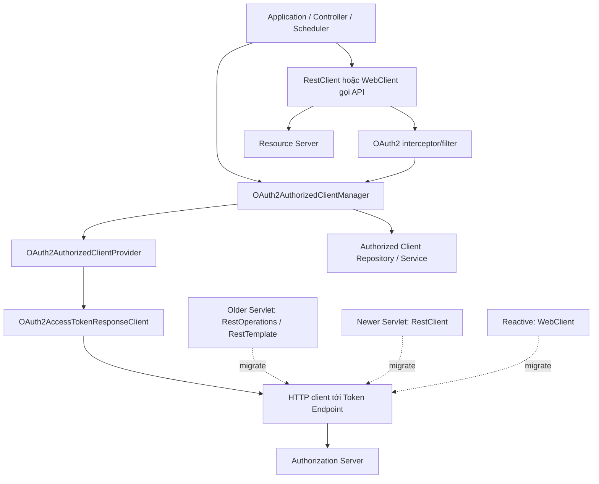

# 33.5. Đối chiếu API token response client và HTTP client giữa các phiên bản

> **Module:** Spring Security OAuth 2.0 OIDC Client  
> **Chương:** 33. Tương thích và nâng cấp  
> **Phạm vi:** Lộ trình chuyển đổi API khi tích hợp OAuth 2.0/OpenID Connect Client trên Spring Security 5.x, 6.x và 7.x; đặc biệt các implementation `OAuth2AccessTokenResponseClient`, `ReactiveOAuth2AccessTokenResponseClient`, `RestOperations`/`RestTemplate`, `RestClient` và `WebClient`.

Khi nâng cấp Spring Security, rất dễ thấy code vẫn biên dịch nhưng hành vi Token Endpoint thay đổi. Một cấu hình cũ dùng `DefaultAuthorizationCodeTokenResponseClient`, `setRequestEntityConverter(...)` và `setRestOperations(...)` có thể không còn là hướng được khuyến nghị; một cấu hình mới dùng `RestClientAuthorizationCodeTokenResponseClient`, `addParametersConverter(...)` và `setRestClient(...)` lại có semantics khác. Đặc biệt, khi tự tạo `RestClient` mà quên HTTP form converter hoặc OAuth2 error handler, login có thể gặp lỗi 415/400 hoặc không parse được `invalid_grant` dù Client ID, secret và redirect URI vẫn đúng.

Ở WebFlux, phương thức truy cập vẫn dựa trên `WebClient` và interface phản ứng `ReactiveOAuth2AccessTokenResponseClient`. Nhưng những hook để chèn, ghi đè hoặc xóa tham số token request đã được hoàn thiện theo các bản Spring Security mới. Đồng thời, các Spring Security 7.x APIs tiếp tục loại bỏ cơ chế cũ đã deprecated, đặc biệt password grant.

Bài này hướng dẫn **đối chiếu theo version và theo trách nhiệm**, tránh tìm/đổi tên class một cách máy móc. Các mốc chính dựa trên tài liệu Spring Security 6.4, 6.5 và 7.0; khi triển khai thật phải kiểm tra tài liệu/Javadoc đúng **patch version trong dependency tree** vì tính khả dụng, deprecation và auto-configuration có thể thay đổi.

---

## 1. Mục tiêu học tập

Sau bài này, bạn có thể:

1. Phân biệt HTTP client gọi **Token Endpoint** với HTTP client gọi **Resource Server API**.
2. Hiểu `OAuth2AccessTokenResponseClient<T>` là abstraction đồng bộ cho việc đổi OAuth2 grant lấy token response.
3. Hiểu `ReactiveOAuth2AccessTokenResponseClient<T>` là abstraction nonblocking trả `Mono<OAuth2AccessTokenResponse>`.
4. Đối chiếu họ `Default*TokenResponseClient` dùng `RestOperations` với họ `RestClient*TokenResponseClient` trong phiên bản mới.
5. Biết vì sao Spring Security 6.4 là mốc quan trọng của migration từ `RestTemplate` sang `RestClient` trên Servlet stack.
6. Phân biệt `RestClient` đồng bộ và `WebClient` reactive, tránh dùng nhầm lớp giữa hai stack.
7. Biết các API `addHeadersConverter`, `setHeadersConverter`, `addParametersConverter`, `setParametersConverter` và `setParametersCustomizer`.
8. Phân biệt **thêm** request parameters, **ghi đè** defaults và **xóa** default parameters.
9. Giải thích việc chỉ thay class implementation không đủ khi đã tùy biến headers, body, response converter hoặc error handler.
10. Dùng `OAuth2AccessTokenResponseHttpMessageConverter` và `OAuth2ErrorResponseErrorHandler` trong `RestClient` tùy biến.
11. Hiểu `setBodyExtractor` và `setWebClient` trên reactive token response client.
12. Nắm được auto-wiring theo bean generic grant type từ Spring Security 6.2+ và điểm cần test để tránh bean “được tạo nhưng không được sử dụng”.
13. Biết cách wiring token response client vào `oauth2Login`, `oauth2Client`, authorized-client providers/managers.
14. Đối chiếu grant `authorization_code`, `refresh_token`, `client_credentials`, JWT bearer và token exchange.
15. Hiểu password grant không có replacement bằng `RestClient*` và đã bị loại bỏ trong Spring Security 7.0.
16. Tách customization cho Client authentication (`client_secret_basic`, `client_secret_post`, `private_key_jwt`) khỏi token response parsing.
17. Tránh làm mất `code_verifier`, `redirect_uri` hoặc `grant_type` khi tùy biến token request.
18. Thiết kế regression tests với fake Authorization Server cho cả token success lẫn OAuth2 Error.
19. Xây chiến lược migration từng bước qua Spring Boot dependency management.
20. Bảo vệ secrets/tokens khỏi HTTP wiretap, headers/body logs và proxies trong lúc debug nâng cấp.

## 2. Trước tiên: hai vai trò HTTP client thường bị nhầm

Một OAuth2 Client có hai loại HTTP request quan trọng.

**A. Token request:** Client gọi Authorization Server/Token Endpoint:

```http
POST /oauth2/token HTTP/1.1
Host: login.example.test
Content-Type: application/x-www-form-urlencoded
Authorization: Basic <redacted-client-authentication>

grant_type=authorization_code&code=<redacted>&redirect_uri=...&code_verifier=<redacted>
```

Response:

```json
{
  "access_token": "<redacted>",
  "token_type": "Bearer",
  "expires_in": 300,
  "refresh_token": "<redacted>",
  "scope": "reports.read"
}
```

HTTP client ở đây nằm **bên trong token response client**, được dùng để xin/cập nhật access token.

**B. Protected resource request:** Ứng dụng gọi API nghiệp vụ:

```http
GET /api/reports HTTP/1.1
Host: api.example.test
Authorization: Bearer <redacted-access-token>
```

HTTP client ở đây có thể là `RestClient`/`WebClient` được gắn OAuth2 interceptor/filter để chọn authorized client và đặt Bearer token.

**Quan trọng:** `RestClientAuthorizationCodeTokenResponseClient` **không** phải một `RestClient` dùng trực tiếp để gọi `/api/reports`. Ngược lại, `OAuth2ClientHttpRequestInterceptor` hỗ trợ protected resource request, không tự đóng vai trò Token Endpoint response parser.

## 3. Sơ đồ kiến trúc và điểm thay đổi theo version



Trong Servlet stack:

- `OAuth2AccessTokenResponseClient<T>` là một callback/strategy đồng bộ.
- Một grant-specific provider gọi nó để nhận `OAuth2AccessTokenResponse`.
- Implementation cũ dùng `RestOperations`; implementation mới dùng `RestClient`.
- Client app gọi API có thể dùng `RestTemplate`, `RestClient` hoặc `WebClient` tùy code/version, nhưng đây là **luồng HTTP khác**.

Trong WebFlux:

- `ReactiveOAuth2AccessTokenResponseClient<T>` dùng giao thức reactive.
- Họ `WebClientReactive*TokenResponseClient` gửi request qua `WebClient`.
- WebClient gọi API có thể được kết hợp với reactive authorized-client manager, nhưng không thay token response client.

## 4. Bảng đối chiếu các mốc phiên bản

| Mốc | Token response client trên Servlet | HTTP transport | Điểm migration |
|---|---|---|---|
| Spring Security 5.x | Thường dùng `DefaultAuthorizationCodeTokenResponseClient` và các `Default*` tương ứng | `RestOperations`/`RestTemplate` | Custom `RequestEntity`, RestTemplate converters/error handler |
| Spring Security 6.0–6.3 | Các implementation `Default*` vẫn là đường quen thuộc | Chủ yếu RestTemplate cho token requests | 6.2+ cải thiện auto-configuration bằng bean generic token response client |
| Spring Security 6.4 | Bổ sung họ `RestClient*TokenResponseClient`; họ `Default*` bị deprecated để chuyển đổi | `RestClient` mới, đồng bộ | Chuyển extension hooks, converters, error handler; hỗ trợ ghi đè/xóa parameters rõ hơn |
| Spring Security 6.5 | Họ `RestClient*` là hướng mới trong tài liệu; APIs cũ đang trên lộ trình loại bỏ | `RestClient` | Dọn deprecations trước major upgrade |
| Spring Security 7.0 | Các API lỗi thời bị loại bỏ theo migration; password grant bị loại bỏ | `RestClient` trên Servlet, `WebClient` trên reactive | Không giả định code 6.x deprecated vẫn compile; kiểm tra release notes/Javadoc |

**Lưu ý về ngữ cảnh:** Spring Framework 6.1 đã giới thiệu `RestClient`. Spring Security 6.4 mới bổ sung họ token response clients dựa trên RestClient; chúng không xuất hiện chỉ vì project nâng cấp Spring Framework riêng lẻ. Tài liệu chính thức về 6.4 ghi rõ các implementation mới được giới thiệu như một lựa chọn migration; vì thế **đừng đồng nhất “có RestClient class” với “default token response đã đổi” ở mọi patch/version**.

## 5. Phiên bản thực tế đến từ dependency tree

Trong dự án Spring Boot, version Spring Security thường được Boot BOM quản lý. Đổi một dependency rời có thể tạo xung đột Spring Framework/Jackson/Netty.

Ví dụ:

```kotlin
plugins {
    id("org.springframework.boot") version "<compatible-boot-version>"
    id("io.spring.dependency-management") version "<compatible-version>"
    java
}

dependencies {
    implementation("org.springframework.boot:spring-boot-starter-security")
    implementation("org.springframework.boot:spring-boot-starter-oauth2-client")
}
```

Đây là **skeleton minh họa**, không phải một BOM được đề xuất cho tất cả version.

Khi upgrade phải biết:

- Spring Boot version.
- Spring Security version thực tế.
- Spring Framework version.
- Java baseline.
- Servlet hay WebFlux.
- Dependency nào kéo `spring-webflux`/Reactor Netty.
- Có `spring-security-oauth2-client` nhiều version trong runtime classpath không.
- Có custom code dùng API deprecated không.

Không hardcode phiên bản “mới nhất” trong tài liệu triển khai lâu dài; kiểm tra dependency tree và release notes của **version đang xây dựng**.

## 6. Interface OAuth2AccessTokenResponseClient<T>

Contract đồng bộ:

```java
import org.springframework.security.oauth2.client.endpoint.OAuth2AccessTokenResponseClient;
import org.springframework.security.oauth2.core.endpoint.OAuth2AccessTokenResponse;

// T là loại OAuth2 grant request cụ thể.
public interface OAuth2AccessTokenResponseClient<T> {
    OAuth2AccessTokenResponse getTokenResponse(T authorizationGrantRequest);
}
```

Đây là **sơ đồ chữ ký khái niệm**, không thay thế Javadoc/generic bound chính xác của version; thực tế type parameter được ràng buộc với `AbstractOAuth2AuthorizationGrantRequest`.

Ý nghĩa:

1. Nhận grant request chứa ClientRegistration và dữ liệu tương ứng grant.
2. Tạo Token Endpoint HTTP request.
3. Thực thi Client authentication/HTTP transport.
4. Parse OAuth2 token success/error response.
5. Trả `OAuth2AccessTokenResponse` hoặc báo lỗi theo contract.

### 6.1. Nó không thực hiện cả OIDC Login

Token response client không tự:

- Tạo/đối chiếu authorization request `state`.
- Chuyển browser sang Authorization Endpoint.
- Validate ID Token claims/nonce trong toàn pipeline.
- Lưu HTTP session.
- Lưu authorized client vào database.
- Gọi protected resource API.
- Revoke remote tokens.

Những bước đó nằm ở các components khác. Khi migration thay token response client, đừng bỏ các security controls ở layer phía trên.

## 7. Interface ReactiveOAuth2AccessTokenResponseClient<T>

Đường reactive dùng:

```java
import reactor.core.publisher.Mono;
import org.springframework.security.oauth2.client.endpoint.ReactiveOAuth2AccessTokenResponseClient;
import org.springframework.security.oauth2.core.endpoint.OAuth2AccessTokenResponse;

public interface ReactiveOAuth2AccessTokenResponseClient<T> {
    Mono<OAuth2AccessTokenResponse> getTokenResponse(T authorizationGrantRequest);
}
```

Đây cũng là biểu diễn contract; generic type bound theo version.

Sự khác biệt quan trọng:

- Không gọi HTTP theo kiểu blocking bên trong event loop.
- Lỗi được phát qua reactive error signal.
- Timeout/retry/context propagation áp dụng theo Reactor/HTTP connector.
- Response không được phát cho đến khi pipeline được subscribe trong ngữ cảnh đúng.
- Custom response extractor phải xử lý OAuth2 Error thành reactive error, không “trả token giả” khi server trả 400.

### 7.1. Không ép RestClient vào reactive chain tùy tiện

`RestClient` là synchronous. Gọi nó trực tiếp bên trong `Mono.map(...)` trên event loop gây blocking và làm giảm scalability. Nếu dự án WebFlux có dependency blocking bắt buộc, cần boundary/offloading hợp lý, nhưng ưu tiên `WebClientReactive*TokenResponseClient`.

## 8. Ánh xạ các implementation theo grant type

| Grant | Servlet API cũ (RestOperations) | Servlet API mới (RestClient) | Reactive (WebClient) |
|---|---|---|---|
| Authorization Code | `DefaultAuthorizationCodeTokenResponseClient` | `RestClientAuthorizationCodeTokenResponseClient` | `WebClientReactiveAuthorizationCodeTokenResponseClient` |
| Refresh Token | `DefaultRefreshTokenTokenResponseClient` | `RestClientRefreshTokenTokenResponseClient` | `WebClientReactiveRefreshTokenTokenResponseClient` |
| Client Credentials | `DefaultClientCredentialsTokenResponseClient` | `RestClientClientCredentialsTokenResponseClient` | `WebClientReactiveClientCredentialsTokenResponseClient` |
| JWT Bearer grant | `DefaultJwtBearerTokenResponseClient` (version có hỗ trợ) | `RestClientJwtBearerTokenResponseClient` | `WebClientReactiveJwtBearerTokenResponseClient` |
| Token Exchange | `DefaultTokenExchangeTokenResponseClient` (version có hỗ trợ) | `RestClientTokenExchangeTokenResponseClient` | `WebClientReactiveTokenExchangeTokenResponseClient` |
| Resource Owner Password | `DefaultPasswordTokenResponseClient` ở bản cũ | **Không có replacement**; bỏ grant | Legacy support theo bản cũ; 7.x không hỗ trợ password grant |

Không phải mọi class trong bảng đều tồn tại trên **mọi** Spring Security 5.x/6.x patch; đặc biệt JWT Bearer/Token Exchange được bổ sung theo quá trình phát triển. Hãy kiểm tra Javadoc version cụ thể trước khi copy import.

### 8.1. Password grant khác Client Credentials

Password grant gửi resource owner username/password cho Client và không còn được khuyến nghị theo OAuth2 Security Best Current Practice. Spring Security 7.0 đã loại bỏ support password grant. Không “migrate” sang Client Credentials vì Client Credentials đại diện **Client itself**, không phải user; thiết kế lại flow bằng Authorization Code + PKCE, Device Authorization hoặc cơ chế tương ứng với đối tượng sử dụng.

## 9. Đối chiếu Authorization Code token response client

**API cũ (Spring Security 5.x/6.x trước migration):**

```java
import org.springframework.security.oauth2.client.endpoint
    .DefaultAuthorizationCodeTokenResponseClient;

DefaultAuthorizationCodeTokenResponseClient client =
    new DefaultAuthorizationCodeTokenResponseClient();

client.setRequestEntityConverter(customRequestEntityConverter);
client.setRestOperations(customRestOperations);
```

Các biến `customRequestEntityConverter` và `customRestOperations` là **đối tượng do ứng dụng tạo**. Đoạn code nhấn mạnh shape của extension points cũ.

**API mới (từ 6.4):**

```java
import org.springframework.security.oauth2.client.endpoint
    .RestClientAuthorizationCodeTokenResponseClient;

RestClientAuthorizationCodeTokenResponseClient client =
    new RestClientAuthorizationCodeTokenResponseClient();

client.addParametersConverter(grantRequest -> {
    LinkedMultiValueMap<String, String> extra =
        new LinkedMultiValueMap<>();
    extra.set("audience", "https://reports-api.example.test");
    return extra;
});

// Khi thực sự cần custom transport:
client.setRestClient(customRestClient);
```

`customRestClient` phải được cấu hình để gửi form body, parse token response và xử lý OAuth2 errors đúng. API mới **không phải đổi trực tiếp** từ `setRestOperations` sang `setRestClient` rồi giữ nguyên RestTemplate object; type/interface và message conversion khác nhau.

## 10. Sự khác nhau giữa RestTemplate, RestOperations và RestClient

| Đặc điểm | `RestOperations`/`RestTemplate` | `RestClient` | `WebClient` |
|---|---|---|---|
| Execution model | Synchronous/blocking | Synchronous/blocking | Reactive/nonblocking contract |
| API style | `exchange`/`postForEntity` | Fluent request builder | Fluent reactive builder |
| Token response client lịch sử | Họ `Default*` | Họ `RestClient*` từ 6.4 | Họ `WebClientReactive*` |
| Request form serialization | HttpMessageConverters | HttpMessageConverters | WebFlux codecs |
| Response parsing | HttpMessageConverters | HttpMessageConverters | BodyExtractors/codecs |
| Error handling | ResponseErrorHandler | RestClient status handler | WebClient response/error handling |
| Runtime | Servlet/synchronous flows | Servlet/synchronous flows | Reactive WebFlux, đôi khi dùng từ Servlet với phối hợp phù hợp |
| Client gọi API nghiệp vụ | Dùng được | Dùng được | Dùng được theo đúng execution model |

Spring Framework `RestClient` không chỉ là “tên mới của RestTemplate”, nhưng cung cấp đường migration: `RestClient.create(restTemplate)` có thể tái sử dụng một số thiết lập của RestTemplate. Vẫn phải kiểm tra converters, error handlers, interceptors và semantics khi áp dụng vào Token Endpoint.

## 11. Tại sao RestClient được ưu tiên trong API mới?

RestClient cho cách diễn đạt dễ tách:

- Default/extra headers.
- Request content type.
- Request body/form.
- ClientHttpRequestFactory để cấu hình HTTP transport/proxy/TLS/timeouts.
- HTTP message converters.
- Status handler.
- Request interceptors.

Mục tiêu Spring Security 6.4 là giúp Servlet và Reactive có các extension hooks tương tự nhau thay vì mỗi stack một cách customization quá khác biệt.

### 11.1. Không bắt buộc “chuyển cả ứng dụng sang reactive”

Thay `DefaultAuthorizationCodeTokenResponseClient` bằng `RestClientAuthorizationCodeTokenResponseClient` **không** biến ứng dụng Servlet thành WebFlux. Cả RestTemplate và RestClient ở đây đều đồng bộ; migration chủ yếu là API/configuration.

## 12. Tùy biến Authorization Code headers bằng API mới

Dùng `addHeadersConverter` khi chỉ **thêm** header mà không muốn tự tạo toàn bộ headers:

```java
import org.springframework.http.HttpHeaders;
import org.springframework.security.oauth2.client.endpoint.RestClientAuthorizationCodeTokenResponseClient;

RestClientAuthorizationCodeTokenResponseClient client =
    new RestClientAuthorizationCodeTokenResponseClient();

client.addHeadersConverter(grantRequest -> {
    HttpHeaders headers = new HttpHeaders();
    if ("corporate".equals(
            grantRequest.getClientRegistration().getRegistrationId())) {
        headers.set(HttpHeaders.USER_AGENT, "report-portal/1.0");
    }
    return headers;
});
```

Đây là ví dụ app-specific header không chứa secret.

**Không** thay toàn bộ headers chỉ để thêm User-Agent: việc đó có thể bỏ `Content-Type`, `Accept` hoặc Client authentication.

### 12.1. setHeadersConverter ghi đè cách tạo headers

Khi phải thay hẳn converter:

```java
DefaultOAuth2TokenRequestHeadersConverter<OAuth2AuthorizationCodeGrantRequest>
    headersConverter = new DefaultOAuth2TokenRequestHeadersConverter<>();

headersConverter.setEncodeClientCredentials(false);

RestClientAuthorizationCodeTokenResponseClient client =
    new RestClientAuthorizationCodeTokenResponseClient();

client.setHeadersConverter(headersConverter);
```

Ví dụ trên liên quan một compatibility requirement của OP; nó **không** phải cấu hình mặc định khuyến nghị. Thay đổi cách encode Client credentials có thể ảnh hưởng tương thích/tuân thủ của `client_secret_basic`. Chỉ thực hiện nếu provider contract yêu cầu và test được HTTP request bytes.

## 13. Thêm token request parameter bằng addParametersConverter

Một OP có thể yêu cầu thêm `audience` hoặc `resource` khi đổi code:

```java
import org.springframework.security.oauth2.client.endpoint.RestClientAuthorizationCodeTokenResponseClient;
import org.springframework.util.LinkedMultiValueMap;
import org.springframework.util.MultiValueMap;

RestClientAuthorizationCodeTokenResponseClient client =
    new RestClientAuthorizationCodeTokenResponseClient();

client.addParametersConverter(grantRequest -> {
    MultiValueMap<String, String> params =
        new LinkedMultiValueMap<>();

    if ("reports".equals(
            grantRequest.getClientRegistration().getRegistrationId())) {
        params.set("audience", "https://reports-api.example.test");
    }
    return params;
});
```

Khi thêm parameter, các mặc định phục vụ `grant_type=authorization_code`, `code`, `redirect_uri` và `code_verifier` (nếu áp dụng PKCE) vẫn phải được framework xử lý. Không tự ghép URL query chứa authorization code.

### 13.1. Chỉ thêm parameter tại đúng grant

`audience` ở Authorization Endpoint có thể khác `audience` tại Token Endpoint. Nếu provider yêu cầu parameter tại cả hai bước, cần customization ở **authorization request resolver** và **token response client** tương ứng; không nghĩ một hook tự tác động tới cả hai.

### 13.2. Resource indicator (RFC 8707)

Khi OP hỗ trợ `resource`, một token request có thể chứa resource indicator. Tên/semantics/khả năng hỗ trợ phụ thuộc provider; không gửi arbitrary URL lấy từ user vào parameter này. Chọn resource từ allowlist gắn với registration và API audience.

## 14. setParametersConverter không giống addParametersConverter

Các hook mới có ý nghĩa khác nhau:

| Hook | Mục đích | Lưu ý |
|---|---|---|
| `addParametersConverter(...)` | Thêm parameters sau defaults | Dùng cho `audience`/custom params thông thường |
| `setParametersConverter(...)` | Converter có thể ghi đè giá trị default/các parameters đã có | Không đồng nghĩa loại bỏ mọi defaults |
| `setParametersCustomizer(...)` | Thao tác lên tập parameters cuối, bao gồm xóa default | Dùng rất thận trọng |
| `addHeadersConverter(...)` | Bổ sung headers | Không phá default Client authentication headers |
| `setHeadersConverter(...)` | Tự tạo headers | Phải bảo toàn required headers/auth method |

Theo tài liệu 6.4, `setParametersConverter` chỉ cho phép override các key, còn để **xóa** một parameter mặc định phải dùng `setParametersCustomizer`. Các thao tác này có thể mang tên tương tự ở Servlet/Reactive clients nhưng hãy kiểm tra Javadoc của từng implementation/version.

## 15. Ví dụ ghi đè một request parameter

Giả sử một provider có compatibility exception yêu cầu một `client_id` khác giá trị trong registration (trường hợp hiếm, cần thẩm định rõ):

```java
RestClientRefreshTokenTokenResponseClient client =
    new RestClientRefreshTokenTokenResponseClient();

client.setParametersConverter(grantRequest -> {
    LinkedMultiValueMap<String, String> params =
        new LinkedMultiValueMap<>();

    if ("legacy".equals(
            grantRequest.getClientRegistration().getRegistrationId())) {
        params.set("client_id", "legacy-client-id");
    }
    return params;
});
```

Đây là **ví dụ semantics của override**, không nên áp dụng máy móc: Client authentication và grant binding có thể bị sai nếu Client ID không nhất quán với AS. Tình huống thực tế nên sửa ClientRegistration hoặc provider integration contract trước khi thay giá trị cốt lõi.

### 15.1. Không dùng setParametersConverter để “xóa” mặc định

Trả về `new LinkedMultiValueMap<>()` có thể vẫn để framework bổ sung default parameters. Không xem một map rỗng là cách ngăn `client_id` hay `grant_type` xuất hiện.

## 16. Xóa parameter sau khi đã tạo bằng setParametersCustomizer

Trong một số JWT Client authentication flows, AS không cho phép vừa gửi `client_assertion` vừa gửi `client_id` riêng trong body.

Tùy contract của provider, có thể:

```java
import org.springframework.security.oauth2.core.OAuth2ParameterNames;
import org.springframework.security.oauth2.client.endpoint.RestClientClientCredentialsTokenResponseClient;

RestClientClientCredentialsTokenResponseClient client =
    new RestClientClientCredentialsTokenResponseClient();

client.setParametersCustomizer(parameters -> {
    if (parameters.containsKey(OAuth2ParameterNames.CLIENT_ASSERTION)) {
        parameters.remove(OAuth2ParameterNames.CLIENT_ID);
    }
});
```

**Đây không phải luật chung của private_key_jwt.** Việc có được bỏ client_id hay không phụ thuộc grant, client authentication method và AS policy. Phải kiểm tra cả `client_assertion_type`, signature, `aud`/`iss`/`sub` của assertion và trường hợp key rotation.

### 16.1. Tuyệt đối không xóa grant_type/code/verifier bừa bãi

Các fields `grant_type`, `code`, `redirect_uri` và `code_verifier` (khi PKCE) là yếu tố ràng buộc protocol. Xóa để “server bớt báo lỗi” thường là dấu hiệu sai cấu hình và làm mất bảo vệ. Tạo negative tests để phát hiện customization vô tình xóa required fields.

## 17. Default RestClient cho Token Endpoint cần những converter nào?

Một cấu hình tương đương defaults trong tài liệu Spring Security mới thường có:

```java
import org.springframework.http.converter.FormHttpMessageConverter;
import org.springframework.security.oauth2.core.http.converter.OAuth2AccessTokenResponseHttpMessageConverter;
import org.springframework.security.oauth2.client.http.OAuth2ErrorResponseErrorHandler;
import org.springframework.web.client.RestClient;

RestClient tokenRestClient = RestClient.builder()
    .messageConverters(converters -> {
        converters.clear();
        converters.add(new FormHttpMessageConverter());
        converters.add(new OAuth2AccessTokenResponseHttpMessageConverter());
    })
    .defaultStatusHandler(new OAuth2ErrorResponseErrorHandler())
    .build();
```

Code minh họa đúng ý tưởng cấu hình được reference mô tả: một converter form để gửi Token Request, một converter cho token response, và error handler tương ứng OAuth2 Error.

**Không** tự ý đổi sang generic JSON converter rồi hy vọng OAuth2Error/TokenResponse vẫn có semantics giống trước.

### 17.1. Tại sao cần FormHttpMessageConverter?

OAuth2 Token Request theo các grant phổ biến dùng `application/x-www-form-urlencoded` POST body. Một `RestClient` custom chỉ cài JSON converter có thể không serialize được `MultiValueMap<String,String>`.

### 17.2. Tại sao cần OAuth2AccessTokenResponseHttpMessageConverter?

Nó chuyển token response parameters thành `OAuth2AccessTokenResponse`, diễn giải token type, expiry, scopes và additional parameters theo framework contract. Một generic JSON-to-Map không tự biết cách chuyển đúng token semantics.

### 17.3. Error handler quan trọng như happy path

AS có thể trả:

```http
HTTP/1.1 400 Bad Request
Content-Type: application/json

{"error":"invalid_grant","error_description":"Authorization code is invalid"}
```

Nếu custom RestClient chỉ ném một generic HTTP exception, các tầng trên có thể không nhận được OAuth2 Error theo contract cũ, dẫn đến retries hoặc user-facing diagnostics sai. Phải kiểm thử cả HTTP 400/401/429/5xx.

## 18. Thay setRestOperations bằng setRestClient đúng cách

Một cấu hình cũ:

```java
RestTemplate restTemplate = new RestTemplate(
    Arrays.asList(
        new FormHttpMessageConverter(),
        new OAuth2AccessTokenResponseHttpMessageConverter()
    )
);
restTemplate.setErrorHandler(new OAuth2ErrorResponseErrorHandler());

DefaultAuthorizationCodeTokenResponseClient client =
    new DefaultAuthorizationCodeTokenResponseClient();
client.setRestOperations(restTemplate);
```

Một cấu hình mới:

```java
RestClient restClient = RestClient.builder()
    .messageConverters(converters -> {
        converters.clear();
        converters.add(new FormHttpMessageConverter());
        converters.add(new OAuth2AccessTokenResponseHttpMessageConverter());
    })
    .defaultStatusHandler(new OAuth2ErrorResponseErrorHandler())
    .build();

RestClientAuthorizationCodeTokenResponseClient client =
    new RestClientAuthorizationCodeTokenResponseClient();
client.setRestClient(restClient);
```

Đây là đối chiếu tư duy. Trong project thật có thể giữ custom request factory/proxy/TLS/timeouts, nhưng cách chuyển những cấu hình đó phải được kiểm tra riêng theo APIs của Spring Framework version.

### 18.1. RestClient.create(restTemplate) có phải giải pháp một dòng?

Spring Framework hỗ trợ tạo RestClient từ RestTemplate như đường chuyển đổi. Nhưng kết quả cần kiểm tra:

- Interceptors.
- Message converters.
- Error handling.
- Default headers.
- ClientHttpRequestFactory.
- Proxy/TLS/timeouts.
- Quan hệ giữa cấu hình cũ và mới.

Không coi `RestClient.create(restTemplate)` là bằng chứng Token Endpoint semantics giữ nguyên khi chưa có regression test.

## 19. Custom response converter: trường hợp AS không chuẩn

Một AS có thể trả `expires_in` bằng chuỗi, thêm `custom_claim` hoặc dùng format legacy khác contract.

Trong Servlet API mới, có thể tùy biến `OAuth2AccessTokenResponseHttpMessageConverter`:

```java
OAuth2AccessTokenResponseHttpMessageConverter converter =
    new OAuth2AccessTokenResponseHttpMessageConverter();

converter.setAccessTokenResponseConverter(parameters -> {
    // Chuyển parameters theo contract của provider.
    // Phải tạo OAuth2AccessTokenResponse hợp lệ.
    // Không loại bỏ refresh_token hoặc additionalParameters tùy tiện.
    return convertLegacyResponse(parameters);
});

RestClient restClient = RestClient.builder()
    .messageConverters(converters -> {
        converters.clear();
        converters.add(new FormHttpMessageConverter());
        converters.add(converter);
    })
    .defaultStatusHandler(new OAuth2ErrorResponseErrorHandler())
    .build();
```

`convertLegacyResponse` là **hàm do ứng dụng tự viết**, không phải Spring Security API. Cần đối chiếu Javadoc converter signature và logic parsing của đúng version.

### 19.1. Những trường cần giữ đúng

- `access_token` không rỗng.
- `token_type` hỗ trợ (thường Bearer).
- `expires_in` đúng đơn vị và giới hạn.
- `scope`/set scopes.
- `refresh_token` nếu response cấp, kể cả refresh token rotation.
- `id_token` và other OIDC additional parameters phục vụ login validation.
- Custom parameters chỉ khi cần và không phát tán vào logs.

**Cảnh báo:** Một converter tự viết chỉ copy access token rồi bỏ `id_token` có thể làm OIDC Login thất bại dù OAuth2 Token Response bản thân là 200.

## 20. OAuth2 Error Response converter

Một AS legacy có thể trả error field khác chuẩn. Tùy project, custom:

```java
OAuth2ErrorHttpMessageConverter errorConverter =
    new OAuth2ErrorHttpMessageConverter();

errorConverter.setErrorConverter(parameters -> {
    String code = String.valueOf(
        parameters.getOrDefault("error", "oauth2_error")
    );
    return new OAuth2Error(code);
});

OAuth2ErrorResponseErrorHandler handler =
    new OAuth2ErrorResponseErrorHandler();
handler.setErrorConverter(errorConverter);
```

Đoạn code mang tính minh họa. Trong production, phải dùng allowlist error codes và kiểm tra type/converter API version; không đưa raw `error_description` chứa dữ liệu từ provider vào logs/tickets.

### 20.1. Không “đổi mọi lỗi thành retryable”

`invalid_client`, `invalid_grant` và `invalid_scope` là lỗi có nghĩa khác 503/timeout. Converter/error handler mới phải giữ classification để authorized-client manager hoặc login failure handler xử lý đúng.

## 21. Reactive: WebClientReactiveAuthorizationCodeTokenResponseClient

Trong WebFlux, implementation chủ đạo vẫn là:

```java
import org.springframework.security.oauth2.client.endpoint.WebClientReactiveAuthorizationCodeTokenResponseClient;
import org.springframework.security.oauth2.client.endpoint.ReactiveOAuth2AccessTokenResponseClient;
import org.springframework.security.oauth2.client.endpoint.OAuth2AuthorizationCodeGrantRequest;

@Bean
ReactiveOAuth2AccessTokenResponseClient<OAuth2AuthorizationCodeGrantRequest>
authorizationCodeTokenResponseClient() {
    WebClientReactiveAuthorizationCodeTokenResponseClient client =
        new WebClientReactiveAuthorizationCodeTokenResponseClient();

    client.addParametersConverter(grantRequest -> {
        LinkedMultiValueMap<String, String> parameters =
            new LinkedMultiValueMap<>();
        parameters.set("audience", "https://reports-api.example.test");
        return parameters;
    });

    return client;
}
```

Imports về `LinkedMultiValueMap`, `Bean` như ở các ví dụ trước cần thêm khi đặt thành file Java hoàn chỉnh.

### 21.1. WebClient không đồng nghĩa Token Endpoint được gọi trước mỗi API request

Reactive authorized-client manager/service quyết định reuse hay refresh theo validity. Token response client chỉ gửi Token Request khi provider/manager cần xin token. Không gọi trực tiếp nó trong mỗi controller request nếu không có nhu cầu protocol rõ ràng.

### 21.2. Tránh .block()

Không gọi `tokenResponseClient.getTokenResponse(...).block()` trong WebFlux event loop. Điều đó làm blocking, có thể gây lỗi runtime hoặc giảm throughput. Compose `Mono` và để framework subscribe đúng context.

## 22. Reactive addHeadersConverter và setHeadersConverter

API mới cho phép pattern tương tự Servlet:

```java
WebClientReactiveAuthorizationCodeTokenResponseClient client =
    new WebClientReactiveAuthorizationCodeTokenResponseClient();

client.addHeadersConverter(grantRequest -> {
    HttpHeaders headers = new HttpHeaders();
    headers.set(HttpHeaders.USER_AGENT, "report-portal/1.0");
    return headers;
});
```

Nếu phải thay headers converter:

```java
DefaultOAuth2TokenRequestHeadersConverter<OAuth2AuthorizationCodeGrantRequest>
    converter = new DefaultOAuth2TokenRequestHeadersConverter<>();

// Chỉ minh họa khi OP yêu cầu compatibility:
converter.setEncodeClientCredentials(false);
client.setHeadersConverter(converter);
```

Cần kiểm tra Client authentication method thực tế (basic/post/private_key_jwt/none), vì thay converter toàn phần có thể vô hiệu hóa required headers mà test mock principal không phát hiện.

## 23. Reactive setParametersConverter và setParametersCustomizer

Từ những cải tiến 6.4, reactive clients có thể override và omit default parameters bằng hook tương ứng.

Ví dụ thêm custom parameter:

```java
WebClientReactiveRefreshTokenTokenResponseClient client =
    new WebClientReactiveRefreshTokenTokenResponseClient();

client.addParametersConverter(grantRequest -> {
    LinkedMultiValueMap<String, String> params =
        new LinkedMultiValueMap<>();
    params.set("resource", "https://reports-api.example.test");
    return params;
});
```

Ví dụ xóa conditionally một parameter theo provider contract:

```java
client.setParametersCustomizer(params -> {
    if (params.containsKey(OAuth2ParameterNames.CLIENT_ASSERTION)) {
        params.remove(OAuth2ParameterNames.CLIENT_ID);
    }
});
```

Không suy rằng `setParametersCustomizer` có cùng overload trên **mọi** version 6.x: kiểm tra API/Javadoc của dependency đang build; Spring Security 6.3 và cũ hơn có những hạn chế customization ở reactive stack.

## 24. Reactive response conversion: BodyExtractor

Khi custom Token Response BodyExtractor:

```java
WebClientReactiveAuthorizationCodeTokenResponseClient client =
    new WebClientReactiveAuthorizationCodeTokenResponseClient();

client.setBodyExtractor((input, context) -> {
    // Đây là hook reactive body extractor.
    // Phải parse success response và phát OAuth2 errors đúng contract.
    return customOAuth2TokenExtractor(input, context);
});
```

`customOAuth2TokenExtractor` là function minh họa cần tự triển khai với đúng kiểu `BodyExtractor<Mono<OAuth2AccessTokenResponse>, ReactiveHttpInputMessage>` trong version sử dụng. Không đơn giản `BodyExtractors.toMono(Map.class)` rồi trả `Mono.empty()` cho lỗi; như vậy authorized client manager có thể xử lý sai.

### 24.1. Trách nhiệm bổ sung của custom BodyExtractor

- Parse JSON/body theo Content-Type.
- Diễn giải access token/token type/expires/scopes.
- Giữ refresh token, ID Token và additional parameters.
- Xử lý error response bằng `Mono.error(...)` theo OAuth2 error contract.
- Không in response body chứa credentials.
- Giới hạn kích thước body và timeout qua WebClient configuration phù hợp.

Nếu chỉ cần sửa một custom field, ưu tiên hook nhỏ nhất được version hỗ trợ thay vì thay toàn bộ extractor.

## 25. Reactive setWebClient và sự khác biệt với setRestClient

Ví dụ:

```java
WebClient webClient = WebClient.builder()
    // Cấu hình connector, timeout, proxy, codecs khi cần.
    .build();

WebClientReactiveAuthorizationCodeTokenResponseClient client =
    new WebClientReactiveAuthorizationCodeTokenResponseClient();

client.setWebClient(webClient);
```

Khi thay WebClient, phải xét:

- OAuth2 form body encoding.
- Token response codecs.
- HTTP error mapping.
- Timeouts/retries.
- TLS trust/proxy.
- Request/response filters và header propagation.
- Reactor Context.
- Wiretap/log redaction.

Không lấy một `WebClient` dùng cho Business API có Bearer interceptor rồi truyền vào Token Endpoint client: nó có thể đính kèm **access token không đúng** cho AS hoặc tạo authorization recursion.

## 26. Token Endpoint WebClient phải tách khỏi API WebClient

Một project có thể có:

```text
tokenWebClient:
  base target: OP token endpoint
  client authentication
  form requests / OAuth2 Error parsing
  no default Bearer user token filter

resourceWebClient:
  base target: reports-api
  OAuth2 authorized client filter
  Authorization: Bearer ...
  API-specific retries/decoders
```

Tách hai clients để không gửi token hoặc Client secret sai đích. Nếu có proxy/TLS configuration chung, tái sử dụng phần transport được review, không tái sử dụng toàn bộ security filters một cách mù quáng.

## 27. Bean generic type injection từ Spring Security 6.2+

Một thay đổi API/configuration quan trọng là khả năng publish bean kiểu:

```java
@Bean
OAuth2AccessTokenResponseClient<OAuth2AuthorizationCodeGrantRequest>
authorizationCodeTokenResponseClient() {

    RestClientAuthorizationCodeTokenResponseClient client =
        new RestClientAuthorizationCodeTokenResponseClient();

    client.addParametersConverter(grantRequest -> {
        LinkedMultiValueMap<String, String> params =
            new LinkedMultiValueMap<>();
        params.set("audience", "https://reports-api.example.test");
        return params;
    });

    return client;
}
```

Tài liệu 6.2+ mô tả Spring Security có thể dùng generic grant type để chọn bean phù hợp và cấu hình OAuth2 Client components mặc định.

### 27.1. Những điều cần kiểm tra

- Type parameter có thật sự là `OAuth2AuthorizationCodeGrantRequest`?
- Bean bị khai báo raw `OAuth2AccessTokenResponseClient` không có generic?
- Có hai beans cùng generic type gây ambiguity không?
- Application có tự publish `OAuth2AuthorizedClientManager` với provider chain riêng khiến auto-configuration không tác động?
- Login filter và authorized-client manager có dùng cùng client mong muốn không?
- Dự án trên 6.1/6.0 không có hành vi auto-wiring được mô tả cho 6.2+?

**Test việc bean được gọi**, không chỉ test bean tồn tại trong context.

## 28. Explicit wiring vào oauth2Login() tokenEndpoint()

Với Servlet Login, thay vì chỉ publish bean, có thể wiring tường minh:

```java
@Bean
SecurityFilterChain securityFilterChain(
        HttpSecurity http,
        OAuth2AccessTokenResponseClient<OAuth2AuthorizationCodeGrantRequest>
            authorizationCodeClient) throws Exception {

    return http
        .authorizeHttpRequests(auth -> auth
            .anyRequest().authenticated()
        )
        .oauth2Login(login -> login
            .tokenEndpoint(token ->
                token.accessTokenResponseClient(authorizationCodeClient)
            )
        )
        .build();
}
```

Ví dụ dành cho Spring Security Servlet DSL có method tương ứng trong các version 6.x/7.x. Khi có cả `oauth2Client` authorization code grant cho ứng dụng ngoài browser login, cần xem đường cấu hình thứ hai.

### 28.1. oauth2Login và oauth2Client không hoàn toàn một nơi

- `oauth2Login` quản lý browser login/callback.
- `oauth2Client`/authorized-client manager hỗ trợ authorization ngoài login và reuse/refresh tokens khi gọi APIs.
- Một custom token response client có thể được cấu hình ở một chỗ nhưng chưa được dùng ở chỗ khác.

Nếu provider yêu cầu `audience` khi login code exchange, nhưng background refresh/token calls không gửi tham số tương ứng, các flows sẽ khác nhau. Cần regression tests trên từng grant.

## 29. Explicit wiring cho OAuth2AuthorizedClientProvider

Một hướng là custom provider builder:

```java
OAuth2AuthorizedClientProvider provider =
    OAuth2AuthorizedClientProviderBuilder.builder()
        .clientCredentials(config -> config
            .accessTokenResponseClient(
                clientCredentialsTokenResponseClient
            )
        )
        .refreshToken(config -> config
            .accessTokenResponseClient(
                refreshTokenResponseClient
            )
        )
        .build();
```

Đây là mẫu API hiện đại trên Servlet; hai biến token response client đã được tạo/config ở nơi khác và phải đúng generic types. Một số builders/overloads thay đổi qua version, vì vậy kiểm tra Javadoc của version trong dự án.

### 29.1. Đừng đánh đồng authorization provider và response client

`OAuth2AuthorizedClientProvider` quyết định khi nào client cần authorize/refresh; `OAuth2AccessTokenResponseClient` thực hiện HTTP Token Endpoint call. Thay response client không tự thay refresh policy, clock skew, lưu token hay failure handler.

## 30. RestClient để gọi Resource Server: 6.4+ use case

Spring Security 6.4 giới thiệu integration giúp `RestClient` gửi Bearer token từ `OAuth2AuthorizedClientManager` qua interceptor:

```java
import org.springframework.context.annotation.Bean;
import org.springframework.security.oauth2.client.OAuth2AuthorizedClientManager;
import org.springframework.security.oauth2.client.web.client.OAuth2ClientHttpRequestInterceptor;
import org.springframework.web.client.RestClient;

@Bean
RestClient reportsRestClient(
        RestClient.Builder builder,
        OAuth2AuthorizedClientManager manager) {

    OAuth2ClientHttpRequestInterceptor interceptor =
        new OAuth2ClientHttpRequestInterceptor(manager);

    return builder
        .requestInterceptor(interceptor)
        .build();
}
```

Khi gọi API, ứng dụng phải chọn authorized client/registration theo policy và không gửi token tới arbitrary URL.

### 30.1. Chọn registration theo request attributes

Ví dụ minh họa:

```java
import static org.springframework.security.oauth2.client.web.client
    .RequestAttributeClientRegistrationIdResolver.clientRegistrationId;

Report report = reportsRestClient.get()
    .uri("https://api.example.test/reports/current")
    .attributes(clientRegistrationId("reports-client"))
    .retrieve()
    .body(Report.class);
```

Giả định class `Report` do ứng dụng định nghĩa. API này là **outbound protected resource request**, không phải token response client.

### 30.2. HTTP transport customization có thể cần ở cả hai nơi

Proxy settings/MTLS/trust store có thể khác giữa OP Token Endpoint và Resource Server. Nếu Token Endpoint phải qua corporate proxy nhưng API dùng service mesh, cấu hình hai RestClients riêng. Không tự chia sẻ Client secret/auth header giữa hai destinations.

## 31. WebClient dùng để gọi Resource Server

Trong Servlet app, từng có nhiều tích hợp `WebClient` bằng authorized client filter. Trong WebFlux, `ServerOAuth2AuthorizedClientExchangeFilterFunction` có thể tích hợp reactive authorized-client manager.

Ví dụ khái niệm:

```java
ServerOAuth2AuthorizedClientExchangeFilterFunction oauth2 =
    new ServerOAuth2AuthorizedClientExchangeFilterFunction(
        reactiveAuthorizedClientManager
    );

WebClient apiClient = WebClient.builder()
    .filter(oauth2)
    .build();
```

Biến manager phải là `ReactiveOAuth2AuthorizedClientManager` thích hợp. Khi gọi, phải chọn authorized client/registration hoặc context đúng. Không kỳ vọng filter tự biết mọi API audience chỉ từ `uri()`.

### 31.1. Đừng đem RestClient interceptor gắn vào WebClient

`OAuth2ClientHttpRequestInterceptor` thuộc `RestClient` integration, không phải WebClient `ExchangeFilterFunction`. Nếu chuyển Servlet/WebFlux stack, phải đổi cả execution model và integration point, không chỉ rename class.

## 32. Client Credentials: migration cần kiểm tra provider chain

Đối với machine-to-machine:

```text
OAuth2AuthorizedClientManager
    -> ClientCredentialsOAuth2AuthorizedClientProvider
    -> OAuth2AccessTokenResponseClient<OAuth2ClientCredentialsGrantRequest>
    -> Token Endpoint
```

API cũ:

```java
DefaultClientCredentialsTokenResponseClient client =
    new DefaultClientCredentialsTokenResponseClient();

client.setRestOperations(customRestOperations);
```

API mới:

```java
RestClientClientCredentialsTokenResponseClient client =
    new RestClientClientCredentialsTokenResponseClient();

client.addParametersConverter(grantRequest -> {
    LinkedMultiValueMap<String, String> extra =
        new LinkedMultiValueMap<>();
    extra.set("audience", "https://reports-api.example.test");
    return extra;
});
```

### 32.1. Không dùng principal browser cho M2M một cách vô thức

Client Credentials đại diện ứng dụng, không user đăng nhập. Authorized client manager/service key phải ổn định và tách khỏi user sessions theo thiết kế. Khi migration, nếu manager đang dùng một principal ngẫu nhiên theo request, có thể phát tokens lặp lại và gây cache misses.

### 32.2. Khi nào provider yêu cầu resource parameter?

Một số AS dùng `audience` hoặc `resource`, hoặc scoped resource registration. Chỉ cấu hình theo provider contract đã xác minh; không coi giá trị parameter là tùy ý từ query của user.

## 33. Refresh Token: migration cần kiểm tra rotation

API cũ:

```java
DefaultRefreshTokenTokenResponseClient client =
    new DefaultRefreshTokenTokenResponseClient();
client.setRestOperations(customRestOperations);
```

API mới:

```java
RestClientRefreshTokenTokenResponseClient client =
    new RestClientRefreshTokenTokenResponseClient();
client.setRestClient(tokenRestClient);
```

Ngoài việc request chạy và parse được access token, phải kiểm tra:

- Refresh token mới có được lưu không?
- Nếu response không trả refresh token, policy giữ token cũ đúng semantics không?
- Expiry và scopes có được parse đúng không?
- `invalid_grant` có được chuyển thành authorization failure thích hợp không?
- Khi hai pods refresh đồng thời, token mới có bị ghi đè hoặc xóa nhầm không?
- Có gửi Client authentication đúng method không?
- Có log raw refresh token trong request/response không?

### 33.1. Không nghĩ token response client giải quyết distributed rotation

Token response client chỉ thực thi HTTP grant. Race control, CAS, lock và durable authorized-client storage nằm ở layer khác. Một migration `DefaultRefresh*` → `RestClientRefresh*` không tự làm cụm an toàn khi AS rotate refresh tokens.

## 34. JWT Bearer và Token Exchange

Spring Security mới hỗ trợ thêm những grant types/mở rộng như JWT Bearer và Token Exchange qua các response clients chuyên dụng.

| Dạng | Điều cần bảo toàn |
|---|---|
| JWT Bearer grant | Assertion construction, Client auth, audience, signature, grant type, token response parsing |
| Token Exchange | Subject token, actor token nếu có, token type fields, resource/audience/scopes, policy |
| Client Credentials | Client identity, scopes, cache key, target resource |
| Authorization Code | Code, redirect URI, PKCE, state/nonce ở tầng login |
| Refresh | Refresh token, rotation, storage, invalid_grant handling |

Không dùng `RestClientClientCredentialsTokenResponseClient` để mô phỏng Token Exchange vì các required request parameters và trust semantics khác nhau. Chỉ nâng cấp sang version có hỗ trợ class tương ứng và kiểm tra đầy đủ grant-specific response client.

### 34.1. Client assertion khác JWT Bearer authorization grant

`private_key_jwt` là **Client authentication method**, còn JWT Bearer grant là **authorization grant type**. Cùng dùng JWT nhưng không phải một. Test phải xác nhận `client_assertion` không bị nhầm thành `assertion` dành cho grant khác.

## 35. Password grant đã bị loại bỏ trong 7.x

Theo Spring Security 7.0 “What's New”, support Resource Owner Password Credentials grant đã bị xóa. 6.4 đã không cung cấp `RestClientPasswordTokenResponseClient` thay thế.

Không tìm cách dùng private deprecated class hoặc fork nó để tiếp tục gửi username/password qua Token Endpoint.

Các hướng thay thế theo đối tượng:

- Browser/web app: Authorization Code + PKCE hoặc confidential Client theo threat model.
- Native/public Client: Authorization Code + PKCE.
- Thiết bị không thuận tiện browser: Device Authorization Grant nếu AS hỗ trợ.
- M2M: Client Credentials khi thực sự đại diện Client.
- Delegation/impersonation: Token Exchange hoặc flow đặc thù đã được đánh giá.

Migration password grant là **thay đổi kiến trúc và security protocol**, không chỉ đổi HTTP client implementation.

## 36. Lưu ý deprecations khi nâng lên 7.x

Một dự án 6.5 còn compile với deprecated APIs có thể fail khi sang major version. Cần scan:

```text
DefaultAuthorizationCodeTokenResponseClient
DefaultRefreshTokenTokenResponseClient
DefaultClientCredentialsTokenResponseClient
DefaultJwtBearerTokenResponseClient
DefaultTokenExchangeTokenResponseClient
DefaultPasswordTokenResponseClient
setRestOperations(...)
setRequestEntityConverter(...)
old password grant providers/managers
```

Không kết luận tất cả các tên này **đều có mặt trên mọi version trước 7**; scan theo actual dependencies. Với mỗi usage:

1. Tìm grant type.
2. Tìm token request customizations.
3. Tìm response/error customizations.
4. Tìm HTTP transport/proxy/TLS.
5. Chọn replacement class.
6. Viết regression test.
7. Cấu hình wiring đúng.
8. Loại code/API deprecated trước major upgrade.

## 37. Tách “API change” và “behavior change”

Có hai loại migration:

**Source/API migration:** import mới, đổi class, method name, bean wiring. Compiler/Javadoc phát hiện phần nào.

**Behavior migration:** form request, encoding, response content type, error mapping, redirect/proxy, retries, socket timeouts. Compiler **không thể** bảo đảm phần này.

Ví dụ:

```java
client.setRestClient(RestClient.create());
```

có thể compile nhưng không tự chứng minh RestClient đó được cấu hình đúng converters/handlers cho OAuth2 Token Endpoint.

### 37.1. Diff cần ở HTTP boundary

Khi chạy fake AS, so sánh những yếu tố được cho phép:

- Method POST.
- Token Endpoint URL.
- Content-Type form.
- Grant type.
- Client authentication method.
- Presence của required grant parameters.
- Custom provider params.
- Response/error parsing.
- Retry/timeout behavior.

Không diff raw authorization code/refresh token bằng cách in vào CI logs.

## 38. HTTP timeout, TLS và proxy settings

Token requests có thể bị ảnh hưởng khi đổi transport:

- Connection timeout.
- Read/response timeout.
- Connection pool.
- Proxy authentication.
- mTLS trust/key material.
- DNS resolution.
- Redirect following.
- TLS hostname verification.
- HTTP/2 negotiation.
- Retry strategy.

Các API cấu hình nằm ở `ClientHttpRequestFactory`/RestClient builder hoặc WebClient connector/Reactor Netty, không nhất thiết ở TokenResponseClient.

### 38.1. Không disable TLS để vượt qua regression

Nếu migration gặp certificate error, sửa truststore/mTLS/proxy/issuer URL. Không đặt “trust all certificates”/disable hostname verification trong production, vì token requests chứa credentials.

### 38.2. Không follow arbitrary redirects có credentials

Token Endpoint thường là endpoint cố định. HTTP client theo redirect sang hostname khác có thể làm lộ Client authentication headers/body. Kiểm tra redirect policy và allowlist destinations.

## 39. Error handling: 400 khác 401, 429 và 503

| Response | Ý nghĩa thường gặp | Điều cần kiểm thử |
|---|---|---|
| 200 JSON token | Grant thành công | Access token, expiry, refresh, ID Token |
| 400 invalid_grant | Code/refresh token không hợp lệ/hết hạn/reused | Mapping thành OAuth2 authorization failure |
| 400 invalid_scope | Scope không được phép | Không retry mù |
| 401 invalid_client | Client authentication sai | Không log Client secret, error classification |
| 429 rate limit | AS giới hạn | Retry/backoff theo policy, không storm |
| 500/503 | AS lỗi hoặc unavailable | Timeout/retry có giới hạn |
| 200 malformed JSON | Protocol response invalid | Không tạo token “một nửa” |
| 200 token_type khác Bearer | Tùy provider/token type support | Validate, không assume Bearer |
| 200 thiếu access_token | Invalid response | Fail closed |
| Slow response | Network/OP timeout | Latency budget |
| Wrong content type | OP không tuân chuẩn | Contract/compatibility policy rõ |

Đặc biệt, `invalid_grant` sau refresh rotation có thể là dấu hiệu stale refresh token ở pod khác; token response client cần phát lỗi đúng, còn durable store xử lý concurrency.

## 40. Testing: không chỉ mock OAuth2Authenticated principal

Một test dùng `oidcLogin()` hoặc `mockOidcLogin()` đặt Authentication giả không thực hiện Token Endpoint HTTP request. Nó không thể phát hiện converter bị hỏng sau RestClient migration.

Cần fake AS/OP:

```text
App / Spring Security
   |
   v
RestClient*TokenResponseClient hoặc WebClientReactive*
   |
   v
Fake Token Endpoint
   |-- kiểm tra form + Client authentication
   |-- trả 200 token response
   |-- trả 400 invalid_grant
   |-- trả 401 invalid_client
   |-- trả malformed JSON
   +-- giả lập timeout/503
```

Mock OIDC principals rất có giá trị cho authorization policy tests, nhưng **không thay** Token Endpoint integration tests.

## 41. Test đặc thù Authorization Code + OIDC Login

Một full login integration test nên xác minh:

1. RP tạo Authorization Request.
2. `state` và PKCE/nonce context được lưu đúng.
3. Fake OP cấp authorization code gắn Client/redirect/challenge.
4. RP nhận callback và đối chiếu state.
5. Token response client gửi POST form với `code`, `redirect_uri`, `code_verifier` nếu áp dụng.
6. Fake OP yêu cầu đúng Client authentication.
7. Fake OP trả signed ID Token/refresh token.
8. RP parse Token Response không mất `id_token` additional parameter.
9. OIDC layer validate issuer/audience/signature/nonce.
10. Authenticated session và authorized client được lưu đúng.
11. User gọi protected URL thành công.
12. Error path không tạo authenticated session.

Nếu chỉ test `getTokenResponse(...)`, vẫn cần một số tests khác để chứng minh wiring của `oauth2Login` đang dùng chính client mới.

## 42. Test riêng Client Credentials

Một fake AS Client Credentials test:

- Dùng non-production client credentials.
- Client gọi `grant_type=client_credentials`.
- Xác nhận Basic/post/private_key_jwt theo configured method.
- Xác nhận scopes/resource/audience được truyền theo provider contract.
- Trả 200 access token với `expires_in`.
- Authorized-client manager reuse token cho request kế tiếp.
- Khi expire, manager gọi Token Endpoint lần nữa.
- Invalid_client được phân loại và không retry vô hạn.
- Không tạo browser session hoặc giả định user principal.
- Không gửi access token tới API sai audience.

## 43. Test riêng Refresh Token

Kịch bản:

1. Fake OP cấp access token A1 và refresh token R1.
2. Lưu authorized client.
3. Advance test clock/ép trạng thái near-expiry theo test harness.
4. Manager gọi Refresh Grant với R1.
5. Fake AS trả A2 và có thể R2.
6. Verify token store lưu đúng token mới.
7. Một request sau dùng A2.
8. Fake AS trả invalid_grant cho R1 cũ.
9. Error handler không xóa nhầm bản R2 mới trong race.
10. Không log R1/R2 raw.

Không suy từ refresh grant success rằng OIDC Authentication hoặc RP session được “login lại”; hai lifecycles khác nhau.

## 44. So sánh các thành phần extension cũ và mới

| Nhu cầu | Trước 6.4 Servlet | 6.4+ Servlet | WebFlux/Reactive |
|---|---|---|---|
| Đổi Authorization Code | `DefaultAuthorizationCodeTokenResponseClient` | `RestClientAuthorizationCodeTokenResponseClient` | `WebClientReactiveAuthorizationCodeTokenResponseClient` |
| Tùy biến request | `setRequestEntityConverter` | `add/setParametersConverter`, headers converter/customizer | Tương tự hooks reactive theo version |
| Thay transport | `setRestOperations(RestOperations)` | `setRestClient(RestClient)` | `setWebClient(WebClient)` |
| Parse success | `OAuth2AccessTokenResponseHttpMessageConverter` | Converter tương tự nhưng gắn RestClient | `BodyExtractor`/WebFlux codecs |
| Parse OAuth2 Error | `OAuth2ErrorResponseErrorHandler` | `RestClient.defaultStatusHandler` với OAuth2 error handler | Reactive error mapping/body extractor |
| Client gọi protected API | RestTemplate/WebClient integration | RestClient + OAuth2 interceptor hoặc WebClient | WebClient + reactive OAuth2 filter |
| Custom request headers | RequestEntity converter hoặc RestOperations interceptors | `addHeadersConverter`/`setHeadersConverter` | Reactive headers converter |
| Override default parameters | Workaround/custom RequestEntity | `setParametersConverter` | API được cải thiện ở 6.4 |
| Omit default parameters | Custom request entity logic | `setParametersCustomizer` | Reactive `setParametersCustomizer` theo 6.4+ |
| Response parsing lỗi | RestTemplate error handler | RestClient status handler | Mono.error/OAuth2 error handling |

### 44.1. Đừng chọn method chỉ vì tên giống nhau

`setParametersConverter` và `setRequestEntityConverter` không nhận cùng kiểu input/output, cũng không có cùng default-merge semantics. Khi port code, hãy tái cấu trúc theo mục tiêu nghiệp vụ (thêm audience? thay client auth? parse legacy response?) thay vì wrap lambda cũ ngay lập tức.

## 45. Migration theo từng bước ít rủi ro

Một kế hoạch thực hành:

**Bước 1 — Inventory.** Tìm mọi `Default*TokenResponseClient`, `RestOperations`, `RestTemplate`, custom converters, error handlers, managers, filters, token caches.

**Bước 2 — Pin baseline.** Xác định versions/JDK/Boot BOM và chạy test với dependency cũ; lưu expected Token Endpoint wire contract **đã redacted**.

**Bước 3 — Phân theo grant.** Authorization Code, Refresh, Client Credentials, JWT Bearer, Token Exchange; không trộn tất cả vào một converter.

**Bước 4 — Chọn API mới.** Sử dụng họ `RestClient*TokenResponseClient` trong Servlet và WebClient reactive ở WebFlux.

**Bước 5 — Di chuyển customization.** Headers/parameters/customizer/transport/error parsing theo contract của version mới.

**Bước 6 — Wire đúng.** `oauth2Login`, `oauth2Client`, manager/provider beans phải dùng client mới; tránh double configuration/ambiguous generics.

**Bước 7 — Fake AS tests.** Success/error/malformed/timeout/PKCE/refresh, đánh giá khác biệt HTTP requests.

**Bước 8 — Sandbox provider.** Chạy login/token exchange với Client test thật tại OP vendor, kiểm tra metadata/Client authentication.

**Bước 9 — Canary.** Theo dõi login success, `invalid_client`, `invalid_grant`, token refresh, latency và API 401/403.

**Bước 10 — Cleanup.** Loại class deprecated, duplicate beans và legacy password grant, cập nhật vận hành/rollback.

Không nâng major version rồi sửa mọi log 400 bằng cách hạ TLS, bỏ state hoặc bypass validation.

## 46. Kịch bản upgrade tuần tự 5.x → 6.x → 7.x

**5.x → 6.0:** có thay đổi Java baseline/Jakarta namespaces và nhiều DSL APIs ngoài phạm vi token response client. Chuẩn bị compile compatibility, servlet container và security configuration. Đừng quy mọi lỗi compile về token response migration.

**6.0/6.1 → 6.2/6.3:** tận dụng bean-based auto-configuration theo generic grant type khi phù hợp, nhưng test rằng manager/login filter thật sự dùng bean.

**6.3 → 6.4/6.5:** chuyển từ `Default*` sang `RestClient*`, thử hooks mới cho headers/parameters/customization, xác nhận HTTP error parsing.

**6.5 → 7.x:** dọn APIs deprecated, bỏ password grant, rà soát các DSL removals và release notes; chạy lại toàn bộ grant tests. Không dựa vào việc “chỉ có một dòng version đổi” để bảo đảm Token Endpoint semantics.

### 46.1. Ưu tiên nâng theo Spring Boot BOM

Spring Boot quản lý versions của Spring Security/Framework. Dùng supported Boot/Security combinations; đừng ép 7.x vào một Boot/Framework baseline không tương thích chỉ vì muốn `RestClient*`.

## 47. Rolling deployment với hai versions

Trong một cụm có pods version cũ và mới:

```text
Pod A: token response client cũ, response parser cũ
Pod B: token response client mới, response parser mới
Shared authorized client store
Same provider registration
```

Rủi ro:

- Một pod parse refresh token response khác.
- Có/không custom `audience` giữa versions.
- Client authentication headers encode khác.
- Default error handler khác khiến cleanup behavior sai.
- Token store serializer/DB schema thay đổi.
- Refresh token rotation race giữa pod cũ/mới.

### 47.1. Giảm rủi ro rollout

- Cả hai versions phải tương thích storage/keying.
- Đảm bảo HTTP Token Request contract không khác ngoài những điểm chủ đích.
- Chạy canary với synthetic clients trước.
- Không mixed-rollout nếu token schema/encryption thay đổi không tương thích.
- Có metric phân tách version/build.
- Chuẩn bị rollback mà không làm mất refresh token version mới.

## 48. Custom HTTP client và secret leakage

Đổi sang RestClient/WebClient thường kèm thêm interceptors/filters để debug. Hãy tránh:

```java
// PHẢN VÍ DỤ:
log.info("token request headers={}, body={}", headers, body);
log.info("token response={}", response);
```

Token Endpoint có thể chứa:

- Authorization code.
- PKCE code_verifier.
- Client secret hoặc client_assertion.
- Refresh token.
- Access token/ID Token.
- Scope và identity claims.

Dùng log an toàn:

```text
event=oauth_token_exchange
registrationId=corporate
grantType=authorization_code
httpStatus=400
oauthError=invalid_grant
durationMs=180
traceId=opaque-42
```

Không ghi raw `error_description` nếu AS có thể đính kèm dữ liệu nhạy cảm.

## 49. HTTP status handler và retry policies

Khi custom RestClient:

- Không coi mọi 4xx/5xx là retryable.
- Phân biệt `invalid_grant`, `invalid_client`, `invalid_scope`.
- Giới hạn retries của network/5xx/429 theo policy.
- Không retry authorization code đã được dùng một lần theo kiểu mù.
- Với refresh token rotation, retry R1 cũ có thể bị OP coi là reuse.
- Không gửi Client secret trong logs hoặc sang redirect domain khác.
- Thêm timeout để tránh Token Endpoint hang vô hạn.

Đổi từ RestTemplate sang RestClient không có nghĩa framework tự thiết kế lại toàn bộ retry/timeout/security policy cho custom transport.

## 50. Kiểm tra REST content-type và JSON response

Token Endpoint dùng:

```http
Content-Type: application/x-www-form-urlencoded
Accept: application/json
```

hoặc những headers phù hợp provider/spec. Response thường JSON.

Các vấn đề khi migration:

- Bỏ FormHttpMessageConverter.
- Thay RequestEntity converter khiến body thành JSON thay vì form.
- Form encoding của `client_secret_post` sai.
- Encoding client credentials HTTP Basic khác.
- Response body bị một custom interceptor đọc mất.
- Content-Length sai khi body được sửa.
- OAuth2 token response parser bỏ `additionalParameters`.
- JSON converter parse `expires_in` sai.
- Error handler xử lý 400 trước converter custom.

Tạo fixture cho thành công và lỗi; kiểm tra actual transmitted HTTP request bytes trong fake AS nếu có compatibility issue.

## 51. Test contract cho OAuth2AccessTokenResponse

Một successful response cần có ít nhất những fields dựa theo grant/spec:

```json
{
  "access_token": "synthetic-access-token",
  "token_type": "Bearer",
  "expires_in": 300,
  "scope": "reports.read",
  "refresh_token": "synthetic-refresh-token"
}
```

Lưu ý:

- Client Credentials grant thường **không cấp refresh token** theo semantics/provider policy.
- OIDC Authorization Code Flow thường có `id_token` trong additional parameters.
- `scope` có thể bị bỏ khi không thay đổi so với request theo OAuth2 contract.
- Refresh token rotation có thể hoặc không phát token mới tùy AS.
- Không nên tự đưa token type khác thành Bearer.
- Additional parameters phải được preserved khi OIDC login cần ID Token.

### 51.1. Contract test nên assert gì?

- Token value không rỗng.
- Token type và scopes hợp lệ.
- Issued/expires timestamps gần test clock.
- Refresh token value khi AS cấp.
- ID Token còn trong additional parameters nếu OP cấp.
- Unsupported/malformed responses bị từ chối.
- Invalid OAuth2 Error được phát đúng exception family.
- Không ghi synthetic token markers trong application/proxy logs ngoài test capture đã kiểm soát.

## 52. Lab A — So sánh RestTemplate và RestClient Token Request

**Mục tiêu:** nhìn rõ thay đổi transport nhưng giữ protocol contract.

1. Dựng fake AS Token Endpoint có khả năng capture headers/form.
2. Dùng `DefaultAuthorizationCodeTokenResponseClient` trên môi trường 6.3/test baseline.
3. Capture request với synthetic code/verifier.
4. Chuyển sang `RestClientAuthorizationCodeTokenResponseClient` trên 6.4+.
5. Capture request tương tự.
6. So sánh method, URI, Content-Type, grant_type, code, redirect_uri, code_verifier và Client auth method.
7. Không log raw credentials ngoài controlled test memory.
8. Test AS trả 200 và 400 invalid_grant.

**Kết quả mong đợi:** HTTP protocol được bảo toàn; những khác biệt đã được xác nhận.

## 53. Lab B — add vs set parameters

**Mục tiêu:** không vô tình xóa required parameters.

1. Tạo RestClientAuthorizationCodeTokenResponseClient.
2. Dùng `addParametersConverter` thêm `audience`.
3. Fake AS xác nhận defaults vẫn còn.
4. Dùng `setParametersConverter` ghi đè một custom field test.
5. Kiểm tra semantics merge/override theo version.
6. Dùng `setParametersCustomizer` xóa một optional field trong scenario test.
7. Cố tình xóa `code_verifier` trong test negative, fake AS phải reject PKCE.
8. Trả về cấu hình đúng.
9. Không sử dụng production tokens.

**Kết quả mong đợi:** biết hook nào thêm, ghi đè và xóa parameters.

## 54. Lab C — Custom RestClient converters và error handler

**Mục tiêu:** không phá OAuth2 Token Response parsing.

1. Dựng fake AS trả 200 token JSON.
2. Tạo RestClient có FormHttpMessageConverter.
3. Gắn OAuth2AccessTokenResponseHttpMessageConverter.
4. Gắn OAuth2ErrorResponseErrorHandler.
5. Test authorization_code success.
6. Test 400 invalid_grant.
7. Test malformed JSON/thiếu access_token.
8. Loại thử một converter trong môi trường test để quan sát lỗi.
9. Khôi phục cấu hình an toàn và viết regression test.

**Kết quả mong đợi:** custom transport vẫn hiểu OAuth2 success/error semantics.

## 55. Lab D — WebFlux WebClient token response client

**Mục tiêu:** kiểm tra migration hooks reactive.

1. Dùng `WebClientReactiveAuthorizationCodeTokenResponseClient`.
2. Gắn `addHeadersConverter` với User-Agent test.
3. Gắn `addParametersConverter` cho audience.
4. Gắn `setWebClient` cấu hình timeout/connector phù hợp.
5. Fake AS xác nhận form và headers.
6. Dùng `StepVerifier` xác nhận `Mono<OAuth2AccessTokenResponse>` thành công.
7. Fake AS trả 400; kiểm tra error signal.
8. Không gọi `block()` trong reactive event loop.
9. Kiểm tra token không xuất hiện trong wiretap logs.

**Kết quả mong đợi:** behavior tương đương Servlet ở protocol nhưng giữ nonblocking execution.

## 56. Lab E — Bean wiring vs direct DSL

**Mục tiêu:** phát hiện client mới được tạo nhưng không dùng.

1. Publish bean `OAuth2AccessTokenResponseClient<OAuth2AuthorizationCodeGrantRequest>`.
2. Fake AS đếm request tới custom client/test transport.
3. Chạy OIDC login qua callback thật.
4. Kiểm tra bean custom được gọi theo config/version.
5. Tạo riêng `OAuth2AuthorizedClientManager` custom và xem provider wiring.
6. Nếu cần, cấu hình explicit `oauth2Login().tokenEndpoint()` và `oauth2Client()`.
7. Chạy lại Login và Client Credentials/Refresh flows.
8. Không suy từ bean tồn tại rằng token exchange đã dùng bean đó.

**Kết quả mong đợi:** integration wiring được kiểm tra thay vì chỉ dựa vào compiler.

## 57. Lab F — Refresh token rotation trên hai pods

**Mục tiêu:** tách lỗi transport với concurrency.

1. Fake AS cấp R1/A1.
2. Shared authorized client store giữ record version 1.
3. Hai pods cùng cần refresh R1.
4. Quan sát duplicate refresh/invalid_grant khi không coordination.
5. Bật single-flight/CAS ở token store layer.
6. Chuyển response client từ DefaultRefreshToken* sang RestClientRefreshToken*.
7. Đảm bảo token result R2 vẫn được lưu chính xác.
8. Pod nhận invalid_grant cũ không xóa R2.
9. Không log refresh token raw.

**Kết quả mong đợi:** transport migration không phá refresh lifecycle của hệ thống phân tán.

## 58. Lab G — API RestClient interceptor tách khỏi Token Endpoint RestClient

**Mục tiêu:** tránh nhầm hai loại HTTP client.

1. Tạo token RestClient chỉ gọi AS Token Endpoint.
2. Tạo resource RestClient với OAuth2ClientHttpRequestInterceptor.
3. Chọn registration `reports-client` từ request context.
4. Fake AS cấp access token synthetic.
5. Resource RestClient gửi Bearer token tới fake reports-api.
6. Kiểm tra Token Endpoint request không chứa Bearer token của API.
7. Kiểm tra reports-api không nhận Client secret.
8. Thử redirect sang host ngoài allowlist; token không bị forward.
9. Test token expiry/refresh theo authorized-client manager policy.

**Kết quả mong đợi:** Token Endpoint transport và Resource API transport có security boundaries riêng.

## 59. Lab H — Upgrade 6.5 sang 7.x và loại password grant

**Mục tiêu:** không để deprecated API ngăn upgrade.

1. Scan code cho `Default*TokenResponseClient`/password grant.
2. Tạo inventory theo grant/client provider.
3. Chuyển Authorization Code, Refresh, Client Credentials sang RestClient*.
4. Loại password grant, thay bằng flow phù hợp sản phẩm.
5. Kiểm tra auto-configuration generic bean types và DSL.
6. Build trên supported Boot/Security/JDK combination.
7. Fake AS tests cho success/error/PKCE/client auth.
8. Sandbox OP contract test với test Client.
9. So sánh metrics login/token refresh trước/sau.

**Kết quả mong đợi:** dọn được API deprecated và thay đổi protocol không an toàn trước major upgrade.

## 60. Ma trận kiểm thử regression

| Hạng mục | Bản cũ | Bản mới | Kỳ vọng |
|---|---|---|---|
| Authorization Code form | RestTemplate | RestClient | Required params tương đương |
| Authorization Code + PKCE | Custom RequestEntity | Parameters converter/customizer | Không mất verifier |
| Client auth basic | RestOperations headers | Headers converter | Correct Client credentials encoding |
| Client auth post | Form body | RestClient body | Client secret ở đúng chỗ |
| Private Key JWT | Custom assertion | Parameters converter | Signature/aud/iss và client_assertion đúng |
| Custom audience | RequestEntity custom | addParametersConverter | Audience đúng, defaults giữ nguyên |
| Omit client_id | Legacy converter | setParametersCustomizer | Chỉ bỏ khi provider cho phép |
| Token response ID Token | Legacy response converter | OAuth2 converter | Additional id_token không mất |
| Error invalid_grant | RestTemplate handler | RestClient status handler | OAuth2 error semantics phù hợp |
| Error invalid_client | RestTemplate handler | RestClient status handler | Không retry mù |
| Timeout | RequestFactory | RequestFactory/connector | Theo latency budget |
| Proxy/TLS | Legacy transport | RestClient/WebClient transport | Cert/host validation đúng |
| Client Credentials | DefaultClientCredentials* | RestClientClientCredentials* | Cache/grant đúng |
| Refresh | DefaultRefreshToken* | RestClientRefreshToken* | New refresh token được lưu |
| Refresh rotation race | Shared store | Shared store | Không overwrite R2 |
| JWT Bearer/Token Exchange | Tùy version | RestClient* tương ứng | Required grant fields đúng |
| WebFlux reactive | WebClientReactive* | WebClientReactive* | Mono/error signals đúng |
| Bean auto-wiring | Older config | 6.2+ generic beans | Bean đúng được gọi |
| Protected API | RestTemplate/WebClient | RestClient interceptor | Bearer tới đúng audience |
| Password grant | Legacy available | Removed 7.x | Migration flow hợp lệ |
| Logs | Có thể lộ query/body | Redacted | Không lộ credentials |
| Sandbox provider | Login/grant baseline | Login/grant new version | Contract không đổi bất ngờ |

## 61. Bảng lỗi thường gặp khi migration

| Triệu chứng | Nguyên nhân khả dĩ | Cách xử lý |
|---|---|---|
| Không tìm thấy `RestClientAuthorizationCodeTokenResponseClient` | Spring Security trước 6.4 | Kiểm tra dependency tree/version |
| Code dùng Default* compile warning/deprecation | API cũ trên 6.4/6.5 | Migrate sang RestClient* |
| Code không compile khi sang 7.x | Class cũ bị loại bỏ/password grant | Xem migration guide và thay APIs |
| Token Endpoint 415 | Form converter không có | Thêm FormHttpMessageConverter |
| Token 200 nhưng parser lỗi | Thiếu OAuth2AccessTokenResponseHttpMessageConverter | Dùng converter đúng |
| invalid_grant thành generic HTTP exception | RestClient error handler chưa đúng | OAuth2ErrorResponseErrorHandler |
| OIDC Login fail vì thiếu ID Token | Custom response parser mất additional parameters | Preserve id_token |
| PKCE mismatch | Custom request body bỏ code_verifier | Kiểm tra converter/parameters |
| invalid_client sau upgrade | Basic credentials/header/body encoding khác | Kiểm tra ClientAuthenticationMethod và wire contract |
| Audience không xuất hiện | Hook không wiring đúng hoặc sai grant | Kiểm tra Bean generic/DSL/Token Request |
| Empty map không xóa client_id | Hiểu sai setParametersConverter | Dùng setParametersCustomizer theo policy |
| Bean token client không được gọi | Custom manager/provider chain bypass auto-config | Wire explicit và test invocation |
| WebFlux bị block | Dùng RestClient trong event loop | Dùng reactive response client/WebClient |
| API gọi Token Endpoint nhầm | Dùng chung wrong RestClient filters | Tách token và resource clients |
| Token bị log | HTTP wiretap/interceptor dump | Redact headers/body và điều tra |
| Refresh token mất sau vài requests | Rotation race/old error handler | Lock/CAS/re-read store |
| Logout vẫn giữ API connection | Authorized-client lifecycle khác session | Xử lý revoke/remove riêng |
| Test oidcLogin xanh nhưng login thật fail | Mock bỏ Token Endpoint/JWT parsing | Fake OP end-to-end |
| Token request timeout sau migration | HTTP transport/proxy settings thay | Restore verified timeouts/TLS |
| Rollout 50% success | Mixed pod configs/token client versions | Canary/config consistency |

## 62. Những hiểu lầm cần tránh

| Hiểu lầm | Hiểu đúng |
|---|---|
| “RestClientTokenResponseClient là RestClient gọi API nghiệp vụ.” | Nó gọi Token Endpoint; protected API HTTP client là vai trò khác. |
| “RestClient chỉ dùng trong WebFlux.” | RestClient là synchronous; WebClient là reactive. |
| “Có Spring Framework RestClient nghĩa Spring Security đã dùng RestClient.” | Họ token clients RestClient bắt đầu từ Spring Security 6.4. |
| “Đổi setRestOperations thành setRestClient là xong.” | Cần converters, status handler, proxy/TLS, request semantics. |
| “setParametersConverter trả empty map nghĩa không có defaults.” | Default parameters vẫn tồn tại; xóa cần customizer phù hợp. |
| “addHeadersConverter thay toàn bộ headers.” | Nó bổ sung; setHeadersConverter mới thay cách tạo headers. |
| “Custom JSON mapper không thể làm mất id_token.” | Có thể làm mất additional parameters, gây OIDC Login fail. |
| “Một bean được tạo thì framework chắc chắn dùng nó.” | Generic type, manager customization và DSL wiring quyết định. |
| “oidcLogin() chứng minh Token Endpoint hoạt động.” | Mock bỏ token exchange. |
| “Password grant có RestClient replacement trong 7.x.” | Không; 7.0 loại bỏ password grant. |
| “Client Credentials thay được password grant.” | Hai grants có chủ thể và semantics khác nhau. |
| “Reactive client giống Servlet client, chỉ trả Mono.” | BodyExtractor, codecs, context và nonblocking behavior khác. |
| “Token Endpoint và protected API có thể dùng chung Bearer interceptor.” | Có thể gửi credentials sai đích hoặc recursion. |
| “400 invalid_grant luôn nên retry.” | Có thể code/refresh token đã dùng/revoked. |
| “Đổi HTTP library tự giải quyết refresh race.” | Concurrency nằm ở manager/storage/coordination. |
| “RestClient.create(RestTemplate) luôn bảo toàn mọi behavior.” | Vẫn cần kiểm tra converters/handlers/interceptors. |
| “Một patch version tự động giữ nguyên OAuth2 protocol contract.” | Cần tests và release notes tương ứng. |
| “Bật DEBUG body log giúp upgrade an toàn.” | Có thể làm lộ access/refresh token, code_verifier và secret. |

## 63. Câu hỏi tự kiểm tra

**1.** `OAuth2AccessTokenResponseClient` và `RestClient` có cùng trách nhiệm không?

*Gợi ý:* một là strategy đổi grant lấy token, một là HTTP transport.

**2.** Vì sao client gọi Resource Server cần cấu hình khác client gọi Token Endpoint?

*Gợi ý:* Bearer API request khác form Client authentication/token response parsing.

**3.** Spring Security 6.4 giới thiệu thay đổi chính nào cho Servlet Token Endpoint?

*Gợi ý:* họ RestClient*TokenResponseClient.

**4.** Interface nào thích hợp cho WebFlux token request?

*Gợi ý:* ReactiveOAuth2AccessTokenResponseClient và WebClientReactive*.

**5.** Cấu hình `setRestClient(RestClient.create())` có bảo đảm parse OAuth2 Error đúng không?

*Gợi ý:* không; cần converters/status handler đúng.

**6.** `addParametersConverter` khác `setParametersCustomizer` thế nào?

*Gợi ý:* thêm parameters so với thao tác/tùy chọn xóa trên bộ parameters đã tạo.

**7.** Nếu OP yêu cầu xóa `client_id` khi có `client_assertion`, nên dùng hook nào ở 6.4+?

*Gợi ý:* setParametersCustomizer sau khi đánh giá provider contract.

**8.** Khi custom response converter, tại sao cần giữ `id_token`?

*Gợi ý:* OIDC Login cần nó để validate authentication.

**9.** Nếu parser không nhận `invalid_grant`, lỗi có thể xuất hiện ở đâu?

*Gợi ý:* OAuth2 error status handler/converter.

**10.** Tại sao `oidcLogin()` không kiểm tra được RestClient Token Endpoint?

*Gợi ý:* tạo Authentication giả, bỏ qua code exchange.

**11.** Bean generic `OAuth2AccessTokenResponseClient<OAuth2RefreshTokenGrantRequest>` có thể được dùng cho Authorization Code không?

*Gợi ý:* không tự động; generic grant type khác.

**12.** Khi có custom `OAuth2AuthorizedClientManager`, publish bean có đủ không?

*Gợi ý:* cần xem manager/provider chain đã wiring response client hay chưa.

**13.** Vì sao password grant phải được thiết kế lại khi nâng Spring Security 7?

*Gợi ý:* grant bị loại bỏ, không có replacement bằng RestClient*.

**14.** `private_key_jwt` và JWT Bearer grant có phải một không?

*Gợi ý:* một là Client authentication, một là authorization grant.

**15.** Refresh token rotation race xảy ra ở lớp nào?

*Gợi ý:* cross-pod manager/storage/AS lifecycle; không chỉ HTTP transport.

**16.** Những test nào giúp phát hiện khác biệt form encoding giữa RestTemplate và RestClient?

*Gợi ý:* fake AS capture actual form/headers và error responses.

**17.** Khi custom Token Endpoint WebClient, có nên gắn OAuth2 Bearer filter dành cho API không?

*Gợi ý:* không, tránh gửi token sai AS.

**18.** Vì sao cần biết Spring Boot BOM đang chọn Spring Security patch nào?

*Gợi ý:* availability, deprecations, matching Spring Framework APIs.

## 64. Checklist trước khi nâng cấp

1. **Versions:** Đã xác định Spring Boot, Spring Security, Spring Framework và Java baseline từ dependency tree?
2. **Stack:** Đang Servlet hay WebFlux? Có lẫn blocking Token Endpoint client vào reactive stack?
3. **Inventory:** Đã tìm mọi Default*TokenResponseClient, RestOperations, converters, managers, WebClient filters?
4. **Grant list:** Authorization Code, Refresh, Client Credentials, JWT Bearer/Token Exchange được phân biệt?
5. **Password grant:** Đã loại bỏ hoặc có kế hoạch thay protocol trước khi nâng lên 7.x?
6. **Replacement:** Servlet 6.4+ dùng RestClient* tương ứng khi cần migration?
7. **Headers:** Client auth/Content-Type/Accept vẫn đúng?
8. **Parameters:** grant_type, code, redirect_uri, code_verifier, audience/resource còn đúng?
9. **Customizer:** Đã phân biệt add/set/customizer và không bỏ default required params?
10. **Transport:** RestClient/RestTemplate/WebClient proxy/TLS/timeouts được kiểm tra?
11. **Response success:** Access token, expiry, refresh, scopes, ID Token/additional params được parse?
12. **Response error:** OAuth2ErrorResponseErrorHandler/BodyExtractor xử lý 400/401 đúng?
13. **Bean wiring:** Generic response client beans được framework thực sự dùng hay manager custom bypass?
14. **Login vs Client:** oauth2Login, oauth2Client, managers/providers có dùng response client phù hợp?
15. **Resource API:** Bearer interceptor/filter chọn đúng registration và destination?
16. **Storage:** Authorized-client service/repository không bị mất/đổi semantics?
17. **Refresh:** Token rotation/concurrency/invalid_grant cleanup được test?
18. **Security:** Không lộ Client secret, code, verifier, refresh/access/ID tokens trong logs/telemetry?
19. **Tests:** Fake AS success/error/malformed/timeout và fake OP login end-to-end đã chạy?
20. **Sandbox:** Provider thật (non-prod) chấp nhận headers/parameters sau migration?
21. **Rollout:** Canary/rollback có kế hoạch cho pod versions, token store, secrets và metrics?
22. **Docs:** Release notes/Javadoc của phiên bản deploy đã được kiểm tra cho từng override API?

## 65. Tài liệu tham khảo

- [Spring Security — Authorization Grant Support (Servlet)](https://docs.spring.io/spring-security/reference/servlet/oauth2/client/authorization-grants.html): RestClient token response clients và hooks.
- [Spring Security — Authorization Grant Support (Reactive)](https://docs.spring.io/spring-security/reference/reactive/oauth2/client/authorization-grants.html): WebClientReactive token response clients.
- [Spring Security — OAuth2 Client Configuration (Servlet)](https://docs.spring.io/spring-security/reference/servlet/oauth2/): generic bean auto-configuration và RestClient customization.
- [Spring Security — OAuth2 Client Authentication (Servlet)](https://docs.spring.io/spring-security/reference/servlet/oauth2/client/client-authentication.html): Basic, Post, private_key_jwt.
- [Spring Security — OAuth2 Client Authentication (Reactive)](https://docs.spring.io/spring-security/reference/reactive/oauth2/client/client-authentication.html): WebClient client auth customization.
- [Spring Blog, 28-10-2024 — RestClient Support for OAuth2 in Spring Security 6.4](https://spring.io/blog/2024/10/28/restclient-support-for-oauth2-in-spring-security-6-4/): mốc API mới, migration hướng Servlet/Reactive.
- [Spring Security 6.5 API — DefaultAuthorizationCodeTokenResponseClient](https://docs.spring.io/spring-security/reference/6.5/api/java/org/springframework/security/oauth2/client/endpoint/DefaultAuthorizationCodeTokenResponseClient.html): deprecation từ 6.4.
- [Spring Security API — RestClientAuthorizationCodeTokenResponseClient](https://docs.spring.io/spring-security/reference/api/java/org/springframework/security/oauth2/client/endpoint/RestClientAuthorizationCodeTokenResponseClient.html): implementation từ 6.4.
- [Spring Security API — OAuth2AccessTokenResponseClient](https://docs.spring.io/spring-security/reference/api/java/org/springframework/security/oauth2/client/endpoint/OAuth2AccessTokenResponseClient.html): contract token response.
- [Spring Security API — ReactiveOAuth2AccessTokenResponseClient](https://docs.spring.io/spring-security/reference/api/java/org/springframework/security/oauth2/client/endpoint/ReactiveOAuth2AccessTokenResponseClient.html): reactive contract.
- [Spring Security 7.0 — What's New](https://docs.spring.io/spring-security/reference/7.0/whats-new.html): removed password grant và breaking changes.
- [Spring Security 7.0 — OAuth2 Client](https://docs.spring.io/spring-security/reference/7.0/servlet/oauth2/client/index.html): hướng sử dụng RestClient/WebClient.
- [Spring Framework — REST Clients](https://docs.spring.io/spring-framework/reference/integration/rest-clients.html): RestClient, RestTemplate và WebClient.
- [Spring Boot — Dependency Versions](https://docs.spring.io/spring-boot/reference/using/build-systems.html): dependency management/compatible versions.
- [RFC 6749 — OAuth 2.0 Authorization Framework](https://www.rfc-editor.org/rfc/rfc6749): Token Endpoint, grant types, errors.
- [RFC 6750 — Bearer Token Usage](https://www.rfc-editor.org/rfc/rfc6750): Authorization header cho protected API.
- [RFC 7636 — PKCE](https://www.rfc-editor.org/rfc/rfc7636): code verifier/challenge.
- [RFC 8707 — Resource Indicators](https://www.rfc-editor.org/rfc/rfc8707): resource parameter semantics.
- [RFC 7523 — JWT Bearer Profiles](https://www.rfc-editor.org/rfc/rfc7523): JWT assertions cho grants/Client authentication.
- [RFC 8693 — Token Exchange](https://www.rfc-editor.org/rfc/rfc8693): subject token/actor token và token exchange.
- [RFC 9700 — OAuth2 Security Best Current Practice](https://www.rfc-editor.org/rfc/rfc9700): các biện pháp bảo vệ và hạn chế password grant.

**Kết luận:** Khi đối chiếu API giữa các phiên bản Spring Security OAuth2/OIDC Client, hãy giữ ranh giới rõ ràng giữa **token response client** (đổi grant lấy token tại Token Endpoint), **HTTP transport** (RestTemplate/RestOperations, RestClient hoặc WebClient) và **HTTP client gọi API** (đính Bearer token cho Resource Server). Spring Security 6.4 giới thiệu họ `RestClient*TokenResponseClient` và hooks nhất quán hơn với reactive stack, nhưng migration từ `Default*` không chỉ là đổi tên: phải giữ chính xác Client authentication, form parameters, PKCE, OAuth2 Error mapping, refresh token và OIDC `id_token`. Spring Security 7.0 loại bỏ password grant, nên phải thiết kế lại flow tương ứng. Một lần nâng cấp đáng tin là lần mà **dependency versions, token request/response wire contract, bean wiring và cả success/error paths** đều được kiểm thử bằng fake AS/OP, rồi xác nhận trên sandbox provider trước khi rollout.
