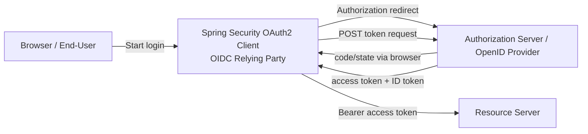
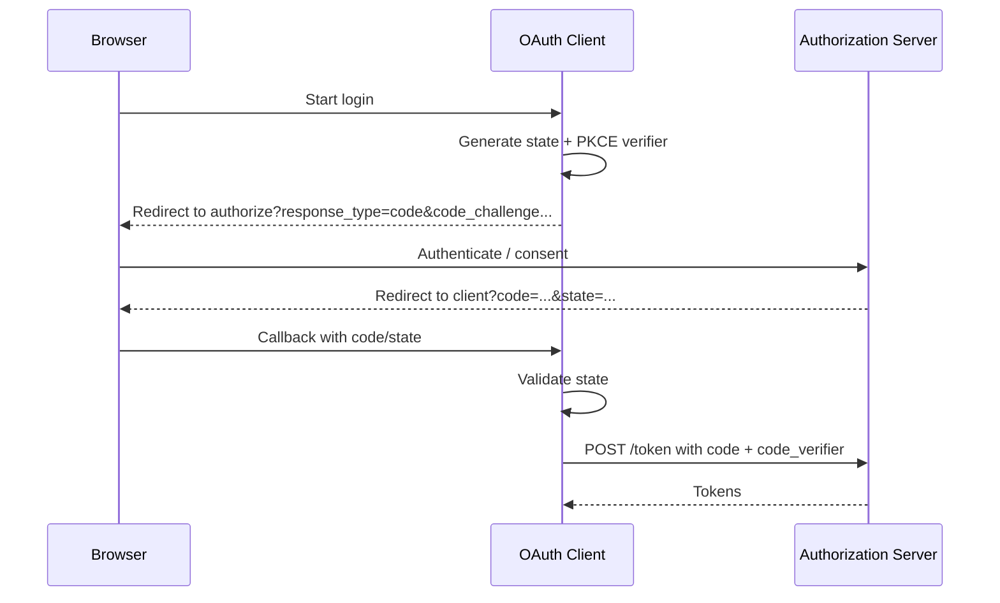
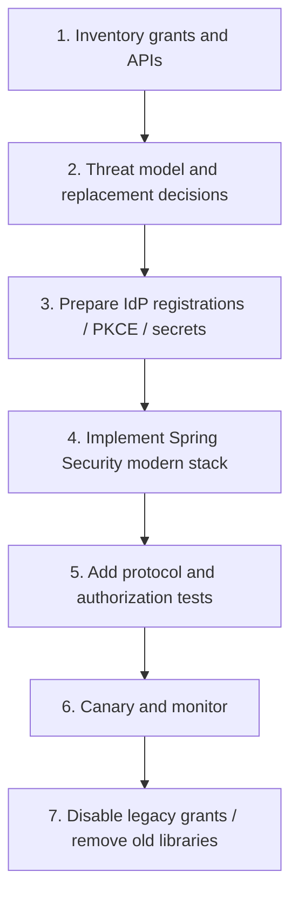

# 33.6. Rà soát các grant hoặc API bị deprecate và phương án thay thế

Khi nâng cấp **Spring Security OAuth 2.0/OIDC Client**, có ít nhất ba loại thay đổi dễ bị nhầm thành một: OAuth grant không còn được khuyến nghị theo security best practices, Java API bị đánh dấu `@Deprecated` hoặc đã bị loại bỏ, và API vẫn hợp lệ nhưng cách sử dụng cũ không còn an toàn.

Ví dụ, **Resource Owner Password Credentials (ROPC/password grant)** và **Implicit Grant** cần được đánh giá lại vì lý do giao thức và bảo mật. Ngược lại, **Authorization Code**, **Client Credentials** và **Refresh Token** vẫn có vai trò đúng; không nên xóa chúng chỉ vì có một phiên bản framework mới. Ở tầng Spring, `OAuth2RestTemplate` và `@EnableOAuth2Sso` thuộc hệ sinh thái Spring Security OAuth legacy; các ứng dụng hiện đại dùng `ClientRegistration`, `OAuth2AuthorizedClientManager`, `SecurityFilterChain` và `oauth2Login()`.

Một cuộc nâng cấp thành công phải trả lời đầy đủ: grant nào đang được cấp tại Authorization Server (AS), Java API nào đang dùng trong client, luồng người dùng nào cần chuyển, dữ liệu token/session nào phải giữ, và cơ chế bảo vệ nào phải được kiểm chứng lại sau migration.

---

## 1. Kết quả cần đạt

Sau bài học, người đọc có thể:

1. Phân biệt **deprecated**, **removed**, **discouraged**, **prohibited** và **vẫn được hỗ trợ**.
2. Kiểm kê grants thật sự được dùng và grants còn mở tại AS.
3. Thay Implicit/ROPC bằng các flow hiện đại phù hợp.
4. Giữ Client Credentials/Refresh Token đúng use case và bảo vệ chúng.
5. Nhận diện các APIs thuộc Spring Security OAuth legacy.
6. Chuyển cấu hình từ `WebSecurityConfigurerAdapter` sang `SecurityFilterChain`.
7. Chuyển old matcher/DSL sang `authorizeHttpRequests` và lambda DSL.
8. Thay `OAuth2RestTemplate` bằng authorized-client management và HTTP client integration.
9. Không nhầm Client, Resource Server, Authorization Server và OIDC RP.
10. Hiểu các extension points dành cho token exchange, OIDC Login và WebFlux.
11. Thực hiện dependency/source inventory, compatibility check và migration rollout.
12. Thiết lập tests chống regression về PKCE, state, nonce, issuer, token storage, scope và tenant isolation.

## 2. Ba lớp cần được rà soát độc lập

| Lớp | Ví dụ vấn đề | Tài liệu xác nhận | Việc cần làm |
|---|---|---|---|
| OAuth/OIDC protocol | `grant_type=password`, `response_type=token` | RFCs, OAuth Security BCP, OP profile | Thiết kế lại authorization flow |
| Spring Java API | `WebSecurityConfigurerAdapter`, `antMatchers` | Versioned Javadoc, migration guide | Chuyển API tương thích |
| Runtime/security architecture | Token trong browser, secret trong Git, refresh race | Threat model, deployment policy | Thay storage/validation/operations |

Một class Java có `@Deprecated` không tự làm grant `client_credentials` trở thành bị cấm. Ngược lại, một server vẫn chấp nhận `grant_type=password` không khiến nó an toàn theo security guidance hiện hành.

### 2.1. Deprecated

Một Java class/method có thể được đánh dấu `@Deprecated` để hướng developers tới API mới. Kiểm tra `since`, `forRemoval`, Javadoc và release thực tế.

### 2.2. Removed

Một API đã bị xóa ở version đích; compilation hoặc runtime linkage fail. Phải thay thế imports, configuration và behavior, không chỉ tắt compiler warnings.

### 2.3. Discouraged hoặc prohibited

Một OAuth flow được mô tả trong RFC lịch sử nhưng không còn đáp ứng security best practice. RFC 9700 đưa ra security guidance độc lập với việc thư viện có còn phương thức tương ứng không.

### 2.4. Behavior thay đổi dù không deprecate

Một framework upgrade có thể thay defaults, matcher semantics, token client implementation hoặc session handling. Test hành vi, không chỉ test compile.

## 3. Ranh giới vai trò OAuth2/OIDC



| Vai trò | Trách nhiệm | Spring hướng hiện đại |
|---|---|---|
| OAuth2 Client | Xin, lưu, sử dụng access tokens | `spring-security-oauth2-client` |
| OIDC Relying Party | Xác thực user qua OP và ID Token | `oauth2Login()`, `OidcUser` |
| Resource Server | Xác minh inbound Bearer token | `oauth2ResourceServer(...)` |
| Authorization Server | Xác thực client, phát code/tokens, consent, keys | Spring Authorization Server hoặc managed IdP |

**Không có replacement 1:1** giữa `@EnableAuthorizationServer` và `oauth2Login()`. Một API phát token và một API nhận login làm những việc khác nhau.

## 4. Bảng quyết định cho OAuth grant types

| Grant hoặc flow | Đánh giá | Lựa chọn phù hợp |
|---|---|---|
| Authorization Code | **Vẫn hợp lệ** | Ưu tiên Code + PKCE cho user-facing clients |
| Authorization Code + PKCE | **Khuyến nghị** | Browser, native, mobile, confidential web theo profile |
| Implicit (response_type=token) | Không còn được khuyến nghị | Code + PKCE hoặc BFF pattern |
| Resource Owner Password Credentials | RFC 9700: client **MUST NOT** sử dụng | Code + PKCE và hosted authentication |
| Client Credentials | **Vẫn hợp lệ** | Machine-to-machine, service identities |
| Refresh Token | **Vẫn hợp lệ** với replay controls | Rotation/sender constraints và safe storage |
| Device Authorization Grant | Hợp lệ theo RFC 8628 | Thiết bị input-limited/CLI nếu AS hỗ trợ |
| JWT Bearer Grant | Extension/profile theo RFC 7523 | Khi AS/client contract hỗ trợ |
| Token Exchange | Extension theo RFC 8693 | Delegation và token transformation được AS kiểm soát |
| OIDC Implicit/Hybrid | Xem response type và threat model | Thường ưu tiên OIDC Code + PKCE cho web login |
| Custom extension grant | Chỉ khi cần | Giữ protocol, policy và interoperability rõ |

### 4.1. OAuth 2.1 không phải một câu trả lời thay cho inventory

OAuth 2.1 tập hợp nhiều security changes. Khi báo cáo compliance, cần kiểm tra publication status/revision thực tế tại thời điểm migration. Dùng RFC 9700 và những RFC có hiệu lực để tham chiếu guidance thay vì tự khẳng định trạng thái mới nhất của một draft.

### 4.2. Đừng bỏ Client Credentials hoặc Refresh Token một cách máy móc

Rủi ro thường đến từ cách sử dụng, ví dụ client secret bị lộ hoặc refresh token rotation xử lý sai, không phải từ sự tồn tại của hai grant này.

## 5. Implicit Grant: vì sao cần chuyển

Một browser client cũ có thể yêu cầu:

```text
GET /authorize?
  response_type=token
  &client_id=browser-old
  &redirect_uri=https://app.example.org/callback
```

AS redirect về browser với access token qua front-channel:

```text
https://app.example.org/callback#access_token=...&token_type=Bearer
```

### 5.1. Vấn đề chính

- Token được phát trực tiếp qua browser authorization response.
- Khó sử dụng authorization-code binding và PKCE.
- Access token có nguy cơ lộ trước JavaScript/XSS hoặc storage không an toàn.
- Token substitution/replay phải được chống bằng các cơ chế khác.
- Một số assumptions của ứng dụng cũ không còn phù hợp với browser hiện đại.

Fragment không được gửi tới HTTP server trong một request thông thường, nhưng điều đó không đồng nghĩa token an toàn trước malicious JavaScript.

### 5.2. Hướng thay thế



Với SPA, áp dụng Code + PKCE cho public client theo AS policies. Với BFF/confidential web app, backend có thể giữ tokens server-side và dùng HTTP-only session cookies phù hợp.

### 5.3. Migration không phải chỉ sửa response_type

Cần cập nhật:

1. Client registration tại AS.
2. Redirect URI exact matching.
3. `state` storage và callback validation.
4. PKCE verifier/challenge generation.
5. Token Endpoint exchange.
6. Browser/backend token storage boundary.
7. API caller và Bearer token handling.
8. Session/CSRF/cookie policies.
9. Logout/re-authentication flows.
10. Negative integration tests.

## 6. Password/ROPC Grant: ngừng thu mật khẩu End-User tại OAuth client

Legacy request:

```http
POST /token HTTP/1.1
Content-Type: application/x-www-form-urlencoded

grant_type=password&
username=employee@example.org&
password=<user-password>&
client_id=old-portal
```

ROPC làm client nhìn thấy user password, thay vì để OP/AS chịu trách nhiệm tương tác xác thực.

### 6.1. Tại sao không còn phù hợp?

- Khó triển khai SSO, federation, passkeys/MFA.
- Client tiếp xúc password của user.
- Tăng nguy cơ credential phishing/leakage.
- Không có hosted consent/authentication interaction đúng nghĩa.
- Khó áp dụng authentication policies phía OP.

RFC 9700 quy định OAuth clients **MUST NOT** sử dụng Resource Owner Password Credentials grant.

### 6.2. Phương án cho browser user

Dùng **OIDC Authorization Code + PKCE** và login tại trusted OP.

```java
@Bean
SecurityFilterChain webSecurity(HttpSecurity http) throws Exception {
    http
        .authorizeHttpRequests(auth -> auth
            .requestMatchers("/", "/error").permitAll()
            .anyRequest().authenticated())
        .oauth2Login(Customizer.withDefaults());

    return http.build();
}
```

### 6.3. Không thay ROPC bằng Client Credentials

`client_credentials` đại diện workload/client, **không** chứng minh một user đã đăng nhập. Việc thay ROPC bằng service token rồi gán `currentUser` giả là phá vỡ audit và domain authorization.

### 6.4. Không tự tạo password form để gọi Token Endpoint

Một UI mới nhưng backend vẫn gửi `grant_type=password` không phải migration ra khỏi ROPC.

### 6.5. Kế hoạch chuyển user

- Thiết lập login tại OP.
- Thiết kế account linking theo trusted `(issuer, subject)`.
- Xóa/thu hồi password đã lưu trái mục đích.
- Xem lại quyền và session mapping.
- Kiểm thử MFA/SSO/recovery flows.
- Có UX hỗ trợ người dùng chuyển đổi.

## 7. Authorization Code + PKCE là baseline cho login

Một Spring Boot confidential Servlet client:

```yaml
spring:
  security:
    oauth2:
      client:
        registration:
          company:
            provider: company
            client-id: ${OIDC_CLIENT_ID}
            client-secret: ${OIDC_CLIENT_SECRET}
            client-authentication-method: client_secret_basic
            authorization-grant-type: authorization_code
            redirect-uri: "{baseUrl}/login/oauth2/code/{registrationId}"
            scope:
              - openid
              - profile
              - email
        provider:
          company:
            issuer-uri: "https://login.example.org"
```

### 7.1. PKCE

```text
code_verifier = high-entropy random
code_challenge = BASE64URL(SHA256(code_verifier))
code_challenge_method = S256
```

Challenge đi trong authorization request; verifier đi trong token request.

### 7.2. PKCE không thay thế state

- `state` liên kết callback với request ban đầu.
- `code_verifier` chứng minh client biết secret của PKCE transaction.
- Exact `redirect_uri` hạn chế nơi AS gửi code.
- `nonce` có vai trò riêng trong OIDC ID Token validation.
- Trusted issuer binding ngăn tráo Authorization Server.

### 7.3. Tùy chỉnh PKCE theo version

Một số Spring Security versions hỗ trợ:

```java
DefaultOAuth2AuthorizationRequestResolver resolver =
    new DefaultOAuth2AuthorizationRequestResolver(
        clientRegistrations,
        "/oauth2/authorization"
    );

resolver.setAuthorizationRequestCustomizer(
    OAuth2AuthorizationRequestCustomizers.withPkce());
```

Sau đó tích hợp resolver:

```java
http.oauth2Login(oauth2 -> oauth2
    .authorizationEndpoint(endpoint ->
        endpoint.authorizationRequestResolver(resolver)));
```

`clientRegistrations` là `ClientRegistrationRepository`. Đây là hướng mở rộng khi cần; các defaults PKCE có thể phụ thuộc Spring Security version và client type. Kiểm tra request thực tế thay vì giả định.

### 7.4. Public vs confidential

Public browser/native client không thể bảo vệ static client secret nhúng trong bundle. Confidential server-side client dùng client authentication tương ứng và vẫn nên dùng PKCE theo security policy.

## 8. Client Credentials còn hợp lệ

Grant machine-to-machine:

```http
POST /token HTTP/1.1
Authorization: Basic <client-credentials>
Content-Type: application/x-www-form-urlencoded

grant_type=client_credentials&
scope=orders.read
```

Hợp lý cho scheduled jobs, service-to-service và workload identities.

### 8.1. Không đánh đồng service identity với user

Token Client Credentials không phải user-delegated token. Resource Server không nên suy luận rằng một user đã được xác thực chỉ từ service token.

### 8.2. Dùng authorized client manager

```java
OAuth2AuthorizedClientProvider provider =
    OAuth2AuthorizedClientProviderBuilder.builder()
        .clientCredentials()
        .build();
```

Đối với job không có Servlet request, `AuthorizedClientServiceOAuth2AuthorizedClientManager` thường phù hợp hơn request-bound manager.

### 8.3. Secrets management

Client secret, `private_key_jwt` private key hoặc mTLS client private key phải được cấp từ trusted secret manager/workload identity, không commit trong YAML.

### 8.4. Scope và audience

Một service token có `orders.read` không tự cho phép mọi tenant/order. Resource Server cần audience, token validation và domain permission checks.

## 9. Refresh Token còn hợp lệ nhưng phải được bảo vệ

```http
POST /token HTTP/1.1
Authorization: Basic <client-credentials>
Content-Type: application/x-www-form-urlencoded

grant_type=refresh_token&
refresh_token=<refresh-token>
```

### 9.1. Rotation

```text
RT-1 -> Token Endpoint -> AT-2 + RT-2
RT-1 reused -> invalid_grant / replay policy
```

### 9.2. Concurrency

Hai requests đọc cùng RT-1 rồi cùng refresh có thể khiến một request thành công và request kia gặp `invalid_grant`. Nếu failure handler xóa record theo registration/principal không kiểm tra version, token RT-2 mới cũng có thể bị xóa.

### 9.3. Hướng khắc phục

- Per-key single-flight/coordination khi AS rotation strict.
- Versioned/conditional updates trong token store.
- Không retry refresh token cũ sau `invalid_grant`.
- Reload current authorized client sau concurrent modification.
- Reauthorize user nếu policy yêu cầu.
- Không log token values.

### 9.4. Refresh token không phải client secret

Refresh token thuộc một authorization context/principal; client secret là thông tin xác thực của confidential OAuth client. Cần storage và rotation policies khác nhau.

## 10. Device, JWT Bearer và Token Exchange

### 10.1. Device Authorization Grant

RFC 8628 dành cho thiết bị hạn chế trình duyệt/nhập liệu:

```text
Device -> AS device_authorization
AS -> device_code, user_code, verification_uri
User -> opens verification_uri on another device
Device -> polls Token Endpoint under policy
```

Nó không phải replacement mặc định cho một browser web login.

### 10.2. JWT Bearer Grant

RFC 7523 có profile JWT assertions. Phân biệt:

```text
JWT bearer authorization grant
  grant_type=urn:ietf:params:oauth:grant-type:jwt-bearer

private_key_jwt client authentication
  client_assertion_type=urn:ietf:params:oauth:client-assertion-type:jwt-bearer
```

Chúng đều có JWT nhưng giải quyết hai trách nhiệm khác nhau.

### 10.3. Token Exchange

RFC 8693 cho phép AS cấp một token mới theo subject/actor/audience/resource policies. Không được tự sửa JWT claims hoặc bỏ audience validation để giả lập token exchange.

### 10.4. Các extensions khác

PAR, JAR, DPoP hoặc CIBA có thể có giá trị trong một số OP ecosystems. Kiểm tra client/AS version và support thật; không giả định mọi Spring Security release hỗ trợ sẵn mọi extension.

## 11. OIDC Implicit/Hybrid cần xem response types

OIDC mô tả các response types khác nhau:

```text
code
id_token
id_token token
code id_token
code token
code id_token token
```

Không đồng nhất OIDC Hybrid với OAuth ROPC. Khi migrate:

- Phân tích token nào đi qua front-channel.
- Xem `nonce`, `c_hash`, `at_hash` requirements tương ứng.
- Thiết kế lại callback/session logic cho OIDC Code Flow.
- Giữ issuer/audience/signature validation.

Với web login thông thường, Authorization Code + PKCE là hướng dễ bảo vệ và kiểm thử hơn.

## 12. Spring Security OAuth legacy vs modern modules

Các legacy artifacts có thể xuất hiện:

```text
org.springframework.security.oauth:spring-security-oauth2
org.springframework.security.oauth.boot:spring-security-oauth2-autoconfigure
```

Các Spring Security modules hiện đại có tên cũng chứa `oauth2`:

```text
org.springframework.security:spring-security-oauth2-client
org.springframework.security:spring-security-oauth2-core
org.springframework.security:spring-security-oauth2-jose
org.springframework.security:spring-security-oauth2-resource-server
org.springframework.boot:spring-boot-starter-oauth2-client
org.springframework.boot:spring-boot-starter-oauth2-resource-server
```

**Không xóa mọi dependency có chuỗi `oauth2`.** Cần phân biệt group ID, role và version.

### 12.1. Legacy imports cần tìm

```text
OAuth2RestTemplate
OAuth2ClientContext
@EnableOAuth2Sso
@EnableOAuth2Client
@EnableResourceServer
@EnableAuthorizationServer
OAuth2Authentication
JwtAccessTokenConverter
TokenStore
ResourceOwnerPasswordAccessTokenProvider
UserInfoTokenServices
```

Danh sách phục vụ **phát hiện code cũ**; không dùng các APIs legacy trong example production mới.

### 12.2. Không có mapping một-một cho toàn bộ classes

`OAuth2RestTemplate` cũ gộp token acquisition và HTTP client. Framework hiện đại tách token management khỏi REST client.

`@EnableAuthorizationServer` cũ là Authorization Server; cần di chuyển sang Spring Authorization Server/managed OP, không phải `oauth2Login()`.

## 13. Bảng migration API thường gặp

| API/config cũ | Trách nhiệm | Hướng thay thế |
|---|---|---|
| `OAuth2RestTemplate` | HTTP + OAuth token | `OAuth2AuthorizedClientManager` + `RestClient`/`WebClient` |
| `OAuth2ClientContext` | Legacy token/request context | `OAuth2AuthorizedClient` + repository/service |
| `@EnableOAuth2Sso` | SSO app auto-config | `SecurityFilterChain` + `oauth2Login` |
| `@EnableOAuth2Client` legacy | Bật client cũ | Modern OAuth2 Client beans/Boot autoconfig |
| `@EnableResourceServer` | Legacy API token validation | `oauth2ResourceServer` |
| `@EnableAuthorizationServer` | Legacy token issuer | Spring Authorization Server hoặc managed OP |
| `JwtAccessTokenConverter` | Legacy JWT converter | Resource Server `JwtDecoder` hoặc AS signing APIs tùy role |
| `TokenStore` | Legacy AS token storage | Authorization Server persistence model |
| `ResourceOwnerPasswordAccessTokenProvider` | Password grant | Đổi flow sang Code + PKCE |
| `UserInfoTokenServices` legacy | Legacy user mapping | `OidcUserService`/`OAuth2UserService` |
| `WebSecurityConfigurerAdapter` | Inheritance security config | `SecurityFilterChain` bean |
| `authorizeRequests` | Legacy authorization DSL | `authorizeHttpRequests` |
| `antMatchers`/`mvcMatchers` | Legacy request matching | `requestMatchers` + appropriate matcher |
| Chained `.and()` style | Configurer chaining | Lambda DSL |
| HTTP `RestTemplate` tổng quát | Synchronous HTTP | Vẫn là HTTP API; OAuth integration là trách nhiệm riêng |

Bảng không khẳng định mọi mục có cùng deprecation annotation/since/forRemoval. Xác minh đúng Javadoc của phiên bản mục tiêu.

## 14. WebSecurityConfigurerAdapter → SecurityFilterChain

Legacy:

```java
// LEGACY ONLY
@EnableWebSecurity
public class OldSecurityConfig extends WebSecurityConfigurerAdapter {

    @Override
    protected void configure(HttpSecurity http) throws Exception {
        http.authorizeRequests()
            .anyRequest().authenticated()
            .and()
            .oauth2Login();
    }
}
```

Modern Servlet:

```java
import org.springframework.context.annotation.Bean;
import org.springframework.context.annotation.Configuration;
import org.springframework.security.config.annotation.web.builders.HttpSecurity;
import org.springframework.security.config.Customizer;
import org.springframework.security.web.SecurityFilterChain;

@Configuration
public class SecurityConfiguration {

    @Bean
    SecurityFilterChain webSecurity(HttpSecurity http) throws Exception {
        http
            .authorizeHttpRequests(auth -> auth
                .requestMatchers("/", "/error", "/assets/**").permitAll()
                .anyRequest().authenticated())
            .oauth2Login(Customizer.withDefaults());

        return http.build();
    }
}
```

### 14.1. Không chỉ thay cú pháp

Phải giữ:

- Rules bảo vệ URLs.
- CSRF/session policies.
- OAuth2 authorization start và callback.
- Login failure/success handlers.
- Custom OAuth2/OIDC user services.
- Token/client repository.
- Exceptions và CORS policy.
- Multiple filter chains ordering.

### 14.2. Không disable CSRF để hết lỗi

Browser session vẫn chịu CSRF threat. Chuyển sang bean config không đòi tắt CSRF toàn web app.

## 15. authorizeRequests/antMatchers → authorizeHttpRequests/requestMatchers

Old:

```java
// LEGACY CONFIG
http.authorizeRequests()
    .antMatchers("/public/**").permitAll()
    .antMatchers("/admin/**").hasRole("ADMIN")
    .anyRequest().authenticated();
```

New:

```java
http.authorizeHttpRequests(auth -> auth
    .requestMatchers("/public/**").permitAll()
    .requestMatchers("/admin/**").hasRole("ADMIN")
    .anyRequest().authenticated());
```

### 15.1. Matcher semantics cần được test

- Servlet path.
- Context path.
- Spring MVC mappings.
- Multiple servlets.
- PathPattern/Ant-style differences.
- Encoded paths.
- Dispatcher types.
- Default routes.

### 15.2. securityMatcher không giống requestMatchers

```java
http.securityMatcher("/api/**");
```

giới hạn requests mà **SecurityFilterChain** này xử lý.

```java
http.authorizeHttpRequests(auth ->
    auth.requestMatchers("/api/**").authenticated());
```

đặt authorization rule bên trong một chain.

Nếu đặt matcher sai, request có thể được match bởi chain khác hoặc không được bảo vệ như mong muốn.

### 15.3. Không thêm permitAll để làm test pass

Sau migration nên giữ default deny/authenticated policy, không tự đưa `anyRequest().permitAll()` vào production.

## 16. Lambda DSL thay chaining style

Old:

```java
http
    .authorizeRequests()
    .anyRequest().authenticated()
    .and()
    .oauth2Login();
```

Modern:

```java
http
    .authorizeHttpRequests(auth ->
        auth.anyRequest().authenticated())
    .oauth2Login(oauth2 -> {
        // OAuth2 Login customizations.
    });
```

Hoặc:

```java
http.oauth2Login(Customizer.withDefaults());
```

### 16.1. Phiên bản quyết định API nào bị loại bỏ

Một số releases deprecated các no-arg overloads hoặc chaining patterns, và các phiên bản mới có thể remove. Không suy đoán từ một warning ở version này rằng API đã removed ở mọi phiên bản khác.

### 16.2. Custom callback path

```java
http.oauth2Login(oauth2 -> oauth2
    .redirectionEndpoint(endpoint ->
        endpoint.baseUri("/auth/callback/*")));
```

Nếu đổi matcher, phải đồng bộ:

```yaml
redirect-uri: "{baseUrl}/auth/callback/{registrationId}"
```

và OP registered callback. Không sửa chỉ một phía.

## 17. OAuth2RestTemplate → manager + HTTP client

Legacy:

```java
// LEGACY — OAuth2RestTemplate không phải lựa chọn mới.
String result = oauth2RestTemplate.getForObject(
    "https://orders-api.example.org/orders",
    String.class);
```

Modern architecture:

```text
ClientRegistration
  -> OAuth2AuthorizedClientManager
  -> OAuth2AuthorizedClient/access token
  -> HTTP client interceptor/filter
  -> Resource Server
```

### 17.1. Vì sao tách riêng?

- Manager xử lý chọn authorized client/provider.
- Repository/service quản lý token persistence.
- HTTP client chịu trách nhiệm target URL/headers/timeouts.
- Tests có thể cô lập token acquisition và outbound integration.
- Không buộc browser request vào background token acquisition.
- Dễ kiểm soát principal/tenant isolation.

### 17.2. RestTemplate chưa chắc deprecated

`RestTemplate` tổng quát không tự là một class legacy OAuth. Vấn đề là **`OAuth2RestTemplate`** của thư viện cũ. Khi dùng `RestClient`, đừng nghĩ RestClient tự có OAuth token acquisition.

## 18. OAuth2AuthorizedClientManager là API hiện đại

Các abstractions thường gặp:

| Abstraction | Phạm vi |
|---|---|
| `ClientRegistration` | OAuth client metadata |
| `ClientRegistrationRepository` | Cung cấp registrations |
| `OAuth2AuthorizedClient` | Registration + principal + tokens |
| `OAuth2AuthorizedClientRepository` | Servlet request/session |
| `OAuth2AuthorizedClientService` | Service-based persistent store |
| `OAuth2AuthorizedClientManager` | Authorize/reauthorize |
| `OAuth2AuthorizedClientProvider` | Grant-specific authorization strategy |
| `ReactiveOAuth2AuthorizedClientManager` | Reactive authorization |

### 18.1. Default managers có use cases khác nhau

- `DefaultOAuth2AuthorizedClientManager`: request-aware Servlet flows.
- `AuthorizedClientServiceOAuth2AuthorizedClientManager`: jobs/services ngoài Servlet request.
- `DefaultReactiveOAuth2AuthorizedClientManager`: WebFlux requests.
- `AuthorizedClientServiceReactiveOAuth2AuthorizedClientManager`: reactive service use cases.

Không tự nói chúng deprecated chỉ vì có từ `OAuth2` hoặc đã tồn tại qua nhiều releases.

### 18.2. Principal binding

`principalName` phải đến từ trusted authenticated context hoặc stable workload identity. Không lấy user-selected principal name để đọc arbitrary authorized client.

### 18.3. Registration binding

Không dùng authorized client của registration B làm fallback cho registration A nếu manager không lấy được token.

## 19. Ví dụ Client Credentials với service manager

Properties:

```yaml
spring:
  security:
    oauth2:
      client:
        registration:
          reports:
            provider: reports
            client-id: ${REPORTS_CLIENT_ID}
            client-secret: ${REPORTS_CLIENT_SECRET}
            client-authentication-method: client_secret_basic
            authorization-grant-type: client_credentials
            scope: reports.read
        provider:
          reports:
            token-uri: "https://login.example.org/token"
```

Java:

```java
import org.springframework.context.annotation.Bean;
import org.springframework.context.annotation.Configuration;
import org.springframework.security.oauth2.client.AuthorizedClientServiceOAuth2AuthorizedClientManager;
import org.springframework.security.oauth2.client.OAuth2AuthorizedClientManager;
import org.springframework.security.oauth2.client.OAuth2AuthorizedClientProvider;
import org.springframework.security.oauth2.client.OAuth2AuthorizedClientProviderBuilder;
import org.springframework.security.oauth2.client.OAuth2AuthorizedClientService;
import org.springframework.security.oauth2.client.registration.ClientRegistrationRepository;

@Configuration
class ReportsClientConfig {

    @Bean
    OAuth2AuthorizedClientManager reportsManager(
            ClientRegistrationRepository registrations,
            OAuth2AuthorizedClientService clients) {

        OAuth2AuthorizedClientProvider provider =
            OAuth2AuthorizedClientProviderBuilder.builder()
                .clientCredentials()
                .build();

        var manager =
            new AuthorizedClientServiceOAuth2AuthorizedClientManager(
                registrations,
                clients
            );

        manager.setAuthorizedClientProvider(provider);
        return manager;
    }
}
```

Call:

```java
OAuth2AuthorizeRequest request =
    OAuth2AuthorizeRequest
        .withClientRegistrationId("reports")
        .principal("scheduled-report-job")
        .build();

OAuth2AuthorizedClient client =
    reportsManager.authorize(request);

if (client == null) {
    throw new IllegalStateException("No authorized reports client");
}

OAuth2AccessToken token = client.getAccessToken();
```

### 19.1. Không ghép grant request thủ công nếu không cần

Spring provider/manager có thể lo token acquisition, expiration và persistence. Không tự lập lại form encoding/client authentication nếu supported integration đã giải quyết.

### 19.2. Service principal không tự là End-User

`scheduled-report-job` là một client storage key/workload identity; API authorization vẫn phải phân biệt token service và user-delegated token.

## 20. Tích hợp RestClient

Trong các Spring Security versions hỗ trợ, có thể dùng `OAuth2ClientHttpRequestInterceptor`:

```java
import org.springframework.web.client.RestClient;
import org.springframework.security.oauth2.client.OAuth2AuthorizedClientManager;
import org.springframework.security.oauth2.client.web.client.OAuth2ClientHttpRequestInterceptor;

@Bean
RestClient reportsClient(
        RestClient.Builder builder,
        OAuth2AuthorizedClientManager manager) {

    var oauth =
        new OAuth2ClientHttpRequestInterceptor(manager);

    return builder
        .baseUrl("https://reports-api.example.org")
        .requestInterceptor(oauth)
        .build();
}
```

Đoạn này minh họa **wiring**, chưa phải toàn bộ call: HTTP request phải chọn đúng `clientRegistrationId` hoặc authorized-client context theo supported resolver/request attributes của phiên bản đang dùng.

### 20.1. Version-aware

`OAuth2ClientHttpRequestInterceptor` không được cung cấp ở tất cả Spring Security releases. Đọc versioned Javadoc thay vì copy example từ release mới vào project cũ rồi kết luận OAuth2 Client không hỗ trợ nữa.

### 20.2. Token leakage

Chỉ gắn Bearer token khi target host/resource đã được trusted config phê duyệt. Không cho browser chọn arbitrary URL mà RestClient tự gắn credentials.

### 20.3. Failure handling

Downstream API 401 `invalid_token` khác Token Endpoint 400 `invalid_grant`. Retry và authorized-client removal cần đúng layer.

## 21. Tích hợp WebClient ở Servlet

Một Servlet app vẫn có thể dùng `WebClient` để gọi downstream APIs:

```java
import org.springframework.security.oauth2.client.OAuth2AuthorizedClientManager;
import org.springframework.security.oauth2.client.web.reactive.function.client.ServletOAuth2AuthorizedClientExchangeFilterFunction;
import org.springframework.web.reactive.function.client.WebClient;

ServletOAuth2AuthorizedClientExchangeFilterFunction oauth =
    new ServletOAuth2AuthorizedClientExchangeFilterFunction(manager);

WebClient client = WebClient.builder()
    .baseUrl("https://orders-api.example.org")
    .apply(oauth.oauth2Configuration())
    .build();
```

`manager` là Servlet authorized-client manager. Explicit registration selection/client context cần được thiết kế theo API contract.

### 21.1. WebClient reactive không làm web application thành WebFlux

MVC controller và Servlet filters vẫn hoạt động theo Servlet stack. Chỉ HTTP client outbound dùng reactive API.

### 21.2. Async context propagation

Nếu WebClient call chạy ngoài Servlet request thread, đừng giả định SecurityContext/request-bound authorized client tự được propagate. Test đúng context.

### 21.3. Không gửi default token đến mọi endpoint

Một default client có thể vô tình đính Bearer token đến origin không đúng. Giới hạn target và registration.

## 22. Legacy SSO → oauth2Login

Old:

```java
// LEGACY ONLY
@EnableOAuth2Sso
public class OldSsoConfig {
}
```

Modern:

```java
@Bean
SecurityFilterChain portalSecurity(HttpSecurity http) throws Exception {
    http
        .authorizeHttpRequests(auth -> auth
            .requestMatchers("/", "/login", "/error").permitAll()
            .anyRequest().authenticated())
        .oauth2Login(oauth2 -> oauth2
            .defaultSuccessUrl("/app", true));

    return http.build();
}
```

### 22.1. Start/callback URLs

Thông thường:

```text
/oauth2/authorization/company
/login/oauth2/code/company
```

Cần giữ routing/session/redirect URI đúng. URL thứ nhất là authorization start; URL thứ hai là callback nhận code/state.

### 22.2. OIDC principal

Modern `OidcUser`/`OidcUserService` chứa claims/authorities. Khi thay legacy `OAuth2Authentication`, test mapper và identity key theo `(iss, sub)`.

### 22.3. Local app authorization

SSO thành công không tự cấp `ROLE_ADMIN` hay tenant membership. Phải giữ domain authorization policies độc lập với OAuth login.

## 23. Legacy Resource Server → modern Resource Server

Old:

```java
// LEGACY ONLY
@EnableResourceServer
public class OldResourceServerConfig {
}
```

Modern:

```java
@Bean
SecurityFilterChain apiSecurity(HttpSecurity http) throws Exception {
    http
        .securityMatcher("/api/**")
        .authorizeHttpRequests(auth ->
            auth.anyRequest().authenticated())
        .oauth2ResourceServer(oauth2 ->
            oauth2.jwt(Customizer.withDefaults()));

    return http.build();
}
```

Properties:

```yaml
spring:
  security:
    oauth2:
      resourceserver:
        jwt:
          issuer-uri: "https://login.example.org"
```

### 23.1. Decoder phải validate

JWT Base64 decoding không tương đương signature validation. Giữ `iss`, `exp`, algorithm, key selection và audience policy.

### 23.2. ID Token không phải API access token

Đừng dùng ID Token từ OIDC Login để gọi API. Resource Server phải xác minh token dành cho nó.

### 23.3. API 401/403

`401 invalid_token` và `403 insufficient_scope` thuộc Bearer token API concerns; không tự gộp với OAuth Authorization Endpoint `access_denied`.

## 24. Legacy Authorization Server migration

Old:

```java
// LEGACY ONLY
@EnableAuthorizationServer
public class OldAuthServerConfig {
}
```

Migrate sang một implementation Authorization Server được hỗ trợ, chẳng hạn Spring Authorization Server hoặc managed OP.

Cần kế hoạch riêng cho:

- Registered clients và redirect URI lists.
- Grant allowlists.
- Signing keys/JWKS rotation.
- Authorization/consent persistence.
- Token issuance, revocation, introspection.
- Scope/audience contract.
- OIDC discovery/UserInfo/logout khi có.
- Legacy tokens và refresh token state.
- Multi-tenant/issuer distinctions.

Không có một annotation thay thế trực tiếp mà tự giữ mọi database schema và security semantics.

### 24.1. Chuyển vai trò đúng

`oauth2Login()` không phát token. Nó là Client/Relying Party.

`oauth2ResourceServer()` không phát token. Nó xác minh inbound tokens.

### 24.2. Data migration có thể là phần khó nhất

Legacy token store, consent records và client credentials có thể phải được chuyển có kiểm soát. Không tự deserialize các classes cũ sang format mới nếu không có compatibility contract.

## 25. WebFlux có APIs khác Servlet

| Servlet | Reactive WebFlux |
|---|---|
| `HttpSecurity` | `ServerHttpSecurity` |
| `SecurityFilterChain` | `SecurityWebFilterChain` |
| `ClientRegistrationRepository` | `ReactiveClientRegistrationRepository` |
| `OAuth2AuthorizedClientManager` | `ReactiveOAuth2AuthorizedClientManager` |
| `HttpServletRequest` | `ServerWebExchange` |
| `MockMvc` | `WebTestClient` |

Reactive security:

```java
@Bean
SecurityWebFilterChain webSecurity(ServerHttpSecurity http) {
    return http
        .authorizeExchange(ex -> ex
            .pathMatchers("/", "/error").permitAll()
            .anyExchange().authenticated())
        .oauth2Login(Customizer.withDefaults())
        .build();
}
```

### 25.1. Không copy Servlet beans

Reactive apps dùng reactive authorized-client repository/service, managers và Reactor Context.

### 25.2. Không block event-loop

Đừng dùng `Mono.block()` trong reactive request handling để thay OAuth2 Client API cũ. Dùng non-blocking providers/client integrations hoặc tách blocking work theo đúng scheduling policy.

### 25.3. Reactive manager vẫn có vai trò

`DefaultReactiveOAuth2AuthorizedClientManager` và service-based reactive manager không tự bị deprecated chỉ vì có version mới.

## 26. Token persistence migration

Modern abstractions:

```text
OAuth2AuthorizedClientRepository
  -> Servlet request/session persistence

OAuth2AuthorizedClientService
  -> principal + registration storage

OAuth2AuthorizedClientManager
  -> authorization and reauthorization
```

### 26.1. Đừng reuse session serialization không tương thích

Khi nâng Spring Boot major, các serialized session objects cũ có thể không deserialize. Có thể phải version dữ liệu hoặc yêu cầu re-login theo kế hoạch.

### 26.2. Không dùng global token cache keyed chỉ theo registration

Một delegated access token thuộc đúng principal/tenant. `Map<registrationId,token>` có thể làm user A sử dụng token của B.

### 26.3. Encryption và retention

Refresh tokens cần encryption at rest, least privilege, redaction và revoke/delete policies.

### 26.4. Rotation race

Một request refresh thất bại không được xóa token mới do request khác vừa ghi. Dùng conditional deletes và coordination theo threat model.

## 27. Deprecated API không có nghĩa mọi classes giống tên đều legacy

Những APIs modern cần giữ đúng khi còn được hỗ trợ ở phiên bản đích:

- `ClientRegistration`.
- `ClientRegistrationRepository`.
- `OAuth2AuthorizedClient`.
- `OAuth2AuthorizedClientService`.
- `OAuth2AuthorizedClientRepository`.
- `OAuth2AuthorizedClientManager`.
- `OAuth2AuthorizedClientProvider`.
- `OidcUser`.
- `OidcUserService`.
- `OAuth2AuthorizationException`.
- `OAuth2AuthenticationException`.

### 27.1. Kiểm tra fully qualified names

Legacy `OAuth2Authentication` và modern `OAuth2AuthenticationToken` không giống nhau. Cùng chuỗi `OAuth2` không bảo đảm API tương ứng.

### 27.2. Kiểm tra Javadoc theo target version

Nếu method deprecated, Javadoc có thể chỉ sang lambda overload. Không cần thiết kế lại grant khi warning chỉ liên quan DSL style.

## 28. Kiểm kê Gradle dependencies

Các lệnh sau là **ví dụ hướng dẫn**, không phải bước người viết bài tự chạy.

```bash
./gradlew dependencies --configuration runtimeClasspath
```

Tìm nguồn transitive dependency:

```bash
./gradlew dependencyInsight \
  --dependency spring-security-oauth2 \
  --configuration runtimeClasspath
```

Trên Windows PowerShell dùng `.\gradlew.bat` nếu phù hợp môi trường.

### 28.1. Cần tìm cả libraries nội bộ

Một shared internal module có thể kéo legacy Spring Security OAuth jars dù application source không còn import class cũ.

### 28.2. BOM version alignment

Đừng override lẻ `spring-security-oauth2-client` sang version khác mọi modules nếu chưa kiểm chứng Spring Boot managed dependencies/compatibility.

### 28.3. Không exclude bừa bãi

Xóa legacy jar mà code dependency vẫn gọi APIs cũ dẫn đến `NoClassDefFoundError` hoặc linkage failure. Nâng module owner trước.

## 29. Tìm source patterns bằng static search

Các chuỗi cần rà soát:

```text
OAuth2RestTemplate
OAuth2ClientContext
EnableOAuth2Sso
EnableOAuth2Client
EnableResourceServer
EnableAuthorizationServer
WebSecurityConfigurerAdapter
authorizeRequests(
antMatchers(
mvcMatchers(
ResourceOwnerPassword
grant_type=password
response_type=token
JwtAccessTokenConverter
TokenStore
UserInfoTokenServices
```

Ví dụ với ripgrep:

```bash
rg -n "OAuth2RestTemplate|OAuth2ClientContext|EnableOAuth2Sso|WebSecurityConfigurerAdapter" src
```

```bash
rg -n "grant_type=password|response_type=token|authorization-grant-type: password" src
```

```bash
rg -n "authorizeRequests\(|antMatchers\(|mvcMatchers\(" src/main
```

### 29.1. Text search không phải là kết luận

Một match có thể nằm trong test tên `rejectPasswordGrant`, tài liệu hoặc code đã vô hiệu hóa. Xác định production call sites, config và AS registrations thật.

### 29.2. Đừng bỏ qua provider client settings

Application không gọi password grant nữa nhưng OP còn bật có thể vẫn là unwanted attack surface. Sau migration, tắt old grants theo policy.

## 30. Bảng inventory gợi ý

| Field | Ví dụ |
|---|---|
| Application | `portal-web` |
| Role | OAuth2 Client/OIDC RP |
| Current Version | Spring Boot/Security đang dùng |
| Target Version | Phiên bản upgrade |
| Current Grant | `password` |
| Replacement | `authorization_code` + PKCE |
| Client Type | Confidential web |
| IdP/Issuer | Corporate OP |
| Registration ID | `company` |
| Client ID | `portal-prod` |
| Redirect URI | Registered callback |
| Token Storage | Session/JDBC |
| API Calls | `OAuth2RestTemplate` |
| Risk | High |
| Owner | Identity/app team |
| Tests | Pending/implemented |
| Rollback | Canary/feature flag |

### 30.1. Vì sao lưu current và target versions?

Không thể kết luận API removed dựa trên “Spring Security mới” chung chung. Một method có thể deprecated trong một release nhưng còn hoạt động ở release khác.

### 30.2. Vì sao lưu client type?

Public browser client và confidential backend có authentication/storage constraints khác nhau.

### 30.3. Vì sao lưu token storage?

Migration có thể làm mất refresh tokens hoặc cross-user session isolation nếu chuyển database schema sai.

## 31. Lộ trình nâng cấp



### 31.1. Pha baseline

Ghi active grants, flows, AS client registrations, token/client storage, user identities, protected endpoints và metrics hiện tại.

### 31.2. Pha lựa chọn

- User login: OIDC Code + PKCE.
- Machine-to-machine: Client Credentials.
- Devices input hạn chế: RFC 8628.
- Delegation cần đổi audience: Token Exchange theo policy.
- Refresh: giữ và harden rotation.

### 31.3. Pha IdP

Thiết lập exact redirect URIs, client authentication, scopes, grant allowlists, PKCE policy, secret rotation và test registrations.

### 31.4. Pha code

Thay legacy config/libs, giữ security rules và test handlers. Không ép đổi AS lẫn RP lẫn Resource Server trong cùng một thay đổi nếu có thể tách.

### 31.5. Pha test

Cần cả controller mock tests và protocol integration tests, không chỉ compile/build success.

### 31.6. Pha rollout

Canary, compare baseline, monitor login success/error, refresh fail, API 401/403. Chỉ retire old grant khi không còn client cần nó.

## 32. Spring Boot 2.x → 3.x compatibility

Một migration thường bao gồm:

```text
Spring Boot 2.x -> 3.x
Spring Security 5 -> 6
Spring Framework 5 -> 6
Java runtime -> Java 17+
javax.servlet.* -> jakarta.servlet.*
```

### 32.1. Servlet namespace

`javax.servlet` → `jakarta.servlet` là Jakarta migration, không phải OAuth grant deprecation.

### 32.2. Security DSL

Chuyển `WebSecurityConfigurerAdapter` và matchers. Test chain order, callback endpoints và CSRF.

### 32.3. Third-party libraries

Các thư viện token integrations, session serialization và old provider adapters có thể chưa hỗ trợ Jakarta/Spring 6.

### 32.4. TLS/JDK changes

JDK upgrade có thể ảnh hưởng trust stores, cipher suites, mTLS/`private_key_jwt` signing. Test với OP staging.

## 33. Spring Security major upgrades mới hơn

Đối với các major versions mới:

1. Đọc migration guides theo từng major/intermediate release.
2. Xem Javadocs của target version.
3. Phân biệt `@Deprecated`, `forRemoval` và removed.
4. Kiểm tra Spring Boot compatibility.
5. Kiểm tra `SecurityFilterChain` matchers/DSL.
6. Kiểm tra OAuth2 Client token HTTP integrations.
7. Kiểm tra OIDC logout/UserInfo/ID Token behavior.
8. Test authorized client persistence compatibility.
9. Kiểm tra trên target JDK.
10. Làm canary trước full rollout.

**Không khẳng định một API cụ thể đã bị xóa trong một Spring Security release mà chưa đối chiếu release notes/Javadoc của version đó.**

## 34. Provider compatibility checks

OP legacy có thể không đáp ứng:

- PKCE S256.
- Exact redirect URI matching.
- Trusted OIDC Discovery issuer.
- Valid JWKS/JWS algorithms.
- `client_secret_basic` hoặc client auth method yêu cầu.
- Refresh token rotation/revocation.
- Correct `sub` in UserInfo.
- Appropriate scopes/audiences.
- Device/Token Exchange extension grants.
- OIDC logout.

### 34.1. Không disable checks để tương thích

Nếu issuer/nonce/JWKS validation fail, sửa provider/config hoặc xây provider-specific integration an toàn. Đừng bỏ cryptographic validation.

### 34.2. Không đăng ký wildcard callback

`https://*.example.org/*` dễ mở đường cho code leakage/open redirects. Dùng exact callbacks hoặc client registrations riêng.

### 34.3. Phân loại errors theo phase

`invalid_client` tại Token Endpoint khác `access_denied` khi user/OP từ chối authorization; `invalid_grant` code khác `invalid_grant` refresh rotation.

## 35. Security properties phải giữ

### 35.1. Redirect URI exact matching

AS chỉ chuyển authorization response đến callback đã đăng ký, phù hợp client và policy.

### 35.2. State

RP khôi phục authorization transaction từ trusted storage, xác minh `state`.

### 35.3. PKCE

Code verifier dùng ở token exchange phải khớp challenge.

### 35.4. Issuer

Với nhiều OPs, kiểm tra trusted issuer/registration binding và chống mix-up. RFC 9207 là một nguồn guidance khi AS hỗ trợ issuer identification.

### 35.5. OIDC ID Token

Kiểm tra signature, `iss`, `aud`, thời gian, `nonce` khi áp dụng, và `azp` theo trường hợp.

### 35.6. UserInfo subject

Nếu UserInfo được dùng, `sub` phải khớp ID Token `sub`.

### 35.7. API access token

Resource Server kiểm tra signature/introspection, issuer, audience, scope/authorities và object/tenant permissions.

### 35.8. Refresh token storage

Bảo vệ encryption, principal isolation, rotation và conditional update/delete.

## 36. Custom authorization request resolver

Legacy code tự ghép OAuth authorize URL dễ sai:

```java
String url = issuer + "/authorize?client_id=" + clientId
    + "&redirect_uri=" + redirectUri;
```

Thay bằng `DefaultOAuth2AuthorizationRequestResolver` và customizer khi cần provider-specific parameters.

```java
DefaultOAuth2AuthorizationRequestResolver resolver =
    new DefaultOAuth2AuthorizationRequestResolver(
        registrations,
        "/oauth2/authorization"
    );

resolver.setAuthorizationRequestCustomizer(builder -> {
    // Provider-specific allowed values only.
});
```

### 36.1. Không lấy redirect_uri từ untrusted input

`redirect_uri` là OAuth callback, không phải destination sau login. Dùng static/trusted `ClientRegistration.redirectUri`.

### 36.2. Multi-tenant

Tenant hint phải được giải qua trusted registry, không dùng user-provided issuer URL hoặc forwarded host để đọc arbitrary discovery metadata.

### 36.3. State/session

Nếu tự viết resolver, không được làm mất state/PKCE/nonce/callback correlations.

## 37. Token Endpoint extension points

Các types đáng biết:

```text
OAuth2AuthorizationCodeGrantRequest
OAuth2RefreshTokenGrantRequest
OAuth2ClientCredentialsGrantRequest
OAuth2AccessTokenResponseClient
OAuth2Error
OAuth2AuthorizationException
```

### 37.1. API implementation có thể thay đổi

Một số Spring Security releases có token response client dựa `RestTemplate`, releases khác bổ sung RestClient-based implementations. Xem versioned Javadoc thay vì quy chụp mọi class dựa RestTemplate đều removed.

### 37.2. Không tự làm sai client auth

Custom HTTP token client cần giữ `client_secret_basic`, `private_key_jwt`, mTLS, correct form encoding và PKCE verifier.

### 37.3. Preserve OAuth error handling

Không nuốt `invalid_grant` rồi tạo fake token để app tiếp tục.

## 38. Claims và authorities migration

Một legacy app có thể lấy roles từ:

```text
legacy OAuth2Authentication
access token roles
UserInfo groups
custom provider attributes
```

Sau OIDC migration, principal là `OidcUser` với OIDC claims và authorities mapping có thể khác.

### 38.1. Không lấy email làm identity duy nhất

External user identity an toàn hơn theo `(iss, sub)` và trusted domain linking.

### 38.2. Scope không phải application role

`SCOPE_profile` không tương đương `ROLE_ADMIN`.

### 38.3. Migrate authorization rules độc lập

Test permissions với user/tenant A, B và negative cases. Login success không tự cấp quyền đọc mọi resource.

## 39. Session và callback compatibility

Một user bắt đầu login dưới deployment A:

```text
start -> state/nonce stored in session
browser redirected to OP
deploy B
callback -> new app version
```

Nếu B không đọc được pending authorization request/session, login có thể fail.

### 39.1. Không tắt state để sửa

Cần session-store compatibility, cookie/proxy correction hoặc yêu cầu user bắt đầu flow mới.

### 39.2. SameSite/Secure/cookie domain

Browser callback có thể không gửi cookie đúng nếu đổi public URL/context path/proxy. Test browser E2E.

### 39.3. Session serialization

Spring Session/JDBC/Redis có thể chứa objects cũ không còn deserialize. Có migration/re-login strategy.

## 40. OIDC Logout sau nâng cấp

Phân biệt:

- Local session logout.
- OP RP-Initiated Logout.
- Front-channel logout.
- Back-channel logout.
- Authorized client token cleanup.
- Token revocation.

`oauth2Login()` chạy thành công không mặc nhiên triển khai mọi loại Single Logout.

`post_logout_redirect_uri` không phải OAuth Authorization Code callback; hai registration policies khác nhau. Kiểm tra version-specific logout support và OP endpoints.

## 41. Bộ test cần có

| Layer | Điều xác nhận | Công cụ |
|---|---|---|
| Unit | Authority/role/tenant mapping | JUnit, Mockito |
| MVC | OIDC principal/controller authorized client | MockMvc `oidcLogin()`, `oauth2Client()` |
| Resource Server | Inbound JWT/opaque token authorization | MockMvc `jwt()`/`opaqueToken()` |
| Protocol | Discovery/JWKS/Token/UserInfo/callback | WireMock/test OP |
| Grant | PKCE/code/client credentials/refresh | Mock Token Endpoint/test AS |
| Storage | Authorized client persistence/isolation | Test DB/session |
| Browser | Login cookies/redirect/consent/logout | E2E browser + test IdP |
| Deployment | Secrets/proxy/rotation | Staging rollout |

### 41.1. Mock OIDC principal khác real login

`oidcLogin()` trong MockMvc không tự gọi OP hoặc xác minh real ID Token signature.

### 41.2. oauth2Client() không chứng minh Token Endpoint

Nó mô phỏng authorized client đã có token. Grant acquisition phải test riêng.

## 42. Negative security tests tối thiểu

1. Callback state không khớp.
2. Authorization code bị reuse.
3. PKCE verifier sai.
4. Redirect URI khác trusted registration.
5. ID Token `iss` sai.
6. ID Token `aud` sai.
7. Nonce sai.
8. Signature sai hoặc unknown `kid`.
9. ID Token hết hạn.
10. UserInfo `sub` mismatch.
11. Token Endpoint `invalid_client`.
12. Token Endpoint `invalid_grant`.
13. Token Endpoint `invalid_scope`.
14. Authorization Endpoint `access_denied`.
15. API Bearer `invalid_token`.
16. API `insufficient_scope`.
17. Cross-tenant/principal token reuse.
18. Refresh token race/reuse.
19. Forged Host/Forwarded không thay callback.
20. Open redirect target ngoài allowlist bị chặn.

Không chỉ assert HTTP 302; 302 có thể là success hoặc login failure redirect. Kiểm tra session và protected endpoint outcome.

## 43. Đo Authorization Code + PKCE sau migration

Authorization redirect phải có:

```text
response_type=code
client_id=...
redirect_uri=<registered-callback>
state=...
code_challenge=...
code_challenge_method=S256
```

Token request phải có:

```text
grant_type=authorization_code
code=<one-time-code>
code_verifier=<original-verifier>
redirect_uri=<matching-uri>
client authentication when applicable
```

### 43.1. Không hard-code state/nonce

Test lấy từ authorization request do Spring tạo rồi dùng đúng session/callback.

### 43.2. Mock AS chưa chắc validate PKCE

WireMock static stub có thể trả success cho mọi verifier. Verify client gửi đúng; test AS separate để xác nhận server enforcement.

### 43.3. Test ID Token

Khi OIDC, token response có signed ID Token; mock JWKS phải chứa public key phù hợp, không tắt signature validation.

## 44. Vận hành canary và rollout

### 44.1. Canary

Áp dụng cho test tenants/users. Theo dõi:

- Login success rate.
- Authorization callback errors.
- Token Endpoint `invalid_client`/`invalid_grant`.
- API 401/403.
- Refresh failure/rotation.
- Session loops.
- OIDC validation failures.
- HTTP client downstream errors.
- Secret/config version skew.

### 44.2. Token/session compatibility

Old sessions hoặc refresh tokens có thể không tương thích với new registration/issuer/client IDs. Chuẩn bị user reauthentication UX và cleanup policy.

### 44.3. Rollback

Rollback binary không tự khôi phục AS registrations, grants, token families và data serialization. Phải biết old flow còn được AS chấp nhận hay không.

### 44.4. Disable legacy grants sau cutover

Sau khi không còn client dùng password/implicit, tắt tại OP. Không giữ trong allowlist vô thời hạn vì sợ rollback.

## 45. Client secrets và key migration

Nếu chuyển từ legacy token client sang modern manager, vẫn cần đúng client authentication:

- `client_secret_basic`.
- `client_secret_post`.
- `private_key_jwt`.
- `client_secret_jwt`.
- mTLS client authentication.
- `none` cho public clients.

### 45.1. Không hard-code

```yaml
client-secret: ${OIDC_COMPANY_CLIENT_SECRET}
```

Secret được cấp từ trusted deployment secret manager.

### 45.2. Rotation

Đồng bộ OP credential version, secret manager và running replicas. Nếu OP không hỗ trợ overlap, lập cutover/maintenance plan.

### 45.3. Đừng log client assertion

Client assertions, Basic auth headers, refresh tokens và authorization codes đều là credential-like data cần redaction.

## 46. Observability không lộ secrets

Structured log:

```json
{
  "event": "oauth2_client_migration_failure",
  "phase": "TOKEN_REFRESH",
  "registrationId": "company",
  "grantType": "refresh_token",
  "oauthErrorCode": "invalid_grant",
  "configVersion": "v12",
  "correlationId": "request-123"
}
```

Không log:

```text
authorization_code
code_verifier
state
nonce
client_secret
client_assertion
access_token
refresh_token
id_token
Authorization: Basic
Authorization: Bearer
```

### 46.1. Metrics low-cardinality

Dùng labels registration alias, phase, grant type, error code, environment. Không dùng user email/token làm labels.

### 46.2. Triaging theo phase

- `access_denied`: user/AS authorization decision.
- `invalid_client`: OAuth client auth at Token Endpoint.
- `invalid_grant`: code/refresh token validity.
- `invalid_scope`: requested scope policy.
- `invalid_token`: API bearer token failure.
- Spring `AccessDeniedException`: local authorization.

## 47. Ma trận rủi ro migration

| Risk | Ví dụ | Ưu tiên |
|---|---|---|
| Password grant active | Client tiếp nhận user password | Rất cao |
| Implicit token front-channel | Access token trong browser fragment | Cao |
| Custom JWT parsing | Bỏ signature/audience validation | Rất cao |
| Wrong issuer/registration | Cross-client token confusion | Rất cao |
| PKCE/state disabled | Authorization Code flow suy yếu | Rất cao |
| Incorrect SecurityFilterChain | Route được bảo vệ sai | Cao |
| OAuth2RestTemplate replacement lỗi | Token không gắn hoặc gửi sai host | Cao |
| Refresh concurrency | Stale delete/rotation reuse | Cao |
| Session serialization mismatch | Login loop khi rollout | Trung bình-cao |
| DSL syntax migration | Behavior giữ nguyên sau tests | Trung bình |
| Secrets rollout skew | invalid_client ở một số pods | Cao |

## 48. Các anti-pattern cần tránh

### 48.1. Gọi mọi OAuth2 API là deprecated

Modern `ClientRegistration`/`OAuth2AuthorizedClientManager` vẫn đúng trách nhiệm.

### 48.2. Thay password grant bằng client credentials cho user

Mất user authentication và audit semantics.

### 48.3. Đổi response_type mà thiếu PKCE/state

Một migration nửa vời có thể yếu hơn flow mới đúng chuẩn.

### 48.4. Chỉ thay OAuth2RestTemplate bằng RestClient trống

Không có authorized client selection/token injection.

### 48.5. Tắt CSRF để vượt lỗi config

Browser session vẫn cần CSRF policy.

### 48.6. Đổi antMatchers thành requestMatchers không test semantics

Có thể làm route được permit ngoài ý định.

### 48.7. Dùng ID Token làm API access token

Sai audience/purpose.

### 48.8. Dùng token cache chung cho mọi tenants

Cross-tenant credential leakage.

### 48.9. Tin claims từ JWT chưa verify

Rủi ro authentication bypass.

### 48.10. Bỏ OIDC nonce/issuer checks vì OP cũ lỗi

Cần sửa provider/integration.

### 48.11. Đăng ký wildcard redirect URI

Tạo open-redirect/authorization-code exposure surface.

### 48.12. Chỉ chạy unit tests

Không xác minh Token Endpoint/JWKS/PKCE/state.

### 48.13. Chỉ assert HTTP 302

Login success/failure đều có thể redirect.

### 48.14. Dùng dependency exclude thay migration owner library

Có thể gây runtime class missing.

### 48.15. Commit client secret trong config

Secret manager/rotation cần được thiết kế riêng.

### 48.16. Retry refresh token cũ sau invalid_grant

Có thể kích hoạt reuse detection/revocation.

### 48.17. Dùng email làm user identity duy nhất

`(iss,sub)` và local account mapping đáng tin cậy hơn.

### 48.18. Coi API mới mặc định ngăn token leak

Outbound HTTP target selection/redirect handling vẫn cần policy.

## 49. Checklist trước khi đánh dấu migration hoàn tất

1. Có current/target Spring Boot và Security versions cụ thể?
2. Đã kiểm kê runtime grants ở AS?
3. Password/ROPC đã có plan ngừng sử dụng?
4. Implicit/front-channel access token đã chuyển sang Code + PKCE?
5. Authorization Code có state/PKCE/exact callbacks?
6. OIDC ID Token signature/issuer/audience/nonce được xác minh?
7. Client Credentials vẫn giữ đúng service identity?
8. Refresh token rotation/replay policy rõ?
9. Extension grants được OP/framework hỗ trợ đúng version?
10. Legacy `spring-security-oauth2` artifacts đã được audit?
11. `OAuth2RestTemplate`/`OAuth2ClientContext` còn usage nào?
12. `@EnableOAuth2Sso`/`@EnableResourceServer`/`@EnableAuthorizationServer` còn không?
13. `WebSecurityConfigurerAdapter` đã được thay?
14. `authorizeHttpRequests`/`requestMatchers` được test?
15. Multiple filter chains đúng order?
16. Servlet vs Reactive managers dùng đúng stack?
17. Authorized client store có đúng principal/registration/tenant keys?
18. Outbound RestClient/WebClient chỉ gắn token tới trusted API?
19. Resource Server có issuer/audience/authorities checks?
20. User identity mapping theo trusted `(iss,sub)`?
21. Client secrets/private keys có secret manager/rotation?
22. Sessions/refresh tokens cũ có migration policy?
23. Negative tests cho state/PKCE/nonce/signature?
24. Tests cho invalid_client/invalid_grant/invalid_scope/access_denied?
25. Test API 401/403?
26. Test UserInfo `sub` mismatch?
27. Test multi-tenant isolation?
28. Test refresh races/stale delete?
29. Có staging canary và rollback plan?
30. Đã xem versioned Javadocs/migration notes trước khi kết luận removal?
31. Đã tắt legacy grants tại AS sau cutover?
32. Logs/metrics không lộ tokens/secrets?

## 50. Hướng ra quyết định theo hệ thống hiện tại

| Nếu hiện tại... | Hướng đi | Phần bắt buộc kiểm tra |
|---|---|---|
| User login bằng `grant_type=password` | OIDC Code + PKCE | Hosted login/MFA/account linking |
| SPA có `response_type=token` | Code + PKCE hoặc BFF | Browser token/session boundary |
| Backend dùng `OAuth2RestTemplate` | Manager + RestClient/WebClient | HTTP target, authorized-client lookup |
| App dùng `@EnableOAuth2Sso` | `oauth2Login` + SecurityFilterChain | Callback/session/claims |
| API dùng `@EnableResourceServer` | `oauth2ResourceServer` | JWT/opaque validations |
| Server dùng `@EnableAuthorizationServer` | Modern AS/managed OP | Clients/keys/tokens/persistence |
| Web config dùng `WebSecurityConfigurerAdapter` | SecurityFilterChain | Matchers/authorization/CSRF |
| Authorization rules dùng `antMatchers` | `requestMatchers` | Path matching semantics |
| Workload dùng `client_credentials` | Giữ | Secret, scope, audience |
| App dùng refresh tokens | Giữ | Rotation/concurrency/storage |
| OIDC Code Flow đã đúng | Giữ/harden | PKCE, nonce, issuer, UserInfo sub |
| JWT client assertion | Giữ nếu cần | Key rotation, aud, kid |
| Input-constrained device | RFC 8628 | Verification URI/polling AS support |

## 51. Kết luận

**Rà soát grants và deprecated APIs** trong Spring Security OAuth2/OIDC Client đòi ba quyết định rõ ràng:

1. **Giao thức:** loại bỏ ROPC/password, tránh Implicit; ưu tiên Authorization Code + PKCE, giữ Client Credentials/Refresh Token khi có đúng use case.
2. **Framework:** thay legacy Spring Security OAuth, `OAuth2RestTemplate` và cấu hình inheritance cũ bằng modern ClientRegistration/AuthorizedClientManager, SecurityFilterChain/lambda DSL và HTTP client integrations phù hợp.
3. **Bảo mật và vận hành:** không bỏ state/PKCE/nonce, giữ signature/issuer/audience validation, token isolation, refresh rotation, secrets management, error handling và rollout tests.

Một lộ trình đúng là:

```text
Inventory -> classify -> choose replacement -> implement
          -> security/protocol tests -> canary -> retire legacy
```

**Đừng xóa API chỉ vì có tên cũ; cũng đừng giữ grant không an toàn chỉ vì vẫn chạy.** Xác định đúng trách nhiệm của từng phần, kiểm chứng bằng tài liệu của target version và đảm bảo replacement giữ nguyên security boundary.

## 52. Tài liệu tham khảo

### OAuth2/OIDC specifications

- [RFC 6749 — OAuth 2.0 Authorization Framework](https://www.rfc-editor.org/rfc/rfc6749): grants và token endpoint.
- [RFC 9700 — Best Current Practice for OAuth 2.0 Security](https://www.rfc-editor.org/rfc/rfc9700): ROPC, Implicit, redirect, mix-up và token security guidance.
- [RFC 7636 — PKCE](https://www.rfc-editor.org/rfc/rfc7636): challenge/verifier.
- [RFC 8252 — OAuth 2.0 for Native Apps](https://www.rfc-editor.org/rfc/rfc8252): native/public clients.
- [RFC 8628 — Device Authorization Grant](https://www.rfc-editor.org/rfc/rfc8628): device flow.
- [RFC 8693 — Token Exchange](https://www.rfc-editor.org/rfc/rfc8693): token exchange.
- [RFC 7523 — JWT Profile for Client Authentication and Grants](https://www.rfc-editor.org/rfc/rfc7523): JWT client assertions.
- [RFC 9207 — AS Issuer Identification](https://www.rfc-editor.org/rfc/rfc9207): mix-up mitigation.
- [OpenID Connect Core 1.0](https://openid.net/specs/openid-connect-core-1_0.html): OIDC Code/Implicit/Hybrid flows và ID Token.

### Spring Security

- [Spring Security — Migration](https://docs.spring.io/spring-security/reference/migration/index.html): versioned migration guidance.
- [Spring Security — Servlet OAuth2 Client](https://docs.spring.io/spring-security/reference/servlet/oauth2/client/index.html): registration, manager, authorized clients.
- [Spring Security — Servlet OAuth2 Login](https://docs.spring.io/spring-security/reference/servlet/oauth2/login/index.html): browser/OIDC login.
- [Spring Security — Servlet Resource Server](https://docs.spring.io/spring-security/reference/servlet/oauth2/resource-server/index.html): Bearer JWT/opaque validation.
- [Spring Security — Servlet Configuration](https://docs.spring.io/spring-security/reference/servlet/configuration/java.html): SecurityFilterChain.
- [Spring Security — Reactive OAuth2 Client](https://docs.spring.io/spring-security/reference/reactive/oauth2/client/index.html): WebFlux authorized clients.
- [Spring Security — Reactive OAuth2 Login](https://docs.spring.io/spring-security/reference/reactive/oauth2/login/index.html): reactive login.
- [Spring Security — OAuth2 Client Test](https://docs.spring.io/spring-security/reference/servlet/test/mockmvc/oauth2.html): MockMvc oauth2Login/oidcLogin/oauth2Client.
- [Spring Security — OAuth2AuthorizedClientManager API](https://docs.spring.io/spring-security/site/docs/current/api/org/springframework/security/oauth2/client/OAuth2AuthorizedClientManager.html): manager abstraction.
- [Spring Boot — Documentation](https://docs.spring.io/spring-boot/index.html): compatibility/migration.
- [Spring Authorization Server](https://docs.spring.io/spring-authorization-server/reference/): modern AS role.

### Security operations

- [OWASP — OAuth 2.0 Cheat Sheet](https://cheatsheetseries.owasp.org/cheatsheets/OAuth2_Cheat_Sheet.html): OAuth security integration.
- [OWASP — Secrets Management](https://cheatsheetseries.owasp.org/cheatsheets/Secrets_Management_Cheat_Sheet.html): client secrets/keys.
- [OWASP — Logging](https://cheatsheetseries.owasp.org/cheatsheets/Logging_Cheat_Sheet.html): credential redaction.
