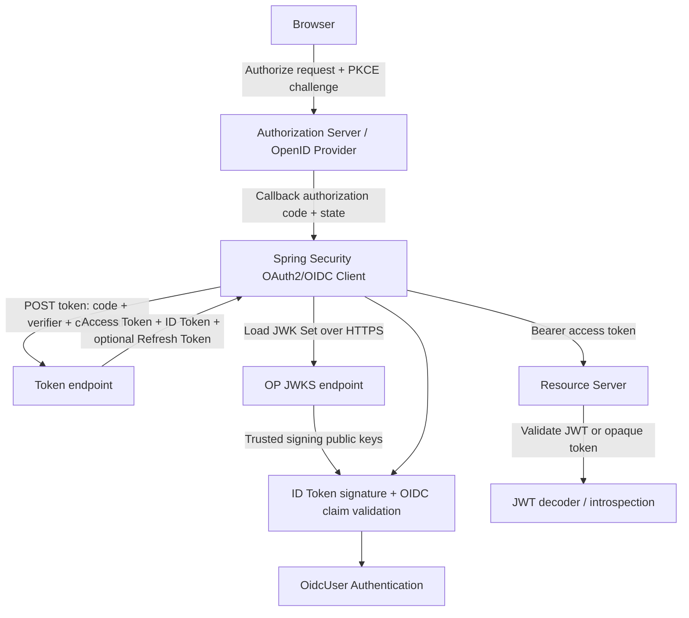
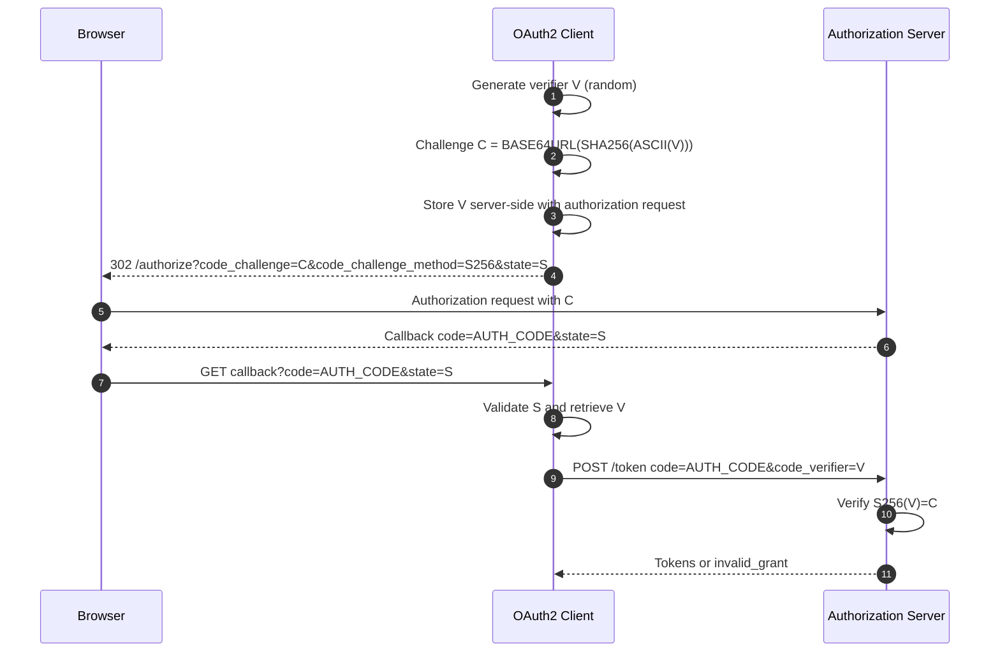
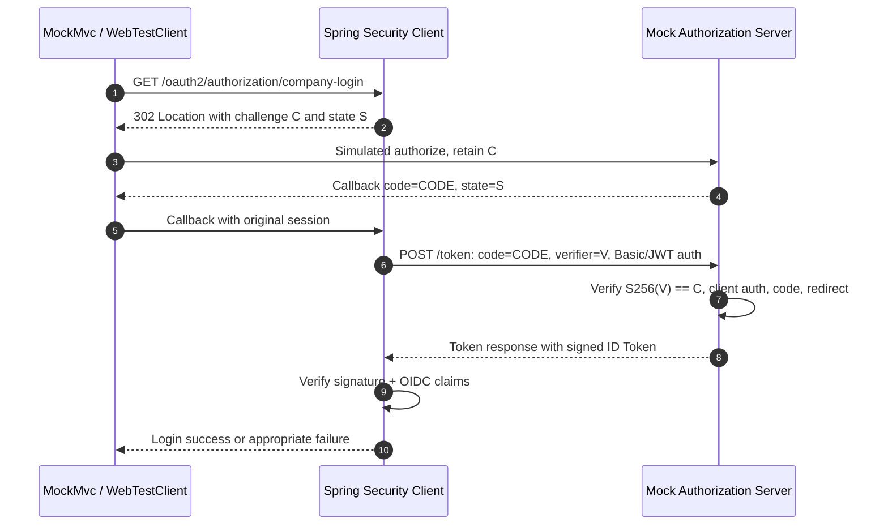

# 33.7. Kiểm tra thay đổi mặc định của PKCE, thuật toán và xác thực token

Khi nâng cấp **Spring Boot, Spring Security, Nimbus JOSE + JWT, Reactor Netty hoặc JDK**, một ứng dụng **Spring Security OAuth 2.0 / OpenID Connect (OIDC) Client** có thể tiếp tục build thành công nhưng thất bại lúc login, đổi authorization code hoặc refresh token. Thậm chí request trả HTTP 200 từ token endpoint nhưng OIDC ID Token không được chấp nhận vì thuật toán chữ ký, issuer, audience hoặc nonce không còn khớp. Một số thay đổi nằm ở default của framework, một số ở provider hoặc cấu hình custom trước đây đã vô tình bị bỏ qua.

Bài **“33.7. Kiểm tra thay đổi mặc định của PKCE, thuật toán và xác thực token”** thuộc chương **33. Tương thích và nâng cấp** hướng dẫn cách thiết lập **baseline theo phiên bản**, phân biệt các cơ chế bảo mật, kiểm tra **PKCE public/confidential clients**, **JWS/JWK/ID Token verification**, **client authentication tại token endpoint**, **Resource Server JWT/opaque token validation**, rồi xây dựng regression test, canary, monitoring và rollback an toàn.

> **Nguyên tắc:** Không sửa một migration thất bại bằng cách tắt PKCE, chấp nhận mọi JWT algorithm, bỏ issuer/audience/nonce checks hoặc vô hiệu TLS certificate verification. Phải xác định **default thực tế nào thay đổi, ở thành phần nào, với registration và provider nào**, rồi điều chỉnh theo contract có bằng chứng.

## 1. Mục tiêu học tập

Sau bài này, bạn có thể:

1. Phân biệt vai trò OAuth2 Client/OIDC Login, Resource Server và Authorization Server.
2. Xác định public/confidential clients và điều kiện PKCE được tự động bật hoặc yêu cầu rõ ràng.
3. Kiểm `code_challenge_method=S256`, `code_challenge` và `code_verifier` xuyên suốt authorize/callback/token exchange.
4. Phân biệt `state`, OIDC `nonce`, PKCE và token endpoint client authentication.
5. Kiểm expected JWS algorithm của ID Token theo từng `ClientRegistration`.
6. Phân biệt ID Token decoder của OAuth2 Login với `JwtDecoder`/`ReactiveJwtDecoder` của Resource Server.
7. Kiểm key selection từ JWKS, signing key rotation, issuer, audience và các claim bảo mật.
8. Xác minh các phương thức `client_secret_basic`, `client_secret_post`, `private_key_jwt`, `client_secret_jwt` và mTLS.
9. Viết ma trận positive/negative tests với WireMock, MockMvc, WebTestClient và token/JWK giả.
10. Xây quy trình nâng cấp có baseline, staging contract tests, canary, cảnh báo và rollback.

## 2. Những ranh giới không được nhầm với nhau



| Bước | Token/credential | Spring Security thường dùng | Kiểm tra khi nâng cấp |
|---|---|---|---|
| Authorization redirect | `state`, `code_challenge`, `nonce` | `OAuth2AuthorizationRequestResolver` / Reactive resolver | PKCE/state/nonce, redirect URI |
| Token exchange | Authorization code, `code_verifier`, client auth | `OAuth2AccessTokenResponseClient` | Body/header, grant, client authentication |
| OIDC Login | ID Token JWT | `OidcIdTokenDecoderFactory`, authentication provider | Expected alg, issuer/audience/nonce, key |
| Authorized client | Access/refresh tokens | `OAuth2AuthorizedClientManager`, service/repository | Token lifecycle, refresh, persistence |
| Outbound API | Bearer access token | OAuth2-enabled `WebClient`/`RestClient` | Chọn đúng token/registration/audience |
| Inbound API | Access token JWT hoặc opaque | `JwtDecoder`/`OpaqueTokenIntrospector` | Signature/introspection, issuer/audience/scopes |
| HTTPS/mTLS | X.509 certificate, client private key | HTTP/TLS stack | Chain, SAN, client identity, policy |

**Token endpoint client authentication** là RP chứng minh mình là OAuth2 client trước AS. **ID Token signature verification** là RP xác minh JWT do OP phát. **Access token validation** thường thuộc Resource Server. Ba việc có thể dùng chữ “token authentication”, nhưng **không chia sẻ một bộ defaults**.

## 3. Phương pháp: ghi nhận baseline theo version, không đoán

Thay vì khẳng định chung “Spring Security phiên bản mới bật tất cả defaults X”, hãy tạo một **compatibility baseline** trên bản đang chạy và so sánh với bản candidate:

| Thuộc tính | Baseline cũ | Candidate mới | Bằng chứng |
|---|---|---|---|
| Boot/Security/Nimbus/JDK | Exact resolved versions | Exact resolved versions | Dependency tree/SBOM |
| Public client PKCE | Enabled? `S256`? | Enabled? `S256`? | Captured Location |
| Confidential client PKCE | Required? | Required? | Resolved registration, redirect |
| Code verifier tại token endpoint | Có và khớp challenge? | Có và khớp? | HTTP stub |
| Token endpoint client auth | Basic/Post/JWT/mTLS/none | So sánh | HTTP request/mock server |
| Expected ID Token JWS alg | Theo issuer/client | So sánh | Signed JWT positive/negative tests |
| JWT Resource Server allowed algs | Theo decoder | So sánh | Decoder tests |
| OIDC claims validation | `iss/aud/nonce/exp`... | So sánh | Tampered fixtures |
| JWK cache/rotation | Refresh keys khi cần | So sánh | Mock JWKS rotation |
| HTTPS/trust | TLS/CA/SNI | So sánh | Network integration tests |

Các tài liệu Spring Security hiện đại mô tả **public clients với method `none` và không có client secret tự dùng PKCE**; `ClientRegistration.clientSettings.requireProofKey` có thể yêu cầu PKCE; `OidcIdTokenDecoderFactory` thường mặc định `RS256`; Resource Server JWT decoders có algorithm allowlist riêng. Tuy nhiên, **custom resolvers, factories, HTTP clients hoặc application auto-configuration** có thể làm behavior chạy khác với defaults.

### 3.1. Inventory trước khi upgrade

Với **mỗi** registration, cần biết:

- `registrationId`, issuer URI, authorization URI, token URI, JWKS URI và các hosts được tin.
- `authorizationGrantType` và `clientAuthenticationMethod`.
- Có client secret không (chỉ ghi trạng thái tồn tại, **không log secret**).
- Public hay confidential; PKCE policy bắt buộc/optional/legacy exception.
- Redirect URI và authorization request repository/session handling.
- Expected ID Token JWS algorithm, issuer, audience và key source.
- Client assertion signer nếu dùng JWT client authentication.
- Token refresh/revocation/introspection endpoints và TLS/mTLS configuration.
- Có Resource Server trong cùng app không, dùng JWT hay opaque introspection?

Đừng chỉ đọc YAML: environment variables, custom `ClientRegistrationRepository`, dynamic tenants, beans và HTTP client overrides có thể thay **runtime effective configuration**.

## 4. PKCE theo RFC 7636

**Proof Key for Code Exchange (PKCE)** ràng buộc một authorization code với client khởi tạo request. Client tạo `code_verifier` bí mật ngẫu nhiên và tính `code_challenge` gửi trên browser redirect. Khi đổi code, client phải xuất trình verifier tương ứng.



Với method `S256`:

\[
\mathrm{code\_challenge} = \mathrm{BASE64URL\_NO\_PADDING}\left(\mathrm{SHA256}(\mathrm{ASCII}(\mathrm{code\_verifier}))\right)
\]

`code_verifier` theo RFC 7636 có độ dài 43–128 ký tự từ tập unreserved và phải được tạo bằng random nguồn đủ mạnh. Không tạo verifier từ timestamp, email, user ID hay counter.

### 4.1. Browser chỉ thấy challenge

```http
HTTP/1.1 302 Found
Location: https://idp.example.org/authorize?response_type=code&client_id=portal-test&state=OPAQUE_STATE&code_challenge=CHALLENGE&code_challenge_method=S256
```

**Không** gửi `code_verifier` trong authorization redirect, callback query, HTML hay client-side storage. Verifier được giữ trong authorization request context và đưa vào **POST token endpoint**.

### 4.2. Token request

```http
POST /token HTTP/1.1
Content-Type: application/x-www-form-urlencoded
Authorization: Basic <TEST_CREDENTIALS_ONLY>

grant_type=authorization_code&code=AUTH_CODE&redirect_uri=https%3A%2F%2Fportal.example.org%2Flogin%2Foauth2%2Fcode%2Fcompany-login&code_verifier=VERIFIER
```

Confidential client có thể gửi **cả client authentication và PKCE verifier**. Một AS đã yêu cầu PKCE phải từ chối missing/wrong verifier, thường dưới dạng `invalid_grant`.

### 4.3. PKCE, state, nonce và client authentication là các cơ chế độc lập

| Cơ chế | Mục tiêu |
|---|---|
| `state` | Authorization response correlation, bảo vệ browser flow khỏi CSRF/mix-up |
| `code_verifier`/`code_challenge` | Ràng buộc code với client đã khởi tạo |
| OIDC `nonce` | Ràng buộc ID Token với authentication request, chống replay |
| Client secret/JWT assertion/mTLS | Client authentication tại token endpoint |
| Redirect URI exact match | Chặn code bị chuyển tới callback không đăng ký |
| TLS | Bảo mật transport và xác thực hostname/certificate |

PKCE **không thay** nonce, state, TLS hoặc client authentication của confidential client.

## 5. Public vs confidential clients khi nâng cấp

Một public OAuth2 Client không giữ được client secret một cách bảo mật. Cấu hình minh họa:

```yaml
spring:
  security:
    oauth2:
      client:
        registration:
          browser-public:
            client-id: browser-test
            client-authentication-method: none
            authorization-grant-type: authorization_code
            redirect-uri: "{baseUrl}/login/oauth2/code/{registrationId}"
            scope: [openid, profile]
        provider:
          browser-public:
            issuer-uri: https://idp.example.org
```

Theo tài liệu Spring Security cho các bản hiện đại, khi client authentication method là `none` và secret trống/không có, PKCE tự được sử dụng. Cũng có thể yêu cầu PKCE qua `ClientRegistration.clientSettings.requireProofKey` cho Authorization Code flow.

### 5.1. Confidential client

```yaml
spring:
  security:
    oauth2:
      client:
        registration:
          company-login:
            client-id: reports-portal
            client-secret: "${COMPANY_CLIENT_SECRET}"
            client-authentication-method: client_secret_basic
            authorization-grant-type: authorization_code
            scope: [openid, profile]
        provider:
          company-login:
            issuer-uri: https://idp.example.org
```

Backend confidential client có thể/bạn thường nên cấu hình PKCE theo provider và security policy, **đồng thời giữ Basic/JWT/mTLS client authentication**. Không được suy luận rằng mọi confidential registration tự bật PKCE trong mọi phiên bản Spring Security nếu chưa kiểm `requireProofKey`/resolver.

### 5.2. Bảng upgrade cases

| Registration | Method | Secret | PKCE policy | Expected |
|---|---|---|---|---|
| Browser public | `none` | Không | Framework public-client behavior | S256 challenge và verifier |
| Backend confidential | `client_secret_basic` | Có | Explicit requireProofKey/approved policy | S256 + Basic auth |
| Legacy confidential | Basic/JWT | Có | Provider không hỗ trợ PKCE | Exception theo provider, không ảnh hưởng public |
| Service `client_credentials` | Basic/JWT/mTLS | Theo method | Không áp dụng | Không có browser PKCE |
| Refresh token grant | Method của client | Theo method | PKCE không áp dụng cho refresh | RT và client auth |

Tắt PKCE global để chạy một legacy confidential provider có thể làm yếu các public registrations. Nếu cần ngoại lệ, khoanh vùng theo registration và đặt deadline migration.

### 5.3. Custom resolver có thể làm mất PKCE

Trong Servlet, `DefaultOAuth2AuthorizationRequestResolver` thường xử lý `/oauth2/authorization/{registrationId}`; WebFlux tương ứng có `DefaultServerOAuth2AuthorizationRequestResolver`. Custom resolver thêm `prompt`, `login_hint`, `max_age` hoặc tenant routing đôi khi tự dựng `OAuth2AuthorizationRequest` và làm mất PKCE attributes.

Biểu hiện:

```text
GET /oauth2/authorization/company-login -> 302 (possibly challenge missing)
Callback state valid -> code exchange
POST /token -> missing code_verifier
AS -> 400 invalid_grant
```

Ưu tiên dùng **default resolver + builder customizer** theo version. Với những version hỗ trợ `OAuth2AuthorizationRequestCustomizers.withPkce()`, có thể áp:

```java
import org.springframework.security.oauth2.client.registration
        .ClientRegistrationRepository;
import org.springframework.security.oauth2.client.web
        .DefaultOAuth2AuthorizationRequestResolver;
import org.springframework.security.oauth2.client.web
        .OAuth2AuthorizationRequestCustomizers;

DefaultOAuth2AuthorizationRequestResolver resolver =
        new DefaultOAuth2AuthorizationRequestResolver(
                registrations, "/oauth2/authorization");
resolver.setAuthorizationRequestCustomizer(
        OAuth2AuthorizationRequestCustomizers.withPkce());
```

`registrations` là một `ClientRegistrationRepository` do ứng dụng cung cấp. Nếu đã có customizer khác, **compose** để giữ PKCE, không thay thế toàn bộ builder attributes và additional parameters tùy tiện. Đối chiếu API chính xác của version đang dùng.

### 5.4. WebFlux Session và Reactor context

Trong WebFlux, authorization request và verifier có thể được giữ qua `WebSession`/repository. Một callback đi sang instance không chia sẻ session, cookie `SameSite` sai hoặc code tự block Reactor event loop có thể làm mất correlation. Đừng dùng global map static chứa verifier của tất cả users; test nhiều tabs và nhiều registrations.

## 6. Regression tests cho PKCE

### 6.1. Authorization redirect chứa S256 challenge

Ví dụ Servlet MockMvc:

```java
mockMvc.perform(get("/oauth2/authorization/browser-public"))
        .andExpect(status().is3xxRedirection())
        .andExpect(header().string(
                "Location",
                org.hamcrest.Matchers.allOf(
                    org.hamcrest.Matchers.containsString(
                            "code_challenge="),
                    org.hamcrest.Matchers.containsString(
                            "code_challenge_method=S256"))));
```

Ở test thực tế, parse URL bằng URI/query parser để không phụ thuộc thứ tự query parameters/encoding.

### 6.2. Test challenge-verifier relation

```java
import java.nio.charset.StandardCharsets;
import java.security.MessageDigest;
import java.util.Base64;

static String s256Challenge(String verifier) throws Exception {
    byte[] hash = MessageDigest.getInstance("SHA-256")
            .digest(verifier.getBytes(StandardCharsets.US_ASCII));
    return Base64.getUrlEncoder().withoutPadding()
            .encodeToString(hash);
}
```

Trong một protocol integration test:

1. Capture `code_challenge` từ authorization redirect.
2. Giữ session/browser correlation khi callback với code và state.
3. Mock token endpoint capture `code_verifier` trong POST.
4. Assert verifier length/allowed characters/entropy strategy theo policy.
5. Assert `s256Challenge(verifier)` bằng challenge đã capture.
6. Assert authorization URL/callback **không chứa raw verifier**.
7. Fake AS từ chối wrong/missing verifier bằng `invalid_grant`.

Không so sánh verifier với một literal cố định; verifier phải random qua các login attempts.

### 6.3. Public vs confidential

| Case | Authorize | Token exchange |
|---|---|---|
| Public with PKCE | Challenge S256 | Verifier, **không** client secret |
| Confidential with PKCE | Challenge S256 | Verifier **và** Basic/JWT/mTLS auth |
| Confidential legacy exception | Theo approved contract | Client auth, PKCE tùy provider |
| Wrong verifier | Challenge C | Fake AS reject |
| No verifier | Challenge C | Fake AS reject |

Chỉ kiểm Location có challenge là **chưa đủ**. Token client custom có thể quên gửi verifier dù redirect đúng.

### 6.4. State, nonce, tab isolation

```text
Tab A: state=SA, verifier=VA, challenge=CA
Tab B: state=SB, verifier=VB, challenge=CB

Callback A -> verifier VA
Callback B -> verifier VB
No shared global lastVerifier
```

Kiểm state mismatch, OIDC nonce mismatch và cross-registration issuer mix-up. Không đặt verifier trong metrics labels/logs để debug.

## 7. Thuật toán: phải biết đang nói về tầng nào

| Algorithm family | Ví dụ | Thuộc tầng |
|---|---|---|
| PKCE code challenge method | `S256`, `plain` | Code binding tại authorization/token endpoints |
| ID Token JWS | `RS256`, `ES256`, `PS256`, `HS256` | OP ký, RP verify |
| Client assertion JWS | `RS256`, `PS256`, `ES256`, `HS256` | RP ký, AS verify |
| JWT access token JWS | `RS256`/`ES256`... | Resource Server verify |
| JWE | Key/content encryption algorithms | Encrypted token profiles |
| TLS | TLS 1.2/1.3 + cipher suites | HTTPS/mTLS transport |
| JWK kty | `RSA`, `EC`, `oct` | Key material type |

Nếu provider báo “chuyển RS256 sang ES256”, phải hỏi: **ID Token? JWT access token? JWT client assertion?** Không thay một global JwtDecoder rồi hy vọng tất cả cùng đúng.

### 7.1. JWT header không được ra lệnh trust policy

Ví dụ header:

```json
{"alg":"RS256","kid":"provider-key-K2","typ":"JWT"}
```

`alg` và `kid` là **untrusted input trước verification**. Application phải có expected algorithms/key sources từ `ClientRegistration`/issuer policy. Không tự nhận `alg=none`, không lấy asymmetric RSA public key làm HMAC secret (algorithm confusion), không tự fetch `jku`/`x5u` bất kỳ từ token header.

### 7.2. JWK Set và signing key rotation

```text
Before: JWKS = [K1], ID Tokens signed K1
Overlap: JWKS = [K1,K2], new tokens signed K2
After: JWKS = [K2], K1 retired
```

JWK signing-key rotation **khác** TLS certificate renewal. Nếu JWKS client cache K1 quá lâu, signature verify có thể fail dù token endpoint 200; nếu TLS CA thay mà JVM không tin, key fetch có thể fail dù JWK signing algorithm không đổi.

### 7.3. `kid` không phải trust anchor

Key ID chỉ giúp chọn key **bên trong JWK Set đã gắn với issuer tin cậy**. Cùng `kid` của hai issuers không cho phép dùng key chéo. Tránh public-key fetch dựa vào arbitrary URL trong JWT header; luôn bind issuer, audience, expected alg, JWK source.

## 8. OIDC ID Token validation và thuật toán ký

`OidcIdTokenDecoderFactory` là thành phần quan trọng khi Spring Security OAuth2 Login xử lý ID Token. Theo tài liệu Spring Security hiện đại, expected algorithm mặc định thường là `RS256`, có thể được cấu hình bằng `setJwsAlgorithmResolver(...)` per `ClientRegistration`.

### 8.1. ID Token claims cần kiểm

| Claim | Ý nghĩa | Migration regression |
|---|---|---|
| `iss` | Identity provider/issuer | Đúng trusted issuer URI |
| `sub` | End-user identity trong issuer | Không dùng email làm khóa identity tin cậy |
| `aud` | Intended client audience | Bao gồm `clientId` của RP |
| `exp` | Expiry | Từ chối expired token |
| `iat` | Issued at | Thời gian phù hợp theo policy |
| `nonce` | Authorization request correlation | Từ chối mismatch theo OIDC flow |
| `azp` | Authorized party | Kiểm theo OIDC rules khi cần |
| `auth_time` | Authentication time | Kiểm nếu `max_age`/contract yêu cầu |
| `at_hash` | Access-token hash binding | Kiểm theo profile/flow yêu cầu |
| `acr`/`amr` | Authentication context/method | Chỉ dùng trong business auth theo policy |

Một ID Token có signature hợp lệ nhưng `aud` dành cho ứng dụng khác phải bị từ chối. Không bỏ claim validators khi thay JWT decoder factory.

### 8.2. Per-registration algorithm policy

Ví dụ cấu hình theo các bản hỗ trợ:

```java
import org.springframework.context.annotation.Bean;
import org.springframework.security.oauth2.client.oidc.authentication
        .OidcIdTokenDecoderFactory;
import org.springframework.security.oauth2.client.registration.ClientRegistration;
import org.springframework.security.oauth2.jose.jws.SignatureAlgorithm;
import org.springframework.security.oauth2.jose.jws.MacAlgorithm;
import org.springframework.security.oauth2.jwt.JwtDecoderFactory;

@Bean
JwtDecoderFactory<ClientRegistration> idTokenDecoderFactory() {
    OidcIdTokenDecoderFactory factory =
            new OidcIdTokenDecoderFactory();
    factory.setJwsAlgorithmResolver(registration -> {
        if ("partner-hmac".equals(registration.getRegistrationId())) {
            return MacAlgorithm.HS256;
        }
        return SignatureAlgorithm.RS256;
    });
    return factory;
}
```

`HS256` ở đây **chỉ minh họa khi OP/client registration đã thỏa thuận dùng HMAC**, không phải một default nên bật toàn cục. Với HMAC-based ID Token algorithms, secret của client là symmetric verification key; cần bảo vệ như credential. Nếu chỉ dùng RS256, hãy để framework default và test theo contract.

### 8.3. Không thay decoder mặc định một cách sơ sài

Nếu tự cung cấp `JwtDecoderFactory<ClientRegistration>` để custom TLS/JWKS/algorithms, cần giữ:

- Signature verification với expected algorithm/key.
- Issuer/audience/timestamp validation.
- OIDC-specific validators (nonce, azp/auth_time khi áp dụng).
- Claim type conversion phù hợp.
- Caching per registration, tránh tạo decoder mới trên mọi request.

Một `NimbusJwtDecoder` dựng chỉ với JWK Set URI rồi quên OIDC validators có thể **làm yếu security**, dù test signature vẫn xanh.

### 8.4. ID Token decoder khác Resource Server JwtDecoder

Một app có:

```java
@Bean
JwtDecoder resourceServerDecoder() {
    // Config cho inbound JWT Bearer của /api/**
}
```

không có nghĩa bean này cũng được `oauth2Login()` dùng để xác minh ID Token. OIDC Login dùng riêng `JwtDecoderFactory<ClientRegistration>`; phải test **hai đường** nếu app vừa OAuth2 Client vừa Resource Server.

## 9. Resource Server JWT/opaque token validation

Resource Server nhận request inbound:

```http
GET /api/reports
Authorization: Bearer ACCESS_TOKEN
```

Với JWT, `JwtDecoder` hoặc `ReactiveJwtDecoder` xác minh signature và claims. Với opaque token, sử dụng introspection hoặc provider-specific opaque validation, không tự đoán token format rồi parse JWT.

### 9.1. Spring Boot Resource Server config

```yaml
spring:
  security:
    oauth2:
      resourceserver:
        jwt:
          issuer-uri: https://idp.example.org
          jws-algorithms:
            - RS256
```

Theo tài liệu Spring Security, Nimbus Resource Server JWT decoders có baseline trusted algorithm `RS256` trong cấu hình mặc định và có thể tùy chỉnh. Một `JwtDecoder` bean custom có thể override Boot properties, vì thế phải test **effective decoder**, không chỉ YAML.

### 9.2. Decoder builder ví dụ

```java
import org.springframework.context.annotation.Bean;
import org.springframework.security.oauth2.jose.jws.SignatureAlgorithm;
import org.springframework.security.oauth2.jwt.JwtDecoder;
import org.springframework.security.oauth2.jwt.JwtValidators;
import org.springframework.security.oauth2.jwt.NimbusJwtDecoder;

@Bean
JwtDecoder reportsApiJwtDecoder() {
    NimbusJwtDecoder decoder = NimbusJwtDecoder
            .withIssuerLocation("https://idp.example.org")
            .jwsAlgorithm(SignatureAlgorithm.RS256)
            .build();
    decoder.setJwtValidator(
            JwtValidators.createDefaultWithIssuer(
                    "https://idp.example.org"));
    return decoder;
}
```

Đây là ví dụ issuer/signature/timestamp validation; **audience của Reports API phải được kiểm riêng** nếu ứng dụng yêu cầu. `JwtValidators.createDefaultWithIssuer` không tự biết API audience.

### 9.3. Audience validator và composition

```java
import org.springframework.security.oauth2.core.OAuth2Error;
import org.springframework.security.oauth2.core.OAuth2TokenValidator;
import org.springframework.security.oauth2.core.OAuth2TokenValidatorResult;
import org.springframework.security.oauth2.jwt.Jwt;

OAuth2TokenValidator<Jwt> reportsAudience =
        jwt -> jwt.getAudience().contains("reports-api")
            ? OAuth2TokenValidatorResult.success()
            : OAuth2TokenValidatorResult.failure(
                new OAuth2Error("invalid_token",
                        "Wrong audience", null));
```

Khi thêm validator, dùng composite như `DelegatingOAuth2TokenValidator` để **giữ issuer/timestamp validators**, không thay tất cả bằng audience-only.

### 9.4. OAuth2 Client không mặc nhiên tự verify access tokens

Access token mà RP nhận có thể là opaque string; OAuth2 Client thường lưu và gắn bearer vào outbound API call. Nó **không cần tự xác minh chữ ký access token** nếu Resource Server là bên đánh giá token. Không đưa ID Token làm bearer thay access token dù cả hai có định dạng JWT.

## 10. Xác thực OAuth2 client tại token endpoint

Một sự thay đổi quan trọng khi nâng cấp có thể là **cách ứng dụng chứng minh chính nó là OAuth2 client trước AS**. Cấu hình `ClientRegistration.clientAuthenticationMethod` không chỉ ảnh hưởng HTTP headers mà còn có thể ảnh hưởng provider security policy và cách framework chọn token response client.

| Method | Cơ chế | Điều bắt buộc kiểm |
|---|---|---|
| `client_secret_basic` | HTTP Basic với client ID/secret | Header Basic đúng, encoding đúng |
| `client_secret_post` | Form fields `client_id`/`client_secret` | POST body đúng; chỉ dùng nếu provider chấp thuận |
| `private_key_jwt` | Client ký JWT assertion bằng private key | `alg/kid`, key, `iss/sub/aud/iat/exp/jti` |
| `client_secret_jwt` | Client ký assertion bằng HMAC client secret | Secret/algorithm đúng, không nhầm ID Token |
| `tls_client_auth` | mTLS X.509 client certificate | Cert/key và identity đã đăng ký |
| `self_signed_tls_client_auth` | mTLS certificate public key đã đăng ký | Proof-of-possession và registration đúng |
| `none` | Public client, không dùng secret | PKCE + exact redirect URI + provider policy |

**`none` client authentication không đồng nghĩa `alg=none` của JWT được chấp nhận.** Một public client có thể dùng `none` method tại token endpoint nhưng vẫn phải xác minh một ID Token được ký đúng.

### 10.1. Basic và POST khác nhau

Đối với confidential Code client:

```yaml
spring:
  security:
    oauth2:
      client:
        registration:
          company-login:
            client-id: portal-web
            client-secret: "${OIDC_CLIENT_SECRET}"
            client-authentication-method: client_secret_basic
            authorization-grant-type: authorization_code
            scope: [openid, profile]
```

Token request Basic:

```http
POST /token HTTP/1.1
Authorization: Basic <TEST_BASIC_CREDENTIALS>
Content-Type: application/x-www-form-urlencoded

grant_type=authorization_code&code=TEST_CODE&code_verifier=TEST_VERIFIER
```

Token request POST method:

```http
POST /token HTTP/1.1
Content-Type: application/x-www-form-urlencoded

grant_type=authorization_code&code=TEST_CODE&client_id=portal-web&client_secret=FAKE_SECRET&code_verifier=TEST_VERIFIER
```

Ví dụ được rút gọn; request code exchange thật còn có `redirect_uri` theo contract. Đừng chuyển từ Basic sang POST chỉ vì provider chấp nhận tạm, và **không log** giá trị header/body credentials. PKCE có thể được gửi **cùng client authentication**, không loại trừ nhau.

### 10.2. Client secret có ký tự đặc biệt

Client secret chứa `+`, `:`, `%`, `/` hoặc Unicode có thể lộ lỗi encode custom khi thay HTTP client. Với `client_secret_basic`, OAuth2 có quy tắc mã hóa credentials riêng trước khi tạo Basic header. Dùng Spring Security token request converters thay vì tự nối header; regression test bằng **secret giả chứa ký tự đặc biệt** và mock server parse đúng.

### 10.3. private_key_jwt

Khi provider dùng `private_key_jwt`, token request mang:

```text
client_assertion_type=urn:ietf:params:oauth:client-assertion-type:jwt-bearer
client_assertion=<signed-JWT>
grant_type=authorization_code hoặc client_credentials
```

JWT assertion có thể chứa:

```json
{
  "iss": "partner-service",
  "sub": "partner-service",
  "aud": "https://partner-idp.example.org/token",
  "jti": "unique-id-for-this-assertion",
  "iat": 1900000000,
  "exp": 1900000300
}
```

Các số thời gian này minh họa cấu trúc. Test thực phải có `iat/exp` tương ứng test clock; không hardcode một timestamp xa rồi mong AS đang dùng production clock chấp nhận. Provider có thể yêu cầu audience là token endpoint hoặc issuer identifier theo contract đã đăng ký.

`NimbusJwtClientAuthenticationParametersConverter` là extension point của Spring Security cho JWT Bearer client authentication. Việc khai `client-authentication-method: private_key_jwt` **không tự cung cấp private signing key**. Cần một JWK resolver/key supplier, token response client và converter được wire đúng.

### 10.4. private_key_jwt khác ID Token

```text
private_key_jwt client assertion:
  signed by Client private key
  verified by Authorization Server
  audience = token endpoint/provider agreed identifier

OIDC ID Token:
  signed by OpenID Provider key
  verified by Client
  audience = Client ID
```

Không dùng public JWKS signing key của OP làm private key của RP, và không đổi `OidcIdTokenDecoderFactory` khi lỗi thực là client assertion signer.

### 10.5. client_secret_jwt

Một client có thể ký assertion bằng HMAC secret nếu provider hỗ trợ. Khi nâng cấp, kiểm algorithm và secret length/signer version. Không suy luận HS256 được phép cho ID Token chỉ vì token endpoint client authentication dùng `client_secret_jwt` HS256; chúng là **hai hợp đồng cryptographic riêng**.

### 10.6. mTLS và sender-constrained tokens

OAuth2 RFC 8705 mô tả mTLS client authentication và certificate-bound access tokens. Kiểm:

1. HTTP token client dùng đúng truststore cho OP server.
2. Client keystore chứa đúng private key và certificate của RP.
3. `tls_client_auth`/`self_signed_tls_client_auth` được AS đăng ký đúng.
4. Token endpoint alias dành cho mTLS được dùng khi provider yêu cầu.
5. Với access token certificate-bound, API WebClient cũng chứng minh đúng certificate khi gọi Resource Server.
6. Cert rotation không làm token cũ bị dùng với cert khác trái contract.

Không sửa `SSLHandshakeException` bằng cách chấp nhận mọi certificate/hostname. Lỗi TLS có thể xuất hiện sớm hơn OAuth2 `invalid_client`.

## 11. Token response clients và grant-specific regression

Spring Security OAuth2 Client có các grants khác nhau, thường qua những response clients khác nhau:

```text
authorization_code -> OAuth2AuthorizationCodeGrantRequest
refresh_token       -> OAuth2RefreshTokenGrantRequest
client_credentials  -> OAuth2ClientCredentialsGrantRequest
token_exchange      -> extension grant (nếu project/provider hỗ trợ)
```

Nâng cấp HTTP transport hoặc custom converter có thể sửa được Code flow nhưng làm hỏng refresh/client credentials vì chỉ một grant được wire theo method cũ.

| Grant | Request cần kiểm | Rủi ro |
|---|---|---|
| Authorization Code | code, redirect URI, code verifier nếu PKCE, client auth | `invalid_grant`, `invalid_client` |
| Refresh Token | refresh token + client auth | Rotation, lost secret/JWT assertion |
| Client Credentials | grant_type, scopes, client auth | Incorrect signer/certificate |
| Token Exchange | Subject/actor token, audience, client auth | Provider chain thay đổi |

### 11.1. PKCE không áp dụng tùy tiện cho mọi grant

`code_verifier` là thành phần của **authorization code exchange**. Một request `grant_type=refresh_token` bình thường không tự cần code_verifier. Nếu upgrade làm code vô tình thêm verifier vào mọi token request, provider có thể từ chối extra parameters. Hãy kiểm body theo grant.

### 11.2. Client authentication có thể vẫn sai sau login

Ví dụ:

```text
First Login:
  authorization_code -> token endpoint Basic auth OK
  ID Token validation OK

Later:
  refresh_token -> new HTTP client lacks Basic/client assertion
  AS returns invalid_client
```

Token acquisition đầu thành công **không đủ** để kết luận refresh hoạt động. Kiểm riêng paths đã sử dụng trong `OAuth2AuthorizedClientManager`.

### 11.3. Automatic HTTP redirects có thể đổi trust boundary

Một token request gửi client secret/assertion không nên auto-follow 302/307 tới arbitrary host. Nếu HTTP client default thay đổi, một redirect có thể làm lộ credential tùy behavior transport. Test server trả Location đến host khác và xác minh client không forward token request/body/header tới host ngoài allowlist.

### 11.4. Timeout và retries

Authorization Code là credential một lần; refresh token có thể rotation. Timeout sau POST **không chắc** AS chưa xử lý request. Generic retry sau timeout có thể dẫn tới `invalid_grant` hoặc refresh token reuse detection. Khi upgrade token HTTP client:

- Kiểm retries đã bị bật/tắt ở lớp nào.
- Đếm logical grant calls và physical HTTP attempts tách biệt.
- Không retry mù quáng authorization code hay refresh token POST.
- Dùng bounded timeout/pool/backoff theo provider contract.
- Phân biệt `invalid_grant` do code/PKCE với RT rotation dựa trên `grant`.

## 12. JWT signing key và TLS certificate có vòng đời khác nhau

Khi upgrade, một lỗi signature verification có thể do cache cũ, không phải default algorithm:

```text
JWK Set:
  K1 -> K1+K2 -> K2
JWT:
  signed K1 -> signed K2
```

Một lỗi TLS có thể do OP renew certificate hoặc intermediate CA. Hai vòng đời độc lập:

| Vật liệu | Dùng để | Thường được lấy từ |
|---|---|---|
| TLS server certificate | Xác minh HTTPS endpoint | TLS handshake/server chain |
| OIDC signing JWK | Verify ID Token JWT | Trusted issuer JWKS |
| Resource Server JWT key | Verify access token JWT | Issuer/JWK trusted for API |
| Client assertion private key | Ký `private_key_jwt` | Client keystore/KMS |
| mTLS client certificate/private key | Client identity/proof | Client TLS keystore |

Đừng import leaf TLS certificate như JWK signing key hoặc pin `kid` vô hạn. Với `JWKS`, chỉ tải từ issuer/metadata đã được phê duyệt; không fetch `jku` arbitrary do token header cung cấp.

### 12.1. TLS trust vẫn bắt buộc

Nếu token endpoint/JWKS URI dùng corporate private CA, một framework/JDK upgrade có thể dùng truststore khác trước. Lỗi `PKIX path building failed`/SAN mismatch không được sửa bằng tắt certificate validation hoặc đổi HTTPS sang HTTP. Kiểm truststore, root/intermediate, DNS/SNI, proxy inspection và hiệu lực cert.

## 13. Ma trận negative tests cho ID Token/JWT

Test có signed JWT fixtures từ test keypair, không dùng private key/provider credentials production.

| Token | Kết quả mong đợi |
|---|---|
| Valid ID Token, approved alg/key/issuer/audience/nonce | OIDC authentication success |
| ID Token `alg=none` hoặc unsigned | Rejected theo signed-token profile |
| ID Token HS256, client chỉ approved RS256 | Rejected |
| ID Token RS256, signature tampered | Rejected |
| ID Token ký bằng issuer B key cho issuer A | Rejected |
| ID Token signature đúng nhưng `iss` sai | Rejected |
| ID Token signature đúng nhưng `aud` không chứa client ID | Rejected |
| ID Token nonce sai | Rejected theo OIDC flow |
| ID Token `exp` trong quá khứ | Rejected |
| Token multi-audience có `azp` không hợp lệ | Rejected khi profile yêu cầu |
| ID Token signed key K2 sau rotation hợp lệ | Accepted sau JWKS update |
| ID Token khai `kid` không tìm thấy | Re-fetch có giới hạn hoặc rejected |
| JWT access token đúng signature nhưng sai API audience | Resource Server reject |
| Opaque token đưa vào JWT decoder | Reject, không tự suy diễn |
| JWT với `jku` trỏ arbitrary host | Không fetch arbitrary URL |

### 13.1. Vì sao chỉ đọc payload chưa đủ?

```text
BASE64URL-decode JWT payload -> JSON claims
```

là **parse** chứ không phải authentication. Test phải dùng `OidcIdTokenDecoderFactory`, `JwtDecoder` hoặc Authentication provider thật và assert response/failure.

### 13.2. Sinh keypair trong test

Mock OP có thể tạo RSA/EC keypair dành cho test, công bố public JWK Set qua HTTPS/loopback test stub và ký JWT bằng private key test. Với key rotation:

1. JWKS ban đầu chứa K1.
2. Token K1 hợp lệ.
3. Thêm K2/JWKS overlap.
4. Token K2 hợp lệ khi decoder cập nhật keys.
5. Wrong alg/issuer vẫn reject dù K2 đúng.

Một JSON JWK chỉ có `kid`/`alg` mà không có key parameters (`n/e` cho RSA hoặc `crv/x/y` cho EC) **không đủ** để verify thật.

## 14. Integration test PKCE với mock Authorization Server

Một test protocol-level nên gồm **hai HTTP boundaries**:



**Quan trọng:** Một WireMock stub `POST /token → 200` cho mọi request sẽ không bắt được thiếu verifier, sai client auth hay code reuse. Muốn test PKCE thật, mock AS phải có logic kiểm challenge–verifier correlation và phản hồi `invalid_grant` cho mismatch.

### 14.1. WireMock stub kiểm cấu trúc tối thiểu

```java
import static com.github.tomakehurst.wiremock.client.WireMock.*;

tokenServer.stubFor(
    post(urlEqualTo("/oauth2/token"))
        .withRequestBody(containing(
                "grant_type=authorization_code"))
        .withRequestBody(containing("code_verifier="))
        .willReturn(okJson("""
            {
              "access_token": "AT_TEST",
              "token_type": "Bearer",
              "expires_in": 3600
            }
            """)));
```

Đoạn này **chỉ là test request shape**, không chứng minh PKCE hoặc OIDC Login thành công (OIDC Login cần ID Token hợp lệ). Để kiểm end-to-end, dùng custom dispatcher/stateful mock OP, verify S256 pairing, tạo signed ID Token với claims đúng, rồi mới assert Authentication.

### 14.2. Giữ browser/session correlation

Khi test callback:

- Dùng đúng cookie/session lưu authorization request.
- Không tạo `state` mới thủ công không liên quan redirect.
- Không dùng verifier của tab/registration khác.
- Nếu có load balancer/multi-instance, test session repository tương ứng.
- Không echo raw state/verifier hoặc authorization code trong test reports.

### 14.3. Tách positive/negative

```text
Positive:
  correct code + state + verifier + client auth
  valid signed ID Token -> login success

Negative PKCE:
  same code + wrong verifier -> invalid_grant

Negative OIDC:
  correct code exchange + wrong ID Token nonce -> login failure

Negative client auth:
  correct verifier + wrong client_secret/jwt assertion -> invalid_client
```

Tách case giúp chẩn đoán đúng thay đổi default, không gộp mọi lỗi thành “OAuth2 login failed”.

## 15. Kiểm RSA → EC signing algorithm migration

Giả sử Partner OP thông báo đổi **ID Token** từ `RS256` sang `ES256`:

1. Xác nhận đây là ID Token alg, không phải client assertion/access token alg.
2. Nhận provider contract về effective date, key types, JWKS, overlap.
3. Kiểm Spring Security/Nimbus/JDK hỗ trợ `ES256`/EC P-256.
4. Cấu hình expected algorithm **riêng cho Partner registration**.
5. Test ES256 signed ID Token + EC public JWK + OIDC claims hợp lệ.
6. Test RS256 token bị reject sau policy switch nếu không còn approved.
7. Test wrong EC key/wrong `iss`/`aud` bị reject.
8. Canary Partner registration trước khi rollout toàn bộ.
9. Monitor JWT validation failures và JWK cache refresh.
10. Rollback nếu contract cho phép compatibility window; không mở all algorithms global.

### 15.1. Phân biệt algorithm switch và key rotation

```text
RSA K1 -> RSA K2:
  algorithm RS256 remains
  key ID/public key changes

RSA RS256 -> EC ES256:
  algorithm changes AND key type changes
```

Hai kịch bản cần negative tests khác nhau. Một thông báo “rotate key” không tự chứng minh algorithm đổi.

## 16. Kiểm public PKCE sau config migration

Một cấu hình có thể vô tình chuyển:

```yaml
client-authentication-method: client_secret_basic
```

thành:

```yaml
client-authentication-method: none
```

vì property binding/refactor/override. Hậu quả:

- Redirect có thể bắt đầu kèm PKCE do public-client rule.
- Token endpoint không nhận Basic client auth.
- AS từ chối `invalid_client` do client đã đăng ký confidential.
- Nếu AS misconfigured chấp nhận public, trust model bị hạ xuống.

**Không sửa bằng cách tắt PKCE.** Lỗi nằm ở client registration method; test phải so sánh both authorization redirect **và** token request authentication.

### 16.1. Resolved registration sanity checks

Có thể xây application startup check (không log secrets):

```text
For each approved registration:
  issuer/tokenUri in trusted allowlist
  grant_type matches client contract
  clientAuthenticationMethod matches AS registration
  PKCE requirement is explicit/verified
  redirect URI is exact and trusted
  expected ID Token alg is approved
  confidential secret/private key exists where required
```

Check này không thay network integration tests; nó giúp phát hiện config binding lỗi trước khi login production.

## 17. Servlet và WebFlux có điểm nối khác nhau

Servlet:

```text
DefaultOAuth2AuthorizationRequestResolver
OAuth2AuthorizationRequestRedirectFilter
OAuth2AccessTokenResponseClient
HttpSecurity.oauth2Login()
OidcIdTokenDecoderFactory
```

Reactive:

```text
DefaultServerOAuth2AuthorizationRequestResolver
OAuth2AuthorizationRequestRedirectWebFilter
ReactiveOAuth2AccessTokenResponseClient
ServerHttpSecurity.oauth2Login()
Reactive authentication/JWT infrastructure
```

Khi migrate project sang WebFlux hoặc cập nhật Reactive stack, không copy Servlet resolver vào Reactive chain. Session/authorization request storage, token HTTP client và subscription behavior khác nhau.

### 17.1. WebFlux configuration minh họa

```java
import org.springframework.context.annotation.Bean;
import org.springframework.security.config.web.server.ServerHttpSecurity;
import org.springframework.security.web.server.SecurityWebFilterChain;

@Bean
SecurityWebFilterChain webFluxSecurity(ServerHttpSecurity http) {
    return http
        .authorizeExchange(exchanges -> exchanges
                .pathMatchers("/login", "/error").permitAll()
                .anyExchange().authenticated())
        .oauth2Login(oauth2 -> {})
        .build();
}
```

Bean này chỉ cho biết flow OAuth2 Login được bật; PKCE policy, registration, token response client, ID Token algorithm và HTTP transport phải được xác minh riêng.

### 17.2. Test WebTestClient redirect

```java
webTestClient.get()
        .uri("/oauth2/authorization/browser-public")
        .exchange()
        .expectStatus().is3xxRedirection()
        .expectHeader().valueMatches(
                "Location", ".*code_challenge_method=S256.*");
```

Trong test chính thức, parse Location URL và assert query key/value vì thứ tự query parameters không cố định. Một redirect regex không đủ test verifier/token exchange.

### 17.3. Reactive security context

Không dùng `block()` trong production WebFilter/handler để tải discovery/JWKS/session. Tests Reactive nên dùng `StepVerifier` và đúng SecurityWebFilterChain/ServerWebExchange context. Một Publisher chưa được subscribe chưa thực hiện HTTP calls.

## 18. Các lỗi phổ biến và ranh giới cần kiểm

| Symptom | Nguyên nhân có thể | Bước điều tra |
|---|---|---|
| Redirect thiếu challenge sau nâng cấp | Client settings/PKCE customizer bị bỏ | Resolved registration, resolver |
| Redirect có challenge, token POST thiếu verifier | Session/repository lost, custom token client | Stored authorization request, POST body |
| `invalid_grant` trong code exchange | Wrong/missing verifier, code replay/expired, redirect mismatch | Grant + code/verifier correlation |
| `invalid_grant` trong refresh | Rotated/revoked RT, concurrency | Token storage/RT lifecycle |
| `invalid_client` | Client auth method/secret/JWT assertion/mTLS sai | Client registration + token HTTP request |
| Token POST 200 nhưng OIDC Login fail | ID Token signature/issuer/audience/nonce | OIDC decoder/claims, JWKS |
| `SignatureException` sau key rotation | Cache stale/new kid/alg mismatch | Trusted JWKS, expected alg, cache |
| `JWT alg not allowed` | Provider đổi algorithm | Per-registration contract, allowlist |
| Resource Server 401 nhưng login OK | Wrong access token issuer/aud/alg | RS JwtDecoder/opaque validator |
| `PKIX path building failed` | JDK truststore/CA changed | TLS chain, truststore, SNI |
| `No subject alternative name` | Hostname/SAN mismatch | URL, cert SAN, proxy |
| Code exchange OK, refresh fail về sau | Separate token response client not configured | Refresh client method/TLS |
| JWT client assertion fail | `aud/alg/kid/exp/jti`/key wrong | Signed assertion, AS contract |
| WebFlux test không thực thi token HTTP | Mono not subscribed | StepVerifier/test binding |
| Multi-provider callback sai issuer | Registration/state mix-up | Issuer binding, session correlation |

### 18.1. Quy trình chẩn đoán theo tầng

```mermaid
flowchart TD
    A["OAuth2 Login thất bại sau upgrade"] --> B{"Authorization redirect tạo đúng?"}
    B -- Không --> C["Registration/resolver/PKCE/redirect URI"]
    B -- Có --> D{"Callback state/session đúng?"}
    D -- Không --> E["State/cookie/session/repository"]
    D -- Có --> F{"POST /token nhận HTTP 200?"}
    F -- Không --> G{"PKCE verifier, client auth, grant, TLS, AS errors"]
    F -- Có --> H{"ID Token signature/key/alg hợp lệ?"}
    H -- Không --> I["ID Token decoder/JWKS/expected alg"]
    H -- Có --> J{"iss/aud/nonce/exp hợp lệ?"}
    J -- Không --> K["OIDC claims and clock"]
    J -- Có --> L{"SecurityContext và API hoạt động?"}
    L -- Không --> M["Authorized client, access-token audience/RS"]
    L -- Có --> N["Canary success; theo dõi refresh/logout"]
```

Đừng “fix” lỗi ở một tầng bằng cách làm yếu tầng khác: `invalid_client` không được sửa bằng bỏ JWT signature verification; `invalid_state` không được sửa bằng bỏ PKCE; JWT wrong audience không được sửa bằng trust-all TLS.

## 19. Migration test suite: đầy đủ positive và negative

| ID | Trường hợp | Kỳ vọng |
|---|---|---|
| P01 | Public Code client, method none, no secret | PKCE S256 |
| P02 | Confidential Code client yêu cầu PKCE | PKCE + client auth |
| P03 | Custom resolver thêm prompt/login_hint | Không làm mất state/nonce/PKCE |
| P04 | Wrong verifier | AS reject `invalid_grant` |
| P05 | Missing verifier khi challenge có | Reject |
| P06 | Cross-tab/cross-registration state mix-up | Reject |
| P07 | Code replay | Reject |
| A01 | ID Token đúng alg/key/claims | Accepted |
| A02 | ID Token `alg=none` | Reject |
| A03 | ID Token signed wrong algorithm | Reject |
| A04 | Signature tampered | Reject |
| A05 | Wrong `iss` | Reject |
| A06 | Wrong `aud` | Reject |
| A07 | Wrong nonce/expired | Reject |
| A08 | JWK rotation K1→K2 | Accepted khi JWKS cập nhật đúng |
| A09 | Arbitrary `jku`/kid | Không fetch untrusted keys |
| C01 | Basic auth | Header đúng test client |
| C02 | Post auth | Form body đúng |
| C03 | private_key_jwt | Assertion signed + claims đúng |
| C04 | client_secret_jwt | HMAC signer/key đúng |
| C05 | mTLS | Client cert đúng, wrong cert reject |
| C06 | Public client | Không gửi secret |
| T01 | Authorization Code grant | Correct code/verifier/redirect |
| T02 | Refresh Token grant | Correct RT + client auth |
| T03 | Client Credentials | Không chạy browser PKCE |
| T04 | Token endpoint returns external 302 | Không forward secrets |
| R01 | RS JWT accepted alg | Chỉ expected allowed |
| R02 | Wrong access token audience/issuer | Reject |
| R03 | Opaque token to JWT-only decoder | Reject |
| O01 | Provider metadata/JWKS HTTPS | TLS trust và issuer đúng |
| O02 | OP outage | Không tự downgrade security |

Chạy **cùng ma trận** trên bản baseline và candidate. Test failure không phải luôn là regression: có thể phiên bản mới đúng và phát hiện policy cũ yếu. Khi đó cần **quyết định bảo mật chính thức** về expected behavior, không tự sửa test để cho phép mọi trường hợp.

## 20. Quy trình nâng cấp thực tế

### 20.1. Pha baseline

1. Ghi exact versions Spring Boot, Spring Security, Framework, Nimbus, Reactor Netty và JDK.
2. Inventory registrations/issuer/client auth methods/PKCE settings/ID Token algorithms.
3. Capture non-secret fields từ authorization redirect (challenge method, presence, redirect URI host).
4. Capture token HTTP request **structure** (grant, fields, header method) qua mock AS.
5. Tạo signed JWT fixtures và test signature + claims theo issuer/client.
6. Kiểm Resource Server JWT/opaque validation riêng nếu có.
7. Test JWK rotation và TLS trust.
8. Test refresh token và client credentials grants.
9. Ghi SLO/metrics login và token acquisition như baseline.

### 20.2. Pha candidate

1. Upgrade theo compatible dependency matrix/BOM của Spring Boot.
2. Chạy compile/unit/integration suites.
3. So sánh authorization request PKCE và token client auth thực tế.
4. So sánh allowed/rejected JWS algorithms, JWT claims và JWK fetching.
5. Kiểm custom resolvers/factories/managers vẫn được autowire/DSL sử dụng đúng.
6. Kiểm provider-specific staging realm, có cả Code/Refresh/ClientCredentials.
7. Canary từng provider/registration và phiên bản deployment.
8. Giám sát `invalid_grant`/`invalid_client`/JWT validation/TLS theo grant/phase.
9. Quyết định rollout/rollback có căn cứ và giới hạn thời gian.

### 20.3. Đừng upgrade dependency lệch BOM

Spring Boot quản lý Spring Framework, Security, Reactor, Netty, Nimbus và nhiều modules liên quan. Override một thư viện bảo mật riêng lẻ có thể tạo binary/runtime incompatibility hoặc thay HTTP defaults ngoài ý định. Xem dependency tree và release notes, kiểm transitive versions thay vì chỉ đọc phiên bản starter.

### 20.4. So sánh runtime resolved registrations

Đừng chỉ diff `application.yml`. Spring environment variables, tenant-specific repositories, custom ClientRegistration builder, secret manager và profile overrides có thể tạo khác biệt. Cần kiểm resolved properties **không chứa secrets**:

```text
registrationId
issuerUri / trusted tokenUri / jwkSetUri
authorizationGrantType
clientAuthenticationMethod
clientSettings.requireProofKey
redirectUri
expected IdToken alg
```

Nếu một method bất ngờ là `none` khi baseline là `client_secret_basic`, phải xử lý trước khi rollout.

## 21. Canary, metrics và alerting

Đặt metric contract rõ ràng, ví dụ:

```text
oauth2.login.completed{registration, outcome}
oauth2.token.request{registration, grant, outcome, reason}
oidc.id_token.validation{registration, outcome, reason}
oauth2.provider.tls.failure{provider, reason}
resource_server.jwt.validation{issuer_category, outcome}
```

Đây là **các metric custom minh họa**, không phải Spring Security tự xuất toàn bộ khi thêm Actuator. Tags phải có cardinality hữu hạn; không log/metric raw token, user email, nonce, state, verifier, authorization code hay client secret.

### 21.1. Đếm invalid_grant theo grant

```text
grant=authorization_code + invalid_grant:
  PKCE verifier, code replay/expiry, redirect URI, client config

grant=refresh_token + invalid_grant:
  refresh rotation/revocation, concurrent refresh, stale store
```

Nếu chỉ gộp mã `invalid_grant`, hệ thống có thể nhầm lỗi PKCE của registration mới với refresh token race của user đang đăng nhập.

### 21.2. Phân biệt token endpoint và ID Token verification

```text
HTTP /token = 200
OIDC validation = failure
```

thường cần kiểm ID Token alg/key/issuer/audience/nonce, không phải Basic/JWT client assertion. Gắn metrics theo phase giúp không thay sai configuration.

### 21.3. Quan sát canary có chất lượng

Với canary, đo:

- Authorization redirects thành công theo registration.
- Code exchange success/failure và token endpoint p95.
- ID Token signature/claims failure rate.
- Refresh token success và `invalid_grant` sau access token expiry.
- Resource Server 401/403 theo audience/issuer.
- JWKS fetch/cache errors và TLS trust failures.

Không chỉ xem login page hiện lên và một user đăng nhập một lần rồi kết luận upgrade an toàn.

## 22. Rollback và compatibility window

Rollback application version không phải lúc nào cứu được login nếu OP đã thay PKCE requirement hoặc signing algorithm:

1. Giữ artifact/config cũ có thể deploy lại.
2. Kiểm session/authorized-client serialization có backward compatibility không.
3. Xác minh OP còn hỗ trợ legacy algorithm/client auth/PKCE behavior không.
4. Nếu provider phát refresh token rotation, không khôi phục RT cũ từ backup rồi auto-retry.
5. Với dual algorithm transition, allowlist theo **registration + deadline**, không cho mọi issuers.
6. Kiểm rollback vẫn xác minh `iss/aud/nonce`, TLS hostname và trusted keys.
7. Sau rollback, chạy smoke tests Authorization Code + PKCE + ID Token + Refresh + API.

### 22.1. Không đổi trust boundary để “rollback nhanh”

Các thay đổi nguy hiểm:

```text
allow all JWT algs
accept alg=none
skip ID Token signature verification
disable state or nonce
turn off PKCE everywhere
trust any TLS certificate
allow dynamic arbitrary issuer/JWKS URLs
```

Chúng không phải rollback an toàn mà là security downgrade. Nếu cần compatibility exception, nó phải hẹp, ghi rõ owner, expiry và tests negative.

## 23. Anti-patterns cần tránh

1. Tắt PKCE vì nhận `invalid_grant` mà chưa kiểm verifier/session.
2. Chấp nhận `plain` code challenge khi policy yêu cầu `S256`.
3. Tạo verifier từ timestamp/user ID.
4. Dùng state như nonce/verifier; ba cơ chế khác nhau.
5. Cho phép raw verifier xuất hiện trong browser redirect/log.
6. Coi confidential client secret là lý do bỏ PKCE.
7. Chuyển confidential registration sang `none` khi property binding lỗi.
8. Cho token header `alg` quyết định allowed algorithms.
9. Chấp nhận `alg=none` trong signed ID Token profile.
10. Dùng RSA public key làm HMAC secret trong custom JWT decoder.
11. Fetch JWK từ arbitrary `jku`/`x5u`.
12. Dùng key `kid` của issuer khác vì tên trùng.
13. Thay OIDC decoder factory rồi bỏ issuer/audience/nonce validators.
14. Nhầm Resource Server JWT decoder với OAuth2 Login ID Token decoder.
15. Gửi ID Token làm API bearer thay access token.
16. Chấp nhận access token valid signature nhưng sai audience.
17. Nhầm private_key_jwt client signing key với OP ID Token signing key.
18. Tự chuyển client_secret_basic sang client_secret_post không theo contract.
19. Bật mTLS token-bound token nhưng gửi token từ HTTP client không có cert.
20. Bỏ HTTPS/TLS certificate verification khi JWKS fetch fail.
21. Chỉ dùng mock token endpoint trả 200, không kiểm PKCE/client auth.
22. Chỉ test `mockOidcLogin()` rồi tưởng đã kiểm ID Token cryptography.
23. Chỉ test authorization redirect, không kiểm token POST verifier.
24. Chỉ có positive RSA token test, không test wrong alg/issuer/audience.
25. Dùng signing keys/client secrets production trong CI.
26. Bật allow-all algorithms toàn hệ thống khi một provider thay key.
27. Gộp refresh `invalid_grant` với code-exchange `invalid_grant`.
28. Rollback framework nhưng không xét OP đã tắt compatibility window.
29. Không kiểm runtime resolved registrations sau refactor property/env.
30. Không có canary metrics theo registration/grant/validation phase.

## 24. Checklist trước production

| Câu hỏi | Kết quả cần đạt |
|---|---|
| Versions Boot/Security/Nimbus/JDK đã pin? | Dependency tree/SBOM có |
| Inventory mọi client registrations? | Issuer/grant/method/scopes/redirect rõ |
| Public Code clients có PKCE S256? | Có theo policy |
| Confidential Code PKCE policy có rõ? | Có, không bỏ client auth |
| Custom resolvers giữ state/nonce/PKCE? | Có |
| Authorization URL không lộ verifier? | Không |
| Code verifier khớp challenge ở token POST? | Test S256 equality |
| Wrong/missing verifier bị mock AS reject? | Có |
| ID Token accepted algorithms per registration? | Được duyệt |
| Invalid alg/signature/issuer/audience/nonce reject? | Có |
| JWKS key rotation test pass? | Có |
| Token client methods match AS registration? | Basic/Post/JWT/mTLS/none đúng |
| JWT assertion key/claims/audience đúng? | Positive và negative tests |
| RS JWT alg/issuer/audience policy riêng? | Có |
| Opaque token validation đúng strategy? | Không tự đoán JWT |
| TLS trust của OP/JWKS đúng? | Không trust-all |
| Refresh/client credentials vẫn hoạt động? | Có regression tests |
| Logs/metrics không lộ token/state/verifier? | Test redaction |
| Staging provider contract tests pass? | Có |
| Canary/rollback plan có? | Có, không security downgrade |

## 25. Bài tập thực hành

### Bài 1: Public PKCE

Tạo public Code client `client-authentication-method=none`. Gọi `/oauth2/authorization/browser-public` bằng MockMvc/WebTestClient. Assert có challenge S256, không có verifier trong Location.

### Bài 2: Challenge/verifier match

Capture redirect challenge và token POST verifier. Tính `BASE64URL(SHA256(verifier))`, assert bằng challenge. Gửi wrong verifier và assert mock AS trả `invalid_grant`.

### Bài 3: Confidential + PKCE

Giữ `client_secret_basic` cùng PKCE. Test token request phải có cả Basic header và verifier. Không chuyển registration sang public.

### Bài 4: ID Token algorithm switch

Tạo test RSA/EC keypairs. Mock OP lần lượt ký RS256/ES256 theo registration policy. Kiểm approved algorithm accept, wrong algorithm/signature/issuer/audience reject.

### Bài 5: private_key_jwt

Tạo client assertion ký bằng private key test. Mock token endpoint verify `alg/kid/aud/exp/iss/sub/jti`. Wrong key/wrong audience phải bị reject `invalid_client`.

### Bài 6: Resource Server audience

Tạo signed JWT đúng issuer nhưng `aud` không có `reports-api`. Đảm bảo Resource Server trả 401; không sửa ID Token decoder vì lỗi ở inbound access-token validation.

### Bài 7: Upgrade decision record

Lập bảng trước/sau cho từng registration: resolved config, PKCE expected, ID Token JWS alg, token client auth, JWKS cache, negative tests, canary metrics, rollback constraints. Dùng bằng chứng từ test protocol thay vì tin mô tả “default không đổi”.

## 26. Câu hỏi ôn tập

1. Vì sao Spring Security upgrade có thể làm login fail dù YAML không đổi?
2. PKCE ràng buộc authorization code với client như thế nào?
3. `code_challenge` và `code_verifier` được gửi ở endpoints nào?
4. Vì sao S256 cần verifier đủ entropy và Base64URL không padding?
5. PKCE có thay thế state, nonce, client secret hoặc TLS không?
6. Public client method none có điều kiện PKCE tự động nào trong Spring Security hiện đại?
7. Confidential client có thể dùng PKCE cùng Basic/JWT/mTLS không?
8. Một custom resolver có thể làm mất verifier ở bước nào?
9. Vì sao chỉ assert authorization redirect chứa challenge chưa đủ?
10. Cách kiểm `S256(verifier) == challenge` mà không hardcode verifier?
11. ID Token decoder khác Resource Server JwtDecoder như thế nào?
12. RS256, ES256, HS256 khác nhau về key type/verification?
13. Vì sao JWT header alg/kid không phải nguồn quyết định trust policy?
14. `alg=none` có liên quan đến `client-authentication-method=none` không?
15. Algorithm confusion HS/RS là rủi ro gì?
16. `iss`/`aud`/`nonce` cần được kiểm dù chữ ký hợp lệ vì sao?
17. Khi nào OIDC `azp`/`auth_time` cần kiểm theo contract?
18. JWK rotation khác TLS certificate renewal thế nào?
19. Token endpoint client_secret_basic khác client_secret_post thế nào?
20. private_key_jwt client assertion dùng signing key nào?
21. JWT assertion `aud` có giống ID Token `aud` không?
22. mTLS certificate-bound access token yêu cầu gì khi gọi API?
23. App vừa OAuth2 Client vừa Resource Server cần kiểm bao nhiêu token decoder paths?
24. Opaque access token có cần được decode JWT không?
25. Khi nhận invalid_client, nên kiểm gì trước khi sửa PKCE?
26. Vì sao invalid_grant theo authorization_code và refresh_token có thể khác gốc lỗi?
27. Vì sao HTTP auto-redirect ở token endpoint nguy hiểm?
28. Vì sao mock AS trả token 200 không kiểm body là test yếu?
29. Cần theo dõi những metrics nào khi canary một provider?
30. Tại sao rollback framework chưa chắc giúp khi OP đã đổi signing algorithm/PKCE policy?

## Tài liệu tham khảo

- [Spring Security Reference — OAuth2 Client Authorization Grants (Servlet)](https://docs.spring.io/spring-security/reference/servlet/oauth2/client/authorization-grants.html)
- [Spring Security Reference — OAuth2 Client Authorization Grants (Reactive)](https://docs.spring.io/spring-security/reference/reactive/oauth2/client/authorization-grants.html)
- [Spring Security Reference — OAuth2 Login Advanced Configuration](https://docs.spring.io/spring-security/reference/servlet/oauth2/login/advanced.html)
- [Spring Security Reference — Reactive OAuth2 Login Advanced Configuration](https://docs.spring.io/spring-security/reference/reactive/oauth2/login/advanced.html)
- [Spring Security Reference — Client Authentication Support (Servlet)](https://docs.spring.io/spring-security/reference/servlet/oauth2/client/client-authentication.html)
- [Spring Security Reference — Client Authentication Support (Reactive)](https://docs.spring.io/spring-security/reference/reactive/oauth2/client/client-authentication.html)
- [Spring Security Reference — Resource Server JWT (Servlet)](https://docs.spring.io/spring-security/reference/servlet/oauth2/resource-server/jwt.html)
- [Spring Security Reference — Resource Server JWT (Reactive)](https://docs.spring.io/spring-security/reference/reactive/oauth2/resource-server/jwt.html)
- [Spring Security API — OidcIdTokenDecoderFactory](https://docs.spring.io/spring-security/reference/api/java/org/springframework/security/oauth2/client/oidc/authentication/OidcIdTokenDecoderFactory.html)
- [Spring Security API — DefaultOAuth2AuthorizationRequestResolver](https://docs.spring.io/spring-security/reference/api/java/org/springframework/security/oauth2/client/web/DefaultOAuth2AuthorizationRequestResolver.html)
- [Spring Boot Reference — Spring Security](https://docs.spring.io/spring-boot/reference/web/spring-security.html)
- [RFC 7636 — Proof Key for Code Exchange](https://www.rfc-editor.org/rfc/rfc7636.html)
- [RFC 6749 — OAuth 2.0 Authorization Framework](https://www.rfc-editor.org/rfc/rfc6749.html)
- [RFC 9700 — OAuth 2.0 Security Best Current Practice](https://www.rfc-editor.org/rfc/rfc9700.html)
- [RFC 7523 — JWT Client Authentication](https://www.rfc-editor.org/rfc/rfc7523.html)
- [RFC 8705 — OAuth 2.0 Mutual-TLS Client Authentication](https://www.rfc-editor.org/rfc/rfc8705.html)
- [RFC 7515 — JSON Web Signature](https://www.rfc-editor.org/rfc/rfc7515.html)
- [RFC 7517 — JSON Web Key](https://www.rfc-editor.org/rfc/rfc7517.html)
- [RFC 8725 — JSON Web Token Best Current Practices](https://www.rfc-editor.org/rfc/rfc8725.html)
- [OpenID Connect Core 1.0](https://openid.net/specs/openid-connect-core-1_0.html)
- [OpenID Connect Discovery 1.0](https://openid.net/specs/openid-connect-discovery-1_0.html)
