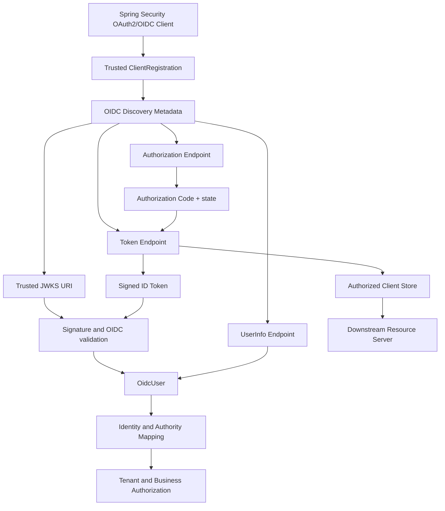

# 33.8. Đánh giá tương thích provider khi nâng cấp discovery hoặc claims

## 1. Bối cảnh: Provider vẫn đăng nhập được, nhưng hợp đồng đã đổi

Ứng dụng Spring Security đóng vai **OAuth 2.0 Client / OpenID Connect (OIDC) Relying Party (RP)**. Nó phụ thuộc vào thông tin provider công bố qua **discovery metadata** và dữ liệu danh tính cung cấp trong **ID Token** hoặc **UserInfo**. Khi nhà cung cấp danh tính (OpenID Provider, OP) nâng cấp phiên bản, thay realm/issuer, bổ sung endpoint, đổi cách phát hành claims hoặc chuyển profile bảo mật, ứng dụng có thể gặp lỗi dù code backend không thay đổi.

Ví dụ giả định:

- Trước nâng cấp: OP trả `preferred_username` trong ID Token, `groups` là mảng chuỗi và UserInfo chứa `email`.
- Sau nâng cấp: OP chỉ trả `preferred_username` qua UserInfo, `groups` không được phát mặc định; `email_verified` là boolean, và metadata thay đổi `token_endpoint_auth_methods_supported`.
- Spring Security vẫn hoàn tất một số phiên đăng nhập, nhưng logic tạo tài khoản, ánh xạ role và kiểm tra tenant có thể bị ảnh hưởng.

Ngược lại, một provider có thể thay discovery metadata mà **không ảnh hưởng giao thức ứng dụng sử dụng**. Do đó không kết luận mọi thay đổi trong JSON metadata đều là breaking change; phải xác định **phần nào thuộc hợp đồng thật của `ClientRegistration`, bộ xác minh OIDC và business logic**.

> **Mục tiêu đánh giá tương thích:** Chứng minh sau nâng cấp, ứng dụng vẫn chọn đúng provider và OAuth client, nhận được token hợp lệ, xác minh danh tính đúng issuer/audience, ánh xạ claims/authorities đúng chính sách, duy trì token lifecycle và **không nới lỏng các ranh giới bảo mật** chỉ để login thành công.

Bài thuộc chương **33. Tương thích và nâng cấp** của module **Spring Security OAuth 2.0 OIDC Client**, tập trung vào Java 17+, Spring Boot 3.x, Spring Security 6.x, cả Servlet và WebFlux. Tên host, issuer, client ID, token và dữ liệu danh tính chỉ là minh họa. Các thuộc tính/API cụ thể phải được đối chiếu với phiên bản dependency và provider được triển khai.

### Mục tiêu học tập

Sau bài học, bạn có thể:

1. Giải thích vai trò của OIDC discovery và phân biệt metadata của provider với dữ liệu claims trong ID Token/UserInfo.
2. Xác định các trường metadata có thể làm hỏng OAuth2 Login, Token Endpoint authentication, JWKS validation, refresh token và logout.
3. Đánh giá thay đổi `issuer`, discovery location, `jwks_uri`, signing algorithms, endpoints, response types, scopes, client authentication methods và PKCE support.
4. Phân biệt claims bắt buộc theo OIDC với claims tùy chọn/provider-specific, cũng như thay đổi **tên, kiểu, nguồn, ý nghĩa** của claims.
5. Bảo toàn định danh `(iss, sub)` và tránh account takeover khi `sub`/`email`/`preferred_username` thay đổi.
6. Xây baseline trước nâng cấp, so sánh contract bằng bảng diff phân loại breaking/security/operational changes.
7. Kiểm thử Spring Security OAuth2/OIDC Client bằng fake OP, mock discovery/JWKS/Token Endpoint/UserInfo và negative tests.
8. Phân tích Servlet và WebFlux behaviors, custom mappers, authorized-client persistence, multi-provider/multi-tenant.
9. Triển khai canary, feature flag, rollback và monitoring không làm lộ tokens hoặc dữ liệu cá nhân.
10. Thiết lập runbook chẩn đoán sự cố provider sau nâng cấp mà không tắt issuer/signature/audience validation.

---

## 2. Ba lớp hợp đồng phải đánh giá độc lập

### 2.1. Lớp 1 — Discovery/provider metadata

Discovery cung cấp thông tin **cấu hình máy đọc được** về OP:

```json
{
  "issuer": "https://login.example.test/realms/employees",
  "authorization_endpoint": "https://login.example.test/realms/employees/oauth2/authorize",
  "token_endpoint": "https://login.example.test/realms/employees/oauth2/token",
  "jwks_uri": "https://login.example.test/realms/employees/keys",
  "userinfo_endpoint": "https://login.example.test/realms/employees/userinfo",
  "response_types_supported": ["code"],
  "subject_types_supported": ["public", "pairwise"],
  "id_token_signing_alg_values_supported": ["RS256"],
  "token_endpoint_auth_methods_supported": [
    "client_secret_basic",
    "private_key_jwt"
  ]
}
```

Các giá trị này không phải access token hay user profile. Chúng định nghĩa **provider capabilities và endpoint locations**.

### 2.2. Lớp 2 — Protocol token và danh tính

Ví dụ ID Token payload đã được xác minh:

```json
{
  "iss": "https://login.example.test/realms/employees",
  "sub": "identity-4821",
  "aud": "employee-portal",
  "iat": 1790000000,
  "exp": 1790003600,
  "auth_time": 1789999900,
  "nonce": "opaque-nonce-bound-to-request",
  "email": "employee@example.test",
  "email_verified": true
}
```

Trong thực tế, token được truyền ở dạng JWT (thường signed JWS), không phải JSON thô. RP phải xác minh chữ ký và OIDC claims theo client registration. `nonce`/`auth_time` và các claims khác có phạm vi bắt buộc phụ thuộc request/flow/profile.

Provider đổi claims có thể không đổi metadata; thay metadata cũng chưa chắc đổi token claims.

### 2.3. Lớp 3 — Business mapping và authorization

Sau khi Spring Security tạo `OidcUser`, ứng dụng có thể:

- Gắn `(issuer, subject)` vào internal account.
- Hiển thị `name`, `picture`, `locale`.
- Dùng `email_verified` khi quyết định có tin email hay không.
- Ánh xạ `groups`/`roles` thành `GrantedAuthority`.
- Chọn tenant/org bằng verified claim hoặc membership store.
- Kiểm tra registration đã login.
- Lưu `OAuth2AuthorizedClient` để gọi downstream API.

Một thay đổi như `groups=["hr-admin"]` → `groups=["/departments/hr/admin"]` có thể **không hề gây exception từ OIDC Login**, nhưng khiến người dùng mất quyền hoặc tệ hơn bị cấp nhầm quyền nếu mapper sử dụng so khớp không an toàn.

### 2.4. Sơ đồ phụ thuộc



Nâng cấp provider phải được đánh giá qua toàn bộ đường phụ thuộc liên quan, không chỉ xác nhận URL discovery trả HTTP 200.

---

## 3. “Tương thích” nghĩa là gì?

### 3.1. Tương thích về cấu hình, giao thức, dữ liệu và bảo mật

| Lớp | Một thay đổi có thể chấp nhận | Một thay đổi dễ gây breaking |
| --- | --- | --- |
| Discovery | Thêm một trường metadata không sử dụng | Đổi `issuer`, `token_endpoint` hoặc `jwks_uri` trái kỳ vọng |
| Authorization | Bổ sung response mode nhưng vẫn hỗ trợ `code` | Không còn hỗ trợ `authorization_code`/redirect pattern hiện tại |
| Client authentication | Thêm `private_key_jwt` bên cạnh `client_secret_basic` | Ngừng `client_secret_basic` khi app vẫn dùng nó |
| ID Token | Thêm claim `locale` optional | Thay `sub`/`iss` hoặc kiểu claim mà mapper phụ thuộc |
| Signing keys | Công bố key mới kèm overlap trước rotation | Ký bằng `kid` mới khi JWKS chưa công bố |
| UserInfo | Thêm `department` nhưng giữ `sub` | Bỏ field ứng dụng bắt buộc; trả `sub` khác ID Token |
| Scopes | Thêm scope mới, vẫn giữ scopes cũ | Bỏ scope gây thiếu claim/permission |
| API Access Token | Giữ audience và grant semantics | Thay audience/scope/issuer khiến Resource Server từ chối |
| Logout | Bổ sung end-session metadata | Bỏ endpoint/configured logout capability |
| Tenant | Thêm tenant claim optional | Đổi org ID semantics, làm user được gắn sai tenant |

### 3.2. “Không vỡ login” chưa đủ

Một smoke test chỉ kiểm tra trang chính trả 200 có thể bỏ sót:

- Browser còn session trước khi nâng cấp, không thực hiện token exchange mới.
- UserInfo Endpoint không trả trường mới nhưng trang chính không dùng.
- Refresh token không được test vì access token còn hạn.
- Group mapping bỏ quyền nhưng test chỉ login user không có quyền đặc biệt.
- Endpoint chỉ gọi Resource Server sau vài giờ.
- Client ID/issuer đổi gây authorized-client records cũ không dùng được.
- Logout/back-channel/logout redirect hỏng nhưng không phát sinh khi login.
- Multi-tenant user vào nhầm organization do claim đổi kiểu.
- Nonce/issuer/audience validation bị custom code vô hiệu hóa để “giữ tương thích”.

Thành công cần có **positive và negative assertions** ở đúng các tầng quan trọng.

### 3.3. Phân loại mức thay đổi

Có thể dùng bốn nhóm để ra quyết định:

1. **Additive/non-breaking (có điều kiện):** metadata hoặc optional claim mới mà app không phụ thuộc; vẫn cần bảo đảm parser chấp nhận.
2. **Behavioral:** giá trị, format, tần suất, thứ tự/nguồn claim đổi nhưng protocol vẫn hợp lệ; cần kiểm tra business logic.
3. **Breaking:** endpoint, issuer/client authentication, claim bắt buộc hoặc kiểu dữ liệu mà app cần bị thay.
4. **Security-sensitive:** thay trust boundary, signing algorithms, key source, `sub`, audience, tenant claim, client auth method hoặc token destination; bắt buộc security review.

Một thay đổi có thể thuộc nhiều nhóm. Ví dụ chuyển `sub` từ public sang pairwise là **behavioral + breaking + security-sensitive** nếu app lấy `sub` làm primary key không có migration plan.

---

## 4. Thiết lập baseline trước nâng cấp

### 4.1. Ghi nhận các nguồn cấu hình đáng tin

Trước khi nâng cấp Spring Boot/Security hoặc OP, tạo inventory **không chứa secret**:

```text
environment: staging
tenant_alias: employees
registrationId: employees-oidc
client_id_alias: portal-web
issuer: https://login.example.test/realms/employees
grant_type: authorization_code
client_auth_method: client_secret_basic
redirect_uri_template: {baseUrl}/login/oauth2/code/{registrationId}
scopes: openid profile email groups
token_endpoint_alias: employees-token
jwks_endpoint_alias: employees-jwks
userinfo_enabled: true
id_token_alg_policy: RS256
principal_mapping: issuer+subject
authority_mapping_version: v3
metadata_snapshot_version: before-upgrade
```

Nếu hệ thống có nhiều registrations/issuers/tenants, lặp baseline cho từng trust domain. Không dùng cấu hình của tenant A để suy từ token tenant B.

### 4.2. Ghi những gì application thực sự đọc

Phân loại claims:

| Claim/nguồn | Bắt buộc với giao thức hay nghiệp vụ? | Được dùng thế nào? |
| --- | --- | --- |
| ID Token `iss` | Protocol-critical | Exact expected OP issuer |
| ID Token `sub` | Protocol-critical | Verified identity key |
| ID Token `aud` | Protocol-critical | Current OAuth client ID |
| ID Token `iat`/`exp` | Protocol-critical | Token-time validation |
| ID Token `nonce` | Theo request/flow | Correlation/replay defense |
| ID Token `auth_time` | Theo request/profile | Max age/reauthentication |
| `name` | Thường optional | Hiển thị tên |
| `preferred_username` | Thường optional | Display/login hint, không global identity |
| `email` | Optional theo scope/consent | Liên hệ; không tự làm identity |
| `email_verified` | Optional tùy profile | Email trust flag nếu app dựa vào nó |
| `picture`/`locale` | Optional | UI/display |
| UserInfo `sub` | OIDC UserInfo identity binding | Phải khớp ID Token subject khi dùng |
| `groups`/`roles` | Provider-specific | Authority/organization mapping nếu đã quy định |
| `tenant_id`/`org_id` | Provider-specific | Tenant policy, cần issuer trust + membership |
| Access token `scope`/`aud` | API contract | Resource Server permission/destination |

Ghi rõ một field là **optional** ở OIDC không có nghĩa nó optional đối với ứng dụng. Nếu business logic bắt buộc phải có `department` để cấp quyền, cần ứng xử fail-safe khi provider ngừng phát field đó.

### 4.3. Chọn representative test identities

Nên có synthetic hoặc controlled test accounts:

- User cơ bản chỉ có profile tối thiểu.
- User có đủ scope/consent để nhận `email`, `groups`.
- User thiếu email hoặc `email_verified=false`.
- User có nhiều groups/roles.
- User thuộc một tenant.
- User thuộc nhiều tenants nếu mô hình hỗ trợ.
- User có subject pairwise dưới nhiều OAuth clients.
- User với Unicode trong `name`/`locale`.
- User có group names chứa dấu gạch, dấu gạch chéo, mixed-case.
- Account có UserInfo khác ID Token về optional display claims.
- Account bị khóa/thu hồi membership nếu provider có policy phù hợp.

Không lấy full production ID Token để lưu trong baseline/ticket. Tạo **schema mẫu/redacted fixture** có version, không chứa PII/tokens/secret.

---

## 5. Discovery metadata: những trường cần đánh giá

### 5.1. `issuer` và vị trí well-known discovery

Ví dụ issuer chứa path:

```text
https://login.example.test/realms/employees
```

Không mặc định nối `/.well-known/openid-configuration` theo cùng một cách cho mọi provider/profile khi issuer có path. Hãy dùng endpoint discovery đúng **OpenID Connect Discovery** và provider contract. Một số hệ thống còn dùng **OAuth 2.0 Authorization Server Metadata** (RFC 8414) với vị trí well-known khác theo quy tắc riêng.

Metadata `issuer` phải phù hợp exact expected issuer của registration. Không chỉ so hostname hoặc cho phép URI có prefix tương tự.

Khi issuer đổi:

```text
old: https://login.example.test/realms/employees
new: https://identity.example.test/oidc/employees
```

cần coi đó là **thay đổi trust boundary** dù hai host cùng tổ chức. Kiểm tra account identity `(iss, sub)`, JWT verifier, client registration, Resource Server, token store và migration.

### 5.2. `authorization_endpoint`

Thay Authorization Endpoint có thể ảnh hưởng:

- URL redirect browser.
- Provider session/cookies/domain.
- Redirect allowlist/approval.
- `state`, PKCE, nonce/response mode.
- `prompt`, `max_age`, `login_hint` và extension parameters.
- Custom `OAuth2AuthorizationRequestResolver`.
- Truy cập qua proxy/WAF/network policy.

Không hardcode authorization URI đã cũ trong custom resolver nếu provider discovery đã chuyển endpoint. Nhưng **không lấy endpoint từ HTTP query do browser cung cấp**.

### 5.3. `token_endpoint`

Thay Token Endpoint ảnh hưởng trực tiếp:

- Authorization Code exchange.
- Refresh Token grant.
- Client Credentials grant.
- Client authentication methods.
- Proxy, TLS truststore, mTLS và private_key_jwt `aud`.
- Firewall/egress allowlist.
- Metrics, tracing và retry policies.
- Token revocation/introspection nếu endpoints thay theo profile.

Một provider chuyển `token_endpoint` nhưng `client_secret_basic` vẫn hợp lệ chưa chắc gây lỗi. Ngược lại, thay endpoint đồng thời yêu cầu `private_key_jwt` có thể khiến Spring Security client trả `invalid_client` dù browser authorization thành công.

### 5.4. `jwks_uri` và signing algorithms

`jwks_uri` là nguồn public verification keys cho tokens của OP. Khi provider đổi:

- JWKS host/path có được tin và reachable qua HTTPS?
- `issuer` và discovery metadata có khớp?
- Token header `kid` có key tương ứng trong JWKS?
- Thuật toán có còn trong allowlist OIDC Client không?
- RSA/EC key types có tương thích không?
- New public key được publish trước khi OP ký token mới chưa?
- Có overlap cho tokens ký bằng old key đến khi hết hạn?
- Cache/CDN và Spring/Nimbus version refresh key đúng lúc không?

**Không** sửa lỗi bằng cách bỏ signature verification, bật `alg=none`, thử mọi JWKS của mọi tenant hoặc tin `jku/x5u` do JWT header không đáng tin cung cấp.

### 5.5. `userinfo_endpoint`

Metadata có thể thêm, đổi hoặc bỏ UserInfo Endpoint. Ảnh hưởng phụ thuộc OIDC user loading strategy:

- Có gọi UserInfo Endpoint không?
- Access token có scope/permission hợp lệ để truy cập UserInfo?
- ID Token có đủ claims để app chạy khi UserInfo không sẵn sàng?
- `sub` trong UserInfo có khớp ID Token không?
- Có custom `OidcUserService` hoặc `OidcReactiveOAuth2UserService`?
- Provider trả JSON hay signed/encrypted UserInfo response?
- UserInfo Endpoint có rate limit/timeout mới không?

Một lần nâng cấp có thể làm login **vẫn thành công** nhưng profile `groups`/`email` thiếu, nếu application không kiểm tra nơi lấy claims hoặc fallback.

### 5.6. Capability fields khác

| Metadata field | Điều cần đánh giá |
| --- | --- |
| `response_types_supported` | `code` còn hỗ trợ không? Không giả định implicit/hybrid vẫn còn |
| `response_modes_supported` | `query`, `form_post`, `jwt` theo provider/profile; callback/CSRF/cookie compatibility |
| `grant_types_supported` | `authorization_code`, `refresh_token`, `client_credentials` theo client contract |
| `scopes_supported` | `openid` và scopes ứng dụng yêu cầu; không đồng nghĩa từng user được cấp tất cả |
| `claims_supported` | Những claims OP có thể phát; không đảm bảo xuất hiện trong mọi token/UserInfo |
| `subject_types_supported` | `public`/`pairwise` và hệ quả identity migration |
| `id_token_signing_alg_values_supported` | Signing alg capabilities; client vẫn phải enforce chính sách |
| `token_endpoint_auth_methods_supported` | `client_secret_basic`/`private_key_jwt`/mTLS profile được phép |
| `token_endpoint_auth_signing_alg_values_supported` | Thuật toán ký JWT client assertions có được hỗ trợ |
| `code_challenge_methods_supported` | PKCE `S256`, thay đổi behavior/custom resolver |
| `request_parameter_supported` | Request object/request parameter capabilities khi ứng dụng phụ thuộc |
| `request_uri_parameter_supported` | Có hỗ trợ request_uri không; an toàn/endpoint policy |
| `end_session_endpoint` | RP-Initiated Logout provider-specific/discovery capability |
| `frontchannel_logout_supported` | Trạng thái cơ chế logout từ browser |
| `backchannel_logout_supported` | Hỗ trợ back-channel logout theo metadata/profile |
| `authorization_response_iss_parameter_supported` | Khả năng phát `iss` ở authorization response theo RFC 9207 |

Không nên tự coi **metadata thiếu field = chắc chắn feature không tồn tại** trong mọi trường hợp. Nhiều trường có giá trị mặc định hoặc quy tắc optional theo chuẩn. Hãy kết hợp spec, registration policy, vendor docs và thực nghiệm với đúng provider version.

### 5.7. Metadata thêm mới có luôn an toàn?

Ví dụ provider bổ sung:

```json
{
  "pushed_authorization_request_endpoint": "https://login.example.test/par",
  "require_pushed_authorization_requests": true
}
```

Một field mới có thể mang **yêu cầu hành vi mới**, không chỉ là metadata bổ sung. Nếu provider bắt buộc PAR nhưng Spring Security client hiện tại không gửi PAR, authorization flow có thể fail dù discovery parse được.

Tương tự, chuyển sang FAPI/profile mới có thể kéo theo JARM, mTLS/DPoP, stronger client authentication hoặc signed request objects. Đừng coi một field “mới và parser bỏ qua” là chứng minh tương thích chức năng.

---

## 6. Claims: tương thích không chỉ là tên field

### 6.1. Bốn khía cạnh của một claim

Khi provider nói “không thay đổi claim `groups`”, hãy hỏi:

1. **Tên:** key còn là `groups`, hay chuyển thành `roles`, `memberOf` hoặc URI claim?
2. **Kiểu:** mảng chuỗi, chuỗi CSV, object chứa fields, boolean hay số?
3. **Nguồn:** ID Token, UserInfo, Access Token hay một custom endpoint?
4. **Ý nghĩa:** group ID là global group, path trong organization, display name hay role có quyền thực thi?

Ví dụ ba response **không tương đương** nếu code chỉ gọi `getClaimAsStringList("groups")`:

```json
{"groups": ["hr-admin", "auditor"]}
```

```json
{"groups": "hr-admin,auditor"}
```

```json
{
  "groups": [
    {"id": "g-481", "name": "hr-admin", "tenant": "north"},
    {"id": "g-927", "name": "auditor", "tenant": "north"}
  ]
}
```

Một thay đổi có thể được provider gọi là “format improvement” nhưng với ứng dụng là **breaking contract**.

### 6.2. ID Token và UserInfo là hai nguồn khác nhau

ID Token dành cho OIDC Client để xác thực người dùng và là nơi có các claims OIDC cốt lõi. UserInfo Endpoint có thể bổ sung profile theo scopes, consent và provider policy.

Ví dụ trước nâng cấp, ID Token chứa:

```json
{
  "sub": "identity-4821",
  "preferred_username": "lan",
  "email": "lan@example.test",
  "groups": ["staff", "approver"]
}
```

Sau nâng cấp, ID Token có thể chỉ còn:

```json
{
  "sub": "identity-4821",
  "email": "lan@example.test"
}
```

Trong khi UserInfo có:

```json
{
  "sub": "identity-4821",
  "preferred_username": "lan",
  "groups": ["staff", "approver"]
}
```

Nếu code dùng `user.getIdToken().getClaimAsStringList("groups")` thì sau nâng cấp có thể nhận `null`. Nếu business contract cần groups, cần quyết định có được phép lấy từ **UserInfo đã được OP xác thực và liên kết đúng `sub`** hay không. Không tự nhặt quyền từ token/endpoint chưa xác minh chỉ vì tên claim giống nhau.

### 6.3. Các claims cốt lõi so với optional claims

Các OIDC ID Token claims đặc biệt quan trọng:

- `iss`: issuer chính xác của OP.
- `sub`: subject identifier trong issuer.
- `aud`: audience phải chứa client ID của RP.
- `exp`: expiration time.
- `iat`: issued-at time.

Các claims khác phụ thuộc flow/request/profile: `nonce`, `auth_time`, `azp`, `at_hash`, `c_hash` và profile claims. Không chuyển các claims security-critical thành optional bằng cách bỏ validators khi provider nâng cấp.

Với UserInfo, `sub` phải khớp ID Token subject nếu response được dùng. Claims như `name`, `email`, `picture` và `locale` thường tùy chọn theo scopes/consent/policy, không được giả định luôn tồn tại.

### 6.4. `sub` phải được hiểu trong ngữ cảnh `iss`

OIDC identity key nên bắt đầu từ:

```text
(verified issuer, verified subject)
```

Không dùng `sub` đơn lẻ làm global account key khi có nhiều issuers; không dùng email, `preferred_username` hoặc display name làm identifier bền vững thay `sub`.

Ví dụ:

```text
Before:
  iss = https://id.example.test/realm-a
  sub = 18372

After:
  iss = https://id.example.test/realm-b
  sub = 18372
```

Dù `sub` giống nhau, đây có thể là hai identity namespaces. Migration cần quy trình chứng minh tương ứng danh tính, không tự “đổi issuer string” trong database rồi coi là cùng user.

### 6.5. Public subject sang pairwise subject

Provider có thể đổi subject type hoặc sector identifier; các OAuth clients khác nhau có thể nhận `sub` khác nhau cho cùng một người.

```text
Before migration:
  iss=OP-A, sub=stable-public-4821

After policy change:
  iss=OP-A, sub=pairwise-for-client-portal-X
```

Cần xác định có thay semantics không; sử dụng identity mapping được OP bảo đảm, account linking có xác minh ownership, audit và rollback. Không tự link bằng email khi subject mới không khớp.

### 6.6. `email` và `email_verified`

Trước:

```json
{"email": "employee@example.test", "email_verified": true}
```

Sau:

```json
{"email": "employee@example.test"}
```

Nếu app yêu cầu email đã được OP xác minh, thiếu `email_verified` không nên mặc nhiên được hiểu là true. Thay từ boolean sang string `"true"` cũng có thể làm mapper sai kiểu.

Không cấp/ghép tài khoản chỉ dựa trên email chưa verified. Với display có thể fallback; với quyết định bảo mật cần chính sách fail-safe.

### 6.7. `groups`/`roles`: dữ liệu profile chưa tự là GrantedAuthority

Provider nâng cấp:

```text
Old: groups = ["payroll-approver"]
New: groups = ["/north/finance/payroll-approver"]
```

Nếu mapper dùng `endsWith("payroll-approver")`, group cùng hậu tố trong tenant khác có thể bị cấp nhầm quyền. Nên dùng **known group identifiers + exact issuer/tenant context**.

Không coi `email`, `department` hay `preferred_username` là role; nếu không xác định được quyền thì deny operation nhạy cảm, không cấp default admin.

### 6.8. Đổi kiểu/nguồn/định dạng

| Thay đổi | Rủi ro |
| --- | --- |
| `"groups":["a"]` → `"groups":"a"` | `ClassCastException` hoặc mapping bỏ sót |
| `"employee_id":123` → `"employee_id":"123"` | So sánh sai kiểu, mất leading zero |
| `"email_verified":true` → `"email_verified":"true"` | Boolean parser/authorization sai |
| `"tenant_id":"north"` → object | Matcher/serializer sai |
| `"department":"Finance"` → `null` | NPE hoặc fallback cấp nhầm quyền |
| `"roles":["a","b"]` → `[]` | Quyền mất hoặc policy khác |
| `"name":"Lan"` → missing | UI fallback |
| `"exp"`/`"iat"` malformed | Protocol validation phải từ chối |

Với identifiers có thể chứa leading zero, không tự ép sang số. Với URI namespace claims, ví dụ `tenant_id` → `https://claims.example.test/tenant_id`, cần mapper có version và test khi cả old/new fields cùng xuất hiện nhưng mâu thuẫn. Một claim key trông như URL không có nghĩa cần HTTP GET tới URL đó.

### 6.9. Unicode, locale và profile rendering

Thay đổi `name`, `locale`, `picture`, `preferred_username` có thể ảnh hưởng UI mà không ảnh hưởng OIDC core. Kiểm thử tên Unicode, empty string, long values, `vi_VN` vs `vi-VN`, images/CDN URLs và profile field missing. Không sử dụng display name như khóa bảo mật.

---

## 7. Claims phụ thuộc scopes, consent và user account

### 7.1. `claims_supported` không đảm bảo mọi user đều nhận claim

Metadata:

```json
{
  "claims_supported": [
    "sub",
    "name",
    "preferred_username",
    "email",
    "email_verified",
    "groups"
  ]
}
```

chỉ mô tả khả năng của OP. Claims thực tế còn phụ thuộc requested/granted scopes, client entitlements, consent, user attributes, organization membership, privacy settings và claim-release rules.

### 7.2. Thay scope có thể làm đổi claim source

Trước:

```yaml
scope:
  - openid
  - profile
  - email
  - groups
```

Sau nâng cấp, `groups` scope có thể đổi tên hoặc đòi admin approval. App vẫn xin scope cũ nhưng AS có thể reject hoặc chỉ grant một tập con.

Cần kiểm tra scopes được gửi, scopes thực sự được grant, UserInfo/ID Token còn claims nghiệp vụ không, và app xử lý missing quyền thế nào. Không xin scope cao hơn chỉ để “cứu” field nếu chưa có security/consent review.

### 7.3. Same provider, different users

Một account admin có đủ group claims không chứng minh user bình thường sẽ có. Baseline nên gồm:

- Profile tối thiểu, thiếu email.
- `email_verified=false`.
- Nhiều groups; không groups.
- Một tenant; nhiều tenants.
- User external directory.
- User có names/locale Unicode.
- User với pairwise `sub` ở hai OAuth clients.

Không dùng một happy-path account để kết luận toàn provider tương thích.

### 7.4. UserInfo `sub` mismatch

Nếu ID Token cho `user-4821` nhưng UserInfo trả:

```json
{"sub": "user-9274", "groups": ["admin"]}
```

thì không được gắn `groups=["admin"]` lên `user-4821`. Theo OIDC, UserInfo `sub` phải match ID Token subject. Nếu provider upgrade gây mismatch, cần từ chối hoặc xử lý theo validator/policy, không bỏ check.

---

## 8. Client authentication, PKCE và grant compatibility

### 8.1. `token_endpoint_auth_methods_supported`

Nếu Spring Client đang dùng:

```yaml
client-authentication-method: client_secret_basic
```

mà provider v2 chỉ chấp nhận `private_key_jwt` hoặc mTLS, code exchange/refresh có thể trả `invalid_client`. Đổi metadata không tự biến Spring client thành private-key JWT signer; cần key/HTTP token response client integration theo version.

Không chuyển sang `none` hoặc `client_secret_post` để thử ngẫu nhiên khi AS contract không cho.

### 8.2. PKCE và code challenge

Provider có thể yêu cầu PKCE `S256` cho một client trước đây không bắt buộc. Kiểm tra:

- Authorization request có `code_challenge`/`code_challenge_method` đúng?
- Token request có `code_verifier` tương ứng?
- Custom authorization request resolver có bỏ PKCE params?
- Redirect/session còn lưu request đúng để correlation?
- Provider có ngừng hỗ trợ `plain` hay yêu cầu `S256`?

PKCE không thay `state`, issuer hoặc signature validation.

### 8.3. Response mode và RFC 9207

Provider chuyển từ query callback sang `form_post`/JARM có thể yêu cầu đổi callback/cookie/CSRF xử lý. Không tự viết controller đổi code bỏ authorization request repository.

Một số provider thêm authorization response `iss` theo RFC 9207:

```text
callback:
  code=...
  state=...
  iss=https://login.example.test/realms/employees
```

`iss` này giúp phát hiện AS mix-up **trước token exchange** khi Spring Security version/provider hỗ trợ. ID Token `iss` được xác minh **sau token exchange**. Không dùng query `iss` chưa tin cậy để chọn Token Endpoint khác.

### 8.4. Refresh tokens

Provider có thể bật refresh-token rotation, đổi `offline_access` consent, Token Endpoint URL, client auth methods hoặc revoke grants cũ. Test login mới không chứng minh authorized clients từ trước upgrade vẫn refresh được.

Phân biệt:

- `invalid_client`: client authentication failed.
- `invalid_grant`: code/refresh token/grant không hợp lệ hoặc không đúng client.
- HTTP 503/timeout: AS availability.
- 401/403 từ downstream API: Access Token/resource authorization.

### 8.5. Access Token có contract độc lập

Đổi JWT/opaque format, `aud`, scope và issuer cho Access Token có thể khiến Resource Server trả 401/403 dù OIDC login thành công. ID Token dành cho RP; không dùng nó làm Bearer token cho API để né incompatibility.

---

## 9. Spring Boot: ánh xạ provider metadata vào `ClientRegistration`

### 9.1. Discovery-driven configuration

```yaml
spring:
  security:
    oauth2:
      client:
        registration:
          employees:
            provider: employees-op
            client-id: ${OIDC_EMPLOYEES_CLIENT_ID}
            client-secret: ${OIDC_EMPLOYEES_CLIENT_SECRET}
            client-authentication-method: client_secret_basic
            authorization-grant-type: authorization_code
            redirect-uri: "{baseUrl}/login/oauth2/code/{registrationId}"
            scope:
              - openid
              - profile
              - email
        provider:
          employees-op:
            issuer-uri: https://login.example.test/realms/employees
```

`issuer-uri` thường khiến Boot/Security discover provider metadata để xây `ClientRegistration`. Startup discovery và caching behavior phụ thuộc framework version/config. Nếu metadata issuer không khớp expected issuer, không nên tự tin redirect sang host khác để “fix”.

### 9.2. Explicit endpoint configuration

```yaml
spring:
  security:
    oauth2:
      client:
        provider:
          employees-op:
            issuer-uri: https://login.example.test/realms/employees
            authorization-uri: https://login.example.test/realms/employees/oauth2/authorize
            token-uri: https://login.example.test/realms/employees/oauth2/token
            jwk-set-uri: https://login.example.test/realms/employees/keys
            user-info-uri: https://login.example.test/realms/employees/userinfo
            user-name-attribute: sub
```

Đây là **fragment provider**. Explicit endpoints có thể phù hợp theo OP contract, nhưng không bỏ expected issuer/ID Token validation, không lấy JWKS từ issuer khác và không chấp nhận arbitrary URL từ browser.

### 9.3. Versioned registration khi đổi trust identity

Nếu issuer hoặc client ID thay, cân nhắc:

```text
employees-oidc-v1
employees-oidc-v2
```

để tokens/grants cũ không bị lookup dưới registration mới, đồng thời cho phép canary/rollback. Không phải mọi metadata update đều bắt buộc đổi registration ID; quan trọng là phân vùng khi **issuer/client identity hoặc token lifecycle boundary** đổi.

### 9.4. Kiểm tra registration đang chạy

```java
import org.springframework.security.oauth2.client.registration.ClientRegistration;
import org.springframework.security.oauth2.client.registration.ClientRegistrationRepository;

public void inspectConfiguredProvider(
        ClientRegistrationRepository registrations) {

    ClientRegistration registration =
            registrations.findByRegistrationId("employees");

    if (registration == null) {
        throw new IllegalStateException(
                "Missing OIDC ClientRegistration");
    }

    var provider = registration.getProviderDetails();

    String issuer = provider.getIssuerUri();
    String authorizationUri = provider.getAuthorizationUri();
    String tokenUri = provider.getTokenUri();
    String jwksUri = provider.getJwkSetUri();

    // Compare these with trusted expected configuration.
    // Do not log clientSecret or raw tokens.
}
```

Đây là **fragment cần được gọi bởi test/checker**, không tự chạy. Không log nguyên `ClientRegistration` object một cách thiếu kiểm soát vì có thể làm lộ secret.

### 9.5. Startup metadata outage khác login-time outage

| Giai đoạn | Triệu chứng |
| --- | --- |
| Startup/discovery | Không tạo được registration/bean do metadata/network |
| Authorization initiation | Redirect tới authorization URI stale |
| Callback/token exchange | `invalid_client`/`invalid_grant` |
| ID Token validation | JWKS/signature/issuer/audience lỗi |
| UserInfo loading | Endpoint/claim format/`sub` mismatch |
| API usage | Access token audience/scope/issuer mới → 401/403 |
| Logout | End-session/back-channel metadata không tương thích |

Không coi startup thành công là chứng minh full login compatible; ngược lại, startup fail vì DNS không chứng minh JSON metadata sai.

---

## 10. Spring Security: kiểm tra việc đọc claims và ánh xạ authorities

### 10.1. Principal OIDC và claims được sử dụng thế nào?

Trong Servlet Spring Security, OIDC Login tạo `OidcUser` khi token/protocol validation thành công. Một số cách đọc:

```java
import org.springframework.security.oauth2.core.oidc.user.OidcUser;

public final class PrincipalView {

    public static String subject(OidcUser user) {
        return user.getIdToken().getSubject();
    }

    public static String issuer(OidcUser user) {
        return user.getIdToken().getClaimAsString("iss");
    }

    public static String preferredUsername(OidcUser user) {
        return user.getClaimAsString("preferred_username");
    }
}
```

`preferred_username` có thể đến từ merged OIDC claims của user service tùy cấu hình, trong khi `getIdToken().getSubject()` luôn chỉ rõ nguồn ID Token. Khi provider đổi nơi phát claim, code dùng `getIdToken()`, `getUserInfo()` và `getClaims()` có thể cho kết quả khác.

Không dùng `getClaimAsString("email")` làm primary authentication key hoặc tự động link accounts nếu email chưa được xác minh.

### 10.2. `OidcUserService` là extension point, không phải nơi bỏ validation

Một cấu hình Servlet cơ bản:

```java
package com.example.portal.security;

import org.springframework.context.annotation.Bean;
import org.springframework.context.annotation.Configuration;
import org.springframework.security.config.annotation.web.builders.HttpSecurity;
import org.springframework.security.oauth2.client.oidc.userinfo.OidcUserService;
import org.springframework.security.web.SecurityFilterChain;

@Configuration
public class OidcLoginConfiguration {

    @Bean
    OidcUserService oidcUserService() {
        return new OidcUserService();
    }

    @Bean
    SecurityFilterChain securityFilterChain(
            HttpSecurity http,
            OidcUserService userService) throws Exception {

        return http
                .authorizeHttpRequests(requests -> requests
                        .requestMatchers("/", "/login").permitAll()
                        .anyRequest().authenticated())
                .oauth2Login(login -> login
                        .userInfoEndpoint(userInfo ->
                                userInfo.oidcUserService(userService)))
                .build();
    }
}
```

Đây là ví dụ cấu hình **mặc định**, chưa làm custom mapping. Nếu dự án override `OidcUserService` hoặc UserInfo claims parsing, cần kiểm tra sau nâng cấp:

- UserInfo có còn được gọi theo scopes/provider behavior không?
- `sub` matching vẫn được thực hiện?
- Custom claim precedence có còn hợp với OP version mới?
- `OidcUser` principal name có còn ổn định?
- Granted authorities có bị cấp dựa trên unverified input không?
- Custom code có xử lý null/missing/changed types không?

**Không tạo `OidcUser` từ JWT parse thô** để vượt qua lỗi signature, `iss` hoặc `aud`.

### 10.3. Ánh xạ nhóm quyền qua known identifiers

Nên tách policy thành component dễ unit test. Ví dụ Spring Security cho OP duy nhất:

```java
package com.example.portal.security;

import java.util.HashSet;
import java.util.List;
import java.util.Set;

import org.springframework.security.core.GrantedAuthority;
import org.springframework.security.core.authority.SimpleGrantedAuthority;
import org.springframework.stereotype.Component;

@Component
public final class TrustedGroupAuthorityMapper {

    public Set<GrantedAuthority> mapGroups(
            String verifiedIssuer,
            Object rawGroups) {

        if (!"https://login.example.test/realms/employees"
                .equals(verifiedIssuer)) {
            return Set.of();
        }

        if (!(rawGroups instanceof List<?> groups)) {
            return Set.of();
        }

        Set<GrantedAuthority> mapped = new HashSet<>();

        for (Object entry : groups) {
            if (!(entry instanceof String groupId)) {
                continue;
            }

            if ("grp-finance-approver-001".equals(groupId)) {
                mapped.add(new SimpleGrantedAuthority(
                        "invoice:approve"));
            }
            if ("grp-employee-reader-002".equals(groupId)) {
                mapped.add(new SimpleGrantedAuthority(
                        "employee:read"));
            }
        }

        return Set.copyOf(mapped);
    }
}
```

Điểm quan trọng:

- Xét exact **verified issuer**.
- Không so nhóm bằng `contains("admin")` hay `endsWith(...)`.
- Không chấp nhận string CSV nếu contract yêu cầu JSON array.
- Không cấp quyền nếu claims thiếu/khác kiểu.
- Không để user tự gửi `groups` qua query/body để ảnh hưởng Authentication.
- Khi provider đổi group IDs, thay mapping theo contract được phê duyệt và test cả negative cases.

### 10.4. Một `GrantedAuthoritiesMapper` cho OIDC Login

Spring Security cung cấp `GrantedAuthoritiesMapper`. Ví dụ map `groups` từ `OidcUserAuthority` đã được xây sau OIDC authentication:

```java
package com.example.portal.security;

import java.util.HashSet;
import java.util.Set;

import org.springframework.context.annotation.Bean;
import org.springframework.context.annotation.Configuration;
import org.springframework.security.core.GrantedAuthority;
import org.springframework.security.core.authority.mapping.GrantedAuthoritiesMapper;
import org.springframework.security.oauth2.core.oidc.user.OidcUserAuthority;

@Configuration
class OidcAuthorityConfiguration {

    @Bean
    GrantedAuthoritiesMapper oidcGrantedAuthoritiesMapper(
            TrustedGroupAuthorityMapper mapper) {

        return authorities -> {
            Set<GrantedAuthority> result =
                    new HashSet<>(authorities);

            for (GrantedAuthority authority : authorities) {
                if (!(authority instanceof OidcUserAuthority oidc)) {
                    continue;
                }

                String issuer = oidc.getIdToken()
                        .getClaimAsString("iss");

                // This example deliberately trusts a single claim source.
                // Revisit only after a provider contract review.
                Object groups = oidc.getUserInfo() == null
                        ? null
                        : oidc.getUserInfo().getClaim("groups");

                result.addAll(
                        mapper.mapGroups(issuer, groups));
            }

            return result;
        };
    }
}
```

Đây là mapper **minh họa theo contract UserInfo là nguồn duy nhất cho groups**. Không có `groups` ở UserInfo thì không được cấp quyền từ group. Nếu OP mới hợp lệ chuyển groups từ ID Token sang UserInfo hoặc ngược lại, cần thay mapping theo nguồn tin cậy mới và kiểm thử thật, không tự fallback tùy ý sang unverified sources.

Một cách wire tường minh tại Servlet DSL:

```java
@Bean
SecurityFilterChain securityFilterChain(
        HttpSecurity http,
        GrantedAuthoritiesMapper mapper) throws Exception {

    return http
            .authorizeHttpRequests(requests -> requests
                    .requestMatchers("/", "/login").permitAll()
                    .anyRequest().authenticated())
            .oauth2Login(login -> login
                    .userInfoEndpoint(info ->
                            info.userAuthoritiesMapper(mapper)))
            .build();
}
```

Đây là **phương án cấu hình thay thế** `SecurityFilterChain` ở mục 10.2, không khai báo cả hai global filter chains trùng matcher trong cùng ứng dụng. Với custom OIDC user service cũng tạo authorities, kiểm tra chính xác thứ tự mapping/combining theo Spring Security version.

### 10.5. Unit test claim mapper

```java
package com.example.portal.security;

import static org.junit.jupiter.api.Assertions.assertEquals;
import static org.junit.jupiter.api.Assertions.assertTrue;

import java.util.List;
import java.util.Set;
import java.util.stream.Collectors;

import org.junit.jupiter.api.Test;

class TrustedGroupAuthorityMapperTest {

    private final TrustedGroupAuthorityMapper mapper =
            new TrustedGroupAuthorityMapper();

    @Test
    void mapsWhitelistedGroup() {
        var mapped = mapper.mapGroups(
                "https://login.example.test/realms/employees",
                List.of("grp-finance-approver-001"));

        Set<String> names = mapped.stream()
                .map(a -> a.getAuthority())
                .collect(Collectors.toSet());

        assertEquals(Set.of("invoice:approve"), names);
    }

    @Test
    void rejectsUnexpectedStringInsteadOfArray() {
        assertTrue(mapper.mapGroups(
                "https://login.example.test/realms/employees",
                "grp-finance-approver-001").isEmpty());
    }

    @Test
    void rejectsWrongIssuer() {
        assertTrue(mapper.mapGroups(
                "https://other.example.test/oidc",
                List.of("grp-finance-approver-001")).isEmpty());
    }
}
```

Điều này chỉ test mapper, **không test** issuer/signature verification của ID Token, UserInfo HTTP call hay production wiring. Cần thêm OIDC integration tests ở mục sau.

### 10.6. `OidcUser.getName()` và principal key

Nếu app đổi user name attribute từ `sub` sang `email`/`preferred_username`, `Authentication.getName()` và key cho `OAuth2AuthorizedClientService` có thể khác.

Hệ quả:

- Authorized client load miss.
- Người dùng bị trùng principal giữa tenants.
- Account linking sai vì email thay đổi/recycle.
- Token refresh dùng key khác lúc save.
- Logout/disconnect xóa sai token record.

Định danh nên dựa trên verified `(issuer,subject)` hoặc internal account ID được liên kết an toàn. Không thay principal naming trong provider upgrade mà không có kế hoạch migration.

### 10.7. Reactive/WebFlux khác Servlet ở đâu?

Các API tương ứng:

| Servlet | Reactive |
| --- | --- |
| `ClientRegistrationRepository` | `ReactiveClientRegistrationRepository` |
| `HttpSecurity.oauth2Login()` | `ServerHttpSecurity.oauth2Login()` |
| `SecurityFilterChain` | `SecurityWebFilterChain` |
| `OidcUserService` | `OidcReactiveOAuth2UserService` |
| `OAuth2AuthorizedClientRepository` | `ServerOAuth2AuthorizedClientRepository` |
| `OAuth2AuthorizedClientService` | `ReactiveOAuth2AuthorizedClientService` |
| `SecurityContextHolder` | `ReactiveSecurityContextHolder` |

Nguyên tắc contract giống nhau: issuer, client registration, claims, authorities và token store phải nhất quán. Nhưng ở WebFlux, error propagation, UserInfo HTTP calls và SecurityContext chạy theo Reactor, không block event loop. `mockOidcLogin()` hữu ích để test app sau login nhưng không chạy OIDC discovery/Token Endpoint/JWKS thật.

---

## 11. `OAuth2AuthorizedClient` và token lifecycle sau provider upgrade

### 11.1. Authorized client chứa token, không phải chỉ profile

`OAuth2AuthorizedClient` thường gồm `ClientRegistration`, access token và optional refresh token. Service/repository thông thường load/remove bằng:

```text
(registrationId, principalName)
```

Một provider change có thể ảnh hưởng:

- Token Endpoint URL/client authentication method.
- Issuer/client ID binding.
- Access token scopes/audience.
- Principal name sau claims mapping thay.
- Refresh token rotation/expiration.
- Revocation/Logout endpoints.
- Persisted token record compatibility khi Spring framework đổi version.

### 11.2. Đổi issuer/client ID cần migration rõ

Nếu grant cũ thuộc:

```text
issuer = https://login.example.test/realms/employees
client_id = portal-A
registrationId = employees-v1
principalName = user-4821
```

không gửi refresh token đó sang Token Endpoint của issuer mới/client `portal-B` khi upgrade. Có thể gây `invalid_grant` và **credential exfiltration** nếu endpoint không thuộc AS ban đầu.

Nên có versioned registration, reauthorization/account linking policy và token cleanup/revocation theo hợp đồng provider, không tái dùng key một cách mù quáng.

### 11.3. Đổi profile claims chưa chắc cần revoke tokens

Nếu OP chỉ chuyển `name` từ ID Token sang UserInfo, refresh tokens có thể vẫn hoạt động. Không xóa toàn bộ authorized client store để “khắc phục” lỗi mapping.

Ngược lại, nếu issuer/client ID thay hoặc AS revoke grants trong nâng cấp, token cũ có thể không còn dùng được. Phân biệt **claim schema change** với **OAuth client identity change**.

### 11.4. Rolling deployment và token cache

```text
Node A/v1:
  principalName = preferred_username
  registration = employees-v1

Node B/v2:
  principalName = sub
  registration = employees-v2
```

Nếu nodes dùng chung DB, có thể xảy ra load miss, duplicate records hoặc ngữ cảnh token không nhất quán. Xác định database key/schema compatibility trước rolling rollout.

Nếu provider bật refresh token rotation, hai nodes đồng thời refresh cùng grant có thể gặp `invalid_grant`; cần coordinated refresh/optimistic versioning độc lập với discovery metadata changes.

### 11.5. Downstream API khác OIDC Login

Một access token mới có issuer/audience/scope khác có thể khiến Resource Server trả 401/403 dù RP đã login. Không dùng ID Token làm Bearer token cho API hoặc tắt API audience validation để né lỗi.

```text
OIDC ID Token validation:
  issuer + client_id audience + signature + time + nonce...

Resource Server access token validation:
  issuer + API audience + scope + tenant/resource authorization...
```

Cần kiểm thử cả hai đường khi provider nâng cấp token profile.

---

## 12. Cách xây một “compatibility contract” thực dụng

### 12.1. Metadata snapshot không chứa secrets

Một baseline artifact có thể lưu các trường đã được chuẩn hóa:

```yaml
providerAlias: employees-op
registrationId: employees
expectedIssuer: https://login.example.test/realms/employees

required:
  responseTypes:
    - code
  grantTypes:
    - authorization_code
  tokenEndpointAuthMethod: client_secret_basic
  oidcSigningAlgorithms:
    - RS256
  scopes:
    - openid
    - profile
    - email
  claims:
    idToken:
      required:
        - iss
        - sub
        - aud
        - iat
        - exp
    userInfo:
      requiredByApplication:
        - sub
        - groups

routing:
  authorizationEndpointAlias: employees-auth
  tokenEndpointAlias: employees-token
  jwksEndpointAlias: employees-jwks

identity:
  internalKey: verified-issuer-and-subject
  authorityMappingVersion: v3
```

Đây là schema **do ứng dụng tự định nghĩa**, không phải YAML Spring Boot/OIDC chuẩn. Giữ aliases thay raw secrets, hash/IDs do hệ thống quản lý. Không đưa token value, client secret, JWT assertion, auth code, email thật vào artifact.

### 12.2. Diff theo ngữ nghĩa thay vì chỉ diff JSON raw

Hai metadata JSON có thể khác thứ tự keys hoặc thứ tự mảng không mang semantic quan trọng, nhưng vẫn tương thích. Ngược lại, một URI hoặc boolean thay đổi có thể gây hậu quả lớn.

So sánh có chủ đích:

| Loại trường | Cách so |
| --- | --- |
| `issuer` | Exact semantic string |
| Endpoints | Scheme + canonical exact host/path/port theo trust registry |
| `id_token_signing_alg_values_supported` | Tập thuật toán + allowlist thực của client |
| `token_endpoint_auth_methods_supported` | Tập methods, current method còn được chấp nhận |
| `scopes_supported` | Tập scopes và granted behavior, không chỉ presence |
| `claims_supported` | Advertised capabilities + actual release by test user |
| `subject_types_supported` | Public/pairwise identity impact |
| `jwks_uri` | Trusted origin và key rotation/test decode |
| `response_modes_supported` | Callback/parser/CSRF behavior |
| `code_challenge_methods_supported` | PKCE algorithm actual behavior |

Đừng coi array reorder thành breaking mà không có lý do. Đừng bỏ qua “metadata field mới” nếu field đó ép thay đổi behavior (ví dụ PAR required).

### 12.3. Bảng risk assessment mẫu

| Change | Tầng ảnh hưởng | Mức rủi ro | Kiểm thử bắt buộc |
| --- | --- | --- | --- |
| Thêm optional `locale` | Profile/UI | Thấp | UI fallback, Unicode |
| Bỏ `email` trong ID Token | User mapping | Trung bình/cao | UserInfo source, missing email |
| `groups` array → object | Authorization | Cao | Mapper negative tests, deny-by-default |
| `sub` public → pairwise | Identity | Rất cao | Account linking/migration |
| Đổi `issuer` | Trust boundary | Rất cao | Issuer/callback/JWKS/token store |
| Đổi `jwks_uri` | Crypto/network | Cao | Signature/key rotation/multi-tenant |
| RS256 → ES256 | Crypto | Cao | Algorithm allowlist/key type |
| Basic → private_key_jwt | Client auth | Cao | All Token Endpoint grants |
| PKCE S256 required | Authorization | Cao | Auth code flow, state, verifier |
| UserInfo `sub` mismatch | Identity security | Chặn release | Protocol negative test |
| Refresh rotation enabled | Token lifecycle | Trung bình/cao | Concurrent refresh/token reuse |
| Access token audience đổi | Resource Server | Cao | API 401/403, token destination |
| Thêm metadata field unused | Discovery parser | Có thể thấp | Parsing/regression smoke |
| PAR trở thành bắt buộc | OAuth flow | Cao | PAR support/client behavior |

Rủi ro cuối cùng phụ thuộc architecture: ứng dụng không dùng UserInfo có ít ảnh hưởng khi UserInfo endpoint đổi, nhưng sẽ bị ảnh hưởng lớn nếu issuer/JWKS binding thay.

### 12.4. Cần ghi “assumptions” rõ

Ví dụ:

```text
Assumption A1:
  OIDC issuer will remain identical.

Assumption A2:
  Each user subject will remain stable for registration employees.

Assumption A3:
  Client auth method client_secret_basic remains accepted.

Assumption A4:
  Groups claim remains string-array in trusted UserInfo.

Assumption A5:
  Refresh tokens issued before upgrade remain valid.

Assumption A6:
  Resource Server audience and scopes remain unchanged.
```

Mỗi assumption cần evidence: provider changelog, contract test, controlled staging, hoặc official confirmation. Nếu không có evidence, đánh dấu **unknown** và đặt gating test/rollback, không tự coi là true.

---

## 13. Contract tests: kiểm thử với fake OpenID Provider

### 13.1. Ba tầng kiểm thử khác nhau

1. **Metadata parser/contract tests:** validate discovery JSON, URI, capabilities, required fields và Spring registration.
2. **OIDC protocol integration tests:** fake OP thực hiện authorization code, Token Endpoint, signed ID Token, JWKS, UserInfo, refresh/callback.
3. **Business authorization tests:** mock authenticated `OidcUser` để kiểm tra claims mapper, tenant membership, roles, UI và API policies.

Không thay (2) bằng (3). `mockOidcLogin()`/`oidcLogin()` giả lập Authentication đã có; chúng **không test** real ID Token JWS/JWKS verification.

### 13.2. Fake OP cần có gì?

Một test OP có thể dùng WireMock, MockWebServer, embedded HTTP(S) server hoặc dedicated identity provider test container. Để mô phỏng full flow, tối thiểu cần:

```text
/.well-known/openid-configuration
/.well-known/jwks.json  (or configured jwks_uri)
/oauth2/authorize
/oauth2/token
/userinfo
```

Phải tạo **test RSA/EC key pair** để ký ID Token (không dùng production private key), công bố public key qua JWKS và bảo đảm claims `iss`/`aud`/`sub`/`nonce` khớp authorization request. Nếu mô phỏng `form_post`/PAR/PKCE, fake OP cần hỗ trợ những interactions đó.

### 13.3. Positive protocol test

```text
Input:
  registrationId=employees
  expected issuer=https://fake-op.test/employees
  client_id=employee-portal-test
  grant=authorization_code
  state matches stored authorization request
  PKCE verifier correct
  ID Token signed with test key K1
  iss matches expected
  aud contains client_id
  sub=employee-4821
  valid exp/iat and nonce when required
  UserInfo sub=employee-4821
  groups=["grp-employee-reader-002"]

Expected:
  OIDC Authentication established.
  Mapping assigns employee:read.
  Authorized client associated with correct registration/principal.
```

### 13.4. Negative protocol test matrix

| Test | Fake provider behavior | Mong đợi |
| --- | --- | --- |
| Wrong discovery issuer | Metadata `issuer` khác configured issuer | Reject/discovery failure |
| Wrong JWKS host | Trusted registry không cho phép URL | Reject/onboarding or config fail |
| Wrong ID Token issuer | Token signed valid nhưng `iss` khác | Reject Authentication |
| Wrong ID Token audience | `aud` không chứa current client ID | Reject |
| Wrong/unsupported algorithm | `alg` ngoài allowlist | Reject |
| Missing matching `kid` | JWKS không có signer public key | Reject |
| Tampered ID Token | Payload bị sửa sau khi ký | Reject |
| Expired ID Token | `exp` quá hạn | Reject |
| Invalid nonce | Mismatch với authorization request | Reject |
| Callback state mismatch | Wrong/missing `state` | Reject before login |
| UserInfo subject mismatch | UserInfo `sub` khác ID Token `sub` | Reject/handle per OIDC protocol |
| Unknown authorization response issuer | `iss` mismatch (RFC 9207 khi hỗ trợ) | Reject before unsafe exchange |
| Token Endpoint auth method change | AS không chấp nhận Basic | `invalid_client`/fail |
| PKCE now required | Request thiếu S256/verifier | Reject token/auth flow |
| Refresh token revoked | Existing grant no longer valid | Graceful reauthorization, no fallback token |
| `groups` wrong type | Array → String | No privileged authority |
| `email_verified` missing | Email present, verification unknown | No verified-email-only access |
| Unknown tenant claim | `tenant_id` không thuộc trusted registry | Deny tenant access |
| Old access token wrong API audience | API validates audience | 401/deny |
| UserInfo 503 | Endpoint unavailable | Defined failure/fallback policy; no unsafe role grant |

### 13.5. Test cả versions song song

Nên duy trì hai bộ test fixtures:

```text
fixtures/provider-v1/metadata.json
fixtures/provider-v1/id-token-claims.json
fixtures/provider-v1/userinfo.json

fixtures/provider-v2/metadata.json
fixtures/provider-v2/id-token-claims.json
fixtures/provider-v2/userinfo.json
```

Đây là **đường dẫn fixture minh họa**, không phải yêu cầu worker tạo file. Dữ liệu phải là synthetic/redacted và lưu trong test repository phù hợp. Mục tiêu:

- v1 vẫn hoạt động trong rollback window.
- v2 hoạt động với contract được chấp thuận.
- Breaking changes được chỉ rõ qua tests thay vì silently normalize.
- Tests security negative vẫn từ chối token/claims sai.
- Khi v1 bị retire, tests cũ có thể chuyển thành archival reference thay vì âm thầm xóa.

### 13.6. Test thay claims source

Một test mapper có thể mô phỏng:

```text
Fixture A:
  ID Token: sub, iss, groups
  UserInfo: sub, name

Fixture B:
  ID Token: sub, iss
  UserInfo: sub, name, groups

Fixture C:
  ID Token: sub, iss
  UserInfo: sub, name
```

Expected behavior phải do policy quyết định:

- Nếu đã phê duyệt groups từ UserInfo → B được map, A có thể không.
- Nếu C thiếu groups → không cấp privileged authority.
- Nếu cả ID Token và UserInfo có groups nhưng mâu thuẫn → không tự hợp nhất quyền rộng nhất.
- Nếu UserInfo sub mismatched → không nhận claims UserInfo.

### 13.7. Test persistence trước/sau upgrade

Một integration environment có thể giữ một `OAuth2AuthorizedClient` v1 hợp lệ, upgrade app/provider rồi thử:

- Load exact registration/principal.
- Refresh token với current AS/client credentials.
- Access Token audience for downstream API.
- Logout/disconnect/revocation đúng AS.
- Concurrent refresh race.
- Không gửi old refresh token sang new issuer/token endpoint.
- Không dùng token user/tenant khác nếu principal key thay.

Nếu migration bắt user reauthorize, test kết quả đó rõ thay vì cố “giữ token cũ” bằng bypass.

---

## 14. Triển khai provider upgrade theo từng giai đoạn

### 14.1. Không đổi OP và Spring Security cùng lúc nếu không cần

Khi nâng cấp đồng thời **Spring Boot/Security** và **OIDC Provider**, một lỗi có thể đến từ:

- Provider metadata/claims mới.
- Framework default behavior thay.
- Nimbus JOSE/JWT decoder version.
- HTTP client/TLS/cache settings.
- Authorized client repository serialization.
- Custom mapper/config bị deprecated hoặc wiring khác.
- Token Endpoint authentication support.

Để dễ quy nguyên nhân, nên tách ít nhất hai trục thay đổi trong staging:

| Spring/OAuth Client | Provider | Mục tiêu |
| --- | --- | --- |
| Version hiện tại | Provider hiện tại | Baseline |
| Version hiện tại | Provider mới | Provider compatibility |
| Version mới | Provider hiện tại | Framework compatibility |
| Version mới | Provider mới | Full target matrix |

Nếu hạ tầng không cho chạy đủ bốn ô, ghi rõ các giả định chưa được kiểm chứng và tăng canary/rollback coverage. Không đánh dấu “Provider incompatible” chỉ vì build framework mới có regression ở custom mapper.

### 14.2. Preflight checklist

Trước thay:

1. Chốt phạm vi issuer, tenants, client IDs, grants, scopes.
2. Lưu metadata baseline không chứa secret.
3. Ghi nhận claims schema và source theo test user classes.
4. Xác nhận provider release notes/migration guide.
5. Kiểm tra OAuth/OIDC specs và Spring version support.
6. Đối chiếu AS client authentication/redirect URI/PKCE.
7. Kiểm tra JWKS/public signing-key rotation plan.
8. Đánh giá thay `sub`/issuer/client IDs.
9. Đánh giá authorized-client persistence/refresh compatibility.
10. Kiểm tra Resource Server audiences và logout endpoints.
11. Có contract tests và negative tests.
12. Xác định rollback limitations, window và owner.

### 14.3. Phase A — Chạy staging với fake OP và provider sandbox

Bắt đầu bằng fixtures/fake OP để ép các tình huống khó gặp. Sau đó chạy staging/sandbox thật để kiểm tra:

- Discovery response từ provider version mới.
- New authorization code flow/PKCE/state/nonce.
- Client authentication và Token Endpoint.
- Signed ID Token issuer/audience/alg.
- UserInfo scopes/claims/sub.
- Role/tenant/account mapping.
- Refresh token behavior.
- Logout/revocation.
- API token audiences/permissions.

Khi sandbox không giống production (khác issuer policy, private claims hoặc group mapping), phải liệt kê **coverage gaps**. Không dùng secrets production để “bù” sandbox thiếu dữ liệu.

### 14.4. Phase B — Canary một registration hoặc nhóm traffic nhỏ

Nếu provider hỗ trợ song song v1/v2:

```text
Normal users:
  registration employees-oidc-v1 -> OP v1

Canary group:
  registration employees-oidc-v2 -> OP v2
```

Định tuyến canary qua **trusted feature flag/tenant registry**. Không cho caller tùy ý chọn arbitrary issuer/token endpoint. Xác nhận:

- Login mới đến đúng registration.
- User subject mapping và membership.
- 401/403 không tăng.
- Scopes/claims đúng.
- New refresh tokens hoạt động.
- Existing sessions không bị gộp nhầm với canary.
- Logout/new login đúng provider version.

Không lấy một session đã authenticated trước khi canary làm bằng chứng callback/token exchange mới pass.

### 14.5. Phase C — Mở rộng theo cohort/tenant/region

Một kế hoạch ví dụ:

```text
T0: Contract tests pass
T1: Internal canary 1%
T2: Controlled staff cohort
T3: Single low-risk tenant / region
T4: 10% -> 25% -> 50%
T5: General traffic
T6: Old registration/grants retirement after policy window
```

Đây chỉ là **minh họa rollout stages**, không phải tỷ lệ bắt buộc. Lịch thực phải theo criticality, OP availability và khả năng chạy song song. Trong mỗi giai đoạn, đặt:

- Thành công/kỳ vọng của new login.
- Mức error rate/latency cho phép.
- Identity/authority mismatch threshold.
- Các negative security tests bắt buộc.
- Token refresh success.
- Resource Server/API results.
- Canaries/chức năng logout.
- Rollback owner/trigger rõ ràng.

### 14.6. Phase D — Xác nhận dài hạn trước khi retire v1

Một số tác động chỉ xảy ra sau thời gian:

- Refresh token hết hạn/access token refresh.
- Batch job dùng client_credentials vào ban đêm.
- User chưa từng login trong canary.
- Third-party linked account consent.
- Certificate/JWKS cache cold ở một region.
- Logout/back-channel hoặc session expiry.
- Event-driven API call cần scope cụ thể.

Duy trì quan sát đủ chu kỳ nghiệp vụ trước khi xóa v1 config. Không giữ hai issuers active vô thời hạn nếu việc đó tạo attack surface không cần thiết; đặt deadline và owner.

### 14.7. Rollback phải an toàn với trust boundaries

Rollback từ v2 về v1 có thể không đơn giản nếu:

- Provider đã ngừng cấp v1 tokens hoặc revoke keys.
- `sub`/issuer đổi, account mapping đã được migration.
- Client ID/secret mới đã thay.
- Refresh token family v2 không dùng được với v1.
- M2M API audience/scopes mới không tương thích.
- Groups/roles schema mới đã ghi vào application DB.
- User đã tạo liên kết tài khoản theo identity v2.

Đề xuất:

1. Version cấu hình/mapper/registration.
2. Ghi migration log và idempotency.
3. Tránh schema destructive migration trước khi canary pass.
4. Định nghĩa khi nào rollback an toàn, khi nào chỉ có roll-forward.
5. Không làm mất identity mapping/audit cần cho xử lý tài khoản.
6. Không gửi token/refresh token từ issuer v2 sang issuer v1.
7. Revoke stale grants đúng AS khi chuyển lại.

### 14.8. Nếu provider không cho chạy song song

Một số OP upgrade in-place trên cùng issuer/endpoint:

- Dùng staging snapshot/provider replica nếu vendor có hỗ trợ.
- Chạy contract tests trước và ngay sau change window.
- Có monitoring login failures/authority mismatches từng phút.
- Chuẩn bị rollback package/provider restore theo vendor guidance.
- Dự kiến gián đoạn khi breaking auth method/claims xảy ra.
- Đánh giá yêu cầu freeze new user onboarding hoặc batch operations.
- Theo dõi old sessions và refresh tokens sau cutover.
- Fail closed thay vì “accept-any-token” nếu OP đổi signing key/issuer sai.

---

## 15. Quản lý schema evolution và backward compatibility

### 15.1. Khi provider tạm phát cả old và new claims

Ví dụ trong cửa sổ migration:

```json
{
  "sub": "identity-4821",
  "groups": ["grp-finance-approver-001"],
  "https://claims.example.test/groups_v2": [
    {
      "id": "grp-finance-approver-001",
      "tenant": "north"
    }
  ]
}
```

Ứng dụng phải quyết định:

- Tin field nào?
- Nếu hai fields không nhất quán, có deny hay alert?
- Khi nào ngừng chấp nhận old field?
- Authorization policy nào dành cho multi-tenant?
- Có lưu claim raw vào DB không?
- Có cần migration audit trước khi cấp quyền?

Một pattern an toàn: **new claim được xem là authoritative sau khi kiểm chứng đầy đủ**, fallback old claim chỉ trong cửa sổ có kiểm soát và chỉ khi đủ xác minh. Không union roles của cả hai fields để lấy quyền rộng nhất.

### 15.2. Claims adapter có version

Một interface ứng dụng minh họa:

```java
package com.example.portal.identity;

import java.util.Set;
import java.util.Map;

public interface ProviderClaimsAdapter {

    String providerContractVersion();

    ProviderIdentity parseVerifiedClaims(
            String verifiedIssuer,
            String verifiedSubject,
            Map<String, Object> idTokenClaims,
            Map<String, Object> userInfoClaims);

    record ProviderIdentity(
            String issuer,
            String subject,
            String displayName,
            Set<String> approvedGroupIds) {
    }
}
```

Đây là **abstraction ứng dụng**, không phải API Spring Security. Chỉ gọi adapter sau khi OIDC Login đã xác minh ID Token/UserInfo đúng và `sub` match. Adapter nên:

- Đọc claims với kiểu được định nghĩa.
- Phân biệt missing và empty.
- Áp issuer/tenant-specific mapping.
- Không tự thêm default privileged group.
- Trả structured identity với verified issuer/subject.
- Có test fixtures cho mỗi provider contract version.

### 15.3. Không bỏ nguồn gốc claim

Một field như `groups` có thể đến từ ID Token, UserInfo hoặc application membership store. Khi hợp nhất:

```text
group = "finance-approver"
source = "verified OIDC UserInfo"
issuer = "employees-op"
contractVersion = "v2"
```

Không lưu một list groups mà quên source/issuer nếu điều đó ảnh hưởng security decisions. Provenance giúp phân loại lỗi sau khi provider đổi nơi phát claims.

### 15.4. Raw claims storage và privacy

Nếu ứng dụng lưu claims:

- Không lưu raw ID Token/Access Token vào database chỉ để “debug nâng cấp”.
- Chỉ lưu fields cần nghiệp vụ, có retention/privacy controls.
- Tránh giữ email/birthdate/phone không cần.
- Phân biệt profile cache và authentication identity.
- Đặt migration scripts idempotent, audit protected.
- Không tính authority từ stale claims không còn được provider xác nhận nếu policy đòi realtime membership.

Khi dùng cache groups, cần TTL/invalidation phù hợp và xem xét hậu quả **revoked membership vẫn được dùng** sau provider upgrade.

---

## 16. Multi-provider, multi-tenant và account linking

### 16.1. Một provider upgrade không được làm mất cách ly tenant

Ví dụ:

```text
Tenant North:
  registrationId = north-oidc
  expectedIssuer = https://id.north.example.test

Tenant South:
  registrationId = south-oidc
  expectedIssuer = https://id.south.example.test
```

Khi North provider nâng cấp metadata:

- Không tự thay JWKS URI South.
- Không dùng North `sub` để load South authorized client.
- Không gửi North client secret/refresh token sang South Token Endpoint.
- Không chuyển token North sang South Resource Server.
- Không gắn người dùng vào South chỉ vì email trùng.

`(verified issuer, sub)` và tenant membership vẫn là ranh giới độc lập.

### 16.2. Một issuer chung cho nhiều organizations

Một số OP dùng **một issuer** cho nhiều tenants, nhưng có claim `org_id` hoặc registration/client ID khác nhau.

Khi provider đổi `org_id` semantics:

- Không dùng issuer duy nhất để chứng minh membership.
- Kiểm tra ID Token audience/client binding.
- Xác minh tenant claim theo provider contract.
- Đối chiếu app membership store.
- Xem các group IDs có namespace tenant không.
- Không coi chuỗi `org_id` lấy từ HTTP request là signed claim.

Nếu group claim bỏ tenant prefix, một group ID có thể đụng giữa organizations; phải có policy rõ không mở quyền tenant sai.

### 16.3. Dynamic BYO-IdP discovery

Với “Bring Your Own Identity Provider”, tenant admin có thể đăng ký issuer. Discovery URL vẫn phải được validate:

- Admin identity/tenant ownership.
- HTTPS, trusted issuer, exact metadata issuer match.
- SSRF-safe networking, private IP/link-local/redirect restrictions.
- TLS hostname/CA verification.
- Response size/timeouts và rate limits.
- Allowlist/trust policy cho Token Endpoint/JWKS/UserInfo hosts.
- Provider registration configuration versioning.
- Incident response khi tenant OP bị compromise.

Không lấy issuer/JWKS URI trực tiếp từ login request hoặc JWT header chưa xác minh rồi tạo `ClientRegistration` mới. Provider migration là **quy trình quản trị trust domain**, không phải dữ liệu người dùng tự chọn.

### 16.4. Account linking sau `sub` hoặc issuer migration

Nếu provider công bố identity mapping:

```text
(old verified issuer, old sub)
            -> trusted mapping proof
(new verified issuer, new sub)
```

hãy kiểm tra nguồn chứng minh và quyền quản trị. Không tự dùng `email` làm khóa nối. Có thể cần user xác thực cả identity cũ và mới, hoặc một enterprise directory mapping do admin được ủy quyền xác nhận.

Test tình huống:

- Hai identities khác issuer nhưng email giống.
- User đổi email nhưng subject giữ nguyên.
- Pairwise subject đổi theo OAuth client.
- Một account bị merge nhầm và phải rollback.
- User thuộc nhiều tenants với membership khác nhau.
- Old subject được tái sử dụng ở source mới (không được giả định tương đương).

### 16.5. Shared AuthorizedClientService qua nhiều tenants

`OAuth2AuthorizedClientService` thường key theo `registrationId` và `principalName`. Nếu trong nâng cấp, app tái dùng một registration ID cho issuer mới, token cũ có thể được load/refresh nhầm.

Giữ namespace rõ:

```text
(north-oidc-v1, principal-A)
(north-oidc-v2, principal-A)
(south-oidc, principal-A)
```

Một principal string giống nhau không chứng minh cùng user across issuers. Custom token store cần migration và exact ownership checks.

---

## 17. Quan sát sự cố sau nâng cấp: đúng dữ liệu, không lộ credential

### 17.1. Log theo giai đoạn

Một login failure nên được phân loại:

```text
discovery_metadata_failed
registration_mismatch
authorization_request_failed
callback_state_mismatch
authorization_response_issuer_mismatch
token_exchange_invalid_client
token_exchange_invalid_grant
jwks_fetch_unavailable
id_token_invalid_signature
id_token_issuer_mismatch
id_token_audience_mismatch
id_token_nonce_mismatch
userinfo_unavailable
userinfo_subject_mismatch
claims_schema_mismatch
authority_mapping_failed
tenant_membership_denied
authorized_client_refresh_failed
downstream_resource_server_denied
logout_endpoint_failed
```

Các tên trên là **error categories đề xuất**, không phải exception identifiers Spring Security bảo đảm có sẵn. Classifier cần dựa trên root cause/code + phase, không chỉ so khớp substring error message của một phiên bản.

### 17.2. Ví dụ log an toàn

```text
WARN event=oidc_provider_contract_mismatch
     provider_alias=employees-op
     registration_id=employees
     contract_expected=v1
     contract_observed=v2
     phase=userinfo_claim_mapping
     reason=groups_type_changed
     correlation_id=login-3b19

WARN event=oidc_login_failed
     provider_alias=employees-op
     phase=id_token_validation
     reason=issuer_mismatch
     rollout_cohort=canary
     correlation_id=login-3b19

INFO event=oidc_provider_compatibility_probe
     provider_alias=employees-op
     version=v2
     outcome=pass
     scope=authorization_code
```

Không log raw token, authorization code, `state`, `nonce`, client secret, refresh token, raw `Authorization`, UserInfo body chứa PII hoặc toàn bộ JWT claims. `contract_observed` nên là version do hệ thống quản lý, không phải chuỗi tự do từ untrusted response.

### 17.3. Metrics gợi ý

| Metric | Mục đích |
| --- | --- |
| `oidc.discovery.fetch.failure` | DNS/TLS/HTTP/parse problems |
| `oidc.discovery.contract_mismatch` | Metadata khác expected contract |
| `oidc.login.attempt` / `failure` | Login success rate theo provider cohort |
| `oidc.callback.state_mismatch` | Session/correlation failure |
| `oidc.id_token.signature_failure` | JWKS/key/alg issue |
| `oidc.id_token.claims_failure` | Issuer/audience/nonce/time |
| `oidc.userinfo.fetch.failure` | UserInfo availability |
| `oidc.claims.schema_mismatch` | Type/source/name divergence |
| `oidc.claims.required_missing` | Business-critical claim missing |
| `oidc.authority_mapping.denied` | Security mapper fail-safe |
| `oidc.tenant.membership_denied` | Tenant authorization |
| `oauth2.authorized_client.refresh_failure` | Token lifecycle incompatible |
| `oauth2.resource_server.401` | API token validation failure |
| `oauth2.resource_server.403` | Scope/permission failure |
| `oidc.logout.failure` | Logout profile mismatch |

Đây là **metrics mẫu**, không phải tính năng Spring Security mặc định. Labels nên là provider alias, registration alias, rollout cohort, reason category và region có cardinality kiểm soát. Không dùng `sub`, email, raw claims hay arbitrary issuer URI làm metric labels.

### 17.4. Đừng coi số lượng lỗi tuyệt đối mà bỏ tỷ lệ

Một canary có 2 logins, 1 fail → 50% nhưng sample nhỏ. Một provider có 10.000 logins, 100 fail → 1% có thể là incident nghiêm trọng nếu SLO đòi ít hơn. Đánh giá:

- Success/failure rate cùng traffic denominator.
- p95/p99 login latency.
- Regional/tenant cohort breakdown.
- Fraction of UserInfo calls failed.
- Percentage of principal mappings missing required claims.
- Account-linking anomalies.
- Refresh token success across time.
- Resource Server 401/403 changes.
- Security incident signals (issuer mix-up, invalid signature).

### 17.5. Tránh logging sensitive claims khi debug

Claims có thể chứa email, phone, address, birthdate, employee IDs, groups, location, PII. Khi cần diff schema:

- Lưu **tên field và kiểu dữ liệu** với dữ liệu synthetic.
- Dùng test accounts được kiểm soát.
- Ghi “expected type=array, observed type=string”, không in values.
- Giới hạn retention và quyền xem logs.
- Mask authorization/refresh tokens và callback `code/state`.
- Không paste production ID Token vào JWT debugger công khai.
- Khi forensic yêu cầu raw evidence, tuân thủ quy trình bảo mật riêng.

---

## 18. Troubleshooting: lỗi nào xuất hiện sau provider upgrade?

| Triệu chứng | Nguyên nhân khả dĩ | Hướng điều tra |
| --- | --- | --- |
| Spring Boot không startup | Discovery DNS/TLS/issuer mismatch | Trusted issuer, metadata schema, network |
| `ClientRegistration` thiếu | Sai Boot config/provider alias | Kiểm tra binding và registration |
| Browser redirect tới authorization URL cũ | Custom resolver hardcode/metadata cũ | So sánh URI runtime và discovery |
| Authorization Endpoint reject ngay | PKCE/redirect URI/scope/PAR profile đổi | Quan sát authorization request và OP policy |
| Callback `state` mismatch | Session/cookie/callback mode | Authorization request repository |
| Authorization response `iss` mismatch | AS mix-up/issuer migration | Stored expected issuer, RFC 9207 |
| Token Endpoint `invalid_client` | Client auth method/secret/key/cert | Client ID và AS credential policy |
| Token Endpoint `invalid_grant` | Code/refresh/PKCE/client binding | Grant lifecycle |
| JWKS `kid` mới chưa có key | Key rotation/cache stale | JWKS publication |
| ID Token signature failed | Key/alg/token bytes/issuer sai | Trusted JWKS và JWS validation |
| ID Token issuer mismatch | Realm/issuer URI đổi | Exact issuer migration |
| ID Token audience mismatch | Client ID/intended recipient đổi | Current registration `client_id` |
| ID Token expiry/time error | `exp/iat` hoặc clock skew | NTP và token lifetime |
| UserInfo 404/503 | Endpoint đổi hoặc outage | Discovery và egress |
| UserInfo `sub` mismatch | OP subject bug/mapping sai | Reject claims, investigate |
| `groups` không đọc được | Array thành string/object hoặc đổi nguồn | Contract schema diff |
| `email_verified` thiếu | Consent/claim-release policy | Không tự tin email |
| Login pass nhưng manager mất quyền | Group IDs/source thay | Authority mapper tests |
| Login pass nhưng quyền quá cao | Mapper fallback sai/stale groups | Security incident, deny |
| Tài khoản bị duplicate | `iss/sub`/principal attribute đổi | Identity linking/migration |
| User vào nhầm tenant | Organization claim semantics đổi | Membership/object authorization |
| Authorized client load miss | Registration/principal key đổi | Token store key |
| Refresh fail sau nhiều giờ | Old grant incompatible/rotation | Test refresh token lifecycle |
| Downstream API 401 | Access token `aud/iss`/format thay | Resource Server contract |
| Downstream API 403 | Scope/tenant/role policy thay | Application authorization |
| Logout redirect sai | End-session metadata đổi | Logout profile |
| Chỉ một region lỗi | DNS/CDN/JWKS cache/truststore | Region-specific rollout |
| Canary pass, production fail | Staging accounts/claims khác | Coverage gaps |
| HTTP 429 tăng | Retry storm/rate limit | Bounded retries/provider quotas |
| Discovery HTTP 200 nhưng HTML | Proxy/WAF interception | Content-Type/JSON/schema |
| Issuer mới trỏ private IP | BYO-IdP SSRF risk | Reject/validate endpoints |
| Existing user vẫn 200 | Session cũ, chưa login mới | New-login and refresh smoke |
| Source claims đầy đủ nhưng role thiếu | Mapper không wired hoặc source precedence | Spring Security configuration |

### 18.1. Cây chẩn đoán theo giai đoạn

```text
Provider nâng cấp và có lỗi
       |
       v
Trusted ClientRegistration tạo được?
       |
       +-- Không -> Discovery/network/issuer/config
       |
       v
Authorization request đúng endpoint/PKCE/redirect?
       |
       +-- Không -> Resolver, OP profile, scope
       |
       v
Callback có state và expected issuer binding?
       |
       +-- Không -> Session/AS mix-up
       |
       v
Token Endpoint chấp nhận auth method/grant?
       |
       +-- Không -> invalid_client/invalid_grant
       |
       v
ID Token signature + iss/aud/time/nonce pass?
       |
       +-- Không -> JWS/JWKS/OIDC claims validation
       |
       v
UserInfo sub match ID Token và có claims yêu cầu?
       |
       +-- Không -> UserInfo/protocol/claim schema
       |
       v
Identity được map đúng internal account?
       |
       +-- Không -> iss+sub/account linking/name attribute
       |
       v
Roles và tenant membership đúng?
       |
       +-- Không -> Groups/organization/authorization policy
       |
       v
Authorized client refresh còn hoạt động?
       |
       +-- Không -> Token store/client auth/grant compatibility
       |
       v
Resource Server / Logout hoạt động?
       |
       +-- Không -> API token audience/scope/logout metadata
       |
       v
Current cohort meets compatibility contract
```

### 18.2. Không dùng workaround làm giảm bảo mật

- **Sai issuer/JWKS:** sửa trusted registration/OP config, không bỏ signature/issuer checks.
- **Sai audience:** sửa client ID/authorization registration, không tin token dành cho client khác.
- **Thiếu group:** điều chỉnh claim source/mapping được phê duyệt, không default admin.
- **Sai identity:** verified issuer+sub và linking có chứng cứ, không merge email.
- **Refresh thất bại:** phân loại `invalid_client`/`invalid_grant`, không gửi refresh token sang issuer khác.
- **Resource Server 401:** xác minh access token audience/scope, không gửi ID Token thay.
- **Mạng/TLS:** sửa DNS/truststore/proxy, không dùng trust-all.
- **Mất session:** sửa cookie/callback/state store, không bỏ state/nonce.

---

## 19. Các tình huống thực hành

Các case dưới đây mô tả **kỳ vọng thiết kế**, không phải các phép thử đã chạy trong STEP 4.

### 19.1. Case A — Discovery thêm optional field

```text
Before:
  response_types_supported=["code"]

After:
  response_types_supported=["code"]
  optional unused metadata added

Expected:
  Parsing succeeds, existing flow still passes regression tests.
```

### 19.2. Case B — PAR trở thành bắt buộc

```text
After:
  require_pushed_authorization_requests=true

Client:
  sends ordinary authorization request, no PAR

Expected:
  Breaking change; integrate PAR or coordinate OP policy.
  Do not simply ignore mandatory metadata.
```

### 19.3. Case C — Issuer đổi realm/path

```text
Old iss=https://id.example.test/realm-a
New iss=https://id.example.test/realm-b

Expected:
  Reject new ID Token under old registration.
  Plan identity/issuer/grant migration.
```

### 19.4. Case D — `jwks_uri` đổi, issuer giữ nguyên

```text
After:
  new trusted HTTPS JWKS URI

Expected:
  Verify exact issuer, TLS/network, key publication and JWS.
  Do not use another tenant's JWKS.
```

### 19.5. Case E — RSA signing key rotation

```text
Old ID Token kid=A
New ID Token kid=B
JWKS publishes A+B during overlap

Expected:
  New signatures verify with B.
  Valid old signatures verify with A during intended lifetime.
```

### 19.6. Case F — RS256 chuyển sang ES256

```text
Old: RS256/RSA public JWK
New: ES256/EC public JWK

Expected:
  Review allowed alg, key types, library compatibility.
  Reject unsupported algorithms and alg=none.
```

### 19.7. Case G — Client auth Basic thành private_key_jwt

```text
Before:
  token_endpoint_auth_method=client_secret_basic

After:
  token_endpoint_auth_method=private_key_jwt

Expected:
  Register public JWK, configure signing key and token client.
  Test authorization code and refresh token paths.
```

### 19.8. Case H — PKCE S256 bắt buộc

```text
New OP:
  S256 required

Expected:
  Authorization request carries challenge;
  Token request carries matching verifier;
  State/issuer/nonce rules unchanged.
```

### 19.9. Case I — Groups chuyển ID Token sang UserInfo

```text
Old:
  ID Token groups=["grp-finance-approver-001"]

New:
  UserInfo groups=["grp-finance-approver-001"]

Expected:
  Validate UserInfo sub, approve new source and test mapper.
  Do not use mismatched UserInfo or old untrusted cache.
```

### 19.10. Case J — Groups array thành CSV

```text
Old: groups=["hr","auditor"]
New: groups="hr,auditor"

Expected:
  Schema mismatch; do not grant privileged authorities
  until new parser and security contract are tested.
```

### 19.11. Case K — Email còn, `email_verified` thiếu

```text
New:
  email=employee@example.test
  email_verified missing

Expected:
  Treat verification as unknown, not true.
  Check any account linking/email policy.
```

### 19.12. Case L — Public subject thành pairwise subject

```text
Old sub=employee-4821
New sub=pairwise-for-client

Expected:
  Trusted identity migration/account linking.
  Never silently merge based on same email.
```

### 19.13. Case M — UserInfo sai subject

```text
ID Token sub=user-4821
UserInfo sub=user-9274

Expected:
  Reject association of UserInfo claims with authenticated user.
  Investigate OP bug/misrouting.
```

### 19.14. Case N — Organization claim namespace đổi

```text
Old: tenant_id=north
New: https://claims.example.test/org={"id":"north"}

Expected:
  Update typed adapter and membership policy.
  Never fallback to allowing all tenants.
```

### 19.15. Case O — Existing refresh tokens bị revoke

```text
New login: success
Old refresh: invalid_grant

Expected:
  Graceful reauthorization/token cleanup.
  Never borrow another user's refresh token.
```

### 19.16. Case P — UserInfo 200 nhưng thiếu `groups`

```text
UserInfo:
  valid sub, no groups

Expected:
  Profile may be valid; group-restricted operations denied.
  Investigate scopes/consent/claim-release policy.
```

### 19.17. Case Q — Access token `aud` đổi

```text
Old aud=employee-api
New aud=account-api
Resource Server expects employee-api

Expected:
  API rejects token until correct audience/grant contract.
  Do not disable API audience validation.
```

### 19.18. Case R — Same `sub` khác issuer

```text
North iss=north, sub=12345
South iss=south, sub=12345

Expected:
  Separate identities and authorized clients.
```

### 19.19. Case S — Same issuer, hai tenants

```text
Shared issuer=corporate
User belongs to North
Request targets South

Expected:
  Validate tenant membership/resource ownership.
  Issuer match is not tenant authorization.
```

### 19.20. Case T — Canary chỉ dùng session cũ

```text
Existing session GET /home -> 200
No new login or token exchange

Expected:
  Insufficient evidence; test fresh login, refresh and API.
```

### 19.21. Case U — Response mode đổi sang form_post

```text
Old: query callback
New: form_post callback

Expected:
  Verify framework callback/cookie/CSRF/state handling.
  Do not bypass OAuth2 authorization request repository.
```

### 19.22. Case V — Một region lỗi discovery

```text
Region A: discovery/JWKS reachable
Region B: DNS/TLS timeouts

Expected:
  Investigate regional network/truststore/cache.
  Do not label metadata schema incompatible without evidence.
```

### 19.23. Case W — Mapper fallback sang admin

```text
Provider omits roles.
App falls back to ROLE_ADMIN.

Expected:
  Severe authorization defect; fail closed,
  inspect accesses and fix mapping.
```

### 19.24. Case X — Rollback issuer khi còn v2 refresh tokens

```text
Application reverted to v1 issuer.
Store contains refresh token from v2 issuer.

Expected:
  Do not send v2 token to v1 AS.
  Version, remove/migrate or reauthorize grants as appropriate.
```

---

## 20. Checklist phê duyệt tương thích

Trước khi đánh dấu provider version mới là tương thích, đội triển khai có thể dùng các gates sau:

| Gate | Điều kiện đạt |
| --- | --- |
| **G1 — Trusted discovery** | Exact issuer, metadata schema, trusted endpoints và transport được kiểm tra |
| **G2 — OAuth authorization** | Redirect URI, response type/mode, state, PKCE, PAR/profile hoạt động |
| **G3 — Client authentication** | Authorization Code/Refresh/Client Credentials theo đúng auth method |
| **G4 — ID Token cryptography** | Signed JWS, expected issuer/audience, allowed alg/JWKS/key rotation |
| **G5 — OIDC claims** | `iss/sub/aud/iat/exp` và flow-dependent nonce/azp/auth_time rules được giữ |
| **G6 — UserInfo** | Endpoint, subject binding, claims source/type và failure policy đúng |
| **G7 — Identity mapping** | `(issuer,subject)`, pairwise subjects/account linking không gây takeover/duplicate |
| **G8 — Authority mapping** | Known group IDs, role/permission policy, missing claims fail-safe |
| **G9 — Multi-tenant isolation** | Không cross issuer/client/JWKS/authorized client/tenant |
| **G10 — Token lifecycle** | Existing/new refresh grants, logout/revocation và downstream APIs |
| **G11 — Regression tests** | Positive và negative contracts đạt trên target versions |
| **G12 — Rollout** | Canary metrics, cohort/region gating, rollback owner và cutover window |
| **G13 — Security** | Không bypass signature/issuer/audience/nonce/tenant checks |
| **G14 — Observability** | Logs/metrics phân biệt phase, không lộ tokens/secrets/PII |
| **G15 — Handover** | Runbook, provider contacts, version retirement plan và sign-off |

Một gate chưa có bằng chứng là **unknown/not yet verified**, không tự coi là đạt. Khi issuer/subject/organization semantics thay, cần explicit security approval dù happy-path login pass.

### 20.1. Mẫu bảng đối chiếu trước/sau

| Thành phần | Trước nâng cấp | Sau nâng cấp | Kết luận |
| --- | --- | --- | --- |
| Issuer | Old exact URL | New exact URL hoặc giữ nguyên | Same trust domain? |
| Client ID | `portal-A` | `portal-A`/`portal-B` | Grant compatibility? |
| Token Endpoint auth | `client_secret_basic` | `private_key_jwt`? | Need new client integration? |
| PKCE | Optional | S256 required? | Authorization request compatible? |
| JWKS | RSA `kid=A` | RSA/EC `kid=B` | Decoder/cache/key rollover? |
| Subject type | `public` | `pairwise`? | Identity migration? |
| UserInfo | `groups` present | `groups` missing/moved | Business role mapping? |
| Email verified | Boolean true/false | Missing/string? | Identity policy? |
| Access token | `aud=employee-api` | New audience? | API authorization? |
| Refresh | Reuse allowed? | Rotation required? | Old-grant compatibility? |
| Logout | End-session available | Endpoint/profile changed? | Logout contract? |

Thay vì ghi “compatible yes/no” duy nhất, tài liệu quyết định nên nêu **evidence và limitations** cho từng contract.

---

## 21. Câu hỏi thường gặp

### 21.1. Provider đổi discovery metadata thì có phải sửa toàn bộ Spring Security config không?

Không nhất thiết. Additive fields có thể không ảnh hưởng ứng dụng, nhưng issuer/endpoints/signing algorithms/client auth methods hoặc profile requirements có thể khiến flow hỏng. Đánh giá theo những capabilities client đang sử dụng.

### 21.2. Metadata JSON thêm field có luôn backward compatible không?

Không. Trường như `require_pushed_authorization_requests=true` có thể áp yêu cầu mới. Parser bỏ qua field không đồng nghĩa authorization requests vẫn được chấp nhận.

### 21.3. Issuer đổi hostname nhưng vẫn thuộc cùng công ty thì sao?

Cần coi là thay đổi trust identity cho đến khi được xác minh/migration đúng. ID Token `iss` phải khớp exact expected issuer; không dùng hostname suffix hoặc một JWKS bất kỳ để nhận token cũ.

### 21.4. Tại sao HTTP 200 của discovery không đủ?

HTTP 200 có thể trả HTML, JSON invalid, issuer không khớp hoặc endpoints/JWKS không dùng được. Cần parse + validate metadata và chạy OAuth/OIDC integration tests.

### 21.5. Có thể dùng một JWKS chung cho mọi issuer để tránh lỗi rotation không?

Không. Key source phải gắn với trusted issuer/registration. “Thử tất cả JWKS đến khi signature pass” mở đường cho issuer mix-up.

### 21.6. ID Token chữ ký hợp lệ có đủ để login không?

Chưa. Cần OIDC claims validation (issuer/audience/time/nonce/azp theo flow), state correlation và application identity/tenant policy.

### 21.7. `claims_supported` có bảo đảm `groups` luôn xuất hiện không?

Không. Claim release phụ thuộc scope, consent, user record và OP policy; phải test nhiều user profiles.

### 21.8. `groups` đổi array thành string có thể tự convert để giữ role không?

Chỉ sau khi contract và mapper mới được kiểm chứng. Với security-sensitive roles, không tùy tiện coerce string hoặc cấp default privileged authority khi parse fail.

### 21.9. Nhóm quyền chuyển từ ID Token sang UserInfo có dùng ngay được không?

Chỉ khi UserInfo là nguồn trusted theo contract, `sub` match ID Token và mapping được kiểm thử. Không nhận quyền từ UserInfo subject khác hoặc một HTTP endpoint do user chỉ định.

### 21.10. Email vẫn giống nhưng `sub` thay, có thể tự động gộp account?

Không chỉ vì email giống. Cần trustworthy identity mapping hoặc account linking chứng minh ownership.

### 21.11. Public `sub` sang pairwise `sub` ảnh hưởng thế nào?

Một người có thể nhận `sub` khác theo client/sector. Nếu app key theo `(iss,sub)`, cần migration/linking có chứng cứ. Không suy danh tính từ preferred username/email.

### 21.12. `email_verified` thiếu thì có thể mặc định true?

Không. Nếu nghiệp vụ yêu cầu verified email, missing phải được coi là unknown/not verified theo policy.

### 21.13. Group claim cho biết user là admin, issuer match, vậy đủ quyền tenant chưa?

Không. Cần tenant membership và resource-level authorization; một issuer có thể phục vụ nhiều organizations.

### 21.14. `user-name-attribute` đổi từ sub sang email có rủi ro?

Có thể thay `Authentication.getName()` và authorized client storage key, gây load misses/collisions hoặc account linking sai. Phải có principal key strategy và migration plan.

### 21.15. Basic chuyển thành private_key_jwt chỉ là đổi YAML?

Không. Cần private signing key, public JWK registration tại AS, JWT assertion creation và token request client integration cho từng grant path.

### 21.16. Provider yêu cầu PKCE S256, có được tắt PKCE/CSRF để tương thích?

Không. Phải thực hiện correct PKCE và giữ state/nonce/issuer validation.

### 21.17. Provider bắt buộc PAR, có thể bỏ qua metadata không?

Không. Client phải hỗ trợ profile hoặc nhà cung cấp phải duy trì compatibility; nếu không AS có thể từ chối request.

### 21.18. UserInfo outage có nên gán default admin role?

Không. Missing claims không được tự nâng quyền. Có thể có fallback profile UI có kiểm soát, nhưng security decision phải fail-safe.

### 21.19. `mockOidcLogin()` có kiểm tra real ID Token signature/issuer không?

Không. Nó giả lập Authentication. Muốn kiểm tra discovery/JWKS/Token Endpoint/OIDC validation phải dùng fake OP với signed synthetic tokens hoặc integration environment.

### 21.20. Có cần test refresh token nếu login mới thành công?

Có. Old grants có thể không tương thích với AS policy mới, client auth hoặc refresh-token rotation.

### 21.21. Resource Server 401 có phải ID Token verify lỗi?

Không mặc định. API thường xác minh Access Token với audience/issuer/scope riêng; phải tách chẩn đoán.

### 21.22. Có thể lưu full ID Token/UserInfo payload để so diff không?

Không nên. Dùng schema/types, aliases và synthetic/redacted fixtures. Tokens/PII không nên đưa vào logs/ticket hoặc public JWT debugger.

### 21.23. Spring Security có tự hiểu provider-specific `groups`/`tenant_id` không?

Không tự thay business mapping của ứng dụng. Cần custom claims adapter/authority mapping và tests.

### 21.24. Một issuer phục vụ nhiều tenants thì issuer check đủ không?

Không. Cần client registration binding, tenant/org claim theo OP contract, membership và object authorization.

### 21.25. Có thể hot reload metadata/`ClientRegistration` mà không restart?

Phụ thuộc Spring Boot/Security version, bean lifecycle, repository, token managers và HTTP clients. Đừng giả định thay PropertySource/JWKS URI là mọi runtime object tự cập nhật. Controlled rollout thường dễ kiểm chứng hơn.

### 21.26. Provider key rotation có bắt buộc mọi user logout?

Không mặc định. Rollover bình thường có thể giữ old/new public keys trong overlap. Khi signing key compromise hoặc issuer identity change, incident policy có thể yêu cầu revoke/re-auth.

### 21.27. Nâng cấp Spring Security và provider cùng lúc có rủi ro gì?

Khó phân biệt regression do client/framework hay provider. Dùng ma trận old/new client × old/new provider và staged testing.

### 21.28. Khi nào nên tạo registration ID v2?

Khi issuer/client identity, token lifecycle boundary hoặc yêu cầu canary song song thay đổi. Một optional metadata field mới không nhất thiết đòi ID mới.

### 21.29. Rollback provider v1 có thể dùng refresh token v2 không?

Không mặc định. Token thường gắn với AS/client/grant; cần migration/revoke/reauthorization policy, không gửi v2 credential tới v1 Token Endpoint.

### 21.30. Tiêu chí kết thúc đánh giá tương thích là gì?

Metadata, protocol, claims, identity, authorities, token lifecycle và downstream API contracts đạt, negative security tests vẫn từ chối đúng, monitoring ổn định, canary/rollback plan và owner sign-off hoàn tất.

---

## 22. Tổng kết

**Đánh giá tương thích provider khi nâng cấp discovery hoặc claims** phải nhìn vào **hợp đồng OAuth2/OIDC toàn diện**, không chỉ so hai JSON metadata hoặc thử một user đăng nhập thành công.

Những nguyên tắc quan trọng:

1. **Discovery metadata** định nghĩa trusted issuer, endpoints và capabilities; so theo ngữ nghĩa và security profile client dùng.
2. **ID Token** phải giữ JWS signature/JWKS, issuer, audience, subject, time và flow-dependent validations. Không bỏ validators để “giữ compatibility”.
3. **UserInfo** là nguồn claims riêng; luôn giữ subject binding và đánh giá scope/consent/claim-release policy.
4. **Claims compatibility** gồm tên, kiểu, nguồn và ý nghĩa; field hiện diện không đồng nghĩa quyền được phép.
5. **Identity** dựa trên verified `(issuer,subject)`; đổi issuer/subject type cần linking/migration có chứng cứ, không tự gộp bằng email.
6. **Authority mapping** chỉ cấp known permissions từ nguồn trusted; missing/wrong claim types phải fail-safe.
7. **Client authentication** và grants có thể thay theo metadata; test PKCE, Basic/private_key_jwt/mTLS, refresh token và API audience.
8. **Spring Security test mutators** hữu ích để test logic sau đăng nhập, nhưng không thay protocol/JWKS integration tests.
9. **Provider contract tests** cần fake OP, signed synthetic tokens, metadata, UserInfo và negative cases.
10. **Rollout/rollback** phải bảo toàn trust domains, authorized-client keys và old/new grants qua từng cohort.
11. **Observability** phải phân loại lỗi theo phase và không log raw tokens, client secrets hoặc PII.
12. **Multi-tenant** yêu cầu issuer/client/JWKS/token store/API isolation xuyên suốt.

### Chuỗi kiểm tra dễ nhớ

```text
Trusted provider / tenant registry
            |
            v
Discovery: issuer, endpoints, capabilities
            |
            v
Spring ClientRegistration + OAuth client auth
            |
            v
Authorization request: state, PKCE, nonce
            |
            v
Callback + Token Endpoint response
            |
            v
ID Token: JWS signature / iss / aud / time
            |
            v
UserInfo: matching subject + optional claims
            |
            v
Verified identity: (issuer, subject)
            |
            v
Claims adapter / authority and tenant policy
            |
            v
Authorized-client storage / refresh lifecycle
            |
            v
Resource Server audience / scope / object permissions
            |
            v
Canary, monitoring, rollback gate, retirement
```

**Kết luận:** Provider version mới chỉ thực sự tương thích khi **không làm mất tính đúng đắn của danh tính, quyền truy cập và token lifecycle**, chứ không phải chỉ khi một endpoint trả HTTP 200 hoặc Spring Security tạo được `OidcUser`. Cần có contract rõ, positive/negative tests, đánh giá trên đúng môi trường và triển khai có kiểm soát.

### Tài liệu tham khảo

- [Spring Security — OAuth 2.0 Login (Servlet)](https://docs.spring.io/spring-security/reference/servlet/oauth2/login/index.html)
- [Spring Security — OAuth 2.0 Client Core Interfaces (Servlet)](https://docs.spring.io/spring-security/reference/servlet/oauth2/client/core.html)
- [Spring Security — OAuth 2.0 Client Authorization Grants (Servlet)](https://docs.spring.io/spring-security/reference/servlet/oauth2/client/authorization-grants.html)
- [Spring Security — Reactive OAuth 2.0 Login](https://docs.spring.io/spring-security/reference/reactive/oauth2/login/index.html)
- [Spring Security — Reactive OAuth 2.0 Client](https://docs.spring.io/spring-security/reference/reactive/oauth2/client/index.html)
- [Spring Security — Testing OAuth2 Login with MockMvc](https://docs.spring.io/spring-security/reference/servlet/test/mockmvc/oauth2.html)
- [Spring Security — Reactive OAuth2 Testing](https://docs.spring.io/spring-security/reference/reactive/test/web/oauth2.html)
- [Spring Boot — OAuth2 Client Configuration](https://docs.spring.io/spring-boot/reference/web/spring-security.html)
- [OpenID Connect Discovery 1.0](https://openid.net/specs/openid-connect-discovery-1_0.html)
- [OpenID Connect Core 1.0](https://openid.net/specs/openid-connect-core-1_0.html)
- [OpenID Connect RP-Initiated Logout 1.0](https://openid.net/specs/openid-connect-rpinitiated-1_0.html)
- [RFC 6749 — OAuth 2.0 Authorization Framework](https://www.rfc-editor.org/rfc/rfc6749)
- [RFC 8414 — OAuth 2.0 Authorization Server Metadata](https://www.rfc-editor.org/rfc/rfc8414)
- [RFC 9207 — OAuth 2.0 Authorization Server Issuer Identification](https://www.rfc-editor.org/rfc/rfc9207)
- [RFC 7636 — Proof Key for Code Exchange](https://www.rfc-editor.org/rfc/rfc7636)
- [RFC 9126 — OAuth 2.0 Pushed Authorization Requests](https://www.rfc-editor.org/rfc/rfc9126)
- [RFC 9700 — OAuth 2.0 Security Best Current Practice](https://www.rfc-editor.org/rfc/rfc9700)
- [RFC 7515 — JSON Web Signature](https://www.rfc-editor.org/rfc/rfc7515)
- [RFC 7517 — JSON Web Key](https://www.rfc-editor.org/rfc/rfc7517)
- [RFC 7523 — JWT Profile for OAuth 2.0 Client Authentication](https://www.rfc-editor.org/rfc/rfc7523)
- [RFC 8705 — OAuth 2.0 Mutual-TLS Client Authentication](https://www.rfc-editor.org/rfc/rfc8705)
- [OWASP — OAuth 2.0 Cheat Sheet](https://cheatsheetseries.owasp.org/cheatsheets/OAuth2_Cheat_Sheet.html)
- [OWASP — Server Side Request Forgery Prevention Cheat Sheet](https://cheatsheetseries.owasp.org/cheatsheets/Server_Side_Request_Forgery_Prevention_Cheat_Sheet.html)
