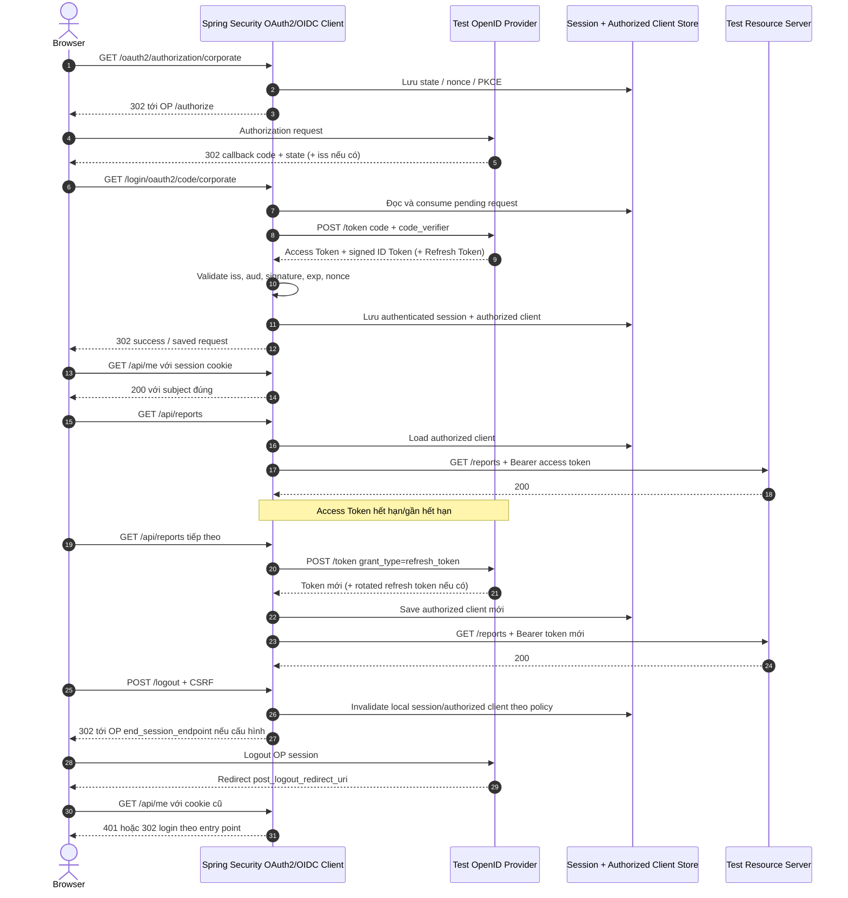
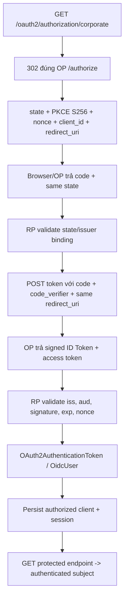
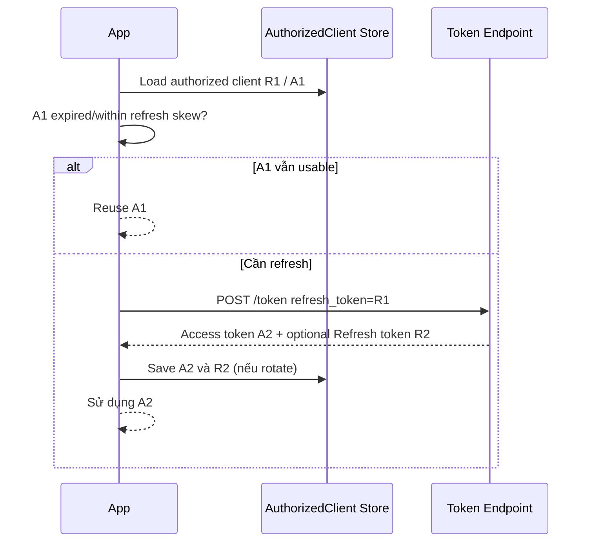
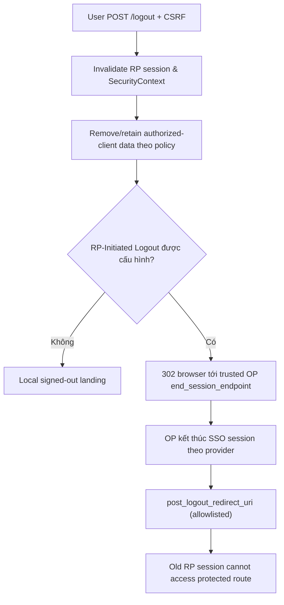

# 33.9. Kiểm thử hồi quy login, refresh, API call và logout

## 1. Vì sao nâng cấp OAuth2/OIDC Client cần một bộ hồi quy xuyên suốt?

Khi nâng Spring Boot, Spring Security, Spring Framework, Java, HTTP client, phiên bản OpenID Provider (OP) hoặc cơ chế lưu session/token, một ứng dụng có thể **khởi động bình thường và vượt qua unit tests** nhưng lại hỏng trong tình huống người dùng thực:

- Người dùng được chuyển đến OP nhưng `redirect_uri` không còn khớp.
- Callback có code nhưng mất `state`, PKCE verifier hoặc OIDC nonce.
- ID Token được OP ký hợp lệ nhưng ứng dụng đọc sai issuer, audience hay claim mapping.
- Login thành công rồi request thứ hai mất `SecurityContext`.
- Access token còn hạn vẫn được dùng; token hết hạn không được refresh hoặc bị refresh lặp lại.
- Refresh token rotation hoạt động ở một pod nhưng hỏng khi hai pods cùng cập nhật.
- `WebClient`/`RestClient` gửi sai token, sai registration hoặc gửi token đến API không được tin.
- Downstream trả `401 invalid_token`, code xử lý lỗi xóa sai authorized client hoặc retry vô hạn.
- Local logout xóa session nhưng browser vẫn được coi là authenticated; hoặc RP-Initiated Logout không chuyển đến đúng OP.
- OP back-channel logout chỉ định một `sid` nhưng ứng dụng xóa nhầm mọi phiên của user/tenant.
- Nâng dependency làm cookie, CSRF, filter order, session serialization hoặc entry point thay đổi.

**Hồi quy không chỉ là kiểm tra lại endpoint `/login`.** Một chu kỳ bảo mật hoàn chỉnh gồm:

```text
Bắt đầu login
    -> authorization callback
    -> ID Token validation
    -> authenticated session
    -> OAuth2AuthorizedClient persistence
    -> API call bằng access token
    -> token expiry và refresh
    -> API call bằng token mới
    -> local/OP logout
    -> xác minh phiên và token không còn được sử dụng sai
```

Mục tiêu của bài là thiết kế bộ test phát hiện **sự thay đổi ngoài ý muốn khi nâng cấp**, đồng thời xác nhận các ranh giới tin cậy vẫn được bảo vệ. Bộ test phải có cả **happy path** và **fail-closed negative cases**, không chỉ vài assertion HTTP `200`.

> **Nguyên tắc chủ đạo:** so sánh **hợp đồng hành vi có thể quan sát** trước và sau nâng cấp; không khóa cứng dữ liệu ngẫu nhiên như `state`, nonce, PKCE verifier, ID Token value hoặc một số chi tiết triển khai nội bộ.

### 1.1. Mục tiêu học tập

Sau bài này, bạn có thể:

1. Xác định phạm vi hồi quy của **login, refresh, API call và logout**.
2. Phân biệt test controller mock với test giao thức OIDC thật.
3. Tạo baseline trước nâng cấp và lập compatibility matrix.
4. Thiết lập test OP, fake Resource Server và kho lưu authorized client/session.
5. Kiểm tra Authorization Code + PKCE S256, `state`, `nonce`, issuer và ID Token audience.
6. Kiểm tra callback, session fixation, cookies và saved-request redirect.
7. Kiểm tra mapping `OidcUser`, authorities, multi-provider và multi-tenant identity.
8. Kiểm tra thời hạn token, refresh threshold, rotating refresh token và concurrency.
9. Xác minh access token được gửi đúng API với audience/scope phù hợp.
10. Kiểm thử downstream `401/403`, authorized-client invalidation và no-token-leak.
11. Phân biệt local logout, RP-Initiated Logout, revocation và back-channel logout.
12. Kiểm tra cookie/CSRF/cross-pod behavior trong rolling upgrades.
13. Dùng MockMvc hoặc WebTestClient đúng phạm vi Servlet/Reactive.
14. Tổ chức CI gates, test fixtures, fault injection và rollout/rollback criteria.
15. Ghi metrics/logs hồi quy không làm lộ code, token hoặc PII.

## 2. Bốn trụ cột của bộ hồi quy

| Trụ cột | Input chính | Kết quả tốt | Lỗi phải bị phát hiện |
| --- | --- | --- | --- |
| **Login** | Browser, authorization code, `state`, PKCE, ID Token | Authenticated `OidcUser`, đúng issuer/subject/authorities/session | Wrong state/nonce/issuer/aud/signature, callback sai, session mất |
| **Refresh** | Authorized client có access token gần hết hạn và refresh token | Token mới được lưu đúng principal/registration; sử dụng theo policy | Không refresh, refresh quá sớm, reuse rotating refresh token, race/mất token |
| **API call** | Access token của authorized client và trusted downstream URL | Bearer token đúng, API xác minh `iss`/`aud`/scope, error handling đúng | ID Token thay access token, sai tenant/audience, token leak, retry lỗi 401 |
| **Logout** | Authenticated RP session, OP session/ID Token tùy flow | Local session chấm dứt; nếu cấu hình OP logout, redirect/notification đúng | Session vẫn truy cập, sai post-logout URI, logout tenant khác, back-channel không xác minh |

Bốn nhóm liên quan nhau nhưng **không hoàn toàn cùng lifecycle**. Ví dụ:

- Local logout **không tự chứng minh** access token đã bị revocation ở OP.
- Refresh token có thể tồn tại dù user không còn RP browser session, tùy storage/policy.
- API `403` do thiếu scope **không có nghĩa** login hoặc refresh thất bại.
- OIDC Login có ID Token; một `client_credentials` workload dùng access token nhưng **không có end-user OIDC session**.
- Browser logout thành công không tự động làm một API đang xử lý request đã xác minh token bị hủy ngay.

Do đó mọi test phải nêu rõ **hợp đồng mình chứng minh**.

## 3. Bản đồ vòng đời và điểm quan sát



Đây là flow minh họa; sau login thành công OP có thể không cấp refresh token, hoặc API call dùng `client_credentials` riêng. Bộ hồi quy phải **được tham số hóa theo grant, provider và sản phẩm**, không giả định mọi registration có refresh.

## 4. Trước khi nâng cấp: ghi baseline hành vi

Một bài học về **tương thích và nâng cấp** không thể chỉ tạo tests sau khi đã đổi dependencies. Trước nâng cấp cần một baseline mô tả contract đang hoạt động và contract mong muốn.

### 4.1. Lưu inventory cấu hình, nhưng không lưu secrets

Một bảng baseline gợi ý:

| Trường | Ví dụ | Tại sao cần |
| --- | --- | --- |
| `appVersion` | `portal-4.x` | Gắn test result với release |
| Java runtime | 21 | Thay đổi HTTP/TLS/provider behavior |
| Spring Boot/Security version | Theo BOM đang chạy | Xác định API/filter behavior |
| Web stack | Servlet hoặc Reactive | Chọn `MockMvc`/`WebTestClient` |
| `registrationId` | `corporate` | Callback/authorized-client key |
| `issuer` | `https://idp.example.test/realms/staff` | OIDC trust binding |
| Public `redirect_uri` | `https://portal.example.test/login/oauth2/code/corporate` | Proxy/registration contract |
| Grant type | `authorization_code` | Token lifecycle |
| PKCE policy | `S256` required | Chống code injection |
| OIDC scope | `openid profile` | ID Token + claims |
| Authorized-client storage | JDBC/Redis/session/in-memory | Migration/persistence |
| Session cookie | `JSESSIONID` hoặc `SESSION` | Callback/logout/cross-pod |
| Resource audience | `reports-api` | API token acceptance |
| Logout mechanism | Local / RP-Initiated / back-channel | Session semantics |
| OP client authentication | `client_secret_basic`, `private_key_jwt`, mTLS... | Token Endpoint compatibility |

Không snapshot `client_secret`, private key, raw ID Token, access/refresh token, PKCE verifier, session cookie hoặc authorization code.

### 4.2. Baseline chứa invariants, không chứa literal ngẫu nhiên

**Đúng:**

```text
Authorization response state equals saved authorization request state.
code_challenge_method is S256.
S256(token_request.code_verifier) equals authorization_request.code_challenge.
ID Token nonce equals nonce sent to OP.
Access token sent to Reports API has approved audience.
After logout, old browser session cannot access protected endpoint.
```

**Sai:**

```text
state must equal "ABCD1234"
OIDC nonce must equal "123456"
ID Token token value must equal a committed JWT string
Session ID must never change after login
```

Mục tiêu regression là khóa đúng **semantics**, không chống lại các cải tiến về randomness/session fixation protection.

## 5. Phân tầng kiểm thử để không nhầm ý nghĩa kết quả

| Tầng | Công cụ | Test được | Không tự test được |
| --- | --- | --- | --- |
| Controller slice | `@WebMvcTest` + `MockMvc`, `@WebFluxTest` + `WebTestClient` | Principal injection, JSON, authorization mapping | Authorization Code/PKCE/JWT cryptography |
| Spring Security integration | App context + SecurityFilterChain/WebFilterChain thật | Filter order, session, callback, token lifecycle với fixtures | Browser/network proxies nếu mock exchange |
| Fake OP integration | WireMock/MockWebServer/test IdP | Code exchange, ID Token signature, refresh, UserInfo, logout URI | Provider production-specific behavior |
| Fake Resource Server | Stub API + signed token validator | Bearer forwarding, audience/scope, 401/403, retries | Hệ thống downstream thật |
| Browser E2E | Browser automation + OP sandbox | Cookies, redirects, SameSite, public URL, logout UX | Tất cả business rules nếu thiếu test data |
| Multi-instance/rolling deployment | 2 app versions + shared storage | Session/token serialization, race, schema migration | Mọi failure mode production |

### 5.1. `oidcLogin()` và `mockOidcLogin()` không phải test login flow

Servlet:

```java
mockMvc.perform(
    get("/api/me").with(oidcLogin()));
```

Reactive:

```java
webTestClient
    .mutateWith(mockOidcLogin())
    .get().uri("/api/me").exchange();
```

Hai helpers đặt sẵn authenticated OIDC principal vào request. Chúng rất tốt cho controller tests, nhưng **bỏ qua** Authorization Request, Token Endpoint, JWKS/ID Token signature, nonce, PKCE và OP redirects.

Bộ hồi quy **login protocol** phải dùng **SecurityFilterChain thực** và test OP/fake OP tạo code/token thật trong phạm vi test. Tương tự, `mockJwt()` không chứng minh Resource Server đã kiểm tra JWT signature/issuer/audience.

### 5.2. Thử nghiệm theo rủi ro

Không nhất thiết biến tất cả test thành browser E2E. Một phân bổ hợp lý:

1. Nhiều unit/controller tests nhanh cho principal, mapping, policy.
2. Integration tests cho từng security contract quan trọng.
3. Ít browser tests có đường đi login → API → refresh → logout.
4. Một số tests rolling upgrade, concurrent refresh và chaos khi release có thay đổi storage/network.

## 6. Thiết kế test environment độc lập với IdP production

Một môi trường tự chứa:

```text
JUnit / Test Framework
    |
    +-- Spring Boot RP test instance
    |     +-- Real SecurityFilterChain / SecurityWebFilterChain
    |     +-- Test ClientRegistrationRepository
    |     +-- Test Session / Authorized Client Store
    |
    +-- Fake OpenID Provider
    |     +-- /.well-known/openid-configuration
    |     +-- /authorize (validate & issue one-time code)
    |     +-- /token (authorization_code & refresh_token)
    |     +-- /jwks (public test signing key)
    |     +-- /userinfo (optional)
    |     +-- /logout (RP-Initiated)
    |     +-- /revoke (optional)
    |
    +-- Fake Reports API
          +-- GET /reports
          +-- signed/opaque access-token validator
          +-- configurable 200 / 401 / 403 / 429 / 503
```

### 6.1. Fake OP phải có trạng thái thật

Một stub luôn trả `200` và token hợp lệ cho mọi request không đủ để chứng minh flow.

Fake OP cần quản lý:

- Authorization code chỉ dùng một lần.
- Code expiry.
- Code binding với `client_id`, exact `redirect_uri`, PKCE challenge.
- OIDC `nonce` từ Authorization Request.
- Signing keys/JWKS và `kid`.
- Refresh token hiện tại, token rotation/expiry/revocation.
- User/OP session và `sid` nếu test logout.
- Provider errors: `invalid_grant`, `invalid_client`, `login_required`, `access_denied`...
- Request counts **theo grant/endpoint** để assert không có replay.

Đối với WireMock/MockWebServer, một số logic là custom dispatcher/test fixture, **không có sẵn tự động** chỉ vì khởi động HTTP stub.

### 6.2. Test keys và data

Dùng:

```text
issuer = https://issuer.example.test
client_id = portal-regression
user subject = test-user-17
API audience = reports-api
email = alice@example.test (tổng hợp)
```

Sinh RSA/EC private key chỉ dành cho tests và cung cấp public JWKS. Không gọi OP production, không dùng real customer account, không commit client secret hoặc refresh token thật.

### 6.3. Đường đi issuer và endpoint

Spring Security có thể tạo registration bằng discovery (`issuer-uri`) hoặc cấu hình tường minh các endpoints. Khi fake OP dùng localhost dynamic port, test cần nhất quán:

- Issuer value mong đợi.
- Discovery `issuer`.
- Authorization/Token/JWKS URLs.
- ID Token `iss`.
- TLS/network trust policy của môi trường test.

Đừng lấy `iss` từ callback/token chưa xác minh để thay đổi Token Endpoint. Không cho fixture “bỏ issuer check” nhằm làm test đơn giản.

### 6.4. Đồng hồ có thể kiểm soát

Refresh tests phụ thuộc `issuedAt`, `expiresAt`, clock skew và provider token expiry. Nên:

- Tiêm `Clock` vào thành phần do ứng dụng tự viết.
- Dùng test token lifetimes đủ xa khi không test boundary.
- Dùng controllable time/clock cho policy riêng.
- Tránh `Thread.sleep(60000)` để đợi token hết hạn.
- Phân biệt Spring Security provider clock skew behavior theo phiên bản.

## 7. Cấu hình Servlet mẫu để xác định contract

Một cấu hình OIDC Login + OAuth2 Client + logout minh họa:

```java
@Configuration
@EnableWebSecurity
class PortalSecurityConfig {

    @Bean
    SecurityFilterChain portalSecurity(
            HttpSecurity http,
            ClientRegistrationRepository registrations)
            throws Exception {

        OidcClientInitiatedLogoutSuccessHandler logoutHandler =
            new OidcClientInitiatedLogoutSuccessHandler(
                registrations);

        logoutHandler.setPostLogoutRedirectUri(
            "{baseUrl}/signed-out");

        return http
            .authorizeHttpRequests(auth -> auth
                .requestMatchers("/", "/signed-out",
                    "/assets/**").permitAll()
                .anyRequest().authenticated())
            .oauth2Login(Customizer.withDefaults())
            .oauth2Client(Customizer.withDefaults())
            .logout(logout -> logout
                .logoutSuccessHandler(logoutHandler))
            .build();
    }
}
```

Đây là ví dụ **Servlet**; project cần các imports Spring Security/Boot tương ứng và provider metadata có `end_session_endpoint` khi muốn RP-Initiated Logout. Nếu OP không hỗ trợ endpoint đó, phải dùng chính sách logout khác; không tự suy diễn URL.

Với callback mặc định:

```text
Start:    /oauth2/authorization/{registrationId}
Callback: /login/oauth2/code/{registrationId}
Logout:   POST /logout (khi CSRF được bật theo cấu hình)
```

### 7.1. Cấu hình registration minh họa

```yaml
spring:
  security:
    oauth2:
      client:
        registration:
          corporate:
            provider: corporate-oidc
            client-id: ${OIDC_CLIENT_ID}
            client-secret: ${OIDC_CLIENT_SECRET}
            authorization-grant-type: authorization_code
            client-authentication-method: client_secret_basic
            scope:
              - openid
              - profile
            redirect-uri: "{baseUrl}/login/oauth2/code/{registrationId}"
        provider:
          corporate-oidc:
            issuer-uri: https://issuer.example.test
```

Trong integration tests dùng test properties trỏ đến test OP; **không** dùng secret production. Nếu cần PKCE cho confidential client, xác nhận resolver/client settings yêu cầu `S256` trong Spring Security version đang chạy và **assert trên Authorization Request thật**.

### 7.2. Reactive tương ứng

```java
@Configuration
@EnableWebFluxSecurity
class ReactivePortalSecurityConfig {

    @Bean
    SecurityWebFilterChain securityWebFilterChain(
            ServerHttpSecurity http) {

        return http
            .authorizeExchange(exchange -> exchange
                .pathMatchers("/", "/signed-out",
                    "/assets/**").permitAll()
                .anyExchange().authenticated())
            .oauth2Login(Customizer.withDefaults())
            .oauth2Client(Customizer.withDefaults())
            .build();
    }
}
```

Muốn RP-Initiated Logout ở WebFlux, dùng `OidcClientInitiatedServerLogoutSuccessHandler` với `ReactiveClientRegistrationRepository` và nối vào `ServerHttpSecurity.logout(...)` theo phiên bản hỗ trợ. Không mang `OidcClientInitiatedLogoutSuccessHandler` của Servlet sang Reactive.

## 8. Login regression: các mốc phải kiểm tra

Một bộ login integration test đầy đủ cần xác nhận:



### 8.1. Assertions ở Authorization Request

Gọi:

```java
MvcResult started = mockMvc.perform(
        get("/oauth2/authorization/corporate")
            .secure(true)
            .scheme("https")
            .serverName("portal.example.test")
            .serverPort(443))
    .andExpect(status().is3xxRedirection())
    .andExpect(header().exists(HttpHeaders.LOCATION))
    .andReturn();

String location =
    started.getResponse().getHeader(HttpHeaders.LOCATION);
```

Từ `Location`, parse query form **đúng một lần**, assert:

```text
Host/path = approved Authorization Endpoint
response_type = code
client_id = expected client ID
redirect_uri = public HTTPS callback đã đăng ký
scope contains openid
state = present, opaque, không rỗng
code_challenge = present
code_challenge_method = S256
nonce = present theo OIDC policy
code_verifier = absent ở front channel
```

Đừng snapshot nguyên `Location` trong logs: nó chứa `state`, `nonce`, challenge và có thể dữ liệu nhạy cảm khác.

### 8.2. Assertions ở callback và Token Request

Giữ `MockHttpSession`/cookie từ initiation. Fake OP phát code đã gắn với challenge. Callback:

```java
MockHttpSession session =
    (MockHttpSession)
        started.getRequest().getSession(false);

mockMvc.perform(
    get("/login/oauth2/code/corporate")
        .session(session)
        .secure(true)
        .scheme("https")
        .serverName("portal.example.test")
        .serverPort(443)
        .param("code", oneTimeCodeFromFakeOp)
        .param("state", stateFromAuthorizationRequest))
    .andExpect(status().is3xxRedirection());
```

Đây là **trích đoạn integration test**, yêu cầu fake OP/fixture/token response được dựng trước. Nó không có `oidcLogin()` — Spring Security phải thật sự thực hiện code exchange.

Fake Token Endpoint recorder kiểm tra:

```text
HTTP POST /token
grant_type = authorization_code
code = oneTimeCodeFromFakeOp
redirect_uri = same exact URI as authorization request
code_verifier = valid RFC7636 string
S256(code_verifier) = observed code_challenge
client authentication = đúng registration
token request count = 1
```

`code_verifier` phải được giữ kín trong logs. Test có thể tính hash trong memory.

### 8.3. OIDC ID Token và session sau login

Fake OP trả ID Token được **ký bằng test private key** và public key tương ứng ở JWKS, chứa:

```json
{
  "iss": "https://issuer.example.test",
  "sub": "test-user-17",
  "aud": "portal-regression",
  "iat": 1780000000,
  "exp": 1780000300,
  "nonce": "NONCE_OBSERVED_BY_TEST_OP"
}
```

`iat`/`exp` ở trên minh họa cấu trúc, **không dùng các timestamps cố định này trong happy-path hiện tại**. Test OP chạy thật nên tạo `iat/exp` tương thích test clock và validity policy. `nonce` phải bằng giá trị **OP thấy trong Authorization Request**; một số Spring Security versions lưu nonce gốc nội bộ nhưng gửi hash của nó tới OP.

Sau token validation:

- SecurityContext có `OAuth2AuthenticationToken`.
- Principal là `OidcUser`.
- `OidcUser.getSubject()` bằng expected subject.
- Issuer được xác minh đúng.
- Authorities/user attribute mapping theo provider policy.
- Authorized client gắn đúng registration ID và principal.
- Browser session tồn tại theo security configuration.
- Subsequent request tới `/api/me` có session cookie đúng → `200`.
- User chưa login hoặc session khác → unauthorized/login redirect.

**Đừng chỉ assert callback trả `302`.** Fail handler và success handler đều có thể redirect.

## 9. Negative login regression: không thể thiếu

| ID | Kịch bản | Kết quả phải giữ sau nâng cấp |
| --- | --- | --- |
| L01 | Thiếu callback `state` | Từ chối trước Token Request |
| L02 | `state` khác pending request | Từ chối; **0 token exchanges** |
| L03 | Callback browser khác không có session | Từ chối |
| L04 | Callback replay sau login | Không tạo authenticated session mới |
| L05 | Authorization code reuse | OP từ chối code dùng lần hai |
| L06 | PKCE verifier sai | OP trả `invalid_grant`, login fail |
| L07 | `code_challenge_method` không phải S256 | Test fail nếu policy yêu cầu S256 |
| L08 | Token Request redirect URI khác | OP từ chối |
| L09 | ID Token chữ ký sai | Login fail closed |
| L10 | ID Token issuer khác | Login fail closed |
| L11 | ID Token audience không có client ID | Login fail closed |
| L12 | ID Token `nonce` thiếu/sai | Login fail khi request đã yêu cầu nonce |
| L13 | ID Token hết hạn | Login fail |
| L14 | ID Token thuật toán ngoài allowlist | Login fail |
| L15 | `azp` không phù hợp khi có nhiều audiences | Theo OIDC policy, không chấp nhận nhầm client |
| L16 | UserInfo `sub` khác ID Token `sub` | Reject UserInfo/OIDC consistency |
| L17 | Authorization response issuer `iss` sai (RFC 9207) | Từ chối trước code exchange nếu cơ chế này áp dụng |
| L18 | OP Token Endpoint timeout sau khi nhận code | Không blind retry code |
| L19 | OP metadata issuer sai | Registration/startup hoặc login fail closed |
| L20 | `JSESSIONID`/`SESSION` cookie bị thiếu | Không tạo session mới từ callback tùy ý |
| L21 | OP hết phiên/MFA dài vượt TTL state | Fail controlled, user restart flow |
| L22 | Provider `access_denied` | Không tạo auth/session, không token request |
| L23 | Multi-provider callback trỏ registration khác | Không exchange code với sai AS |
| L24 | Proxy đổi public scheme/host | Test phát hiện `redirect_uri` lệch |
| L25 | Custom authorities thiếu/sai | Không cấp quyền ngoài policy |

Lỗi cụ thể có thể trả `302 /login?error`, `400`, `401` hoặc exception tùy filter chain/failure handler. **Assert security outcome và số request thật**, không khóa một thông báo provider-specific không ổn định.

## 10. Login regression: user identity, claims và quyền

Một ID Token có:

```json
{
  "iss": "https://issuer.example.test/realms/acme",
  "sub": "user-123",
  "email": "alice@example.test",
  "email_verified": true
}
```

Không có nghĩa:

- `email` là khóa user bất biến.
- User có quyền admin chỉ vì claim tồn tại.
- User có quyền tenant khác cùng domain.
- `sub` của hai issuers là cùng identity.
- Claims ở UserInfo luôn hiện diện trong ID Token.

### 10.1. Invariants

- Identity key thường là `(issuer, subject)` hoặc ID nội bộ ánh xạ có kiểm soát.
- `OAuth2AuthenticationToken.getAuthorizedClientRegistrationId()` phải gắn registration đã chọn.
- `OidcUser.getSubject()` giữ đúng `sub` sau nâng cấp mapper.
- Nếu `getName()` dùng custom name attribute, test khác biệt với subject.
- Authorities đã map theo approved roles/scopes/tenant policy.
- Claim tùy chọn bị thiếu được xử lý đúng, không cấp quyền mặc định.
- Cross-tenant request bị domain authorization từ chối.

### 10.2. Test principal bằng mock chỉ đúng tầng controller

Khi test `@AuthenticationPrincipal OidcUser`, dùng:

```java
mvc.perform(get("/api/me")
        .with(oidcLogin()
            .idToken(t -> t
                .claim("sub", "user-123")
                .claim("iss", "https://issuer.example.test"))))
    .andExpect(status().isOk());
```

Đây là **unit/slice regression** cho principal injection, **không chứng minh** issuer validation của code exchange. Cần thêm happy/negative full-flow tests mục 8–9.

## 11. Session và cookie là một phần login regression

Khi nâng Spring Security/Boot, container Servlet, Spring Session hoặc reverse proxy, một flow có thể qua token exchange thành công nhưng mất session ở request kế tiếp.

### 11.1. Những điều cần kiểm tra

- Cookie name (`JSESSIONID` hoặc `SESSION`) đúng environment.
- `Secure` khi dùng HTTPS.
- `HttpOnly` cho session cookie nếu phù hợp policy.
- `SameSite` tương thích redirect hoặc `form_post` callback mode.
- Domain/path/context path chính xác.
- Session fixation protection và thay đổi session ID theo policy.
- Không giữ authentication trong session cũ sau logout.
- Không lẫn session giữa users/tenants.
- Multi-pod callback tìm đúng pending authorization request.
- Session store có TTL phù hợp MFA/long login và logout invalidation.
- Saved-request redirect không trở thành open redirect.

### 11.2. Test với browser thật khi cần

`MockMvc` có thể giữ một `MockHttpSession`, nhưng không chứng minh:

- Browser thực sự gửi cookie sau cross-site redirect.
- Reverse proxy rewrite `Set-Cookie` đúng.
- TLS termination truyền scheme/public host chính xác.
- Cookie path/SameSite policy trên browser hiện đại.

Những regression này cần browser E2E qua public test hostname/ingress hoặc test environment gần production.

### 11.3. Test session fixation không nên snapshot ID cứng

Nếu login thành công làm session ID đổi, điều đó thường là một security control tốt. Test nên khẳng định:

```text
Prior session cannot be reused for unintended authentication.
Post-login session is associated with correct user.
Session fixation protection behavior matches configured policy.
```

Không buộc session ID sau nâng cấp giống session ID trước nâng cấp.

## 12. Refresh regression: mô hình token lifecycle

Spring OAuth2 Client thường quản lý access/refresh tokens qua:

```text
ClientRegistration
    + principalName
    -> OAuth2AuthorizedClient
          accessToken (issuedAt, expiresAt, scopes)
          refreshToken (nếu OP phát)
```

`OAuth2AuthorizedClientManager` hoặc `ReactiveOAuth2AuthorizedClientManager` có thể thực hiện reauthorization khi token expired hoặc gần expired, tùy configured providers/clock skew.

Một refresh flow:



**Không phải mọi OIDC Login đều có refresh token.** OP có thể yêu cầu `offline_access`, consent hoặc policy riêng để phát nó. Một số client flows chỉ cần login lại; `client_credentials` có thể lấy token mới mà không có refresh token.

### 12.1. Dữ liệu baseline cho refresh

| Trường | Ý nghĩa |
| --- | --- |
| `registrationId` | Token thuộc OAuth2 client nào |
| `principalName` | User/workload đang sở hữu authorized client |
| `issuedAt`/`expiresAt` | Chính sách refresh threshold |
| Access token `scopes` | Quyền được cấp |
| Access token `aud` | Resource được phép gọi |
| Refresh token present? | Có thể dùng refresh grant không |
| Refresh rotation? | OP có đổi R1 → R2 không |
| Store implementation | JDBC/Redis/session/in-memory |
| Failure handler policy | Invalid grant có xóa authorized client không |
| Clock skew | Refresh trước expiry bao lâu |
| Concurrency coordination | Có single-flight/CAS theo token key không |

Không snapshot token values thật; dùng test-generated tokens và ghi **loại thay đổi**.

## 13. Refresh tests: không refresh quá sớm, không dùng token hết hạn

Bộ test tối thiểu:

1. **A1 còn hạn ngoài refresh threshold:** gọi authorized-client manager → dùng lại A1, **0 Token Endpoint requests**.
2. **A1 gần hết hạn:** theo configured clock skew → refresh được kích hoạt nếu có R1.
3. **A1 hết hạn:** không gửi A1 hết hạn đến API.
4. **Refresh thành công:** nhận A2, lưu đúng `issuedAt`, `expiresAt`, scopes và principal.
5. **Refresh rotation:** nếu OP trả R2, store không tiếp tục dùng R1.
6. **OP không trả refresh token mới:** giữ/xử lý refresh token theo contract và Spring Security provider implementation, không tự xóa nhầm.
7. **Refresh invalid_grant:** không retry vô hạn; xóa/invalidate authorized client theo failure handler policy và tái xác thực khi cần.
8. **Network timeout sau OP consume R1:** không blind retry R1 nếu outcome không rõ.
9. **Two users / two registrations:** refresh một bên không ghi đè bên khác.
10. **Concurrent requests:** không dùng cùng rotating refresh token đồng thời nếu sản phẩm yêu cầu single-flight.
11. **Persistence test:** authorized client vừa refresh được load lại đúng từ database/Redis.
12. **Refresh after logout:** tùy policy không dùng lại state đã bị thu hồi hoặc xóa.

### 13.1. Đừng kiểm tra bằng cách đợi hết hạn thật

Sai:

```java
Thread.sleep(60_000);
```

Tốt hơn:

- Tạo test `OAuth2AccessToken` với `expiresAt` phù hợp.
- Tiêm clock vào code tự viết.
- Dùng fake Token Endpoint trả expiry có kiểm soát.
- Xác nhận skew của framework theo phiên bản bằng test integration.

Một thay đổi default skew hoặc custom provider có thể khiến refresh bắt đầu sớm hơn/muộn hơn. Chỉ coi đó là regression nếu **vi phạm contract đã chọn**.

## 14. Test Servlet OAuth2AuthorizedClientManager với refresh

Mã khung cho service/background context:

```java
OAuth2AuthorizedClientProvider provider =
    OAuth2AuthorizedClientProviderBuilder.builder()
        .refreshToken()
        .build();

AuthorizedClientServiceOAuth2AuthorizedClientManager manager =
    new AuthorizedClientServiceOAuth2AuthorizedClientManager(
        registrations,
        authorizedClientService);

manager.setAuthorizedClientProvider(provider);

OAuth2AuthorizeRequest request =
    OAuth2AuthorizeRequest
        .withClientRegistrationId("corporate")
        .principal("user-17")
        .build();

OAuth2AuthorizedClient result = manager.authorize(request);
```

Đây là **đoạn cấu hình/điều khiển**, không phải test class hoàn chỉnh. Test cần tạo `registrations`, authorized client A1/R1 đã lưu, fake Token Endpoint và assertions sau khi gọi.

**Phân biệt manager:** `AuthorizedClientServiceOAuth2AuthorizedClientManager` phù hợp ngoài Servlet request; `DefaultOAuth2AuthorizedClientManager` dùng request-aware repository/context. Không dùng manager service rồi suy ra session browser authorization request đã được kiểm tra.

### 14.1. Test Token Request

Fake OP recorder cần thấy:

```text
POST /token
grant_type=refresh_token
refresh_token=R1
client authentication đúng registration
```

Sau đó:

```text
Response:
    access_token=A2
    refresh_token=R2 (nếu rotation)
```

Assert:

```text
No authorization_code request.
Exactly one refresh grant for this logical refresh.
A2 stored for (corporate, user-17).
R2 stored when returned.
No A1 in subsequent downstream API Authorization header.
No R1 reused after rotation.
```

### 14.2. Refresh invalid_grant

Fake OP:

```http
HTTP/1.1 400 Bad Request
Content-Type: application/json

{"error":"invalid_grant"}
```

Expected phụ thuộc manager/failure handler version:

- Refresh không được coi thành công.
- Không phát ra A2 giả.
- Authorized client hỏng phải được xử lý theo approved invalidation/removal policy.
- User/workload cần reauthorization hoặc token acquisition path mới phù hợp.
- Không retry R1 nhiều lần chỉ để “hy vọng thành công”.
- Có metrics/error nhưng không log refresh token.

Đừng assert rằng mọi phiên bản tự xóa authorized client theo cùng một cách khi app có custom failure handlers; **đo outcome của cấu hình đang dùng**.

## 15. Rotating refresh token và concurrency: ca hồi quy ưu tiên cao

Một luồng race điển hình:

```text
A1 gần hết hạn
  |
  +-- Pod A dùng R1 -> OP phát A2/R2
  |
  +-- Pod B cũng dùng R1 -> OP thấy reuse R1
```

Provider có thể trả `invalid_grant`, revoke token family hoặc có grace period riêng. Cần test theo provider contract.

### 15.1. Regression test concurrency

Given:

```text
One authorized-client key:
    registrationId=corporate
    principalName=user-17
    accessToken=A1 expiring
    refreshToken=R1

N=20 concurrent API calls
```

When: 20 calls cùng cần token mới.

Then, nếu hệ thống thiết kế single-flight:

```text
Exactly one refresh request using R1.
All successful calls use A2.
Store has R2 (if rotation).
No lost updates.
No user/tenant token mixing.
```

Nếu dự án chưa có single-flight, cần đánh dấu đây là **khoảng trống cần xử lý**, không sửa test bằng cách cho fake OP chấp nhận vô hạn request R1.

### 15.2. Cùng JVM và nhiều pods

- `Mono.cache()`/in-memory promise map có thể ngăn duplicate requests **trong một process**, nhưng cần key/TTL/cleanup.
- Multi-pod có thể cần optimistic locking, CAS, distributed coordination hoặc provider-supported rotation model.
- In-memory `OAuth2AuthorizedClientService` không phải persistence strategy cho cross-pod.
- Rolling deployment phải kiểm tra cả phiên bản cũ và mới **đọc/ghi schema cùng store** khi rollout cho phép chạy song song.

### 15.3. Unknown outcome: response mất sau khi OP đã rotate

Test fake OP:

```text
Consume R1.
Generate A2/R2.
Drop connection before response reaches client.
```

Expected:

```text
No automatic blind replay R1.
No cross-user overwrite.
Controlled reauthorization/recovery.
Event categorized as refresh_unknown_outcome.
```

Một retry chung trên `WebClient` có thể gây reuse detection và mất session; phải kiểm tra đúng filter/operator boundary.

## 16. Persistence regression và nâng cấp schema

Một lỗi upgrade nghiêm trọng: authorized client đã lưu trước upgrade không giải mã được hoặc mất refresh token sau upgrade.

### 16.1. Test dữ liệu từ phiên bản trước

Nếu app lưu `OAuth2AuthorizedClient` trong JDBC/Redis/session:

1. Dựng authorized-client record bằng **phiên bản N** và test token R1.
2. Khởi động **phiên bản N+1** trên schema/serializer mà rollout cho phép.
3. Load record bằng repository/service mới.
4. Xác minh `registrationId`, principal name, access token expiry/scopes và refresh token.
5. Kích hoạt refresh, lưu record mới.
6. Nếu có rollback trong chính sách, thử N đọc record sau N+1 ghi.
7. Kiểm tra không làm lộ token qua serialization/logs.

Không commit binary session/token của production. Dùng fixtures được sinh bởi test version trước hoặc một migration harness có kiểm soát.

### 16.2. Nâng Spring Session và cookie

Các phiên bản có thể thay:

- Serialization format.
- Session attribute types.
- TTL/prefix namespace.
- Cookie name/path/SameSite.
- Session fixation handling.
- OIDC session registry/back-channel logout correlation.

Bộ test multi-instance nên bao gồm:

```text
Login started on old pod -> callback on new pod.
Login on new pod -> protected request on old pod.
Refresh on old pod -> read authorized client on new pod.
Logout from new pod -> old pod no longer trusts old session.
```

Chỉ chạy các kịch bản cross-version khi **deployment topology và session format support** cho phép; một số migration cần drain sessions hoặc rolling restart có kiểm soát.

## 17. API call regression: token đúng phải đến đúng resource

Một ứng dụng đã OIDC Login chưa chắc gọi API đúng. Outbound request thường cần access token từ đúng `OAuth2AuthorizedClient`:

```text
OIDC ID Token:
    aud = portal-web
    dùng để xác thực danh tính tại RP

Access Token:
    aud = reports-api
    dùng làm Bearer khi gọi Reports API
```

**Không gửi ID Token tới Resource Server** chỉ vì nó là JWT có `sub`.

### 17.1. Hợp đồng outbound

- URL là fixed/trusted Reports API host.
- HTTP method/path/body đúng version của API.
- Header `Authorization: Bearer ...` chứa **access token**.
- Token thuộc approved registration/client/user.
- Issuer và audience phù hợp Reports API.
- Token còn hạn.
- Scope/roles đáp ứng endpoint.
- Không gắn Authorization vào URL khác sau redirects.
- Không gửi credentials qua HTTP.
- API response được map đúng DTO/error contract.

### 17.2. Servlet WebClient tích hợp authorized-client manager

Ví dụ:

```java
@Bean
WebClient reportsWebClient(
        OAuth2AuthorizedClientManager manager) {

    ServletOAuth2AuthorizedClientExchangeFilterFunction oauth2 =
        new ServletOAuth2AuthorizedClientExchangeFilterFunction(
            manager);

    return WebClient.builder()
        .baseUrl("https://reports-api.example.test")
        .apply(oauth2.oauth2Configuration())
        .build();
}
```

Khi gọi API có thể chỉ định authorized client:

```java
reportsWebClient.get()
    .uri("/reports/me")
    .attributes(
        ServletOAuth2AuthorizedClientExchangeFilterFunction
            .clientRegistrationId("reports-user"))
    .retrieve()
    .bodyToMono(ReportDto.class);
```

Các snippets yêu cầu imports và appropriate authenticated context/manager configuration. **`reports-user` phải tồn tại trong registration catalog**. Không bật `setDefaultOAuth2AuthorizedClient(true)` trên shared client một cách tùy tiện vì nó có thể gắn token vào mọi requests.

### 17.3. Reactive WebClient

WebFlux tương ứng:

```java
@Bean
WebClient reportsWebClient(
        ReactiveOAuth2AuthorizedClientManager manager) {

    ServerOAuth2AuthorizedClientExchangeFilterFunction oauth2 =
        new ServerOAuth2AuthorizedClientExchangeFilterFunction(
            manager);

    return WebClient.builder()
        .baseUrl("https://reports-api.example.test")
        .filter(oauth2)
        .build();
}
```

Request:

```java
return reportsWebClient.get()
    .uri("/reports/me")
    .attributes(
        ServerOAuth2AuthorizedClientExchangeFilterFunction
            .clientRegistrationId("reports-user"))
    .retrieve()
    .bodyToMono(ReportDto.class);
```

Test phải dùng đúng manager và reactive security context. `WebTestClient` là test HTTP client vào WebFlux server; `WebClient` là runtime HTTP client đi ra API — không hoán đổi hai vai trò.

## 18. Kiểm thử API call bằng fake Resource Server

Một API stub có thể ghi nhận:

```text
method = GET
path = /reports/me
Authorization header = Bearer A1
Host = reports-api.example.test
```

Không nên in raw A1 vào CI logs. Assert equality/token identity trong test memory hoặc dùng token alias/hash đã được xử lý an toàn.

### 18.1. Các cases cần có

| Case | Fake API | Expected |
| --- | --- | --- |
| A01 | A1 còn hạn, đúng audience/scope | Một GET; `200` |
| A02 | A1 expired, R1 refresh thành A2 | API nhận A2, không nhận expired A1 |
| A03 | API nhận ID Token thay access token | Test fail, hệ thống phải sửa |
| A04 | Token `aud=billing-api`, gọi Reports | Reports reject |
| A05 | Token `iss` không trusted | Reports reject |
| A06 | Token đúng `aud` nhưng thiếu scope | `403 insufficient_scope` |
| A07 | API trả `401 invalid_token` | Không retry vô hạn; authorized-client failure policy |
| A08 | API trả `403 insufficient_scope` | Không tự làm mới vô hạn để “có thêm quyền” |
| A09 | GET bị 503 transient | Retry bounded chỉ nếu API contract safe |
| A10 | POST side-effecting timeout sau commit | Không replay nếu thiếu idempotency contract |
| A11 | Redirect đến untrusted host | Không chuyển Bearer token |
| A12 | Client registration/tenant sai | Không gọi API hoặc API reject |
| A13 | Multiple downstream services | Mỗi API nhận token có audience phù hợp |
| A14 | API 2xx nhưng JSON contract đổi | Adapter/controller test phát hiện |
| A15 | Logout xong request API mới | Không dùng lại authorized client/session đã invalidated theo policy |

### 18.2. `401 invalid_token` và `403 insufficient_scope`

Resource Server có thể trả:

```http
HTTP/1.1 401 Unauthorized
WWW-Authenticate: Bearer error="invalid_token"
```

hoặc:

```http
HTTP/1.1 403 Forbidden
WWW-Authenticate: Bearer error="insufficient_scope"
```

Đây không phải hai lỗi tương đương:

- `401 invalid_token` có thể báo token không còn được chấp nhận; authorized client có thể phải được xóa/reauthorize **theo policy và handler**.
- `403 insufficient_scope` có thể báo token hợp lệ nhưng không đủ quyền; refresh cùng scopes thường không giúp.
- Một số APIs dùng custom errors; test cần kiểm tra full API contract.

Trong Spring Security các phiên bản có hỗ trợ `RemoveAuthorizedClientOAuth2AuthorizationFailureHandler`, một số outbound integrations có thể xử lý invalid-token responses để remove authorized client khỏi store, cho lần gọi sau thực hiện token acquisition. **Không giả định mọi version/constructor tự cấu hình failure handler giống nhau**; assert explicit chosen behavior.

### 18.3. Không tự replay mọi API request sau 401

Một retry filter chung có thể làm:

```text
POST /payments -> 401
refresh/acquire new token
POST /payments again
```

Nếu POST trước đã tạo side effect ở downstream nhưng response lỗi, có nguy cơ trùng nghiệp vụ. Recovery phải xét **idempotency và response semantics**, không chỉ expired token.

## 19. API response contract cũng cần regression

Với `WebClient.retrieve()` hoặc `RestClient.retrieve()`, nâng thư viện có thể thay:

- Exception type khi HTTP 4xx/5xx.
- Error body decoding.
- Client timeouts.
- Redirect behavior.
- JSON serialization của dates/enums/nullable fields.
- Retry/failure-handler ordering.
- Filter attribute resolution.
- Proxy/TLS defaults.

Test nên assert:

```text
HTTP status preserved or mapped as documented.
Content-Type handled correctly.
Error body does not leak access token.
Upstream timeout propagates bounded failure.
No unbounded retries.
No stale token used after explicit invalidation.
```

Không snapshot toàn bộ stack trace hay framework exception message nếu không phải public API contract.

## 20. Logout regression: ba lớp cần phân biệt

Trong OIDC có các khái niệm:

1. **Local logout** — kết thúc RP session và local authentication.
2. **RP-Initiated Logout** — RP chuyển browser đến OP `end_session_endpoint`.
3. **OP-Initiated Back-Channel Logout** — OP gửi Logout Token đến RP để chấm dứt session tương ứng, nếu hỗ trợ/cấu hình.

Ngoài ra có thể có:

4. **OAuth2 Token Revocation** — gọi `/revoke` để thu hồi access/refresh token theo policy.

Bốn cơ chế có thể được kết hợp nhưng **không phải một thao tác duy nhất**. Đặc biệt, local logout không tự chứng minh OP SSO session đã kết thúc hoặc token đã được revoke.

### 20.1. Hình dung logout contract



**Từ “theo policy” là quan trọng:** `OAuth2AuthorizedClientService` có thể lưu tokens ngoài session. Logout HTTP không tự đảm bảo mọi record trong service được xóa, trừ khi app có cleanup handler/repository semantics tương ứng. Test phải nêu rõ dữ liệu nào phải bị xóa.

## 21. Local logout: các assertions tối thiểu

Với Servlet app dùng browser session và CSRF:

```java
MvcResult loggedOut = mvc.perform(
        post("/logout")
            .session(authenticatedSession)
            .with(csrf()))
    .andExpect(status().is3xxRedirection())
    .andReturn();
```

Nếu app trả `204`/JSON hoặc custom handler thì assert theo contract. `authenticatedSession` phải thực sự đến từ login hoặc test context phù hợp.

Sau đó:

```text
Request với old session cookie:
    /api/me -> 401 hoặc 302 login.
SecurityContext no longer authenticated.
Local session invalidated.
Saved browser session references removed/rotated.
Authorized client state cleared according to application policy.
```

### 21.1. CSRF regression

Với login dựa vào browser session:

```text
POST /logout + CSRF token -> allowed.
POST /logout missing/invalid CSRF -> rejected.
```

Nếu app deliberately customized logout matcher/CSRF, test behavior ấy thay vì giả định mặc định. Không chuyển logout sang `GET` chỉ để test dễ pass; GET logout dễ tạo logout CSRF và các hành vi không mong muốn.

### 21.2. Logout không đồng nghĩa API access token lập tức bất hợp lệ

Một JWT access token đã được phát có thể tiếp tục hợp lệ ở Resource Server đến khi hết hạn, trừ khi có revocation/denylist/introspection/token-binding policy phù hợp. Do đó:

```text
RP session invalidated ≠ all previously issued JWTs invalidated
```

Nếu yêu cầu sản phẩm là **logout lập tức vô hiệu hóa token**, thiết kế phải có cơ chế thực thi và test riêng; không chỉ assert RP session biến mất.

## 22. RP-Initiated Logout: kiểm thử URL và OP behavior

Khi cấu hình `OidcClientInitiatedLogoutSuccessHandler` ở Servlet, handler có thể dùng metadata `end_session_endpoint` của OP và redirect browser.

Ví dụ handler:

```java
OidcClientInitiatedLogoutSuccessHandler handler =
    new OidcClientInitiatedLogoutSuccessHandler(
        clientRegistrationRepository);

handler.setPostLogoutRedirectUri(
    "{baseUrl}/signed-out");
```

Kiểm thử `Location` header sau logout:

```text
scheme/host/path = approved OP end_session_endpoint
id_token_hint = ID Token phù hợp session trước logout (nếu flow/provider dùng)
post_logout_redirect_uri = approved public RP URL
state = opaque, kiểm tra theo implementation/provider contract nếu có
```

Không log full URL vì có thể chứa **ID Token trong `id_token_hint`**. Trường `post_logout_redirect_uri` phải được đăng ký/allowlist tại OP; không mở arbitrary redirect do user input.

### 22.1. Negative cases

- OP metadata thiếu `end_session_endpoint`.
- OP dùng wrong issuer/tenant logout endpoint.
- `post_logout_redirect_uri` không được đăng ký.
- Public URL bị reverse proxy suy ra thành `http://internal-service`.
- ID Token/session không có khi người dùng đã logout local.
- User từ corporate registration bị redirect sang partner OP.
- OP logout page thất bại nhưng local session vẫn phải chấm dứt theo policy.
- `state` logout không đúng nếu ứng dụng có logout correlation mechanism.
- Logout tới OP rồi back to RP không tạo lại authenticated session cũ.

**Không dùng local logout test để kết luận OP-side session chắc chắn đã bị xóa.** OP behavior cần fake OP với session state hoặc sandbox/browser integration test.

## 23. OIDC Back-Channel Logout: hồi quy session correlation

Trong các phiên bản Spring Security Servlet hỗ trợ OIDC back-channel logout, OP có thể gửi một **Logout Token đã ký** tới endpoint tương ứng, thường theo dạng:

```text
POST /logout/connect/back-channel/{registrationId}
```

Ứng dụng liên kết Logout Token với RP sessions bằng provider `sid` hoặc `sub`, tùy trường hợp.

Một Logout Token OIDC có claims như:

```json
{
  "iss": "https://issuer.example.test",
  "aud": "portal-regression",
  "iat": 1780000000,
  "jti": "unique-logout-event",
  "sid": "provider-session-42",
  "events": {
    "http://schemas.openid.net/event/backchannel-logout": {}
  }
}
```

Ví dụ chỉ minh họa cấu trúc; test hợp lệ phải ký và thiết lập `iat` phù hợp test clock. Theo OIDC Back-Channel Logout, không được tự coi một JWT tùy ý là Logout Token.

### 23.1. Các kiểm tra an ninh

- Signature từ trusted OP keys.
- `iss` khớp expected issuer.
- `aud` chứa đúng client ID của RP.
- `iat`/`jti`/events theo specification.
- Có `sid` hoặc `sub` theo contract.
- `nonce` không được xuất hiện trong Logout Token theo đặc tả.
- Reject duplicate/replayed `jti` nếu implementation/policy yêu cầu replay control.
- Không để Logout Token của tenant A kết thúc session tenant B.
- Chỉ logout session tương ứng `sid`; trường hợp `sub` có phạm vi logout được xác định rõ.
- Không xóa mọi sessions vì thấy `sub` trùng mà bỏ issuer/client binding.

### 23.2. Tương thích Spring Session

Nếu app dùng Spring Session, cookie có thể được đặt là `SESSION` thay vì Servlet `JSESSIONID`. Spring Security back-channel logout implementation có thể cần cấu hình tương ứng trong `OidcBackChannelLogoutHandler` và `OidcSessionRegistry`. Đây là điểm dễ hỏng khi nâng Spring Session hoặc migrate từ local session sang Redis.

Test:

```text
Login S1 và S2 cùng user nhưng khác OP sid.
OP back-channel logout sid=S1.
Then S1 is invalidated; S2 remains active.
```

Tùy OP Logout Token chỉ có `sub` thì phạm vi có thể khác. Cần đối chiếu implementation và OIDC protocol. Nếu dự án không hỗ trợ back-channel logout, **không** bật endpoint tùy tiện rồi nới CSRF/signature validation.

### 23.3. Reactive không phải mặc nhiên có cùng DSL/hành vi

WebFlux có OIDC login và RP-Initiated Logout handler riêng, nhưng không nên giả định Servlet back-channel logout classes hoặc registry có thể dùng nguyên xi trong Reactive. Cần kiểm tra feature parity của **Spring Security version cụ thể**, cấu hình có thật và viết tests theo stack đó.

## 24. Token Revocation và logout: tách outcome

Nếu app gọi OAuth2 Revocation Endpoint:

```http
POST /revoke
Content-Type: application/x-www-form-urlencoded

token=FAKE_REFRESH_TOKEN
token_type_hint=refresh_token
```

Kiểm tra:

- Đúng trusted revocation URL.
- Client authentication phù hợp.
- Token value thuộc đúng authorized client/user.
- Local session/authorized client cleanup không phụ thuộc remote revocation timeout quá dài.
- Provider response/error theo RFC 7009 và policy.
- Không log raw refresh token.
- Token đã revoke không được sử dụng trong refresh mới.

**Cẩn thận:** HTTP 200 ở Revocation Endpoint không luôn chứng minh token trước đó đang active — tiêu chuẩn có thể cho success cả token không tồn tại. Test phải xác minh **hệ quả trong fake OP token store** nếu muốn chứng minh token không còn refresh được.

Không claim “remote tokens revoked” khi chỉ test local logout HTTP 302.

## 25. Servlet và Reactive: cùng contract, khác test infrastructure

| Chủ đề | Servlet | WebFlux |
| --- | --- | --- |
| HTTP security | `HttpSecurity` | `ServerHttpSecurity` |
| Filter chain | `SecurityFilterChain` | `SecurityWebFilterChain` |
| HTTP test client | `MockMvc` | `WebTestClient` |
| Security context | `SecurityContextHolder` theo Servlet integration | `ReactiveSecurityContextHolder` / Reactor Context |
| Session | `HttpSession` / Spring Session | `WebSession` / Spring Session |
| Client registration | `ClientRegistrationRepository` | `ReactiveClientRegistrationRepository` |
| Authorized client manager | `OAuth2AuthorizedClientManager` | `ReactiveOAuth2AuthorizedClientManager` |
| Authorized client repo | `OAuth2AuthorizedClientRepository` | `ServerOAuth2AuthorizedClientRepository` |
| Mock OIDC principal | `oidcLogin()` | `mockOidcLogin()` |
| Mock OAuth2 client | Servlet OAuth2 test postprocessors/repos | `mockOAuth2Client()` |
| JWT controller fixture | `jwt()` | `mockJwt()` |
| RP-Initiated Logout | `OidcClientInitiatedLogoutSuccessHandler` | `OidcClientInitiatedServerLogoutSuccessHandler` |

### 25.1. WebFlux integration: giữ cookie/state

Nếu tự tạo WebTestClient:

```java
WebTestClient client = WebTestClient
    .bindToApplicationContext(applicationContext)
    .apply(springSecurity())
    .configureClient()
    .baseUrl("https://portal.example.test")
    .build();
```

Trong **real login integration test**, bắt Authorization Redirect; giữ `SESSION`/cookie từ initiation và gửi lại trong callback. Không dùng:

```java
client.mutateWith(mockOidcLogin())
```

để giả một user đã được đăng nhập, vì nó bỏ qua logic bạn đang muốn kiểm tra.

Trong unit/controller tests, `mockOidcLogin()` **là đúng công cụ**. Hãy đặt test vào đúng tầng.

### 25.2. Đừng `.block()` trong Reactive production code

Khi kiểm thử refresh/API calls, một số JUnit methods có thể dùng `StepVerifier` hoặc `.block(Duration)` để lấy kết quả; điều này thuộc **test thread**. Không vì vậy mà gọi `.block()` trong WebFlux handlers hoặc event-loop processing.

### 25.3. Browser cookie behavior không hoàn toàn được chứng minh bằng mock exchange

Nếu user login/logout qua browser thật, phải kiểm tra SameSite, Secure, context path, forwarded headers và OP cookies trong server-bound/browser test. `WebTestClient` mock exchange không mô phỏng mọi policy của Chrome/Safari.

## 26. Ma trận hồi quy tổng hợp: login

| ID | Test | Điều kiện đạt |
| --- | --- | --- |
| LOGIN-01 | Start login | Redirect đúng OP |
| LOGIN-02 | Client registration | Client ID/issuer/redirect URI đúng |
| LOGIN-03 | PKCE | `S256`, challenge/verifier khớp |
| LOGIN-04 | CSRF state | Khớp và một transaction |
| LOGIN-05 | OIDC nonce | ID Token claim khớp nonce OP thấy |
| LOGIN-06 | ID Token signature | Trusted JWKS key |
| LOGIN-07 | ID Token `iss` | Đúng expected issuer |
| LOGIN-08 | ID Token `aud`/`azp` | Đúng RP client ID/quy tắc OIDC |
| LOGIN-09 | ID Token expired/wrong sig | Fail closed |
| LOGIN-10 | UserInfo `sub` | Khớp ID Token |
| LOGIN-11 | OIDC principal | Issuer/sub/authorities đúng |
| LOGIN-12 | Session persistence | Protected request tiếp theo authenticated |
| LOGIN-13 | Session fixation | Không dùng được session không hợp lệ |
| LOGIN-14 | Saved request | Redirect hợp lệ, không open redirect |
| LOGIN-15 | Error/access_denied | Không tạo session |
| LOGIN-16 | Wrong state/browser | Không có Token Request |
| LOGIN-17 | Code replay | Không authenticate mới |
| LOGIN-18 | Multi-AS issuer mix-up | Không gửi code đến Token Endpoint sai |
| LOGIN-19 | Reverse proxy | Public redirect URI đúng |
| LOGIN-20 | Multi-pod | Callback tìm được state/nonce/PKCE |
| LOGIN-21 | Two issuers same `sub` | Không trộn identity |
| LOGIN-22 | Tenant membership | Không cấp quyền theo claim chưa xác minh |
| LOGIN-23 | Metadata/JWKS rotation | Không chấp nhận token ký key sai |
| LOGIN-24 | Missing optional email | Hành vi DTO/business đúng |

## 27. Ma trận hồi quy tổng hợp: refresh

| ID | Test | Điều kiện đạt |
| --- | --- | --- |
| REF-01 | Access token còn hạn | Không gọi Token Endpoint |
| REF-02 | Access token gần expiry | Refresh đúng threshold/skew |
| REF-03 | Access token expired | Không gửi token expired tới API |
| REF-04 | Refresh request | Đúng grant/client authentication |
| REF-05 | Refresh success | Store A2 đúng principal/registration |
| REF-06 | Rotation R1 → R2 | Không reuse R1 |
| REF-07 | OP không trả R2 | Xử lý theo provider contract |
| REF-08 | `invalid_grant` | No blind retry; failure handler đúng |
| REF-09 | Timeout after R1 consumed | Unknown-outcome recovery |
| REF-10 | No refresh token | Controlled reauthorization |
| REF-11 | Concurrent refresh | Không duplicate R1 nếu single-flight required |
| REF-12 | Two users same registration | Không cross-user overwrite |
| REF-13 | Two registrations same user | Không cross-registration overwrite |
| REF-14 | Multi-tenant issuer | Token không cross-tenant |
| REF-15 | Store persistence | Load token sau restart đúng |
| REF-16 | Cross-version schema | Old/new compatible theo rollout plan |
| REF-17 | Failure after update | Atomic write/CAS policy |
| REF-18 | Refresh after logout | Không dùng unauthorized stale state |
| REF-19 | Token quota/outage | Retry policy không replay rotation |
| REF-20 | Metrics/logs | Không lộ R1/R2/access token |

## 28. Ma trận hồi quy tổng hợp: API call

| ID | Test | Điều kiện đạt |
| --- | --- | --- |
| API-01 | GET Reports A1 hợp lệ | Bearer access token, không ID Token |
| API-02 | Expired A1 → refresh → A2 | API nhận A2 |
| API-03 | Wrong audience | API reject |
| API-04 | Wrong issuer | API reject |
| API-05 | Wrong signature/introspection | API reject |
| API-06 | Missing scope | `403`/policy denial |
| API-07 | `401 invalid_token` | Authorized client failure policy, bounded |
| API-08 | `403 insufficient_scope` | Không refresh loop |
| API-09 | 503/timeout GET | Bounded retries nếu safe |
| API-10 | POST unknown outcome | Không blind replay |
| API-11 | Redirect external host | Không leak Bearer |
| API-12 | Missing authorized client | Controlled acquisition/reauth |
| API-13 | Wrong registration ID | Không gửi token tới API |
| API-14 | Reports/Billing cùng issuer | Audience per resource |
| API-15 | Multi-tenant user | Tenant-bound authorized client |
| API-16 | Access token revoked | Không tiếp tục reuse theo policy |
| API-17 | Token cache valid | Không gọi Token Endpoint mỗi GET |
| API-18 | API JSON schema changed | Adapter test phát hiện |
| API-19 | Error body/headers | Safe mapping, không leak secrets |
| API-20 | API after RP logout | Không dùng session/authorized client trái policy |

## 29. Ma trận hồi quy tổng hợp: logout

| ID | Test | Điều kiện đạt |
| --- | --- | --- |
| OUT-01 | POST logout có CSRF | Local session invalidated |
| OUT-02 | POST thiếu CSRF | Reject nếu CSRF enabled |
| OUT-03 | Old session cookie | Không truy cập protected endpoint |
| OUT-04 | Local-only logout | Không giả định OP SSO logout |
| OUT-05 | RP-Initiated Logout | Redirect trusted OP end_session endpoint |
| OUT-06 | `id_token_hint` | Đúng session/client nếu provider dùng |
| OUT-07 | `post_logout_redirect_uri` | Allowed public URI |
| OUT-08 | Wrong OP/issuer | Không logout tenant khác |
| OUT-09 | OP unavailable | Local cleanup đúng policy |
| OUT-10 | OP logout success | Browser quay về signed-out landing |
| OUT-11 | Remote revocation success | Fake OP token inactive/revoked |
| OUT-12 | Remote revocation error | Không tuyên bố remote success |
| OUT-13 | Back-channel valid Logout Token | Terminate matching RP session |
| OUT-14 | Back-channel wrong sig | Reject |
| OUT-15 | Back-channel wrong issuer/audience | Reject |
| OUT-16 | Back-channel wrong `sid` | Không xóa session khác |
| OUT-17 | Back-channel replay | Không tạo tác dụng phụ/trạng thái sai |
| OUT-18 | Spring Session cookie rename | Session registry correlation đúng |
| OUT-19 | Concurrent logout/refresh | Không giữ token state không hợp lệ |
| OUT-20 | Multiple tabs | Tất cả tabs không truy cập protected resource với session cũ |

## 30. Hồi quy tương thích giữa Spring Security versions

Một nâng cấp có thể thay framework behavior ở nhiều lớp:

| Khu vực | Có thể bị ảnh hưởng | Hợp đồng cần khóa |
| --- | --- | --- |
| Security DSL | `authorizeRequests` → `authorizeHttpRequests`, method deprecations | Routes/permissions vẫn đúng |
| Filter ordering | OAuth2 login/callback/CSRF/logout filters | State/CSRF/callback được xử lý đúng |
| ClientRegistration | Defaults, `issuer-uri`, scopes, redirect URI | Correct provider and endpoints |
| PKCE | Default behavior, custom resolver/client settings | S256 challenge/verifier |
| OIDC validation | JWKS/claims/nonce algorithms | Fail closed khi token sai |
| OIDC principal | Attribute/name/authority mapping | Identity/roles không đổi ngoài ý muốn |
| Authorized client | Repository/service API, failure handlers | Store/load/remove đúng |
| Refresh provider | Clock skew, token refresh policy | Refresh threshold/rotation |
| HTTP client | `RestClient`/`WebClient`, defaults, timeouts | Bearer token đúng host và handler |
| Session | Cookie, serializer, Spring Session | Login persistence/logout |
| CSRF | Default matchers/handlers | Mutating requests vẫn được bảo vệ |
| Logout | End Session handler/back-channel registry | Session/OP semantics |
| Servlet vs Reactive | Types/beans/config | Không trộn security stacks |
| Monitoring | Exception/metric names | Alert/runbook vẫn nhận diện lỗi |

### 30.1. Nâng từ nhánh Servlet API cũ

Khi thay đổi thế hệ framework/Jakarta Servlet, project có thể cần sửa các imports `javax.servlet` → `jakarta.servlet`, security config style và dependencies. Những thay đổi **compile-time** là một vấn đề; regressions về login/session/cookies/tokens là vấn đề riêng và chỉ được chứng minh qua tests.

### 30.2. Spring Boot/Security major versions

Không giả định các APIs như test annotations, `OAuth2ClientHttpRequestInterceptor`, `OidcClientInitiatedLogoutSuccessHandler`, back-channel logout DSL hoặc `ClientRegistration.ClientSettings` có đúng signature ở **mọi** versions. Chọn phiên bản và đối chiếu official API docs; khi nâng major version, test **observable behavior** thay vì cố gắn một extension point cũ vào version mới.

### 30.3. Nâng OP/IdP

Một OP upgrade có thể thay:

- Canonical issuer hoặc realm path.
- Metadata/JWKS URI.
- ID Token algorithms/key rotation.
- Refresh token rotation/grace period.
- Client authentication requirements.
- Scope/consent/claims.
- UserInfo behavior.
- Back-channel/End Session features.
- Rate limits.

Bộ regression cần thêm OP-specific contract tests; đừng chỉ tin app unit tests.

## 31. CI/CD: chạy tests theo thứ tự hợp lý

Một pipeline khuyến nghị:

```mermaid
flowchart LR
    CODE["Change / Dependency Upgrade"] --> UNIT["Unit + Controller Tests"]
    UNIT --> SEC["Security Contract Integration"]
    SEC --> FLOW["Fake OP + API Full-flow Tests"]
    FLOW --> BROWSER["Browser / Sandbox Smoke"]
    BROWSER --> MIGRATE["Session/Token Store Migration Tests"]
    MIGRATE --> CANARY["Canary + Observability"]
    CANARY --> RELEASE["Promote / Rollback decision"]
```



### 31.1. PR gate

Chạy nhanh:

- Controller/user mapping.
- URL authorization rules.
- Refresh expiry boundary unit tests.
- API outbound bearer forwarding.
- Logout CSRF/session invalidation.
- Một số fake OP login/refresh failures.

### 31.2. Merge/nightly gate

Chạy thêm:

- Full fake OP signed ID Token/JWKS.
- Refresh rotation/concurrency.
- API `401/403` error handling.
- RP-Initiated Logout và back-channel tests nếu có.
- Session serialization compatibility.
- Cross-tenant and multi-provider matrix.
- Fault injection 429/503/timeouts.
- Browser sandbox happy path.

### 31.3. Release/upgrade gate

Với nâng major framework hoặc IDP:

- Current version baseline vs candidate version.
- Rolling upgrade A/B session/token persistence.
- Canary login success rate và callback failure categories.
- Refresh `invalid_grant`/token reuse metrics.
- API `401/403` rates và authorized-client removal.
- Logout local/OP completion rates.
- Rollback/feature flag/restart strategy đã chuẩn bị.

**Không** đợi đến production mới phát hiện Spring Session serializer không đọc được record cũ.

## 32. Gating dựa trên security invariants, không chỉ HTTP status

Một test `login -> 302` có thể pass ngay cả khi flow đi tới failure handler. Một test `logout -> 200` có thể pass trong khi cookie cũ vẫn có quyền. Cần assertions nhiều điểm.

### 32.1. Một test tổng hợp nên có các checkpoints

```text
1. Authorization initiation
   -> correct OP, state, PKCE, nonce.

2. Callback and Token Exchange
   -> one-time code, correct verifier, signed ID Token verified.

3. Authenticated Session
   -> OidcUser subject/issuer/registration correct.

4. Initial API Call
   -> correct bearer access token and audience.

5. Token Expiry / Refresh
   -> one refresh, save new access/refresh tokens.

6. API Call After Refresh
   -> uses new access token, does not reuse expired token.

7. Logout
   -> local session invalidated;
      remote logout/revocation separately verified if configured.

8. Post-Logout
   -> old session cannot call protected endpoint.
```

Một regression suite tốt cũng có **negative test độc lập cho từng checkpoint** thay vì chỉ một happy-path test dài, vì khi một step fail, những steps sau không chạy và lỗi khó định vị.

## 33. Fixtures và fault injection không gây rò credential

Các dữ liệu nhạy cảm xuất hiện trong integration flow:

```text
authorization code
state
PKCE code_verifier
OIDC nonce
client secret
ID Token
access token
refresh token
session cookie
id_token_hint
```

Không in chúng trong:

- HTTP wire logs.
- CI build artifacts.
- Exception response bodies.
- Screenshots/browser HAR công khai.
- Metrics labels.
- Source control fixtures chứa data production.

### 33.1. Telemetry đề xuất

```text
event=oidc_regression_login
registrationId=corporate
stage=id_token_validation
outcome=passed

event=oauth2_regression_refresh
registrationId=corporate
grant=refresh_token
rotated=true
attempts=1

event=oauth2_regression_api_call
downstream=reports
tokenSource=authorized_client
httpStatus=200

event=oidc_regression_logout
mechanism=rp_initiated
localSessionInvalidated=true
remoteResult=confirmed_by_test_op
```

Đây là **event names minh họa**, không phải Spring Security mặc định. Các labels dùng **alias ổn định**, tránh raw tokens và arbitrary tenant IDs gây high cardinality.

### 33.2. Fault injection có mục đích

| Inject | Điều cần xác minh |
| --- | --- |
| Drop Token Endpoint response sau code consumed | Không replay authorization code |
| Drop refresh response sau R1 consumed | Không reuse rotating R1 |
| JWKS trả key sai | Chữ ký ID Token bị từ chối |
| Wrong issuer metadata | Không tin metadata sai |
| API `401 invalid_token` | Bounded recovery |
| API `403 insufficient_scope` | Không tự xin quyền không được phép |
| UserInfo timeout | Fail closed/degrade theo claim criticality |
| Logout OP `503` | Local session cleanup vẫn đúng |
| Back-channel Logout Token sai chữ ký | Không ảnh hưởng session |
| Cross-tenant `sid` | Không logout tenant khác |
| Shared session Redis unavailable | Fail closed, không chế tạo state |
| Two pods refresh đồng thời | Không gây reuse/lost update |

## 34. Phân biệt hồi quy thật và thay đổi được phê duyệt

Sau nâng cấp, có những thay đổi là **đúng** và nên cập nhật contract/test:

- Thêm PKCE S256 làm Authorization Request có thêm parameters.
- Tăng kiểm tra ID Token nonce/issuer.
- Bật CSRF cho logout POST trước đây thiếu.
- Không còn cho GET logout mặc định.
- Không tiếp tục chấp nhận JWT sai audience.
- Rotate session ID sau login.
- Dừng tự động forward bearer token sang mọi URL.
- Thay đổi failure handler để remove invalid authorized client an toàn.

Nếu test cũ mong hành vi **yếu bảo mật**, không sửa production để giữ test xanh. Cần:

1. Ghi nhận thay đổi bảo mật.
2. Thống nhất expected behavior mới.
3. Cập nhật test contract có lý do.
4. Bổ sung negative case chứng minh fail-closed.
5. Đánh giá tác động migration đối với sessions/tokens và UX.

Regression suite là **công cụ bảo vệ hành vi đã phê duyệt**, không phải cách đóng băng mọi lỗi lịch sử.

## 35. Một runbook khi suite thất bại

### 35.1. Nhận diện test stage

```text
Authentication initiation?
Authorization callback?
Token exchange?
ID Token/JWKS validation?
Session/persistence?
Authorized client refresh?
Outbound API call?
Logout local?
Logout at OP?
Back-channel notification?
```

### 35.2. Các nguyên nhân thường gặp

| Triệu chứng | Bước kiểm tra |
| --- | --- |
| Authorization `Location` sai host | Proxy headers, `{baseUrl}`, redirect-uri |
| `invalid_grant` ở code exchange | Code reuse/expiry, PKCE, redirect URI, client binding |
| Callback state missing | Session cookie, repository, cross-pod, TTL |
| ID Token issuer/audience mismatch | ClientRegistration/metadata/test OP claims |
| JWKS fail sau key rotation | `kid`, trusted keys, decoder cache |
| Login pass nhưng `/api/me` anonymous | SecurityContext persistence/session cookie |
| User có wrong role sau upgrade | GrantedAuthorities mapper, UserInfo, scopes |
| Refresh không chạy | Expiry/skew, configured provider, repository |
| Refresh liên tiếp | Expiry calculation, token store update, concurrency |
| Refresh `invalid_grant` tăng | Rotation/reuse, stale store, provider policy |
| API bearer không có | WebClient filter/RestClient interceptor, selected registration |
| API 401 | Token issuer/audience/expiry/signature/revocation |
| API 403 | Scope/roles/domain permission |
| Wrong downstream host nhận token | Shared client defaults, redirects, SSRF |
| Logout local không xóa session | Logout matcher, CSRF, session repo, handlers |
| Logout chỉ tới local page, không tới OP | `end_session_endpoint`, logout success handler |
| Back-channel không chấm dứt session | Logout Token validation, registry, cookie name |
| Old/new pods đọc session lỗi | Serialization/schema migration |
| Browser E2E fail nhưng MockMvc pass | Cookies, SameSite, TLS, proxy/real redirects |

### 35.3. Chọn rollback hay fix forward

Cân nhắc **ngăn rollout/rollback** khi:

- `state`, PKCE, nonce, issuer/audience hoặc signature validation không còn bảo đảm.
- Session/logout sai user/tenant.
- Access/refresh token bị lộ hoặc gửi sang host không tin.
- Refresh token rotation bị race gây reuse/revoke hàng loạt.
- Authorized-client storage hỏng/mất dữ liệu.
- API authorization cấp quyền vượt policy.

Với lỗi UX không nghiêm trọng (ví dụ avatar thiếu) có thể cân nhắc fix forward, nhưng vẫn cần security boundary nguyên vẹn. Quyết định phụ thuộc incident/release policy của hệ thống.

## 36. Bài tập thực hành

### Bài A — Login regression từ redirect đến session

Dùng fake OP với Authorization/Token/JWKS endpoints và RSA signed ID Token. Kiểm tra:

```text
Correct redirect URI
State bound to session
PKCE S256 verifier matches challenge
OIDC nonce matches
ID Token signature/iss/aud/exp valid
Subsequent /api/me returns correct subject
```

Thêm wrong-state và wrong-nonce tests, assert không tạo authenticated session.

### Bài B — Refresh rotation

Seed `OAuth2AuthorizedClient` A1/R1 đã hết hạn. Fake OP nhận R1 và trả A2/R2. Assert:

```text
One refresh POST.
New authorized-client record contains A2/R2.
Next API call sends A2.
Later refresh does not reuse R1.
```

Thử timeout sau R1 consumed và xác minh không blind retry.

### Bài C — API call theo audience

Tạo Reports API và Billing API. RP gọi Reports với token chỉ dành Reports. Thử gửi token Billing vào Reports:

```text
Reports rejects token.
RP does not bypass audience validation.
Bearer token not logged.
```

### Bài D — `401` và `403`

API trả lần lượt `401 invalid_token` và `403 insufficient_scope`. Assert failure handling theo version/config, không tạo refresh/retry loop và không cấp quyền mới chỉ để test pass.

### Bài E — Local + RP-Initiated Logout

Login thành công, POST `/logout` với CSRF. Assert old RP session invalid, `Location` trỏ đúng OP `end_session_endpoint`, có approved `post_logout_redirect_uri`, và OP sandbox nhận logout. Không log `id_token_hint`.

### Bài F — Back-channel logout

Tạo hai sessions cùng user khác `sid`. Gửi signed Logout Token cho `sid` thứ nhất. Assert chỉ session tương ứng bị vô hiệu; signed token sai issuer/audience/chữ ký không xóa session.

### Bài G — Rolling upgrade

Khởi tạo login/authorized client trong phiên bản N, đọc và refresh trong N+1; ngược lại nếu rollback policy yêu cầu. Kiểm tra session serialization và token store schema khi hai versions chạy song song.

### Bài H — Reactive

Thực hiện login/API/refresh/logout trên WebFlux bằng `SecurityWebFilterChain`, WebTestClient và fake OP. Giữ WebSession cookie đúng. Không dùng `mockOidcLogin()` làm bằng chứng code exchange.

## 37. Câu hỏi ôn tập

**1. Vì sao hồi quy login phải đi qua callback và Token Endpoint?**  
Vì controller mock OIDC principal không kiểm tra `state`, PKCE, issuer, nonce hoặc JWT validation thật.

**2. Hợp đồng PKCE cần test gì?**  
Authorization Request có `S256` challenge; Token Request có verifier tương ứng; OP từ chối verifier sai.

**3. OIDC nonce trong ID Token phải bằng giá trị nào?**  
Giá trị nonce OP nhận từ Authorization Request; RP xác minh nó với transaction đã lưu.

**4. Callback `state` sai nên có bao nhiêu Token Endpoint requests?**  
Bằng 0 khi RP từ chối trước token exchange.

**5. ID Token đúng chữ ký nhưng `aud` là client khác có hợp lệ không?**  
Không. OIDC RP phải là intended audience.

**6. Vì sao test 302 sau callback chưa đủ?**  
Cả success và failure handlers có thể redirect; phải kiểm tra authenticated session và identity.

**7. Refresh token có luôn tồn tại sau OIDC Login không?**  
Không. Phụ thuộc scope, provider policy, consent và grant.

**8. A1 còn hạn thì test refresh expected gì?**  
Tùy skew, thường không cần Token Endpoint nếu A1 vẫn usable.

**9. Refresh rotation R1 → R2 cần xác minh gì?**  
Store cập nhật R2 và không reuse R1.

**10. Vì sao timeout khi refresh nguy hiểm?**  
OP có thể đã consume R1 nhưng client mất response; retry R1 có thể bị coi là replay.

**11. Trong multi-pod, in-memory single-flight có đủ không?**  
Không chắc. Cần phối hợp cross-pod hoặc storage-level CAS theo thiết kế.

**12. `OAuth2AuthorizedClientManager` có đảm bảo mọi refresh concurrency an toàn không?**  
Không mặc định cho mọi storage/topology; phải test theo phiên bản và implementation.

**13. API downstream nhận ID Token hay access token?**  
Access token dành cho API, không phải ID Token dành cho RP.

**14. `401 invalid_token` có giống `403 insufficient_scope` không?**  
Không. Một bên token không được chấp nhận, một bên thường là thiếu quyền.

**15. Vì sao không retry mọi API POST sau 401?**  
Có thể gây side effects trùng nếu operation không idempotent.

**16. Bật default authorized client trên mọi WebClient requests có rủi ro gì?**  
Có thể làm token bị gắn vào host/resource không được phê duyệt.

**17. Local logout có chắc token revoked tại OP không?**  
Không. Revocation cần workflow/policy riêng.

**18. Local logout có chắc OP SSO cookie bị xóa không?**  
Không. Cần RP-Initiated/OP logout behavior và verification.

**19. `post_logout_redirect_uri` có phải OAuth login `redirect_uri` không?**  
Không. Chúng phục vụ hai vòng đời khác nhau.

**20. Test logout CSRF nên gồm gì?**  
POST đúng CSRF cho phép; POST thiếu/sai CSRF bị từ chối nếu policy enabled.

**21. Back-channel Logout Token cần những kiểm tra nào?**  
Chữ ký, issuer, audience, issued time, event, sid/sub và replay/session policy.

**22. `sid` trong back-channel logout hữu ích ở đâu?**  
Chỉ định provider session, cho phép chấm dứt RP session tương ứng mà không xóa mọi session user.

**23. Vì sao Spring Session có thể làm back-channel logout hỏng?**  
Cookie name, session registry và serialization có thể đổi; cần kiểm tra correlation.

**24. Vì sao cần old/new version tests trước rolling upgrade?**  
Để phát hiện không tương thích session/authorized-client persistence và race giữa pods.

**25. Test nào phát hiện SameSite cookie hỏng?**  
Browser E2E qua real redirects/HTTPS/proxy; mock exchange thường không đủ.

**26. Vì sao không snapshot `state`/nonce?**  
Chúng ngẫu nhiên theo transaction; cần assert properties/binding, không giá trị cứng.

**27. Khi nào mock OIDC principal là đúng?**  
Khi test controller/authorization mapping, không phải full login protocol.

**28. Vì sao cần kiểm tra token đi đúng API host?**  
Để ngăn bearer token leakage/SSRF/cross-resource misuse.

**29. Nếu test cũ yêu cầu behavior yếu bảo mật thì có nên giữ nó?**  
Không. Cập nhật contract được phê duyệt và bổ sung negative regression tests.

**30. Kết quả quan trọng nhất của bộ hồi quy là gì?**  
Login đúng danh tính, refresh đúng lifecycle, API dùng đúng token và logout chấm dứt đúng phiên — kể cả khi gặp lỗi, **không phá trust boundary**.

## 38. Checklist trước khi chấp thuận nâng cấp

### 38.1. Login

- [ ] Authorization redirect đúng OP/client/redirect URI.
- [ ] `state` gắn session và không bị replay.
- [ ] PKCE S256 được sinh, verifier khớp challenge.
- [ ] OIDC nonce được đối chiếu với ID Token.
- [ ] ID Token signature/issuer/audience/expiry/`azp` đúng.
- [ ] JWKS rotation/unknown `kid` fail closed.
- [ ] OidcUser/authorities/tenant mapping đúng.
- [ ] Session/saved-request/CSRF/browser cookies còn hoạt động.
- [ ] Multi-provider/response issuer không gây AS mix-up.
- [ ] Không tạo session cho failed login.

### 38.2. Refresh

- [ ] Token còn hạn không bị refresh vô ích.
- [ ] Expiry/skew triggers đúng.
- [ ] Refresh request dùng đúng registration/principal.
- [ ] A2/R2 được lưu chính xác; R1 không reuse sau rotation.
- [ ] `invalid_grant` và unknown outcome fail closed.
- [ ] Concurrent refresh không làm lost updates.
- [ ] Authorized-client persistence tương thích rollout.
- [ ] Không cross-user/cross-tenant token state.

### 38.3. API

- [ ] Sử dụng access token thay vì ID Token.
- [ ] Token có issuer/audience/scope phù hợp API.
- [ ] Downstream trusted host cố định, không leak Bearer.
- [ ] 401/403 được xử lý khác nhau.
- [ ] Refresh không tạo retry loop.
- [ ] GET retry bounded; side-effecting POST không blind replay.
- [ ] API DTO/error contract tương thích.
- [ ] No expired token after refresh.

### 38.4. Logout và CI

- [ ] Local session bị invalidated.
- [ ] CSRF logout policy đúng.
- [ ] RP-Initiated Logout URL, hint, redirect URI đúng.
- [ ] Remote revocation được kiểm chứng riêng nếu áp dụng.
- [ ] Back-channel logout validate Logout Token và target `sid`/`sub` nếu hỗ trợ.
- [ ] Cookie/session registry không lỗi qua Spring Session migration.
- [ ] Browser E2E kiểm tra public HTTPS redirects.
- [ ] Canary theo dõi login/refresh/API/logout failures.
- [ ] Có rollback strategy và test artifacts chứa dữ liệu tổng hợp.
- [ ] Không có raw code/token/verifier/secret/session cookie trong logs.

## 39. Tài liệu tham khảo

### Chuẩn OAuth2/OIDC

- [RFC 6749 — OAuth 2.0 Authorization Framework](https://www.rfc-editor.org/rfc/rfc6749)
- [RFC 7636 — PKCE](https://www.rfc-editor.org/rfc/rfc7636)
- [RFC 9700 — OAuth 2.0 Security Best Current Practice](https://www.rfc-editor.org/rfc/rfc9700)
- [RFC 9207 — Authorization Server Issuer Identification](https://www.rfc-editor.org/rfc/rfc9207)
- [RFC 7009 — Token Revocation](https://www.rfc-editor.org/rfc/rfc7009)
- [RFC 6750 — Bearer Token Usage](https://www.rfc-editor.org/rfc/rfc6750)
- [RFC 7662 — Token Introspection](https://www.rfc-editor.org/rfc/rfc7662)
- [RFC 9068 — JWT Profile for Access Tokens](https://www.rfc-editor.org/rfc/rfc9068)
- [OpenID Connect Core 1.0](https://openid.net/specs/openid-connect-core-1_0.html)
- [OpenID Connect Discovery 1.0](https://openid.net/specs/openid-connect-discovery-1_0.html)
- [OpenID Connect RP-Initiated Logout 1.0](https://openid.net/specs/openid-connect-rpinitiated-1_0.html)
- [OpenID Connect Back-Channel Logout 1.0](https://openid.net/specs/openid-connect-backchannel-1_0.html)

### Spring Security/Spring Framework

- [Spring Security — Servlet OAuth2 Login](https://docs.spring.io/spring-security/reference/servlet/oauth2/login/index.html)
- [Spring Security — Servlet OIDC Logout](https://docs.spring.io/spring-security/reference/servlet/oauth2/login/logout.html)
- [Spring Security — Servlet OAuth2 Client](https://docs.spring.io/spring-security/reference/servlet/oauth2/client/index.html)
- [Spring Security — Servlet Authorized Client Features](https://docs.spring.io/spring-security/reference/servlet/oauth2/client/authorized-clients.html)
- [Spring Security — Servlet OAuth2 MockMvc Tests](https://docs.spring.io/spring-security/reference/servlet/test/mockmvc/oauth2.html)
- [Spring Security — Reactive OAuth2 Login](https://docs.spring.io/spring-security/reference/reactive/oauth2/login/index.html)
- [Spring Security — Reactive OAuth2 Client](https://docs.spring.io/spring-security/reference/reactive/oauth2/client/index.html)
- [Spring Security — Reactive Authorized Client Features](https://docs.spring.io/spring-security/reference/reactive/oauth2/client/authorized-clients.html)
- [Spring Security — Reactive OAuth2 WebTestClient Tests](https://docs.spring.io/spring-security/reference/reactive/test/web/oauth2.html)
- [Spring Security — API OidcClientInitiatedServerLogoutSuccessHandler](https://docs.spring.io/spring-security/reference/api/java/org/springframework/security/oauth2/client/oidc/web/server/logout/OidcClientInitiatedServerLogoutSuccessHandler.html)
- [Spring Framework — MockMvc](https://docs.spring.io/spring-framework/reference/testing/spring-mvc-test-framework.html)
- [Spring Framework — WebTestClient](https://docs.spring.io/spring-framework/reference/testing/webtestclient.html)
- [Spring Boot — Testing Applications](https://docs.spring.io/spring-boot/reference/testing/spring-boot-applications.html)
- [Spring Session Reference](https://docs.spring.io/spring-session/reference/index.html)

**Ghi nhớ:** Khi nâng Spring Boot/Spring Security hoặc OP, đừng chỉ kiểm tra ứng dụng khởi động và login page hiện ra. Bộ hồi quy phải chứng minh **login có state/PKCE/nonce, chữ ký/issuer/audience đúng và session được tạo**; **refresh dùng đúng grant, không reuse rotating token và lưu authorized client đúng người dùng**; **API call dùng access token dành đúng resource, xử lý 401/403 không retry hoặc rò token**; **logout chấm dứt local session, điều phối OP logout và revocation/back-channel theo cấu hình thực tế**. Khóa những contract có thể quan sát bằng fake OP, fake API, Servlet/Reactive integration tests, browser E2E và rolling-upgrade tests; các mock principal chỉ phục vụ tầng controller. Trong mọi failure path, hệ thống phải **fail closed và giữ đúng trust boundaries**.
